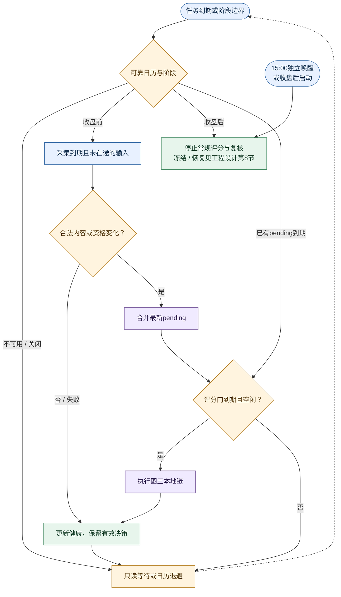
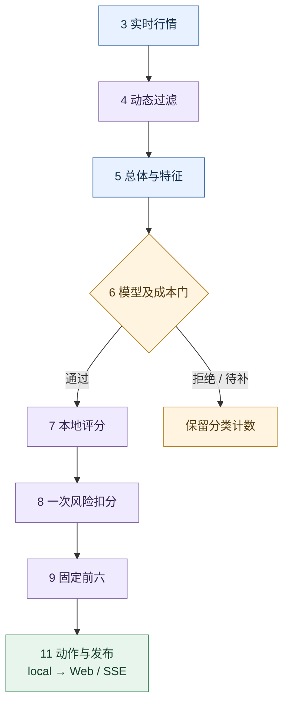
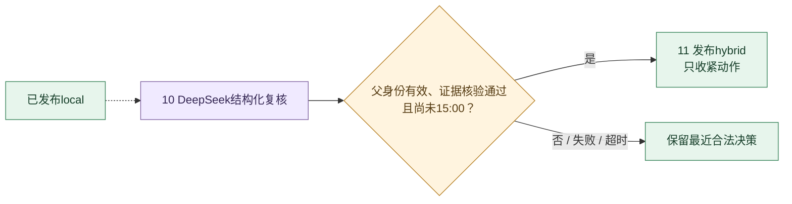
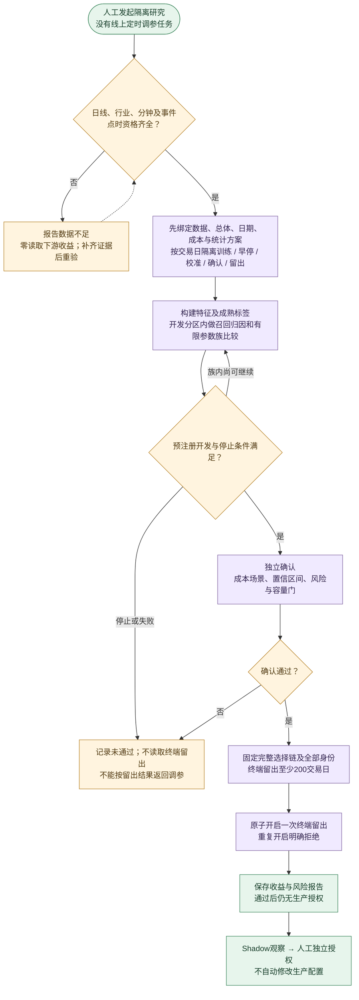

# 荐股评分逻辑

本文是候选、过滤、因子、评分、风险、排名及收益准入的唯一权威。
架构和Web见[工程设计](2_工程设计.md)，数据维护及训练见[下载训练](4_下载训练.md)，交付状态见[工程实施](3_工程实施.md)。

## 1. 目标、范围与当前结论

程序回答两个研究问题：哪些股票值得研究，以及支持这个判断的数据是否可信。分数不是上涨概率，也不是收益保证。

| 名称 | 研究目标 | 模型是否改变最终分 |
| --- | --- | --- |
| Tomorrow | 下一交易日T+1的机会与风险 | 否；只给预测诊断和成本净效用门 |
| D25 | 未来第 2 至第 5 个交易日区间内具备上涨能力的股票 | 否；使用自己的单一2–5日模型头 |
| Long | 固定研究池的当前行情 | 不评分、不排名、不冻结 |

V2/V3是两套模型档位，不是两种持有期。每档都有Tomorrow和D25两个独立模型头。
默认V2来自用户选择，不表示其收益已通过验证；V3也没有自动晋级权限。

全新V1另提供工程Shadow档位，与退役V1无关；它用模型排序分确定六席，只允许关注或回避，不写正式冻结和推荐业绩。下文生产最终分合同仍适用于V2/V3；V1的独立分数与动作语义见第6.4节。

第2–8节默认描述收盘前常规新决策；已有正式记录只读恢复及收盘补建的明确例外集中在第9节。local表示尚未经过DeepSeek升级，不代表常规链可以绕过模型门。

全文用以下标签区分事实：

| 标签 | 含义 |
| --- | --- |
| 当前 | 现有代码、配置实际采用的规则 |
| 目标，待实现 | 用户已确认方向，但仍须后续代码切换和验证 |
| 研究，未生效 | 需要样本外证据，不能直接修改生产参数 |

## 2. 端到端荐股链路

### 2.1 十一层业务流程：启动、循环与发布

十一层选择链已切换，启动复用与评分节流见工程实施阶段215。第1、2层在启动时执行一次，在线轮次从第3层开始；十一层审计仍展示完整输入来源，层号不代表11个独立定时器。

以下四图分别表达启动、循环、本地决策及异步复核，不把所有返回路径挤在一张图中。蓝色为输入，紫色为计算，绿色为交付，橙色为条件或降级；实线为控制/数据流，虚线为复用或异步交接。精确字段、窗口和间隔由后文表格及工程设计拥有。

**图一：启动与交接。** 第1、2层每个资料与过滤身份只执行一次；结果及原始计数常驻内存，维护后正常重启加载新内容。

**图二：在线调度循环。** 同策略最多一个在途及一个最新pending；任务到期与输入合法变化分别判断。日历不可用按工程设计退避；盘前或非交易日只读等待，不补跑漏点。15:00由独立控制任务封口，长评分不能延迟冻结。

**图三：收盘前本地选择链。** 复用图一第1、2层，在线从第3层进入；模型门前固定市场、板块、行业及成本参考。第11层先交付local，不等待图四。收盘补建采用第9节的独立例外，不冒充通过模型门。

**图四：可选异步复核。** 只复核固定六席内的合格对象；关闭、预算不足或不满足请求条件时保留local。图三下一轮不等待此图完成，复核不能改分、重排或补位。

全市场、合格总体、前六席报价overlay及Long统一按10秒调度；09:15至15:00（含午间）输入变化后按10秒门触发荐股，15:00独立封口。行业热度及分钟输入保留原采集窗口和60/120秒、3/5秒频率，不改变荐股节奏。DeepSeek由合法local决策及证据变化触发，15:00停止新增请求及结果升级，物理请求仍受每日168次全局上限约束。
10秒是评分触发下限，不是整条链10秒内完成的保证。若计算超过10秒，运行中的任务不并发重开，只保留最新待处理输入；完成后处理已到期的最新任务，不额外再睡10秒，也不补跑积压轮次。15:00冻结按独立控制点执行，不等待慢评分或复核。
具体时段和间隔统一见[工程设计第5节](2_工程设计.md#5-交易日与时间线)及[第6.2节](2_工程设计.md#62-当前刷新节奏)，冻结及迟到恢复见其[第8节](2_工程设计.md#8-发布冻结与持久化)。

| 层 | 职责与输出 |
| --- | --- |
| 1 本地资料加载 | 启动读取本地资料并标准化；后续只复用，来源年龄继续增长 |
| 2 静态资格过滤 | 启动按永久事实和配置黑名单计算合格总体，后续复用同一集合及计数 |
| 3 实时行情 | 获取同轮报价并校验来源、时间及字段 |
| 4 动态过滤 | 按新行情ST、停牌、流动性、当前价格和公司事实当前有效性过滤 |
| 5 市场总体与特征 | 固定同轮市场、板块、行业总体，形成模型及评分特征 |
| 6 模型过滤 | 预测诊断及成本净效用门；模型不参与最终数值评分 |
| 7 本地评分 | 对通过模型门且输入合格的股票计算本地证据分，应用质量缺失扣分 |
| 8 风险扣分 | 独立计算并扣除一次本地风险，得到local_score |
| 9 固定评分前六 | 按local_score统一排名及既定板块约束固定六席，同分按代码升序，后续不以第七名补位 |
| 10 可选DeepSeek复核 | 只复核固定六席，核验证据后可作结构化风险否决 |
| 11 动作与发布 | 决定动作、发布快照，并遵守15:00冻结合同 |

1. 启动只固定不随轮次变化的资格；未来生效的永久事实、公司风险有效窗口、证据年龄及覆盖截止在运行时继续检查。新资料手动维护后重启加载，静态缓存不表示风险永久有效。
2. 每个策略对通过模型门且输入合格的股票完成本地评分及风险扣分，直接统一选择总前六；不保留独立候选分、50分预选线或每板120只截断。
3. 模型所需的市场、板块、行业总体先固定，再执行模型门，避免筛选反过来改变模型输入。
4. 当前按上述11层组织；代码同步类型、计数、审计、API/SSE和Web消费者，不能只改层数标签。
5. 数据不足与业务淘汰分别计数，不能因为缺数据就声称股票不合格。

### 2.2 活动实现边界

活动类型、逐层审计、GET/SSE、Web和诊断使用同一十一层事实。完整合格人口先过模型门，再完成本地评分及一次风险扣分，统一固定六席；没有候选分、50分线、每板120只或360只业务上限。旧14阶段/16诊断的冻结记录仍按原协议和规范字节只读。

完整人口扩大后的特征覆盖、I/O及整轮耗时须独立验收，不能靠无界请求或降低数据质量实现覆盖。执行证据和未验收项只查工程实施台账。

## 3. 数据采集、点时归一化与数据就绪

### 3.1 字段怎么看

下列字段表用职责名称说明用途，不依赖实现阶段编号。表中同一行的字段是一组相同用途，不代表它们可互相替代。
公式、单位和缺失口径还需与config/features.json及实际领域计算保持一致；配置目录存在字段不代表该字段参与生产评分。

| 输入组 | 主要用途 | 不足时如何处理 |
| --- | --- | --- |
| 证券身份与公司事实 | 静态资格、公司过滤和风险 | 已确认事实才淘汰；未知或风险覆盖不足单独标记 |
| 实时报价与分钟 | 动态过滤、尾盘结构和动作 | 关键字段非法或过期待补，不伪装业务空集 |
| 历史与派生因子 | 流动性、趋势、稳定性和总体比较 | 按策略窗口及字段资格判断，不现场下载 |
| 模型输入 | 各档各策略头的预测及成本门 | 缺必需字段不造中性预测，不绕过动作门 |
| 时间、来源与身份 | 防止未来信息、混轮及陈旧结果 | 校验不通过时拒绝新输入，保留合法结果 |

全部字段、单位、模型输入和缺失处理见[完整字段附录](#附录完整字段与因子表)，不从主阅读路径删除因子说明。

### 3.2 数据生命周期与内存

| 数据组 | 评分侧关心什么 |
| --- | --- |
| 证券、ST、行业、日历 | 身份、生效日期、覆盖及来源年龄 |
| 公司公告、财务、风险 | 已知事实、最新报告及风险覆盖截止 |
| 在线raw/qfq窗口 | 策略窗口、复权、完整性和发布身份 |
| 模型 | 档位、双头、特征和数据身份匹配 |
| 行情及市场总体 | 同轮来源时点、参考人口和不可变身份 |

数据目录、维护及读取方式唯一见[下载训练](4_下载训练.md#2-数据资格与资源所有权)，缓存与资源预算见工程设计。

1. 目标中慢数据全部手动维护，启动读取本地；不在候选、评分或HTTP请求里下载慢数据，具体维护范围归下载训练。
2. 历史事实“低频”不等于永远有效；新公告、财报、交易日和窗口滚动仍要维护。
3. 可提前计算公司事实及纯历史因子；依赖当前价格或时效的风险和因子仍按轮计算。
4. 内存预算的当前值和扩大目标唯一见工程设计第7节。
5. 数据内容摘要相当于“指纹”：内容改变则身份改变，用于发现损坏、错配和并发更新，不是预测因子。

新鲜度不能只看一个统一TTL：

| 数据 | 如何判断是否仍可使用 |
| --- | --- |
| 实时报价 | 来源年龄按当前阶段cadence和config/cache.json动作年龄判断；过期不能形成新可执行动作 |
| 公司事实 | 365天是一年公告范围，不是允许365天不更新；最新财报及同案状态仍需及时维护 |
| qfq | 用可靠交易日历比较发布截止及策略窗口，库存在不代表已经更新到目标交易日 |
| 当前行业 | 满7日由手动准备更新，服务复用启动引用；缺失或过期必须标记年龄及降级 |
| 模型 | 不按每轮报价更新；手工训练后重启，数据/特征合同与双头身份必须匹配 |

目标须分别说明财报有效性、公告风险覆盖截止和本次读取时间。前晚维护不代表次日盘中新风险已核实；覆盖不足或过期时明确降级，必要时仅观察，不能用延长TTL冒充无风险。

### 3.3 输入时间与前复权

1. 业务时间统一到Asia/Shanghai；来源时刻用于判断可用性，接收时刻用于处理先后。
2. raw是当时实际价格，qfq是为比较历史收益而统一复权基准的价格；两者不能随意互换。
3. 推荐从本地短窗口取qfq，不在评分时请求供应商；“本地读取”仍需要下载时证明价格身份。
4. Tencent请求qfq却返回普通day时，只有逐行公司行动元数据为空且两个调整标志均为零，才可证明窗口内等价；不得把一般未复权 `day` 标记为 qfq。解析和发布细节归下载训练第3–4节。
5. 训练用当前名单、事后ever-ST排除和收盘日线，可能存在选择偏差或时点差异，不能直接宣称严格点时研究通过。

### 3.4 数据就绪

| 状态 | 具体例子 | 当前处置 |
| --- | --- | --- |
| data_pending | 缺价格/涨幅/成交额、历史窗不足、模型字段或行业缺失 | 不计业务淘汰，不占候选名额 |
| refresh_pending | 报价过期、来自未来，需取得新观测 | 保留有效旧视图，等待更新 |
| reject | 可信事实确认ST、停牌、亏损或硬风险 | 业务淘汰 |
| observe_only | 风险覆盖不足、板块可靠度不足、必要跨源复核未完成 | 可展示本地分，不作为正式可执行项 |
| pass | 字段、时点、过滤与可靠度满足要求 | 继续后续步骤 |

“degraded”描述服务或投影在失败后的降级，不是另一种股票收益评级。
只有全市场没有可信输入才整体not_ready；真实业务全空可以ready，暂时非法空集不能清除有效决策。

## 4. 两级硬过滤

硬过滤只依据确定性规则。DeepSeek不能放宽资格或用自由文本新增阻断。

| 当前步骤 | 检查内容 | 主要结果 |
| --- | --- | --- |
| ST预过滤 | 官方名称ST/*ST/退、已确认历史ST或退市警示 | 排除；未知资格待核 |
| 一级市场条件 | 当前停牌、上市日龄、流动性、一字板、过热边界 | 已确认违反规则才reject |
| 二级公司风险 | 人工黑名单、最新财报、已核实公司风险 | 依据事实排除或只观察 |

1. 上市第0–5个交易日、重新上市首日、退市整理首日按当前规则排除，第6日起使用普通规则。
2. 主板当前过热线为8%，创业板/科创板16%；8.00%/16.00%通过，超过边界剔除。它是策略阈值，不是交易所涨停幅度，也没有最优收益结论。
3. 最新正式财报按报告期及披露时间确定；归母净利润或扣非/核心净利润任一小于0即排除。旧报告亏损不永久排除当前股票。
4. 一年公告风险窗口为评估前365天；主要股东减持按公告至完成/终止后90天处理，正式调查和强退按同案状态处理。
5. 造假、违法、资金占用、担保等须核对官方正文及主体；标题只筛文件，结案必须关联同一案件或原公告。
6. unlock_risk或pledge_risk大于0、financial_deterioration大于0.5按当前硬门处理；来源未知则保守标记覆盖不足。
7. 人工永久黑名单必须有代码、原因、生效时间及证据。公司公告不再创建永久违法排除事实。

目标把已经落库的公司事实判断前移，但实际改造必须保留同一批输入、时点和首个拒绝原因。

## 5. 板内总体、评分资格与全局排名

### 5.1 板内总体

总体是同一交易日、阶段和板块的完整合格参考集合，用来回答“这只股票在同类股票中处于什么位置”。

1. 当前至少100个有效样本；这不是只取100只股票。
2. 不足时最多复用最近5个有效交易日的同板同阶段总体，不借用其它板块。
3. 连续变量按固定参考的2.5%/97.5%边界同时截尾参考值和待评分值，再以并列平均秩计算0–100相对位置；单样本或全相等取50。参考字段无有效样本时保持缺失，不用请求子集另建参考。
4. 总体身份绑定trade_date、phase、board、data_version、merge_epoch及参考内容摘要；预选和正式评分复用同一总体。固定参考投影不随候选人数、请求分批或重排重建百分位；缺失计数描述本次请求，样本数和边界描述参考总体。
5. 行业直接评分权重为0。行业用于模型暴露控制、当前展示和集中风险提示，不等于正向加分。

### 5.2 评分输入资格

报价、证券身份和策略历史窗先通过明确的输入检查，模型manifest规定模型必需字段；缺失者记待补，不计业务淘汰。通过模型门后才计算本地评分。其余本地组件按第6节计质量缺失，纯展示/研究字段不因缺失阻断评分；下行保护不足仅观察。

旧候选核心字段30%缺失门已删除。board_data_reliability >= 0.85仍是复核和可执行链的要求，不替代模型必需字段及本地输入检查。固定总体和成本参考不因请求批次或模型结果重建。

### 5.3 完整总体输入准备

两策略分别保留完整合格集合，物理报价请求取去重并集，并按供应商有界分批执行。每轮每股只请求一次，不维护按候选分排序的储备或失败补位；原config/candidate.json及其权重已退役。

行情缺失、过期或结构非法时保留该股待补原因，不能从后续缓存读取绕过本轮缺失。deadline到达保留最近完整有效批次；新结果不得冒充旧批次更新。完整总体不等于强制等待全部来源，合法本地降级及最近有效发布仍可读。

### 5.4 全局排名

1. Tomorrow、D25分别对通过模型门且输入合格的股票完成本地评分、质量缺失扣分和一次风险扣分。
2. 使用ROUND_HALF_UP保留两位后的local_score，按分数降序、代码升序合并三板排名；不按板块先填名额，不经过每板120只中间池。
3. 按既定板块约束固定前六；不足不降低门槛。DeepSeek不改分，复核后不以第七名补位，六席可以包含关注或回避项。
4. 不再使用candidate_score及其50分线提前排除评分对象，也不按未扣风险的base_score确定最终名次；字段、时点及模型输入资格仍须满足。

| 检查例子 | 目标结果 |
| --- | --- |
| 旧候选分排第121，但local_score排全局第3，且其它资格和约束满足 | 应参与总前六选择，不能在完整评分前被截断 |
| 甲base_score为90、风险扣25得65；乙为80、扣5得75，其它条件相同 | 乙排在甲前面；不能因甲原始分高而占先 |
| local_score相同，且其它资格满足 | 按代码升序确定名次，重复运行顺序一致 |

## 6. 本地评分与模型过滤

### 6.1 本地评分怎么计算

当前最终分是“证据质量分”，0表示明显不利、50中性、100明显有利，不是上涨概率。

~~~text
signal_score = sum(component_score * component_weight)
quality_penalty = sum(missing_component_weight * missing_subcomponent_weight * 50)
base_score = clamp(signal_score - quality_penalty, 0, 100)
local_score = clamp(base_score - local_risk_penalty, 0, 100)
~~~

1. 子因子先转换为0–100，再按子权重形成组件，最后按板块权重加总。
2. P(x)表示同板平均秩百分位；较低更好的因子使用100-P(x)。
3. B(x;l,o1,o2,u)为带通评分：适中区间[o1,o2]得100，区间外侧线性下降，在l/u之外为0。
4. 一般缺失项即使填了中性50，也要扣去对应中性贡献，不能因缺失反而受益。
5. 报价、历史和模型必需字段的缺失已在前面阻断，不在此重复计淘汰。
6. base_score已扣质量缺失，尚未扣本地风险；local_score才是扣风险后的分数。

### 6.2 本地组件与配置

| 策略 | 组件 | 原理及内部权重 |
| --- | --- | --- |
| Tomorrow | 尾盘结构 | 尾盘涨幅35%、量比30%、收盘位置35% |
| Tomorrow | 换手流动 | 换手冲击35%、成交额冲击35%、价量确认30% |
| Tomorrow | 趋势 | 均线位置37.5%、斜率37.5%、突破25% |
| Tomorrow | 稳定 | 低波动50%、低回撤50% |
| Tomorrow | 市场状态 | risk_on/neutral/risk_off当前映射为60/50/40 |
| 两策略 | 入场质量 | 缩量回踩、放量突破或未确认形态 |
| D25 | 趋势 | 均线结构7/17、斜率6/17、突破4/17 |
| D25 | 质量价值 | 质量50%、价值30%、成长20% |
| D25 | 稳定 | 低波动50%、低回撤50% |
| D25 | 量价流动 | 成交额分位50%、换手冲击25%、成交额冲击25% |

| 板块 | Tomorrow：尾盘/流动/趋势/稳定/市场/入场 | D25：趋势/质量/稳定/量价/入场 |
| --- | --- | --- |
| 主板 | 16.6667/5.5556/22.2222/27.7778/11.1111/16.6667% | 29.4118/29.4118/17.6471/11.7647/11.7647% |
| 创业板 | 25/18.75/18.75/12.5/6.25/18.75% | 28.5714/14.2857/14.2857/28.5714/14.2857% |
| 科创板 | 16.6667/5.5556/27.7778/27.7778/5.5556/16.6667% | 35.2941/29.4118/17.6471/11.7647/5.8824% |

表内百分比为便于阅读的近似值，计算读取config/scoring.json中的精确数值。
评分权重、风险和动作门分别由scoring.json、risk.json、selection.json管理，成本归cost.json；旧candidate.json及候选分权重已退役。
配置加载后形成不可变策略；领域、应用和性能入口不再复制权重真相。

换手和成交额冲击分别是“当前值/20日中位数”。带通边界当前为换手0.8/1.1/2/4、成交额0.8/1.2/3/6。
它们只是量价代理，不是主力资金流。当前比例是既定策略参数，尚无科学最优的证据。
换手冲击只接受同为百分点的真实当前换手率和历史20日换手率中位数；历史基线缺失、非有限或不大于0时保留缺失，不用成交额/当前市值估算。缺失沿用既有质量扣分。
入场使用的volume_to_5d_average固定为“当日累计实际成交股数/此前5个完整交易日实际成交股数的算术均值”，不包含当日日线，不使用供应商量比或成交额比替代。窗口不足5日、量为负或非有限、历史均量不大于0时结果缺失；真实零成交日计入均值。缺失时不确认缩量回踩或放量突破，入场质量按既有缺失规则处理，0.70/2.0阈值保持不变。

### 6.3 模型做什么

| 档位 | 算法 | 拟合日 | 在线历史范围 | 独立目标 |
| --- | --- | --- | --- | --- |
| V2 | LightGBM | 1000 | 251个市场交易日 | Tomorrow T+1；D25 T+2～T+5平均 |
| V3 | Ridge | 750 | 61个市场交易日 | 同上，但读取本档自己的双头 |

V2/V3 启动时，D25读取所选档位双头中自己的单一 2–5 日模型头；它是一个完整且唯一的 2–5 日生产策略头，不拆成四种生产策略。
模型预测的是扣成本前超额收益；收盘前在线成本门扣一次成本，净效用不大于0不能进入正式或观察动作池。收盘补建不调用模型头，适用第9节的单独资格，不声明通过该门。
相对模型信号分仅用于诊断，不覆盖local_score，也不能理解为上涨概率。
行业残差化用于剔除共同暴露，不是行业加分。两个档位可能因为同一套本地分和相近成本门而出现相似六席，需要分步归因，不能直接认定模型无效。

当前在第6层执行模型计算和成本门，再对合格对象进行第7层本地评分；两者由同一本地决策用例编排，不能把用例名称误解为业务顺序。算法、窗口和新增概率头均先研究，不能运行时自动择优。
成本参考按同轮、同板固定：在模型门前，取通过硬过滤且满足该档该策略模型输入资格的完整人口及其有效Amihud，不受旧候选30%缺失门、候选分、120只截断、预测结果或请求批次影响。沿用未截尾的并列平均秩0–1尺度；单样本或全相等取0.5，成本公式和阈值不变。显式参考为空或该板无合格参考时记模型输入待补，不回退到请求名单。
成本身份绑定档位、策略、模型、交易日/阶段/配置、总体merge_epoch及合格人口的代码/板块/Amihud内容，与板内评分总体身份一起进入决策input_versions，并用于缓存失效、复核及冻结。仅展示报价变化不重建成本身份；参考事实或资格改变必须更新身份。同一参考、预测和自身流动性下，仅请求拆分或更换同伴不得改变净效用准入。

### 6.4 全新V1工程Shadow

每个持有期分别训练共享全市场LightGBM lambdarank排序器和独立Ridge毛超额回归器。输入只使用信号日前251个连续完整交易日的qfq收盘价和成交额；首发固定10项：1/3/5/20/60/120/250日收益、20日波动、60日当前回撤、20日平均成交额的自然对数。缺日、缺价、零或无效成交额不造特征；实时行情仍只参与既有过滤、本地解释与动作规则。

同轮、同头完整模型输入合格人口在净效用门之前固定。rank_raw无收益单位，其并列平均秩映射为0–100的final_score，单样本或全相等取50，空人口不造分；ROUND_HALF_UP保留两位。score_scale固定为learned_rank_percentile_0_100，score_model_id固定为learned_rank；排序人口、特征内容、模型及成本合同均进入决策身份。请求拆分或重排不改变同股分数。

Ridge预测扣费前超额收益，经过去独立日期校准后只扣一次完整往返成本；净效用不大于0不能进入选择链。本地风险只从证据质量base_score扣一次形成local_score，不再从模型排序分扣风险；78/76及其关注线仍比较local_score。按模型排序分降序、代码升序固定六席，板块最多四席，回避席位不补位。

工程Shadow不会发起DeepSeek请求，动作保留既有可靠度、时效、下行保护和风险限制，最高只能关注。execution_mode=shadow且production_authority=false的决策不得创建正式checkpoint、scheduled/close_fallback冻结或正式业绩；GET/SSE/Web展示“模型排序分”和Shadow身份。V1缺模型、组件损坏、发布占用或缺必需特征时关闭新决策，不借V2/V3生成V1分数。

当前历史标签仍是信号日收盘入场代理，不证明盘中可成交，也不构成第12节要求的收益准入或正式Shadow验收。历史独立确认、终端留出、至少60交易日合格Shadow、资源门及用户生产授权仍须分别完成；工程训练成功不授予其中任一资格。

## 7. 本地风险与 DeepSeek 结构化复核

### 7.1 本地风险

风险阈值和扣分来自config/risk.json，生产扣分总上限25。

| 风险 / 字段 | 当前触发条件 | 扣分 |
| --- | --- | ---: |
| 拥挤 near_limit_crowding | limit_proximity >= 0.75 | 5 |
| 价量背离 | price_volume_divergence >= 0.5 | 4 |
| 高波动 | volatility_20d >= 4 | 3 |
| 短期过热 | short_term_overheat >= 0.5 | 3 |
| 日内反转 | intraday_reversal >= 0.5 | 4 |
| 流动性收缩 / 趋势破坏 | 对应字段 >= 0.5 | 各3 |
| 减持/解禁 | reduction_or_unlock等级1/2/3 | 3/5/8 |
| 质押 | pledge_risk等级1/2/3 | 3/5/8 |
| 财务恶化 | financial_deterioration >= 0.5 | 6 |
| 负面公告 / 监管 | negative_announcement_level为[1,3) / >=3 | 5/15 |

同一事实去重；同组按配置组合，扣分不突破上限。硬过滤已经排除的股票不会靠软扣分重新入选。
当前质押/解禁大于0已硬排除，质押等级扣分等软规则在正常同轮可能不可达；财务恶化硬门与软门也有边界重叠。须先核对“硬排除、软扣分、动作收紧”的适用矩阵，再决定去除无效规则，不擅自放宽风险。
风险事实要求来源、置信度和有效期；已确认风险不得因本轮源失败而消失。
下载时可提取并保存公司事实，当前价距涨停、反转、时效等必须按本轮重评，不能把最终扣分永久写死。

### 7.2 下行保护与入场质量

| 检查 | 当前处理 |
| --- | --- |
| ATR20、波动、回撤等必需保护字段不足 | 只观察 |
| ATR非正、波动为负、回撤不在[-100,0]或稳定评分不在[0,100] | 只观察，报告输入非法 |
| 从最高价回落幅度/ATR20 >= 1，且close_location <= 35 | 将可执行项收紧为观察 |
| trend_breakdown >= 0.5 | 将可执行项收紧为观察 |
| low_volatility_score和low_drawdown_score均 <= 20 | 将可执行项收紧为观察 |
| risk_off且market_breadth <= 30，同时尾盘收益为负或close_location <= 50 | 将可执行项收紧为观察 |
| 单独未确认回踩/突破 | 影响entry_quality，不自动形成veto |
| 单独过热、高波动、临近涨停 | 执行已有软扣分，不凭此新增DeepSeek veto |

缩量回踩当前要求MA5 >= MA10 >= MA20、斜率>0、价格>=MA20，距MA5不超过1%或距MA10不超过2%，量能比<=0.70。
放量突破要求价格>=前20日高点、量能比>=2、收盘位置>=70、突破偏离在0–5%；需要行业广度的调用另要求>=60。
具体数值是当前规则而非普适定律；调整须用第12节的方法验证，不能把保护器变成提升低分股票的通道。

### 7.3 DeepSeek结构化风险复核

只从已经固定的六席中选择输入合格、非本地veto且有高风险、动作线附近、席位边界或证据冲突的对象，最多六只。只有primary结构化复核路径，challenger已删除。失败保留本地分和席位；核验后的veto只改动作为回避，不改分、不重排、不补位。

每日全局168次物理HTTP上限保持，失败、重试及schema修复均计数；预热与emergency保持独立原子桶。

1. 每只股票最多12条点时证据，回包必须引用本地证据ID、来源和发布时间。
2. 自由文本、评级和置信度不能直接扣分；合法事实只能映射为经过证据核验的结构化风险veto。
3. 至少2个协议维度已知且confidence_coverage >= 0.50才接纳；正向事实需官方来源或至少两个独立可信来源，相反证据保留。新决策deepseek_score=null、deepseek_risk_penalty=0。
4. 单次网络 timeout 为 20 秒；密钥缺失、超时、预算耗尽、无效回包或迟到均保留local。
5. 当前预算桶、截止、熔断和缓存行为归工程设计，不因为本文写入目标就视为已删除。
6. 目标中六席先固定，veto只收紧状态，不从第七名补位。

## 8. 最终分、动作、稳定排名与 TopK

### 8.1 最终分

以下是V2/V3生产公式；V1工程Shadow使用第6.4节的独立模型排序分，本地动作门仍使用local_score。

~~~text
final_score = ROUND_HALF_UP(clamp(base_score - local_risk_penalty, 0, 100), 2)
final_score = 已扣一次风险的local_score，按两位小数发布
~~~

例如base_score为82.345，风险扣5，则最终分为77.35。不能再从77.35重复扣5。
显示顺序直接保留固定席位的selection_rank；选席按两位local_score降序、代码升序，复核和冻结不重新排序。

### 8.2 动作门

| 策略 | 推荐线 | 关注线 | 低于关注线 |
| --- | ---: | ---: | --- |
| Tomorrow | 78 | 72 | 回避 |
| D25 | 76 | 70 | 回避 |

观察区间由config/selection.json的推荐线减observation_margin=6得到，即72/70；配置校验固定为6。新阈值只影响新决策，旧正式记录的分数和动作不重新解释。
分数达标还须通过净效用、可靠度、新鲜度、下行保护及veto；因此高分也可能关注或回避。
本地先发布，合法复核只能基于仍有效的父决策收紧动作，数值分不变。失败、冻结后或迟到的复核不得覆盖新结果或正式记录；发布对象及并发保护归工程设计。

### 8.3 六席与集中度

1. 三板合并后按统一最终分固定前六，不按板先填名额。
2. 六席逐股展示推荐、关注或回避；不是六只推荐再加六只关注。
3. 单一板块最多 `ceil(6 * 60%) = 4`，没有行业名额限制；同行业集中风险按事实展示。
4. 固定席位保留原selection_rank；复核veto、动作变化或封口不从第七名以后递补，合法空仓不降门槛。

## 9. 冻结、恢复与不可变历史

Tomorrow/D25 15:00 后已有同日正式记录不得被任何迟到结果覆盖。Long：不冻结、不写推荐历史。

| 情况 | 处理 |
| --- | --- |
| 15:00前 | 展示同日最新合法滚动决策 |
| 已有同日正式记录 | first-wins，任何迟到结果均不得覆盖 |
| 15:00后缺正式记录 | 先尝试恢复合法同日current；确需重新计算时，仅按合法同日输入创建一次local-only close_fallback |
| 冻结后新报价 | 仅更新报价overlay，不改六席、分数或动作 |

冻结保存同一决策的六席、动作、输入身份、阶段审计、来源时点和内容摘要。
持久化失败只能重试已经固定的对象，不能重新评分。旧数据不重算、不补当前模型身份，也不改称当前规则的结果。

**收盘恢复与收盘补建不是同一计算路径。** 以下对照说明现有实现，不放宽收盘前模型门，也不授予收益或生产验证资格。

| 项目 | 收盘前常规新决策 | 15:00后缺正式记录的恢复 |
| --- | --- | --- |
| 已有合法同日current | 按最新合法输入滚动发布 | 先尝试固定该current，不重新评分；保留其原local/hybrid身份 |
| 必须重新计算时 | 完整合格总体先过模型及净效用门 | close_rebuild只生成local，phase为close_fallback，不调用模型头或模型成本门 |
| 历史资格 | 按所选档位及策略模型窗口校验 | 本地基础历史要求20日，不套用模型251/61日门；其余必需字段仍须合格 |
| Tomorrow可靠度 | 按常规适用组件计算 | tail_structure不纳入可靠度的适用权重和必需字段；不是补造尾盘数据，也不改写评分权重 |
| 风险及动作 | 一次本地扣分、可靠度、新鲜度、下行保护与既定动作线 | 仍执行本地资格、风险及动作检查；local-only不等于一律仅观察，也不表示模型验证通过 |
| DeepSeek | 可选异步结构化复核 | 不新增请求或hybrid升级 |
| 冻结资格 | 15:00正常封口取合法已发布同日决策 | 校验同策略、当日、运行身份、观察时间和收盘输入身份；已有正式记录或正常封口待提交时不能覆盖 |

[本地投影](../src/trader/recommendation/application/pipeline/final_selection/decision_projection.py)、[可靠度字段](../src/trader/recommendation/domain/scoring/scoring_calculations.py)及[冻结协调](../src/trader/recommendation/application/pipeline/freeze_publish/freeze_coordinator.py)分别拥有计算、字段资格和恢复准入。新补建记录保留close_fallback、official_close及local_only标记；复用已有hybrid时不伪装为新local。具体调度、持久化重试与Web只读路径见工程设计第8节。

## 10. 展示与可解释性

1. 每一层显示本层输入数、通过数、业务淘汰、待补及主要原因，不能用上一层原因重复凑解释。
2. 分数、六席和流程诊断绑定同一决策身份，禁止新名单配旧诊断；目标按第2节11层流程展示，当前实现差异见第2.2节。
3. 当前10秒报价overlay属于另一时点的显示增强，必须保留其父决策与来源时间；它不代表重新评分。
4. 先用中文说明“缺什么、为什么、下一步怎么办”，再按需展开技术名称。
5. 模型展示预测超额、成本和净效用；不展示为第二套最终分或已知亏损概率。

## 11. 逐环节优化空间与优先级

所有收益优化均为研究建议，不能宣称提高收益；明确的目标工程调整见工程设计。

| 问题 | 比较方法 | 判定依据 |
| --- | --- | --- |
| 旧候选分提前截断漏掉多少机会 | 对照完整评分后直接选六的目标，跟踪首次淘汰位置 | Top6召回、成本后收益、完整评分范围与耗时 |
| 权重和过热线是否合理 | 一次只改变一个参数族 | 样本外净收益、回撤、严重亏损 |
| 风险扣分是否过重 | 原规则与单项消融，保留已知硬风险 | 收益与尾部风险同时比较 |
| 动作分数如何划分 | 当前按用户要求采用78/72、76/70；与旧78/73、76/71配对比较 | 样本外收益、误拒绝、回撤；阈值切换本身不证明收益提升 |
| 模型过滤是否有效 | 规则、规则+本档模型门、不同门位置 | 覆盖、过滤贡献、净效用、名单差异 |
| V2/V3或持有期名单相似 | 同日同股拆分模型预测、成本门、本地分和选择影响 | 逐环节归因，不只比较六席重合率 |
| 是否需要其它算法 | Ridge、LightGBM及独立Logistic门的预定义对照 | 校准、净收益、资源、稳定性 |
| 预读及更大缓存能否提速 | 相同输入、交替多轮测量 | 命中、淘汰、读库、P50/P95、RSS与换页 |
| 同轮到Web是否完整 | 追踪一个输入身份经过所有层 | 无混轮、无旧结果回写、明确耗时 |
| 同样80分在各板是否可比 | 分板、分市场状态比较分数与未来净收益、尾部风险 | 统一0–100标尺不等于收益已校准，不直接改权重 |
| 相近风险是否被多条规则反复抑制 | 分别移除相似因子、风险项和动作门作配对比较 | 数值只扣一次；经济含义重叠是否有益仍需证据 |
| 新增信息是否只偏向覆盖充分的股票 | 按板块、规模及资料完整度拆分待补、误拒和收益 | 数据不足单独计数，不把缺资料等同于公司差 |
| 移除行业限额后的集中度 | 统计六席行业占比及共同因子暴露 | 展示集中风险，不另造未经确认的行业硬门 |
| 复核是否有增量价值 | 同一父决策比较不复核和结构化veto | 漏报、误否决、机会成本、延迟和请求成本一起报告 |

算法复杂不代表收益更好；Logistic若作为“上涨概率”门，必须先定义目标并校准，不能把回归预测直接改名为概率。
所有参数变更先走第12节，再获得生产变更授权。

### 11.1 已确认口径问题与研究假设

| 事项 | 证据及性质 | 目标或验证方向 |
| --- | --- | --- |
| 固定总体投影一致性 | [归一化计算](../src/trader/recommendation/domain/scoring/scoring_calculations.py)统一使用固定参考的截尾与平均秩投影 | 按第5.1节核对整总体、子集、分批、重排和合法回退的一致性 |
| 成本参考一致性 | [模型成本计算](../src/trader/recommendation/application/pipeline/local_score/model_scoring.py)采用第6.3节完整板内参考，参考身份进入缓存和决策 | 同一参考及自身事实下，请求名单变化不改变成本与准入；不据此宣称收益提升 |
| 成交量比与成交额比混用 | [特征计算](../src/trader/recommendation/infra/normalization/features.py)已改为累计股数/前5个完整交易日均量，删除供应商量比和成交额比替代 | 缺少同口径输入时保留缺失；旧冻结记录保持原身份，单位修复不代表收益验证通过 |
| 换手率基线替代 | [冲击计算](../src/trader/recommendation/domain/scoring/scoring_calculations.py)已删除历史成交额/当前市值替代，只使用真实历史换手率 | 基线不足时按缺失处理；流通股、股本变化及来源间可比性仍需研究核验 |
| 盘中累计与整日基线比较 | 当前累计成交额、换手率除以历史整日中位数；收益影响尚待验证 | 按上午、午后、尾盘测量，同时间基线作为研究对照，不直接替换现行公式 |
| 历史人口和事实时点 | 当前名单及事后ever-ST排除不能证明当时已知，见第3.3节 | 研究核对当时人口、披露及生效时间；资格不足不继续读取评价收益 |
| 模型门的位置和有效性 | 已前移到本地评分之前，收益贡献和误拒率仍是研究问题 | 固定参考总体、同数据同成本比较，不把工程顺序切换视为已提高收益 |

以下是929db9c5基线的纯函数复现，不代表修复后的行为，也不证明真实收益损失；修复与验证证据只记工程实施台账：

| 固定条件 | 仅变化什么 | 观察结果 |
| --- | --- | --- |
| 1000只固定主板总体，同一股票自身输入及总体身份不变 | 候选99/100/120只 | 成交额百分位5.01/50.51/42.02，本地基础分61.85/64.52/64.02 |
| 三股原始事实固定，该股预测0.30%、自身流动性不变 | 请求批次使用不同同伴 | 成本0.40%/0.20%，净效用−0.10%/＋0.10%，准入翻转 |

### 11.2 公开方法参考

| 来源 | 借鉴内容 |
| --- | --- |
| [QuantConnect研究指南](https://www.quantconnect.com/docs/v2/writing-algorithms/key-concepts/research-guide) | 点时人口、未来信息、幸存者偏差、滚动样本外验证 |
| [米筐数据接口](https://rqopen.ricequant.com/doc/rqalpha-plus/api/data-api) | 区分盘中累计快照、完整和未完成K线及查询时点 |
| [回测过拟合研究](https://www.davidhbailey.com/dhbpapers/backtest-prob.pdf) | 反复挑选参数产生的选择偏差，避免只展示最佳回测 |
| [QuantConnect滑点说明](https://www.quantconnect.com/docs/v2/writing-algorithms/reality-modeling/slippage/key-concepts) | 研究锚点与实际成交分开，单独评价滑点和市场冲击 |

这些资料提供方法依据，不证明本项目当前权重、模型或收益有效，也不能据公开文档比较不同产品的盈利能力。

## 12. 收益验证与变更门禁

### 12.1 收益与风险口径

| 项目 | 唯一口径 |
| --- | --- |
| 进场锚点 | 研究采用D日15:00；价格有限且正，具有当时已生效资格及交易状态，不表示实际能够按该价成交 |
| Tomorrow退出 | T+1前复权收盘 |
| D25退出 | 分别计算T+2、T+3、T+4、T+5，再取均值 |
| 复权 | 进出场使用同一基准；raw用于实际可交易判断，不混用raw进场和qfq退出 |
| 成本 | 每个持有期扣一次完整买卖成本，20bp主评价、50bp稳健性、100bp压力 |
| 基准 | 同日同策略、当时已合格可交易人口的等权收益 |
| 空仓 | 空仓日保留在日期分母；未用槽及全资金口径分别解释如下 |

~~~text
gross_return_h = exit_price_h / entry_price - 1
net_excess_h = gross_return_h - benchmark_return_h - round_trip_cost
d25_aggregate = (net_excess_T2 + net_excess_T3 + net_excess_T4 + net_excess_T5) / 4
MAE = min(0, min(low[t] / entry_price - 1))
MAE/ATR20 = MAE / (ATR20_at_entry / entry_price)
~~~

1. D25不能使用未来四日最高价作为标签，必须分别报告四个期限。
2. 停牌、一字板等不可交易事实不能删除；退出不可卖时保留当日可信收盘估值，无有效收盘才沿用前有效价，并报告延迟退出压力结果。
3. MAE为收益比例，MAE/ATR20为ATR20倍数，二者均不大于0。严重亏损判断针对MAE/ATR20：Tomorrow<=−1.5倍、D25<=−2.5倍，不是收益−1.5%/−2.5%。本节公式使用小数收益；`_pct`字段使用百分点，MAE/ATR20为无量纲倍数，按字段合同显式转换。
4. 盘中进场当日不能使用进场前的最低价；15:00进场当日区间只有锚点。
5. ATR20缺失时保留可核实收益，但不得伪造风险标签；风险准入仍要求标签完整。
6. 基准人口先于候选阈值和板内上限确定，不让模型选择改变基准。
7. 保留15:00研究锚点及冻结合同；另报可交易价格、滑点和不可成交情景，不把完整收盘数据的事后可得性当作截止前可得证据。

#### 标签、选股贡献与资金收益分别解释

| 指标 | 含义和限制 |
| --- | --- |
| D25四期限均值 | T+2～T+5机会标签，逐期限另报；尚未定义分仓、重叠持仓、资金占用和退出时，不能当资金曲线或直接年化 |
| 六槽选股指标 | 当前部分研究把已扣基准和成本的选中收益求和除以6，未用槽贡献0；是固定槽位指标，不能直接称全资金组合超额 |
| 入选均值 | 只对入选股票求均值，需同时报告入选数和空仓日；不能替代固定六槽指标 |
| 全资金组合超额 | 还需明确仓位、重叠、再平衡、退出及现金基准；定义未完成前，不据现有标签或六槽值宣称已得到实际资金收益 |

例如基准上涨10%、组合全现金且现金收益为0时，全资金相对基准收益为−10%；六槽选股指标仍可能为0。两者不是同一指标，不能共用含糊的“净超额”标题。
本节澄清现有指标边界，不改旧报告和当前生产公式；新增资金组合评价须先确定完整定义。

### 12.2 验证顺序与通过条件

1. 按交易日切分；训练、早停、校准、确认和留出不重叠，至少5日隔离，不随机混入未来数据。
2. 日线、行业、分钟及事件披露时间需证明当时可见；当前名单及完整收盘日线不能冒充真实点时证据。
3. 前置资格不足时零读取后续收益，保持historical_data_insufficient。
4. 先固定公式、单位、目标、日期、父数据hash、成本和停止条件，再读取评价结果。
5. 有限参数族确认按既有策略合同取移动区块：Tomorrow默认5日，D25默认且至少10日；与前述至少5日的数据隔离不同。使用10000次bootstrap、Holm 0.05校正及95%置信区间，不得看完结果后换参数。其它已注册研究保留自身区块设置；新研究预先固定依赖处理和敏感性检查。
6. 20bp与50bp相对基准的净收益置信下界须为正，收益排序改善，严重亏损、回撤、换手和容量不得劣化；100bp只报告压力。
7. 终端留出至少200日，开发及确认完成、完整链固定后只原子开启一次；重复开启返回terminal_holdout_already_opened。
8. 报告Rank IC、NDCG@6、Q1–Q5单调性、Top10/20/50及Top6净超额、胜率、回撤、严重亏损、换手、容量、不可交易率和分年/市场状态表现。
9. 历史通过仍为production_authority=false；Shadow和人工生产授权独立完成，不自动调参、启用或回退。

### 12.3 当前证据边界

| 结论 | 能说明什么 | 不能说明什么 |
| --- | --- | --- |
| 模型文件结构合格 | 可加载、双头身份一致 | 收益已经通过 |
| 日线工程代理训练成功 | 特征和拟合流程接通 | 真实15:00点时一致 |
| V2由用户选择 | 默认档位是V2 | V2优于V3 |
| 旧V2历史门失败 | 原数据下严重亏损、换手或排序门未通过 | 来源永远无效或新模型必然失败 |
| loss_probability_status=not_modeled | 尚无已验证严重亏损概率头 | 现有信号分是亏损概率 |

已知本地风险在候选上界中仍记为mandatory_known_local_risk_penalty，不得假定已确认风险消失。
数据、模型、真实服务和收益的完成状态只查[开放事项](3_工程实施.md#开放事项与证据入口)。

### 12.4 研究比较与约束身份

研究方法和收益准入仍由本文定义；类型对象、分区、父身份、精确覆盖及报告拒绝协议唯一见[下载训练第6.3节](4_下载训练.md#63-研究对象与报告绑定)。

| 研究检查 | 固定要求 |
| --- | --- |
| 召回人口 | 在模型和旧候选分截断之前固定，每股只记首个拒绝边界；目标覆盖完整合格总体，后续追踪不重算双写 |
| 旧容量研究 | 既有60/120/180/240/完整人口试验保留原身份及已固定选择；仅解释旧预选损失，不再为新目标选择生产中间池 |
| 排序四臂 | 纯规则；规则+行业模型净效用门；行业门+预测净效用排序；共享/部分池化模型排序 |
| 共享模型 | Ridge和LightGBM为同一臂预注册子项；控制市场、板块、行业和流动性暴露 |
| 选择顺序 | 固定前六后执行门且不递补，与先执行门再约束选六严格配对；空槽按现金0 |
| 召回准入 | 全体/逐板有效覆盖>=95%；Oracle Top20召回95%置信下界>=95%，Top50下界>=90% |
| 收益准入 | 20/50bp相对基准bootstrap下界均为正，通过Holm 0.05，风险、容量、换手不恶化 |
| 不确定性 | 亏损概率报告Brier和ECE；预测区间报告覆盖率；模型/训练窗口分歧、OOD与缺失不确定性分桶核验 |
| DeepSeek增量 | 同一父人口比较local-only与结构化 facts veto；本地最终分及可选结构化风险否决保持现行边界 |
| 机会成本 | 精确求解同约束oracle，可保留现金；不能用事后收益贪心排序冒充最优 |
| 既有独立复核研究约束 | oracle Top6、每板最多3、每行业最多2，属于该研究身份；不能直接外推为生产或新目标的同约束收益证明 |
| 统计口径 | 既有六槽研究未用槽位贡献0、父日期等权，入选均值另报；指标含义按第12.1节，不等同全资金组合超额 |
| 压力场景 | 原选择固定后报20/50/100bp，不重排、不恢复veto、不丢弃转亏样本，成本只扣一次 |

生产目前板块上限为ceil(6×60%)=4，独立复核研究每板最多3；部分成本选择研究还使用floor取整。它们是不同研究身份和可行集合，不能互相替代。
目标生产一致验收必须使用与目标相同的资格、评分、动作和集中度约束，另立研究身份；旧报告、旧约束和已开启留出均不改写。

当前完整总体配对研究身份为`eleven_layer_full_population`，不再运行候选容量网格或行业限额。生产对照为模型门后按两位local_score及板限固定六席，再执行结构化风险veto与动作资格，不递补；模型净效用排序臂只是隔离研究比较，不改变V2/V3最终分。旧独立研究的原约束和报告仍只解释自身身份，不能作为该目标的通过证据。

## 13. 链路外边界

1. Long只展示固定研究池当前行情，不进入评分、DeepSeek、TopK、冻结或收益结算。
2. 不引入下单、仓位建议或收益承诺。
3. 不用缺失值冒充0或无风险，不为补满六席降低门槛。
4. 本文不定义数据库表、线程、API及运维细节，分别引用其权威文档。
5. 历史记录保留原身份，不按新目标重写；运行对象和公开投影由工程设计定义。

## 附录：完整字段与因子表

本附录保留全部字段定义及当前使用说明；实现差异和待修正项见第11.1节。

### 行情与证券身份

| 程序字段 | 中文名及用途 | 单位 | 使用职责 / 缺失处理 |
| --- | --- | --- | --- |
| code、name、exchange、board | 股票身份、交易所和板块 | 文本 | 身份与资格；身份或板块无法确认时待核或只观察 |
| listing_date、listing_age_sessions | 上市日期、交易日龄 | 日期、交易日 | 动态过滤；日龄未知不能形成可执行动作 |
| is_st、is_blacklisted | ST、人工黑名单 | 布尔 | 静态资格过滤；可信命中则排除 |
| is_suspended、is_one_price_limit | 当前停牌、一字板 | 布尔 | 动态过滤；已确认不可交易则排除 |
| price、pct_change、amount | 当前价格、涨跌幅、成交额 | 元、百分点、元 | 行情校验与动态过滤；关键缺失、非法为待补，不计业务淘汰 |
| previous_close、open_price、high、low | 昨收、开盘、最高、最低 | 元 | 行情校验、形态与动作；非法结构待补 |
| turnover_rate、amplitude | 换手率、振幅 | 百分点 | 评分与动作；按具体因子缺失处理 |
| volume | 当日累计实际成交量 | 股 | 入场5日量比；缺失不以成交额或供应商量比补齐 |
| volume_ratio、market_cap | 供应商量比、市值 | 倍、元 | 独立流动性风险证据与容量；不作为入场5日量比，不为单项缺失另找源 |
| source、source_time、received_time | 来源、来源时刻、接收时刻 | 上海时区时间 | 来源追踪及新鲜度判断 |
| data_version、merge_epoch | 内容版本、同轮市场身份 | 标识 | 贯穿评分与发布，防止混用不同轮数据 |
| cross_source_verified、cross_source_deviation_pct | 跨源是否复核、价格偏差 | 布尔、百分比 | 输入质量；未完成必要复核则只观察 |
| change_5m、speed | 5分钟涨跌、涨速 | 依来源合同 | 当前不进入活动候选分、本地分或模型必需输入 |

全市场主路为Tencent，失败或主路超时后才使用Sina。Tencent成功时不额外请求备路。
Tencent全市场适配器当前以批次完成时刻标记该批观测；定向报价另解析供应商时间。
这表示程序何时得到一轮结果，不表示所有股票在交易所同一微秒成交。实现细节和deadline归工程设计。

### 历史与本地评分因子

| 程序字段 | 中文含义 / 计算原理 | 更新性质 | 使用职责 |
| --- | --- | --- | --- |
| amount_median_20d、turnover_median_20d | 近20日真实成交额、换手率中位数，作为常态基线 | 元、百分点；收盘资料 | 流动性过滤与评分；不得用成交额/当前市值补换手基线 |
| amount_percentile_20d | 历史成交额在同板总体的位置，衡量流动性 | 历史输入 + 当轮总体 | 流动性评分 |
| return_5d、return_10d、return_20d、return_60d | 相应区间价格涨跌 | 历史派生 | 趋势、风险与动作 |
| relative_strength_5d、relative_strength_10d、relative_strength_20d | 区间收益在同板总体的相对位置 | 当轮总体 | 相对强度与评分 |
| ma5、ma10、ma20 | 5/10/20日均价 | 历史派生 | 趋势、风险与动作 |
| ma20_slope_pct、ma_slope | 均线斜率及其评分，判断趋势方向 | 历史派生 | 趋势评分与动作 |
| ma20_60_position、ma20_60_structure | 中短均线相对中长均线的位置、结构 | 历史派生 | 趋势评分 |
| prior_high_20d、breakout_20d | 过去20日高点及突破强度 | 历史基线 + 当前价 | 评分与入场形态 |
| breakout_deviation_pct、ma20_deviation_inverse | 突破偏离及距均线的反向偏离分 | 历史基线 + 当前价 | 评分、风险与入场形态 |
| volatility_20d、low_volatility_score | 近20日波动及其反向评分 | 历史 + 同板总体 | 稳定性评分与动作 |
| max_drawdown_20d、low_drawdown_score | 近20日最大回撤及其评分 | 历史 + 同板总体 | 稳定性评分与动作 |
| atr20_pct | 近20日真实波幅占价格比例 | 百分点，历史派生 | 下行保护，也是风险研究归一化尺度 |
| turnover_shock_20、turnover_shock_score | 当前换手相对历史常态及适中程度评分 | 实时 | 换手流动评分 |
| amount_shock_20、amount_shock_score | 当前成交额相对历史常态及适中程度评分 | 实时 | 换手流动评分 |
| flow_confirmation_score | 收益方向与成交额变化是否相互支持 | 实时派生 | 价量评分 |
| tail_return_30m_pct、tail_return_30m | 尾盘30分钟涨幅及对应评分 | 分钟数据 | Tomorrow尾盘评分 |
| tail_volume_ratio_raw、tail_volume_ratio | 尾盘成交量相对基线的倍数及评分 | 分钟数据 | Tomorrow尾盘评分 |
| close_location | 当前价在日内高低区间的位置，越靠上分越高 | 实时 | 尾盘评分与动作 |
| trend_score | 均线位置与斜率的组合 | 历史派生 | 历史预选的趋势派生量，不再形成活动候选分 |
| capacity_score、moderate_amplitude、price_executability | 容量、适中振幅、价格可执行性 | 实时 + 历史 | 历史D25预选的执行派生量，不再形成活动候选分 |
| entry_quality | 缩量回踩或放量突破是否得到确认 | 实时 + 历史 | 入场质量评分与动作 |
| volume_to_5d_average | 当日累计实际股数/前5个完整交易日实际股数均值，排除当日日线 | 倍，实时 + 历史 | 入场形态与动作；同口径输入不足时保留缺失 |
| market_breadth、market_regime | 市场上涨广度、风险偏好状态 | 当轮总体 | 市场状态评分与动作 |
| quality_score、value_score、growth_score | 财务质量、估值、成长评分 | 最新可用财务 + 必要市价 | D25质量价值评分 |
| industry_strength、industry_breadth、industry_trend | 行业强度、上涨广度、趋势 | 当轮聚合 | 展示或辅助计算，非正向行业加分 |
| industry_policy_score、risk_protection_score | 行业政策、风险保护的辅助复合字段 | 按依赖更新 | 非独立生产加分项 |
| limit_distance_safety、moderate_daily_return | 距涨停安全度、适中日涨幅 | 实时 | 入场形态辅助 |
| price_volume_confirmation、upward_consistency、risk_adjusted_return_20d | 价量确认、上涨连续性、风险调整收益 | 按依赖更新 | 辅助/研究；不是新增本地权重项 |

所有候选和评分因子先按各自合同转换到0–100。分数高不等于“涨得最多”，而是该项证据更符合当前规则。

### 公司事实与风险字段

| 程序字段 | 中文含义 | 更新性质 | 使用职责 / 缺失处理 |
| --- | --- | --- | --- |
| latest_disclosed_report_loss | 最新正式财报是否亏损 | 报告披露后更新 | 公司资格过滤；未知不能当作不亏损 |
| financial_deterioration | 财务恶化程度 | 报告披露后更新 | 公司过滤与风险扣分；依阈值处理 |
| major_shareholder_reduction、shareholder_reduction_level | 主要股东减持事实、等级 | 公告事件 | 公司风险过滤与扣分 |
| financial_fraud_history、major_illegal_history | 窗口内已核实造假、重大违法 | 公告事件 | 公司资格过滤；字段名带history不代表永久追溯 |
| official_investigation_history | 正式调查状态 | 公告事件 | 公司资格过滤；同案结束后按规则解除 |
| fund_occupation_history、illegal_guarantee_history | 资金占用、违规担保 | 公告事件 | 公司资格过滤 |
| forced_delisting_risk | 已核实强退程序风险 | 公告事件 | 公司资格过滤 |
| unlock_risk、pledge_risk、reduction_or_unlock | 解禁、质押、减持/解禁综合风险 | 公告、快照 | 公司过滤与风险扣分 |
| negative_announcement_level | 已核实负面公告等级 | 公告事件 | 本地风险扣分 |
| corporate_risk_window_unavailable | 一年风险窗口未完成核验 | 覆盖状态 | 资格与动作；只观察，不能当作无风险 |
| limit_proximity | 当前涨幅距板块涨停幅度的比例 | 实时 | 本地拥挤风险 |
| price_volume_divergence | 价量背离 | 实时 + 历史 | 本地风险扣分 |
| short_term_overheat、intraday_reversal | 短期过热、日内反转 | 实时 + 历史 | 风险扣分与下行保护 |
| liquidity_contraction、trend_breakdown | 流动性收缩、趋势破坏 | 实时 + 历史 | 本地风险扣分 |

普通新闻只是带来源、发布时间的证据，不直接生成硬风险、永久排除或数值扣分。
事实必须发生并披露于本轮评估之前；未知、解析失败、分页缺口不能写成“无风险”。

### 模型输入

| 字段组 | 含义 | V2 | V3 |
| --- | --- | --- | --- |
| qfq_return_1d、qfq_return_3d、qfq_return_5d | 前复权短期收益 | Tomorrow三项，D25后两项 | 相同 |
| qfq_momentum_20d_skip5、qfq_momentum_40d_skip5、qfq_momentum_60d_skip5 | 剔除最近5日后的趋势基础量 | 20/40/60日，并扩展120/250日 | 20/40/60日 |
| qfq_residual_momentum_*d_skip5 | 扣除市场、板块、行业和流动性共同暴露后的趋势 | 同上 | 同上 |
| market_qfq_momentum_*d_skip5 | 市场长期趋势状态 | 120/250日 | 不使用 |
| qfq_amihud_20d、qfq_average_amount_20d | 流动性分组/暴露基础量 | 按纯特征合同计算 | 相同 |
| model_industry | 有生效日期的证监会行业引用 | 必需 | 必需 |

活动模型头要求的字段顺序、单位和完整性以模型manifest与config/features.json的model_contracts一致为准。
缺失任何必需模型输入时，该股待补充，不能用0、同名展示行业或另一档预测代替。
