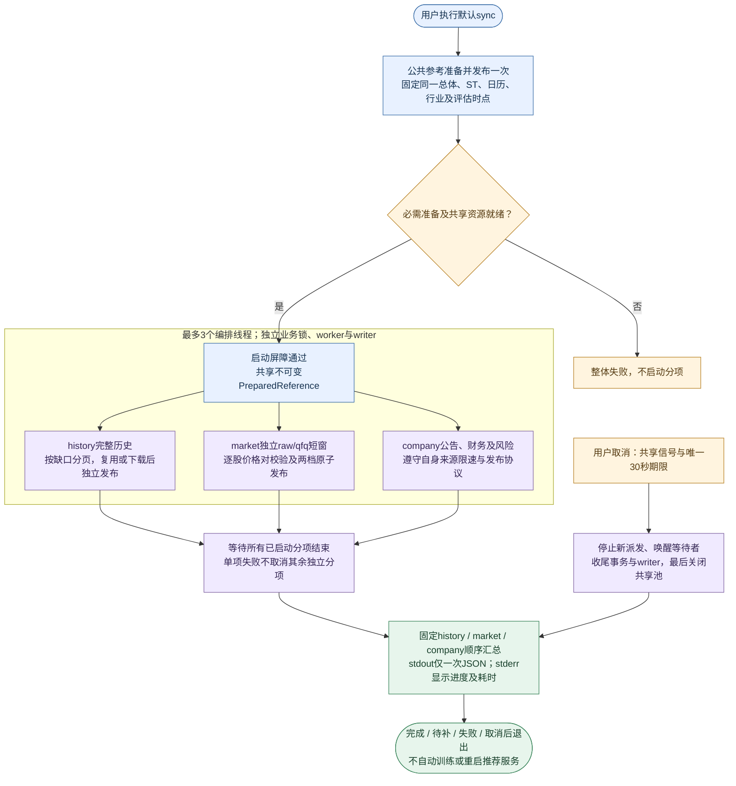
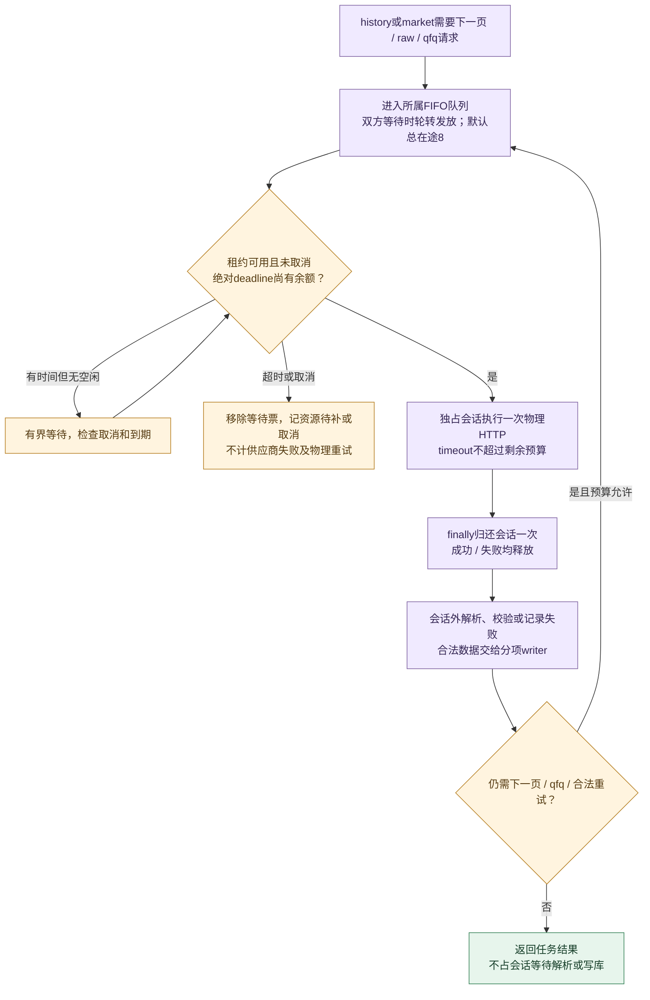

# 历史代码实施方案（已退役）

> 历史方案，仅供回溯，不再维护或作为施工清单。下文保留原审查基线、阶段安排及研究设计，其中V2/V3默认启动、both、V1待接入/Shadow、在线短窗输入与并行sync计划已被后续代码或合同替代。当前命令见[根README](../README.md)，V1权限及模型排序见[评分第6.4节](1_评分逻辑.md#64-全新v1模型排序与正式接入)，运行和训练分别见[工程设计](2_工程设计.md)与[下载训练](4_下载训练.md)。

本文不维护任务状态；实际改动、验证和未完成项只记入[工程实施](3_工程实施.md)。第5节的未验证研究仍只是原方案，不授予收益资格或发布权限。

## 1. 审查基线与已确认差距

首次审查以文档提交fbe4f4b0、929db9c5为需求依据，代码基线为929db9c5，分支为Afuture。下表保留首次审查发现，是否已经解决只查工程实施台账；首次下载、训练及Web观测补充以db261b89为依据。本轮以阶段210交付提交dc793c43重新核对同步链，新增并行同步方案；不把已交付能力重新列为待实现。

| 优先级 | 已确认差距 | 代码证据及影响 |
| --- | --- | --- |
| P1 | 固定总体投影随请求人数改变，截尾算法也不一致 | [scoring_calculations.py](../src/trader/recommendation/domain/scoring/scoring_calculations.py)：99/100/120只请求会得到不同百分位，进而改变同股评分 |
| P1 | 成本门按请求批次重算流动性分位 | [model_scoring.py](../src/trader/recommendation/application/pipeline/local_score/model_scoring.py)：仅更换同伴，已复现净效用由负转正 |
| P1 | 旧预选、再次截断及360只限制仍在 | [scored_fusion.py](../src/trader/recommendation/domain/risk/scored_fusion.py)：直接扩大输入会触发异常，不能只删除候选阶段标签 |
| P1 | 历史解码依赖活动阶段定义 | [decision_record_codec.py](../src/trader/recommendation/infra/persistence/decision_record_codec.py)：直接替换枚举可能使合法旧记录在启动恢复时被隔离 |
| P1 | 旧复核能够覆盖新输入的质量状态 | [local_decision_builder.py](../src/trader/recommendation/application/pipeline/local_score/local_decision_builder.py)：现有6个用例已复现 |
| P2 | 分钟检查制造新内容身份，both重复建资源 | [source_router.py](../src/trader/recommendation/application/pipeline/data_source/source_router.py)、[bootstrap.py](../src/trader/bootstrap.py)：造成重复评分、采集及缓存占用 |

首次审查还涉及量比与成交额比混用、历史换手率替代、慢数据自动维护、28只复核、challenger、行业限额及旧诊断消费者；已经交付的修复不重复施工，其余按所属阶段继续。

规划时两组定向检查合计123项通过、9项失败；失败包括上述6项状态覆盖回归及3项旧文档断言。该检查未覆盖全量、真实供应商、浏览器或收益验收；后续证据只查工程实施台账。

### 1.1 已有数据与训练消费关系

| 资料或产物 | dc793c43的已有入口及消费者 | 后续优化方向 |
| --- | --- | --- |
| 完整history | 默认sync、sync history及train前置维护；训练、研究及固定快照结算消费 | 阶段214与其它分项重叠执行，保留原发布及续传 |
| 独立raw/qfq短窗 | sync market；推荐启动预读派生量及近期行，维护后正常重启加载，运行中不轮询发布身份 | 阶段211共享基础输入，阶段214共享腾讯请求预算 |
| 公告、财报、质押、解禁 | sync company；已有跨夜覆盖资格、轻量预读及公司过滤/风险消费 | 阶段211减少发布与解码开销，阶段214并行维护 |
| 证券、ST、日历、行业 | download统一手动准备和发布，推荐固定启动参考 | 阶段214三个分项共用同一不可变参考和评估时点 |
| V2/V3双头模型 | train联合训练或复用；已有短发布锁、失败分类、四头状态和重启提示 | 复用既有加载边界，不因下载并行引入模型热切换 |
| 样本、标签、训练报告 | 训练和研究产物，训练成功不自动授予收益或生产资格 | 继续按阶段213验证，不作为实时特征灌入 |

短窗、公司证据和模型的现有接入见[组合根](../src/trader/bootstrap.py)。完整history不成为在线荐股的新增前置条件；推荐继续使用独立251/61日短窗，不把2000日训练库搬入内存，也不用history隐式补齐短窗价格。

### 1.2 基于阶段210交付的新优化边界

| 优先级 | 断点与影响 | 证据入口 |
| --- | --- | --- |
| P2 | 默认sync已包含完整history，但仍按history/market/company串行；正常market同步不依赖history完成 | [同步编排](../src/trader/download/application/sync_data.py)、[短窗执行](../src/trader/download/infra/qfq_update_runner.py) |
| P1 | history/market各建默认8个腾讯会话，直接并行会叠至16；借用连接无限等待且无跨分项公平分配 | [组合根](../src/trader/bootstrap.py)、[腾讯会话与供应商](../src/trader/download/infra/tencent_qfq_supplier.py) |
| P1 | 短窗文档已有整股180秒合同，当前供应商未贯穿该deadline；排队、请求和重试需共用预算 | [腾讯供应商](../src/trader/download/infra/tencent_qfq_supplier.py)、[日线请求](../src/trader/download/infra/tencent_daily.py) |
| P1 | CLI取消当前只设置Event，分项各自收尾；并行后需共同期限、等待writer和明确强退语义 | [CLI取消](../src/trader/entrypoints/cli.py)、[关停primitive](../src/trader/infra/shutdown.py) |
| P2 | 公司进度在公共准备前开始计时，输出器未共用行锁；缺少并行分项及总墙钟统计 | [组合根](../src/trader/bootstrap.py)、[公司进度](../src/trader/download/entrypoints/company_evidence_progress.py)、[终端输出](../src/trader/download/infra/terminal_progress.py) |
| P1 | 后端14阶段、16项诊断与Web合并12行并存，依赖长度和位置；部分耗时未赋值，毫秒和未知显示不清 | [阶段类型](../src/trader/recommendation/domain/evidence/pipeline.py)、[诊断投影](../src/trader/recommendation/application/pipeline/quality_check/pipeline_status.py)、[Web观测](../src/trader/web/static/status_view.js) |
| P1 | 发布回执只按策略与交易日筛选，旧轮失败可能污染新轮；仅回执变化时链条可能不刷新 | [Web观测](../src/trader/web/static/status_view.js)、[页面更新](../src/trader/web/static/dashboard.js) |

新优化边界来自dc793c43的静态调用链，不代表并行同步已经实现或提速已经实测。阶段210已交付的固定启动资料、公司跨夜资格、模型失败分类及发布锁按原owner复用；交付证据和未验收项只查台账，不重新打开210。

## 2. 已确定的实施口径

以下区分当前交付基础和待切换目标；当前命令按下载训练第1节，实际交付及验证状态只查工程实施台账。

- **成本参考按板固定**：在模型门前，使用完整板内模型输入合格人口的有效Amihud，保持现有平均秩0–1尺度和成本公式。人口不受候选分、请求分批及预测结果影响；参考身份进入缓存和决策输入身份。
- **取消旧30%候选缺失门**：模型必需字段缺失记待补；报价及历史必需项沿用明确资格检查；其余评分项执行质量扣分；下行保护不足仅观察。保留0.85可靠度要求。
- **允许跨夜资料**：财报有效、必需来源完整且覆盖至前一交易日的资料，可用于次日新动作；展示真实覆盖截止。更旧、不完整或未核实的覆盖限制为观察，已知硬风险继续生效。
- **模型不可用时**：保留合法旧结果并报告缺项，模型门保持关闭，不新增脱离模型门的评分展示链。
- **默认同步全部资料**：当前./run.sh sync完成公共参考后串行执行history、market、company；阶段214改为准备完成后三项并行，保留单项入口和原发布合同，同步不启动训练。train仍先完成历史维护再联合训练，已验证无变化的内容沿用既有增量及复用机制。
- **重启统一加载**：sync/train完成后正常重启加载慢资料和模型；普通启动只运行推荐服务，运行中不扫描慢资料数据库或模型文件变化。已加载数据仍按真实覆盖和当前时点判断资格。
- **Web展示最近发布轮**：链条与当前选中荐股表使用同一已发布身份，展示完整十一层耗时及输入输出；下一轮只作简短进度提示，不覆盖已发布轮统计。
- 两策略继续联合发布；评分权重、动作阈值、时效预算及研究参数按现行权威合同执行。

## 3. 按依赖顺序实施

保留阶段206–210原设计供回溯，阶段211–213编号和职责不变。阶段210已由dc793c43交付；新增阶段214是以该提交为基础的独立下载并行优化，只依赖210，不拆走211–213工作，可与后续推荐主线独立实施。编号不代表必须等待213后才能执行214；本次仅保存方案，不创建214的活动台账记录。实际实施时沿用已登记记录或核对编号占用后登记，每阶段独立完成、提交和推送。

### 阶段206：修复固定总体与成本投影

- 分开“构建参考分布”和“投影股票”，统一评分截尾、并列平均秩及缺失处理；预排序并使用二分查找，消除逐股扫描总体的平方开销。
- 成本直接采用完整板内参考，不能暂用旧120只池，也不受旧30%候选门影响；同步类型、缓存键及输入身份。
- 验收：同一参考下，整总体、任意子集、重排和分批结果一致；覆盖1/99/100/120只、截尾边缘、并列、全相等及合法总体回退。

### 阶段207：统一成交量与换手率语义

- 贯通供应商解析、类型对象、合并及特征计算，统一累计成交量单位；volume_to_5d_average使用真实成交量与前5个完整交易日均量。
- 删除成交额冒充成交量、历史成交额除当前市值冒充历史换手率的替代；缺失进入既有质量及保护规则。
- 验收：成交量相同而价格不同，不改变成交量比；缺量不回退成交额；入场阈值保持现行数值。

### 阶段208：修复分钟触发与旧复核回写

- 分钟内容身份由已接纳的完整K线窗口事实生成，覆盖同分钟及窗口内旧分钟修订；检查时间、接收时间和来源时间分别记录，供应商轮询时间不能充当内容版本。刷新端口返回不可变类型结果，调度与特征缓存使用同一份内容及资格身份。
- 内容不变但缺失、过期或降级资格发生变化时仍使相关评分输入失效；失败保留合法最近内容，不能因缓存命中或重新接收相同内容重置来源年龄。检查次数、内容变化和评分触发分别验证。
- 本地计算和复核回写共用输入owner的原子校验；绑定策略、交易日、输入批次、父决策及会话generation，替代同日判断和阶段数组索引。成功回包、失败诊断及无hybrid结果均适用，校验失败不写新轮状态。
- 验收：重复内容不评分，同分钟修订会评分；过期资格变化可传递；同日新输入、跨日、休眠恢复及15:00封口后旧结果不能覆盖新诊断或正式记录，闭合现有6项失败。阶段209再隔离旧历史，阶段212再切换十一层及发布回执，不把当前输入状态直接当作已发布轮。

### 阶段209：隔离历史只读解码

- 历史审计使用独立不可变类型和冻结的旧协议校验，不依赖活动阶段枚举；活动构建器只接受活动流程类型。
- 同步恢复、查询和白名单投影，保留旧字节、字段缺席规则、版本及摘要；完整性校验继续执行。
- 验收：旧14阶段/16键记录可读且不会被误隔离，规范字节及摘要不变。正式记录仍只保存六席，保持现有8 MiB保护及数据库布局。

### 阶段210：完成手动维护、发布及启动加载闭环

本节保留原交付设计，事实证据见工程实施台账及dc793c43；不再把下列内容作为新增施工任务。原串行同步安排是当前基线，并行替换由阶段214定义。

#### 下载入口与所有权切换

- 默认sync按公共参考准备→history→market→company执行，Shell、PowerShell及CLI保持一致；同步类型化分项结果和退出投影，保留history/market/company单项入口。显式sync history取消定时维护门槛；train调用同一准备及历史维护能力。
- 公共准备返回不可变的官方总体、完整ST证据、检查日期、可靠日历和参考身份；history不能只收到过滤后的代码，也不能重新获取同轮总体/ST。当前行业与历史锚点行业仍按各自身份消费。
- 必需公共准备失败停止依赖项；独立分项失败或待补保留断点，继续其它可执行分项。当前行业失败仍允许合法Tencent价格降级发布，训练报告资料不足；取消停止后续任务。沿用0完成、1失败或待补、2参数/配置错误、130取消；进度写stderr，最终分项JSON写stdout。
- download统一拥有慢数据联网和发布；原子切换bootstrap、参考加载器、公司资料与历史消费者，删除推荐服务中的公司固定点任务、QFQ维护线程、证券/日历/行业联网更新能力。新增显式history-automation-uninstall，删除历史自动安装及执行能力；启动不修改宿主调度。
- 手动company经bootstrap调用推荐应用只读用例，取得最近7日有效发布名单的去重代码，以不可变参数传给新闻采集；无名单时明确新闻未覆盖，沿用有界新闻窗口，不全市场冷抓。

#### 资料资格与固定启动快照

- 分开财报披露/生效、公告风险覆盖截止、质押快照、解禁前视范围、最近查询、发布时间和本地加载时间。修复queried_on跨夜整体失效；按第2节跨夜口径判断，缺页、缺正文、未知来源或过期覆盖限制动作，已知硬风险持续生效。未来披露不可使用，已披露的未来解禁仍可作为风险。
- 生命周期启动后有界预读轻量公司事实和历史派生量；CreateApp()继续无副作用，本阶段遵守当前内存预算。启动分批读取前后核对发布身份，变化时有界重试或报告未就绪，不接受混合发布。
- 启动预读只执行一次，完成后线程退出；运行中不轮询发布身份，不调用历史refresh、公司load_report或实例化新预测器。评分、模型及收益结算历史消费者均固定启动身份；完整history按合法不可变旧快照读取，不因active指针变化偷偷换代。缺history只影响其实际消费者，不误关其它在线能力。

#### 模型加载及训练状态

- 分类处理模型缺失、损坏、摘要/合同冲突及publication_busy，组合根按档关闭模型门并保留合法旧投影和只读Web；不广泛吞掉RuntimeError，不自动训练、切档或借用其它策略头。
- 每档最终发布和全部活动双头读取共用目录外短发布锁；拟合、复制及预校验在锁外，锁内完成最终切换或一致读取。采用单调deadline有界竞争，启动不等待贯穿拟合的训练锁，不读取暂存目录。
- 到期判断覆盖V2/V3的Tomorrow/D25四头，复用已有状态所有者；分别投影已加载与磁盘身份、label_cutoff、训练来源历史身份、到期原因及重启需求。HTTP只读内存，不调用会保存状态的到期计算。
- 在线可用性核对模型自身摘要、档位、双头同源同次训练和推理合同；训练历史身份用于溯源，不要求等于每日更新的history。训练复用仍严格匹配最新输入，历史修订报告到期原因，不改写旧模型或冻结身份。
- 验收：同步全部/单项、失败继续、取消续传、跨夜及节假日覆盖、坏工件仍可读Web、发布/启动交错、四头到期及重启加载均通过；推荐启动及五时段无慢数据下载。行为切换时同步下载训练命令表、热采用说明和工程设计，不把本计划当成当前操作说明。

### 阶段211：共享both资源并扩大有界缓存

- bootstrap只创建一套进程客户端、来源通道和基础输入缓存；模型、档位决策、冻结及发布状态保持隔离，共用既有DeepSeek原子账本。
- 扩展已有短窗投影，为完整合格总体预读轻量公司事实、财务摘要和纯历史派生量，报价相关因子按轮计算；评分热路径不再因公司冷项读库。预读未完成明确待补，Web仍可读旧结果；公告正文和完整训练库不常驻内存。
- 扩展已有DailyFeaturePack、ResearchEpoch及输入身份，绑定证券、日历、行业、qfq、公司证据、模型和配置到缓存与决策；不建立平行清单或状态库。
- 减少公司发布中的重复解码和编码，将可分离构建及清理移出长写事务；提交前校验源身份，原子更新发布内容和指针。保留FULL持久化、并发读取校验及失败保旧，使用公共只读SQLite边界，不对活动WAL库使用immutable绕过并发保护。
- 同步配置、校验、条目容量及统计，将共享逻辑缓存切至512 MiB、RSS验收预算切至2 GiB。observation、canonical_snapshots、feature_batches、local_scoring、review、projection六组初始分配为264/116/49/33/25/25 MiB，另保留8 MiB预留。
- 将闲置执行器额度改为独立分钟执行器，最多5个请求在途；逐步提交，使用统一deadline、取消及限流，避免同池嵌套等待。
- 验收：两档相同基础输入只采集、预读和构建一次；评分预热后无公司资料或完整history SQL，资源仅释放一次；默认、单档、both均受进程总预算约束。启动预读、解码、派生和评分分别测量，不能以提高TTL或缩小评分人口通过性能门。

### 阶段212：原子切换十一层完整选择链

- 输入准备覆盖完整合格总体，依次执行模型门、本地评分、一次风险扣分和统一选六。删除候选分、50分线、每板120、储备补位及360只业务上限。
- 按两位local_score降序、代码升序固定六席；保留板块上限，取消行业限额；DeepSeek仅复核六席内合格对象，删除challenger。否决后保持原席位，不递补。
- 正式投影和报价展示直接读取固定席位；页面默认Tomorrow。阶段209先隔离旧历史协议，本阶段原子更新活动类型、审计、GET、SSE、Web、统一诊断及研究追踪。

#### 十一层事实、输入输出与处置数目

主链按评分权威确定的顺序：本地资料加载→静态资格过滤→实时行情→动态过滤→市场总体与特征→模型过滤→本地评分→风险扣分→固定评分前六→可选DeepSeek复核→动作与发布。

- recommendation应用在真实执行入口、完成、失败及取消处维护唯一执行事实，投影阶段快照、计数和诊断。14个旧活动阶段、16项诊断及Web合并12行同步切换；仍有职责的历史窗口、完整度等诊断归入层内详情，删除退役候选和预选消费者。
- 每层记录状态、实际输入/输出股票数、业务淘汰、待补、处理失败和必要的未入选数，以及原因和来源健康；输出对应实际交给下一层的集合，按批次身份和人数校验相邻交接。
- 同一股票按首个拒绝边界互斥归类，附加风险标签可重叠但不累计为重复淘汰。资料不足不计业务排除；第9层未入前六记未入选。降级后继续输出的股票只计输出，来源失败次数另记，不能同时计处理失败。
- 第10层携带固定席位，提交、完成、缓存复用、veto及来源失败作为子计数；未复核或失败不减少席位，不补位。第11层保持席位并列推荐/关注/回避分布，发布操作按记录或次数单列，不与股票数混加。
- 观测绑定档位、策略、交易日、会话generation、输入及父决策/投影身份；首个断点沿用primary_blocker。禁止按同日或旧数组索引更新新轮诊断，也不通过最终六席反推上游人数。

#### 真实耗时与发布完成语义

- 各实际执行边界使用可注入单调时钟记录耗时；展开显示排队、采集、计算、校验、可选复核等待及发布I/O。整轮墙钟耗时独立测量，共享、并行或异步阶段不能简单相加。
- 启动预读、本轮缓存命中及来源年龄分开；缓存命中显示本轮复用，不重复计入上次构建耗时。未执行、未测量使用null，真实0显示0 ms；短耗时显示毫秒，较长自适应秒或分钟，失败/超时保留已测时长。
- 第11层分列动作计算、当前发布及冻结I/O。发布回执严格关联决策/投影身份，运行遥测独立于已冻结规范字节；缺回执明确未记录，不回写正式记录补耗时。
- 本地已发布与DeepSeek复核完成分别显示；当前发布、冻结写入、研究任务入队及消费者实际完成是不同事实。入队成功只表示交接，不能标记整条交付完成，也不使本地发布等待可选复核或研究消费。

#### Web观测与增量更新

- 链条默认展示当前选中荐股表所属的最近发布轮，顶部显示轮次、结果时间、整轮耗时和主要断点。十一层每行显示状态、输入→输出和耗时，展开查看淘汰/待补/失败/未入选、原因、来源覆盖及子操作。
- 正在运行的下一轮仅简短提示进度；没有已发布轮时显示明确空态，不把运行中计数拼到旧名单。已发布但复核待完成明确标记本地结果。
- 前端按明确阶段key和顺序渲染，删除14/12长度判断、数组位置回退和旧流程映射。名单、分数和阶段观测随同一决策原子更新；匹配回执变化可单独更新对应详情，不必等待阶段或下一轮评分变化。
- 同步顶部漏斗、输入质量区、错误归属和发布详情，移除旧候选分、120只截断及旧复核范围文案。保留展开、选区和档位/策略/日期选择，报价overlay不重建链条；旧响应、旧回执不能污染新选择。
- HTTP/Web只读取推荐应用投影，沿用现有路由和SSE恢复边界，不触发下载、评分、训练或读业务库。旧历史按原协议只读，缺失统计不补零或强行映射十一层；Long显示不适用。
- 验收：旧候选第121名但最终全局第3名能够入席；超过360只正常处理；复核及封口不重新选六；名单、分数、计数、耗时和诊断属于同轮。不能只以页面出现11个标签作为完成证明。

### 阶段213：补齐目标研究身份与整体交付证据

- 以Tomorrow、D25十一层选股流程的历史回放和收益验证为研究对象，按新规则重建研究流程，统一采用完整股票总体、逐板成本参考、每板最多4只、无行业限额及固定六席不补位。
- 删除与新规则不兼容的旧研究约束、实现、配置和报告，重新定义研究身份、数据分区及统计参数并生成验证报告；报告明确区分D25四期限标签、六槽指标及入选均值，不保留旧规则兼容分支。
- 扩展现有统一诊断，完成完整人口、both资源、冻结恢复及桌面交付验收入口；真实数据资格不足时明确报告缺项。
- 在仓库外隔离副本完成sync→train→正常重启→实时荐股→冻结→Web端到端验收；区分下载完成、工件可加载、在线可用、点时资格、收益验证及生产授权，训练成功不自动授予后两者。
- 复用既有Web状态、实时链合同测试及统一诊断，验收十一层真实边界、计数、耗时、回执和浏览器交互；真实模型或供应商不足时保留具体未验证项，不用fixture或HTTP 200替代。

### ~~阶段214：并行同步与腾讯共享请求预算~~

#### 目标、依赖及复用边界

以dc793c43的串行sync作为比较基线。复用已交付的公共准备、三个分项用例、业务锁、发布事务、断点、固定启动资料及重启生效合同；只改变下载编排、腾讯请求资源和对应观测，不重新实施阶段210，不改变评分、模型授权或推荐内存预算。

以下两图是本阶段的并行目标，尚不是当前默认sync行为；当前串行流程见[下载训练第1.2节](4_下载训练.md#12-执行顺序与退出结果)。同步由用户手动触发，一轮结束退出，没有固定定时执行间隔。

**每次腾讯物理请求的循环：** history与market共享总在途上限，company沿用自身来源预算；解析和写库不持有腾讯会话。等待由可用容量、deadline及取消驱动，不增加固定sleep。

- ./run.sh sync默认三项并行，不新增parallel开关或生产串行fallback；单项命令只运行对应分项。train仍按历史维护→训练执行，不并行拟合与尚未完成的历史维护。
- 公共参考准备及发布是启动屏障，只执行一次；三个分项使用同一不可变PreparedReference及checked_at对应的业务评估时点。实际开始/完成时刻用于观测，持续耗时使用单调时钟；跨午夜不能分别重新选择数据日期。
- ST准备使用的会话在屏障前独立结束，其实际供应商请求不误计为腾讯价格请求。行业引用继续区分当前参考与历史锚点；正常market不新增history前置，也不启用历史seed作为隐蔽补价。

#### 所有权、配置及并发调度

| 当前owner或资源 | 目标与全部消费者切换 | 必删或替换路径 |
| --- | --- | --- |
| SyncData串行循环 | 同一应用owner注入有界执行端口，调度所选分项并汇总不可变结果 | 替换串行for调用，保留唯一活动编排 |
| bootstrap分别创建history/market会话 | bootstrap创建并持有一套腾讯会话池，两个供应商实例使用带任务身份的请求租约 | 删除两个分项重复建池和自行关闭共享会话的代码 |
| 整股窗口持有会话 | 腾讯供应商每次物理HTTP尝试独占借还；raw/qfq、分页、重试和host切换全部接入 | 删除窗口级长租约及任何绕过共享预算的请求路径 |
| 独立进度输出及串行取消 | 现有入口适配器共用行输出器、取消控制及收尾期限 | 替换各自打印碎片、独立重开30秒及旧顺序测试 |

- bootstrap持有最多3个编排线程，与下载worker池隔离；history/market保留有界派发和各自单writer，company保留现有业务会话与来源限速。SyncData不创建线程池、HTTP客户端或数据库连接，公共primitive不包含业务规则。
- 在唯一下载配置config/download.json增加sync.tencent_max_inflight，默认8、范围1–12；同步严格配置解析、类型和所有入口消费者。history_workers仍表示历史worker数，不借改名或复用字段悄悄改变其含义。分项worker数与腾讯物理在途数分别统计，单项入口也遵守同一腾讯总预算。
- 腾讯共享池按history、market各自FIFO排队；两边都有等待者时轮转发放空闲会话，一边无等待者时全部空闲额度可供另一边使用。现有请求不抢占；market完成后history可用全部空闲容量，不能固定各4个直到退出。
- 租约只包围一次物理HTTP请求，传输完成即归还，解析及写库不占用会话；不同请求不能同时使用同一会话。raw→qfq顺序、单位/日期/价格对和复权分页重叠校验保持，不把同TCP连接当成供应商快照原子性证明。
- 公共准备、分项和组合根仍各有明确生命周期；共享池最后关闭且只关闭一次。组合根扩展通过删除重复建池及显式注入收敛，不突破1200行限制或引入第二组合根。

#### 排队、deadline及失败分类

- 请求租约接受任务身份、绝对单调deadline和取消查询；替换无超时Queue.get，等待时有界检查取消，过期/取消移除等待票并唤醒其它请求。取得租约后再次检查预算，finally精确归还一次。
- 会话排队超时使用独立资源失败类型，记待补，不转成供应商失败，不消耗HTTP重试次数；获取租约位于供应商重试捕获边界之外。重试、host切换和下一页重新排队，真实尝试才计物理请求。
- 补齐已有短窗合同的实现缺口：从股票下载任务开始建立一次180秒预算，覆盖排队、raw/qfq、分页及重试；单次最多45秒、最多2次重试，请求timeout取单次上限与剩余预算较小值。将绝对deadline贯穿供应商、日线协议及HTTP transport，不能每次重试重新领取180秒。
- history每次请求按该调用既有超时建立绝对deadline，预算包含租约排队，取得会话后只使用剩余时间；沿用原分页和重试上限，不机械套短窗整股180秒。company继续既有预算、巨潮间隔和HTTP错误分类，不借并行提高各来源请求频率。
- 单项失败或待补不取消其它独立任务，各分项维护锁和发布事务保持；不新增跨库大事务、不跨线程共享SQLite连接。共享必需资源初始化失败则报告整体失败，不能继续启动缺少资源的分项。
- 无论完成先后，最终tasks按history、market、company排序；完整保留已经结束的分项结果。全部完成返回0，失败或待补返回1，参数/配置错误返回2，取消返回130；正常路径stdout只输出一次最终JSON。

#### 共同取消与安全收尾

- 首次取消建立唯一共享取消信号和30秒ShutdownDeadline，停止新派发并唤醒租约等待者；各分项收集已完成结果、保存合法断点，完成或回滚正在执行的短事务，再关闭worker。不能因某项先返回cancelled就直接结束整个sync。
- 将writer等待和资源关闭纳入同一期限，不允许各分项finally重新领取30秒。writer未退出时不释放业务锁、不关闭仍被使用的连接；future超时不代表Python线程或事务已经结束。
- 复用现有watchdog机制，但为sync显式适配退出130；不能直接沿用通用watchdog的退出2。共同期限耗尽或第二次中断时明确报告强制退出及未完成收尾，先终止受管供应商子进程，不声称资源已优雅关闭。
- 正常取消仍汇总一次JSON；强退可能没有完整JSON，stderr必须给出受控原因。SQLite保持原持久化和恢复合同，重启检查真实发布及断点，不把未确认数据伪装成完成，也不提前清理仍在运行的资源。

#### 分项进度、耗时与输出接口

- 公共准备独立显示sync reference，三个分项分别显示history/market/company；格式化后经同一个行级输出器完整写stderr，保留已有节流和心跳。分项进度对象从实际启动时计时，不把参考准备或其它任务耗时算进本项。
- 扩展现有SyncResult、SyncTaskResult及白名单投影，不新建运行状态库；保留现有分项业务统计、缺项原因和JSON字段，新增下表观测。只对真实HTTP开始计物理尝试，等待失败不增加该计数。

| 观测 | 定义 |
| --- | --- |
| reference_duration_ms | 本轮公共准备墙钟耗时 |
| 分项duration_ms | 分项实际开始至完成、失败或取消的墙钟耗时 |
| total_duration_ms | 准备、并行执行及收尾的命令总墙钟，独立测量、不相加分项 |
| 腾讯峰值在途及分项累计排队 | 核对总预算与公平性；累计排队是各请求之和，可大于分项墙钟 |
| 物理请求、重试及失败次数 | 包含真实失败和host切换，区分资源等待与供应商错误 |
| 收尾状态 | 区分正常关闭、取消后关闭及强退，未知或未完成不补成成功 |

#### 实施顺序与验收

1. 先实现共享请求租约、配置、deadline和资源指标，原子切换两个价格供应商及全部消费者，再开放三项并行，避免中间态把腾讯并发放大到16。
2. 切换编排、取消收尾、进度及结果投影；同步Shell/PowerShell帮助和单项入口。行为切换时再更新下载训练、工程设计和日常命令说明，当前操作仍按串行基线。
3. 实现切片完成后集中补必要并发、恢复及输出回归，运行受影响pytest、Ruff和mypy；若修改公共测试基础设施再执行完整回归。阶段210已交付的全量证据不能冒充阶段214验证，既有失败以实施时基线复核。
4. 以仓库外dc793c43隔离检出及相同初始数据副本作串行基线，扩展已有统一下载诊断。完成完整diff Review和全部消费者检查后，按214原记录交付单一提交并推送，不混入211–213。

| 必要场景 | 验收标准 |
| --- | --- |
| 公共准备及并行启动 | 准备失败时任务未启动；事件/屏障证明三项重叠且使用同一参考及评估时点，不靠短sleep猜测 |
| 腾讯上限与公平 | 默认物理在途不超过8，会话无重入；两分项均可取得额度，空闲额度可借用，容量1及12边界可运行 |
| 请求配对及超时 | raw/qfq和分页校验保持；全部重试受同一池约束，短窗整股180秒不因排队或重试重置 |
| 分项失败和单项入口 | 某项失败其它项完成，结果排序及退出码稳定；单项不启动其它分项或要求完整history |
| 取消与资源释放 | 排队、HTTP在途、写入、重试及供应商子进程处取消均不泄漏租约；共同30秒、二次中断及强退原因可验证 |
| 发布及续传 | 保持raw/qfq成对发布、公司失败保旧及真实断点，取消/发布失败后重跑不产生虚构完成 |
| 进度和机器输出 | 日志完整分行且带分项，正常退出只有一个JSON；分项计时不含公共准备，总时长不累加重叠工作 |
| 串并行等价及性能 | 相同供应商回放和数据截止下，业务内容及状态一致；排除耗时和随机发布身份后比较，无额外重复请求 |

- 初建、日常增量和同日复用分别交替至少5轮，记录总时长、各分项完成时间、排队、真实请求/错误率、SQL/写入时间、RSS、线程及连接峰值；证明market/company更早完成，报告总耗时实际变化，不预先承诺固定倍数。
- 串行基线只存在于隔离旧检出或诊断，不保留第二套生产实现。fixture证明重叠和一致性，真实供应商另作有界实测；不能用合成结果宣称真实全市场提速。所有写入验证使用仓库外隔离副本，报告和真实证据仅记入214原台账记录。

## 4. 验证与交付标准

- 阶段门禁：实现切片完成后集中补最小必要回归，运行受影响Ruff；公共类型、历史解码及资源边界增加mypy。阶段212运行推荐业务及跨边界回归。
- 下载与加载：覆盖初建、增量、同日重跑、history失败后其它独立分项继续、取消续传、锁竞争、低空间及发布失败保旧；文件存在但未发布、hash损坏、窗口不足及启动并发发布分别报告准确原因。
- 资料与模型：覆盖前晚/周末及节假日维护、财报有效而风险覆盖不足、缺页/正文待补、未来披露与已披露未来事件；单档/单头缺失、损坏、跨代、发布繁忙、四头到期、磁盘更新只提示重启，以及history日更不误关合法模型门。
- Web计数与耗时：验证真实边界集合与人数、首拒互斥、未入席和数据不足分开、少于六席及六席含回避、DeepSeek部分/全部失败不补位；覆盖135 ms、1.25 s、0 ms、未知、缓存复用、进行中及超时，整轮耗时不简单加总阶段。
- 同轮交付：同日A轮迟到复核、旧会话及失败发布回执不能修改B轮；GET、SSE与Web名单/分数/十一层观测同身份，运行中下一轮仅作提示。只有匹配回执变化时面板也能更新，切策略/档位/日期、展开复制、断线恢复和报价补丁均无混轮；旧14/16审计的字节和摘要保持。
- 冻结与交付：覆盖五时段热/冷运行、15:00 first-wins、合法close_fallback、迟到复核、SSE重连，以及Long不参与评分和冻结。
- 性能：同机同负载交替至少5轮，分别记录同步分项、启动预读、SQL/解码/派生、检查、内容变化、评分触发、请求排队、缓存、评分P50/P95、浏览器更新耗时、RSS及换页。按既有时效与增长门验收；完整人口分钟采集必须实测，现有5个worker不能作为满足预算的证明。
- 最终门禁：运行make format-check、make lint、make type-check、make test-full、make package。既有回归失败及复杂度差异按台账最新交付基线逐项复核，不沿用旧48项名单，也不能宣称未通过的门禁全绿。
- 各阶段只在docs/3_工程实施.md登记实际证据；行为切换时同步权威文档。数据演练使用仓库外隔离副本；真实数据切换、PR、合并及发布仍按既有授权边界执行。
- 单独补充方案时只交付文档，不表示代码阶段完成；进入代码实施后按所属阶段登记和记录真实证据。阶段211复用210的固定启动快照与有界预读再共享both、扩大覆盖和预算；阶段214复用210的下载用例实现并行，不重新打开210或拆走211–213。

## 5. 荐股链修复与全新V1算法方案

### 5.1 本轮范围与身份

本轮代码审查基线为3f06c3b6；前次只读扫描的关键训练/评分文件在该提交仍保留相同逻辑。用户明确要求新增**全新V1算法评分档位，与退役V1没有关系**。V1仍分别服务Tomorrow和D25，不增加持有期策略，Long继续只展示行情。

本节是目标待实现方案。当前可运行档位仍为V2/V3，生产最终分仍为local_score；本次文档不创建模型、不执行训练、不切换配置或活动数据。V1接入代码时，须同时修订评分逻辑、工程设计、下载训练及对应skill中的档位/评分限制；不能只修改允许值就绕过现行合同。旧阶段方案及历史证据不因本节重新生效。

V1首发采用**共享LightGBM横截面排序＋独立收益回归门**，模型直接决定名次。本地规则负责证据解释和动作资格；V2/V3保留原行为作比较。日期前推OOF融合列为后续有条件研究，首发不同时引入多套未验证模型。

### 5.2 扫描问题与修复优先级

“已确认”区分源码事实与合成验证；“待实测”不代表线上故障已经发生。复验脚本统一扩展scripts既有诊断，报告输出仓库外，不新增第二个进度台账。

| 优先级 / 事项 | 证据与影响 | 修复与验收 |
| --- | --- | --- |
| P1 行情来源时间被刷新 | [腾讯报价](../src/trader/recommendation/infra/market_data/providers/tencent.py)的fetch_market覆盖已解析source_time，并按整批完成秒生成版本；合成旧30秒行情被包装成0秒，同事实重复接收也改变输入身份 | 保留供应商source_time，received_time独立；内容身份只随真实事实改变，年龄/资格变化仍触发必要更新。覆盖网关、缓存新旧合并、评分触发、冻结来源年龄和GET/SSE展示 |
| P1 缓存键平方遍历 | [模型特征](../src/trader/recommendation/application/pipeline/local_score/model_scoring.py)的_fact_revisions逐股嵌入全体收益/动量元组；单字段N=2/4/8的合成哈希计数为4/16/64 | 同轮事实向量只表示一次，逐股引用自己的内容；任一真实输入变化仍正确失效。用增长计数及完整输入冷热基准证明消除N²，不凭小样本声称固定提速倍数 |
| P1 同股特征及推断重复构造 | 同文件在逐字段循环内调用完整_model_feature_vector；3股×6字段调用18次，缓存命中仍重建。[预测器](../src/trader/training/infra/model_bundles/predictor.py)逐股建矩阵及转换数组 | 每股一次向量；加载时固定变换数组，按模型批量预测并还原原输入顺序。对空批、单股、重排、缺行业、异常和取消验证；V2/V3数值、门和六席按明确容差及边界回归保持一致 |
| P1 训练报告不验证预测 | [样本索引](../src/trader/training/infra/sample_index.py)的validation_target_metrics只统计标签均值/方差；[训练引擎](../src/trader/training/infra/engine.py)结构门只检查模型非空及验证行数 | 单独保留标签分布统计，新增真正的样本外预测评价；分开结构合格、预测评价、收益准入、生产授权，不将任一列互相推导 |
| P1 有效模型覆盖被高估 | [行业拟合](../src/trader/training/infra/model_fitting.py)跳过训练不足或缺校准/验证的行业，却汇总全部行业行数 | 分别报告源行、实际拟合行、实际预测行、覆盖股票/日期/行业及跳过原因；用跳过行业的输入证明结构报告不虚增覆盖 |
| P1 训练截止长期滞后 | [日期切分](../src/trader/download/domain/baostock_daily.py)预留三段研究窗口；2000日合成日历下V2/V3拟合尾落后数据尾665/640日，校准尾落后615日 | 保留旧研究留出隔离，新增独立的近期滚动拟合协议及身份；报告特征截止、label_cutoff、拟合尾、校准尾和年龄。不能简单删留出，不能让近期重拟合沿用旧工件的收益通过身份 |
| P1 点时和可执行收益证据不足 | 当前训练明确15:00_close_proxy、point_in_time_parity=false及收益未通过；当前证券总体、历史事件/分钟覆盖须复核 | 先盘点历史真实可见资料；完整收盘代理与盘中真实回放分别报告。入场、T+1、不可成交和D25资金定义按5.5补齐，资料不足不读取下游收益 |
| P2 行情队列与重复采集 | 腾讯按固定波次等最慢请求；全市场后可能再次抓完整合格集合并重建特征，静态路径可达，真实重复量待测 | 先修时间语义，再在原并发上限内完成即补下一分片；只复用同轮、身份一致且年龄合格的报价，补缺失/过期项。记录请求数、排队、错误率、完整覆盖及尾延迟 |
| P2 分钟覆盖和双头等待 | 分钟固定代码次序及共同deadline可能偏向前部；Tomorrow/D25串行共同发布。是否饥饿/谁主导延迟待实测 | 按股票、板块、来源年龄统计分钟覆盖和未派发原因，必要时按年龄轮转；先共享计算，再评估有界并行。保持两头共同发布，不能靠中间候选截断达标 |
| P3 SSE编码与端到端观测 | 每订阅者重复编码；已有sse_publish只测入队，缺有效模型的旧性能探针没有测出完整链 | 多标签页有瓶颈再缓存不可变事件编码；补来源→采集→特征→推断→发布→浏览器P50/P95、RSS及完整覆盖。10秒触发周期不能当成10秒完成保证 |

当前默认工件目录在本次扫描时未发现可加载V2/V3模型；这只说明本工作区证据不足，不代表用户其它机器或目录没有模型，也不构成算法收益结论。

### 5.3 按依赖交付的修复包

下列编号是实施依赖，不是活动阶段号或进度。进入实施时在工程台账登记独立批次；已有阶段213的研究身份/报告工作由原owner继续，本文只消费其完成的接口和证据，不重复接管。

| 顺序 / 前置 | 当前owner → 目标owner及消费者 | 交付边界与退出条件 |
| --- | --- | --- |
| R1 时间真实性 | recommendation/infra的腾讯adapter继续拥有供应商解析；gateway、market_cache_identity、candidate_quote_cache、input_identity及公开来源投影共同消费 | 原子删除“接收即刷新来源时间/版本”行为，完整贯通来源年龄；相同内容、迟到/未来行情、资格过期和15:00边界均可核验 |
| R2 热路径；依赖R1基准 | recommendation/application的model_scoring拥有共享事实/特征缓存；training/infra的TrainedHeadPredictor拥有模型批推断；profile_factory及双策略计算消费 | 不新增第二套特征计算或推断实现；切换全部调用后删除逐字段完整构造及逐股通用推断热路径。完成结果等价、门边界、冷暖耗时、RSS与缓存失效验收 |
| R3 训练真实性；可与R1/R2独立 | training/domain拥有日期切分，sample_index、model_fitting、engine拥有拟合与评价；tomorrow_training、训练进度/结果/工件codec、到期状态、CLI及启动检查消费 | 修正实际覆盖并补y与yhat评价；原子迁移BaoStockTrainingSplit/BuildBaostockTrainingSplit及校验与全部消费者，删除download中的训练切分owner/导出，不留转发。研究与近期拟合使用不同类型协议，download只供历史快照/日历；旧工件不改写，报告无双写通过状态 |
| R4 数据与比较；依赖R3 | download提供点时事实和不可变快照；training复用阶段213的研究身份、前置资格及报告端口；推荐不读取研究数据库 | 固定历史总体、标签、日期、成本和约束，完成四臂比较。缺分钟/事件/行业证据时准确报告不足，不用当前名单或日线代理授予盘中资格 |
| R5 V1离线算法；依赖R3/R4协议 | training/domain定义排序样本/合同，application编排，infra拟合与工件codec；recommendation经类型化已加载模型端口消费 | 产出新身份的Tomorrow/D25整组工件和可复现报告；实验产物不进入生产加载目录；既有V2/V3训练默认行为不改变 |
| R6 V1原子接入；依赖R5及历史准入 | recommendation/domain拥有排序/动作语义，application编排；bootstrap唯一组合，HTTP/Web只读消费 | 同批切换档位类型、配置校验、资源、工件加载、选席、身份、持久化、GET/SSE/Web、诊断及权威合同；先开放隔离Shadow，显式启用另过门。不得出现能选V1但仍走V3分支的中间态 |
| R7 有证据的I/O优化；依赖R1及完整链测量 | 复用现有scheduler/market_data/intraday_loader/cycle_execution及HTTP编码owner | 仅修测得瓶颈；不放大物理并发、预算或陈旧容忍度；完整总体、两头共同发布、异常与停止保持可观察 |

实施顺序为R1→R2，R3并行准备，R3→R4→R5→R6；R7按实测瓶颈插入。每个代码包先完成实现切片，再补关键回归、受影响Ruff及必要mypy。数据写入和对比均在仓库外隔离副本；真实服务重启、活动数据切换与发布不包含在计划交付中。

### 5.4 V1如何评分并参与荐股

#### 首发算法与字段

每个持有期独立训练一组组件：共享全市场LightGBM lambdarank排序器，加共享Ridge毛超额收益回归器。共享表示跨行业拟合，不再要求每个行业单独达到20000行；行业/板块暴露与未知值资格由manifest明确表达，不能悄悄回退其它行业模型。两持有期仍是两个业务头，各头组件必须完整、同批且合同一致。

| 字段 / 组件 | V1目标语义 |
| --- | --- |
| 排序器 | 每个交易日为一个query，预测当天完整模型合格人口的相对优先顺序；Tomorrow/D25分别拟合，所有同日股票进入同一折 |
| 排序标签 | 按同日成本后超额标签的并列平均秩划为0～4档，label_gain固定0,1,2,3,4；档位仅用于排序，不解释为收益大小。成本场景预注册，不因测试结果更换 |
| 训练权重 | 交易日等权，组内股票权重及query归一化显式固定；不能让上市股票越来越多的年份仅凭行数支配目标 |
| 初始参数 | 延用现有小树规模作为起点：learning_rate=0.05、max_depth=3、num_leaves=7、max_bin=63、seed=0；lambdarank_truncation_level=10、评价NDCG@6；轮数/早停及叶最小行数在开发区固定并进入身份，不在留出调参 |
| rank_raw | 排序器原始输出，无收益单位，不减成本，不当概率 |
| final_score / score_scale | 在固定同轮、同头完整模型输入合格人口上，把rank_raw映射为并列平均秩百分位0～100，score_scale=learned_rank_percentile_0_100；ROUND_HALF_UP保留两位。单样本/全相等取50；无样本不造分 |
| local_score | 原证据质量分扣一次本地风险，保留原标尺；用于解释及动作线资格，不能把模型排名百分位代入78/76等本地阈值 |
| predicted_gross_excess / net_utility | 独立Ridge头预测扣费前超额收益，使用独立过去校准；net_utility只扣一次完整往返成本。<=0仍阻止新动作，缺预测/失配不造中性值 |
| selection_rank | 通过模型门并完成本地证据/风险处理后，按两位V1 final_score降序、代码升序固定六席；同一分数的解释与实际顺序一致 |

排序百分位的参考人口在模型净效用门之前固定，不能用“已入选六只”或某个请求分片重算。参考人口与内容hash进入模型、缓存、决策和冻结身份；相同总体下分批/重排不改变同股分数。人口真实变化可以改变相对分，Web必须标为“模型排序分”，不能沿用本地证据质量的0/50/100解释或跨日视为同一上涨概率。

选择仍按既有板块上限固定六席，保留关注/回避席位，不以第七名补位；本地风险veto、可靠度、时效和下行保护继续收紧动作。local_risk_penalty只在local_score扣一次，不再从排名百分位或收益预测扣相同风险。DeepSeek仅对固定席位作经核验的结构化风险veto，不给模型加分、不改名次；168次全局物理HTTP上限及预算桶保持。三档并行时必须共享同一个物理预算，不能每档各168次。

因此模型实际参与两件事：排序器改变谁进入六席及其先后；收益回归器判断该机会扣费后是否仍值得进入选择链。本地动作线继续区分推荐、关注与回避。V2/V3的final_score=local_score保持原样，不能给所有档位统一换成模型分。

#### V2/V3训练结果如何进一步使用

先做配对对照：纯规则、规则＋现行模型门、同一预测器净效用排序、V1共享排序，保持相同数据/日期/资格/成本/板限/六席规则。前两臂与后两臂差异可分离“过滤贡献”和“排名贡献”；只看名单重合率不能判断模型有没有价值。

后续融合在V1内部预注册为有限候选：在严格前推的历史折内重训LightGBM回归与Ridge，生成每行未见过该行标签的OOF预测；再由正则化Ridge元模型学习这些预测、排序信号与扣费前超额收益的关系。元模型也按时间前推验证，输出predicted_gross_excess后仅减一次成本得到net_utility。不能把已拟合全期的V2/V3预测当OOF，不能混用不同标签/成本/特征窗口而不控制变量，也不设任意“规则70%＋模型30%”。默认不直接依赖sklearn StackingRegressor或增加sklearn生产依赖。

元模型的全部学习所得输入，包括rank_raw/排序百分位、回归预测、校准及变换，都必须来自只见过去资料的对应折外模型；基模型参数族也只能由更早开发资料决定。不能用全开发期拟合排序器的输出补齐某折信号，元模型评价折的标签也不能参与该折的基模型或融合器拟合。

融合只有在预注册的独立确认中超过首发简单模型且不恶化风险/成本时才另批接入；否则保留简单模型。概率与下行分位数头、CatBoost排序、小型TCN/TSMixer及MASTER列为更后的独立研究，先证明当前量价表格模型的增益，不因历史行数多直接引入深度模型。

### 5.5 训练、验证与近期重拟合计划

#### 数据和标签先对齐

1. 盘点2000日历史的raw/qfq配对、真实历史证券总体（含退市/更名/ST变更）、交易日历、行业生效时间、公司披露和缺口。价格样本多不等于日期独立样本多，也不等于历史盘中事实齐全。
2. 首发特征从已能复验的日频动量扩展到收益1/3/5/20/60/120/250日、波动/ATR、真实成交量与换手变化、流动性、价位及市场/板块/行业暴露，逐组消融。每个输入必须有同一纯公式、单位、可见时间、缺失规则和manifest；不能把全部本地80因子无条件灌入。
3. 无历史盘中快照时，先训练“前一完整交易日可见信息”的日频基础模型，训练与推断均不偷用当日完整日线；当天实时行情只用于已有合法过滤/动作规则。历史完整选择链的盘中过滤仍需点时证据，否则仅生成工程代理报告。另行积累不可变盘中样本，足够后再比较实时调整模型；日频成功不能证明盘中收益。
4. Tomorrow先保留T+1、D25保留T+2/3/4/5逐期限及均值机会标签。使用相同复权基准，市场等权基准人口在选择前固定；训练回归标签为扣费前超额，排序标签成本与评价成本按研究身份固定，禁止同一收益再重复扣费。
5. 可交易验证另定义：信号可得后首个合法可执行价格作为进场；若15:00完整数据才可得，不能假定已在该收盘成交。A股T+1按实际模拟买入日计算，不能沿用信号日期假造当日买入；记录涨跌停、停牌、无法成交、真实费率/滑点和延迟退出。D25机会标签不直接当资金收益；首轮另固定T+5退出情景、分批资金占用/重叠、现金与再平衡规则，约束在读取结果前写入研究合同，不输出实盘仓位建议。

#### 日期切分和训练步骤

| 步骤 | 具体做法 / 产物 |
| --- | --- |
| 预注册 | 绑定父数据hash、可见时间、总体、特征/标签/成本、算法参数族、日期窗口、选择约束、统计与停止条件；复用阶段213完成的报告身份协议 |
| 开发滚动 | 起始取750个有效拟合日；1000日仅作预注册窗口对照。开发区内每次向前推进20交易日，分别留过去20日早停、20日收益校准及后续20日OOF评价；边界至少5交易日隔离，并按实际标签/执行跨度取更长值。所有变换只在拟合分区学习 |
| 分层检查 | 每折输出真实yhat及覆盖；按日期计算RankIC、NDCG@6、Q1～Q5及Top6/10/20/50，逐年/市场状态/行业/板块/流动性检查。跳过或不可预测的行仍报告原因，不能只挑成功行业 |
| 独立确认 | 在开发之后单独保留至少200交易日，完整运行预先固定的选择链；不依据确认结果返回无限调参。失败按停止条件结束，新研究不得借用已看过窗口作为未见证据 |
| 终端留出 | 至少200交易日，未被训练、早停、校准、融合或参数选择读取；完整链固定后一次原子开启。已经打开的旧留出不改名重用，资料/日期不足则保持收益门未通过 |
| 收益准入 | 执行评分逻辑第12节：20/50bp相对基准净收益95%置信下界为正；日期区块bootstrap 10000次、Holm 0.05，Tomorrow默认5日、D25至少10日；风险、回撤、严重亏损、换手和容量不恶化，100bp压力单列 |
| 近期重拟合 | 研究参数固定后，生产候选另在最新已成熟标签上滚动拟合，保留过去独立早停/校准及标签隔离；不再因为研究窗口让生产拟合尾长期停在600多日前。以label_cutoff判成熟，不强求当天价格已到就能训练当天标签 |
| 工件身份 | 新拟合产生新模型/数据/窗口/校准hash；研究报告绑定被评价的工件或前推训练协议，不能直接给新工件复制旧prediction_return_validation_passed。近期工件必须证明遵循已验证协议并完成独立前推/Shadow检查，授权状态另存明确证据 |

上述日期数是开发起点，必须先核对2000日可读日历在预热、隔离、开发、确认和留出后的真实预算。预算不足不挤占留出或降低准入；不得假定当前价格库已具备200日盘中点时证据。若盘中证据只能从现在采集，完整盘中准入所需观察期也必须相应等待，不能用日线生成伪快照缩短。

### 5.6 工程接入与新旧身份隔离

| 所有者 / 消费者 | V1实施要求及必须删除的错误路径 |
| --- | --- |
| 档位与配置 | 一次同步profile_identity、settings、training_settings、CLI、Shell/PowerShell、前端选择和validate-config；保留V2/V3默认值。删除“非v2即v3”的二分假设，不保留把未知值导向V3的分支 |
| 数据路径 | 新V1模型按training/models/v1/{tomorrow,d25}/双头目录发布，每头有model.json与metadata.json；临时样本使用training/samples/v1，推荐决策使用recommendation/learned_rank以隔离退役旧V1记录，DataPaths明确映射。首发最长250日特征使用已有251日合法价格发布的只读事实，不增第三路qfq下载，不在线加载2000日训练库；模型/决策身份仍独立。不得读取旧单文件模型、覆盖退役旧V1数据或将旧工件复制改名；旧资料继续按原身份保留 |
| 工件与模型能力 | metadata强制绑定profile_id=v1、model_id=learned_rank、完整合同hash、特征/成本/日期/训练身份及两头所有组件摘要；缺任一必需项拒绝。profile_factory、模型解码及批推断按真实类型原子接入，不靠档位字符串猜工件语义 |
| 启动与资源 | bootstrap显式创建V1能力，复用共享慢资料、行情、缓存和物理请求预算；每档决策、身份、冻结及状态隔离。不要简单复制第三套行情线程或按档位倍增现有512 MiB共享缓存/2 GiB推荐RSS预算；V1不具备资格时不增加生产任务，不影响V2/V3合法运行 |
| 评分与选席 | local_score、rank_raw、模型排序分、收益预测和成本是独立类型字段；固定总体、模型门、风险、选席和动作按5.4贯通。禁止复用V3分支承接V1，禁止第二个隐蔽排序入口 |
| 决策与公开投影 | 决策输入身份、decision_record_codec、current/history用例、GET、SSE替换/重连、Web标题及排序、诊断、离线结算全部消费明确score_scale/score_model_id/contract hash；输出由adapter按白名单投影 |
| 冻结与旧记录 | V1同样15:00 first-wins及合法close_fallback；既有任何档位正式记录字节/身份不改写，不能按“V1”名称重解释。缺新合同的旧工件不属于新V1，不新增旧V1兼容接口 |
| 失败 | 新V1缺模型、组件损坏、过期/失配或发布繁忙时关闭其新动作，保留同身份最近合法快照并标年龄/原因；不借V2/V3伪装V1，不自动训练或切档。Web仍可只读其它合法结果 |

无生产数据迁移需求时不制造迁移；需要旧持久化结构调整时先登记全部消费者、目标owner和必删路径，在仓库外隔离副本验证。权威合同只在相应行为原子切换时更新；文档计划不能替代代码门禁。

### 5.7 使用与启用计划

| 时点 | 用户操作与程序行为 |
| --- | --- |
| 当前 | 继续使用已实现的./run.sh、./run.sh sync与./run.sh train；train仍是历史维护后联合V2/V3训练。当前train拒绝--profile，不能把V1示例当成已支持命令 |
| 离线开发入口完成后 | 在现有CLI及Shell/PowerShell中增加显式训练档位选择；不指定仍维持原默认行为。选择V1时只拟合V1两头并输出隔离工件/研究报告，普通启动不隐式调用此入口。精确命令随实现同步帮助，不在本计划虚构可运行命令 |
| 历史准入通过后 | 开启隔离Shadow，V2/V3生产名单、DeepSeek调用及冻结不受影响；回放/实时Shadow绑定新V1身份，记录V1排序、解释、输入年龄、覆盖、成本、漂移及模拟收益，不写正式推荐业绩 |
| Shadow验收 | 预注册至少60个交易日，评价末端等待最长实际标签成熟；检查同轮到浏览器、全人口延迟、RSS、漏样、异常降级和收益风险方向。它不能替代至少200日历史终端留出；不足/不合格继续关闭V1生产资格 |
| 显式启用 | 历史、Shadow、资源、工程门全部通过后形成候选，由用户单独授权生产配置/真实数据切换与发布；完成相应权威合同及配置后正常重启加载。启用不自动把V1设为默认，不假定其优于V2/V3 |
| 日常更新 | 建议人工每周在标签成熟后运行维护/训练；到期只提醒。正常./run.sh运行期间不下载、不训练，不新增30分钟数据库扫描，也不热加载模型；维护后正常重启才接纳新工件 |
| 异常与回退 | 保留最近有效同身份结果并提示来源/模型年龄；不满足准入时停止新动作。人工选择其它合法档位须显式展示其身份；若需软件回退，使用完整旧release及匹配数据副本，不将新V1结果写回旧库 |

V1接入阶段须完成最小必要回归和受影响静态检查，覆盖模型真正改变六席顺序、相同输入确定性、风险/成本不重复、V2/V3行为、旧身份不可混读、五时段热冷运行、冻结、API/SSE/Web及预算共享。形成发布候选仍须运行工程设计第13节统一门禁；fixture、历史收益或HTTP 200不能代替真实完整链和发布验收。

### 5.8 方法依据与结论边界

- [LightGBM官方参数文档](https://lightgbm.readthedocs.io/en/stable/Parameters.html)提供lambdarank、rank_xendcg、query分组、label_gain和截断参数；本方案选择lambdarank和明确线性标签增益。官方支持算法不代表本项目扣费收益改善。
- [scikit-learn官方StackingRegressor文档](https://scikit-learn.org/stable/modules/generated/sklearn.ensemble.StackingRegressor.html)说明元模型使用交叉验证预测，并提示同样本预拟合预测的过拟合风险；本方案自行生成日期前推OOF，不直接使用默认KFold，也不假定普通TimeSeriesSplit可直接适配该封装。
- 可交易模拟按交易日对应规则核验买入交收和回转限制，当前上交所规则见[上海证券交易所交易规则（2026年修订）第3.1.4条](https://www.sse.com.cn/lawandrules/sselawsrules2025/trade/universal/c/c_20260424_10816492.shtml)。历史样本适用当时规则，不用当前规则覆盖所有年份。
- 后续研究方法可参考[CatBoost排序目标](https://catboost.ai/docs/en/concepts/loss-functions-ranking)、[TCN原始论文](https://arxiv.org/abs/1803.01271)、[TSMixer原始论文](https://arxiv.org/abs/2303.06053)及[MASTER原始论文](https://arxiv.org/abs/2312.15235)。是否增加依赖和算力投入，以本地同约束样本外增益决定。

修复时间和热路径可提高数据真实性与计算效率；更高推断频率、更多历史行数或更新的算法都不能单独证明荐股收益提高。收益结论必须来自固定协议、完整选择链和真实数据资格下的独立验证。
