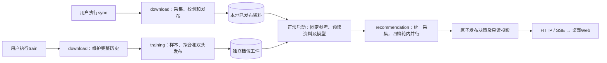
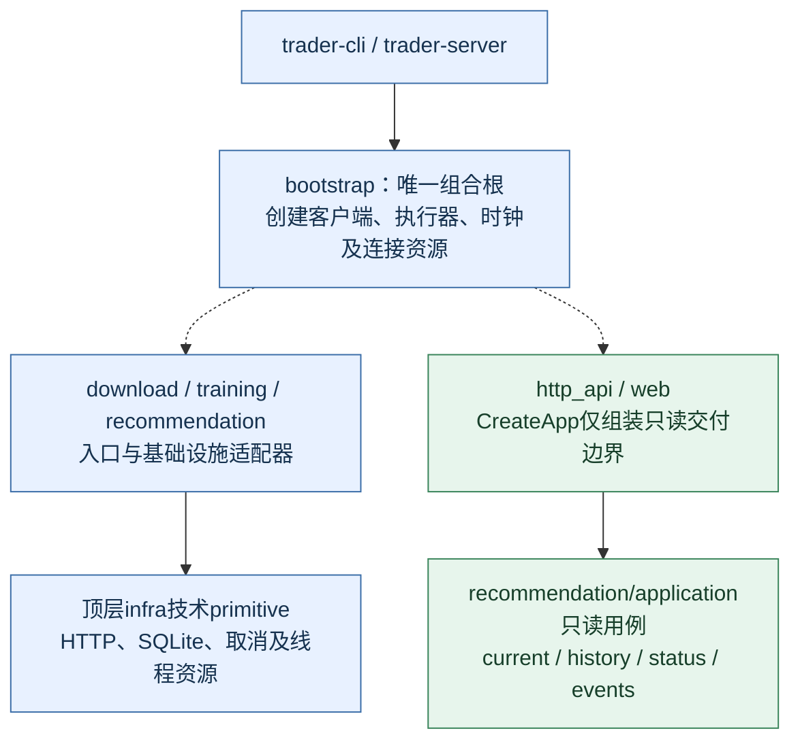
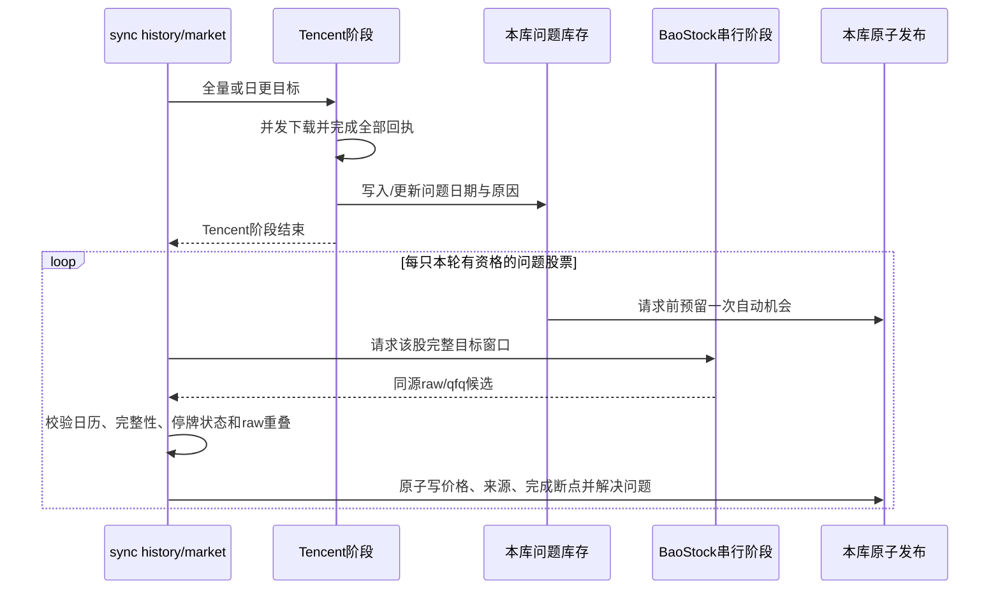
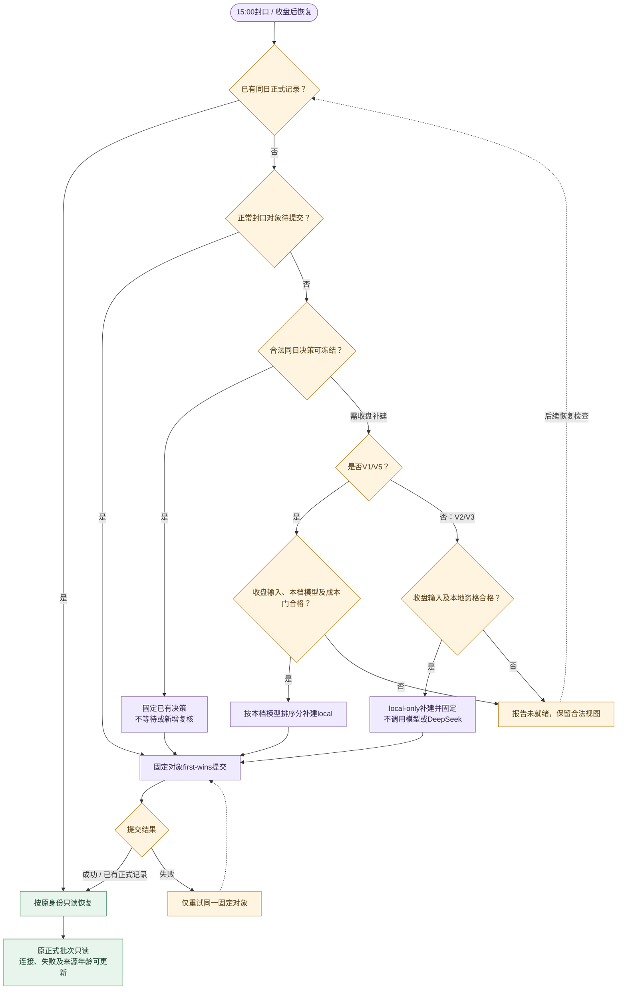
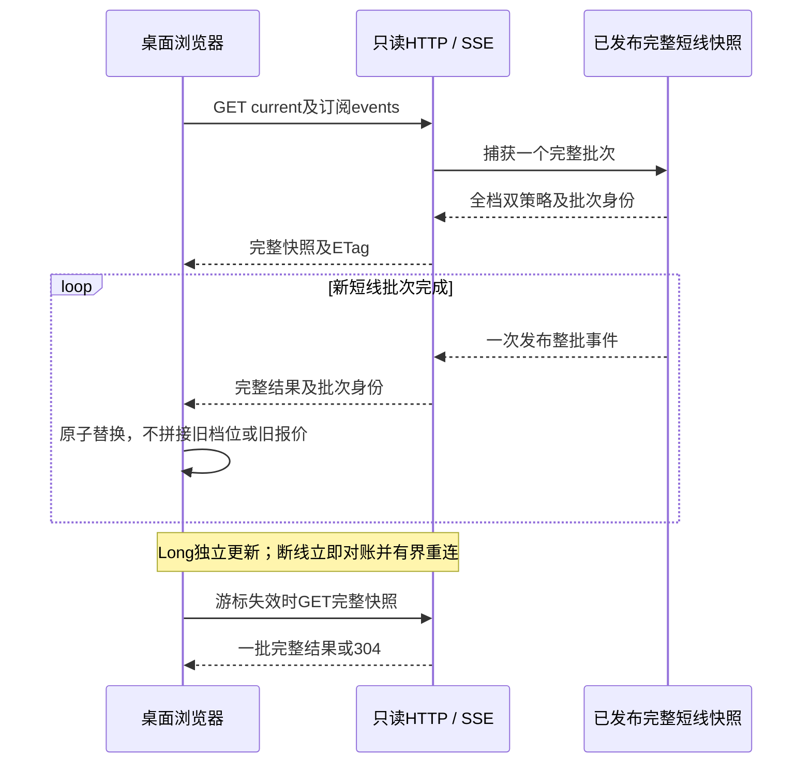

# 工程设计

本文是产品范围、架构、资源、时间线、API/Web、运维和验收的唯一权威。
评分及收益准入见[评分逻辑](1_评分逻辑.md)，数据维护见[下载训练](4_下载训练.md)，完成状态只查[工程实施](3_工程实施.md)。

本轮框架目标按[total_plan.md](total_plan.md)统一；用户后续明确Long保留现有独立更新频率、不参与四档双策略发布屏障，此项以该要求为准。120秒本地整轮和四档本地原子发布已完成代码切换，仍须以真实盘中整轮和浏览器证据验收；热路径零数据库操作尚待后续步骤闭合。DeepSeek流程、请求合并、缓存及配置迁出暂缓，启用状态沿现有配置，联合验收单列。明确标为“当前”的参数、源码审计及布局只描述现状，不与目标并列成为另一套规则；历史证据不得升级为新框架完成证明。

## 1. 产品定位与范围

这是运行在个人PC上的A股研究看板，只提供研究结果和只读展示，不提供真实下单、多租户或移动端业务。

| 范围 | 当前约定 |
| --- | --- |
| Python | 3.10–3.14 |
| 浏览器 | 当前稳定版Chrome、Edge、Firefox桌面版 |
| 访问 | 默认127.0.0.1，默认端口5000，无远程身份认证 |
| 策略 | Tomorrow、D25、不评分的Long |
| 模型档位 | V1/V2/V3生产档位及独立V5 TCN生产排序；不是额外的持有期策略 |
| 推荐展示 | 同轮评分前六，每只标记推荐、关注或回避 |
| 正式记录 | Tomorrow/D25在15:00 first-wins；Long不冻结 |

### 1.1 现状与目标怎么区分

| 事项 | 当前实现 | 仍需单独验收 |
| --- | --- | --- |
| 慢资料 | 手动sync/train；启动共享预读轻量公司事实和参考，运行中不轮询文件或慢库 | 真实来源覆盖、时效与启动性能 |
| 选择链 | 完整合格总体→模型门→本地评分→一次风险扣分→按档位固定总前六 | 全市场输入覆盖、同轮交付和资源 |
| 风险复核 | 只复核固定六席内合格对象；veto保留席位，不补位 | 真实证据质量与复核增量 |
| 集中度 | 无行业限额；板块最多四席，同行业可以占六席 | 共同风险披露及样本外影响 |
| 内存 | 同进程共享512 MiB逻辑缓存、2 GiB RSS验收预算 | 真实RSS、连续增长与延迟门 |

“已实现”只描述工程行为，不等于真实全链、收益或发布通过。待实现目标须显式标注，不能作为当前操作说明；具体证据只查工程台账。评分参数及算法变更的准入归评分逻辑。

### 1.2 唯一活动产品边界

1. 活动产品代码只在src/trader，组合根为bootstrap.py。
2. 页面只有根工作台和第9节列出的API；不保留旧策略页面或带项目版本前缀的兼容路由。
3. 配置用data_dir承载业务数据，runtime_dir承载锁、日志和临时产物；其中DeepSeek预算状态必须可靠持久化，不能当可丢弃缓存清理。
4. 缺数据或模型时只读Web仍可启动并报告未就绪；工件损坏不能伪造可用模型。
5. 新框架不要求兼容旧数据，不写旧schema迁移、旧工件解码或双读fallback；新运行期已发布记录保持原身份和first-wins。历史文本不代表当前活动合同。

## 2. 系统能力与业务流程

### 2.1 三条业务链

下载、训练、实时荐股分别运行，不设计三者同时运行的资源调度。普通run.sh只启动在线推荐；sync/train由用户手动执行，完成后正常重启加载新内容。荐股启动和运行期间均不执行历史整窗恢复、尾部补缺或公司资料补下载，也不安排后台补缺；缺失、过期或覆盖不足只保留限制并提示手动sync history/market/company。实时行情和分钟刷新仍按在线合同执行。图示说明交接，下载与训练的顺序、退出码和断点合同见下载训练第1节。



| 业务 | 唯一责任 |
| --- | --- |
| download | 历史、短窗口、参考和公司证据采集及发布 |
| training | 样本、拟合、模型发布、隔离研究及结算；不自行启用模型 |
| recommendation | 在线行情、资格、评分、风险、六席和冻结 |
| http_api / web | 只调用推荐应用的只读用例，按白名单展示；不采集、训练、评分或写业务状态 |

### 2.2 一轮数据如何到页面

**目标合同，待实现与验收。** 默认V1/V2/V3/V5四档参与，每档包含Tomorrow/D25；显式所选档位集合在启动固定。Long保留完整名单及现有独立更新频率，不评分、不排名、不冻结；不参与短线采集和发布屏障。

1. 启动一次预加载参考、公司轻量事实、历史及共享派生量和模型，固定发布身份；训练样本库不进入推荐链路。
2. 现有RecommendationRounds / RoundAdmission拥有唯一轮次、启动时刻及单调绝对截止；从排队和采集开始到服务端发布共用120秒上限。
3. 对四档所需证券取去重并集，统一取得报价及所需分钟数据。供应商允许有界分批，采齐后锁定不可变输入；保留来源真实时间戳和新鲜度检查，不把分钟时间改成报价时间。
4. 按相同窗口、公式、总体和版本复用过滤及基础计算。档位专属窗口、模型输入、排名、成本和动作门独立；评分分支不再刷新行情或补资料。
5. 四档本地计算并行，结果写入本轮私有工作区；整轮执行失败或超时不能发布。DeepSeek改造暂缓，当前仅验收本地链，显式记录复核启用状态及覆盖范围。
6. 全部启用档位双策略均形成结果后，由唯一发布owner检查轮次、取消、截止和预期版本，一次替换完整内存快照；各档视图由此派生，不另有可写current。
7. HTTP、SSE、Web消费同一批次。发布前完整保留上一批，发布时一起替换名单、分数、报价、原因和诊断；删除短线独立报价overlay；DeepSeek联合发布流程待后续独立核对，本轮不宣称已切换。

合法空集、合法降级、模型未就绪和执行失败必须区分；缺模型不能造预测或借旧档结果拼接新批。任一必需执行分支失败保留上一完整快照，失败提示及来源年龄可独立更新。完成或失败回收后即可重采，不等满120秒，旧轮与新轮不得重叠。取消及持久化边界分别见第4.2、8节。

完整合格人口先过模型门，再评分、扣一次本地风险并按档位选六；不恢复每板120只或720只并集上限。共享计算不改变总体、字段完整性和来源年龄，覆盖及性能须分别实测。

### 2.3 分数、模型与风险

公告原生文本主解析由隔离的Poppler `pdfinfo`/`pdftotext`子进程完成；无文字、无法解析或文本解析超时在同篇内转本地串行Tesseract中文OCR。主解析器版本进入策略身份，因此升级后旧失败会自动重新处理。

本地评分、模型成本门、风险扣分和DeepSeek否决的业务定义只在评分逻辑中维护。

当前公司事实库为data/company/company_facts.sqlite3，采用关系表、固定整数枚举和数值/时刻字段，每股一条主事实及必要事件、证据键、待核实项；不保存公告全文、JSON事件数组或续传状态。推荐启动共享一次读取；旧evidence.sqlite3不参与读取或回退。独立eligibility.sqlite3退役，ST仍由market/reference维护，人工永久黑名单和退市排除由download发布到正式库company_exclusion。公司正文核验归download，评分账本归recommendation，HTTP/Web只读投影。

公告定位和采集检查点独立存于data/company/raw/company_collection.sqlite3，正文短暂存于raw/text，PDF仅有界驻留内存。原生文本失败后可进入本地串行Tesseract中文OCR；大小、页数或文本超限只进入独立扩限策略。确定性失败按公告摘要、PDF摘要及对应策略身份封存为不可提取/资料未知，同内容同策略不做每日重试；公告修订或对应策略升级才重新开放，显式`--repair-documents ocr|limits`只处理既有对应失败。每批下载、提取、正式发布、提交回执后删除正文；默认50篇，正文目录上限256 MiB并保留64 MiB磁盘余量，按剩余容量缩小批次。正式事实引用的来源定位、失败状态及成功提取元数据保留，无关已完成目录及分页成员清理；原始目录不参与启动预读，证据详情才按键查询。当前正式库和采集库均使用schema 2。本轮重设计允许按实测热点改变库、表和字段；只初始化新schema，删除旧库迁移和兼容reader，不再保留运维表升级例外，活动重建另按下载训练第7.4节执行。字段短名由持久化codec映射到原领域类型，公开投影、评分语义及共享预读合同保持。实际列名、类型及可空性见[下载训练数据库字典](4_下载训练.md#db01-datacompanycompany_factssqlite3)，原列映射及固定枚举见[字段切换映射](4_下载训练.md#83-公司原字段到当前字段)和[枚举协议](4_下载训练.md#company-protocol)。

公司风险初始状态需要官方上市日期和连续历史覆盖证明，一年公告查询不能代替；缺证据时通过既有review_reasons投影为未知并限制动作。解禁前视完整性在每次内存读取按当前决策日重评，覆盖尾部不足独立降级；这两项均不触发Web或荐股热路径下载。提取规则身份不匹配拒绝加载，需手动同步重新发布后正常重启采用。

既有股票列表的评分列展示最终分、原基础分、实际加分、实际扣分及风险复核；不增加独立加减分列。详情展开规则奖励、策略上限、实际奖励、风险规则合计、上限/实际扣分、已含财务/成长贡献、公司风险等级及覆盖、各事件原因和期限。V1继续区分模型排序分和本地动作分，Long不展示分数。旧记录明确无加减分明细。

GET及SSE的scores.ledger为同一冻结账本的白名单投影，前端不评分。`GET /api/company/<code>/documents?evidence_id=...`最多接收32个证据ID，只通过推荐只读用例按代码及ID读取本地标题、链接、披露时间、正文提取状态；不读全文、不抓网络、不写运行状态。链接仅接受HTTP(S)，页面显示证据读取失败，不把无证据表示成无风险。打开当前证据不修改历史账本。

工程侧只保证输入、父身份、计算结果和消费者一致，不创建第二套公式或默认参数。

### 2.4 发布与恢复

| 对象 | 内容 | 目标变化方式 |
| --- | --- | --- |
| 完整轮次快照 | 全部启用档位双策略及对应诊断 | 截止前统一校验后一次切换 |
| local ScoredFreeze | 本轮本地分、模型诊断、风险、动作、六席及审计 | 先存轮内私有工作区，随完整批次发布 |
| hybrid ScoredFreeze | 本地父结果及已核实结构化风险 | DeepSeek流程改造暂缓；沿现有父身份、截止和正式记录保护，联合验收另计 |
| LongProjection | 完整观察池及独立采集的最新报价，缺价保留条目 | 保持现有频率独立更新，不阻塞或等待短线，不进入短线历史 |
| 正式冻结记录 | 最近完整合法同日决策的规范字节及摘要 | 持久化成功才标正式，同日first-wins |

同一身份同内容重试幂等，身份相同但内容不同拒绝；持久化失败只重试已经固定的冻结对象，不重新评分。轮次、输入版本、会话generation、取消状态、发布序号和CAS由既有owner共同校验，不新增第二套调度或current状态。

MarketInputCoordinator持有不可变输入身份，RecommendationRounds管理轮次生命周期，现有统一发布器负责跨档整批提交；旧各档独立发布依次执行不满足原子切换。计算及诊断写回均须匹配仍有效的轮次。旧轮取消后不能更新共享行情、结果和诊断，回调仅可完成资源清理。

LocalFreezeBuilder及共享缓存有界持有计算投影；任务结束、异常或取消后释放输入引用。正式历史按新schema只读查询，不通过保留旧轮计算对象恢复，也不增加旧协议解码。

## 3. 架构与模块边界

本图是依赖与资源注入图，不表示执行频率。实线向下为代码依赖，虚线为组合根创建并注入；业务调度另见第5–6节。



三个业务内部都按同一方向依赖。下图中的application通过端口使用外部资源，端口实现在infra；箭头不表示application创建或导入infra。

```mermaid
flowchart TD
    subgraph Download["download：采集与发布"]
        DE["entrypoints / infra<br/>命令、供应商、持久化适配器"] --> DA["application<br/>准备、同步、校验和发布编排"]
        DA --> DD["domain<br/>纯数据资格与发布规则"]
    end
    subgraph Training["training：样本与模型"]
        TE["entrypoints / infra<br/>训练命令、模型及样本适配器"] --> TA["application<br/>样本、拟合和研究编排"]
        TA --> TrainingDomain["domain<br/>纯特征、标签及评价规则"]
    end
    subgraph Recommendation["recommendation：实时决策"]
        RE["entrypoints / infra<br/>运行时、行情及决策适配器"] --> RA["application<br/>调度、输入、评分与冻结用例"]
        RA --> RD["domain<br/>纯过滤、分数、风险及选择规则"]
    end
    classDef input fill:#e8f1ff,stroke:#3b6ea8,color:#16324f;
    classDef work fill:#f0eaff,stroke:#8064a2,color:#342653;
    classDef result fill:#e7f5ec,stroke:#39845a,color:#173f2a;
    class DE,TE,RE input;
    class DA,TA,RA work;
    class DD,TrainingDomain,RD result;
```



1. 业务内依赖方向固定为entrypoints/infra → application → domain。
2. domain不读配置、文件、网络、数据库或时钟；application不导入本业务infra和Flask。
3. 跨业务只传不可变类型对象，不传供应商dict或以反射隐藏边界。
4. JSON只出现在配置、供应商解析、持久化codec、schema事件及公开投影边界。
5. 外部客户端、连接资源、执行器和可注入时钟由组合根显式创建。
6. CreateApp()无线程、无网络、无数据库、无文件写入副作用。
7. 模块按职责拆分，活动源码单文件最多1200行，不为行数制造聚合壳。

下载只拥有历史事实、发布与缺口；训练切分、标签、到期和提醒由training拥有。两者共用catalog物理文件，按独立关系表分别编解码和读写；训练到期与提醒表由training创建，只读状态不建表，不通过下载成功状态传递训练资格。完整数据发布不依赖其它档位的模型状态。

证券、ST、日历及完整参考发布由download统一写入market/reference/company_st.sqlite3。采集续传指针与不可变发布成员分离，历史catalog固定准确的参考发布版本；推荐启动读取已发布版本，不轮询采集状态。参考库先提交，catalog后绑定，跨库不宣称原子；缺失或损坏引用明确不可用。历史快照缓存同时检查catalog、参考库及各自WAL的文件身份，外部参考变化后重新核验。完整布局与字段见下载训练附录。

### 3.1 目标流程与诊断交接

业务流程统一按评分逻辑第2.1节的11层描述，当前代码差异见其第2.2节；现有枚举和诊断接口见本文第11.1节。
流程诊断携带批号、输入/输出、拒绝/待补/失败、来源健康和耗时；相邻环节交接身份和数量必须连续。

目标只维护一份流程事实，再投影为阶段、计数和界面；层内诊断不能各自维护第二套状态。11层是业务说明，不要求拆成11个服务、线程池或持久化对象。旧冻结审计的读取边界见第11.1节。

### 3.2 配置权威与规范入口

pyproject.toml是依赖、构建、资源和公开入口的唯一来源；不另建配置真相源。

命名规范统一见[Python工程skill](../.agents/skills/python-engineering-guide/references/coding-standard.md#3-命名格式与可读性)。

### 3.3 配置修改与启动校验

**集中配置边界。** 扩展现有config/*.json和infra/settings，不建立第二配置中心。所有有运行、业务或性能调整意义的参数尽量配置化；纯数学常数、协议枚举、版本及schema结构仍由实现定义。

| 唯一配置归属 | 参数范围 |
| --- | --- |
| runtime.json | 数据/运行根目录、配置入口、全局storage介质选择 |
| scheduler.json、market_data.json | 整轮预算、调度、请求/重试、来源限速、并发、队列和关停 |
| cache.json、storage.json | 缓存/内存；跨业务HDD/SSD连接、批量、事务、读取窗口及checkpoint策略 |
| download.json | 下载范围、专属worker/批次/续传、解析/OCR及整批检查 |
| training.json、features.json | 各档窗口、特征、样本批次、计算线程、内存预约及拟合/早停 |
| filter.json、scoring.json、selection.json、risk.json、cost.json | 过滤、权重、选席/动作、风险和成本 |
| delivery.json、research.json、performance.json | HTTP/SSE、研究及验收预算 |

deepseek.json维持现有唯一归属，参数迁出及调整暂缓。

已迁出的启动历史参数由`scheduler.json.pipeline.history_preload`唯一配置：

| 字段 | 单位及默认值 | 合法范围 | 消费者 |
| --- | --- | --- | --- |
| warn_after_seconds | 秒；300 | 0.001–3600，有限数值，拒绝布尔 | bootstrap注入共享SharedHistoryProjection；首次达到阈值记录实际耗时并继续读取，不终止或重读 |

配置启动时解析为不可变HistoryPreloadSettings；PublishedHistoryCache必须显式接收共享owner，不再自行创建带隐藏默认值的owner。history-sqlite预读及model-inputs诊断使用指定runtime配置；隔离database-baseline使用被测checkout的配置。历史预读只执行一次；读取、解码及内存投影共用取消检查和单调耗时观测，超过提示阈值只打印一次耗时，完成或失败时记录总耗时。文件、解析、SQLite、容量或发布身份变化等错误明确报告，不自动重新扫描；用户取消和进程停止仍终止读取。提示阈值不参与特征/样本配置身份；诊断单独记录实际参数。此调整不证明启动提速，也不改变120秒推荐轮次合同。

`storage.json`由`infra/settings`一次解析为不可变HDD/SSD参数组，介质选择仍仅由`runtime.json`拥有；下载专属参数不在`storage.json`重复定义。当前配置清单如下，表中数值是迁出时的既有行为，不是性能调优结论：

| 配置及字段 | 类型、单位与当前值 | 消费者及身份边界 |
| --- | --- | --- |
| `storage.json.*.connection_timeout_seconds` | 有限正数，秒；HDD/SSD均为5 | 公共存储策略及介质诊断；不进入特征、样本和模型身份 |
| `storage.json.*.read_window_rows` | 正整数，行；HDD/SSD均为512 | 存储/训练样本诊断按实际检测介质投影；改变前仍须步骤五同介质实测 |
| `storage.json.*.transaction_batch_rows` | 正整数，行；HDD/SSD均为64 | 存储策略投影；业务专属写批次继续由所属配置拥有 |
| `storage.json.*.checkpoint_mode` | `PASSIVE/RESTART/TRUNCATE`；当前均为`TRUNCATE` | 存储策略投影；正式持久性及first-wins不因调参放宽 |
| `download.json.history.write_batches` | 正整数，代码数/单元格数；上限64/32768，HDD首建8/16384、增量16/8192，SSD均16/8192 | 历史下载写入调度；按运行介质选择，unknown保守采用HDD组 |
| `download.json.online_qfq` | 窗口交易日、worker数、秒、重试次数；251/61、8、15、2 | QFQ下载、历史腾讯补缺、CLI和诊断；构造器不保留同名数值默认 |
| `download.json.company`临时正文容量 | 正整数，字节；256MiB容量、64MiB保留 | 公司正文临时文件owner；组合根和诊断显式注入 |
| `performance.json.database.hdd/ssd` | 百分比、胜出轮数及证据状态；HDD为validated，SSD为unverified | 数据库/列式候选诊断按独立物理介质选门，unknown拒绝选门 |

`strategy.json`拆分文件中的过滤、选席、公司评分、信号、风险罚分和阈值均由启动加载器校验后注入；正常可调字段不再以“必须等于当前值”锁死。分数两位`ROUND_HALF_UP`、固定公式/schema、DeepSeek覆盖门及每日168次等不可放宽合同继续由实现和权威评分合同约束。DeepSeek配置迁出仍暂缓。

1. 默认迁出保持数值和行为；关键值在所属文件显式定义，构造函数不保留同名硬编码默认值。派生参数由配置及实际资源计算。
2. 启动一次解析为有类型的不可变对象，由组合根注入；业务代码不读配置文件，每轮不重新解析。修改后正常重启生效。
3. 启动校验类型、单位、范围和参数关系，拒绝缺失必需字段、未知字段及冲突组合；不以“必须等于旧硬编码值”阻止合法调整。
   凡现有`config/*.json`已经定义的可调字段，加载器和消费者不得复制当前数值、以等值表重复维护，或解析后改用代码字面量。实现只保留字段/枚举/schema结构、类型、范围、跨字段关系及不可放宽的业务上限；需要固定的纯数学或协议常数不得伪装成可调配置。
4. 120秒整轮、每日168次物理请求等业务上限继续独立限制，配置化不授权放宽。评分/模型参数改变仍须业务及收益准入；线程、批次、SQLite和缓存的性能调整先满足第7.6节实测门。
5. 特征、样本、模型身份仅绑定真正影响结果的配置；监听端口、日志及不改变语义的存储批量不触发全部样本重建。新运行期正式记录不因配置改变而重解释。

当前可用`.venv/bin/trader-cli --config "$PWD/config/runtime.json" validate-config`核对配置解析、跨字段关系和实际投影；它不证明资料、模型或性能候选已经就绪。JSON布尔使用true/false，不接受字符串、数字布尔、注释或尾随逗号。监听地址、端口沿现有本地边界与TRADER_HOST/TRADER_PORT覆盖规则，不另建环境变量配置中心。

## 4. 生命周期、并发与资源所有权

### 4.1 表 R：资源所有权唯一规范

| 资源 | 所有者 | 生命周期及限制 |
| --- | --- | --- |
| HTTP/供应商客户端 | bootstrap创建，业务适配器使用 | 超时、取消、来源隔离；关闭时可等待 |
| 业务执行器 | bootstrap | 本地计算、网络等待、下载写入职责分开；不隐藏创建池 |
| SQLite连接 | 持有连接的单线程/会话 | 显式关闭、短事务，不跨线程共享可变连接 |
| 公司事实和历史特征投影 | recommendation内存消费者 | 启动固定发布身份；维护后正常重启加载，失败保留合法投影 |
| 模型 | training发布，recommendation启动读取 | 同档双头一致，不热替换、不自动切档 |
| 正式记录与发布序号 | recommendation | 冻结库内first-wins；独立序号库先持久预留再发布 |
| 共享DeepSeek预算 | recommendation共享账本 | 跨档位、重试、失败共同计费，原子预留不退回 |
| 研究及训练临时资源 | training | 有界、可停止；与推荐内存预算分别核算 |

### 4.2 排队、完成和关停

**目标合同。** RecommendationRounds拥有整轮状态，不再允许各档latest-wins任务独立推进可见结果。

1. 每轮固定`started_monotonic + round_timeout_seconds`，默认及业务上限120秒；本轮本地链的排队、采集、分批、重试、计算和服务端提交传递同一截止；DeepSeek联合流程暂缓。
2. 所有分支只用剩余预算；阶段上限可更小，不能各自重新获得完整时间。发布临界区再次检查截止，达到第120秒即失去提交资格。
3. 超时或失败先撤销发布资格，再停止派发并取消可取消任务；长计算按有界批次检查取消。Future.cancel()或等待返回超时不表示同步调用已经终止。
4. 不可协作取消的外部调用复用infra/isolated_call等可终止隔离执行，资源由bootstrap创建、终止并回收；不以不断新建线程实现恢复。
5. 回收完成后立即重采，不堆积下一轮输入、不重叠；清理耗时单独报告，旧任务不得写共享行情、结果或诊断，也不能占下一轮资源。
6. 停止接单、取消、等待及队列排空可观察；总关停期限以`scheduler.json`的`pipeline.shutdown_timeout_seconds`为唯一运行配置，默认值当前为30秒。组合根将其注入调度器、命令行取消watchdog及下载/训练/性能资源收尾；已有共享`ShutdownDeadline`的组件必须继续传递同一截止，不给每个组件重新起算完整预算。超期仍有活动资源必须报告，不能宣称已停止。

当前同步调用和旧队列的能力缺口见第7.5节源码审计；本目标不表示硬终止已经实现。15:00冻结独立优先，不能被本轮等待阻塞。

### 4.3 SQLite公共边界

| 层次 | 职责 |
| --- | --- |
| infra/sqlite_connection.py | 驱动封装、连接选项、释放、事务、建表校验、完整性及有界备份primitive |
| 业务adapter | SQL、表合同、编解码、业务错误和发布语义 |
| application/domain | 使用业务端口和类型对象，不操作驱动 |

持久业务数据使用FULL持久化；仅可重建训练临时样本可按其合同降低同步级别。
WAL/FULL用于共享短窗口、公司证据等并行读写场景，不能靠关同步来获得性能。
硬盘介质检测唯一owner为infra/storage_probe，由组合根在CLI数据命令及服务启动时检查配置目录，支持手动路径覆盖和unknown修改提示；SQL/open热路径不重复检测，HTTP/Web工厂无探测副作用。只读诊断将应用配置和自动检测的物理介质分开报告，已知冲突必须降级；手动配置不替代性能验收的实际介质证据。目录范围、配置及只读诊断见[下载训练的数据目录硬盘检测](4_下载训练.md#数据目录的硬盘检测)。
公共连接会话、显式事务和原子初始化由同一技术边界提供；业务消费者保留自己的SQL与编解码。交付状态及隔离性能证据只查工程实施，不能外推为真实全市场验收。

## 5. 交易日与时间线

### 5.1 表 T：交易日时间线唯一规范

所有业务时间为带时区Asia/Shanghai，窗口左闭右开。交易日只取可靠日历，不按星期猜测。
日历不可用时Web可启动，但交易任务、评分和冻结保持calendar_unavailable；目标不在推荐循环联网补日历或扫描慢库，提示手动维护并正常重启。

| 状态 | 行为 |
| --- | --- |
| 启动 | 一次预读本地参考、公司事实、历史派生量和模型；缺失/过期降级，不下载慢资料 |
| 09:15至15:00，含午间 | 统一before_close；按第6.2节完整轮次连续采集、计算和发布 |
| 15:00节点 | 独立停止常规评分和DeepSeek，Tomorrow/D25按最新合法同日决策first-wins冻结，不等待慢轮 |
| 15:00后 | 已有同日正式批次只读；缺记录才合法恢复或补建一次，详见第8节；不以独立报价刷新修改正式批次；Long仍每10秒更新收盘显示 |
| 交易日盘前09:15以前 | 不采集/评分，Web可只读展示已有结果 |
| 非交易日启动 | 按最近交易日真实收盘执行一次完整测试预览；所有档位共用此模式，Web只读内存，不冻结或写正式历史 |
| 手动维护 | sync/train由用户执行；启动不安装或卸载宿主调度任务 |

只保留15:00作为荐股封口控制节点；分钟及行业数据的业务适用窗口保持，采集纳入同一轮次，不构成独立发布调度。

暂停、休眠唤醒或跨日后用会话generation隔离旧任务；迟到、旧交易日和旧会话结果不能写入当前索引。
真实五时段证据与代码中的保护逻辑分别判断。

非交易日预览由组合根共享的`RecommendationRunScope`在可靠日历加载后确定，适用于V1/V2/V3/V5单档、组合及默认全档。该进程固定为测试预览，跨日不会自动转为正式交易调度；正式运行须正常重启。日历未就绪时不猜测最近交易日，也不启动正式写入。输入预读未完成可等待，完整输入就绪后每档Tomorrow/D25各计算一次；成功或失败后均不重复评分，刷新页面只读内存。Long不进入预览评分或冻结；沿用当前预览路径独立取得一次最近交易日D的真实收盘报价，不受短线模型或历史预加载阻塞，保持3秒请求预算。只接收D的15:00及以后真实报价，保留来源日期、实际接收时间及缺失状态；不将更早交易日或D盘中价冒充收盘价。

采集使用最近交易日D的收盘事实：报价来源时间须属于D且不早于15:00、不晚于实际观察时刻；不伪造星期六报价或把D盘中价当收盘价。分钟行须属于D，历史模型窗口仍按各档信号日合同对齐。实际数据年龄保留，用显式preview上下文解释收盘资格；普通交易日的新鲜度合同保持原样。预览依次采集全市场、行业、合格总体报价和分钟，再使用正常模型、成本门、评分、风险及选席；模型合同冲突和历史超时明确失败，不借旧名单或close_fallback补齐。可选DeepSeek仍遵守真实运行日共享168次物理请求预算，失败保留合法local结果。

Tencent全市场批次只用完成时间标识批次版本，来源时间和分片实际接收时间保持供应商解析结果。启动参考资料先交给行情合并器，静态资格及其余固定输入全部就绪后才打开实时读取门。多档共享分钟通道时，被新请求替换的等待按可观测的分钟批次失败处理，沿用既有有效缓存及降级限制；无有效分钟仍保持缺失，不将可选分钟通道竞争直接变为整轮预览失败。

当前实现曾对非交易日预览全市场与候选分别给予180秒预算；这是待替换的旧分段边界。目标在输入就绪后对一次完整预览同样采用唯一120秒截止，不给各阶段重置预算；启动预加载单独计量，来源时间资格、模型输入门及不写正式记录的限制保持。

决策的`trade_date`为实际计算日，`market_trade_date`为D；`observed_at/generated_at`为实际生成时间，`market_as_of`为D的15:00。独立`preview_run_id`进入决策身份和版本，序号只在内存分配。current、SSE和状态仅在预览时增加`run_mode=preview`及市场日期/时间字段；状态另有`preview_started_at`、`preview_state`（waiting_inputs/running/ready/failed）及`preview_error`，旧正式记录和普通响应不增加空字段。页面同时显示测试预览、收盘日期、计算时间和阻塞原因；V1/V5已获生产授权仍不能将预览写成正式记录。

预览只发布内存索引及SSE，不创建或恢复正式checkpoint，不冻结，不写正式推荐历史、研究轨迹、基准或收益结算。调度器在派发前隔离正式控制任务，写入adapter在初始化/连接前再次拒绝preview；允许必要的DeepSeek预算和请求审计。非交易日测试结果不能冒充正式记录、历史回放或真实收益验收。

## 6. 数据服务、刷新与降级

### 6.1 来源职责

| 来源 | 当前用途 |
| --- | --- |
| 上交所/深交所官方列表 | 证券代码、板块、上市日期等身份参考 |
| Tencent | 全市场主路、候选与TopK定向报价；download使用日历及raw/qfq日线 |
| Sina | Tencent全市场失败/超时后的顺序备路，主路成功则不请求 |
| 东方财富及现有AKShare适配器 | 分钟尾部、财务、质押、解禁和有界候选新闻；不进入在线全市场主备 |
| 巨潮 | 分市场/日期的公告、正文及可核验公司事实 |
| BaoStock | 证监会历史行业及当前行业参考；history/market的Tencent整批结束后提供问题股票的同源raw/qfq补缺，不提供实时价格主路 |
| Tushare | 当前120积分能力下daily未复权独立审计，不是生产财务或qfq补缺源 |
| DeepSeek | 可选结构化事实复核，不生成候选或数值分 |

不要因为源不参与全市场报价就删除其其它真实用途。没有消费者的旧能力不作为目标能力保留。
完整字段及缺失处置见评分逻辑第3节，下载协议见下载训练第3–4节。

报价adapter在进入MarketQuote前统一累计成交量为股：Tencent字段6及诊断用东财f5按手乘100，Sina volume直接按股读取；缺失、负值和非有限值记为缺失。Sina与东财公开接口单位可交叉核对[AKShare股票数据说明](https://akshare.akfamily.xyz/data/stock/stock.html)。供应商volume_ratio与实际volume分别保留，不能互相补齐。
字段来源、标量/列式合并、变更检测及诊断均携带volume。历史DailyBar统一为实际股数：腾讯日线在download共享解析处换算一次，东财日线adapter按手乘100，本地raw/qfq投影使用raw实际量并保留qfq价格。特征只读取前5个完整交易日的量，具体公式和缺失处置归评分逻辑第6.2节；此内部输入不额外扩展HTTP公开字段白名单，也不改写已有历史或冻结记录。

#### 6.1.1 价格下载与补缺状态机

`download`是完整历史、独立短窗、问题记录、来源绑定和发布状态的唯一owner。完整历史与短窗各自维护问题库存，禁止一方读取或修改另一方的缺口、尝试次数、来源身份和完成断点。HTTP与Web只读已发布结果，不触发补缺。

首次全量和后续日更使用同一两阶段编排：先完成整个Tencent阶段，待所有股票下载、校验和持久化回执收齐后，汇总问题股票直接进入BaoStock阶段，不再组织第二轮Tencent失败股票重试。Tencent可以使用既有有界并发；BaoStock只允许一个会话串行请求，raw、qfq、隐式分页和物理重试共用限速时间线，日线请求起点至少间隔1.5秒。history、market和当前行业查询共用`data/market/reference/baostock.lock`进程锁，两个进程不能同时形成BaoStock请求。



问题股票的补充单位是整只股票的目标窗口。完整历史取目标2000个市场交易日，新股按上市日裁剪；market取251日，并从同一候选产生V3的61日切片。只有候选日期完整、每个日期为完整raw/qfq或供应商明示停牌、raw重叠满足下载训练第3节容差时，才允许整窗切换来源。不同供应商的qfq基准不得按单日混合，不做缩放、平移或合成；校验失败保留旧有效窗口和未解决问题。

自动机会按“库、股票、缺失日期”持久化。一个缺失日期在首次全量或该次日更中最多自动进入一次BaoStock阶段；失败、中断或仍不完整时保留失败回执，后续普通日更不重复请求这个旧日期。新增交易日形成新的问题日期，因此有自己的自动机会。`sync history --repair-source baostock`和`sync market --repair-source baostock`只重试所选库已有问题，不运行全市场Tencent价格下载、不顺带推进目标日；无问题时不请求价格。显式批次自身幂等，已有未完成正常全量批次时拒绝越过它直接发布。

已切换为BaoStock基准的股票在日更中仍先检查Tencent尾部。Tencent尾部不能拼到BaoStock窗口；若BaoStock增量与旧窗口锚点完全一致，可用同源尾部合并，否则重新获取BaoStock整窗。每经过20个市场交易日才允许重新取得Tencent完整目标窗口，只有完整窗口通过同一校验才能整窗切回Tencent。

持久化遵守“先记请求、后做网络、发布事务内解决”的顺序。history先把完整候选写入可重放日志，再按未发布序号写年度库，全部年度分区成功后才清缺口、更新来源并发布新快照；中断恢复优先重放本地候选，不重复请求BaoStock，旧快照继续按旧序号读取。market在一个SQLite事务中同时提交价格、V2/V3窗口身份、日历、问题清除、尝试回执、完成断点和publication；仍有问题时不写完成断点。两类库都保留失败原因及未解决计数，不能以供应商返回成功替代持久化成功。

运行输出必须分别报告Tencent完成汇总、BaoStock计划数/已尝试/已修复/未修复/旧缺口跳过数和最终问题统计。活动数据修复前先用`price-repair-audit`在仓库外隔离副本验证完整窗口、迁移、重放及旧快照不变；活动修复后用history只读审计和`qfq-sqlite`核对完整性、双档身份与完成断点。具体字段、表结构和raw容差由下载训练第3–4节维护。

### 6.2 统一轮次与采集窗口

**当前实现，待真实验收。** `RecommendationRounds`固定启用档位、轮次开始单调时刻及一个由`scheduler.json`注入且不超过120秒的绝对截止；准备、采集、模型预算和发布只消费剩余时间。各档本地Tomorrow/D25先进入轮次私有工作区，`UnifiedFreezeIndex`在共享事务锁内先校验全部档位再一次提交；任一档拒绝或到期均不改变任一档current。旧短线六席overlay刷新及两个60秒阶段等待已经删除，Long继续独立，DeepSeek流程调整暂缓。真实供应商卡住、五轮盘中和浏览器绘制仍按第13节取证，不能用自动化fixture代替。

| 环节 | 目标行为 |
| --- | --- |
| 启动 | 一次加载历史、参考、公司、模型及共享派生量；未就绪明确报告 |
| 轮次开始 | 固定启用档位、会话、开始时刻和唯一120秒单调截止 |
| 采集 | 四档所需证券去重采集；分钟来源时间和原新鲜度要求保持，采齐后锁定 |
| 计算 | 四档并行，各档Tomorrow/D25保持差异；同窗口、公式、总体和版本复用基础计算 |
| 复核 | 现有DeepSeek行为保留，流程/配置/缓存改造暂缓；验收注明开关及覆盖范围 |
| 发布 | 全部分支形成完整结果后一次替换名单、分数、报价、原因和诊断 |
| 失败/超时 | 保留上一完整批；撤销资格、终止与回收，之后立即重采 |
| 15:00 | 独立优先冻结最近完整合法结果；先落盘再标正式，不等待慢轮 |

现有分钟尾盘窗口13:00至14:48及行业数据适用时间是输入语义；分钟粒度不保证每轮有新内容。窗口、来源限速、队列与较小请求timeout由所属配置注入，但所有请求和等待只能使用整轮剩余预算。缓存可复用未变化的算术结果，不能刷新来源年龄或让评分分支自行混入新报价。

慢资料全部手动维护，运行中不扫描发布身份、读慢库、补历史或热加载模型。V2/V3/V5训练到期和V1模型状态在启动读取后仅由HTTP投影内存；已加载/磁盘身份和restart_required反映启动检查，不表示持续监测。配置和资料维护后正常重启。

Long使用配置中的完整固定名单，不套用短线ST、退市或其它荐股过滤；缺报价保留条目并标记缺失。它保持现有独立报价通道和10秒更新频率，不等待或阻塞四档双策略，不评分、不排名、不冻结、不写推荐历史；非交易日仍独立读取一次收盘报价。

SSE连通时不轮询完整current，断线按第9节对账。非交易日只执行一次预览；盘前和收盘后行为按第5节；短线不能恢复独立报价overlay，Long按现有规则更新。

### 6.3 表 F：失败分类唯一规范

| 类别 | 示例 | 对外行为 |
| --- | --- | --- |
| 未就绪 | 缺qfq、模型、证券身份 | 报告具体缺项，数据不足不计业务淘汰 |
| 过期 | 报价旧、参考需更新 | 标记年龄，保留有效视图，限制新动作 |
| 来源失败 | 超时、限流、传输失败 | 保留最近有效内容，不以空值覆盖 |
| 内容冲突 | 复权、hash、父身份不一致 | 拒绝新内容，暴露受控原因 |
| 业务全空 | 数据可信，但所有股票被规则淘汰 | ready空集合，保留空原因 |
| 瞬态非法空集 | 输入失败导致无合法结果 | 不发布清空，保留同日有效决策 |
| 持久化失败 | 锁争用、磁盘不足、事务失败 | 重试固定对象，不能重新评分 |
| 复核失败/迟到 | DeepSeek不可用或父决策已变化 | 保留本地，不阻塞只读Web |

primary_blocker优先解释使整批输出归零的待补/失败阶段，其次报告较早的部分降级；行情过期、流动性历史不足、模型输入不足分别报告。模型层输入全部待补时显示“模型输入未就绪”，不得解释为模型业务淘汰；统一诊断从模型层读取输入就绪数，并用实际预测调用计数区分是否执行模型。

### 6.4 降级后还能做什么

保留视图、产生新诊断和发布可执行动作是三件事；“本地降级可用”不能笼统代替各项准入。

| 情况 | 可读视图与新动作边界 |
| --- | --- |
| 来源超时或新内容非法 | 保留最近有效快照，明确来源年龄与失败类别；不能用失败输入覆盖或清空 |
| 模型缺失、损坏或不可用 | Web仍可读，保留已有合法记录；收盘前模型门不能通过，不新增脱离模型门的可执行推荐。收盘后仅按[收盘恢复例外](1_评分逻辑.md#9-冻结恢复与不可变历史)处理；不能将local-only补建声称为通过模型验证 |
| 报价过期或必要输入不足 | 展示已有内容并标记未就绪/过期；不把旧输入当成新一轮可执行证据 |
| 财报仍有效，但公告覆盖截止较早 | 分开显示财报有效性与风险覆盖；未核实或过期时限制新动作，必要时仅观察，不能按读取时间刷新覆盖 |
| DeepSeek失败或迟到 | 合法本地决策继续；不等待复核冻结，不因复核失败更改数值分 |

资料年龄阈值及缺失字段分级须在后续代码计划中对齐评分规则，不能临时放宽净效用门或把数据不足记为业务淘汰。

## 7. 当前运行内存、缓存与性能契约

### 7.1 当前值与扩大目标

| 指标 | 当前配置/校验 |
| --- | ---: |
| cache_logical_bytes | 512 MiB，536870912字节 |
| process_peak_rss_bytes | 2 GiB，2147483648字节 |
| 逻辑缓存预留 | 520 MiB池减8 MiB预留；预留不可分配为常规缓存 |

1. 逻辑缓存按规范JSON载荷估算，不是Python实际占用；对象、索引、模型、线程和临时副本还占内存。
2. 2 GiB是RSS性能验收线，没有操作系统强制内存限额。
3. 当前解析器固定校验512 MiB/2 GiB；各组依次为264/116/49/33/25/25 MiB。目标按第3.3节迁出为唯一配置及关系校验，默认不变；扩大预算须先有实测证据。
4. 默认、单档和任意组合共用单个推荐进程预算，不能每档重复领取；离线训练另行核算。
5. 扩大预算的目的为减少读库与重复计算，不等于已经提速。

任意档位组合由bootstrap创建一套行情客户端、来源通道、分钟执行器及基础缓存，公共参考和公司资料各预读一次，共用同一个DeepSeek原子账本；模型、各档输入窗口和决策身份保持隔离，资格写入队列由全进程共享；现有各档独立控制与持久化队列须接入唯一轮次和整批发布owner，不再各自推进current。包含V2时由V2持有共享资源，否则由列表首档持有；owner先启动、最后停止，其余档位按创建顺序逆序停止。
轻量公司事实、公共参考及各档历史派生量由原owner持有，通过共享缓存常驻预留计量，分组容量不足明确待补。模型、索引和临时对象计入进程RSS，不能通过移出缓存统计绕过预算。

V1/V2/V3/V5共用一个CompanyEligibility及资格写入执行器。事实排序、证据摘要与计数仅在事实变化时重建；排除视图在下一事实生效时点前复用，跨生效边界或回看更早时点重新筛选，仍按请求时点返回资格证据。新ST/退市风险立即在共享内存中生效；非ST排除按最多512条一批交给主档拥有的单个有界执行器提交，荐股计算调用不等待SQL或公司发布摘要重算。失败事实保持待提交，60秒冷却后由下一轮记录调用重试；停止时尝试排空并报告未完成数量，停止期限传递到SQLite取消边界。待写项尚未持久化，强制结束进程不保证恢复；已提交永久排除不受影响。只读状态展示pending_persistence_count，不触发写入。该队列只提交已观察到的资格事实；历史、短窗和公司资料仍由用户手动sync更新。各档模型输入、决策和正式冻结身份保持独立，整轮控制与可见快照统一拥有。

### 7.2 增加容量放在哪里

启动预读完成后线程退出；新输入按数据、来源、交易日、配置及发布身份查共享缓存，命中则复用不可变结果，未命中才计算并按容量缓存。各档模型门、评分、决策及冻结身份继续隔离；缓存命中不能绕过时效检查，也不增加刷新定时器；缺项只在已加载内存上计算，不能触发数据库或文件fallback。

| 优先驻留 | 希望减少的工作 | 仍需控制 |
| --- | --- | --- |
| 公司事实、证券资格和行业引用 | 反复SQL查询和解码 | 新鲜度、发布身份、来源失败 |
| 历史派生因子、模型基础输入 | 反复读取日线和重复派生 | 窗口、复权、字段完整性 |
| 同轮总体和共享特征 | Tomorrow/D25重复构建 | 不混交易日、配置或输入身份 |
| 有界原始日线 | 热路径读库 | 不复制完整2000日训练历史 |

全市场、候选报价、分钟及参考条目容量为12000；同事实报价因子通过共享quote_factor_inputs缓存复用，各档模型长窗计算独立。容量和预算扩大未延长原有输入TTL或动作年龄。
基础因子按股票、上海交易日、基础配置和schema只保留最新输入；实际数值依赖与历史条目相等时复用，接收时间、日内来源时间和供应商版本不单独触发算术重算。并发合并后仍核对实际输入，迟到写入遵守原来源/接收时间顺序。输入版本忽略生成结构化摘要的观察时间，真实证据日期、报价来源时间、来源质量、风险和执行限制仍参与接受判断；每轮资格与来源年龄继续按当前时间复核，行情force刷新及TTL不变。
已发布历史经FactorHistory投影为基础计算实际需要的标量与收益锚点，基础因子缓存不再携带完整HistoryContext、原始日线或待补字段占位；未提供发布摘要的独立计算调用仍保留原始输入以复用历史统计。各档长窗模型锚点独立计算，不因250日锚点变化重算共享短窗基础因子。候选组的全部横截面数值及归一化元数据均有完整市场参考时，直接消费该参考；部分覆盖仍沿用原候选组计算，再覆盖已提供的参考，明确None不被填成中性值。
V1每次按当前完整合格总体构建模型输入并预测，再计算排名、成本和发布身份。V2/V3/V5保持事实、共享计算与原始预测缓存；模型向量按本轮计算结果构建，完整输入相同时复用既有原始预测。推理前后与结果投影仍受deadline约束，V3逐行点积归约保持；V5计算精度由已校验模型工件声明，允许float32或float64，训练参数及候选采用门见下载训练第5.5节。
缓存身份仍绑定数据集、来源、主体、请求、交易日、阶段、配置和schema；失败保留最近有效值。
启动DailyFeaturePack与ResearchEpoch绑定证券、日历、行业、qfq、公司、模型及配置发布身份，复用原有输入版本传入决策。DailyFeaturePack只增加派生值与字段来源，原始日线仍只保留最近20行；启动身份未绑定完成时评分待补，只读Web可继续提供已有结果。

四档FeatureBuilder通过同一market_cross_section缓存复用总体分位数、行业强度/宽度及市场宽度；实际依赖字段、股票范围及顺序、上海交易日、来源数据版本和算法schema参与身份，模型专用长窗字段与接收时间不触发公共算术重算。同输入并发只计算一次，公共归一化统计在一个总体中只保存一份；最多保留4个总体，计入既有feature_batches分组预算，容量不足仍返回本次计算结果。完整市场参考继续直用，部分参考只覆盖本次候选视图，不改共享结果。每轮报价/证据时效、模型、动作和冻结身份继续独立构建；复用算术不表示旧报价重新有效，也不触发SQL或补缺。

### 7.3 性能怎么证明

| 测量项 | 比较内容 |
| --- | --- |
| 缓存 | 命中率、淘汰次数、实际载荷、分组占用 |
| I/O | SQL读取数、连接/事务次数、磁盘读取 |
| 延迟 | 分别测来源年龄、冷启动、输入准备、纯计算、发布及浏览器延迟，再报整轮P50/P95 |
| 内存 | RSS峰值、可用内存、换页、连续运行增长 |
| 正确性 | 同输入的分数、排序、身份和冻结结果一致 |

同一机器、相同负载下新旧实现交替至少5轮；物理冷缓存、预热缓存及真实网络分别说明。
当前绝对延迟和5%相对回归门仍由config/performance.json拥有；100 tick增长门为20%，不能用扩大预算掩盖持续增长。
旧10秒报价刷新不代表完整评分链性能，目标已取消独立overlay。取消预选后，分钟缓存、请求队列和性能负载都要覆盖完整合格总体，不能沿用旧120只负载宣称全市场提速；不得扩大并发到无界或放宽来源年龄。
全市场和候选报价各自有界，但盘中调度受第6.2节同一个跨档轮次约束：启动预加载完成后统一采集，全部阶段只用同一120秒剩余预算；前轮未回收不另起采集。候选提交核对市场人口身份，已被新人口替代的结果拒绝，评分只消费完整且同身份的输入。

当前逐项P95数值列在[技术附录](#附录技术参数与诊断字段)；主流程只引用配置拥有的门禁，不在多个章节重复维护。

统一诊断的performance默认在同一进程并发测量V1/V2/V3/V5的Tomorrow/D25八个头；显式scoring-profile可选单档或完整四档列表，local及runtime只选择单档，省略时沿用配置或服务默认档位。诊断与启动、训练一致拒绝both旧别名。负载使用5500股合成输入和真实加载工件，按本档合同生成完整长窗、行业及量价序列；首次计算、完全相同输入、单股事实变化、冷评分状态到草稿分别计时，输入准备、缓存预热和诊断指纹不混入模型延迟。V1沿用独立排序模型，V5使用TCN预测百分位排序；模型全拒可以如实报告，缺模型、缺依赖或合同不符不能用零预测替代。

模型原生调用次数用独立profiler探针逐头统计，不混入时延采样；同进程探针串行执行以兼容Python3.14，实际延迟测量仍按所选档位双头并发。LightGBM只计Booster.predict这一层，TCN计网络批预测，Ridge只计有界批次，内部保留原逐行点积归约顺序，避免浮点误差翻转成本净效用零点资格，不将其计为一次BLAS核调用。持续内存场景复用同组评分实例100 tick，读取当前RSS计算增长，进程高水位只用于峰值门。报告绑定源码、完整输入、双头模型、评分/成本/预算合同及环境；相对比较要求输入、模型、合同和环境身份一致，保留不同源码摘要以比较实现改动。合成评分负载不代表历史磁盘预读、共享行情缓存、真实网络、浏览器或冻结验收，未执行的等价性与正式决策基线明确标记未验证。

所选档位共用一个启动历史投影owner和一个预读线程：按最大所需窗口扫描一次，每股对齐后立即生成各档派生值，共享保留的20根日线；相同窗口长度的不可变历史摘要只计算一次，不同长度分别计算，不常驻多份完整长窗。前置估值扩展按同一股票合并读取，基础日线与派生投影分别计入512 MiB缓存预算；各档的输入绑定、模型和冻结身份仍独立。历史输入质量按观察日批量计算上一交易日；行情相同事实命中原始行与成本参考缓存，人口、行业、价格/金额或配置改变时按完整身份失效。

复核原始事实缓存及single-flight由组合根注入同一实例；策略分类仍绑定本档合同。缓存保留原manifest，重新核验证据后以不可变binding绑定当前候选，不能覆盖原摘要规避校验。先完成本批拥有的请求，再等待其它owner，禁止持有未执行claim互等；等待和HTTP共同受剩余截止时间约束。失败、取消及超时释放claim，所有物理尝试计入原168次预算，数值评分、固定席位和first-wins冻结不变。

### 7.4 运行开销与优化边界

以下按当前实现区分已切换边界与待优化项，性能影响仍需实测。

| 当前问题 | 证据入口 | 优化及验证方向 |
| --- | --- | --- |
| 分钟检查与评分触发已分离 | [分钟刷新路由](../src/trader/recommendation/application/pipeline/data_source/source_router.py)比较完整分钟窗口内容及缺失/过期资格；检查、接收和来源时间分别保留 | 相同内容及资格不使评分缓存失效；同分钟或旧分钟修订、资格变化触发原有节流评分，来源年龄不因重新接收而重置。分钟缓存以来源/接收时间判断先后，内容哈希不作时序比较 |
| 分钟使用独立有界执行器 | [分钟加载器](../src/trader/recommendation/infra/market_data/intraday_loader.py)逐步提交，进程最多5个请求在途，整批共用单调deadline与取消 | 等待、供应商重试均占同一deadline；未发出的请求不记供应商失败，过期结果不回写；完整总体的真实限流和完成率仍须实测 |
| 所选档位共享基础资源与缓存 | [组合根](../src/trader/bootstrap.py)一次创建来源与预读owner，并发同阶段同模式行情请求合并 | 单个等待者超时不取消其它档位；日期、阶段及强制刷新模式隔离，模型、决策与冻结身份隔离，发布目标为跨档一次切换 |
| 行业任务复用已发布市场结果 | [市场特征服务](../src/trader/recommendation/infra/market_data/market_feature_service.py)的全市场构建统一计算行业强度与宽度 | 行业任务读取同人口最新快照，不另建历史/研究特征，不覆写已有研究、风险及较新市场快照，也不刷新来源年龄或市场缓存TTL；行情与引用变化仍由原全市场刷新入口处理 |
| 两策略完成后联合发布 | [整轮执行](../src/trader/recommendation/application/runtime/cycle_execution.py)存在共同等待边界 | 测量慢档和慢策略对整轮的影响；目标必须跨全部启用档位一次发布，不允许拆分 |

当前分钟内容TTL为45秒，旧实现按10秒检查；目标将其纳入同轮采集，保留原TTL与适用窗口。采集、缓存检查和完整评分次数分别统计。
这些问题与加大缓存分别验证；缓存扩大不能证明重复计算和串行等待已经消失。

### 7.5 deadline覆盖审计与完整轮次测量

下表是本轮框架切换前的源码审计，保留未完成缺口，不是目标实现规范，也不能凭文档调整视为已修复。采集/评分触发间隔归scheduler配置，单次网络timeout归来源配置，15:00是业务截止，总关停30秒是资源退出等待预算；performance.json中的P95预算是验收标准，不会自动中断任务。

| 边界 / 当前owner | 已有约束 | 尚不能保证的部分 |
| --- | --- | --- |
| 来源排队：[source_lanes](../src/trader/recommendation/application/runtime/source_lanes.py) | 记录submitted_at至执行的队列耗时，保留一个最新pending；调用者按剩余预算等Future | request.call同步运行；cancel/Future等待超时不能杀死已运行调用 |
| 全市场主备：[source_coordinator](../src/trader/recommendation/infra/market_data/source_coordinator.py) | Tencent主路最多12秒且受调用方截止约束，失败后才尝试Sina；耗尽外层预算不启动备路，超时发取消信号 | 来源编排的剩余预算仍由带时区墙钟差计算，尚未全链统一为单调绝对截止；无外层deadline不能从12秒推导整轮上限 |
| HTTP：[http_transport](../src/trader/infra/http_transport.py) | 单调deadline覆盖连接锁、传输和分段读取；请求timeout与传入deadline取较小值 | 这是一次物理请求边界；全部分批和重试必须继续传同一外层截止，不能重新给予完整预算 |
| 分钟批次：[intraday_loader](../src/trader/recommendation/infra/market_data/intraday_loader.py) | 有界派发，共享单调deadline和取消；迟到结果不写分钟缓存 | 缩短等待不能证明第三方同步调用已退出；需分别观察在途资源及下一合法轮 |
| 校验、合并、输入发布：[gateway](../src/trader/recommendation/infra/market_data/gateway.py) | 来源完成后、canonical merge前检查截止，共享请求等待者有自己的超时 | 合并、校验和内存提交中的同步计算没有统一可强制抢占机制；阶段计时不等于硬截止 |
| 模型上下文：[input_assembly](../src/trader/recommendation/application/pipeline/data_source/input_assembly.py) | 交易日以15:00减当前上海时间建立time_budget_seconds；显式非交易日preview使用既有SCORE任务预算15秒，保留真实input_age；close_fallback不建立收盘前模型预算，V2/V3跳过模型，V1仍须通过本档模型及成本门 | 不是“每轮最多10秒”；从构建上下文到模型调用的延迟不能仅靠模型内部elapsed证明已被扣除 |
| 特征、模型和投影：[model_scoring](../src/trader/recommendation/application/pipeline/local_score/model_scoring.py) | 单调计时在获取模型锁前启动，特征/成本、批推断和分数投影有检查点，返回后过期结果可拒绝 | RLock等待没有超时获取；predict同步执行，在其返回前检查点无法中断卡死计算；本地规则评分也无通用硬终止 |
| 决策持久化及发布：[cycle_execution](../src/trader/recommendation/application/runtime/cycle_execution.py)、[publication_io](../src/trader/recommendation/application/pipeline/freeze_publish/publication_io.py) | session、版本/CAS、正式记录first-wins保护合法发布；SQLite另有锁等待边界 | 身份检查与拒绝覆盖保证一致性，不等于同一个整轮deadline覆盖SQL、发布、SSE和浏览器 |
| 取消及关停：[latest_wins](../src/trader/recommendation/application/runtime/latest_wins.py) | 停止接单、取消pending、以共享ShutdownDeadline等待并报告alive/timed_out | processor同步执行；30秒等待结束仍可能有活动线程，不能声称已强制终止或下一轮一定恢复 |

若要兑现“任何卡死任务均可在整轮上限后恢复”，后续必须沿原owner将队列、来源尝试、校验、计算和提交串成同一单调预算，过期停止派发并拒绝回写；不可协作取消的计算需评估可终止进程，资源仍由bootstrap创建和回收。仅增加JSON timeout或不断新建线程不能闭合该要求。慢请求、无限计算、迟到返回、锁等待、正常下一轮及15:00 first-wins应分别验证。本节只是源码审计，不授予上述硬终止能力。

测量复用唯一诊断入口，文件写仓库外；不启动下载、训练或维护活动历史。以下命令分别覆盖可独立运行的采集、依赖已发布模型的离线计算、以及已运行服务的只读状态：

```bash
.venv/bin/python3 scripts/diagnose_runtime.py --profile market-factor-compare --market-sources tencent --market-profiles v2 v3 --market-sizes 0 --market-mode single --source-samples 5 --market-source-loop-seconds 120 --market-task-seconds 600 --command-timeout-seconds 610 --output /tmp/trader-market-measurement.json
.venv/bin/python3 scripts/diagnose_runtime.py --profile performance --scoring-profile v2 --command-timeout-seconds 120 --output /tmp/trader-performance-v2-measurement.json
.venv/bin/python3 scripts/diagnose_runtime.py --profile performance --scoring-profile v3 --command-timeout-seconds 120 --output /tmp/trader-performance-v3-measurement.json
.venv/bin/python3 scripts/diagnose_runtime.py --profile runtime --web-samples 6 --web-interval-seconds 10 --output /tmp/trader-runtime-measurement.json
```

`market-sizes 0`为完整参考人口；该诊断复用真实供应商适配器，但不是运行服务的完整轮次，辅助公司/分钟探测仍只有三只样本。performance指定V2、V3的两条命令分别执行离线门；省略scoring-profile时执行四档同进程资源门。runtime采样读取同轮计时、身份和漏斗，连续6次HTTP读取也可能重复同一轮，统计前必须按轮次身份去重。

最终证据按所测单档及显式选择的多档同进程运行分别记录至少5个不同完整轮次：有效目标/返回/合格数量、缺失和失败类别、各来源真实时间与年龄、物理请求/重试、队列→采集→解析/校验→计算→发布耗时，另计后台批写和正式冻结持久化、整轮P50/P95/最大值及RSS峰值。说明机器、交易时段、冷启动/预热、配置和模型身份；不要相加各段P95充当整轮P95，五样本尾分位只作初测。源码读到已有计时而未实际采样的字段仍标未测；来源时间跨度也不等于来源年龄。实际结果与阻塞仅记工程台账。

### 7.6 数据库与公共计算的对照验收

实施顺序固定为现状实测→确认瓶颈→候选方案→仓库外隔离对照→达标后实施→实施后复测。使用实际数据规模、真实输入及对应HDD/SSD文件系统；fixture、源码推断或SQL条数下降不替代业务总耗时收益。没有瓶颈证据不改，没有真实输入、介质或合法时点就记未验证并暂不实施该项性能优化；不能先删除基线数据再补理由。正确性及原子发布修复仍须功能验收，若声称提速也须过此门。

阈值唯一来源为config/performance.json：数据库目标负载5组新旧交替，中位墙钟至少减少10%、至少4组获胜，其它既有负载回退不超过5%；仅命名切换只要求正确性及不超过5%的回退，不把改名或SQL条数减少直接算作提速。列式候选的15%及首次/增量总成本门见[下载训练第5.6节](4_下载训练.md#56-列式读取候选的接入门)。磁盘体积记录但不作为这轮性能改造通过条件，实际空间不足和写入失败仍须处理。

目标是正常盘中从采集到服务端发布零数据库连接、零SQL，不能只证明逐股计算零SQL。启动预读、研究/资格后台批写、历史/证据查询和15:00冻结分别计量；后台队列不参与本轮完成判定，但积压、失败、排空及关闭成本必须报告。序号在启动或轮次开始前持久预留，热路径只在内存分配，额度不足不能在发布临界区临时读写数据库。

公共人口、参考、历史、公司、横截面及基础量按真实依赖和身份共享不可变对象；不同窗口、模型和决策保持独立。先观察命中、驱逐、旧轮次引用释放及RSS，再决定是否扩大预算；预算变更须同步配置、解析和本章合同。4逻辑CPU、10 GiB仅是旧方案的规划环境，执行时报告实际分配；不自动提高512 MiB逻辑缓存、2 GiB推荐RSS或训练scope门。

重型下载、训练和荐股基准分别执行；物理I/O使用仓库外真实磁盘，不使用tmpfs/ramfs、不在活动机全局清缓存。每轮绑定源码、依赖、配置、输入、模型、发布及环境，记录连接、SQL、事务、批量行数、WAL、物理读写、RSS、可用内存及换页。新进程、预热缓存和真实网络分别说明；SQL累计时间不能相加当墙钟，五个样本的P50/P95不证明长期稳定性。

历史专项按[总计划第9节](total_plan.md#9-历史优化方向与实测要求)核对当前消费者：行业有界批推断、线性完整值校验、依赖失效和公共参考复用优先验证已有能力。至少100 tick区分缓存、在途输入、草稿、异步队列及原生矩阵驻留，观察引用释放、GC暂停和RSS，不能关GC或改计时起点掩盖增长。索引/连接候选计入查询计划、扫描量、锁等待及最终关闭/checkpoint；历史撤回方案须说明当前瓶颈与候选相对旧试验的变化，不机械恢复。DeepSeek专项不进入本轮性能收益及通过条件。

## 8. 发布、冻结与持久化

**目标持久化边界。** 正常盘中采集到服务端发布不操作数据库；研究轨迹及资格事实进入既有有界后台批量写入器，不参与本轮完成判定。队列满、落盘失败和关停未排空显式报告，不回改已发布名单或分数。序号在启动或轮次开始前持久预留，热路径只分配内存序号；不足时明确拒绝该次发布，不在临界区临时补库，崩溃允许跳号、不允许复用。

15:00正式冻结是明确例外：优先固定最近完整合法结果，先确认持久化，再由唯一发布owner串行协调正式状态及内存快照。布局须先按真实负载对照裁决；若跨档合库可用同库事务，若仍跨库则不得声称原子事务。部分提交失败保留新运行期已提交事实，未落盘者不得标正式，恢复不覆盖已提交记录、不拼接跨档current。

**收盘控制路径：按策略、交易日幂等执行。** 15:00独立封口，收盘后启动执行恢复；先核对正式记录和已固定的正常封口对象，再决定是否需要补建。下图适用于V1/V2/V3/V5正式决策；Long不冻结。新框架不读取或迁入旧检查点，不增加兼容路径。模型、历史与动作的例外只由[评分逻辑第9节](1_评分逻辑.md#9-冻结恢复与不可变历史)定义。



| 数据 | 唯一所有者与原子边界 |
| --- | --- |
| 正式冻结记录 | recommendation；新schema内first-wins，先持久化后投影；事务布局经实测裁决 |
| 发布序号与当前指针 | recommendation；现有持久预留机制在热路径外补足，current只有一个跨档整批owner，不伪造跨库事务 |
| DeepSeek共享预算 | recommendation共享账本；跨档位原子预留 |
| 离线资格、公司事实及历史行情 | download发布，recommendation只读消费 |
| 实时报价、分钟与同轮市场输入 | recommendation；按来源及内容身份更新，不归离线下载拥有 |
| 模型、样本与隔离研究报告 | training；不回写在线评分或旧正式记录 |
| 在线收益结算与逐日决策追踪 | recommendation拥有收益计算、不可变类型、结算编排、写入端口和持久化；training复用其纯计算及类型、只读研究消费，不重写原决策 |

Python对象、HTTP/SSE、事件和规范字节统一使用freeze命名；滚动计算的ScoredFreeze仍须经过正式提交才成为历史冻结记录，名称不授予发布权限。新接口使用/api/freezes，事件字段为freeze_version/freeze_hash，规范记录嵌套字段为freeze；不提供旧字段或路由别名。新字段参与新规范摘要，因此旧协议和旧数据不兼容。旧副本只随完整旧release隔离使用，不改写或导入新库。V1持久目录统一为v1。运行遥测中freeze表示策略构建，seal表示正式封口；两类失败分别计数，构建成功不能解除正式封口失败。

完整持久目录见[下载训练第2.1节](4_下载训练.md#21-持久目录)；实际数据库文件、逐字段类型/可空性及荐股用途统一见[下载训练数据库字典](4_下载训练.md#附录数据库文件与字段字典)。

1. 正式记录保存规范字节、SHA-256及提交状态；同库事务原子，跨库失败按本节目标处理；15:00 first-wins。
2. 正常冻结取已发布且CAS合法的最新同日决策；已有hybrid则沿用，否则local，不等待复核。
3. 同日正式记录缺失才允许合法close_fallback；不取上一交易日结果冒充当日。
4. 重启读取原身份记录；新输入不得覆盖已正式发布的同日记录。
5. 数据回退必须完整release配合匹配数据副本，不能将新数据写回旧库。

正常启动冻结库只核对schema，不执行全库quick_check或全历史载荷解码；当前决策按策略与日期读取，历史页按需读取目标日期。首次读取仍校验该条规范字节、摘要及身份，成功结果进入既有进程共享projection缓存，重复读取不打开数据库；不可变正式记录不因行情TTL过期失效。日期目录最多缓存366个日期，正式提交时失效；缺记录和读取失败不缓存，避免阻挡之后的合法提交。缓存遵守既有条数、分组和进程总容量，容量不足仅影响复用，不改变读取结果。显式recover保留全库完整性检查、逐条校验与隔离，并清除该库缓存；外部离线改库须停止服务并重启加载。

同进程已有current或封口对象的恢复和冷启动重新构建分开记录：前者保留原冻结对象，后者仅在缺少同日正式记录且收盘输入合法时以close_fallback重算local。冷启动不再从退役检查点恢复。收盘恢复路径校验运行身份和收盘输入身份；这些标记不等同于交易所成交证明或收益准入。无合法输入时保持未就绪，不能为填满页面制造六席。Long独立按收盘报价更新，不经过此冻结链。

### 8.1 DeepSeek资源合同

| 约束 | 当前实现 |
| --- | --- |
| 使能 | config/deepseek.json的deepseek.enabled默认false；true启用，false关闭，正常重启生效 |
| 每日全局 | 168次物理请求，重试/失败/schema修复均计数 |
| 常规桶 | tomorrow 独占目标 21、硬上限 38；D25硬上限16、共享预热4、emergency 5；还受阶段限制 |
| 单次timeout | DeepSeek 单次网络 timeout 20 秒 |
| 熔断 | 传输/schema或应用率异常时冷却900秒，local继续 |
| 缓存 | 绑定证据、模型、prompt、schema、配置；普通报价变化不直接增加请求 |

预热和emergency仍为独立原子桶。challenger已删除，固定六席内复核不增加其它桶。
预算、批次和熔断由组合根创建的一个类型化内存owner管理，四档共享，status只读取内存快照，不读文件或SQLite。参数唯一归config/deepseek.json，本轮迁出及调整暂缓；运行计数不回写配置。既有复核截止、可靠预算预留、父身份及冻结保护保持，零数据库要求不能解释成允许未记账HTTP；本地链120秒验收不代表联合复核已改造或通过。

运行状态唯一文件为runtime_dir/deepseek/state.json，默认.runtime/trader/deepseek/state.json；多档的profiles子目录不改变此位置。data_dir/.deepseek.lock使用ProcessLock覆盖owner生命周期，不同runtime_dir不能同时启用同一数据根的DeepSeek。锁文件只绑定状态文件位置摘要，不保存预算；切换位置再切回旧文件也不能恢复旧额度。停止时关闭预算入口并释放锁，迟到完成不能写回已关闭owner。

每次物理HTTP前，线程锁内检查全局、桶、阶段和熔断，生成新状态，再经同目录临时文件写入、文件fsync和原子替换确认预留；POSIX随后fsync父目录及新建目录的父入口，Windows使用MoveFileExW的替换与write-through标志。任一步无法确认成功就不发送HTTP；HTTP期间不持预算锁。完成按request_id更新当前修订，失败、超时、修复及预留后崩溃均不退款。正常重启将未完成请求/批次记为abandoned，半开probe回到冷却；跨日迟到完成仍属于原上海自然日，不影响新日熔断或冻结。

| state.json字段 | 类型与含义 |
| --- | --- |
| schema_version、state_hash、owner_identity | 格式1、整个状态的内容校验摘要、状态文件位置身份；缺失、格式/摘要不符拒绝外部请求 |
| budget_date、budget_policy_hash、revision | 上海自然日、当前限额/桶/阶段/熔断配置摘要、单owner递增修订；改配置不清空用量 |
| blocked_date、blocked_reason | 无法核验或持久化失败的停用日和固定原因类别；最早下一上海自然日恢复 |
| requests | 每日最多168条成功预留；request_id、原预算日、档位/策略、桶/阶段、batch_id、emergency_reason、预留/完成时刻、状态及HTTP状态/超时/token统计 |
| review_batches | 仅与物理请求关联的批次摘要；候选/缓存命中及applied/abstain/rejected/late计数，不保存逐股正文或响应 |
| health_state | mode、open_until、probe_batch_id、recovery_successes、reason；恢复窗口从有界批次计算 |

状态上限4 MiB，不裁剪当天计费请求腾额度。跨日仅保留旧在途请求及关联批次，收尾后在后续跨日清理；无HTTP批次最多保留168条内存摘要，不落文件。完整prompt、响应、错误原文、正文和凭据不写状态文件。请求和批次均保留有界容量，超限停用外部复核。

旧SQL字段仅供回溯：reservation_id/call_id归并为物理请求request_id，trade_date改为上海自然日budget_date，token_count为total_tokens；prompt/completion/cache-hit/cache-miss统计各保留口径，未知token不能补0。requested_model、actual_model、model_role等必要完成信息仍独立，不能把旧七张表原样复制成七套JSON事实。批次与健康明细过期不能回收计费额度；完整历史映射见[下载训练第8.4节](4_下载训练.md#84-非公司表的历史切换清单)。

首次空目录、丢失/损坏/版本不支持或更换状态位置均视为当天调用情况未知，显式初始化写入当日隔离状态，当日不发HTTP；正常重启保留隔离日，最早下一上海自然日建立新日预算。不可写或数据根锁占用同样只停用外部复核，本地评分、冻结及只读Web继续；状态查询不会触发初始化或网络修复。不读取、迁入或回退旧DeepSeek数据库。

关闭DeepSeek时跳过DeepSeek的凭据加载；常规复核、预热与emergency均跳过HTTP及重试，不占物理请求预算。Tushare仍独立读取和校验其凭据，两者共用.token_key时该文件仍可能由Tushare读取，文件权限与格式要求仍生效。已有skipped批次审计仍可记录，合法local决策、分数、席位和冻结路径继续；不以关闭复核绕过模型或本地风险门。/api/status中的deepseek.enabled及deepseek.zero_call_reason可区分主动关闭与密钥缺失。

## 9. 唯一 Web API 与 SSE

### 9.1 表 A：API schema 唯一规范

| 路由 | 内容 | 副作用 |
| --- | --- | --- |
| GET / | 桌面工作台 | 无 |
| `GET /api/freezes/<strategy>/current` | 当前freeze_view及ETag | 只读 |
| `GET /api/freezes/<strategy>/history?date=YYYY-MM-DD` | 精确日期正式记录 | 只读 |
| `GET /api/freezes/<strategy>/dates` | 该策略正式日期列表 | 只读 |
| GET /api/status | 注入的内存状态聚合 | 不读库、不读文件、不联网 |
| GET /api/events | freeze_event有界事件流 | 只读订阅 |

strategy只允许tomorrow/d25/long；profile查询参数只接受一个已启动档位v1、v2、v3或v5，未启动档位返回参数错误。组合列表只用于进程启动与训练，不能作为HTTP查询参数。
Long只支持current；history返回not_applicable，dates为空，不转荐股历史。

`GET /api/status`的`scoring_profile.heads.<strategy>.is_enable`表示该模型头是否启用；诊断输出沿用同一字段，不再输出或接受旧`active`字段。内部类型使用`is_enabled`，不代表训练资格或历史收益验证通过。

市场状态使用`market_data.latest_source`表示最近采用的行情来源；延迟瀑布统计使用`pending_trace_count`表示未完成轨迹数。诊断及研究字段按职责命名，候选扩展标志为`candidate_set_expanded`，旧字段名不作为兼容别名输出。

### 9.2 整批快照与公开投影

**当前实现，待真实验收。** 四档索引共用一个发布事务锁；HTTP每档查询从该锁保护的current派生只读视图。短线SSE只为本地整轮发布一个带`round_sequence`及全部启用档位Tomorrow/D25完整替换内容的`batch`事件，前端按当前档位和策略从该事件一次替换。DeepSeek后续升级仍沿既有单档事件，联合原子化改造暂缓；Long保持独立通道和现有更新频率，不进入此屏障。

1. 完整快照包含必要轮次身份、各档结果、coverage、降级/不可用原因、selection_diagnostics及六席；只新增表达一致性必需的字段，并同步类型、白名单及前端。
2. 明确区分成功、合法降级、合法空结果、未就绪和执行失败。执行失败或超时不发布；不能把上一轮某档结果填入新批，draft不能计作正式覆盖。
3. 名单、分数、报价、原因和对应诊断一次替换。旧短线报价overlay入口删除；DeepSeek联合流程调整暂缓，不将本地原子展示结论外推；连接状态、失败提示和数据年龄可独立变化。
4. 默认评分标尺、实际模型头和各档排序分语义按评分逻辑投影，不靠页面标签推断；不公开完整特征、供应商原文或未入选股票身份，未知值用null。
5. 只展示新schema产生的正式历史；不兼容旧协议，不补造旧记录字段。短线完整事件及Long独立事件明确区分，不让Long更新推进短线批次身份。

### 9.3 SSE与恢复

短线事件完整携带整批结果，前端一次替换；不再发送可独立推进名单、分数或报价的短线补丁。Long沿现有独立更新通道，不受短线成败阻塞。连接恢复沿现有有界重连机制，不增加业务采集。



1. 事件ID单调；schema只保留新协议，不另加旧字段解码。正式记录与批次身份分别核对，不能用某一档的版本代替完整批次版本。
2. 显式Last-Event-ID或cursor才回放；游标过期、超前、断裂或身份不匹配时resync_required。
3. 重同步捕获一个完整短线批次；逐档GET时不得把不同批次响应拼接，前端按批次校验并整批替换。慢客户端有界丢弃，不阻塞publisher。
4. SSE连通时停止完整current轮询；断线立即对账，每3秒临时轮询，与1/2/4/8/15秒上限的重连退避并行，恢复后停止轮询。
5. 切换档位、策略、日期后隔离旧响应，保留用户选择。Long报价不重建短线表格，不改变短线发布身份。

## 10. 当前唯一桌面界面

| 区域 | 内容及行为 |
| --- | --- |
| 顶部选择 | 已启动的V1/V2/V3/V5档位、日期、Tomorrow/D25/Long |
| 摘要卡 | 数据状态、六席状态、发布状态；DeepSeek使能时增加模型预算，关闭时三卡等宽 |
| 荐股表 | 固定六席、股票与独立板块行业列、最终分、原因、当前及锚点行情；动作在详情中展示 |
| 评分链 | 同轮流程状态、中文原因、数量及来源；目标按11层展示，当前接口差异见第11.1节 |
| 模型详情 | 本档实际模型、预测超额、成本及净效用，不冒充最终分 |
| Long | 完整固定名单及chokepoint/future_growth/low_price_potential分组，不因报价失败隐藏 |
| 历史 | 精确策略和日期的正式记录，缺失显示空态，不自动跳到别日 |

1. 观察评分链路十一层的编号、标题、概要与展开详情均可选择复制；刷新不能打断选区或擅自展开。股票详情仍可展开、选择和复制。
2. 页面首次固定进入Tomorrow，输入未就绪或零入选时展示该策略的真实进度与原因；不因Long先就绪自动跳转。用户手动选择策略优先于尚未结束的初始化请求。
3. 后台刷新与SSE重连保留用户手动选择的策略、档位和日期。
4. 历史缺失、未就绪、合法空仓分别说明；Long禁用历史日期。
5. 桌面验证检查内容可读、交互和数据一致性，不再强制固定三种分辨率。
6. 目标展示财报有效性、公司风险覆盖截止及资料降级原因；固定六席可含关注/回避项，不能笼统称为六只可执行推荐。行业限额取消后显示集中风险，不擅自增加替代硬门。
7. 顶部行情状态初始显示“行情待确认”；当前短线预览因模型工件或模型能力不可用而阻断且无报价来源时，显示“行情尚未准备”及“模型未就绪，预览已阻断”。已有报价继续显示实际来源；历史、长期和实际行情错误不套用模型阻断文案。
8. 启动输入未就绪时，短线页面显示历史读取、容量校验与发布、公司资料加载或输入绑定阶段，并显示已处理/总股票数及单调累计耗时。超时显示“历史加载超时”，保留最后进度与停止时耗时，不再提示自动重试；已有合法结果继续按原身份展示。状态仍由预加载owner通过HTTP白名单投影，同一历史终止原因不在每个刷新周期重复打印。
9. 候选尚未进入评分时，输入状态沿用实际资格计划的淘汰数量和原因，过期/未来报价计入待刷新，资料缺口计入待补；不能用总体减候选数代替业务淘汰。总体已在上游清空时展示首个清空阶段的原因，存在暂态原因时优先展示，不能持续显示“评分待完成”。
10. SSE完整替换的席位计数必须满足推荐、关注与回避三类之和等于入选数；合法回避席位直接更新页面，不得因忽略unavailable_count误判schema后反复整页查询。

## 11. 可观测性与安全

### 11.1 同轮十一层执行观测

PipelineStageSnapshot与RecommendationPipelineStatus使用同一十一层顺序，定义见评分权威第2节；GET、SSE、Web、统一诊断和研究追踪按同一已发布决策读取。每层输入严格等于输出、业务淘汰、待补、失败和未入选之和，相邻批次身份及人数连续；首拒互斥，风险标签和来源失败另计。

第9层记录固定六席及未入选数；第10层始终传递固定席位，另列可复核、提交、完成、缓存复用、veto及来源失败子计数；第11层列推荐/关注/回避。来源失败后继续输出者只计输出，不能重复计处理失败。

耗时使用注入单调时钟；未执行或未测量为null，真实零显示0 ms，长耗时自适应秒/分钟。第1、2层保留启动批次、as_of及原人数，在线标记startup_reuse、latency_ms=null；页面显示“沿用启动结果”，不伪装成本轮加载或重复计入启动耗时，来源年龄随观察时刻更新。总墙钟独立测量；其它缓存复用记录实际本轮时间，层内记录采集、计算、校验和复核等待，尚未独立测量的排队耗时明确未知。

页面按选中表所属已发布轮显示版本、时间、墙钟和断点；下一输入轮只作简短提示，不能与旧名单拼接。匹配的发布回执必须同时满足策略、交易日、决策版本及内容摘要，回执变化独立刷新详情；入队、消费者完成、当前发布与冻结写入分别表述。发布I/O属于运行遥测，不回写冻结规范字节。

短线十一层结构不因15:00、冻结、历史读取或未就绪而消失。已有冻结/历史观测只读展示原轮，来源年龄及匹配运行回执可更新，报价保持该批次原值；未发布时可展示同策略同日的运行阶段进度。缺失层保留层名并显示未知计数和未测量耗时，不以零填充、不跨轮拼接，也不将旧14/16协议映射为新十一层事实；Long仍不适用。

“下一输入轮”提示只属于同策略同交易日的当前滚动页；冻结、历史及跨日运行状态不触发该提示。

目标只解码新schema实际产生的审计和正式记录，删除旧14/16协议只读兼容及仅为迁移保留的fixture。不可变类型、规范身份、摘要和白名单仍由原持久化owner负责；缺失或未测量字段保持null，不补写事实。活动构建器、历史查询和诊断使用一致合同，不恢复旧评分链。

### 11.2 状态与日志

| 状态类别 | 必须可观察的内容 |
| --- | --- |
| 来源 | 近期成功、年龄、超时/限流等受控原因 |
| 缓存 | 命中、淘汰、逻辑字节及容量 |
| 调度 | 当前阶段、generation、队列、最新待处理、固定点任务状态 |
| 模型 | 档位、head、请求/复用/物理预测批次、未就绪原因 |
| 决策 | current、冻结、持久化和发布计数 |
| DeepSeek | enabled/configured、物理调用数、预算及零调用原因 |
| 失败恢复 | 活动/已恢复、首次/最近时间及次数，最多20条近期错误 |

1. status只从内存聚合，不读数据库或网络；公司研究状态不拥有第二套下载队列。
2. 成功只清除对应阶段或数据任务的失败，不能把其它失败一并清空。
3. 不输出密钥、完整外部响应、逐股特征、个人路径或内部关联载荷。
4. 诊断只有聚合计数、状态和延迟；受限逐股探测不写正式历史和Web响应。

## 12. 安装、运行与运维

| 任务 | 当前入口 |
| --- | --- |
| 启动 | ./run.sh，Windows使用run.ps1或run.bat |
| 选择单档或组合 | ./run.sh v2 或 ./run.sh v1,v2,v3；逗号分隔 |
| 更新在线资料 | ./run.sh sync、sync market或sync company |
| 完整历史维护后训练全部或指定档位 | ./run.sh train 或 ./run.sh train v1,v5 |
| 本地只读诊断 | .venv/bin/python3 scripts/diagnose_runtime.py --profile local --output - |
| 运行服务诊断 | 同一脚本--profile live --base-url http://127.0.0.1:5000 --output - |
| 历史维护机器入口 | trader-cli sync history；已有系统任务需使用当前命令 |
| 显式价格补缺 | trader-cli sync history --repair-source baostock、trader-cli sync market --repair-source baostock；只处理各自问题库存，整窗切换与失败重试见下载训练第3、4节 |

1. 正常启动默认同时运行V1/V2/V3/V5，不自动训练；直接传逗号列表可选择任意非空组合，启动/训练不再接受--profile或both。Web只展示已启动档位的互斥按钮，包含V2时默认展示V2，否则展示列表首档；Long由该默认档位单一采集。切换按钮只改变只读视图，不启停后台档位。
2. 模型每头为model.json与metadata.json；手工训练后正常重启，不热加载。
   训练由bootstrap按所选档位数创建唯一有界执行器；各档共用一次历史价格流及既有日历对齐，再按自己的窗口建样本、独立拟合。V2/V3不再捆绑调度；线程、内存预约、样本缓存和取消合同见下载训练第5节。
3. 配置使用绝对路径；TRADER_CONFIG、TRADER_HOST、TRADER_PORT控制本次启动。
4. DeepSeek/Tushare密钥从同名环境变量、对应*_FILE或已配置.token_key读取，不写日志和公开响应。
5. Ctrl+C开始共同30秒关闭，再次中断才强制退出；旧进程持锁时不要删锁文件冒充关闭。
6. 数据缺失不触发Web下载；具体初始化、续传和维护操作只引用下载训练。
7. runtime配置使用单项`"storage": "ssd"`或`"storage": "hdd"`，统一应用于程序的数据路径，不保存逐路径覆盖。省略或设为null时自动检测；交互式启动服务或执行sync/train遇到未知介质时，只询问一次并保存该单项，下次启动复用。跳过选择或无交互终端时保留unknown与保守批量，不阻塞只读服务。

## 13. 测试与发布验收

V5为独立TCN预测排序档位，模型/样本目录与V1/V2/V3保持相同层级，决策和研究使用v5身份。默认启动及默认训练均包含V5；./run.sh train v5和./run.sh v5分别只进行V5维护训练与启动，PowerShell同义。V5模型启动输入从已发布完整历史读取有界窗口，与各档共用市场日历对齐规则，不创建新下载源或读取V3模型。

序列在启动预读裁剪最近20根日线之前计算并纳入共享缓存预算，运行中通过不可变类型传递，只读HTTP/Web不下载、拟合或写状态。PyTorch为V5可选CPU依赖，V1/V2/V3无需加载；缺依赖或工件失败时只读Web和合法旧投影继续可用，V5新决策准入关闭。TCN直接排序的另一种职责及变更边界见评分逻辑第6.5节。

### 13.1 选择门禁

| 改动 | 检查 |
| --- | --- |
| Markdown、注释、非运行元数据 | 完整diff、链接、空白；必要时运行现有文档合同 |
| Python逻辑 | 受影响Ruff，按风险定向回归 |
| 公共类型、复杂边界 | 加受影响mypy |
| 测试基础设施或全仓测试调整 | 完整回归 |
| 发布 | 以下完整门禁及真实专项 |

~~~bash
make format-check
make lint
make type-check
make test-full
make package
~~~

make test/make test-fast是非slow快速集，不代替make test-full。
上述命令是发布门禁目录，不构成自动运行授权；按AGENTS.md逐项检查实际依赖。格式检查、自动格式化及无关脚本只有明确授权才执行，含这些依赖的Make目标、测试或hook须拆开；不可拆分则跳过并记录，不宣称完整发布门禁通过。
make test-history、make test-train、make test-recommendation按业务选择，包含各自慢用例；PYTEST_WORKERS调整默认4个worker。
测试只读种子先关闭，写入/损坏测试复制独立文件，禁止共享可变SQLite连接或硬链接。

### 13.2 发布专项

1. 架构依赖、CreateApp无副作用、评分与veto分离、168次预算并发、共享输入与跨档整批发布。
2. 来源乱序、取消、迟到、SSE游标及慢客户端、冻结first-wins和摘要恢复；DeepSeek暂缓项单列未验收，不据本地通过补签。
3. 仓库外安装wheel，验证console scripts、资源、三平台维护模板及pip check。
4. 桌面真实渲染及交互、实际模型身份、同轮诊断、历史和Long展示。
5. 性能fixture绑定数据、配置、源码及环境；离线禁外网，固定DeepSeek响应，延迟与内存分别测量。
6. 检查进程共享512 MiB逻辑缓存、2 GiB RSS及连续运行增长门；配置切换和fixture通过不代表真实全市场或发布门通过。

### 13.3 五时段矩阵

| 场景 | 必须验证 |
| --- | --- |
| 上午热运行 | 四档双策略同一输入批次、整批发布；Long按现有频率独立更新 |
| 午间热运行 / 冷启动 | 统一120秒整轮，完成/回收后重采；失败保留上一完整批 |
| 15:00边界 | 最新合法决策、first-wins、迟到不能改正式记录 |
| 15:00后热运行 | 正式批次名单、分数、动作及报价固定；Long独立更新 |
| 正式记录命中 / 收盘恢复 | 精确同日恢复，缺记录才合法close_fallback，不跨日替代 |

真实服务和供应商证据与fixture结果分开记录。HTTP200、旧进程或文件存在不能证明整链通过。
任一绝对预算红项仍阻断发布，不用其它阶段余量抵消。

### 13.4 实时荐股与存储恢复的完整验收

1. 固定实际启用档位、代码、配置、模型、输入窗口和PID，使用本批代码的新进程；缺模型或资料的档位明确失败原因，不在荐股流程中补下载或训练，不停止其它终端任务。
2. 从页面反查API/SSE，再正向对齐报价取得、输入就绪、动态过滤、公共特征、模型/评分、本地发布及页面渲染的同一策略、交易日、轮次和身份。逐一排除过期报价、full_market超时、排队争用、paired_input_epoch_mismatch、ready后未发布及旧页面状态覆盖；旧日志仅是调查线索。
3. 连续取得至少5个真实盘中不同完整轮次。四档双策略须一次完整发布；慢档、供应商卡住、评分失败或迟到本地结果不允许半批；DeepSeek暂缓，启用状态与未覆盖的联合场景明确记录。验证119秒完成与120秒到期拒绝、阶段间不重置预算；当前轮未回收前，下一轮采集不得增长；慢档、超时、取消、会话变化及停止均不能遗留占用。API、SSE和实际桌面页面的策略、决策身份、数量、发布时间和来源年龄一致；空结果区分业务淘汰、资料待补及执行失败，并核对首个阻断原因。
4. 同次记录排队、采集、准备、评分、服务端发布及整轮耗时，取消清理和浏览器绘制单列；验证正常盘中采集到发布零连接、零SQL，后台批写/历史查询/冻结另计；100 tick内存观察与完整轮次分别计数。冻结仍在15:00独立优先，Long保持独立不评分；验证来源失败保留最近有效结果、SSE重连/轮询恢复、正常停止及批量写队列排空或明确未完成项。
5. 恢复专项覆盖首次构建、同日/次日重跑、取消、部分提交、重启复用、旧格式拒读、参考版本冲突、raw/qfq单侧缺失、未发布修订隔离、正式冻结同内容幂等/异内容拒绝、损坏隔离及旧SSE游标resync。DeepSeek并发168上限、独立桶、预留后崩溃、跨日迟到和状态丢失保留为现行回归合同；本轮不改造、不将其专项作为本地链通过条件，后续相关验证使用固定时钟与隔离目录，不消耗真实额度。

诊断继续扩展scripts/diagnose_runtime.py及所属模块；确认首个阻断后先集中修复，再按新修改或证据缺口复测。盘中条件不足时保留隔离失败路径与只读结果，不用预览、HTTP 200、合成输入或历史证据替代五轮实测，也不为等窗口反复启动长测。下载训练的覆盖和受控重建另按其第7节核验；记录只写工程实施。

## 14. 研究与交付边界

| 边界 | 工程要求与权威入口 |
| --- | --- |
| 研究执行 | training的selection_experiment拥有计算和前置门；research-selection读取仓库外证据并生成不可变报告，不接入HTTP、SSE或生产调度 |
| 研究协议 | 输入、父身份、精确覆盖及报告拒绝见[下载训练第6.3–6.4节](4_下载训练.md#63-研究对象与报告绑定)；research-status和统一诊断只读展示，不自动采纳外部报告 |
| 收益与授权 | 收益准入及正常验证路径只由[评分逻辑第12节](1_评分逻辑.md#12-收益验证与变更门禁)定义；工程可加载、预测评价、收益通过和人工授权分别记录 |
| V1现行例外 | 新V1已获用户明确授权正式接入；manual_user_override与production_authority=true不改写历史收益或Shadow证据。评分和动作见[第6.4节](1_评分逻辑.md#64-全新v1模型排序与正式接入)，工件与旧身份隔离见下载训练第5.4节 |
| V5现行例外 | 新V5已获用户明确授权正式接入；按TCN预测百分位固定六席，manual_user_override与production_authority=true不改写旧Shadow记录，也不代表收益验证通过 |
| 真实切换 | 未获授权不切换、删除或迁移活动数据，不修改旧正式记录；PR、合并、tag、真实数据切换及发布仍需独立授权 |
| 交付证据 | 验收通过只形成候选；实际改动、验证和未完成项仅记工程台账，不在本文件维护进度 |

所有档位沿用第3节唯一组合根、第7节共享预算和第8节不可变发布合同。V1缺模型、特征或工件验证失败时关闭其新决策，保留同身份合法结果；不借用其它档位。旧Shadow保持原身份，只读Web仍可用。

## 附录：技术参数与诊断字段

以下内容供实现和排障查阅；业务流程、降级、冻结及只读交付要求仍在正文。

### 当前逐项延迟预算

数值由config/performance.json拥有；下表是现有阶段性能指标，不是独立调度预算，也不能相加代替120秒整轮门。目标切换时同步诊断口径，阈值不得临时放宽以使候选通过。

| 当前P95项目 | 上限 |
| --- | ---: |
| 全市场标准化 / 合并 / 快照 | 250 / 600 / 900 ms |
| 候选规划 / 候选并集投影 | 5000 / 100 ms |
| 单板评分 / 两策略板内评分 / 三板墙钟 | 250 / 750 / 1000 ms |
| 全局选择 / 本地发布 | 100 / 500 ms |
| quote-to-draft / 复核后发布（旧测量口径） | 5000 / 1000 ms；切换时核对消费者，不能据此保留发布后升级路径 |
| SSE入队 / 浏览器绘制 | 100 / 100 ms |
| current API / ETag304 | 200 / 50 ms |
| 日期 / 状态API | 各100 ms |

### 当前SSE协议参数

| 项目 | 当前值 |
| --- | --- |
| envelope schema_version | freeze_event |
| 旧短线行补丁 patch_schema_version | 当前为4；目标删除短线报价补丁，采用整批事件，不保留兼容解码；Long独立通道按实际合同处理 |
| 断线临时current对账 | 每3秒；SSE恢复后停止 |
| 重连退避 | 1/2/4/8/15秒，上限15秒 |

### 当前诊断字段

| 顺序 | key |
| --- | --- |
| 1–4 | local_data、static_filter、dynamic_market、dynamic_filter |
| 5–8 | market_features、model_filter、local_score、local_risk |
| 9–11 | fixed_selection、risk_review、action_publish |

阶段状态为pending/running/completed/degraded/not_applicable；事实快照保留实际输入/输出、拒绝/待补/失败/未入选、来源健康、原因和耗时。市场特征层的行情、证券资料及历史是覆盖分面；原因标签可重叠，不能相减倒推人数。Long不适用；目标不保留旧历史协议解码。

## 附录：推荐运行数据库字典

推荐快照、正式决策的实际文件、全部表、逐字段SQLite类型、可空性及荐股层级用途，统一见[下载训练数据库字典](4_下载训练.md#附录数据库文件与字段字典)，按data目录实际文件逐库列出。DeepSeek已不使用SQLite，其文件字段和恢复合同见本文第8.1节。本附录仅保留查阅入口，不维护第二份字段字典。

第4.3节SQLite公共边界、第8节发布/冻结/恢复、第8.1节DeepSeek资源以及第9节只读HTTP/Web合同继续由本文拥有。字段表描述磁盘结构，不授予V5正式发布权限，不改变Long不冻结或同日正式记录first-wins要求。
