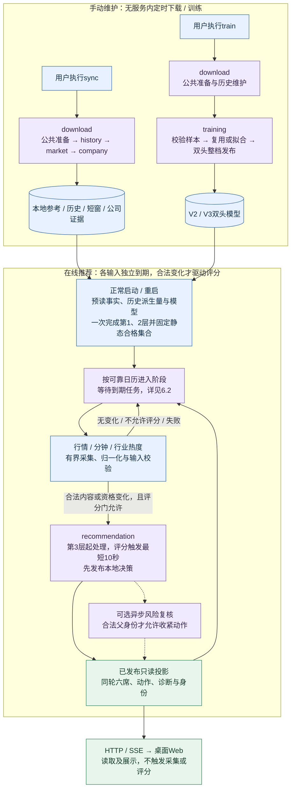
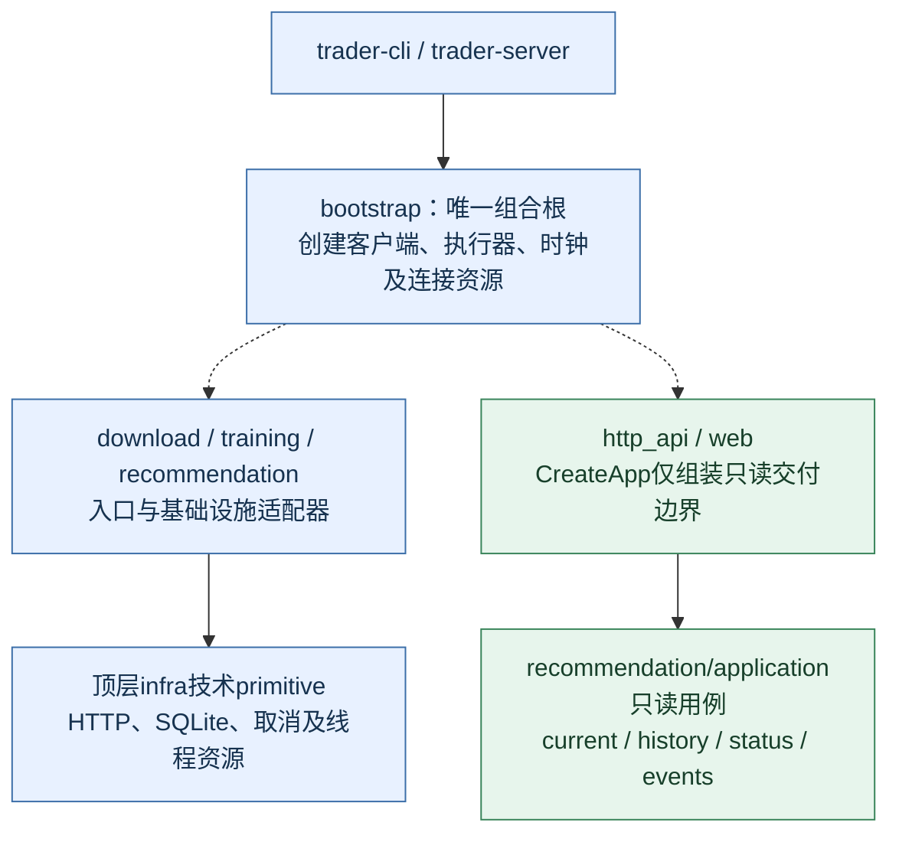
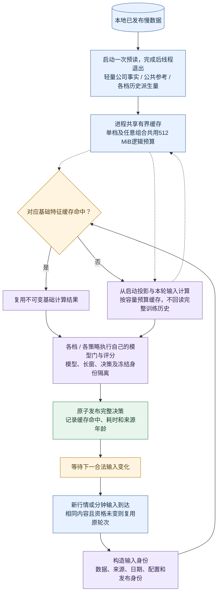
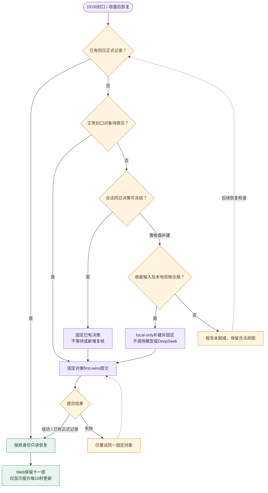
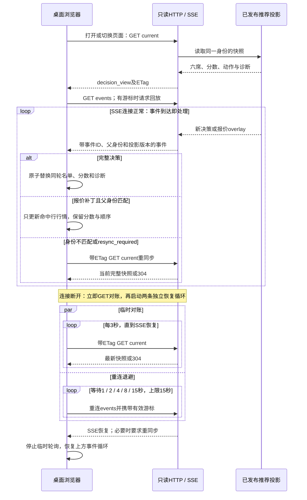
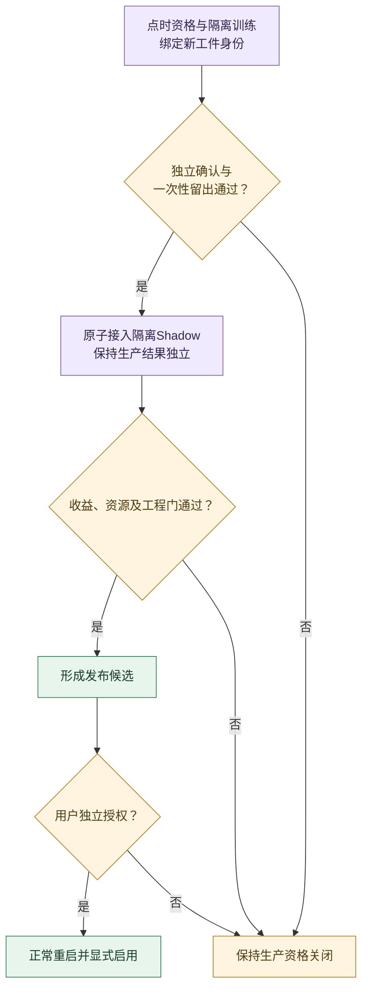

# 工程设计

本文是产品范围、架构、资源、时间线、API/Web、运维和验收的唯一权威。
评分及收益准入见[评分逻辑](1_评分逻辑.md)，数据维护见[下载训练](4_下载训练.md)，完成状态只查[工程实施](3_工程实施.md)。

## 1. 产品定位与范围

这是运行在个人PC上的A股研究看板，只提供研究结果和只读展示，不提供真实下单、多租户或移动端业务。

| 范围 | 当前约定 |
| --- | --- |
| Python | 3.10–3.14 |
| 浏览器 | 当前稳定版Chrome、Edge、Firefox桌面版 |
| 访问 | 默认127.0.0.1，默认端口5000，无远程身份认证 |
| 策略 | Tomorrow、D25、不评分的Long |
| 模型档位 | V2/V3生产档位、显式V1工程Shadow及独立V5 TCN预测过滤；不是额外的持有期策略 |
| 推荐展示 | 同轮评分前六，每只标记推荐、关注或回避 |
| 正式记录 | Tomorrow/D25在15:00 first-wins；Long不冻结 |

### 1.1 现状与目标怎么区分

| 事项 | 当前实现 | 已确认目标，待代码切换 |
| --- | --- | --- |
| 慢数据维护 | 全部手动sync/train，启动读本地；已删除推荐慢资料联网与自动历史维护 | 已切换，真实源验收独立记录 |
| 公司资料读取 | 所选档位共享一次启动预读，加载完整合格总体的轻量事实，前后校验发布身份；冷项不读库 | 已切换，真实全市场覆盖及启动性能另验收 |
| 模型与评分顺序 | 完整合格总体→模型门→本地评分→一次风险扣分→固定总前六 | 已切换，无120只中间层或360只业务上限 |
| DeepSeek | 固定六席内合格对象的单一路径结构化复核 | 已移除challenger；veto保留席位不补位 |
| 行业集中度 | 不按行业限额截断，板块最多四席 | 同行业可以占六席，风险仍按事实披露 |
| 推荐内存 | 进程共享缓存512 MiB，RSS验收预算2 GiB | 配置及共享边界已切换，真实RSS与增长门另验收 |

目标没有完成前，操作说明仍以当前行为为准；写入目标不表示代码、配置、数据或模型已经切换。
评分参数及算法替换先验证收益，不因文档重写直接生效。

### 1.2 唯一活动产品边界

1. 活动产品代码只在src/trader，组合根为bootstrap.py。
2. 页面只有根工作台和第9节列出的API；不保留旧策略页面或带项目版本前缀的兼容路由。
3. 配置只用data_dir承载持久业务数据、runtime_dir承载锁、日志和可丢弃临时产物。
4. 缺数据或模型时只读Web仍可启动并报告未就绪；工件损坏不能伪造可用模型。
5. 旧记录保留原始身份，不按新评分或15:00口径回算；历史文本不代表当前活动合同。

## 2. 系统能力与业务流程

### 2.1 三条业务链

按触发方式分区：普通run.sh只启动在线推荐服务，启动时读取慢资料和模型，随后按交易阶段循环；sync/train由用户另行执行，维护完成后正常重启加载新内容。在线服务不定时扫描慢资料数据库或文件的变化。



| 业务 | 做什么 | 不负责什么 |
| --- | --- | --- |
| download | 历史、短窗口、参考和公司证据采集及发布 | 评分、推荐排序 |
| training | 样本、拟合、模型发布、研究及结算 | 在线自行启用模型 |
| recommendation | 当前行情、资格、评分、风险、六席和冻结 | HTTP请求触发下载或训练 |
| http_api / web | 读取推荐应用用例，按白名单展示 | 网络采集、评分、业务状态写入 |

### 2.2 一轮数据如何到页面

1. 来源结果完成单位、时区和身份归一化，形成不可变市场快照。
2. 两策略复用同轮基础特征，按各自资格和候选规则计算。
3. 本地结果先发布；可选DeepSeek回包只能基于仍有效的父决策收紧风险结论。
4. UnifiedDecisionIndex通过序号及CAS发布完整决策，名单、分数和诊断一起切换。
5. HTTP读取同一投影，SSE发送完整替换或报价补丁。
6. 报价overlay只更新显示行情，不改评分和六席；页面明确保留两个时点的关系。

当前每档两策略输入覆盖完整合格人口；物理行情取去重并集并按供应商上限分批，`ScoredNativeInput.requested_codes` 与特征按策略隔离，不设720只并集上限。
行情刷新缺失者保留待补，不从储备补位；截止前不能完成本轮请求与校验则保留上一完整有效批次，不交付半批结果。
完整评分扣风险后直接选择总前六，已经删除每板120只中间层；输入准备覆盖模型门和评分所需总体，不能以旧候选分或固定请求名单隐蔽截断。须核验特征覆盖、I/O和整轮耗时；有界分批请求不等于按分数限制评分人口。

### 2.3 分数、模型与风险

本地评分、模型成本门、风险扣分和DeepSeek否决的业务定义只在评分逻辑中维护。
工程侧只保证输入、父身份、计算结果和消费者一致，不创建第二套公式或默认参数。

### 2.4 发布与恢复

| 对象 | 内容 | 变化方式 |
| --- | --- | --- |
| local ScoredDecision | 同轮本地分、模型诊断、风险、动作、六席及阶段审计 | 新输入经合法发布替换 |
| hybrid ScoredDecision | 本地父决策 + 已核实的结构化风险结论 | 只接纳匹配父决策的合法回包 |
| LongProjection | 固定观察池及当前报价 | 独立只读展示，不进入短线历史 |
| 正式冻结记录 | 15:00前合法最新决策的规范字节和摘要 | 同日first-wins，已提交不可覆盖 |
| 报价overlay | 匹配父决策的最新行情 | 可变化，不重算评分 |

同一身份同内容重试幂等，身份相同但内容不同拒绝。持久化失败只重试已固定对象，不重新计算。
本地、复核及报价补丁统一校验父身份和发布序号，迟到结果不能覆盖更新决策；一个完整发布对象只由一个索引拥有。

输入诊断由MarketInputCoordinator持有不可变的策略、交易日、来源修订、输入批次和会话generation身份。本地计算及复核通过同一原子校验回写；复核还须匹配已接纳本地父决策，并在写入时确认尚未到15:00。成功、失败及无hybrid结果都不能覆盖新输入或旧会话之后的诊断；此输入状态不替代已发布轮的流程快照。

## 3. 架构与模块边界

本图是依赖与资源注入图，不表示执行频率。实线向下为代码依赖，虚线为组合根创建并注入；业务调度另见第5–6节。



三个业务内部都按同一方向依赖。下图中的application通过端口使用外部资源，端口实现在infra；箭头不表示application创建或导入infra。

```mermaid
flowchart TD
    subgraph Download["download：采集与发布"]
        DE["entrypoints / infra<br/>命令、供应商、持久化适配器"] --> DA["application<br/>准备、同步、校验和发布编排"]
        DA --> DD["domain<br/>纯数据资格与发布规则"]
    end
    subgraph Training["training：样本与模型"]
        TE["entrypoints / infra<br/>训练命令、模型及样本适配器"] --> TA["application<br/>样本、拟合和研究编排"]
        TA --> TrainingDomain["domain<br/>纯特征、标签及评价规则"]
    end
    subgraph Recommendation["recommendation：实时决策"]
        RE["entrypoints / infra<br/>运行时、行情及决策适配器"] --> RA["application<br/>调度、输入、评分与冻结用例"]
        RA --> RD["domain<br/>纯过滤、分数、风险及选择规则"]
    end
    classDef input fill:#e8f1ff,stroke:#3b6ea8,color:#16324f;
    classDef work fill:#f0eaff,stroke:#8064a2,color:#342653;
    classDef result fill:#e7f5ec,stroke:#39845a,color:#173f2a;
    class DE,TE,RE input;
    class DA,TA,RA work;
    class DD,TrainingDomain,RD result;
```



1. 业务内依赖方向固定为entrypoints/infra → application → domain。
2. domain不读配置、文件、网络、数据库或时钟；application不导入本业务infra和Flask。
3. 跨业务只传不可变类型对象，不传供应商dict或以反射隐藏边界。
4. JSON只出现在配置、供应商解析、持久化codec、schema事件及公开投影边界。
5. 外部客户端、连接资源、执行器和可注入时钟由组合根显式创建。
6. CreateApp()无线程、无网络、无数据库、无文件写入副作用。
7. 模块按职责拆分，活动源码单文件最多1200行，不为行数制造聚合壳。

下载只拥有历史事实、发布与缺口；训练切分、标签、到期和提醒由training拥有。两者可共用已有catalog物理表，但按记录kind分别编解码和读写，不通过下载成功状态传递训练资格。完整数据发布不依赖其它档位的模型状态。

### 3.1 目标流程与诊断交接

业务流程统一按评分逻辑第2.1节的11层描述，当前代码差异见其第2.2节；现有枚举和诊断接口见本文第11.1节。
流程诊断携带批号、输入/输出、拒绝/待补/失败、来源健康和耗时；相邻环节交接身份和数量必须连续。

目标只维护一份流程事实，再投影为阶段、计数和界面；层内诊断不能各自维护第二套状态。11层是业务说明，不要求拆成11个服务、线程池或持久化对象。旧冻结审计的读取边界见第11.1节。

### 3.2 配置权威与规范入口

pyproject.toml是依赖、构建、资源和公开入口的唯一来源；不另建配置真相源。

命名规范统一见[Python工程skill](../.agents/skills/python-engineering-guide/references/coding-standard.md#3-命名格式与可读性)。

### 3.3 配置修改与启动校验

config/runtime.json是配置入口，其余JSON按固定分区读取；运行中不重新加载配置，修改后正常重启生效。JSON布尔使用true/false，不能写成字符串、True/False或0/1；JSON不支持注释与尾随逗号，字段必须写在所属分区。

配置文件同时承载用户选项与已固定合同，字段存在不等于允许任意修改：

| 配置类别 | 修改边界 |
| --- | --- |
| DeepSeek使能 | config/deepseek.json的deepseek.enabled可选true/false，详见第8.1节 |
| 监听地址、端口及路径 | 可按类型、取值范围和本地监听边界调整；TRADER_HOST/TRADER_PORT覆盖文件值 |
| 调度间隔、缓存及性能负载 | 当前实现按第6.2节及第7节合同校验；偏离固定表会在启动前被拒绝 |
| 评分、选席、模型身份与预算 | 按评分逻辑及对应资源合同校验，不因手工编辑配置自动放宽 |
| 未登记字段或错误类型 | 启动拒绝，不忽略拼写错误，也不偷偷改回默认值 |

runtime_sha256等配置身份由内容自动计算，启动不要求它与上一次配置hash相同。改变使能等合法选项会生成新身份，已有正式记录仍按原身份只读；配置字段校验、训练特征合同和模型工件内容校验分别判断，不能将它们统称为“配置hash变了”。

启动前可运行`.venv/bin/trader-cli --config "$PWD/config/runtime.json" validate-config`核对配置；该命令不启动服务或下载训练。它只能证明配置满足当前合同，不能证明数据、模型和服务均已就绪。发生错误时先核对报错字段、所属文件及JSON语法；若需要改变已固定合同，须同步修改权威文档、实现与必要验证。

## 4. 生命周期、并发与资源所有权

### 4.1 表 R：资源所有权唯一规范

| 资源 | 所有者 | 生命周期及限制 |
| --- | --- | --- |
| HTTP/供应商客户端 | bootstrap创建，业务适配器使用 | 超时、取消、来源隔离；关闭时可等待 |
| 业务执行器 | bootstrap | 本地计算、网络等待、下载写入职责分开；不隐藏创建池 |
| SQLite连接 | 持有连接的单线程/会话 | 显式关闭、短事务，不跨线程共享可变连接 |
| 公司事实和历史特征投影 | recommendation内存消费者 | 启动固定发布身份；维护后正常重启加载，失败保留合法投影 |
| 模型 | training发布，recommendation启动读取 | 同档双头一致，不热替换、不自动切档 |
| 正式记录与发布序号 | recommendation | 同日first-wins、单调序号、同库事务 |
| 共享DeepSeek预算 | recommendation共享账本 | 跨档位、重试、失败共同计费，原子预留不退回 |
| 研究及训练临时资源 | training | 有界、可停止；与推荐内存预算分别核算 |

### 4.2 排队、完成和关停

当前latest-wins的四条规则分别是：

1. 尚未开始的旧 pending 可以被最新输入替换。
2. 已经开始纯本地评分的旧任务必须完成并可先发布 local。
3. 若已有更新 pending，旧任务跳过 DeepSeek。
4. 新 local 随后通过 sequence/CAS 替换临时 current。

这里替换的是尚未开始的工作，不是允许旧完成覆盖新发布。来源失败、相同内容和无变化回退只更新健康状态，不重复触发评分。
所有后台资源支持取消、停止接单、等待退出和状态观察；单次总关停期限30秒，不给每个组件各加30秒。

### 4.3 SQLite公共边界

| 层次 | 职责 |
| --- | --- |
| infra/sqlite_connection.py | 驱动封装、连接选项、释放、事务、建表校验及完整性primitive |
| 业务adapter | SQL、表合同、编解码、业务错误和发布语义 |
| application/domain | 使用业务端口和类型对象，不操作驱动 |

持久业务数据使用FULL持久化；仅可重建训练临时样本可按其合同降低同步级别。
WAL/FULL用于共享短窗口、公司证据等并行读写场景，不能靠关同步来获得性能。
公共连接会话、显式事务和原子初始化由同一技术边界提供；业务消费者保留自己的SQL与编解码。交付状态及隔离性能证据只查工程实施，不能外推为真实全市场验收。

## 5. 交易日与时间线

### 5.1 表 T：交易日时间线唯一规范

所有业务时间为带时区Asia/Shanghai，窗口左闭右开。交易日只取可靠日历，不按星期猜测。
日历不可用时Web可启动，但交易任务、评分和冻结保持calendar_unavailable，按30/60/120/300秒上限退避重试。

| 状态 | 行为 |
| --- | --- |
| 启动 | 一次预读本地参考、公司事实、历史派生量和模型；缺失/过期降级，不下载慢资料 |
| 09:15至15:00，含午间 | 统一before_close；行情、定向报价、六席、Long和输入驱动荐股按10秒调度 |
| 15:00节点 | 独立停止常规评分和DeepSeek，Tomorrow/D25按最新合法同日决策first-wins冻结，不等待慢轮 |
| 15:00后 | 已有同日正式记录只读；缺记录才按合法收盘身份恢复同日决策或local-only补建一次，详见第8节；报价及Long每10秒更新收盘显示 |
| 盘前09:15以前或非交易日 | 不采集/评分，Web可只读展示已有结果 |
| 手动维护 | sync/train由用户执行；启动不安装或卸载宿主调度任务 |

只保留15:00作为荐股封口控制节点；行业热度和分钟输入的独立采集窗口见6.2节，不构成荐股阶段。

暂停、休眠唤醒或跨日后用会话generation隔离旧任务；迟到、旧交易日和旧会话结果不能写入当前索引。
真实五时段证据与代码中的保护逻辑分别判断。

## 6. 数据服务、刷新与降级

### 6.1 来源职责

| 来源 | 当前用途 |
| --- | --- |
| 上交所/深交所官方列表 | 证券代码、板块、上市日期等身份参考 |
| Tencent | 全市场主路、候选与TopK定向报价；download使用日历及raw/qfq日线 |
| Sina | Tencent全市场失败/超时后的顺序备路，主路成功则不请求 |
| 东方财富及现有AKShare适配器 | 分钟尾部、财务、质押、解禁和有界候选新闻；不进入在线全市场主备 |
| 巨潮 | 分市场/日期的公告、正文及可核验公司事实 |
| BaoStock | 证监会历史行业及当前行业参考，不提供当前价格主路 |
| Tushare | 当前120积分能力下daily未复权独立审计，不是生产财务或qfq补缺源 |
| DeepSeek | 可选结构化事实复核，不生成候选或数值分 |

不要因为源不参与全市场报价就删除其其它真实用途。没有消费者的旧能力不作为目标能力保留。
完整字段及缺失处置见评分逻辑第3节，下载协议见下载训练第3–4节。

报价adapter在进入MarketQuote前统一累计成交量为股：Tencent字段6及诊断用东财f5按手乘100，Sina volume直接按股读取；缺失、负值和非有限值记为缺失。Sina与东财公开接口单位可交叉核对[AKShare股票数据说明](https://akshare.akfamily.xyz/data/stock/stock.html)。供应商volume_ratio与实际volume分别保留，不能互相补齐。
字段来源、标量/列式合并、变更检测及诊断均携带volume。历史DailyBar统一为实际股数：腾讯日线在download共享解析处换算一次，东财日线adapter按手乘100，本地raw/qfq投影使用raw实际量并保留qfq价格。特征只读取前5个完整交易日的量，具体公式和缺失处置归评分逻辑第6.2节；此内部输入不扩展HTTP报价overlay白名单，也不改写已有历史或冻结记录。

### 6.2 当前刷新节奏

数值来源为[config/scheduler.json](../config/scheduler.json)，schedule.py只区分closed/before_close/after_close，cadence.py独立保留分钟及行业采集窗口。下表是最短调度间隔，不保证一轮全部完成，也不表示每次都发生HTTP请求。

| 任务 | 收盘前09:15至15:00（含午间） | 收盘后 |
| --- | --- | --- |
| 全市场输入 | 10秒 | 缺正式记录时一次性合法收盘恢复 |
| 合格总体定向报价 | 10秒；全市场完成可立即交接同轮采集 | 由收盘恢复输入负责 |
| 输入驱动本地评分 | 10秒门；无变化不重复计算 | 仅合法close_fallback |
| 固定六席显示报价 | 10秒 | 10秒，分数/席位/动作不变 |
| Long报价 | 10秒 | 10秒，展示当天收盘价，不冻结 |
| 尾盘分析用的分钟行情 | 13:00至14:48每10秒检查一次，与股票报价调度间隔一致；其余无独立周期 | 无 |
| 行业热度 | 09:15至09:30每120秒；09:30至11:20、13:00至14:48每60秒；其余无独立周期 | 无 |

1. 午间与末段不再关闭荐股或改为单次补建；删去14:46/14:48复核停调、14:59:20检查点和14:59:50最终报价控制任务。数据尚未形成或来源未更新时保留合法投影及明确缺失状态，不强制产生新结果。
2. 同类采集在途时跳过重复派发；输入变化在10秒门内合并为pending。评分最多一个在途和一个最新pending，慢轮完成后处理已到期的最新输入，不补跑积压，也不额外等待10秒。
3. 行情采集与评分不逐步骤各睡10秒；全市场完成可直接交接定向输入，准备完成后按评分门交接。输入内容和资格都无变化时只更新健康状态。
4. 15:00冻结独立唤醒和执行，不等待周期采集、评分或复核；迟到结果不得覆盖正式记录。DeepSeek按证据、缓存、健康状态和预算决定是否请求，截止为15:00；预算记账仍沿用既有分桶和168次物理请求硬上限。
5. 公司、qfq、模型及证券/日历/行业参考仍启动加载，第1、2层形成静态资格后复用；不加入10秒采集。非交易日无上述周期任务。

两轮之间复用未变化输入，不能为了凑10秒制造新内容身份。SSE连通时不轮询完整current；断线临时对账见第9节。
公司资料、财务、公告、历史、短窗以及证券/日历/行业参考全部手动维护，完成后正常重启读取本地投影；具体维护合同见下载训练。
实时行情、分钟输入和随行情计算的行业热度仍属于在线输入。全部手动维护不代表能够自动发现盘中新公告；页面须区分财报有效性和风险覆盖截止，未核实或过期时降级，必要时仅观察。
运行期间不扫描慢资料发布身份，也不自动发现外部sync/train产生的新内容；手动维护后正常重启。历史结算固定启动manifest，active推进不会重解释旧结果。四个模型头的训练到期由既有状态所有者维护，服务启动时只读取一次，HTTP只投影内存；已加载/磁盘身份和restart_required字段反映启动检查结果，不代表持续监测磁盘。模型缺失、损坏、摘要/合同冲突及publication_busy分别降级，保留合法旧投影和只读Web。

### 6.3 表 F：失败分类唯一规范

| 类别 | 示例 | 对外行为 |
| --- | --- | --- |
| 未就绪 | 缺qfq、模型、证券身份 | 报告具体缺项，数据不足不计业务淘汰 |
| 过期 | 报价旧、参考需更新 | 标记年龄，保留有效视图，限制新动作 |
| 来源失败 | 超时、限流、传输失败 | 保留最近有效内容，不以空值覆盖 |
| 内容冲突 | 复权、hash、父身份不一致 | 拒绝新内容，暴露受控原因 |
| 业务全空 | 数据可信，但所有股票被规则淘汰 | ready空集合，保留空原因 |
| 瞬态非法空集 | 输入失败导致无合法结果 | 不发布清空，保留同日有效决策 |
| 持久化失败 | 锁争用、磁盘不足、事务失败 | 重试固定对象，不能重新评分 |
| 复核失败/迟到 | DeepSeek不可用或父决策已变化 | 保留本地，不阻塞只读Web |

primary_blocker优先解释使整批输出归零的待补/失败阶段，其次报告较早的部分降级；行情过期、流动性历史不足、模型输入不足分别报告。模型层输入全部待补时显示“模型输入未就绪”，不得解释为模型业务淘汰；统一诊断从模型层读取输入就绪数，并用实际预测调用计数区分是否执行模型。

### 6.4 降级后还能做什么

保留视图、产生新诊断和发布可执行动作是三件事；“本地降级可用”不能笼统代替各项准入。

| 情况 | 可读视图与新动作边界 |
| --- | --- |
| 来源超时或新内容非法 | 保留最近有效快照，明确来源年龄与失败类别；不能用失败输入覆盖或清空 |
| 模型缺失、损坏或不可用 | Web仍可读，保留已有合法记录；收盘前模型门不能通过，不新增脱离模型门的可执行推荐。收盘后仅按[收盘恢复例外](1_评分逻辑.md#9-冻结恢复与不可变历史)处理；不能将local-only补建声称为通过模型验证 |
| 报价过期或必要输入不足 | 展示已有内容并标记未就绪/过期；不把旧输入当成新一轮可执行证据 |
| 财报仍有效，但公告覆盖截止较早 | 分开显示财报有效性与风险覆盖；未核实或过期时限制新动作，必要时仅观察，不能按读取时间刷新覆盖 |
| DeepSeek失败或迟到 | 合法本地决策继续；不等待复核冻结，不因复核失败更改数值分 |

资料年龄阈值及缺失字段分级须在后续代码计划中对齐评分规则，不能临时放宽净效用门或把数据不足记为业务淘汰。

## 7. 当前运行内存、缓存与性能契约

### 7.1 当前值与扩大目标

| 指标 | 当前配置/校验 |
| --- | ---: |
| cache_logical_bytes | 512 MiB，536870912字节 |
| process_peak_rss_bytes | 2 GiB，2147483648字节 |
| 逻辑缓存预留 | 520 MiB池减8 MiB预留；预留不可分配为常规缓存 |

1. 逻辑缓存按规范JSON载荷估算，不是Python实际占用；对象、索引、模型、线程和临时副本还占内存。
2. 2 GiB是RSS性能验收线，没有操作系统强制内存限额。
3. 配置解析器固定校验512 MiB/2 GiB及各组预算；observation、canonical_snapshots、feature_batches、local_scoring、review、projection依次为264/116/49/33/25/25 MiB。
4. 默认、单档和任意组合共用单个推荐进程预算，不能每档重复领取；离线训练另行核算。
5. 扩大预算的目的为减少读库与重复计算，不等于已经提速。

任意档位组合由bootstrap创建一套行情客户端、来源通道、分钟执行器及基础缓存，公共参考和公司资料各预读一次，共用同一个DeepSeek原子账本；模型、各档输入窗口、决策、冻结、控制与持久化队列保持档位隔离。包含V2时由V2持有共享资源，否则由列表首档持有；owner先启动、最后停止，其余档位按创建顺序逆序停止。
轻量公司事实、公共参考及各档历史派生量由原owner持有，通过共享缓存常驻预留计量，分组容量不足明确待补。模型、索引和临时对象计入进程RSS，不能通过移出缓存统计绕过预算。

### 7.2 增加容量放在哪里

图中循环表示每个新输入批次如何使用缓存，不是另加一个刷新定时器；行情及评分仍服从第6.2节。



| 优先驻留 | 希望减少的工作 | 仍需控制 |
| --- | --- | --- |
| 公司事实、证券资格和行业引用 | 反复SQL查询和解码 | 新鲜度、发布身份、来源失败 |
| 历史派生因子、模型基础输入 | 反复读取日线和重复派生 | 窗口、复权、字段完整性 |
| 同轮总体和共享特征 | Tomorrow/D25重复构建 | 不混交易日、配置或输入身份 |
| 有界原始日线 | 热路径读库 | 不复制完整2000日训练历史 |

全市场、候选报价、分钟及参考条目容量为12000；同事实报价因子通过共享quote_factor_inputs缓存复用，各档模型长窗计算独立。容量和预算扩大未延长原有输入TTL或动作年龄。
缓存身份仍绑定数据集、来源、主体、请求、交易日、阶段、配置和schema；失败保留最近有效值。
启动DailyFeaturePack与ResearchEpoch绑定证券、日历、行业、qfq、公司、模型及配置发布身份，复用原有输入版本传入决策。DailyFeaturePack只增加派生值与字段来源，原始日线仍只保留最近20行；启动身份未绑定完成时评分待补，只读Web可继续提供已有结果。

### 7.3 性能怎么证明

| 测量项 | 比较内容 |
| --- | --- |
| 缓存 | 命中率、淘汰次数、实际载荷、分组占用 |
| I/O | SQL读取数、连接/事务次数、磁盘读取 |
| 延迟 | 分别测来源年龄、冷启动、输入准备、纯计算、发布及浏览器延迟，再报整轮P50/P95 |
| 内存 | RSS峰值、可用内存、换页、连续运行增长 |
| 正确性 | 同输入的分数、排序、身份和冻结结果一致 |

同一机器、相同负载下新旧实现交替至少5轮；物理冷缓存、预热缓存及真实网络分别说明。
当前绝对延迟和5%相对回归门仍由config/performance.json拥有；100 tick增长门为20%，不能用扩大预算掩盖持续增长。
10秒报价overlay不等于10秒完成整个评分链。取消预选后，分钟缓存、请求队列和性能负载都要覆盖完整合格总体，不能沿用旧120只负载宣称全市场提速；不得扩大并发到无界或放宽来源年龄。
全市场刷新与候选报价由独立有界任务运行；全市场来源长耗时或失败时，候选报价仍按自身节奏刷新。候选提交核对市场人口身份，已被新人口替代的结果拒绝，评分只消费完整且同身份的输入。

当前逐项P95数值列在[技术附录](#附录技术参数与诊断字段)；主流程只引用配置拥有的门禁，不在多个章节重复维护。

统一诊断的performance默认在同一进程并发测量V1/V2/V3/V5的Tomorrow/D25八个头；显式scoring-profile可选单档。local及既有both诊断保持原有分档语义。负载使用5500股合成输入和真实加载工件，按本档合同生成完整长窗、行业及量价序列；首次计算、完全相同输入、单股事实变化、冷评分状态到草稿分别计时，输入准备、缓存预热和诊断指纹不混入模型延迟。V1仍是Shadow，模型全拒可以如实报告，缺模型、缺依赖或合同不符不能用零预测替代。

模型原生调用次数用独立profiler探针统计，不混入时延采样：LightGBM只计Booster.predict这一层，TCN计网络批预测，Ridge只计有界批次，内部保留原逐行点积归约顺序，避免浮点误差翻转成本净效用零点资格，不将其计为一次BLAS核调用。持续内存场景复用同组评分实例100 tick，读取当前RSS计算增长，进程高水位只用于峰值门。报告绑定源码、完整输入、双头模型、评分/成本/预算合同及环境；相对比较要求输入、模型、合同和环境身份一致，保留不同源码摘要以比较实现改动。合成评分负载不代表历史磁盘预读、共享行情缓存、真实网络、浏览器或冻结验收，未执行的等价性与正式决策基线明确标记未验证。

所选档位共用一个启动历史投影owner和一个预读线程：按最大所需窗口扫描一次，每股对齐后立即生成各档派生值，只共享保留的20根日线，不常驻多份完整长窗。前置估值扩展按同一股票合并读取，基础日线与派生投影分别计入512 MiB缓存预算；各档的输入绑定、模型和冻结身份仍独立。历史输入质量按观察日批量计算上一交易日；行情相同事实命中原始行与成本参考缓存，人口、行业、价格/金额或配置改变时按完整身份失效。

复核原始事实缓存及single-flight由组合根注入同一实例；策略分类仍绑定本档合同。缓存保留原manifest，重新核验证据后以不可变binding绑定当前候选，不能覆盖原摘要规避校验。先完成本批拥有的请求，再等待其它owner，禁止持有未执行claim互等；等待和HTTP共同受剩余截止时间约束。失败、取消及超时释放claim，所有物理尝试计入原168次预算，数值评分、固定席位和first-wins冻结不变。

### 7.4 运行开销与优化边界

以下按当前实现区分已切换边界与待优化项，性能影响仍需实测。

| 当前问题 | 证据入口 | 优化及验证方向 |
| --- | --- | --- |
| 分钟检查与评分触发已分离 | [分钟刷新路由](../src/trader/recommendation/application/pipeline/data_source/source_router.py)比较完整分钟窗口内容及缺失/过期资格；检查、接收和来源时间分别保留 | 相同内容及资格不使评分缓存失效；同分钟或旧分钟修订、资格变化触发原有节流评分，来源年龄不因重新接收而重置。分钟缓存以来源/接收时间判断先后，内容哈希不作时序比较 |
| 分钟使用独立有界执行器 | [分钟加载器](../src/trader/recommendation/infra/market_data/intraday_loader.py)逐步提交，进程最多5个请求在途，整批共用单调deadline与取消 | 等待、供应商重试均占同一deadline；未发出的请求不记供应商失败，过期结果不回写；完整总体的真实限流和完成率仍须实测 |
| 所选档位共享基础资源与缓存 | [组合根](../src/trader/bootstrap.py)一次创建来源与预读owner，并发同阶段同模式行情请求合并 | 单个等待者超时不取消其它档位；日期、阶段及强制刷新模式隔离，模型、决策、冻结与发布按档位隔离 |
| 两策略完成后联合发布 | [整轮执行](../src/trader/recommendation/application/runtime/cycle_execution.py)存在共同等待边界 | 测量慢策略对另一策略的影响；是否拆分发布须先明确产品语义，不能默认改变同轮合同 |

当前分钟内容TTL为45秒，分钟行情在采集窗口内每10秒检查一次；调度、缓存检查和实际完整评分次数要分别统计，不能把间隔直接当成整轮速度。
这些问题与加大缓存分别验证；缓存扩大不能证明重复计算和串行等待已经消失。

### 7.5 deadline覆盖审计与完整轮次测量

下表描述现有代码的能力边界，不新增一套计时owner，也不把审计发现当成已修复。采集/评分触发间隔归scheduler配置，单次网络timeout归来源配置，15:00是业务截止，总关停30秒是资源退出等待预算；performance.json中的P95预算是验收标准，不会自动中断任务。

| 边界 / 当前owner | 已有约束 | 尚不能保证的部分 |
| --- | --- | --- |
| 来源排队：[source_lanes](../src/trader/recommendation/application/runtime/source_lanes.py) | 记录submitted_at至执行的队列耗时，保留一个最新pending；调用者按剩余预算等Future | request.call同步运行；cancel/Future等待超时不能杀死已运行调用 |
| 全市场主备：[source_coordinator](../src/trader/recommendation/infra/market_data/source_coordinator.py) | Tencent主路最多12秒且受调用方截止约束，失败后才尝试Sina；耗尽外层预算不启动备路，超时发取消信号 | 来源编排的剩余预算仍由带时区墙钟差计算，尚未全链统一为单调绝对截止；无外层deadline不能从12秒推导整轮上限 |
| HTTP：[http_transport](../src/trader/infra/http_transport.py) | 单调deadline覆盖连接锁、传输和分段读取；请求timeout与传入deadline取较小值 | 这是一次物理请求边界；全部分批和重试必须继续传同一外层截止，不能重新给予完整预算 |
| 分钟批次：[intraday_loader](../src/trader/recommendation/infra/market_data/intraday_loader.py) | 有界派发，共享单调deadline和取消；迟到结果不写分钟缓存 | 缩短等待不能证明第三方同步调用已退出；需分别观察在途资源及下一合法轮 |
| 校验、合并、输入发布：[gateway](../src/trader/recommendation/infra/market_data/gateway.py) | 来源完成后、canonical merge前检查截止，共享请求等待者有自己的超时 | 合并、校验和内存提交中的同步计算没有统一可强制抢占机制；阶段计时不等于硬截止 |
| 模型上下文：[input_assembly](../src/trader/recommendation/application/pipeline/data_source/input_assembly.py) | 以15:00减当前上海时间建立time_budget_seconds，并携带input_age；close_fallback无模型预算且不调用模型头 | 不是“每轮最多10秒”；从构建上下文到模型调用的延迟不能仅靠模型内部elapsed证明已被扣除 |
| 特征、模型和投影：[model_scoring](../src/trader/recommendation/application/pipeline/local_score/model_scoring.py) | 单调计时在获取模型锁前启动，特征/成本、批推断和分数投影有检查点，返回后过期结果可拒绝 | RLock等待没有超时获取；predict同步执行，在其返回前检查点无法中断卡死计算；本地规则评分也无通用硬终止 |
| 决策持久化及发布：[cycle_execution](../src/trader/recommendation/application/runtime/cycle_execution.py)、[publication_io](../src/trader/recommendation/application/pipeline/freeze_publish/publication_io.py) | session、版本/CAS、正式记录first-wins保护合法发布；SQLite另有锁等待边界 | 身份检查与拒绝覆盖保证一致性，不等于同一个整轮deadline覆盖SQL、发布、SSE和浏览器 |
| 取消及关停：[latest_wins](../src/trader/recommendation/application/runtime/latest_wins.py) | 停止接单、取消pending、以共享ShutdownDeadline等待并报告alive/timed_out | processor同步执行；30秒等待结束仍可能有活动线程，不能声称已强制终止或下一轮一定恢复 |

若要兑现“任何卡死任务均可在整轮上限后恢复”，后续必须沿原owner将队列、来源尝试、校验、计算和提交串成同一单调预算，过期停止派发并拒绝回写；不可协作取消的计算需评估可终止进程，资源仍由bootstrap创建和回收。仅增加JSON timeout或不断新建线程不能闭合该要求。慢请求、无限计算、迟到返回、锁等待、正常下一轮及15:00 first-wins应分别验证。本节只是源码审计，不授予上述硬终止能力。

测量复用唯一诊断入口，文件写仓库外；不启动下载、训练或维护活动历史。以下命令分别覆盖可独立运行的采集、依赖已发布模型的离线计算、以及已运行服务的只读状态：

```bash
.venv/bin/python3 scripts/diagnose_runtime.py --profile market-factor-compare --market-sources tencent --market-profiles v2 v3 --market-sizes 0 --market-mode single --source-samples 5 --market-source-loop-seconds 120 --market-task-seconds 600 --command-timeout-seconds 610 --output /tmp/trader-market-measurement.json
.venv/bin/python3 scripts/diagnose_runtime.py --profile performance --scoring-profile both --command-timeout-seconds 120 --output /tmp/trader-performance-measurement.json
.venv/bin/python3 scripts/diagnose_runtime.py --profile runtime --web-samples 6 --web-interval-seconds 10 --output /tmp/trader-runtime-measurement.json
```

`market-sizes 0`为完整参考人口；该诊断复用真实供应商适配器，但不是运行服务的完整轮次，辅助公司/分钟探测仍只有三只样本。`performance --scoring-profile both`分别执行两档离线门，不代表两个档位并行运行的资源门。runtime采样读取同轮计时、身份和漏斗，连续6次HTTP读取也可能重复同一轮，统计前必须按轮次身份去重。

最终证据按V2、V3及并行both分别记录至少5个不同完整轮次：有效目标/返回/合格数量、缺失和失败类别、各来源真实时间与年龄、物理请求/重试、队列→采集→解析/校验→计算→持久化→发布耗时、整轮P50/P95/最大值及RSS峰值。说明机器、交易时段、冷启动/预热、配置和模型身份；不要相加各段P95充当整轮P95，五样本尾分位只作初测。源码读到已有计时而未实际采样的字段仍标未测；来源时间跨度也不等于来源年龄。实际结果与阻塞仅记工程台账。

## 8. 发布、冻结与持久化

**收盘控制路径：按策略、交易日幂等执行。** 15:00独立封口，收盘后启动执行恢复；先核对正式记录和已固定的正常封口对象，再决定是否需要补建。下图不适用于Long；旧版本已持久化检查点仅保留原身份的读取/消费能力，不再创建定时检查点。模型、历史与动作的例外只由[评分逻辑第9节](1_评分逻辑.md#9-冻结恢复与不可变历史)定义。



| 数据 | 唯一所有者与原子边界 |
| --- | --- |
| 正式决策与快照 | recommendation；正式记录同日first-wins，旧检查点只读恢复 |
| 发布序号与当前指针 | recommendation；持久序号与快照同库事务，当前索引按CAS发布 |
| DeepSeek共享预算 | recommendation共享账本；跨档位原子预留 |
| 离线资格、公司事实及历史行情 | download发布，recommendation只读消费 |
| 实时报价、分钟与同轮市场输入 | recommendation；按来源及内容身份更新，不归离线下载拥有 |
| 模型、样本与隔离研究报告 | training；不回写在线评分或旧正式记录 |
| 在线收益结算与逐日决策追踪 | recommendation写入；研究只读消费，不重写原决策 |

具体文件及目录只在[下载训练第2.1节](4_下载训练.md#21-持久目录)维护。

1. 正式记录保存规范字节、SHA-256及提交状态，同库原子提交；15:00 first-wins。
2. 正常冻结取已发布且CAS合法的最新同日决策；已有hybrid则沿用，否则local，不等待复核。
3. 同日正式记录缺失才允许合法close_fallback；不取上一交易日结果冒充当日。
4. 重启读取原身份记录；新输入不得覆盖已正式发布的同日记录。
5. 数据回退必须完整release配合匹配数据副本，不能将新数据写回旧库。

已有current恢复和重新构建分开记录：前者保留原决策，后者才以close_fallback输入重算local。收盘恢复路径校验运行身份和收盘输入身份；这些标记不等同于交易所成交证明或收益准入。无合法输入时保持未就绪，不能为填满页面制造六席。Long独立按收盘报价更新，不经过此冻结链。

### 8.1 DeepSeek资源合同

| 约束 | 当前实现 |
| --- | --- |
| 使能 | config/deepseek.json的deepseek.enabled默认false；true启用，false关闭，正常重启生效 |
| 每日全局 | 168次物理请求，重试/失败/schema修复均计数 |
| 常规桶 | tomorrow 独占目标 21、硬上限 38；D25硬上限16、共享预热4、emergency 5；还受阶段限制 |
| 单次timeout | DeepSeek 单次网络 timeout 20 秒 |
| 熔断 | 传输/schema或应用率异常时冷却900秒，local继续 |
| 缓存 | 绑定证据、模型、prompt、schema、配置；普通报价变化不直接增加请求 |

预热和emergency仍为独立原子桶。challenger已删除，固定六席内复核不增加其它桶。
预算账本变更时更新内存快照，status不为显示预算重新访问SQLite。

关闭DeepSeek时跳过DeepSeek的凭据加载；常规复核、预热与emergency均跳过HTTP及重试，不占物理请求预算。Tushare仍独立读取和校验其凭据，两者共用.token_key时该文件仍可能由Tushare读取，文件权限与格式要求仍生效。已有skipped批次审计仍可记录，合法local决策、分数、席位和冻结路径继续；不以关闭复核绕过模型或本地风险门。/api/status中的deepseek.enabled及deepseek.zero_call_reason可区分主动关闭与密钥缺失。

## 9. 唯一 Web API 与 SSE

### 9.1 表 A：API schema 唯一规范

| 路由 | 内容 | 副作用 |
| --- | --- | --- |
| GET / | 桌面工作台 | 无 |
| `GET /api/decisions/<strategy>/current` | 当前decision_view及ETag | 只读 |
| `GET /api/decisions/<strategy>/history?date=YYYY-MM-DD` | 精确日期正式记录 | 只读 |
| `GET /api/decisions/<strategy>/dates` | 该策略正式日期列表 | 只读 |
| GET /api/status | 注入的内存状态聚合 | 不读库、不读文件、不联网 |
| GET /api/events | decision_event有界事件流 | 只读订阅 |

strategy只允许tomorrow/d25/long；profile查询参数只接受一个已启动档位v1、v2、v3或v5，未启动档位返回参数错误。组合列表只用于进程启动与训练，不能作为HTTP查询参数。
Long只支持current；history返回not_applicable，dates为空，不转荐股历史。

### 9.2 快照与补丁

1. decision_view包含身份、coverage、降级原因、selection_diagnostics、六席及可选draft。
2. not_ready不能假装ready；没有正式项时可独立展示同日draft，不能把draft计入正式覆盖。
3. 分数标尺为weighted_evidence_quality_0_100，模型版本取实际head身份，不靠页面标签猜测。
4. 同轮新决策必须原子替换名单、coverage和阶段诊断，不能由旧计数倒推。
5. overlay仅允许更新价格、涨跌、成交额、换手、市值、来源、时间和报价版本；必须匹配父决策及projection_version。
6. 不公开完整特征、原始供应商载荷或未入选股票身份；不可用数值为null，不伪造0。

### 9.3 SSE与恢复

图中只有读取与界面更新。事件到达即处理，不等待一个评分周期；10秒报价刷新也不代表重新评分。断线后的3秒对账与退避重连各用自己的定时器，并行运行。



1. 事件ID单调；envelope和行补丁各自拥有schema版本，精确值见技术附录。
2. 显式Last-Event-ID或cursor才回放；游标过期、超前、断裂或父身份不匹配时resync_required。
3. 客户端用ETag GET current重同步；慢客户端有界丢弃，不能阻塞publisher。
4. SSE连通时停止完整current轮询；断线立即对账，临时有界轮询并退避重连，恢复后停止临时轮询。具体间隔见技术附录。
5. 正常overlay只更新命中行，不重建表头和整张表；切换档位/策略/日期后隔离旧响应。

## 10. 当前唯一桌面界面

| 区域 | 内容及行为 |
| --- | --- |
| 顶部选择 | V2/V3、日期、Tomorrow/D25/Long |
| 摘要卡 | 数据状态、六席状态、发布状态；DeepSeek使能时增加模型预算，关闭时三卡等宽 |
| 荐股表 | 固定六席、股票与独立板块行业列、最终分、原因、当前及锚点行情；动作在详情中展示 |
| 评分链 | 同轮流程状态、中文原因、数量及来源；目标按11层展示，当前接口差异见第11.1节 |
| 模型详情 | 本档实际模型、预测超额、成本及净效用，不冒充最终分 |
| Long | 完整固定名单及chokepoint/future_growth/low_price_potential分组，不因报价失败隐藏 |
| 历史 | 精确策略和日期的正式记录，缺失显示空态，不自动跳到别日 |

1. 观察评分链路十一层的编号、标题、概要与展开详情均可选择复制；刷新不能打断选区或擅自展开。股票详情仍可展开、选择和复制。
2. 当前页面首次按Tomorrow、D25、Long顺序选首个ready且有入选项的策略；无项时选首个ready，否则Tomorrow。
3. 目标默认定位Tomorrow，需后续代码调整；当前刷新不能抢走用户手动选择。
4. 历史缺失、未就绪、合法空仓分别说明；Long禁用历史日期。
5. 桌面验证检查内容可读、交互和数据一致性，不再强制固定三种分辨率。
6. 目标展示财报有效性、公司风险覆盖截止及资料降级原因；固定六席可含关注/回避项，不能笼统称为六只可执行推荐。行业限额取消后显示集中风险，不擅自增加替代硬门。

## 11. 可观测性与安全

### 11.1 同轮十一层执行观测

PipelineStageSnapshot与RecommendationPipelineStatus使用同一十一层顺序，定义见评分权威第2节；GET、SSE、Web、统一诊断和研究追踪按同一已发布决策读取。每层输入严格等于输出、业务淘汰、待补、失败和未入选之和，相邻批次身份及人数连续；首拒互斥，风险标签和来源失败另计。

第9层记录固定六席及未入选数；第10层始终传递固定席位，另列可复核、提交、完成、缓存复用、veto及来源失败子计数；第11层列推荐/关注/回避。来源失败后继续输出者只计输出，不能重复计处理失败。

耗时使用注入单调时钟；未执行或未测量为null，真实零显示0 ms，长耗时自适应秒/分钟。第1、2层保留启动批次、as_of及原人数，在线标记startup_reuse、latency_ms=null；页面显示“沿用启动结果”，不伪装成本轮加载或重复计入启动耗时，来源年龄随观察时刻更新。总墙钟独立测量；其它缓存复用记录实际本轮时间，层内记录采集、计算、校验和复核等待，尚未独立测量的排队耗时明确未知。

页面按选中表所属已发布轮显示版本、时间、墙钟和断点；下一输入轮只作简短提示，不能与旧名单拼接。匹配的发布回执必须同时满足策略、交易日、决策版本及内容摘要，回执变化独立刷新详情；入队、消费者完成、当前发布与冻结写入分别表述。发布I/O属于运行遥测，不回写冻结规范字节。

短线十一层结构不因15:00、冻结、历史读取或未就绪而消失。已有冻结/历史观测只读展示原轮，报价、来源年龄及匹配运行回执按既有刷新路径更新；未发布时可展示同策略同日的运行阶段进度。缺失层保留层名并显示未知计数和未测量耗时，不以零填充、不跨轮拼接，也不将旧14/16协议映射为新十一层事实；Long仍不适用。

“下一输入轮”提示只属于同策略同交易日的当前滚动页；冻结、历史及跨日运行状态不触发该提示。

[历史解码](../src/trader/recommendation/infra/persistence/decision_record_codec.py)将旧审计解析为独立不可变的[HistoricalPipelineAudit](../src/trader/recommendation/domain/publication/historical_pipeline.py)，按冻结的14阶段/16诊断键协议校验；历史校验及规范身份投影不依赖活动阶段枚举或构建器。恢复、查询及GET/SSE沿用原字段、身份和摘要，缺席字段不补写，旧诊断未持久化的耗时及拒绝数继续输出null。持久化原字节、六席上限、8 MiB保护和数据库布局保持不变。

活动流程构建器只接收活动类型；历史审计只用于只读承载、身份核验和公开白名单投影，不参与调度或评分。新十一层持久化审计也由独立历史类型解析，旧14/16协议不补字段、不重新解释。

### 11.2 状态与日志

| 状态类别 | 必须可观察的内容 |
| --- | --- |
| 来源 | 近期成功、年龄、超时/限流等受控原因 |
| 缓存 | 命中、淘汰、逻辑字节及容量 |
| 调度 | 当前阶段、generation、队列、最新待处理、固定点任务状态 |
| 模型 | 档位、head、请求/复用/物理预测批次、未就绪原因 |
| 决策 | current、冻结、持久化和发布计数 |
| DeepSeek | enabled/configured、物理调用数、预算及零调用原因 |
| 失败恢复 | 活动/已恢复、首次/最近时间及次数，最多20条近期错误 |

1. status只从内存聚合，不读数据库或网络；公司研究状态不拥有第二套下载队列。
2. 成功只清除对应阶段或数据任务的失败，不能把其它失败一并清空。
3. 不输出密钥、完整外部响应、逐股特征、个人路径或内部关联载荷。
4. 诊断只有聚合计数、状态和延迟；受限逐股探测不写正式历史和Web响应。

## 12. 安装、运行与运维

| 任务 | 当前入口 |
| --- | --- |
| 启动 | ./run.sh，Windows使用run.ps1或run.bat |
| 选择单档或组合 | ./run.sh v2 或 ./run.sh v1,v2,v3；逗号分隔 |
| 更新在线资料 | ./run.sh sync、sync market或sync company |
| 完整历史维护后训练全部或指定档位 | ./run.sh train 或 ./run.sh train v1,v5 |
| 本地只读诊断 | .venv/bin/python3 scripts/diagnose_runtime.py --profile local --output - |
| 运行服务诊断 | 同一脚本--profile live --base-url http://127.0.0.1:5000 --output - |
| 历史维护机器入口 | trader-cli sync history；已有系统任务需使用当前命令 |

1. 正常启动默认同时运行V1/V2/V3/V5，不自动训练；直接传逗号列表可选择任意非空组合，启动/训练不再接受--profile或both。Web只展示已启动档位的互斥按钮，包含V2时默认展示V2，否则展示列表首档；Long由该默认档位单一采集。切换按钮只改变只读视图，不启停后台档位。
2. 模型每头为model.json与metadata.json；手工训练后正常重启，不热加载。
3. 配置使用绝对路径；TRADER_CONFIG、TRADER_HOST、TRADER_PORT控制本次启动。
4. DeepSeek/Tushare密钥从同名环境变量、对应*_FILE或已配置.token_key读取，不写日志和公开响应。
5. Ctrl+C开始共同30秒关闭，再次中断才强制退出；旧进程持锁时不要删锁文件冒充关闭。
6. 数据缺失不触发Web下载；具体初始化、续传和维护操作只引用下载训练。

## 13. 测试与发布验收

V5为独立TCN预测过滤档位，模型/样本目录与V1/V2/V3保持相同层级，决策和研究使用v5身份。默认启动及默认训练均包含V5；./run.sh train v5和./run.sh v5分别只进行V5维护训练与启动，PowerShell同义。V5模型启动输入从已发布完整历史读取有界窗口，与各档共用市场日历对齐规则，不创建新下载源或读取V3模型。

序列在启动预读裁剪最近20根日线之前计算并纳入共享缓存预算，运行中通过不可变类型传递，只读HTTP/Web不下载、拟合或写状态。PyTorch为V5可选CPU依赖，V1/V2/V3无需加载；缺依赖或工件失败时只读Web和合法旧投影继续可用，V5新决策准入关闭。TCN直接排序的另一种职责及变更边界见评分逻辑第6.5节。

### 13.1 选择门禁

| 改动 | 检查 |
| --- | --- |
| Markdown、注释、非运行元数据 | 完整diff、链接、空白；必要时运行现有文档合同 |
| Python逻辑 | 受影响Ruff，按风险定向回归 |
| 公共类型、复杂边界 | 加受影响mypy |
| 测试基础设施或全仓测试调整 | 完整回归 |
| 发布 | 以下完整门禁及真实专项 |

~~~bash
make format-check
make lint
make type-check
make test-full
make package
~~~

make test/make test-fast是非slow快速集，不代替make test-full。
make test-history、make test-train、make test-recommendation按业务选择，包含各自慢用例；PYTEST_WORKERS调整默认4个worker。
测试只读种子先关闭，写入/损坏测试复制独立文件，禁止共享可变SQLite连接或硬链接。

### 13.2 发布专项

1. 架构依赖、CreateApp无副作用、评分与veto分离、168次预算并发、single-flight、latest-wins。
2. 来源乱序、取消、迟到、SSE游标及慢客户端、冻结first-wins和摘要恢复。
3. 仓库外安装wheel，验证console scripts、资源、三平台维护模板及pip check。
4. 桌面真实渲染及交互、实际模型身份、同轮诊断、历史和Long展示。
5. 性能fixture绑定数据、配置、源码及环境；离线禁外网，固定DeepSeek响应，延迟与内存分别测量。
6. 检查进程共享512 MiB逻辑缓存、2 GiB RSS及连续运行增长门；配置切换和fixture通过不代表真实全市场或发布门通过。

### 13.3 五时段矩阵

| 场景 | 必须验证 |
| --- | --- |
| 上午热运行 | 两策略同日完整输入与发布，Long独立 |
| 午间热运行 / 冷启动 | 与收盘前其它时间统一10秒循环，失败保留已有投影 |
| 15:00边界 | 最新合法决策、first-wins、迟到不能改正式记录 |
| 15:00后热运行 | 名单和分数固定，仅报价overlay变化 |
| 正式记录命中 / 收盘恢复 | 精确同日恢复，缺记录才合法close_fallback，不跨日替代 |

真实服务和供应商证据与fixture结果分开记录。HTTP200、旧进程或文件存在不能证明整链通过。
任一绝对预算红项仍阻断发布，不用其它阶段余量抵消。

## 14. 研究与交付边界

1. 收益及生产准入只由评分逻辑第12节定义；日线工程代理训练成功不等于收益通过。
2. 研究在仓库外隔离输出，不接入HTTP、SSE、生产调度或自动模型更新。
3. 用户未授权时不切换、删除或迁移活动数据；不修改旧正式结果。
4. 验收通过只形成候选，PR、合并、tag、真实数据切换和发布仍需独立授权。
5. 进度和未完成项只记实施台账，不在本文复制历史交付日志。
6. 完整总体配对研究沿用training的selection_experiment唯一计算与前置门，通过research-selection读取仓库外证据并生成不可变报告；research-status及统一诊断只读展示目标身份与验证要求，旧研究状态不能替代目标验证。输入协议见[下载训练6.4](4_下载训练.md#64-完整总体配对研究入口)。

**新V1已提供工程训练和隔离Shadow入口，生产资格保持关闭。** `./run.sh train v1`显式维护历史并训练，`./run.sh v1`单独运行工程Shadow；PowerShell同义。默认启动及默认训练均包含V1；普通启动不下载、训练或轮询模型。新V1专属源码归入所属层的v1目录，模型按training/models/v1双头目录发布，临时样本使用training/samples/v1；推荐决策和研究仍使用learned_rank职责空间，避免与退役旧V1同名记录混读。在线只读已发布完整历史，按实际市场日历选取信号日前251日；已含信号日日线时仍保留此前输入，不新增行情下载。模型、决策、研究及状态与旧V1隔离，不读取旧数据或重解释冻结身份。

组合根继续是bootstrap.py；评分能力工厂只构造内存对象，不创建外部客户端或线程池。显式V1沿用同一进程缓存/RSS、行情并发及全局168次预算合同，工程Shadow实际请求DeepSeek为零。缺模型、特征或工件验证失败时只读Web可用，新V1决策关闭；V1不回退其它档位，维护后正常重启加载。

正式准入顺序见[已授权方案](2.md#5-荐股链修复与全新v1算法方案)；工程Shadow能力不等于已通过历史门或开始合格Shadow验收。当前V1不能正式冻结、结算或进入生产。



## 附录：技术参数与诊断字段

以下内容供实现和排障查阅；业务流程、降级、冻结及只读交付要求仍在正文。

### 当前逐项延迟预算

数值由config/performance.json拥有；下表是当前配置说明，不能用目标容量替代现行验收。

| 当前P95项目 | 上限 |
| --- | ---: |
| 全市场标准化 / 合并 / 快照 | 250 / 600 / 900 ms |
| 候选规划 / 候选并集投影 | 5000 / 100 ms |
| 单板评分 / 两策略板内评分 / 三板墙钟 | 250 / 750 / 1000 ms |
| 全局选择 / 本地发布 | 100 / 500 ms |
| quote-to-draft / 复核后发布 | 5000 / 1000 ms |
| SSE入队 / 浏览器绘制 | 100 / 100 ms |
| current API / ETag304 | 200 / 50 ms |
| 日期 / 状态API | 各100 ms |

### 当前SSE协议参数

| 项目 | 当前值 |
| --- | --- |
| envelope schema_version | decision_event |
| 行补丁 patch_schema_version | 4；独立于envelope版本 |
| 断线临时current对账 | 每3秒；SSE恢复后停止 |
| 重连退避 | 1/2/4/8/15秒，上限15秒 |

### 当前诊断字段

| 顺序 | key |
| --- | --- |
| 1–4 | local_data、static_filter、dynamic_market、dynamic_filter |
| 5–8 | market_features、model_filter、local_score、local_risk |
| 9–11 | fixed_selection、risk_review、action_publish |

阶段状态为pending/running/completed/degraded/not_applicable；事实快照保留实际输入/输出、拒绝/待补/失败/未入选、来源健康、原因和耗时。市场特征层的行情、证券资料及历史是覆盖分面；原因标签可重叠，不能相减倒推人数。Long不适用，旧历史只读协议不映射为上述十一层。
