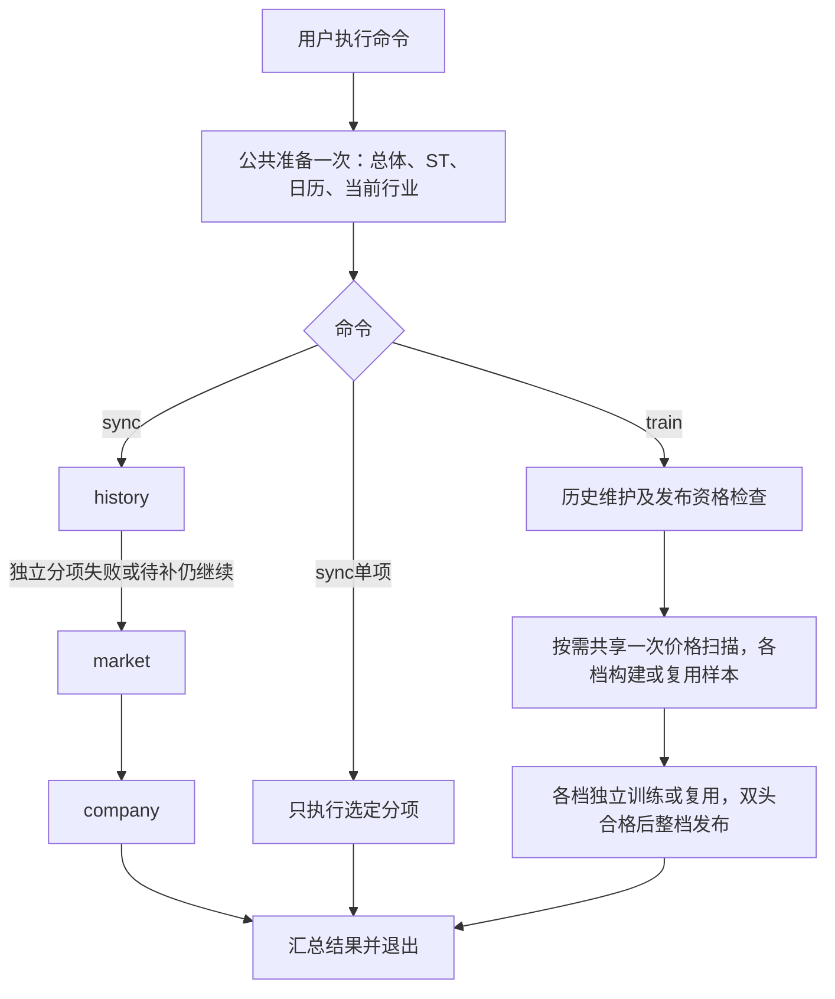
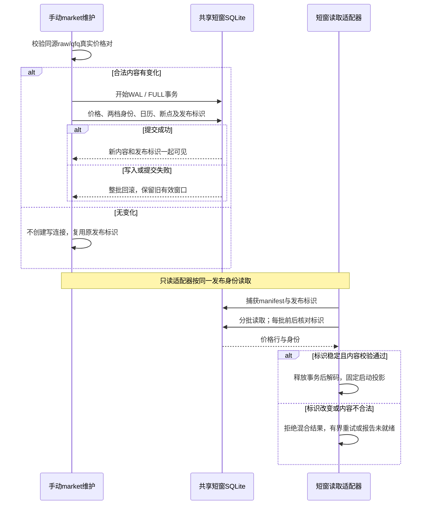

# 下载、训练与回溯

本文是下载、历史数据、独立qfq、训练模型及回溯工程的唯一权威。
评分和收益准入见[评分逻辑](1_评分逻辑.md)，架构、API和资源见[工程设计](2_工程设计.md)，完成证据见[工程实施](3_工程实施.md)。

## 1. 离线入口与消费者

### 1.1 先选命令

| 任务 | 当前命令 | 结果 |
| --- | --- | --- |
| 更新全部本地资料 | ./run.sh sync | 共用一次证券总体/ST/日历/当前行业准备，再依次更新history、market、company |
| 维护独立日线短窗 | ./run.sh sync market | 发布共享251/61日短窗口 |
| 只更新公告、财务及风险 | ./run.sh sync company | 增量发布公司证据 |
| 维护完整历史并训练全部档位 | ./run.sh train | 维护一次历史，四档共用一次价格扫描并独立并行训练 |
| 只训练任意档位组合 | ./run.sh train v1,v5 | 一次历史维护后只处理所列档位；也支持单独v2或v3 |
| 只训练全新V1 | ./run.sh train v1 | 维护历史后训练排序/收益双组件的Tomorrow/D25整组工件；生产运行权限由独立人工授权决定 |
| 只训练V5 | ./run.sh train v5 | 维护历史后训练或复用按行业TCN的Tomorrow/D25整组工件 |
| 只维护完整历史 | ./run.sh sync history | 不受周更门槛限制，只发布历史事实与缺口，不计算训练资格 |
| 卸载已安装的旧系统任务 | trader-cli history-automation-uninstall | 校验归属后显式停止并移除旧任务；启动不执行卸载 |

PowerShell入口保持相同命令语义；sync不接受档位，train直接接收由v1、v2、v3、v5组成的非空逗号列表，不接受重复档位、--profile或both；省略列表时选择全部。启动入口使用相同列表和默认值，具体见工程设计。
train是用户明确触发的下载加训练，不是只启动一个已有模型；普通run.sh只启动推荐服务，不执行sync/train。慢资料在启动时读取，运行期间不轮询数据库或模型文件变化，手动维护后正常重启加载。
一次train只维护一次历史，公共准备或历史维护失败即停止。bootstrap创建容量等于所选档位数（1～4）的执行器，协调器持有一次历史维护锁及所选档位锁；每档独立，不捆绑V2/V3。

| 训练资源 | 当前约束 |
| --- | --- |
| 输入扫描 | 读取并对齐价格流一次，按窗口分发；每批256行，每档最多排队2批，不将整段历史常驻内存 |
| SQLite | worker创建并关闭自己的连接；建样本后关闭写连接，再用只读连接拟合 |
| 拟合顺序 | 各档并行，同档Tomorrow/D25共享样本与统计；头和行业仍顺序执行 |
| 失败与取消 | 单档失败不阻断其它档位；取消通知全部worker并等待退出，主线程独占信号处理 |

汇总报告容量、价格扫描次数、原始行数、耗时和退出码，具体输出及退出语义见第1.2节。
旧人工下载命令和check入口不保留兼容别名，本地检查使用统一诊断。

sync已包含history，通常无需紧接着再执行sync history。需要更新全部资料再训练时，执行sync后再执行train；train仍校验同一历史维护合同，同日身份及数据完整时不请求价格，不会重新下载2000日。只更新公司资料使用sync company，它仍先完成公共参考准备，不下载完整历史或行情窗口。不同命令同时维护同一分项时由该分项锁拒绝重入；train遇历史维护占用时停止，不拿未发布数据训练。

手动history与market维护以Asia/Shanghai 15:15为当日目标边界：此前只请求最近已完成交易日，15:15起允许今天进入目标日；实际交易日仍由可靠日历确定。Tencent当日raw/qfq尚未配齐时保留明确待重试缺口，后续重跑增量补齐，不把单侧价格视为完成。

公司首次或未完成运行按断点补齐公告、财报和必要正文；窗口、请求间隔、重试及持续风险覆盖要求见第2.3节。命令开始先提示公共参考准备，首次或跨上海日期的ST核验也可能较慢；不能用CLI环境检查耗时代表业务启动时间。

交易日历优先复用`company_st.sqlite3`中同一上海日期且完整性及身份校验通过的参考，并显示本地复用；证券总体、ST及行业仍走各自准备规则。缺失、跨日或无效参考必须重新请求日历，无效缓存明确提示；请求失败保留旧发布与断点，不以过期日历冒充当日准备成功。日历超时和公司维护锁占用除JSON类别外另给终端恢复提示；Ctrl+Z暂停的旧任务应在原终端恢复后用Ctrl+C退出，锁释放后才能续传。

### 1.2 执行顺序与退出结果

命令运行一轮后退出，没有服务内定时下载或训练。当前默认sync串行执行三个分项；train先维护一次历史，再并行处理所选档位。

| 分支或边界 | 当前处置 |
| --- | --- |
| 公共准备 | 共用不可变官方总体、完整ST证据、上海检查日、可靠日历及参考身份；当前行业与历史锚点行业分开 |
| 必需准备失败、配置错误或取消 | 停止新派发，保存合法断点，等待已接收事务并关闭资源；不继续后续分项或训练 |
| 默认sync单项失败或待补 | 保存结果和断点，继续其它独立分项；单独market不依赖history先完成 |
| 当前行业失败 | 仍允许合法价格降级；训练另报告资料不足 |
| train前置 | 历史维护失败、取消或无合法发布快照时不拟合；有合法快照但有部分价格缺口时，只用合格样本，由各档输入及日期门决定是否可训练 |
| 同日重跑 | 复用相同身份的完整数据和模型，不因其它档位模型缺失、损坏或发布占用判下载失败 |
| 输出 | stderr输出进度，stdout输出最终JSON；单档profile_training_result，多档追加selected_training_result |
| 数据采用 | 已发布资料及模型在正常重启后校验加载，不热更新；工程成功不授予收益或生产资格 |

每档训练结果输出reused和stage_seconds。后者为既有进度owner记录的已完成阶段累计单调耗时，未完成不补零，也不解释为单独队列测量；并行各档耗时不能相加当作命令墙钟。模型双头完整性、复用身份和失败回滚见第5节。

| 退出码 | sync | train |
| --- | --- | --- |
| 0 | 分项均完成，无待补 | 所选档位均完成或合法复用 |
| 1 | 至少一项失败或仍待补 | 至少一档失败或历史前置失败 |
| 2 | 参数/配置错误 | 参数/配置错误 |
| 130 | 已取消 | 已取消，不继续训练 |

下载完成只判断发布状态与价格缺口，不计算训练到期或收益资格。history_maintenance_status及data_sync.tasks的历史输出不含training_due、training_due_reason、training_heads、matured_label_days_since_training和automatic_training；到期读取、不可用状态及唯一owner见第7.1节。

## 2. 数据、资格与资源所有权

### 2.1 持久目录

路径相对于配置data_dir；默认根为data/。runtime_dir只放服务锁、日志及可丢弃临时产物。

| 路径 | 内容 / 写入者 | 消费者 |
| --- | --- | --- |
| market/reference/company_st.sqlite3 | download写入证券、ST、日历及不可变参考发布；采集指针与发布成员分离 | 同轮下载准备、训练总体、推荐固定启动参考与资格 |
| market/reference/industry.sqlite3 | 历史industry_query、当前current_industry_query | 历史锚点与当前模型行业分别消费 |
| market/history/catalog.sqlite3 | 任务、缺口、序号、绑定参考和发布指针 | 推荐启动有界预读、训练、研究及结算的快照入口 |
| market/history/prices_YYYY.sqlite3 | 年度物理价格分区 | 只读历史消费 |
| market/daily_window.sqlite3 | 独立raw/qfq短窗口、两档身份及断点 | 短窗维护与核验；模型上下文读取完整历史 |
| company/company_facts.sqlite3 | 公告、财务、质押、解禁及发布投影 | 推荐风险与财务 |
| company/eligibility.sqlite3 | 当前/永久资格事实与身份 | 推荐过滤 |
| training/models/{v2,v3}/{tomorrow,d25}/ | 每头model.json及metadata.json | 推荐启动加载 |
| training/models/v1/{tomorrow,d25}/ | 每头model.json及metadata.json；双头整组发布并保留原训练验证报告 | 显式V1启动加载 |
| training/samples/{v2,v3,v5}/ | 待补训练可复用samples.sqlite3及complete.json；完整完成或明确拒绝后清理文件与空目录 | 各档训练工作区 |
| training/samples/v1/ | 仅在V1训练中暂存样本，结束或取消后清理文件与空目录；旧目录有数据时拒绝覆盖 | 显式V1训练工作区 |
| training/models/v5/{tomorrow,d25}/ | 每头model.json及metadata.json，行业TCN保存在头文件内 | V5启动加载 |
| recommendation/{v1,v2,v3,v5}/ | freeze.sqlite3、publication_state.sqlite3；V5路径存在不表示允许正式提交 | 正式冻结记录和独立发布序号 |
| recommendation/shared/deepseek_budget.sqlite3 | 跨档位物理请求预算 | 复核与只读内存状态 |
| research/{v1,v2,v3,v5}/ | outcomes.sqlite3、按日traces、按身份experiments | 结算与隔离研究 |

1. 先持久化company_st.sqlite3不可变发布，再将publication_id及历史参考摘要绑定到catalog的reference_binding；日历和总体各自固定准确的发布版本。缺失引用禁止发布历史指针，不保留旧参考JSON。
2. 当前行业查询与历史锚点分表，不得互相替代；当前参考满7日由手动准备更新，推荐侧不联网补查。
3. 跨PC共享已训练模型时，仅将`data/training/models/{v1,v2,v3,v5}/{tomorrow,d25}/`下的`model.json`和`metadata.json`纳入Git；每档双头四文件必须作为同一批完整提交，保留原始字节与身份。样本缓存、SQLite、锁文件、暂存目录及其它业务数据仍留在本机；尚未产出完整双头的档位不提交占位模型。
4. 各业务独立维护锁；数据锁紧邻数据，模型发布锁位于整档替换目录之外。

数据库文件、表和逐字段含义见[本文数据库字典](#附录数据库文件与字段字典)；其中也包含推荐快照、正式决策和DeepSeek账本，工程运行合同仍见[工程设计](2_工程设计.md#8-发布冻结与持久化)。

其它PC在`Afuture`分支执行`git pull --ff-only origin Afuture`即可取得已提交模型；拉取前停止本机训练及服务，确认模型目录没有需要保留的本地改动或未跟踪工件，存在冲突时先备份到仓库外并人工处理，不强制覆盖。接收端保持代码、依赖和配置合同匹配，仍须单独维护行情、历史和公司资料；正常启动或重启时由现有加载器校验双头、摘要和合同，不热更新。Git共享只分发训练结果，不授予V1/V5收益或生产资格。

#### 字段从下载到消费者

逐字段来源、单位、缺失和评分用途统一见[评分附录](1_评分逻辑.md#附录完整字段与因子表)，本节只解释数据工程路径，避免复制评分权重。

| 输入 owner / 命令 | 发布与读取 | 消费者和具体例子 |
| --- | --- | --- |
| 公共准备；sync各分项、train共享 | 证券/ST/日历/行业固定引用；推荐启动读取同一发布身份 | 静态资格、上市交易日龄、前一交易日风险覆盖、模型行业暴露；当前行业不代替历史锚点行业 |
| history；`./run.sh sync history`或train前维护 | 年度价格分区及catalog发布指针；推荐有界预读，训练/研究按锚点和快照读取 | 推荐历史派生量、拟合样本、回溯与结算，不在在线评分中扫描全历史；历史字段合格不等于当前来源新鲜 |
| market；`./run.sh sync market` | 独立raw/qfq短窗原子发布；模型启动上下文改读已发布完整历史的有界窗口 | 收益、均线、波动、回撤及金额基线；各档窗口按完整历史身份对齐，不把251行短窗当作信号日前251日 |
| company；`./run.sh sync company` | 正式财报/公告/质押/解禁形成证据及资格发布；推荐一次分批预读，不按股票评分逐次查库 | D25财务质量与估值、本地风险及资格；财报需已披露，公告一年风险覆盖完整性独立判断 |
| 在线行情/分钟；正常服务来源任务 | 内存标准化及有界缓存，按内容/资格变化触发派生；不触发sync/train | 当前价格/实际量/金额与本地历史组合，分钟构成尾盘因子；HTTP/Web读取最终用例，不抓取这些输入 |
| training；`./run.sh train` | 模型双头整档发布，正常启动加载，不热更新 | 使用完整历史有界投影派生的同档特征，提供预测诊断和成本门；V1另提供模型排序。工件不是报价来源，缺失不制造预测 |

例如昨日以前5个完整交易日实际股数为100、120、80、100、100万股，均值100万股；当日实时60万股产生`volume_to_5d_average=0.60`。分子来自在线Q，分母来自已发布H，缺其中任一端便不能确认缩量形态；供应商volume_ratio=1.5不能替代0.60。又如真实当前换手3.00%、历史20日中位数2.00%，得到冲击1.5；金额2亿元除以历史1亿元得到金额冲击2，两条基线不互换。上述是说明性例子，不是真实测量。

源码审计已明确的I/O边界是：history供长样本，market供独立短窗，二者raw/qfq重复不是删库理由；启动公司预读、固定参考、基础历史上下文及共享模型特征缓存已有owner，不再新增并行缓存。剩余优化先测冷启动各预读阶段的SQL次数/字节/耗时、连续同输入评分的读库增量、模型特征缓存命中及RSS，再比较同发布身份的输出、覆盖与延迟。诊断自身每次加载输入的耗时不能当成运行服务每轮的重复I/O。

复用`diagnose_runtime.py`的history-sqlite、qfq-sqlite及download-performance专用诊断；写入基准只用仓库外隔离副本，活动历史正在维护时不执行竞争性全库实验。尚无完整history/company吞吐实测时，只列未验证边界，不根据字段表推断优化收益。

`--profile database-baseline --database-probe-directory <新的仓库外目录>`建立下载与启动基线：每轮新进程，历史五场景、联合/单项下载、启动预读及同日重启分别测量。复用现有业务owner和SQLite封装，验证独立目录、发布身份一致、一次联合准备、共享历史主扫描及预读后的零数据库读取。报告区分合成fixture、真实文件系统I/O与未验收的生产吞吐；tmpfs/ramfs不作为SSD/HDD证据，同文件系统手动介质配置明确标记来源。工作量、计数口径、POSIX进程组超时及已有诊断的显式目录选项见[scripts说明](../scripts/README.md)。

#### 数据目录的硬盘检测

CLI数据命令及推荐服务组合启动时，统一使用infra/storage_probe检查runtime、历史、独立qfq、参考、公司/资格、预算以及V1/V2/V3/V5模型、样本、推荐与研究目录；HTTP/Web工厂不执行检测。检测解析软链接，未创建目录使用最近存在的父目录，同一次检查按设备复用元数据，不扫描业务内容或运行写盘测速。Linux读取物理设备rotational及组合设备的全部成员；Windows使用卷/分区与物理盘唯一标识关联；macOS读取diskutil介质属性及APFS物理成员。命令式系统查询每个设备最多3秒，权限不足、虚拟/网络存储或无法证明物理介质时明确返回unknown；虚拟SCSI的rotational值不能证明宿主介质。

实际加载的runtime配置可添加可选字段：`"storage": {"overrides": [{"path": "data/training/samples", "kind": "hdd"}]}`。路径相对项目根目录，也可为绝对路径；kind只允许hdd或ssd，解析后重复路径报错，最具体路径覆盖上级配置。手动值优先且显示“已使用手动配置”。交互终端启动服务或执行sync/train遇到unknown时，每个未知设备询问一次SSD/HDD，将选择按受影响路径原子写入现有runtime配置，下次启动直接复用；回车跳过或无交互终端时保留unknown并提示手工设置。选择虚拟盘时应先在宿主机确认真实介质。未配置storage等同空覆盖列表。

只读检查使用`.venv/bin/python3 scripts/diagnose_runtime.py --profile storage`；可重复附加`--storage-path /absolute/source-or-output`核查独立源目录及输出目录。该检查只读取文件系统元数据，不修改活动数据。检测结果目前驱动历史下载批量选择；其它数据操作先完成目录覆盖与诊断，后续I/O调优不在本批生效，不把HDD/SSD识别等同于训练提速验收。

| 数据操作审计范围 | 当前owner及后续调优边界 |
| --- | --- |
| 历史读写、校验、重打包与发布 | download/infra/history_*；检测已切换公共owner，写事务、摘要、first-wins保持 |
| qfq、参考、公司证据及资格 | download/infra/qfq_sqlite、reference_index、company_evidence_index及company_facts_reader；共享SQLite/FULL保持 |
| 样本、缓存、模型封存与发布 | training/infra/sample_cache、sample_index、profile及model_bundles/profile_publication；紧凑样本与批量读取另批实现 |
| 推荐决策、预算及发布序号 | recommendation/infra/persistence与deepseek/budget；短事务和正式记录不可变保持 |
| 研究快照、残差、回溯与证据索引 | training/infra/research；冷扫描、顺序读取和同盘调度另批实测 |
| 公共文件、序列化、锁、SQLite及诊断源/输出 | infra/atomic_files、serialization、process_lock、sqlite_connection；不在每次open或SQL重复检测，诊断通过显式路径检查 |

### 2.2 ST资格

| 情况 | 处理 |
| --- | --- |
| 官方当前简称已确认ST | 直接记ever-ST并排除，不再请求该股其它业务数据 |
| 曾经ST | 永久排除；摘帽不恢复 |
| 当天有效clear证据 | 当前上海检查日内复用 |
| 缺失、过期或未知 | 通过曾用名来源补查；失败则未知，不进入下载 |
| 资格数据库损坏 | 停止，不清空旧排除后继续 |

最多8股滚动在途，每64股或收尾短锁合并；网络期间不持文件锁。
并发合并ever-ST优先；qfq在维护锁内移除已排除代码的派生窗口，history不破坏物理旧行。
推荐端的ST资格固定取自启动时公共参考的完整证据；新确认的历史ST在重启后生效，不再借旧qfq名单作为资格来源。永久ever-ST事实可复用，公共准备仍记录本轮检查日期。
当前名单和事后ever-ST排除存在选择偏差，不等于历史时点资格合格。

### 2.3 公司资料

活动库为`data/company/company_facts.sqlite3`。旧evidence.sqlite3停止读写，不导入、不迁移、不删除、不作为失败回退。新库须重新下载；本批工程交付不执行活动数据切换。

published以股票代码为主键，每股一条轻量事实，含最新财务八指标及披露时间/状态、最新质押、未来180天解禁计划和覆盖状态、risk_events_json、positive_events_json、review_reasons_json、待正文数、公告覆盖起止及实际检查/发布时间。发布身份和提取规则身份只保存在全局publication。完整字段及枚举由[事实类型](../src/trader/download/domain/company_facts.py)、[事件类型](../src/trader/download/domain/company_events.py)及[持久化协议](../src/trader/download/infra/company_facts_protocol.py)定义，加减分合同以评分逻辑第7.1节为准。

风险事件保留主体、案件、等级依据、首次/最近披露、生效、解除/到期时间、状态、摘要与证据ID；减持另保留计划事实。利好事件保留类型、主体、状态、取消时间、等级、实施量化证据及等级里程碑，计划数字和口径不明不授予实施等级。待核实原因独立保存，不能用事件数组为空推断风险为0。元数据、正文、查询成员及页断点仍由原始资料表持有，不把每股发布行数当作原始资料变更数。

正文和页断点由下载所有者保存。已确认持续风险及必要证据跨年保留；普通正文不进入推荐启动读取。最近7天修订按日核对，当日公告15分钟后允许再查，未提交页保持断点；更正清空正文核验状态，未核实期间保留已确认风险、暂停关联利好奖励。全文核验采取有界保守规则，不支持或含歧义的结论记录待核实，不用标题补造事件。

初始持续风险状态独立于一年公告窗口。组合根注入官方上市日期，发布只在已有查询覆盖连续追溯到上市日时认定初始历史可证；日期或覆盖不足写入`initial_risk_state_unverified`并限制正式动作。当前365天增量查询不能自动完成较早上市公司的初始核验，须另有正式历史证据；不通过填空或扩大资料TTL放行。发布同时重读本地跨年公告，未提取及待核实公告也参与完整性判断；持续风险、待核实项的证据及覆盖证明保留，不导入旧库。主体/否定、实施比例及合同税口径的提取规则身份已切换，旧身份发布须用新代码重新同步发布再重启加载；从原始页和正文重建事件，不复用旧规则的案件结论，也不为未处理的旧行赋予新身份。

启动按512股SQL批次在同一只读快照读取轻量事实，核对前后发布身份；一次装入共享ResearchEpoch，评分热路径无公司SQL或网络，取消、30秒时限和容量门保持。证据标题和链接按需经推荐只读查询取得；不生成data/doc人工报告。

终端财务、质押及解禁显示日期范围及分页。公告目录按固定窗口内所有目标市场共同完成的自然日输出进度，首尾日期均计入；同一天的全部子查询及父范围并集核对完才计为完成，日期分母不随证券查询拆分而增长。显示当前市场、日期及查询分页，不显示股票完成数或页面股票提示；近期优先与历史续传可令当前日期跳转，日期完成数不代表连续覆盖截止。正文下载提取按篇输出尝试、成功、失败、冷却及待补计数，并显示当前正文股票。逐股事件核验按本批待更新股票总数递增输出当前代码/名称、本地公告（含保留的跨年证据）及正文计数。核验完成后单列原子发布，提交成功才显示已发布。无新闻候选明确未覆盖；阶段切换清除旧股票提示。证券组及身份哈希仍隐藏，普通进度限频1秒，阻塞操作保留5秒心跳。

公告元数据与链接保存在disclosures；只对风险/利好相关标题下载正文PDF。原始PDF临时放入内存并经隔离进程完整提取，文字保存disclosures.body，body_checked标记成功；当前没有永久PDF归档目录。失败正文保持待补/待核实，不用标题代替分析。既有company-resume诊断增加company-storage-audit只读模式，可核对正文数量、字符数及持久化重试分类，不访问网络，不创建副本或更改数据。

| 分项 | 当前窗口 | 增量方式 |
| --- | --- | --- |
| 公告与风险 | 最近365天发行人披露 | 新日期、失败页、最近7天重叠、每天一个旧月修订检查 |
| 新闻 | 最近7天，每股最多50条 | 只取最近7日两档有效正式发布名单的去重代码，与本轮合格总体取交集；无名单明确未覆盖，不全市场冷抓 |
| 财务 | 最新正式报告及所需对比，最长550天报告期 | 披露增量及7天回看 |
| 质押 | 最新完整市场快照 | 完整后替换，失败保留旧值 |
| 解禁 | 未来180天 | 完整后替换 |

1. 巨潮按市场/日期分页，每页30条、最多100页；跨日超限、重复页或旧游标超过100页时继续二分。单日超限或重复页先按主板/创业板或主板/科创板切分，再按巨潮官方证券清单每32项分组，仍超限时二分证券组；单个查询对象仍超限则明确待补。证券筛选同时核对官方发行人身份，允许同一发行人的历史代码，保留返回的原始代码。全部子片完成后，以记录并集而非可重叠子查询总数之和核对父查询总数及新样本；一致后才声明覆盖并清理撤回。当前证券清单不代表历史完整总体，缺记录时保留已完成页，按代码正反序各至多100页有界查找遗漏发行人，只补新增查询并再次核对完整并集；仍不一致保持待补。确证来源撤回或替换记录时保留查询成员、重新核验受影响日期的查询代次。修正查询策略首次接入只释放相应筛选/覆盖失败的冷却，网络冷却及后续新失败保持。规划只补现有分片未占据的日期，已完成宽片也不重复创建日片，重启不重新创建已拆父片；旧月复核重新核验子查询。
   巨潮来源主板计数包含B股披露，来源分组与覆盖核对保留这些记录并按正确交易所处理；推荐发布总体仍只使用已确认的A股代码。日期片完成后的撤回清理使用带日期范围的现有索引查询，只清理对应市场和日期的失效关联。
2. 标题只筛正文，风险须核对主体、官方结论及同案结束关系。
3. 事实与页断点使用FULL事务。发布先通过公共只读连接读取一致源快照，在连接私有TEMP表分批构建编码；取得短写事务后重新核对同一读连接的data_version，原子提交投影与指针。源内容变化拒绝本次发布并保留旧结果，清理在发布后独立执行；重启从首个未提交页续传，新日期及近期修订排在历史待补前，历史未完成查询保留首个未提交页；存在历史待补时不追加旧月复核。已有覆盖记录不能掩盖未完成复核，该市场存在待补分片时仍标记覆盖不足。采集按日期、正文按篇、事实处理按股输出进度；只有后两阶段显示真实处理的股票，历史发行人补查单独标明。终端本轮汇总才显示成功页、原始资料变更及缓存复用；变更合计财报、质押/解禁、公告/新闻及正文的实际变更，包含必要删除，不是每股一行的发布表行数。重复核验页可以增加成功页而不增加原始资料变更；仍有效的历史完整片计入复用。阶段耗时与命令累计分别显示，sync的命令累计包括之前的history和market。
4. 公告已下载且元数据未变时复用正文；一次失败不能清空已确认事实。本轮待下载正文从365日前上海日期零点开始、截止观测时间；发布另结合已保留的跨年持续风险及待核实资料。逐篇失败原因、尝试时间和重试期限随内容摘要持久保存；同一内容在冷却期内不下载，仍计入pending_documents并保持风险未知。摘要、解析参数或诊断策略变化允许立即重试，核验成功清除该篇失败状态。初始化只增加重试及子查询表，不重建已有事实、页游标或发布投影。
5. 单次请求最多8秒，巨潮至少间隔1秒；传输失败或408/500/502/503/504最多3次物理尝试，等待2/4秒，每次物理请求独立计时，并保持取消响应。公司请求超时与间隔在`config/download.json`的`company`段配置，加载时校验上述上限。
6. 公告查询和PDF下载分别熔断：403/429立即停止对应来源；网络超时、连接失败或可重试HTTP错误耗尽3次物理尝试后只暂缓该任务，连续3个任务传输失败才停止对应来源。公告连续3个查询校验失败也停止公告来源，合法响应及提交成功后重置计数。失败片页游标保留，暂时失败15分钟内不重新下载；其它查询失败默认24小时冷却。PDF的404、解析失败、超限和解析超时仅影响该篇，不累计来源传输失败。来源失败停止相应采集后仍可发布合法降级投影；用户取消停止新派发并保留断点。日志分别显示尝试、核验、冷却和待补计数，以及来源停止或取消原因。
7. `sync company`不设整轮或分阶段时长上限，按待处理清单持续执行；完成后结束，用户可随时Ctrl+C中断，再次运行从首个未提交页及待补正文续传。配置不接受整轮或阶段预算字段，旧字段已退役，不提供兼容读取。单次请求、PDF解析、请求间隔、有限重试与失败冷却仍按公司配置约束；来源拒绝或连续失败仍会暂缓并明确待补原因，不做无限重试。修改下次启动同步生效，已有进程继续原逻辑。公共准备另有来源超时、并发上限及取消边界；独立诊断工具的运行上限只通过取消信号约束其隔离探测，不回写生产任务配置。推荐服务不再运行09:15/12:45资料任务。
8. published_codes只表示已有可读投影，不等于完整一年风险覆盖；pending_partitions和pending_documents分别报告待补页片和正文。

公司同步按批次交替推进：默认处理20个目录页，再处理最多50篇到期正文，核验并原子发布受影响股票，然后继续下一批。批次数量只决定调度粒度，不是阶段预算；365天全目录、父子查询并集核验、近期7天与旧月复核规则保持。来源暂缓后仍处理另一来源可用任务及合法降级发布。进入正文清单读取前即切换为“公告正文下载提取／总数待确认”，心跳不沿用上一阶段。单篇解析超时按该篇失败记录并继续其它正文，顶层pending表示部分发布并需续传，中文终端原因不改变JSON机器码或CLI退出码。

正文默认两个工作线程、两个独立HTTP客户端，每个客户端至少间隔1秒；目录批次使用其中一个客户端，目录与正文批次交替执行。bootstrap显式拥有HTTP及工作线程，最多同时处理两篇，每篇仍受下载字节、解析页数/字符数及单次超时限制。工作线程只下载和解析，主流程统一使用共享SQLite封装提交正文及失败状态；取消停止新派发，收齐已接受的成功结果后关闭资源。内容摘要不匹配的迟到正文不落库。下次启动复用已提交页、成功正文和未到期冷却。

数据库增加可重建的正文候选索引和持久化受影响股票清单，不另存正文或业务事实副本；首次初始化只从既有标题回填候选，保留旧页游标、正文、重试及publication。页身份明确绑定30条和全公告查询，旧断点回填相同合同，拒绝未经验证的分页切换。来源实测50/100条请求仍返回30条，因此生产保留30条；公告分类过滤未经完整性验证，继续获取全目录。

页/正文/结构化变更与受影响股票标记在同一FULL事务提交；局部发布仅重算需要更新的股票，保持其它发布行，原子更新全表发布身份并清除本批标记。首次、跨日期及覆盖变化会扩大核验范围；提取规则变更必须重建全部已发布股票，不能把新身份写到旧规则行上。过期资料清理每轮结束执行一次。原始输入读取归属company_fact_inputs，写入及发布归属company_evidence_index，推荐只读消费者归属company_facts_reader；连接和事务仍统一由infra/sqlite_connection管理。

日志增加批次号、已知待下载页数及页数未知查询数；逐股计数以本批实际核验总体为分母，代码/名称、公告数、已分析数、风险和利好数保持，提交成功才显示本批已发布。正文累计成功至少5篇且有有效采集耗时后显示速度和已知待核验正文的预计时间，明确不含尚未发现正文及冷却；不能按已完成日期比例估算整轮结束时间。统一诊断的company-pagination-audit只读比较分页能力；company-pipeline-audit在显式仓库外目录用同组公告实测单/双线程、事实一致性及再次运行复用，不作为全年覆盖证明。

同一篇同一内容本轮失败后不再排队，即使长任务跨过冷却期限也不重复请求；下一轮仍按持久化重试期限处理，更正为新摘要后可立即获取。正文暂缓计数包括冷却及本轮已失败项。跨午夜的下一次发布会重新核验本轮总体的日期与有效性，不能只刷新当天发生资料变更的股票。

正文运行参数同属`config/download.json`的`company`段：

| 配置项 | 默认值 | 含义 |
| --- | --- | --- |
| directory_batch_pages | 20 | 每批目录页上限，1–100；单次父片补查保持既有有界修复流程 |
| document_batch_size | 50 | 每批到期正文上限，1–200 |
| document_workers | 2 | 正文并发数，仅允许1或2；各自独立客户端，统一单写入 |
| document_failure_retry_seconds | 86400 | 不可读、加密、无文本、超限等正文失败，24小时后再试 |
| document_transient_retry_seconds | 900 | 正文或公告查询的网络失败、正文解析超时等，15分钟后再试 |
| document_limits.max_bytes | 16777216 | PDF下载上限16 MiB，可设置至64 MiB |
| document_limits.max_pages | 200 | 全文页数上限，可设置至1000页 |
| document_limits.max_text_characters | 1000000 | 全文字符上限，可设置至200万字符 |

PDF仍在受单调超时约束的独立子进程内解析，每页展开内容最多8 MiB；加密、完全无文本、文本不足80字符、页数/展开内容/文本超限分别报告。只接纳完整提取结果，不把截断文本、短文本或扫描件自动当作已核验；本轮不加入OCR。增加上限或修改正文解析超时后，下次同步可重新尝试旧失败篇；改配置不会更新已经启动的进程。单个证券查询仍超供应商上限、官方清单不完整及扫描件等缺口保持显式未知。

程序内部采用有界批量读写，读取后结束事务再解码，不在评分请求中联网。
慢数据全部手动维护；推荐生命周期启动后分批预读轻量事实，评分冷项不再触发公司数据库读取。启动前后校验同一发布身份，最多重试3轮，30秒或取消后报告未就绪，不接受混合发布。
所选档位共享同一ResearchEpoch和一次公司预读，公告正文只在生成风险事实时短暂使用；原owner的常驻字节纳入进程缓存预算。DailyFeaturePack同时绑定固定证券、日历、行业、各档qfq、公司、模型和配置身份，未完成绑定的输入不得进入评分。

#### 公司事实的有效性与覆盖截止

| 时间或状态 | 需要说明什么 |
| --- | --- |
| 财报披露及生效时间 | 报告是否在评估时已公开，是否仍是最新可用正式报告 |
| 公告风险覆盖截止 | 已核验到什么时刻，有哪些页片、正文或来源仍待补 |
| 最近查询时间 | 实际何时维护，不等于全部事实的生效日或无风险证明 |
| 本地读取时间 | 仅表示何时加载，不能刷新来源年龄或风险覆盖截止 |

[公司资料读取](../src/trader/recommendation/infra/market_data/published_company_research.py)按可靠交易日历的前一实际交易日判断风险覆盖，节假日不按自然日误失效。财报披露、风险覆盖截止、质押日、解禁前视范围、最近查询、发布及本地加载时间分别保留。
未来披露不参与计算；查询时已经公开的未来解禁可以作为风险。过期风险覆盖限制动作并保留已知硬风险，不否定已披露财报，也不因本地重读而刷新来源年龄；前晚资料不证明盘中新公告已核实。

解禁覆盖与公告覆盖分别判断：每次内存读取按当前决策日重新计算180日前视范围和计划合计，`unlock_coverage_end`不足时合计为未知、动作受限；不复用启动时已变短的前视范围，不用最近交易日公告覆盖代替解禁完整性。

### 2.4 资源与SQLite边界

| 场景 | 当前限制 |
| --- | --- |
| 下载worker | 默认8，最多12；会话在股票间排他复用 |
| 持久SQLite | 显式事务、FULL、线程持有连接；WAL用于共享读写 |
| 历史待写/在途 | 合计最多64股、32768请求日期单元 |
| qfq待写/在途 | 合计最多32股、8192日期单元 |
| 样本SQLite / LightGBM直方图池 | 32 MiB / 64 MiB |
| 单档计算 | 最多2个计算线程；现有单档资源验收单独核算 |
| Linux train整体scope | 4608 MiB回压、5120 MiB硬限制 |
| 并行执行器 | 所选档位数1～4；不以硬盘类别或外部证据开关限制为两档 |
| 拟合内存预约 | 共享预算最多3 GiB，并按可用内存保留1.5 GiB余量；按矩阵尺寸估算，预算不足等待，单任务超限明确失败 |

并发执行位置与实际大矩阵分配分开控制：V1按当前模型头的四分区样本数预留矩阵、元数据及拟合工作区，映射释放后归还，再处理下一头；V2/V3按最大行业矩阵及原生计算工作区预留；V5预留批次缓存和网络工作区。预约原子完成，等待可取消，退出归还；不是固定最多两任务。保留Linux整体scope；V1/V2/V3每档2个计算线程，V5按training.json配置1～4线程且不得超过当前CPU亲和性允许的数量。V5同一行业的训练/早停float64批次只读取一次，各轮复用；合计超过256 MiB改用样本工作区临时文件映射，结束或取消清理。网络输入在批次边界按配置转为float32或float64，不改缓存格式及批次顺序。序列块缓存仅保存原小端float64载荷的只读视图，按原32 MiB载荷预算淘汰；连续列选择不再复制整批，训练缓存的最终布局保持。

性能诊断使用统一入口`--profile training-performance --history-root <仓库外历史副本> --training-probe-directory <新的仓库外输出目录>`，可用`--training-profiles`选择组合。串行前测、共享并行、串行后测均使用新子进程及独立输出；加`--baseline-checkout <仓库外旧版源码>`则运行旧版前测、新版、旧版后测，各自首次及同模型目录重复执行，分别记录耗时、复用与扫描次数。比较持久模型数值及评价指标，配置摘要须相同，实现身份另列；不把实现摘要变化当作数值变化，也不把该测量声称为独立预测回放或历史下载耗时。任何一轮样本门不通过时标记不可比较，不将阻断更快解释为训练提速；单组夹测不能代替稳定全市场收益证据。不再读取TRADER_JOINT_FIT_EVIDENCE。
推荐使用进程共享512 MiB逻辑缓存/2 GiB RSS验收预算，train内存预算独立。配置已切换，真实资源验收按工程设计第7节执行。
SQLite公共边界见[工程设计第4.3节](2_工程设计.md#43-sqlite公共边界)；交付状态和实测证据只查工程实施。

机械盘首次发布前的全量续传沿用初建批量提交策略；读取已写数据与选择写入批量分别判断。恢复读取先用代码索引确认股票在年库中是否存在，整股未写入时不再逐日探测；已有部分数据时仍按请求日期及序号读取。年库写事务先用代码索引证明整批股票在记录及观测中都不存在，才使用首次插入路径；已有股票仍逐项校验冲突、幂等及未发布缺口升级，FULL与落库后确认断点保持不变。历史进度分别显示已返回任务的恢复读库、供应商及校验累计耗时，以及已完成落库和当前批次待确认时间；并发累计耗时不能相加解释为整轮墙钟，尚在执行的读库看在途数量及最久在途。

## 3. 完整历史下载、补缺与发布

### 3.1 请求什么

| 项目 | 当前规则 |
| --- | --- |
| 初始窗口 | 最近2000个可靠市场交易日，新股不补上市前日期 |
| 价格和日历来源 | Tencent；BaoStock只供行业 |
| raw请求 | 每股一次有界窗口 |
| qfq翻页 | 恰好返回640行且未覆盖目标起点时，按重叠锚点向前，最多5页 |
| 停止翻页 | 少于640行、覆盖起点或达到页上限；不无限凑满 |
| 增量 | 新日、可重试缺日和最多5个有效锚点 |
| 同日已完整 | 免价格联网，检查必要身份 |
| 参考单独变化 | 发布新参考身份，复用价格 |

1. 日历来自Tencent指数，日期有序、唯一且不越过截止日；允许附带多1条当日行后再裁剪。
2. 请求跨度按最早至最晚缺日计算，不能把稀疏缺日数量当窗口长度。
3. qfq有限但非正的旧价只隔离受影响日期，同页其它合格行继续保存。
4. 已确认非正qfq日期延迟20个市场交易日再重查；普通单侧缺行、网络失败不延迟。
5. 锚点冲突、分页失败保留已验证近期行，明确待重试，不改为供应商正常少返回。
6. 尾部补缺为qfq起点前的交易日额外预留两个请求名额，短窗口至少请求7行。raw重叠日的交易状态必须一致，开高低收各项绝对差不超过0.0051元；成交量差不超过100股或两值较大者的0.1%，成交额差不超过100元或两值较大者的0.1%。成交额还允许一侧为整万元精度、另一侧四舍五入至整万元与其相同。通过后可用新完整配对补缺，已有完整价格对仍保留原值；超限冲突仍待重试。
7. 完整历史首次Tencent下载汇总后，同轮仅对仍可重试的失败股票再获取一次并输出最终汇总；再次失败即结束本轮，保留缺口供下次手动同步。已确认非正qfq日期遵守20个市场交易日的延迟重查，不因本轮补取提前请求；部分缺行但没有失败的股票不进入该次补取。

### 3.2 缺行不是同一种失败

| 结果 | 保存状态 | 后续 |
| --- | --- | --- |
| 同日raw/qfq均有效 | 完整同源价格对 | 可用，后续保留有效行 |
| 两侧成功但该日都未返回 | tencent_inferred_suspended空价格点 | 仅停牌推定，不是交易所证明或可成交价 |
| 只有一侧 | 无完整价格的待重试缺口 | 不跨源拼另一半 |
| 超时、限流、损坏或身份冲突 | 失败/未知 | 保留已验证数据和断点 |
| qfq非正 | 不合格qfq日期 | 有界延迟重查，不平移价格、不以raw冒充 |

已有有效日线先到先用，真实价格可替代推定，推定不能覆盖真实价格。
行业源失败时允许先发布Tencent价格快照，训练保持data_incomplete，后续补行业并复用价格。
成功但少于2000日不等于下载失败，也不代表模型字段一定合格。

### 3.3 正式年库与逻辑快照

这是一次手动历史维护内部的工作队列循环，不是服务每隔数秒自动下载。派发受worker、来源限速及deadline约束；“5秒”是批量写入触发条件之一，不是每5秒重下全部历史。

图中等待节点要求worker完成与writer排空同时成立；没有下一只股票不表示最后一批已持久化。取消后停止新派发，已接收事务完成或回滚，writer退出后才释放维护锁；不会沿正常成功分支发布。合法历史修订和断点可供下次人工续传，未发布价格不会冒充新发布快照。训练、研究按不可变manifest读取，在线结算继续绑定启动捕获的manifest。
发布内容校验逐月计时，每月仅在校验完成后输出一次进度与本月耗时；校验开始事件仍用于计时。

1. 年库使用具名价格列，保留逐月logical_hash、修订身份及观察序号；物理合年不改变逻辑月身份。
2. 已发布快照不可变，未发布数据不因已落盘就对读者可见。
3. 日历、总体、绑定参考和发布指针由控制库维护，参考与指针同事务提交。
4. 正常写入按年度归组，每4096行一个FULL事务；单写线程内最多复用32个年库连接。
5. HDD/unknown首建按8股或16384日期单元触发；SSD及增量按16股或8192单元，另有5秒或网络排空触发。unknown同时提示手动配置，不默认为SSD。
6. 取消时停止派发，等待已接收事务退出并关闭资源后释放维护锁。
7. 已发布记录不能被同序号内容改写；合法未发布缺失状态只能向更完整已验证事实推进。
8. 旧格式明确拒绝，不做隐藏双读或现场破坏性升级。
9. 未发布断点遇到合格总体变化时，在同一事务更新父身份及任务集合；共同证券保留进度，新增证券下载目标窗口，移除证券不再派发。共同证券的板块、上市/退市日期、日历或来源冲突仍拒绝续传，已发布快照不变。
10. 每次恢复读取按物理年库分组，同一股票在该次读取中每年只打开一次读连接；仍按请求日期和快照序号筛选，不把未来或未请求记录作为已完成数据。
11. 初次发布中断后也遵守非正qfq的20交易日重查间隔，等待重查的已确认任务不重新派发、不整窗重读；其缺口仍保留并计入待补，不计为合格复用。

### 3.4 进度、空间与诊断

等待心跳显示在途股数、待派发股数及最久在途时长，覆盖恢复读取、下载和校验；完成数只在落库确认后推进。“下载”累计已返回任务的耗时，不能代表未返回任务已经等待多久。本地恢复慢可用统一诊断`--profile history-sqlite --history-resume-samples 1`只读测量，最多8股，不请求供应商或写入历史。

| 输出 | 应说明什么 |
| --- | --- |
| 逐股终态 | 实际下载、本地复用、无需下载、本地失败分别说明 |
| 阶段进度 | 股、页、分片、篇单位不能混用；无总数时显示未知 |
| 等待 | 源站等待超过5秒显示心跳，不伪造进度 |
| 汇总 | 成功、残留缺口、未处理及稳定失败原因 |
| 失败 | 原操作及受控异常类型/位置，不输出完整路径或外部载荷 |

耗时用HH:MM:SS；缺口是“股票×交易日”，不是请求次数或股票数。
终端可着色，管道/文件/JSON无ANSI；成功绿色、待补黄色、最终失败红色，不靠颜色替代文字。

空间审计和性能比较使用scripts/diagnose_runtime.py的history-space、history-sqlite、history-write等既有profile。
报告区分正式库、辅助文件、WAL、分配容量、RSS及网络/写入/校验耗时；小fixture不代表全市场性能。
离线压实和维护必须在隔离副本按显式命令执行，不自动清理活动年库。

## 4. 独立qfq短窗口

### 4.1 下载和存放

| 项目 | 当前规则 |
| --- | --- |
| 窗口 | V2最近251、V3最近61个市场交易日范围 |
| 来源 | Tencent同源raw/qfq真实价格对 |
| 请求 | 一次251日范围，尾部增量按需要日期请求，不固定640 |
| 物理库 | 全部板块、两档共用market/daily_window.sqlite3 |
| 逻辑表 | bars、identities、calendars、completions、publications |
| 版本 | 当前SQLite user_version=2；旧板块库或缺发布标识的共享库拒绝 |
| 与完整历史的关系 | 不依赖history，不要求先运行完整历史下载 |

1. 251/61是市场日历范围，不为凑够成交根数向前无限回查。
2. 少量同源缺日只请求尾部和重叠；来源变更或重叠冲突才重取单股251日窗口。
3. 两侧成功缺行不补页、不换源；只写真实价格对，不伪造昨收、换手、停牌或ST。
4. 整窗推定停牌且零真实行时记“无真实日线”，不推进完成断点；单侧价格但零价格对仍待重试。
5. 请求失败或不可信时保留旧有效窗口，继续其它股票；不借BaoStock补价。
6. 每股raw/qfq合计180秒单调deadline，单次45秒、最多2次重试。
7. worker满载最多等5秒，到期停止新派发并保存已接收合法结果；未派发不伪装为供应商失败。

### 4.2 原子提交与读取

下图描述短窗发布及其读取适配器的合同；模型启动上下文按第5.2节读取完整历史。raw/qfq配对、两档发布和读侧前后身份核验属于同一闭环，短窗库只保留真实价格事实。

1. 无变化不创建写连接，变化只写变更行、删除过期日、更新身份。
2. WAL/FULL事务一起提交价格、两档身份、日历、完成断点及每档publication_id；首次建表也在该事务中，失败整批回滚。首次回滚后无表且user_version为0的空库按尚未发布读取，不建表、不写文件；有旧表或非目标版本的库仍明确拒绝。
3. publication_id是同批随机唯一标识；无变化复用不改，移除股票也须更新，最后一只移除则清除该档发布身份。
4. 内容hash仍校验实际价格及日历；发布标识不是内容校验的替代品。
5. 读取manifest时捕获全体身份、日历和发布标识；每批窗口前后仅核对标识，不重复全量扫描。
6. 逐股取行和摘要校验完成后释放事务，再解码；并发标识变化时拒绝混合结果。
7. 短窗读取不写回完整历史或替代模型所需的信号日前窗口；模型启动预读的来源、时限和内容校验见第5.2节。

### 4.3 固定启动身份

历史快照状态统一为published、unavailable、invalid；摘要字段统一为snapshot_hash，历史根目录字段为history_root。catalog的published_snapshot表只保存已发布指针，Python快照类型为HistorySnapshot和PublishedHistorySnapshot；启动进度使用reading_published_snapshot。CLI、诊断和Web同步采用这些名称，不保留旧名称映射。

| 场景 | 当前行为 |
| --- | --- |
| 15:10及晚启动 | 不自动下载短窗；收盘后手动维护，正常重启后采用 |
| 候选和评分 | 读取启动时预读的历史派生因子 |
| 收益结算与模型输入完整历史 | 绑定启动捕获的不可变manifest，发布指针推进后仍读原快照；完整history不可用时模型待补，只读Web保留合法旧结果 |
| 完整历史模型窗口不足 | 记录窗口不足、截止日期不匹配或异常价格，保持待补，不借用其它档位 |

缺模型时不自动训练；训练模型补齐后需正常重启。最近成交日过旧的股票仍限制动作，不能把“库中有价格”当作“当前新鲜”。

## 5. 训练输入、样本与拟合

### 5.1 预检与样本

1. 每个V1/V2/V3/V5档位独立核对双头与当前历史、标签截止、配置、特征、依赖和实现摘要；匹配返回reused=true。V1还绑定完整输入描述、总体与上市区间，并在共享扫描前检查；所有所选档位均无须构建样本时，价格扫描次数为0。复用不重新发布或刷新模型来源日期；本轮未建样本时V1的sample_counts为null、coverage为空，模型预测与已保存的评价报告保持。
2. 某档缺失、损坏或身份变化只触发该档重训；不受到期提醒周期限制。完整样本缓存按身份复用，不重复生成特征和横截面。
3. 首扫前校验行业、切分和样本保守上界；所有行业均不足20000行时提前阻断。
4. 同一市场日期的全部股票处于同一切分，特征按代码和日期对齐，不按每股第N行对齐。
5. 原始特征和在线模型复用纯公式及manifest；横截面暴露先于未来标签可用性固定。
6. 只保留唯一最终samples特征表；写入时累计小型日期/行业/标签统计表及每日标签缺失诊断。有效日期、标签均值方差、行业行数改查统计表，不反复扫描宽特征表。统计、切分和样本一起封存并校验摘要。
7. V2/V3行业拟合读取按每批最多4096行、按日期/代码顺序装入NumPy矩阵，批内按训练、早停、校准分组，保留各头独立的特征列、目标缺失过滤和校准日期；读取行数必须与已封存统计一致。V5紧凑序列批次仍由原序列读取路径处理。
8. V1矩阵同样按每批最多4096行读取，逐项核验特征BLOB长度后按原小端float64批量解码；保留每头日期、代码、行业、标签与排序query顺序。每头分配前预约内存，矩阵和映射释放后归还，发布不占用拟合预约；所有训练参数和计算线程保持。

### 5.2 不同日期窗口各是什么意思

| 数字 | 含义 | 是否要求每只股票都有这么多行 |
| --- | --- | --- |
| 2000 | 完整历史目标市场日历窗口 | 否，新股不补上市前日期 |
| 251 / 61 | V2 / V3历史范围，提供250 / 60日特征及一根前置价格 | 保留市场日期，历史停牌/缺行按下述规则对齐；异常价格不填补 |
| 1000 / 750 | V2 / V3有效拟合日期 | 是总体切分要求，不是每股上市历史要求 |
| 1250 | 部分旧研究代理/候选窗口的日期约束 | 不是当前每股统一门槛 |
| 5 | 最大标签成熟跨度及切分隔离尺度 | T+5沿共同市场日历定位 |
| 200 | 研究终端留出最低交易日 | 研究准入，不是生产在线窗口 |

新股能否贡献样本取决于足够历史特征及成熟标签。某只股票不足不意味着整场训练必然停止，但不能降低模型必需窗口。
V1/V2/V3/V5共用一个纯市场日历对齐规则：在上市至退市区间内，确认停牌、推定停牌及已发布快照内的个股缺行保留日期，使用此前同源qfq收盘估值，OHLC持平、量额为零。确认停牌可采用供应商当天估值；推定/缺行始终保留estimated标记，不推进最近已观测价格日期或冒充新鲜行情。不向后借价格、不回填上市前、不修复单侧缺价或异常价格；没有此前有效价格时维持窗口不足。整市场日期缺失属于源数据缺口，不能推定全市场停牌。原始库保持事实不变。

训练预热可从同一2000日已发布范围读取更早前值，各分区边界及模型所需窗口不变；在线先读档位窗口加一日，仅窗口开头无前值时每次增加63日寻找更早估值，最多2000日，足够即停止。V1始终选择信号日前251日，历史已更新到信号日也保留该输入；V5选信号日前61日形成60步序列，辅助特征保留信号日锚点。原始事实、合成估值与训练标签分别保留语义。

推荐启动只读完整历史的有界窗口，核对已发布分区的逻辑摘要，并逐行校验实际载荷与持久化摘要；不重复解码整月未请求载荷，不降低损坏检测或修订隔离。首次校验年度文件时以1 MiB缓冲顺序预读物理页，减少机械盘随机读取，页由操作系统管理；同一文件身份复用已有分区校验，扩窗补查也经过此入口。预读物理页不授予内容信任，仍完整执行所需逻辑证明与载荷校验。按月查询使用日期前导索引定位年度库中的窗口，再按股票排序，避免每月扫描整年；训练窄列扫描与启动窗口的最新修订查找使用相同日期前导的观测主键，保留快照序号上限。派生后仅保留最近20根日线、所需模型输入和历史摘要，纳入既有缓存预算。前后核对发布身份，最多重试3轮，受300秒单调时限及取消边界约束；同一预算传入物理预读、分区逻辑校验、SQLite执行及行解码，不在首个窗口返回后才检查。完成后线程退出，维护后正常重启加载；终态失败明确阻断预览，不继续显示等待输入。完整审计仍校验所有载荷；`--profile model-inputs`只读核验全市场V1输入数量、原因和耗时，不执行预测。

T+1至T+5严格定位市场交易日，不移动到下一成交日；确认停牌的有效估值可以用于估值收益，不能解释为可成交退出。推定停牌/缺行估算不得生成未来标签，也不得沿用估算前值把后续无价停牌升级成已确认价格。Tomorrow只依赖T+1，D25只依赖完整T+2～T+5；一头标签缺失不直接丢弃另一头样本。四档工程训练对每个日期、期限独立取信号时合格人口中实际收益可知的成员，按有效人数计算等权基准；缺收益只排除对应个股标签，整期限无有效收益时仍不可用。横截面特征暴露保留信号时人口，不随未来标签筛选重算。样本诊断分别报告T+1/D25缺失、确认停牌和估算日数；实际日期、行业行数和独立校准门不降低。该目标不替代完整总体的收益研究及正式结算基准；基准合同进入训练身份，旧规则样本和模型不得作为新规则训练结果复用。

对齐合同进入所有档位特征、样本缓存与工件身份。旧合同工件需要显式重训；各档仍须双头全部合格才能原子发布，不热更新或改写已冻结记录。`scripts/diagnose_runtime.py --profile training-alignment --history-root <仓库外历史副本> --training-probe-directory <新的仓库外输出目录>`使用未改动的配置执行八头训练与重载，并区分工程结果和未验收收益；不会修改活动历史或启用工件。

切分从终端留出向前安排，保留预热和训练/早停/校准/确认/留出隔离。通用及V2/V3新切分统一使用供应商无关的training_date_split标识，生成与校验使用同一名称，不保留供应商前缀别名。标识参与切分摘要，旧身份缓存与工件在下次显式训练时按新合同重建；不就地改写已有文件、数据库或冻结记录。
不能先按比例截出开发集，再让预热挤掉有效拟合日；窗口比较属于研究，不是日常命令自动择优。

### 5.3 缓存、拟合与模型文件

| 步骤 | 当前规则 |
| --- | --- |
| 价格扫描 | 所选待构建档位共用一次原始价格扫描和一次日历对齐，按窗口分发 |
| 样本 | 各档分别构建与封存；同档两个头复用一次特征、标签、横截面及统计；只有完整同身份缓存可复用 |
| 拟合 | V2只产LightGBM，V3只产Ridge，显式V5只产TCN；每档内部顺序拟合两个头 |
| 模型目标 | Tomorrow为T+1；D25是一个完整且唯一的2–5日生产策略头 |
| 标签成本 | 拟合标签扣成本前，在线净效用扣一次成本 |
| 发布 | 双头全部合格后整档切换；每头model.json及metadata.json |
| 失败 | 拟合、校验或切换失败回滚上一完整组 |
| 推荐加载 | 启动读取所选档位，不热加载、不自动切档、不借另一策略头替代 |

样本身份绑定数据、日期切分、特征/标签及实现摘要；学习率等拟合参数属于拟合身份。
每档最多一份完整缓存，失败保留、成功或明确拒绝后释放；已清空的工作目录一并移除，未完成缓存不能伪装成可复用。

metadata.json保存模型摘要、同档双头训练身份和嵌套合同，不使用隐藏活动指针或旧bundle兼容。
每档最终切换与双头读取共用目录外短发布锁；拟合、复制和预校验在锁外，竞争等待采用单调时钟且有2秒上限。缺失、损坏、摘要冲突、合同冲突和publication_busy分类关闭模型门，保留合法旧投影及只读Web，不自动训练、切档或借用另一头。
在线加载核对模型自身摘要、双头同源同次训练及推理合同；训练历史hash用于溯源，不要求等于每日推进的history。离线训练复用仍严格核对最新输入。
artifact_structure_valid只表示结构可加载；prediction_return_validation_passed才表示收益门结果。
当前日线工程代理不能凭训练成功将后者改成true，不授予production_authority，也不自动更新模型。

进度按预检、读取/建样本、横截面、索引、标签统计、拟合、发布分别输出，长阶段10秒心跳显示运行中；索引按一次操作计数，完成前0/1不表示未执行。每档任务返回后立即在stderr显示完成、阻塞、失败或取消及已知原因，不等最慢档位；最终JSON明细与组合汇总仍在所有任务收尾后输出。拟合完成仅表示模型已拟合，工件发布完成才表示双头已落盘。
行业顺序拟合、float64原地标准化，不靠降低精度或隐藏行业并发换取表面提速。

行业模型进度由程序自动附带行业标识、训练样本数和内部阶段；V5区分行业样本缓存、标准化统计、训练、早停验证及独立校准，并显示当前轮次/配置上限和当前阶段已完成批次/总批次。行业开始、拟合完成及跳过原因立即输出，内部批次仍按10秒节流与心跳展示最新计数。外层行业计数与整个头的阶段耗时不因换行业或轮次重置；这些诊断不改变样本、参数或模型准入，已启动进程不热更新日志。

V2/V3/V5校准统一使用居中协方差，至少2条样本且覆盖2个校准日期，预测方差必须大于1e-20，输入与参数必须有限。退化校准仅拒绝该行业并记录原因，其它数据或计算异常仍阻断整头；无合格行业、双头不完整或发布失败保留旧整组，不补造默认斜率。实际训练覆盖只累计成功拟合的行业，另报候选行数与被拒行业。日期门阻断时，coverage逐头列出训练、早停、校准、确认及封存留出的预期/有效日期、样本行数、标签行数和全部缺失日期；每个缺日记录候选数及T+1～T+5缺失计数。training_rows=0表示没有完成拟合，不表示样本库为空。只读诊断`--profile training-coverage`也可检查旧缓存；增加`--training-signal-date YYYY-MM-DD`可核对V5已存在T+1总体的五个未来价格期限。历史推定停牌可以对齐特征日期，但不能补造未来标签。

工程预测评价在拟合和校准完成后读取现有日线confirmation代理分区，输出实际yhat的MAE、RMSE、日期等权RankIC和股票/日期/行业覆盖；validation只作报告，不调参。原daily_proxy_holdout改为独立封存分区，只保留行数统计，不读取其特征/目标计算预测评价；阶段213的点时确认和终端留出入口仍独立。评价属于prediction_diagnostic_only，不能授予收益或生产资格。新评价合同与报告字段进入训练/样本身份和严格codec；旧工件字节保持，新运行合同不符明确要求重训，不自动补写指标或借另一档加载。

### 5.4 全新V1训练与工件

专属源码位于training/domain/v1、training/infra/profile/v1以及推荐业务所属层的v1目录；命令入口统一由training/entrypoints/selected_training编排。模型写入training/models/v1/{tomorrow,d25}/，每头各有model.json和metadata.json；可丢弃样本工作区位于training/samples/v1，正常结束或取消后连同空目录清理。旧training/models/learned_rank/model.json及training/samples/learned_rank不再读取或自动迁移，须显式重训生成新格式；若training/models/v1/仍有退役旧V1的单文件模型，或training/samples/v1/已有数据，训练拒绝覆盖，须先在仓库外隔离副本中处理。V1不改写V2/V3模型或已发布推荐。

config/training.json的v1条目是拟合参数唯一来源：默认750日拟合、20日早停、20日校准、20日预测评价，各边界至少5交易日隔离；Tomorrow/D25标签分别等待1/5交易日成熟，所有变换仅在拟合区学习。近期工程拟合不占用或重新授予未见研究留出身份。

V1各分区边界按上述市场日历固定，标签不可知的日期允许没有该头样本，不向相邻分区借日；每个分区必须非空，拟合仍满足minimum_training_rows，实际日期/行数进入工件覆盖。V2/V3/V5原有有效拟合日期及行业行数门保持不变。

V1在任一头开始拟合前统一检查双头全部分区；空分区或拟合行数不足直接输出头、分区及预期/有效日期和行数，避免拟合完Tomorrow才发现D25不可用。已知训练异常保留稳定具体原因，不再一律退化为ValueError。

显式重训发布时，新暂存双头必须通过完整重载校验；已有当前格式目录只核验路径归属，不要求旧模型仍满足新合同，允许替换合同过期、损坏或缺文件的工件。退役单文件、未知条目及符号链接仍拒绝覆盖；切换失败恢复原目录，在线加载的合同与完整性校验不放宽。V1各头拟合完成显示有效模型1，整组发布单独显示开始与完成。

每个交易日作为一个排序query，按当日成本后超额标签的并列平均秩分成0–4档，线性label_gain为0,1,2,3,4。样本权重与组内人数成反比，使每天总权重相同；lambdarank_norm=false、截断10、NDCG@6、两计算线程进入固定合同。Ridge拟合扣费前毛超额，校准读取独立过去分区；不会把排名原始值当作收益再扣成本。

训练复用历史维护锁、检查repack围栏，在锁内读取同一已发布历史身份，按日/代码流式建样本；矩阵使用本轮临时文件映射，双头顺序拟合并释放映射。两头全部拟合、验证和重载检查成功后，在目录外2秒有界发布锁下整组切换v1目录；发布锁占用、取消或任一头失败均保留旧整组。每头model.json保存变换、排序、收益和校准模型组件；metadata.json按V2/V3通用字段名保存profile_id、strategy_head、model_id、model_hash、training_input、validation_report和逐文件content_hash，并绑定特征、参数、四分区日期、覆盖与预测评价。V1的training_input新增必需training_identity_hash，覆盖完整历史输入、参数、训练实现、Python/NumPy/LightGBM版本；缺少该身份的旧V1工件须由train v1完整重训，不补默认身份、不清空历史数据。读取时严格核验两个文件的内容摘要、两头共享的输入/日历/来源身份与整组摘要；缺头、缺文件、跨合同或摘要损坏分别报告missing、integrity_conflict或contract_conflict，锁忙报告publication_busy，均关闭模型门。V1特有的排序加收益组件及工程Shadow报告仍保留各自模型合同。

每头metadata.json保存实际拟合/早停/校准/预测行数、股票/日期/行业覆盖，以及基于独立yhat的MAE、RMSE、日期平均RankIC和NDCG@6；样本缺价、缺行业、短窗口和未成熟标签另行计数。报告只表示工程结构和预测评价，production_authority、point_in_time_parity及prediction_return_validation_passed固定false。日线收盘入场代理没有通过可交易完整选择链、独立历史收益及正式Shadow门，不能据此启用生产。当前V1另获用户明确生产授权，运行加载器记录manual_user_override和production_authority=true，同时保留historical_unavailable；不改写模型文件或训练报告，不要求为权限切换重训。V5继续保持原Shadow权限和训练流程。

### 5.5 V5显式训练与共享量价输入

V5使用training/models/v5/{tomorrow,d25}/，每头固定model.json和metadata.json；training/samples/v5/复用现有samples.sqlite3及complete.json的可恢复缓存生命周期。各行业模型保存在所属头文件内，不创建每行业目录。算法源码按training/domain/v5、training/infra/profile/v5及recommendation所属层的v5组织；标准单档命令统一归training/entrypoints/profile_training.py，组合编排归selected_training.py，公共样本、锁和整组发布复用唯一owner。

V5样本采用无损重叠序列块：samples只存6项辅助特征、六个期限标签与序列起始位置；sample_sequence_blocks按股票与64步块存储小端float64。相邻窗口只有逐字节一致的后缀/前缀才能共享，缺口或不同值照常追加，不改变60×6序列、365/366维输入、日期/代码顺序或标签。写侧最多保留8192股的最近窗口和未满块（V5值载荷不足48MiB），超过后封存并淘汰，只损失复用机会；读侧保留32MiB块缓存及一个在途批次，每批最多256样本、每条取块SQL最多800参数。批量还原与统计仍归唯一样本owner，V2/V3保持列存格式，行业拟合接口不变。

complete.json新增storage格式身份；旧宽表或身份不匹配的可丢弃缓存在下一次显式训练时重建，不在线迁移或双读。新缓存仍在准备切分及索引、同步数据库、完整SHA256和原子manifest后才可复用，取消或损坏不授予完整性。校验和封存分别显示实际MiB、百分比及各自阶段耗时，标签统计单独计时。此变化不降低浮点精度、训练轮数或模型准入门，也不删除已有有效模型。

统一诊断`--profile v5-samples --training-probe-directory /absolute/new/external/directory`比较相同合成输入的宽表与紧凑块；可加`--wide-sample-source /absolute/samples.sqlite3`只读抽取旧宽表一个行业前4096行、最多500个日期，源查询最多30秒。比较保留输入日期、特征和标签，只使用诊断分区，不进行模型拟合；全部写入发生在显式新建的仓库外目录。输出数据库字节数、构建/封存/读取耗时、磁盘类型与逐值等价结果；操作系统缓存未控制，子集收益不能等同于全市场训练收益或90分钟达标。

./run.sh train v5先执行现有完整历史维护，再只训练或复用V5双头；同日完整历史不重复下载2000日。sync history负责完整历史，sync market负责独立在线短窗，二者不是同一份库。V5模型输入绑定已发布完整历史，排除信号日并取得此前61日序列；不依赖V2模型，不改变V3的61日合同。

下载已有OHLC、实际成交量和成交额字段。原始库已有字段而模型未接入时补投影；合法成交日缺字段仍由download原有断点/供应商流程取得完整配对。历史停牌/个股缺行按第5.2节对齐，上市历史不足、非正qfq及供应商失败分别标记。V5训练资格由自身日历窗口及行业样本门决定，不要求不合格股票全部恢复后才训练。

config/training.json的v5条目是拟合参数唯一来源，不新增数据库配置或运行热更新。以下均由严格配置解析读取，缺字段、未知字段、非法范围或非有限数值拒绝训练；CLI的validate-config输出完整V5参数及摘要，训练开始输出实际参数，各头训练前列出行业样本数和资格原因。

| 参数位置 | 用途与边界 | 原配置 | 当前轻量配置 |
| --- | --- | --- | --- |
| v5.fit_dates | 有效拟合交易日数，至少250 | 750 | 250 |
| v5.minimum_industry_training_rows | 每行业训练行数门，至少1 | 20000 | 20000 |
| v5.tcn.hidden_channels | 隐藏通道数，只支持4、8、16 | 16 | 8 |
| v5.tcn.compute_dtype | CPU网络计算精度，float32或float64 | float64 | float32 |
| v5.tcn.epochs | 最大轮数，1～100 | 100 | 30 |
| v5.tcn.early_stopping_rounds | 连续无显著改善的轮数，1～epochs | 10 | 5 |
| v5.tcn.early_stopping_relative_delta | 相对改善阈值，0≤值<1；0恢复原严格改善规则 | 0 | 0.001 |
| v5.tcn.compute_threads | 训练线程数，1～4且不超过可用CPU数 | 2 | 2 |
| v5.tcn.batch_size | 每批行数，1～256 | 256 | 256 |
| v5.tcn.learning_rate | 学习率，0.000001～1 | 0.001 | 0.001 |
| v5.tcn.weight_decay | 权重衰减，0～1 | 0.0001 | 0.0001 |
| v5.tcn.dropout | 丢弃率，0≤值<1 | 0.1 | 0.1 |
| v5.tcn.seed | 非负整数随机种子 | 0 | 0 |

250日约为一个交易年，只缩短原拟合分区的左边界，并非取当前日期向前一年。20日早停、20日独立校准、各5日隔离、200日确认及两类留出沿用原边界，2000日下载和60×6量价输入不缩减。V5切分身份为v5_annual_training_split，通用及V2/V3为training_date_split，两者均不绑定下载供应商。缩短窗口会使部分行业不足20000行，按原资格拒绝，不自动降低门槛。

TCN仍只有一套参数化实现：四个双卷积残差块、核3和1/2/4/8膨胀率，末步表示拼接辅助特征后输出。标准化只学习拟合分区，统计与持久化样本保持float64，网络按配置精度计算；推断一线程，按模型文件声明的精度与宽度重建，不使用当前训练配置猜测旧模型。早停耐心按相对上次显著改善的累计改善量重置，但权重始终恢复实际最小早停误差的一轮；校准退化或非有限结果拒绝发布。

每头metadata.json记录完整training_configuration及内容摘要，model.json携带网络结构版本、宽度、精度和严格张量尺寸。配置改变使模型合同失效；只改优化器、网络或线程参数不改变同一实现下的样本身份，改变拟合日期会使样本失效。缺结构身份的旧V5工件必须重训，不补默认宽度或双读旧格式；V2/V3模型格式保持。

轻量配置的质量评估使用统一v5-lite诊断：5组交替CPU批次耗时中位比值不超过0.5，再在相同评价日期上按250日双头合格行业的样本量选最小、中位、最大三个行业，对照原750日/100轮参数。每一组RMSE不得超过原值1.05倍，日期平均RankIC不得下降超过0.01；真实对照总预算3小时，任一失败即停止，超时或缺结果不得视为通过。用户明确指定配置时按其指令启用，但必须保留质量未通过的结论，不能将配置启用表述为质量或收益验收通过。90分钟是目标，批次加速不等于全市场时长承诺。确认区仅作这次预先定义的对照，不反复搜索参数，不开启终端留出或授予收益资格。

当前默认按用户明确指令启用250日、8隐藏通道、float32、最多30轮、早停耐心5、相对改善阈值0.001及2线程。参数在训练启动时读取，已运行进程必须停止并重新启动训练才能使用新值。此前D25质量对照未通过，结论仍保留；V5继续工程Shadow，完整双头耗时及90分钟目标尚未验证，实际证据见工程实施阶段261。

首次使用先安装pyproject.toml中v5可选依赖（CPU包可通过官方https://download.pytorch.org/whl/cpu索引安装满足范围的torch，再安装.[v5]），执行sync维护资料，再train v5，正常重启run.sh v5加载。缺依赖不影响其它档位。双头按相同训练输入/批次及文件摘要校验后整组发布，失败保留旧整组；收益与生产准入仍由评分逻辑决定。

V5工件的无生产权限须贯通加载、两头运行状态和新决策，包括缺模型、空批及收盘补建；当前只供工程Shadow观察。在线以信号日前61个完整交易日的合法序列判断输入资格，62日读取范围不是最低历史门；预测与成本参考使用同一完整模型输入资格。

## 6. 回溯、评价与生产隔离

线上冻结前六用于观察；实际“推荐”和“关注”分别按本策略持有期结算，“回避”不计正式推荐业绩。
不能用在线结果回灌训练或自动调参；收益公式、成本、MAE和终端留出只由评分逻辑第12节定义。

### 6.1 点时资格和证据绑定

| 门 | 必须证明 |
| --- | --- |
| 历史日线 | 总体、日期、raw/qfq、缺口、来源及发布身份 |
| 历史行业 | 至少300只分层样本，分类、生效区间及来源 |
| 15:00分钟与事件 | 分层覆盖至少95%，真实时区、披露时间、量额和复权语义 |

1. PointInTimeDataQualificationReport是三门类型化结果，任一不足则不读取下游收益。
2. 数据集每行绑定价格、日历、证券、行业、事件、特征和outcome的父hash。
3. 基准人口在候选阈值和板限之前固定；不使用今天的名单倒推当年。
4. 数据分区至少5日隔离，终端留出至少200日；构建时不访问留出收益。隔离天数与bootstrap区块长度分别核验，统计要求见评分逻辑第12.2节。
5. 研究报告同内容重放幂等，异内容、父身份篡改或覆盖不完整则拒绝发布。

### 6.2 研究如何比较

| 比较内容 | 解释边界 |
| --- | --- |
| 规则、规则加模型门、不同档位与持有期 | 预先固定人口、日期、成本和选择约束，不按结果改比较条件 |
| 60/120/180/240/完整总体 | 仅用于既有预选链的损失归因；新目标不保留中间候选池 |
| 固定前六后执行门、门后选择六席 | 分开配对，不能把不同可行集合当成同一策略 |
| D25四期限均值、固定T+5及预定义退出 | 四期限均值是机会标签；实际资金组合另需仓位和退出定义，不事后挑最高价 |
| 收益及压力结果 | 报告召回、Rank IC、NDCG@6、成本后指标、严重亏损、回撤、换手、容量和不可交易情况；六槽、入选均值与资金收益分别标名 |
| Shadow | 只输出漂移、校准和收益风险聚合，不改生产配置 |

成本场景、统计检验、现金口径与生产约束的唯一要求见[评分逻辑第12节](1_评分逻辑.md#12-收益验证与变更门禁)。

研究适配器只在仓库外隔离运行，不接HTTP、SSE或生产调度。工程接通、fixture通过和历史报告都不能代替当前收益准入。

### 6.3 研究对象与报告绑定

本节只定义研究工程协议；评分、风险和收益准入仍以评分逻辑为准。各对象分别承担以下职责：

| 对象 | 只负责什么 |
| --- | --- |
| AlphaScore | 未扣风险信号、扣成本前预测、模型和特征身份 |
| RiskFreeze | 一次性扣分、veto、严重亏损概率及不确定性，不生成正向alpha |
| ExecutionCost | 完整往返成本、容量、参与率和成本场景 |
| SelectionUtility | 隔离研究的预测净效用和风险约束，不接入当前最终分 |

1. 读取样本前绑定点时资格、数据集、calibration或confirmation分区、完整日期、V2/V3和唯一模型ID/hash；不混训练或终端留出。
2. 样本须精确覆盖分区所有candidate_eligible行，包括本地veto/成本否决行；缺股、缺整日、混档、父hash或结果冲突则整份拒绝。
3. 公司事实published_at与行业industry_effective_at不得越过决策可见时点。PointInTimeEventFact逐项匹配事件ID、内容hash、披露/生效/锚点时间；提前公开、未来生效的公告可作为当时已知风险。
4. structured_facts精确覆盖两组引用并集，不能漏、重复或夹带事实；hash一致只证明引用一致，不单独证明外部事实真实。
5. oracle低于实际合法选择时拒绝报告，仅容忍1e-12浮点尾差。无输入日期不能自行认作合法空仓。
6. 自由文本不能直接扣分；数据不足时零读取评价收益，保留historical_data_insufficient，不能用fixture或收盘代理伪造校准。

报告必须标明指标含义、统计单位、区块设置、板块上限及取整方式、行业约束。新目标另绑定新研究身份；不改写旧报告、旧选择或已开启留出，也不把不同约束的结果互相替代。

### 6.4 完整总体配对研究入口

通过现有CLI执行隔离研究，所有证据与报告路径必须位于仓库外；不启动推荐服务、不联网、不训练，不读取活动研究库，也不开启终端留出：

~~~bash
.venv/bin/python3 -m trader.entrypoints.cli --config /absolute/project/config/runtime.json research-selection \
  --evidence-dir /absolute/external/selection-evidence \
  --output /absolute/external/selection-validation.json
~~~

`plan.json`和`rows.jsonl`由点时证据准备方提供，JSON对象只接受当前字段白名单，不加载旧候选池格式。内容摘要证明绑定与一致性，不能单独证明外部事实真实。

| 输入 | 必须绑定 |
| --- | --- |
| plan.specification | Tomorrow或D25、V2/V3、完整研究日期、PointInTimeDateSplit的七组日期、calibration或confirmation分区、总体与数据清单/召回hash、三个独立模型ID/hash、配置hash、完整逐板成本参考hash和预注册随机种子 |
| plan.prerequisite | specification_hash、qualification_hash、点时/召回资格、与specification一致的三个父hash、未开启留出、完整总体的日期/代码/parent_row_hash白名单及失败原因 |
| plan.rows_sha256 | rows.jsonl原始文件SHA-256；改行、漏行、重复行和父身份冲突不能发布评价结果 |
| 每行 | 日期/代码/板块/行业、parent_row_hash、已扣一次本地风险的rule_score、预测往返成本、风险/动作/容量资格、严重亏损及MAE/ATR20标签、三类模型的扣费前预测及已扣同人口基准的实际收益 |
| target_evidence | Tomorrow为t1；D25按t2/t3/t4/t5逐项提供，predefined_exit只用于预注册对比，不代替四期限均值 |

读取顺序为计划与前置门→精确总体覆盖→完整文件摘要及行资格→配对评价。前置不合格时零读取rows.jsonl，返回historical_data_insufficient；每个日期须有完整父人口，不能把缺整日认作现金。文件及单行读取有界，输入输出不得重叠。

报告携带`eleven_layer_full_population`身份、完整十一层合同、分区/父身份、固定席位数与实际入选数；板块上限固定4、无行业限额。四个研究臂及共享模型的Ridge/LightGBM子项在相同人口上比较模型门前后固定六席，复核、动作及容量拒绝均不补位。生产对照使用rule_model_gate、model_gate_then_fixed_top6和本策略原标签，其余臂不获得生产授权。

20/50/100bp对同一已固定选择各扣一次，每个D25期限独立结算后等权平均；六槽指标按父日期等权、空槽贡献0，入选均值按实际入选股票观测另报。严重亏损标签须符合评分逻辑12.1，不能用收益百分数替代MAE/ATR20。报告的六槽累计回撤也不是资金曲线回撤。

统计方案在读取收益前绑定：Tomorrow移动区块5日、D25为10日、10000次bootstrap、95%区间；全体非对照变体的20/50bp构成一个Holm 0.05族，另报对纯规则的配对增量。样本短于区块明确无效，100bp只报告压力。计算完成只表示historical_experiment_completed，仍须独立完成确认期排序/风险/容量门、一次性终端留出、Shadow及人工授权，不把研究状态解释为收益或生产准入通过。

同内容报告重放幂等，已有路径内容冲突明确拒绝，不能覆盖旧报告。`research-status`与统一诊断的research profile只报告目标身份及外部验证要求，不自动扫描或采纳仓库外报告；旧研究和活动history的工程状态分别展示。

## 7. 维护、提醒与验收

### 7.1 当前维护行为

| 情况 | 返回/处理 |
| --- | --- |
| 显式sync history或train | 执行同一历史维护能力，不受时间点或周更门槛限制 |
| 无库或控制库不可读 | 手工初始化或报告失败，推荐只读服务仍可运行 |
| 锁竞争 | already_running，不删除别人锁 |
| 内容和身份无变化 | already_current |
| 模型到期 | 只提醒，不自动训练、切档或重启服务 |
| 没有匹配的持久到期观察 | training_due=null、training_due_reason=unavailable，不伪造数据不足结论 |

到期由模型label_cutoff、成熟标签及输入/合同修订决定，覆盖V2/V3/V5所选档位的Tomorrow/D25双头，规则与持久化由training唯一拥有。下载只发布历史事实；显式训练相应档位后保存到期结果，通过训练结果、history-automation-status及推荐启动状态读取；V1使用独立模型加载状态，不伪造同一到期记录。推荐服务启动时只读取一次已有结果，HTTP只投影内存中的到期和启动检查捕获的已加载/磁盘身份及重启需求，不调用持久化计算，也不持续检查新发布。仅下载后缺少匹配到期观察时明确不可用，不在只读状态入口重新计算或写入。

训练切分与标签合同属于training/domain，旧研究切分、标签隔离及模型格式保持。训练到期、提醒与每日claim使用catalog中的training_due、training_reminder_claim、training_reminder关系表，逻辑身份及哈希保持；由training的adapter单独创建和读写，download只解码自身发布记录。隔离重建需显式恢复训练记录并核对一致性后才原子替换catalog；不迁移或重写活动数据库。
自动安装与定时执行入口已经删除。旧宿主任务须显式卸载；启动不修改宿主调度。

### 7.2 手动维护边界

第1节命令是唯一维护入口。推荐服务不运行公司09:15/12:45、短窗15:10或完整历史15:10/20:30自动任务；普通启动不安装、卸载或修改宿主调度。已安装旧任务须显式卸载，只处理归属校验通过的Trader用户级任务；归属不明或系统命令失败时保留现场并报告。

在线行情与分钟仍按工程设计采集。慢资料仅在启动时预读有界轻量事实和历史派生量，不常驻完整2000日训练库或公告正文。接受盘中新公司资料不能自动获知的限制；维护后正常重启采用新身份，读取时间不能刷新来源年龄。

### 7.3 分开验收

1. 下载：初建、增量、同日复用、真实缺口、锚点冲突、取消、重试与来源失败。
2. 数据库：损坏、磁盘不足、发布失败、未发布隔离、短窗并发读及摘要错配。
3. 训练：切分、样本身份、短历史、行业不足、双头失败恢复及重启加载。
4. 性能：分开测网络、SQL、校验、样本、拟合和RSS；明确合成负载与真实全市场边界。
5. 研究：点时资格、标签、收益门、终端留出和人工授权分别证明。

本地状态使用.venv/bin/python3 scripts/diagnose_runtime.py --profile local --output -。
专项profile及隔离参数见[scripts说明](../scripts/README.md)；全市场2000日、连续日更和所选各档真实训练仍需独立验收。

## 附录：数据库文件与字段字典

用户已清空data目录，以下不代表当前落盘状态。DB04–DB16按本轮参考、历史及短窗代码布局列出；其余库保留2026-10-28清空前的结构核对快照，尚待各自实现包更新，不能作为当前读写格式依据。旧29文件、139表、1142字段仅是该历史快照的统计；本轮不沿用这一总数。年度分区逐库展开，实际年份由下载覆盖区间决定。

以下完整路径使用默认`data_dir=data`；自定义数据根时替换此前缀。V1的推荐、研究、模型和样本目录统一为`v1`；V2/V3/V5分别使用各自档位名。表格外列文件路径，表内第一列只放字段名；下方索引的目录和文件名拼接即对应文件。

“可空”表示实际SQLite布局是否允许存储SQL NULL，不是本次数据是否存在空值，也不是业务是否接受缺失；按NOT NULL、WITHOUT ROWID/STRICT主键及INTEGER PRIMARY KEY语义核对。普通rowid表的TEXT PRIMARY KEY不自动禁止NULL，业务codec仍可要求该值必填；默认空字符串与SQL NULL不同，INTEGER主键传入NULL会生成键值而非保存NULL。

链条层号沿用[评分逻辑第2.1节](1_评分逻辑.md#21-十一层业务流程启动循环与发布)。下载断点等字段只间接支持输入准备，训练、研究、冻结后结算单独标注；层号指数据最终消费环节，不表示评分时按字段查询SQLite。JSON/TEXT或BLOB各为一个物理列，描述其整体内容；不把其中属性冒充独立SQL列。价格为元/股，成交量为股、成交额为元，pct/turnover类字段通常为百分数点；训练标签的小数收益率另注明。本轮历史和短窗数值列声明REAL，日期为自1970-01-01起的天数INTEGER，时刻为UTC微秒INTEGER，SHA-256为32字节BLOB。行业查询raw边界保留ISO日期TEXT。number_flags保留原整数/浮点类型和负零，防止SQLite REAL亲和性改变既有规范摘要；不改变行情单位或精度。

SQLite内部表、索引、隐含rowid、连接TEMP表及`-wal/-shm`附属文件不另列为业务数据库。现存退役库也完整列出并标明不读取；不存在的样本/实验文件放在末尾代码定义参考，不冒充当前落盘结果。这里只查询文件及schema元数据，未读取业务行，不证明覆盖、收益或发布验收通过。

### 数据库文件索引（新代码布局与历史快照）

| 编号 | 目录 | 文件名 | 当前用途 |
| --- | --- | --- | --- |
| DB01 | `data/company/` | `company_facts.sqlite3` | 公司事实 |
| DB02 | `data/company/` | `eligibility.sqlite3` | 资格事实 |
| DB03 | `data/company/` | `evidence.sqlite3` | 已退役，不参与当前荐股 |
| DB04 | `data/market/` | `daily_window.sqlite3` | 独立短窗 |
| DB05 | `data/market/` `history/` | `catalog.sqlite3` | 历史发布与断点 |
| DB06 | `data/market/` `history/` | `prices_2018.sqlite3` | 年度价格 |
| DB07 | `data/market/` `history/` | `prices_2019.sqlite3` | 年度价格 |
| DB08 | `data/market/` `history/` | `prices_2020.sqlite3` | 年度价格 |
| DB09 | `data/market/` `history/` | `prices_2021.sqlite3` | 年度价格 |
| DB10 | `data/market/` `history/` | `prices_2022.sqlite3` | 年度价格 |
| DB11 | `data/market/` `history/` | `prices_2023.sqlite3` | 年度价格 |
| DB12 | `data/market/` `history/` | `prices_2024.sqlite3` | 年度价格 |
| DB13 | `data/market/` `history/` | `prices_2025.sqlite3` | 年度价格 |
| DB14 | `data/market/` `history/` | `prices_2026.sqlite3` | 年度价格 |
| DB15 | `data/market/` `reference/` | `company_st.sqlite3` | 证券、ST、日历和不可变参考发布 |
| DB16 | `data/market/` `reference/` | `industry.sqlite3` | 行业参考 |
| DB17 | `data/recommendation/` `v1/` | `freeze.sqlite3` | 正式冻结记录 |
| DB18 | `data/recommendation/` `v1/` | `publication_state.sqlite3` | 独立持久发布序号 |
| DB19 | `data/recommendation/` `shared/` | `deepseek_budget.sqlite3` | 共享复核预算 |
| DB20 | `data/recommendation/` `v2/` | `freeze.sqlite3` | 正式冻结记录 |
| DB21 | `data/recommendation/` `v2/` | `publication_state.sqlite3` | 独立持久发布序号 |
| DB22 | `data/recommendation/` `v3/` | `freeze.sqlite3` | 正式冻结记录 |
| DB23 | `data/recommendation/` `v3/` | `publication_state.sqlite3` | 独立持久发布序号 |
| DB24 | `data/research/` `v1/` | `outcomes.sqlite3` | 冻结后收益结算 |
| DB25 | `data/research/` `v1/traces/` | `2026-10-27.sqlite3` | 逐轮发布追踪 |
| DB26 | `data/research/` `v2/` | `outcomes.sqlite3` | 冻结后收益结算 |
| DB27 | `data/research/` `v2/traces/` | `2026-10-27.sqlite3` | 逐轮发布追踪 |
| DB28 | `data/research/` `v3/` | `outcomes.sqlite3` | 冻结后收益结算 |
| DB29 | `data/research/` `v3/traces/` | `2026-10-27.sqlite3` | 逐轮发布追踪 |

### DB01 `data/company/company_facts.sqlite3`

用途：公司事实。
结构/消费者依据：[company_evidence_sql](../src/trader/download/infra/company_evidence_sql.py)、[company_facts_reader](../src/trader/download/infra/company_facts_reader.py)。

#### 表 `company_dirty_codes`

主键：`code`。

| 字段 | SQLite类型 | 可空 | 含义 | 链条第几层，起什么作用 |
| --- | --- | --- | --- | --- |
| `code` | TEXT | 否 | 需重新核验/发布的股票，主键；与事实变更同事务标记 | 下载维护，间接支持第1、4、8层：受影响股票重核与增量发布时关联需要核验/发布的股票；不直接计分 |

#### 表 `company_document_requirements`

主键：`disclosure_id`。

| 字段 | SQLite类型 | 可空 | 含义 | 链条第几层，起什么作用 |
| --- | --- | --- | --- | --- |
| `disclosure_id` | INTEGER | 否 | 需正文核验的资料ID，主键并引用disclosures；可重建索引 | 下载维护，间接支持第1、4、8层：正文候选索引时定位需正文核验的原公告；不直接计分 |

#### 表 `company_work_policy`

主键：`singleton`。

| 字段 | SQLite类型 | 可空 | 含义 | 链条第几层，起什么作用 |
| --- | --- | --- | --- | --- |
| `singleton` | INTEGER | 否 | 单例键1 | 下载维护，间接支持第1、4、8层：工作索引提取规则校验时定位唯一策略记录；不直接计分 |
| `identity` | TEXT | 否 | 工作索引绑定的提取规则身份 | 下载维护，间接支持第1、4、8层：工作索引提取规则校验时验证查询/提取规则身份并使旧工作索引失效；不直接计分 |

#### 表 `component_checks`

主键：`component`、`scope`。

| 字段 | SQLite类型 | 可空 | 含义 | 链条第几层，起什么作用 |
| --- | --- | --- | --- | --- |
| `component` | TEXT | 否 | 结构化组件名；与scope联合主键 | 下载维护，间接支持第1、4、8层：结构化组件有效性核验时区分财务、质押、解禁等组件；不直接计分 |
| `scope` | TEXT | 否 | 核验范围身份 | 下载维护，间接支持第1、4、8层：结构化组件有效性核验时绑定查询范围；不直接计分 |
| `checked_at` | TEXT | 是 | 最近组件核验时间，可空 | 下载维护，间接支持第1、4、8层：结构化组件有效性核验时确定已核验范围的来源年龄；不直接计分 |
| `failure` | TEXT | 否 | 最近组件失败类别 | 下载维护，间接支持第1、4、8层：结构化组件有效性核验时保留失败类别，避免把失败当覆盖完整；不直接计分 |

#### 表 `contract`

主键：`identity`。

| 字段 | SQLite类型 | 可空 | 含义 | 链条第几层，起什么作用 |
| --- | --- | --- | --- | --- |
| `identity` | TEXT | 是 | 主键，固定`company_facts`，拒绝旧证据库 | 第1层：校验company_facts库身份，拒绝误读退役公司库 |

#### 表 `coverage`

主键：`market`、`start`、`end`。

| 字段 | SQLite类型 | 可空 | 含义 | 链条第几层，起什么作用 |
| --- | --- | --- | --- | --- |
| `market` | TEXT | 否 | 已验证覆盖市场；与start/end联合主键 | 下载维护，间接支持第1、4、8层：公告已验证覆盖范围时限定市场；不直接计分 |
| `start` | TEXT | 否 | 已验证覆盖起点 | 下载维护，间接支持第1、4、8层：公告已验证覆盖范围时限定查询/覆盖起点；不直接计分 |
| `end` | TEXT | 否 | 已验证覆盖终点 | 下载维护，间接支持第1、4、8层：公告已验证覆盖范围时限定查询/覆盖终点；不直接计分 |
| `checked_at` | TEXT | 否 | 覆盖完成核验时间，不是下载启动时间 | 下载维护，间接支持第1、4、8层：公告已验证覆盖范围时确定已核验范围的来源年龄；不直接计分 |

#### 表 `disclosure_codes`

主键：`code`、`disclosure_id`。

| 字段 | SQLite类型 | 可空 | 含义 | 链条第几层，起什么作用 |
| --- | --- | --- | --- | --- |
| `code` | TEXT | 否 | 关联股票；与disclosure_id联合主键 | 下载核验及第10层：按股票归属查证公告，防止他股证据混入 |
| `disclosure_id` | INTEGER | 否 | 引用disclosures.id，删除原资料时级联删除 | 下载核验及第10层：连接原始公告与证券，定位具体证据 |

#### 表 `disclosure_queries`

主键：`market`、`start`、`end`、`scope`。

| 字段 | SQLite类型 | 可空 | 含义 | 链条第几层，起什么作用 |
| --- | --- | --- | --- | --- |
| `market` | TEXT | 否 | 父日期片市场 | 下载维护，间接支持第1、4、8层：超量父片的子查询分页时限定市场；不直接计分 |
| `start` | TEXT | 否 | 父日期片起点 | 下载维护，间接支持第1、4、8层：超量父片的子查询分页时限定查询/覆盖起点；不直接计分 |
| `end` | TEXT | 否 | 父日期片终点 | 下载维护，间接支持第1、4、8层：超量父片的子查询分页时限定查询/覆盖终点；不直接计分 |
| `scope` | TEXT | 否 | 子查询身份；前四列联合主键并关联父片 | 下载维护，间接支持第1、4、8层：超量父片的子查询分页时绑定查询范围；不直接计分 |
| `plate` | TEXT | 否 | 供应商查询板块参数 | 下载维护，间接支持第1、4、8层：超量父片的子查询分页时绑定供应商板块参数；不直接计分 |
| `securities` | TEXT | 否 | 子查询证券范围参数 | 下载维护，间接支持第1、4、8层：超量父片的子查询分页时绑定供应商证券范围参数；不直接计分 |
| `next_page` | INTEGER | 否 | 子查询下一待提交页 | 下载维护，间接支持第1、4、8层：超量父片的子查询分页时从首个未提交页恢复；不直接计分 |
| `expected_rows` | INTEGER | 是 | 子查询应有条数，可未知 | 下载维护，间接支持第1、4、8层：超量父片的子查询分页时确定应收条数；不直接计分 |
| `received_rows` | INTEGER | 否 | 子查询已提交条数 | 下载维护，间接支持第1、4、8层：超量父片的子查询分页时记录已提交条数并校验完整性；不直接计分 |
| `complete` | INTEGER | 否 | 子查询完整性标记 | 下载维护，间接支持第1、4、8层：超量父片的子查询分页时仅在完整性通过后标记完成；不直接计分 |
| `failure` | TEXT | 否 | 子查询失败类别 | 下载维护，间接支持第1、4、8层：超量父片的子查询分页时保留失败类别，避免把失败当覆盖完整；不直接计分 |

#### 表 `disclosure_query_contracts`

主键：`market`、`start`、`end`、`scope`。

| 字段 | SQLite类型 | 可空 | 含义 | 链条第几层，起什么作用 |
| --- | --- | --- | --- | --- |
| `market` | TEXT | 否 | 查询市场 | 下载维护，间接支持第1、4、8层：固定30条全公告分页合同校验时限定市场；不直接计分 |
| `start` | TEXT | 否 | 查询日期片起点 | 下载维护，间接支持第1、4、8层：固定30条全公告分页合同校验时限定查询/覆盖起点；不直接计分 |
| `end` | TEXT | 否 | 查询日期片终点 | 下载维护，间接支持第1、4、8层：固定30条全公告分页合同校验时限定查询/覆盖终点；不直接计分 |
| `scope` | TEXT | 否 | 查询范围；前四列联合主键 | 下载维护，间接支持第1、4、8层：固定30条全公告分页合同校验时绑定查询范围；不直接计分 |
| `page_size` | INTEGER | 否 | 已验证分页大小，固定30 | 下载维护，间接支持第1、4、8层：固定30条全公告分页合同校验时固定已验证的每页30条；不直接计分 |
| `filter_identity` | TEXT | 否 | 已验证查询过滤身份，固定`all_announcements` | 下载维护，间接支持第1、4、8层：固定30条全公告分页合同校验时固定全公告查询，防止漏查类别；不直接计分 |

#### 表 `disclosure_query_policy`

主键：`singleton`。

| 字段 | SQLite类型 | 可空 | 含义 | 链条第几层，起什么作用 |
| --- | --- | --- | --- | --- |
| `singleton` | INTEGER | 否 | 单例键1 | 下载维护，间接支持第1、4、8层：公告查询策略校验时定位唯一策略记录；不直接计分 |
| `identity` | TEXT | 否 | 公告父子查询策略身份 | 下载维护，间接支持第1、4、8层：公告查询策略校验时验证查询/提取规则身份并使旧工作索引失效；不直接计分 |

#### 表 `disclosure_query_rows`

主键：`market`、`start`、`end`、`scope`、`source_id`、`code`。

| 字段 | SQLite类型 | 可空 | 含义 | 链条第几层，起什么作用 |
| --- | --- | --- | --- | --- |
| `market` | TEXT | 否 | 子查询父片市场 | 下载维护，间接支持第1、4、8层：父子查询去重及并集核验时限定市场；不直接计分 |
| `start` | TEXT | 否 | 子查询父片起点 | 下载维护，间接支持第1、4、8层：父子查询去重及并集核验时限定查询/覆盖起点；不直接计分 |
| `end` | TEXT | 否 | 子查询父片终点 | 下载维护，间接支持第1、4、8层：父子查询去重及并集核验时限定查询/覆盖终点；不直接计分 |
| `scope` | TEXT | 否 | 所属子查询身份 | 下载维护，间接支持第1、4、8层：父子查询去重及并集核验时绑定查询范围；不直接计分 |
| `source_id` | TEXT | 否 | 接收资料来源ID | 下载维护，间接支持第1、4、8层：父子查询去重及并集核验时按原公告ID去重；不直接计分 |
| `code` | TEXT | 否 | 关联股票；前六列联合主键 | 下载维护，间接支持第1、4、8层：父子查询去重及并集核验时关联需要核验/发布的股票；不直接计分 |
| `record_key` | TEXT | 否 | 父子查询并集核验所用资料记录键 | 下载维护，间接支持第1、4、8层：父子查询去重及并集核验时按稳定资料键核对父子片并集；不直接计分 |

#### 表 `disclosures`

主键：`id`。

| 字段 | SQLite类型 | 可空 | 含义 | 链条第几层，起什么作用 |
| --- | --- | --- | --- | --- |
| `id` | INTEGER | 否 | 本地资料主键 | 下载核验→第4、8层：关联公告、股票和正文重试，保证同一证据 |
| `source` | TEXT | 否 | 供应商来源；与source_id唯一 | 第10层及证据展示：识别公告来源；下载时用于去重和核验 |
| `source_id` | TEXT | 否 | 来源侧公告/新闻ID | 第10层及证据展示：按原公告ID匹配复核引用，避免凭空新增风险 |
| `kind` | TEXT | 否 | `announcement`公告或`news`新闻 | 下载核验→第4、8层：区分正式公告和新闻的证据处理路径 |
| `title` | TEXT | 否 | 资料标题 | 下载核验→第4、8层：筛选需正文核验的文件；标题本身不直接扣分 |
| `published_at` | TEXT | 否 | 对外披露时间，不能用采集时间代替 | 第4、8、10层：按原披露时点验证风险窗口及复核证据可见性 |
| `url` | TEXT | 否 | 原文地址 | 第10层及证据展示：保留原文追溯链接，不作为数值分数 |
| `digest` | TEXT | 否 | 来源内容身份，防止迟到正文写入新版资料 | 下载核验→第4、8层：绑定正文与公告版本，拒绝过期内容的迟到写入 |
| `body` | TEXT | 否 | 提取的完整正文；默认空字符串 | 下载核验→第4、8层：提取结构化风险/利好事实；评分不加载全文 |
| `body_checked` | INTEGER | 否 | 正文是否完成核验 | 第10层及证据展示：确认正文核验状态；未核验资料不能冒充完整证据 |

#### 表 `document_retries`

主键：`disclosure_id`。

| 字段 | SQLite类型 | 可空 | 含义 | 链条第几层，起什么作用 |
| --- | --- | --- | --- | --- |
| `disclosure_id` | INTEGER | 否 | 失败正文ID，主键并引用disclosures | 下载维护，间接支持第1、4、8层：正文失败冷却重试时定位需正文核验的原公告；不直接计分 |
| `digest` | TEXT | 否 | 此失败绑定的资料内容身份 | 下载维护，间接支持第1、4、8层：正文失败冷却重试时将失败记录绑定同一资料内容；不直接计分 |
| `policy` | TEXT | 否 | 重试/解析策略身份 | 下载维护，间接支持第1、4、8层：正文失败冷却重试时将冷却绑定解析/重试策略；不直接计分 |
| `failure` | TEXT | 否 | 正文失败类别 | 下载维护，间接支持第1、4、8层：正文失败冷却重试时保留失败类别，避免把失败当覆盖完整；不直接计分 |
| `attempted_at` | TEXT | 否 | 最近尝试时间 | 下载维护，间接支持第1、4、8层：正文失败冷却重试时保留最近尝试时间；不直接计分 |
| `retry_after` | TEXT | 否 | 最早允许重试时间 | 下载维护，间接支持第1、4、8层：正文失败冷却重试时限制最早重试时点；不直接计分 |
| `attempts` | INTEGER | 否 | 已记正文尝试次数 | 下载维护，间接支持第1、4、8层：正文失败冷却重试时记录实际尝试次数；不直接计分 |

#### 表 `financials`

主键：`code`、`report_date`。

| 字段 | SQLite类型 | 可空 | 含义 | 链条第几层，起什么作用 |
| --- | --- | --- | --- | --- |
| `code` | TEXT | 否 | 股票代码；与report_date联合主键 | 第1层：将该股财务事实关联到同一证券，供第4、7层消费；本表先由download核验并形成published |
| `report_date` | TEXT | 否 | 财报报告期末日期 | 第4层：识别最新已披露报告期，避免旧财报替代最新财报；本表先由download核验并形成published |
| `published_at` | TEXT | 否 | 财报披露时间，决定可见性 | 第4层：限制财报可见时点；披露后才可进入第7层；本表先由download核验并形成published |
| `basic_eps` | REAL | 是 | 基本每股收益 | 第5、7层：结合当前价及报告期计算PE，供D25估值与Tomorrow财务奖励；本表先由download核验并形成published |
| `book_value_per_share` | REAL | 是 | 每股净资产 | 第5、7层：结合当前价计算PB，供D25估值与Tomorrow财务奖励；本表先由download核验并形成published |
| `revenue_growth_pct` | REAL | 是 | 营业收入同比增长率 | 第7层：形成营收成长分，供D25基础组件与Tomorrow财务奖励；第4、8层另判财务恶化；本表先由download核验并形成published |
| `net_profit_growth_pct` | REAL | 是 | 归母净利润同比增长率 | 第7层：形成归母利润成长分，供D25基础组件与Tomorrow财务奖励；第4、8层另判财务恶化；本表先由download核验并形成published |
| `core_profit_growth_pct` | REAL | 是 | 扣非净利润同比增长率 | 第7层：形成扣非利润成长分，供D25基础组件与Tomorrow财务奖励；第4、8层另判财务恶化；本表先由download核验并形成published |
| `roe_pct` | REAL | 是 | 净资产收益率 | 第7层：形成盈利质量分，供D25基础组件与Tomorrow财务奖励；本表先由download核验并形成published |
| `parent_net_profit` | REAL | 是 | 归母净利润 | 第4层：最新归母利润为负时硬过滤；第7层用于财务质量；本表先由download核验并形成published |
| `core_net_profit` | REAL | 是 | 扣非净利润 | 第4层：最新扣非利润为负时硬过滤；第7层用于财务质量；本表先由download核验并形成published |

#### 表 `partition_retries`

主键：`market`、`start`、`end`、`scope`。

| 字段 | SQLite类型 | 可空 | 含义 | 链条第几层，起什么作用 |
| --- | --- | --- | --- | --- |
| `market` | TEXT | 否 | 失败片市场 | 下载维护，间接支持第1、4、8层：公告查询冷却续传时限定市场；不直接计分 |
| `start` | TEXT | 否 | 失败片起点 | 下载维护，间接支持第1、4、8层：公告查询冷却续传时限定查询/覆盖起点；不直接计分 |
| `end` | TEXT | 否 | 失败片终点 | 下载维护，间接支持第1、4、8层：公告查询冷却续传时限定查询/覆盖终点；不直接计分 |
| `scope` | TEXT | 否 | 子查询范围；前四列联合主键 | 下载维护，间接支持第1、4、8层：公告查询冷却续传时绑定查询范围；不直接计分 |
| `retry_after` | TEXT | 否 | 公告查询最早重试时间 | 下载维护，间接支持第1、4、8层：公告查询冷却续传时限制最早重试时点；不直接计分 |

#### 表 `partition_rows`

主键：`market`、`start`、`end`、`source_id`、`code`。

| 字段 | SQLite类型 | 可空 | 含义 | 链条第几层，起什么作用 |
| --- | --- | --- | --- | --- |
| `market` | TEXT | 否 | 所属父片市场 | 下载维护，间接支持第1、4、8层：公告父片接收与并集完整性核验时限定市场；不直接计分 |
| `start` | TEXT | 否 | 所属父片起点 | 下载维护，间接支持第1、4、8层：公告父片接收与并集完整性核验时限定查询/覆盖起点；不直接计分 |
| `end` | TEXT | 否 | 所属父片终点 | 下载维护，间接支持第1、4、8层：公告父片接收与并集完整性核验时限定查询/覆盖终点；不直接计分 |
| `source_id` | TEXT | 否 | 父片已接收资料ID | 下载维护，间接支持第1、4、8层：公告父片接收与并集完整性核验时按原公告ID去重；不直接计分 |
| `code` | TEXT | 否 | 父片已接收资料关联股票；五列联合主键 | 下载维护，间接支持第1、4、8层：公告父片接收与并集完整性核验时关联需要核验/发布的股票；不直接计分 |

#### 表 `partitions`

主键：`market`、`start`、`end`。

| 字段 | SQLite类型 | 可空 | 含义 | 链条第几层，起什么作用 |
| --- | --- | --- | --- | --- |
| `market` | TEXT | 否 | 公告市场分区；与start/end联合主键 | 下载维护，间接支持第1、4、8层：公告父日期片续传时限定市场；不直接计分 |
| `start` | TEXT | 否 | 父日期片起点 | 下载维护，间接支持第1、4、8层：公告父日期片续传时限定查询/覆盖起点；不直接计分 |
| `end` | TEXT | 否 | 父日期片终点 | 下载维护，间接支持第1、4、8层：公告父日期片续传时限定查询/覆盖终点；不直接计分 |
| `next_page` | INTEGER | 否 | 下一待提交目录页，初始1 | 下载维护，间接支持第1、4、8层：公告父日期片续传时从首个未提交页恢复；不直接计分 |
| `expected_rows` | INTEGER | 是 | 供应商报告应有条数，可未知 | 下载维护，间接支持第1、4、8层：公告父日期片续传时确定应收条数；不直接计分 |
| `received_rows` | INTEGER | 否 | 已提交接收条数 | 下载维护，间接支持第1、4、8层：公告父日期片续传时记录已提交条数并校验完整性；不直接计分 |
| `complete` | INTEGER | 否 | 父片完整性是否通过 | 下载维护，间接支持第1、4、8层：公告父日期片续传时仅在完整性通过后标记完成；不直接计分 |
| `checked_at` | TEXT | 是 | 片核验时间，可空 | 下载维护，间接支持第1、4、8层：公告父日期片续传时确定已核验范围的来源年龄；不直接计分 |
| `failure` | TEXT | 否 | 父片失败类别，空串表示无记录 | 下载维护，间接支持第1、4、8层：公告父日期片续传时保留失败类别，避免把失败当覆盖完整；不直接计分 |

#### 表 `publication`

主键：`singleton`。

| 字段 | SQLite类型 | 可空 | 含义 | 链条第几层，起什么作用 |
| --- | --- | --- | --- | --- |
| `singleton` | INTEGER | 否 | 单例键1 | 第1层：定位唯一全表发布记录，防止混用多个当前版本 |
| `version` | TEXT | 否 | 全表发布内容版本 | 第1层：绑定公司预读内容身份，确认各批读取同一发布 |
| `published_at` | TEXT | 否 | 原子发布完成时间 | 第1层：识别全表发布时点，不刷新底层资料年龄 |
| `schema_identity` | TEXT | 否 | 公司发布schema身份 | 第1层：验证发布结构，拒绝不兼容的公司投影 |
| `extraction_identity` | TEXT | 否 | 事件提取规则身份，变更须重核验 | 第1层：验证提取规则匹配；不匹配的旧事实不得入链 |

#### 表 `published`

主键：`code`。

| 字段 | SQLite类型 | 可空 | 含义 | 链条第几层，起什么作用 |
| --- | --- | --- | --- | --- |
| `code` | TEXT | 否 | 股票代码，主键 | 第1层：按证券代码绑定整股公司事实，供第4、7、8、10层读取对应事实 |
| `financial_report_date` | TEXT | 是 | 当前采用财报的报告期 | 第4层：识别最新报告期并判定财务证据是否可用 |
| `financial_disclosed_at` | TEXT | 是 | 当前采用财报披露时间 | 第4层：校验财报在决策时已公开，防止未来信息 |
| `financial_state` | TEXT | 否 | 财务数据是否有效、缺失或未核实 | 第4、11层：财务资料缺失或未核实时限制可执行资格，不以NULL当作盈利 |
| `basic_eps` | REAL | 是 | 已发布基本每股收益，供估值等消费者 | 第5、7层：结合当前价及报告期计算PE，供D25估值与Tomorrow财务奖励 |
| `book_value_per_share` | REAL | 是 | 已发布每股净资产 | 第5、7层：结合当前价计算PB，供D25估值与Tomorrow财务奖励 |
| `revenue_growth_pct` | REAL | 是 | 已发布营业收入增长率 | 第7层：形成营收成长分，供D25基础组件与Tomorrow财务奖励；第4、8层另判财务恶化 |
| `net_profit_growth_pct` | REAL | 是 | 已发布归母净利润增长率 | 第7层：形成归母利润成长分，供D25基础组件与Tomorrow财务奖励；第4、8层另判财务恶化 |
| `core_profit_growth_pct` | REAL | 是 | 已发布扣非净利润增长率 | 第7层：形成扣非利润成长分，供D25基础组件与Tomorrow财务奖励；第4、8层另判财务恶化 |
| `roe_pct` | REAL | 是 | 已发布ROE | 第7层：形成盈利质量分，供D25基础组件与Tomorrow财务奖励 |
| `parent_net_profit` | REAL | 是 | 已发布归母净利润 | 第4层：最新归母利润为负时硬过滤；第7层用于财务质量 |
| `core_net_profit` | REAL | 是 | 已发布扣非净利润 | 第4层：最新扣非利润为负时硬过滤；第7层用于财务质量 |
| `pledge_ratio_pct` | REAL | 是 | 已发布质押占总股本比例 | 第4、8层：计算质押风险及硬门，避免重复扣风险 |
| `pledge_as_of` | TEXT | 是 | 质押统计基准日 | 第4、8层：检查质押统计日期和证据年龄 |
| `pledge_state` | TEXT | 否 | 质押数据有效性状态 | 第4、11层：质押资料未知或失效时限制可执行动作 |
| `unlock_schedule_json` | TEXT | 否 | 日期与比例组成的解禁计划JSON | 第4、8层：按未来180日计划计算解禁风险及硬门 |
| `unlock_checked_at` | TEXT | 是 | 解禁资料核验时间 | 第4、8层：校验解禁证据年龄，读取时间不刷新年龄 |
| `unlock_coverage_end` | TEXT | 是 | 已核验解禁计划覆盖截止日 | 第4、11层：核实完整180日解禁覆盖，不足时限制动作 |
| `unlock_state` | TEXT | 否 | 解禁资料有效性状态 | 第4、11层：区分已核实解禁与资料未知，控制可执行资格 |
| `risk_events_json` | TEXT | 否 | 有证据身份和时效的结构化风险事件JSON | 第4、8、10层：提供已核验风险事实、时效和证据引用，供硬门、风险扣分与复核 |
| `positive_events_json` | TEXT | 否 | 结构化正向事件JSON，不替代正式财报指标 | 第7层：提供结构化事件证据，按本地规则采用；不直接生成模型预测 |
| `review_reasons_json` | TEXT | 否 | 待复核原因列表JSON，明确资料未知 | 第4、11层：保留待核原因，限制未知风险下的执行动作 |
| `pending_document_count` | INTEGER | 否 | 尚待核验正文数，非负 | 第4、11层：提示正文核验未完成，不把已下载标题当风险覆盖完整 |
| `announcement_coverage_start` | TEXT | 是 | 公告完整覆盖起点 | 第4、11层：检查一年公告窗口的覆盖起点 |
| `announcement_coverage_end` | TEXT | 是 | 公告完整覆盖终点 | 第4、11层：检查公告覆盖截止是否满足决策日期 |
| `announcement_state` | TEXT | 否 | 公告风险覆盖有效性状态 | 第4、11层：区分公告风险已核实与未知，约束动作 |
| `checked_at` | TEXT | 否 | 本股事实核验时间 | 第1、4层：保留本股核验时间，启动后继续检查事实有效性 |
| `published_at` | TEXT | 否 | 本股投影发布时间，不刷新原资料年龄 | 第1层：标记本股发布时点，不替代财报和公告的原披露时间 |

#### 表 `ratio_snapshots`

主键：`component`。

| 字段 | SQLite类型 | 可空 | 含义 | 链条第几层，起什么作用 |
| --- | --- | --- | --- | --- |
| `component` | TEXT | 否 | 比例组件，主键 | 下载维护，间接支持第1、4、8层：质押/解禁完整查询发布时区分财务、质押、解禁等组件；不直接计分 |
| `start` | TEXT | 否 | 已发布比例查询起点 | 下载维护，间接支持第1、4、8层：质押/解禁完整查询发布时限定查询/覆盖起点；不直接计分 |
| `end` | TEXT | 否 | 已发布比例查询终点 | 下载维护，间接支持第1、4、8层：质押/解禁完整查询发布时限定查询/覆盖终点；不直接计分 |
| `checked_at` | TEXT | 否 | 整体查询核验完成时间 | 下载维护，间接支持第1、4、8层：质押/解禁完整查询发布时确定已核验范围的来源年龄；不直接计分 |

#### 表 `ratios`

主键：`component`、`code`、`day`。

| 字段 | SQLite类型 | 可空 | 含义 | 链条第几层，起什么作用 |
| --- | --- | --- | --- | --- |
| `component` | TEXT | 否 | `pledge`质押或`unlock`解禁；与code/day联合主键 | 下载核验→第4、8层：区分质押与解禁风险来源 |
| `code` | TEXT | 否 | 股票代码 | 下载核验→第4、8层：将比例归属到对应股票 |
| `day` | TEXT | 否 | 质押统计日或解禁计划日 | 下载核验→第4、8层：确定质押统计日或解禁计划生效日 |
| `ratio_pct` | REAL | 否 | 占总股本比例，0–100 | 下载核验→第4、8层：形成占总股本比例及风险测量；先发布到轻量投影 |

#### 表 `structured_members`

主键：`component`、`code`、`day`。

| 字段 | SQLite类型 | 可空 | 含义 | 链条第几层，起什么作用 |
| --- | --- | --- | --- | --- |
| `component` | TEXT | 否 | 正在校验的组件；与code/day联合主键 | 下载核验→第4、8层：区分质押与解禁风险来源 |
| `code` | TEXT | 否 | 分页接收股票 | 下载核验→第4、8层：将比例归属到对应股票 |
| `day` | TEXT | 否 | 该条结构化数据日期 | 下载核验→第4、8层：确定质押统计日或解禁计划生效日 |
| `ratio_pct` | REAL | 是 | 分页内比例，可空；完成后形成正式组件数据 | 下载核验→第4、8层：形成占总股本比例及风险测量；先发布到轻量投影 |

#### 表 `structured_progress`

主键：`component`、`scope`。

| 字段 | SQLite类型 | 可空 | 含义 | 链条第几层，起什么作用 |
| --- | --- | --- | --- | --- |
| `component` | TEXT | 否 | 财务/比例等分页组件；与scope联合主键 | 下载维护，间接支持第1、4、8层：财务/比例分页续传时区分财务、质押、解禁等组件；不直接计分 |
| `scope` | TEXT | 否 | 分页查询范围 | 下载维护，间接支持第1、4、8层：财务/比例分页续传时绑定查询范围；不直接计分 |
| `start` | TEXT | 否 | 查询范围起点 | 下载维护，间接支持第1、4、8层：财务/比例分页续传时限定查询/覆盖起点；不直接计分 |
| `end` | TEXT | 否 | 查询范围终点 | 下载维护，间接支持第1、4、8层：财务/比例分页续传时限定查询/覆盖终点；不直接计分 |
| `next_page` | INTEGER | 否 | 下一待提交页 | 下载维护，间接支持第1、4、8层：财务/比例分页续传时从首个未提交页恢复；不直接计分 |
| `expected_rows` | INTEGER | 是 | 应有条数，可未知 | 下载维护，间接支持第1、4、8层：财务/比例分页续传时确定应收条数；不直接计分 |
| `received_rows` | INTEGER | 否 | 已提交条数 | 下载维护，间接支持第1、4、8层：财务/比例分页续传时记录已提交条数并校验完整性；不直接计分 |

### DB02 `data/company/eligibility.sqlite3`

用途：已退役的资格事实格式，以下字段仅用于识别旧布局，不作为活动读写合同。
当前非ST资格由[company_facts_index](../src/trader/download/infra/company_facts_index.py)持久化，[company_eligibility](../src/trader/recommendation/infra/market_data/company_eligibility.py)读取并形成内存资格；ST归公共参考库。

#### 表 `issuer_eligibility_facts`

主键：`identity_key`。

| 字段 | SQLite类型 | 可空 | 含义 | 链条第几层，起什么作用 |
| --- | --- | --- | --- | --- |
| `identity_key` | TEXT | 是 | 代码、原因、证据ID组成的hash主键 | 第1、2层：按稳定身份去重资格事实；不产生数值分数 |
| `code` | TEXT | 否 | 股票代码 | 第1、2层：按证券匹配排除事实；不产生数值分数 |
| `reason` | TEXT | 否 | 当前/永久不合格原因枚举 | 第1、2层：按永久/当前不合格原因构建静态过滤；不产生数值分数 |
| `effective_at` | TEXT | 否 | 事实生效时间，未来生效事实不能提前采用 | 第1、2层：仅采用已生效事实，未来生效者等待；不产生数值分数 |
| `evidence_id` | TEXT | 否 | 证据ID；与code/reason唯一 | 第1、2层：将排除理由关联到具体证据；不产生数值分数 |
| `source` | TEXT | 否 | 证据来源 | 第1、2层：记录排除事实的供应商来源；不产生数值分数 |
| `evidence_hash` | TEXT | 否 | 原证据内容摘要 | 第1、2层：核实排除事实引用的证据内容；不产生数值分数 |
| `content_hash` | TEXT | 否 | 类型化资格事实摘要 | 第1、2层：核验事实或全表发布内容一致；不产生数值分数 |

#### 表 `publication`

主键：`singleton`。

| 字段 | SQLite类型 | 可空 | 含义 | 链条第几层，起什么作用 |
| --- | --- | --- | --- | --- |
| `singleton` | INTEGER | 否 | 单例键1 | 第1、2层：定位唯一资格发布；不产生数值分数 |
| `content_hash` | TEXT | 否 | 全部资格事实的发布摘要 | 第1、2层：核验事实或全表发布内容一致；不产生数值分数 |
| `fact_count` | INTEGER | 否 | 发布事实条数，不是股票总数 | 第1、2层：校验发布事实条数一致；不产生数值分数 |
| `refresh_state` | TEXT | 否 | 刷新状态，初始not_ready | 第1、2层：区分资格已就绪、待核和刷新失败；不产生数值分数 |
| `last_refresh_at` | TEXT | 是 | 最近刷新时间，可空 | 第1、2层：判断资格核验年龄；不产生数值分数 |
| `next_refresh_at` | TEXT | 是 | 下一刷新提示时间，可空；不表示服务自动维护 | 第1、2层：显示下一刷新提示，不触发在线自动维护；不产生数值分数 |
| `refresh_failure_count` | INTEGER | 否 | 刷新失败计数 | 第1、2层：暴露资格刷新失败次数；不产生数值分数 |
| `last_error` | TEXT | 是 | 最近失败类别，可空 | 第1、2层：说明资格资料待补原因；不产生数值分数 |
| `last_source` | TEXT | 否 | 最近刷新来源，默认incremental | 第1、2层：追溯本次资格发布来源；不产生数值分数 |

### DB03 `data/company/evidence.sqlite3`

用途：已退役，不参与当前荐股。
这是仍留在磁盘上的旧`company_evidence`布局，仅登记其结构。当前download/recommendation不读写、不导入、不回退到本库；下表所有字段均不参与当前十一层。

#### 表 `component_checks`

主键：`component`、`scope`。

| 字段 | SQLite类型 | 可空 | 含义 | 链条第几层，起什么作用 |
| --- | --- | --- | --- | --- |
| `component` | TEXT | 否 | 结构化组件名；与scope联合主键 | 不适用：退役库，当前十一层均不读取；仅供旧文件结构追溯 |
| `scope` | TEXT | 否 | 核验范围身份 | 不适用：退役库，当前十一层均不读取；仅供旧文件结构追溯 |
| `checked_at` | TEXT | 是 | 最近组件核验时间，可空 | 不适用：退役库，当前十一层均不读取；仅供旧文件结构追溯 |
| `failure` | TEXT | 否 | 最近组件失败类别 | 不适用：退役库，当前十一层均不读取；仅供旧文件结构追溯 |

#### 表 `contract`

主键：`identity`。

| 字段 | SQLite类型 | 可空 | 含义 | 链条第几层，起什么作用 |
| --- | --- | --- | --- | --- |
| `identity` | TEXT | 是 | 旧库合同标识，值限定为company_evidence | 不适用：退役库，当前十一层均不读取；仅供旧文件结构追溯 |

#### 表 `coverage`

主键：`market`、`start`、`end`。

| 字段 | SQLite类型 | 可空 | 含义 | 链条第几层，起什么作用 |
| --- | --- | --- | --- | --- |
| `market` | TEXT | 否 | 已验证覆盖市场；与start/end联合主键 | 不适用：退役库，当前十一层均不读取；仅供旧文件结构追溯 |
| `start` | TEXT | 否 | 已验证覆盖起点 | 不适用：退役库，当前十一层均不读取；仅供旧文件结构追溯 |
| `end` | TEXT | 否 | 已验证覆盖终点 | 不适用：退役库，当前十一层均不读取；仅供旧文件结构追溯 |
| `checked_at` | TEXT | 否 | 覆盖完成核验时间，不是下载启动时间 | 不适用：退役库，当前十一层均不读取；仅供旧文件结构追溯 |

#### 表 `disclosure_codes`

主键：`code`、`disclosure_id`。

| 字段 | SQLite类型 | 可空 | 含义 | 链条第几层，起什么作用 |
| --- | --- | --- | --- | --- |
| `code` | TEXT | 否 | 关联股票；与disclosure_id联合主键 | 不适用：退役库，当前十一层均不读取；仅供旧文件结构追溯 |
| `disclosure_id` | INTEGER | 否 | 引用disclosures.id，删除原资料时级联删除 | 不适用：退役库，当前十一层均不读取；仅供旧文件结构追溯 |

#### 表 `disclosure_queries`

主键：`market`、`start`、`end`、`scope`。

| 字段 | SQLite类型 | 可空 | 含义 | 链条第几层，起什么作用 |
| --- | --- | --- | --- | --- |
| `market` | TEXT | 否 | 父日期片市场 | 不适用：退役库，当前十一层均不读取；仅供旧文件结构追溯 |
| `start` | TEXT | 否 | 父日期片起点 | 不适用：退役库，当前十一层均不读取；仅供旧文件结构追溯 |
| `end` | TEXT | 否 | 父日期片终点 | 不适用：退役库，当前十一层均不读取；仅供旧文件结构追溯 |
| `scope` | TEXT | 否 | 子查询身份；前四列联合主键并关联父片 | 不适用：退役库，当前十一层均不读取；仅供旧文件结构追溯 |
| `plate` | TEXT | 否 | 供应商查询板块参数 | 不适用：退役库，当前十一层均不读取；仅供旧文件结构追溯 |
| `securities` | TEXT | 否 | 子查询证券范围参数 | 不适用：退役库，当前十一层均不读取；仅供旧文件结构追溯 |
| `next_page` | INTEGER | 否 | 子查询下一待提交页 | 不适用：退役库，当前十一层均不读取；仅供旧文件结构追溯 |
| `expected_rows` | INTEGER | 是 | 子查询应有条数，可未知 | 不适用：退役库，当前十一层均不读取；仅供旧文件结构追溯 |
| `received_rows` | INTEGER | 否 | 子查询已提交条数 | 不适用：退役库，当前十一层均不读取；仅供旧文件结构追溯 |
| `complete` | INTEGER | 否 | 子查询完整性标记 | 不适用：退役库，当前十一层均不读取；仅供旧文件结构追溯 |
| `failure` | TEXT | 否 | 子查询失败类别 | 不适用：退役库，当前十一层均不读取；仅供旧文件结构追溯 |

#### 表 `disclosure_query_policy`

主键：`singleton`。

| 字段 | SQLite类型 | 可空 | 含义 | 链条第几层，起什么作用 |
| --- | --- | --- | --- | --- |
| `singleton` | INTEGER | 否 | 单例键1 | 不适用：退役库，当前十一层均不读取；仅供旧文件结构追溯 |
| `identity` | TEXT | 否 | 公告父子查询策略身份 | 不适用：退役库，当前十一层均不读取；仅供旧文件结构追溯 |

#### 表 `disclosure_query_rows`

主键：`market`、`start`、`end`、`scope`、`source_id`、`code`。

| 字段 | SQLite类型 | 可空 | 含义 | 链条第几层，起什么作用 |
| --- | --- | --- | --- | --- |
| `market` | TEXT | 否 | 子查询父片市场 | 不适用：退役库，当前十一层均不读取；仅供旧文件结构追溯 |
| `start` | TEXT | 否 | 子查询父片起点 | 不适用：退役库，当前十一层均不读取；仅供旧文件结构追溯 |
| `end` | TEXT | 否 | 子查询父片终点 | 不适用：退役库，当前十一层均不读取；仅供旧文件结构追溯 |
| `scope` | TEXT | 否 | 所属子查询身份 | 不适用：退役库，当前十一层均不读取；仅供旧文件结构追溯 |
| `source_id` | TEXT | 否 | 接收资料来源ID | 不适用：退役库，当前十一层均不读取；仅供旧文件结构追溯 |
| `code` | TEXT | 否 | 关联股票；前六列联合主键 | 不适用：退役库，当前十一层均不读取；仅供旧文件结构追溯 |
| `record_key` | TEXT | 否 | 父子查询并集核验所用资料记录键 | 不适用：退役库，当前十一层均不读取；仅供旧文件结构追溯 |

#### 表 `disclosures`

主键：`id`。

| 字段 | SQLite类型 | 可空 | 含义 | 链条第几层，起什么作用 |
| --- | --- | --- | --- | --- |
| `id` | INTEGER | 否 | 本地资料主键 | 不适用：退役库，当前十一层均不读取；仅供旧文件结构追溯 |
| `source` | TEXT | 否 | 供应商来源；与source_id唯一 | 不适用：退役库，当前十一层均不读取；仅供旧文件结构追溯 |
| `source_id` | TEXT | 否 | 来源侧公告/新闻ID | 不适用：退役库，当前十一层均不读取；仅供旧文件结构追溯 |
| `kind` | TEXT | 否 | `announcement`公告或`news`新闻 | 不适用：退役库，当前十一层均不读取；仅供旧文件结构追溯 |
| `title` | TEXT | 否 | 资料标题 | 不适用：退役库，当前十一层均不读取；仅供旧文件结构追溯 |
| `published_at` | TEXT | 否 | 对外披露时间，不能用采集时间代替 | 不适用：退役库，当前十一层均不读取；仅供旧文件结构追溯 |
| `url` | TEXT | 否 | 原文地址 | 不适用：退役库，当前十一层均不读取；仅供旧文件结构追溯 |
| `digest` | TEXT | 否 | 来源内容身份，防止迟到正文写入新版资料 | 不适用：退役库，当前十一层均不读取；仅供旧文件结构追溯 |
| `body` | TEXT | 否 | 提取的完整正文；默认空字符串 | 不适用：退役库，当前十一层均不读取；仅供旧文件结构追溯 |
| `body_checked` | INTEGER | 否 | 正文是否完成核验 | 不适用：退役库，当前十一层均不读取；仅供旧文件结构追溯 |

#### 表 `document_retries`

主键：`disclosure_id`。

| 字段 | SQLite类型 | 可空 | 含义 | 链条第几层，起什么作用 |
| --- | --- | --- | --- | --- |
| `disclosure_id` | INTEGER | 否 | 失败正文ID，主键并引用disclosures | 不适用：退役库，当前十一层均不读取；仅供旧文件结构追溯 |
| `digest` | TEXT | 否 | 此失败绑定的资料内容身份 | 不适用：退役库，当前十一层均不读取；仅供旧文件结构追溯 |
| `policy` | TEXT | 否 | 重试/解析策略身份 | 不适用：退役库，当前十一层均不读取；仅供旧文件结构追溯 |
| `failure` | TEXT | 否 | 正文失败类别 | 不适用：退役库，当前十一层均不读取；仅供旧文件结构追溯 |
| `attempted_at` | TEXT | 否 | 最近尝试时间 | 不适用：退役库，当前十一层均不读取；仅供旧文件结构追溯 |
| `retry_after` | TEXT | 否 | 最早允许重试时间 | 不适用：退役库，当前十一层均不读取；仅供旧文件结构追溯 |
| `attempts` | INTEGER | 否 | 已记正文尝试次数 | 不适用：退役库，当前十一层均不读取；仅供旧文件结构追溯 |

#### 表 `financials`

主键：`code`、`report_date`。

| 字段 | SQLite类型 | 可空 | 含义 | 链条第几层，起什么作用 |
| --- | --- | --- | --- | --- |
| `code` | TEXT | 否 | 股票代码；与report_date联合主键 | 不适用：退役库，当前十一层均不读取；仅供旧文件结构追溯 |
| `report_date` | TEXT | 否 | 财报报告期末日期 | 不适用：退役库，当前十一层均不读取；仅供旧文件结构追溯 |
| `published_at` | TEXT | 否 | 财报披露时间，决定可见性 | 不适用：退役库，当前十一层均不读取；仅供旧文件结构追溯 |
| `basic_eps` | REAL | 是 | 基本每股收益 | 不适用：退役库，当前十一层均不读取；仅供旧文件结构追溯 |
| `book_value_per_share` | REAL | 是 | 每股净资产 | 不适用：退役库，当前十一层均不读取；仅供旧文件结构追溯 |
| `revenue_growth_pct` | REAL | 是 | 营业收入同比增长率 | 不适用：退役库，当前十一层均不读取；仅供旧文件结构追溯 |
| `net_profit_growth_pct` | REAL | 是 | 归母净利润同比增长率 | 不适用：退役库，当前十一层均不读取；仅供旧文件结构追溯 |
| `core_profit_growth_pct` | REAL | 是 | 扣非净利润同比增长率 | 不适用：退役库，当前十一层均不读取；仅供旧文件结构追溯 |
| `roe_pct` | REAL | 是 | 净资产收益率 | 不适用：退役库，当前十一层均不读取；仅供旧文件结构追溯 |
| `parent_net_profit` | REAL | 是 | 归母净利润 | 不适用：退役库，当前十一层均不读取；仅供旧文件结构追溯 |
| `core_net_profit` | REAL | 是 | 扣非净利润 | 不适用：退役库，当前十一层均不读取；仅供旧文件结构追溯 |

#### 表 `partition_retries`

主键：`market`、`start`、`end`、`scope`。

| 字段 | SQLite类型 | 可空 | 含义 | 链条第几层，起什么作用 |
| --- | --- | --- | --- | --- |
| `market` | TEXT | 否 | 失败片市场 | 不适用：退役库，当前十一层均不读取；仅供旧文件结构追溯 |
| `start` | TEXT | 否 | 失败片起点 | 不适用：退役库，当前十一层均不读取；仅供旧文件结构追溯 |
| `end` | TEXT | 否 | 失败片终点 | 不适用：退役库，当前十一层均不读取；仅供旧文件结构追溯 |
| `scope` | TEXT | 否 | 子查询范围；前四列联合主键 | 不适用：退役库，当前十一层均不读取；仅供旧文件结构追溯 |
| `retry_after` | TEXT | 否 | 公告查询最早重试时间 | 不适用：退役库，当前十一层均不读取；仅供旧文件结构追溯 |

#### 表 `partition_rows`

主键：`market`、`start`、`end`、`source_id`、`code`。

| 字段 | SQLite类型 | 可空 | 含义 | 链条第几层，起什么作用 |
| --- | --- | --- | --- | --- |
| `market` | TEXT | 否 | 所属父片市场 | 不适用：退役库，当前十一层均不读取；仅供旧文件结构追溯 |
| `start` | TEXT | 否 | 所属父片起点 | 不适用：退役库，当前十一层均不读取；仅供旧文件结构追溯 |
| `end` | TEXT | 否 | 所属父片终点 | 不适用：退役库，当前十一层均不读取；仅供旧文件结构追溯 |
| `source_id` | TEXT | 否 | 父片已接收资料ID | 不适用：退役库，当前十一层均不读取；仅供旧文件结构追溯 |
| `code` | TEXT | 否 | 父片已接收资料关联股票；五列联合主键 | 不适用：退役库，当前十一层均不读取；仅供旧文件结构追溯 |

#### 表 `partitions`

主键：`market`、`start`、`end`。

| 字段 | SQLite类型 | 可空 | 含义 | 链条第几层，起什么作用 |
| --- | --- | --- | --- | --- |
| `market` | TEXT | 否 | 公告市场分区；与start/end联合主键 | 不适用：退役库，当前十一层均不读取；仅供旧文件结构追溯 |
| `start` | TEXT | 否 | 父日期片起点 | 不适用：退役库，当前十一层均不读取；仅供旧文件结构追溯 |
| `end` | TEXT | 否 | 父日期片终点 | 不适用：退役库，当前十一层均不读取；仅供旧文件结构追溯 |
| `next_page` | INTEGER | 否 | 下一待提交目录页，初始1 | 不适用：退役库，当前十一层均不读取；仅供旧文件结构追溯 |
| `expected_rows` | INTEGER | 是 | 供应商报告应有条数，可未知 | 不适用：退役库，当前十一层均不读取；仅供旧文件结构追溯 |
| `received_rows` | INTEGER | 否 | 已提交接收条数 | 不适用：退役库，当前十一层均不读取；仅供旧文件结构追溯 |
| `complete` | INTEGER | 否 | 父片完整性是否通过 | 不适用：退役库，当前十一层均不读取；仅供旧文件结构追溯 |
| `checked_at` | TEXT | 是 | 片核验时间，可空 | 不适用：退役库，当前十一层均不读取；仅供旧文件结构追溯 |
| `failure` | TEXT | 否 | 父片失败类别，空串表示无记录 | 不适用：退役库，当前十一层均不读取；仅供旧文件结构追溯 |

#### 表 `publication`

主键：`singleton`。

| 字段 | SQLite类型 | 可空 | 含义 | 链条第几层，起什么作用 |
| --- | --- | --- | --- | --- |
| `singleton` | INTEGER | 否 | 单例键1 | 不适用：退役库，当前十一层均不读取；仅供旧文件结构追溯 |
| `version` | TEXT | 否 | 全表发布内容版本 | 不适用：退役库，当前十一层均不读取；仅供旧文件结构追溯 |
| `published_at` | TEXT | 否 | 原子发布完成时间 | 不适用：退役库，当前十一层均不读取；仅供旧文件结构追溯 |

#### 表 `published`

主键：`code`。

| 字段 | SQLite类型 | 可空 | 含义 | 链条第几层，起什么作用 |
| --- | --- | --- | --- | --- |
| `code` | TEXT | 否 | 股票代码，主键 | 不适用：退役库，当前十一层均不读取；仅供旧文件结构追溯 |
| `version` | TEXT | 否 | 旧版每股发布版本 | 不适用：退役库，当前十一层均不读取；仅供旧文件结构追溯 |
| `published_at` | TEXT | 否 | 旧版每股投影发布时间 | 不适用：退役库，当前十一层均不读取；仅供旧文件结构追溯 |
| `payload` | TEXT | 否 | 旧版每股公司证据JSON，当前程序不再解码 | 不适用：退役库，当前十一层均不读取；仅供旧文件结构追溯 |

#### 表 `ratio_snapshots`

主键：`component`。

| 字段 | SQLite类型 | 可空 | 含义 | 链条第几层，起什么作用 |
| --- | --- | --- | --- | --- |
| `component` | TEXT | 否 | 比例组件，主键 | 不适用：退役库，当前十一层均不读取；仅供旧文件结构追溯 |
| `start` | TEXT | 否 | 已发布比例查询起点 | 不适用：退役库，当前十一层均不读取；仅供旧文件结构追溯 |
| `end` | TEXT | 否 | 已发布比例查询终点 | 不适用：退役库，当前十一层均不读取；仅供旧文件结构追溯 |
| `checked_at` | TEXT | 否 | 整体查询核验完成时间 | 不适用：退役库，当前十一层均不读取；仅供旧文件结构追溯 |

#### 表 `ratios`

主键：`component`、`code`、`day`。

| 字段 | SQLite类型 | 可空 | 含义 | 链条第几层，起什么作用 |
| --- | --- | --- | --- | --- |
| `component` | TEXT | 否 | `pledge`质押或`unlock`解禁；与code/day联合主键 | 不适用：退役库，当前十一层均不读取；仅供旧文件结构追溯 |
| `code` | TEXT | 否 | 股票代码 | 不适用：退役库，当前十一层均不读取；仅供旧文件结构追溯 |
| `day` | TEXT | 否 | 质押统计日或解禁计划日 | 不适用：退役库，当前十一层均不读取；仅供旧文件结构追溯 |
| `ratio_pct` | REAL | 否 | 占总股本比例，0–100 | 不适用：退役库，当前十一层均不读取；仅供旧文件结构追溯 |

#### 表 `structured_members`

主键：`component`、`code`、`day`。

| 字段 | SQLite类型 | 可空 | 含义 | 链条第几层，起什么作用 |
| --- | --- | --- | --- | --- |
| `component` | TEXT | 否 | 正在校验的组件；与code/day联合主键 | 不适用：退役库，当前十一层均不读取；仅供旧文件结构追溯 |
| `code` | TEXT | 否 | 分页接收股票 | 不适用：退役库，当前十一层均不读取；仅供旧文件结构追溯 |
| `day` | TEXT | 否 | 该条结构化数据日期 | 不适用：退役库，当前十一层均不读取；仅供旧文件结构追溯 |
| `ratio_pct` | REAL | 是 | 分页内比例，可空；完成后形成正式组件数据 | 不适用：退役库，当前十一层均不读取；仅供旧文件结构追溯 |

#### 表 `structured_progress`

主键：`component`、`scope`。

| 字段 | SQLite类型 | 可空 | 含义 | 链条第几层，起什么作用 |
| --- | --- | --- | --- | --- |
| `component` | TEXT | 否 | 财务/比例等分页组件；与scope联合主键 | 不适用：退役库，当前十一层均不读取；仅供旧文件结构追溯 |
| `scope` | TEXT | 否 | 分页查询范围 | 不适用：退役库，当前十一层均不读取；仅供旧文件结构追溯 |
| `start` | TEXT | 否 | 查询范围起点 | 不适用：退役库，当前十一层均不读取；仅供旧文件结构追溯 |
| `end` | TEXT | 否 | 查询范围终点 | 不适用：退役库，当前十一层均不读取；仅供旧文件结构追溯 |
| `next_page` | INTEGER | 否 | 下一待提交页 | 不适用：退役库，当前十一层均不读取；仅供旧文件结构追溯 |
| `expected_rows` | INTEGER | 是 | 应有条数，可未知 | 不适用：退役库，当前十一层均不读取；仅供旧文件结构追溯 |
| `received_rows` | INTEGER | 否 | 已提交条数 | 不适用：退役库，当前十一层均不读取；仅供旧文件结构追溯 |

### DB04 `data/market/daily_window.sqlite3`

用途：独立短窗；布局版本3。双档窗口、日历及发布身份仍在同一事务更新；日期使用天数INTEGER，摘要使用32字节BLOB。
结构/消费者依据：[qfq_sqlite](../src/trader/download/infra/qfq_sqlite.py)、[price_columns](../src/trader/download/infra/price_columns.py)。
raw与qfq各自保留价格来源；qfq_preclose、qfq_change_pct、qfq_turnover_pct是公共布局保留列，当前qfq合同要求NULL。

#### 表 `daily_price`

主键：`code`、`trade_date`。

| 字段 | SQLite类型 | 可空 | 含义 | 链条第几层，起什么作用 |
| --- | --- | --- | --- | --- |
| `code` | TEXT | 否 | 股票代码 | 独立短窗维护：将窗口、观察或维护状态关联到股票；不提供第3层实时报价 |
| `trade_date` | INTEGER | 否 | 短窗交易日 | 独立短窗维护：对齐短窗交易日或记录已完成目标日；不提供第3层实时报价 |
| `status` | TEXT | 是 | 价格单元状态：配对完整、停牌、raw/qfq缺失或未知缺口等 | 独立短窗维护：区分完整配对、停牌和价格缺口，决定窗口可用性；当前模型上下文读完整历史 |
| `raw_present` | INTEGER | 是 | 是否存在不复权侧 | 独立短窗维护：确认不复权侧存在，缺失时禁止假造执行价；当前模型上下文读完整历史 |
| `raw_open` | REAL | 是 | 不复权开盘价 | 独立短窗维护：保存并核验不复权开盘价；当前第5、6层上下文读完整历史，本列不替代在线行情 |
| `raw_high` | REAL | 是 | 不复权最高价 | 独立短窗维护：保存并核验不复权最高价；当前第5、6层上下文读完整历史，本列不替代在线行情 |
| `raw_low` | REAL | 是 | 不复权最低价 | 独立短窗维护：保存并核验不复权最低价；当前第5、6层上下文读完整历史，本列不替代在线行情 |
| `raw_close` | REAL | 是 | 不复权收盘价，执行/结算价格依据 | 独立短窗维护：保存并核验不复权收盘价；当前第5、6层上下文读完整历史，本列不替代在线行情 |
| `raw_volume` | REAL | 是 | 不复权侧实际成交股数 | 独立短窗维护：保存并核验不复权实际成交量；当前第5、6层上下文读完整历史，本列不替代在线行情 |
| `raw_amount` | REAL | 是 | 不复权侧实际成交额 | 独立短窗维护：保存并核验不复权成交额；当前第5、6层上下文读完整历史，本列不替代在线行情 |
| `raw_preclose` | REAL | 是 | 不复权前收盘价，可缺失 | 独立短窗维护：保存并核验不复权前收价；当前第5、6层上下文读完整历史，本列不替代在线行情 |
| `raw_change_pct` | REAL | 是 | 不复权涨跌幅，可缺失 | 独立短窗维护：保存并核验不复权涨跌幅；当前第5、6层上下文读完整历史，本列不替代在线行情 |
| `raw_turnover_pct` | REAL | 是 | 不复权换手率，可缺失 | 独立短窗维护：保存并核验不复权换手率；当前第5、6层上下文读完整历史，本列不替代在线行情 |
| `raw_trading_status` | TEXT | 是 | 不复权侧`trading`或`suspended` | 独立短窗维护：区分实际交易与停牌，避免把停牌当作正常价格样本；当前模型上下文读完整历史 |
| `qfq_present` | INTEGER | 是 | 是否存在独立前复权侧，不由raw合成 | 独立短窗维护：确认独立qfq侧存在，缺失时禁止由raw合成；当前模型上下文读完整历史 |
| `qfq_open` | REAL | 是 | 前复权开盘价 | 独立短窗维护：保存并核验前复权开盘价；当前第5、6层上下文读完整历史，本列不替代在线行情 |
| `qfq_high` | REAL | 是 | 前复权最高价 | 独立短窗维护：保存并核验前复权最高价；当前第5、6层上下文读完整历史，本列不替代在线行情 |
| `qfq_low` | REAL | 是 | 前复权最低价 | 独立短窗维护：保存并核验前复权最低价；当前第5、6层上下文读完整历史，本列不替代在线行情 |
| `qfq_close` | REAL | 是 | 前复权收盘价，连续收益与模型特征依据 | 独立短窗维护：保存并核验前复权收盘价；当前第5、6层上下文读完整历史，本列不替代在线行情 |
| `qfq_volume` | REAL | 是 | 前复权来源实际成交股数，不是复权调整量 | 独立短窗维护：保存并核验前复权实际成交量；当前第5、6层上下文读完整历史，本列不替代在线行情 |
| `qfq_amount` | REAL | 是 | 前复权来源实际成交额 | 独立短窗维护：保存并核验前复权成交额；当前第5、6层上下文读完整历史，本列不替代在线行情 |
| `qfq_preclose` | REAL | 是 | 公共布局保留列，当前qfq合同必须NULL；前收字段只来自raw | 不直接参与：公共价格布局保留列，当前qfq合同要求NULL，不能据此补造因子 |
| `qfq_change_pct` | REAL | 是 | 公共布局保留列，当前qfq合同必须NULL；涨跌幅字段只来自raw | 不直接参与：公共价格布局保留列，当前qfq合同要求NULL，不能据此补造因子 |
| `qfq_turnover_pct` | REAL | 是 | 公共布局保留列，当前qfq合同必须NULL；换手字段只来自raw | 不直接参与：公共价格布局保留列，当前qfq合同要求NULL，不能据此补造因子 |
| `qfq_trading_status` | TEXT | 是 | 前复权侧`trading`或`suspended` | 独立短窗维护：检查qfq窗口停牌与连续性，不跳过缺失交易日；当前模型上下文读完整历史 |
| `number_flags` | INTEGER | 否 | 36位标记，低18位保留整数、高18位保留负零；两段均依raw/qfq各9个数值列顺序 | 内容身份校验，不参与评分 |

#### 表 `window_calendar`

主键：`profile`、`trade_date`。

| 字段 | SQLite类型 | 可空 | 含义 | 链条第几层，起什么作用 |
| --- | --- | --- | --- | --- |
| `profile` | TEXT | 否 | 日历所属短窗档位；与trade_date联合主键 | 独立短窗维护：隔离251/61日窗口身份与日历；不提供第3层实时报价 |
| `trade_date` | INTEGER | 否 | 该档窗口要求的交易日 | 独立短窗维护：对齐短窗交易日或记录已完成目标日；不提供第3层实时报价 |

#### 表 `window_completion`

主键：`code`。

| 字段 | SQLite类型 | 可空 | 含义 | 链条第几层，起什么作用 |
| --- | --- | --- | --- | --- |
| `code` | TEXT | 否 | 已完成配对维护的股票，主键 | 独立短窗维护：将窗口、观察或维护状态关联到股票；不提供第3层实时报价 |
| `cutoff_date` | INTEGER | 否 | 已完成目标日 | 独立短窗维护：对齐短窗交易日或记录已完成目标日；不提供第3层实时报价 |
| `source` | TEXT | 否 | 完成时来源身份 | 独立短窗维护：追溯窗口/完成状态对应的来源；不提供第3层实时报价 |

#### 表 `window_binding`

主键：`profile`、`code`。

| 字段 | SQLite类型 | 可空 | 含义 | 链条第几层，起什么作用 |
| --- | --- | --- | --- | --- |
| `profile` | TEXT | 否 | 短窗档位；与code联合主键 | 独立短窗维护：隔离251/61日窗口身份与日历；不提供第3层实时报价 |
| `code` | TEXT | 否 | 短窗股票 | 独立短窗维护：将窗口、观察或维护状态关联到股票；不提供第3层实时报价 |
| `content_hash` | BLOB | 否 | 该档该股窗口内容摘要 | 独立短窗维护：校验该股整段短窗内容；不提供第3层实时报价 |
| `source` | TEXT | 否 | 窗口来源身份 | 独立短窗维护：追溯窗口/完成状态对应的来源；不提供第3层实时报价 |
| `start_date` | INTEGER | 否 | 窗口首交易日 | 独立短窗维护：核对短窗左边界及长度；不提供第3层实时报价 |
| `end_date` | INTEGER | 否 | 窗口截止日，包含当日 | 独立短窗维护：核对短窗截止是否与目标日一致；不提供第3层实时报价 |

#### 表 `window_publication`

主键：`profile`。

| 字段 | SQLite类型 | 可空 | 含义 | 链条第几层，起什么作用 |
| --- | --- | --- | --- | --- |
| `profile` | TEXT | 否 | 短窗档位，主键 | 独立短窗维护：隔离251/61日窗口身份与日历；不提供第3层实时报价 |
| `publication_id` | TEXT | 否 | 整档已发布窗口身份，两档原子对齐 | 独立短窗维护：校验整档发布身份并保持两档对齐；不提供第3层实时报价 |

### DB05 `data/market/history/catalog.sqlite3`

用途：历史来源、参考绑定、发布、下载断点；布局版本2。结构依据：[控制表](../src/trader/download/infra/history_control_rows.py)、[下载断点](../src/trader/download/infra/history_download_index.py)、[训练维护](../src/trader/training/infra/history/training_maintenance_index.py)。

calendar_binding和universe_version分别绑定准确的publication_id；同一ST/行业摘要不代表证券名称或日历相同。reference_file由组合根显式注入后保存为相对路径。引用先在company_st.sqlite3发布，再提交catalog；缺失或损坏引用明确失败，不读取旧JSON。history_industry保留点时行业区间，不改读当前行业。训练的三张表在首次合法写入时由training创建，纯读取不建表。所有旧布局均要求重建，不现场迁移活动库。

#### 表 `schema_contract`

主键：`singleton`。

| 字段 | SQLite类型 | 可空 | 含义 | 链条第几层，起什么作用 |
| --- | --- | --- | --- | --- |
| `singleton` | INTEGER | 否 | 单例键，固定1 | 历史维护与第1层：固定输入和发布边界，不直接计分 |
| `schema_id` | TEXT | 否 | 布局身份，拒绝其它库格式 | 历史维护与第1层：固定输入和发布边界，不直接计分 |
| `schema_version` | INTEGER | 否 | 本catalog物理布局版本，固定2 | 历史维护与第1层：固定输入和发布边界，不直接计分 |
| `reference_file` | TEXT | 是 | 显式注入的参考库相对catalog目录路径；未绑定时为空，不猜测其它目录 | 历史维护与第1层：固定输入和发布边界，不直接计分 |

#### 表 `reference_binding`

主键：`reference_hash`。

| 字段 | SQLite类型 | 可空 | 含义 | 链条第几层，起什么作用 |
| --- | --- | --- | --- | --- |
| `reference_hash` | BLOB | 否 | 历史ST及行业区间的逻辑SHA-256，32字节 | 历史维护与第1层：固定输入和发布边界，不直接计分 |
| `publication_id` | TEXT | 否 | 绑定的不可变参考发布身份，不能跟随当前指针 | 历史维护与第1层：固定输入和发布边界，不直接计分 |

#### 表 `history_industry`

主键：`reference_hash`、`code`、`start_date`。

| 字段 | SQLite类型 | 可空 | 含义 | 链条第几层，起什么作用 |
| --- | --- | --- | --- | --- |
| `reference_hash` | BLOB | 否 | 历史ST及行业区间的逻辑SHA-256，32字节 | 历史维护与第1层：固定输入和发布边界，不直接计分 |
| `code` | TEXT | 否 | 六位ASCII证券代码 | 历史维护与第1层：固定输入和发布边界，不直接计分 |
| `start_date` | INTEGER | 否 | 区间起点，包含当日 | 历史维护与第1层：固定输入和发布边界，不直接计分 |
| `end_date` | INTEGER | 是 | 区间终点；行业区间不含当日，日历范围包含当日；行业未结束时为空 | 历史维护与第1层：固定输入和发布边界，不直接计分 |
| `industry` | TEXT | 否 | 行业名称 | 历史维护与第1层：固定输入和发布边界，不直接计分 |
| `classification` | TEXT | 否 | 行业分类口径 | 历史维护与第1层：固定输入和发布边界，不直接计分 |

#### 表 `source_version`

主键：`id`。

| 字段 | SQLite类型 | 可空 | 含义 | 链条第几层，起什么作用 |
| --- | --- | --- | --- | --- |
| `id` | BLOB | 否 | 该版本逻辑SHA-256，32字节 | 历史维护与第1层：固定输入和发布边界，不直接计分 |
| `source` | TEXT | 否 | 数据来源身份 | 历史维护与第1层：固定输入和发布边界，不直接计分 |
| `dataset` | TEXT | 否 | 供应商数据集身份 | 历史维护与第1层：固定输入和发布边界，不直接计分 |
| `supplier_contract` | TEXT | 否 | 供应商合同及历史参考摘要绑定 | 历史维护与第1层：固定输入和发布边界，不直接计分 |
| `observed_at` | INTEGER | 否 | 实际观察时刻，UTC微秒 | 历史维护与第1层：固定输入和发布边界，不直接计分 |

#### 表 `calendar_binding`

主键：`id`。

| 字段 | SQLite类型 | 可空 | 含义 | 链条第几层，起什么作用 |
| --- | --- | --- | --- | --- |
| `id` | BLOB | 否 | 该版本逻辑SHA-256，32字节 | 历史维护与第1层：固定输入和发布边界，不直接计分 |
| `source_hash` | BLOB | 否 | 来源版本的逻辑SHA-256，32字节 | 历史维护与第1层：固定输入和发布边界，不直接计分 |
| `start_date` | INTEGER | 否 | 区间起点，包含当日 | 历史维护与第1层：固定输入和发布边界，不直接计分 |
| `end_date` | INTEGER | 否 | 区间终点；行业区间不含当日，日历范围包含当日；行业未结束时为空 | 历史维护与第1层：固定输入和发布边界，不直接计分 |
| `session_count` | INTEGER | 否 | 已确认开市日数量，不把缺失日期推定为休市 | 历史维护与第1层：固定输入和发布边界，不直接计分 |
| `publication_id` | TEXT | 否 | 绑定的不可变参考发布身份，不能跟随当前指针 | 历史维护与第1层：固定输入和发布边界，不直接计分 |

#### 表 `universe_version`

主键：`id`。

| 字段 | SQLite类型 | 可空 | 含义 | 链条第几层，起什么作用 |
| --- | --- | --- | --- | --- |
| `id` | BLOB | 否 | 该版本逻辑SHA-256，32字节 | 历史维护与第1层：固定输入和发布边界，不直接计分 |
| `source_hash` | BLOB | 否 | 来源版本的逻辑SHA-256，32字节 | 历史维护与第1层：固定输入和发布边界，不直接计分 |
| `security_count` | INTEGER | 否 | 该版本包含的证券数量 | 历史维护与第1层：固定输入和发布边界，不直接计分 |
| `publication_id` | TEXT | 否 | 绑定的不可变参考发布身份，不能跟随当前指针 | 历史维护与第1层：固定输入和发布边界，不直接计分 |

#### 表 `sync_checkpoint`

主键：`id`。

| 字段 | SQLite类型 | 可空 | 含义 | 链条第几层，起什么作用 |
| --- | --- | --- | --- | --- |
| `id` | TEXT | 否 | 同步身份及检查点序号组成的稳定键 | 历史维护与第1层：固定输入和发布边界，不直接计分 |
| `content_hash` | BLOB | 否 | 逻辑内容SHA-256，32字节；不因物理列类型变化重算业务身份 | 历史维护与第1层：固定输入和发布边界，不直接计分 |
| `sync_id` | TEXT | 否 | 同步任务身份 | 历史维护与第1层：固定输入和发布边界，不直接计分 |
| `ordinal` | INTEGER | 否 | 同次同步内的检查点序号，从1开始 | 历史维护与第1层：固定输入和发布边界，不直接计分 |
| `state` | TEXT | 否 | 同步状态：pending、running、completed、failed或cancelled | 历史维护与第1层：固定输入和发布边界，不直接计分 |
| `observed_at` | INTEGER | 否 | 实际观察时刻，UTC微秒 | 历史维护与第1层：固定输入和发布边界，不直接计分 |
| `completed_units` | INTEGER | 否 | 已完成工作量 | 历史维护与第1层：固定输入和发布边界，不直接计分 |
| `total_units` | INTEGER | 否 | 计划总工作量，不小于已完成量 | 历史维护与第1层：固定输入和发布边界，不直接计分 |
| `failure_code` | TEXT | 是 | 稳定失败类别，成功时为空 | 历史维护与第1层：固定输入和发布边界，不直接计分 |

#### 表 `history_snapshot`

主键：`id`。

| 字段 | SQLite类型 | 可空 | 含义 | 链条第几层，起什么作用 |
| --- | --- | --- | --- | --- |
| `id` | INTEGER | 否 | 发布序号，从1开始 | 历史维护与第1层：固定输入和发布边界，不直接计分 |
| `content_hash` | BLOB | 否 | 逻辑内容SHA-256，32字节；不因物理列类型变化重算业务身份 | 历史维护与第1层：固定输入和发布边界，不直接计分 |
| `data_cutoff_date` | INTEGER | 否 | 已发布行情截止日 | 历史维护与第1层：固定输入和发布边界，不直接计分 |
| `label_cutoff_date` | INTEGER | 否 | 已成熟标签截止日，不晚于行情截止日 | 历史维护与第1层：固定输入和发布边界，不直接计分 |
| `calendar_hash` | BLOB | 否 | 绑定日历逻辑SHA-256，32字节 | 历史维护与第1层：固定输入和发布边界，不直接计分 |
| `universe_hash` | BLOB | 否 | 绑定证券总体逻辑SHA-256，32字节 | 历史维护与第1层：固定输入和发布边界，不直接计分 |
| `source_hash` | BLOB | 否 | 来源版本的逻辑SHA-256，32字节 | 历史维护与第1层：固定输入和发布边界，不直接计分 |

#### 表 `snapshot_partition`

主键：`snapshot_id`、`calendar_year`、`calendar_month`。

| 字段 | SQLite类型 | 可空 | 含义 | 链条第几层，起什么作用 |
| --- | --- | --- | --- | --- |
| `snapshot_id` | INTEGER | 否 | 所属历史发布序号，引用history_snapshot.id | 历史维护与第1层：固定输入和发布边界，不直接计分 |
| `calendar_year` | INTEGER | 否 | 公历年 | 历史维护与第1层：固定输入和发布边界，不直接计分 |
| `calendar_month` | INTEGER | 否 | 逻辑月份，1至12 | 历史维护与第1层：固定输入和发布边界，不直接计分 |
| `relative_path` | TEXT | 否 | 相对历史根的年度价格文件路径 | 历史维护与第1层：固定输入和发布边界，不直接计分 |
| `logical_hash` | BLOB | 否 | 固定发布序列下该月份逻辑证明SHA-256，32字节 | 历史维护与第1层：固定输入和发布边界，不直接计分 |
| `row_count` | INTEGER | 否 | 逻辑证明覆盖的行数 | 历史维护与第1层：固定输入和发布边界，不直接计分 |
| `sync_sequence` | INTEGER | 否 | 同步/发布序号，从1开始 | 历史维护与第1层：固定输入和发布边界，不直接计分 |

#### 表 `published_snapshot`

主键：`singleton`。

| 字段 | SQLite类型 | 可空 | 含义 | 链条第几层，起什么作用 |
| --- | --- | --- | --- | --- |
| `singleton` | INTEGER | 否 | 单例键，固定1 | 历史维护与第1层：固定输入和发布边界，不直接计分 |
| `snapshot_hash` | BLOB | 否 | 已发布历史快照SHA-256，32字节 | 历史维护与第1层：固定输入和发布边界，不直接计分 |
| `sync_sequence` | INTEGER | 否 | 同步/发布序号，从1开始 | 历史维护与第1层：固定输入和发布边界，不直接计分 |

#### 表 `download_batch`

主键：`singleton`。

| 字段 | SQLite类型 | 可空 | 含义 | 链条第几层，起什么作用 |
| --- | --- | --- | --- | --- |
| `singleton` | INTEGER | 否 | 单例键，固定1 | 历史维护与第1层：固定输入和发布边界，不直接计分 |
| `sync_sequence` | INTEGER | 否 | 同步/发布序号，从1开始 | 历史维护与第1层：固定输入和发布边界，不直接计分 |
| `source_hash` | BLOB | 否 | 来源版本的逻辑SHA-256，32字节 | 历史维护与第1层：固定输入和发布边界，不直接计分 |
| `calendar_hash` | BLOB | 否 | 绑定日历逻辑SHA-256，32字节 | 历史维护与第1层：固定输入和发布边界，不直接计分 |
| `universe_hash` | BLOB | 否 | 绑定证券总体逻辑SHA-256，32字节 | 历史维护与第1层：固定输入和发布边界，不直接计分 |
| `cutoff_date` | INTEGER | 否 | 本轮维护或训练到期检查截止日 | 历史维护与第1层：固定输入和发布边界，不直接计分 |

#### 表 `download_tasks`

主键：`code`。

| 字段 | SQLite类型 | 可空 | 含义 | 链条第几层，起什么作用 |
| --- | --- | --- | --- | --- |
| `code` | TEXT | 否 | 六位ASCII证券代码 | 历史维护与第1层：固定输入和发布边界，不直接计分 |
| `tencent_done` | INTEGER | 否 | 腾讯独立qfq步骤是否完成，0或1 | 历史维护与第1层：固定输入和发布边界，不直接计分 |
| `attempts` | INTEGER | 否 | 该股已尝试次数，0至3 | 历史维护与第1层：固定输入和发布边界，不直接计分 |
| `failure` | TEXT | 是 | 采集断点的失败类别，可为空 | 历史维护与第1层：固定输入和发布边界，不直接计分 |

#### 表 `download_task_dates`

主键：`code`、`trade_date`。

| 字段 | SQLite类型 | 可空 | 含义 | 链条第几层，起什么作用 |
| --- | --- | --- | --- | --- |
| `code` | TEXT | 否 | 六位ASCII证券代码 | 历史维护与第1层：固定输入和发布边界，不直接计分 |
| `trade_date` | INTEGER | 否 | 业务交易日，自1970-01-01起的天数 | 历史维护与第1层：固定输入和发布边界，不直接计分 |

#### 表 `download_gaps`

主键：`code`、`trade_date`。

| 字段 | SQLite类型 | 可空 | 含义 | 链条第几层，起什么作用 |
| --- | --- | --- | --- | --- |
| `code` | TEXT | 否 | 六位ASCII证券代码 | 历史维护与第1层：固定输入和发布边界，不直接计分 |
| `trade_date` | INTEGER | 否 | 业务交易日，自1970-01-01起的天数 | 历史维护与第1层：固定输入和发布边界，不直接计分 |

#### 表 `download_qfq_unusable`

主键：`code`、`trade_date`。

| 字段 | SQLite类型 | 可空 | 含义 | 链条第几层，起什么作用 |
| --- | --- | --- | --- | --- |
| `code` | TEXT | 否 | 六位ASCII证券代码 | 历史维护与第1层：固定输入和发布边界，不直接计分 |
| `trade_date` | INTEGER | 否 | 业务交易日，自1970-01-01起的天数 | 历史维护与第1层：固定输入和发布边界，不直接计分 |
| `cutoff_date` | INTEGER | 否 | 本轮维护或训练到期检查截止日 | 历史维护与第1层：固定输入和发布边界，不直接计分 |

#### 表 `training_due`

主键：`due_id`。

| 字段 | SQLite类型 | 可空 | 含义 | 链条第几层，起什么作用 |
| --- | --- | --- | --- | --- |
| `due_id` | TEXT | 否 | 训练到期观察身份 | 训练到期与提醒：training唯一拥有，不影响评分 |
| `reason` | TEXT | 否 | 训练到期原因，沿用training领域枚举 | 训练到期与提醒：training唯一拥有，不影响评分 |
| `baseline_date` | INTEGER | 是 | 模型已覆盖的成熟标签截止日，模型缺失时为空 | 训练到期与提醒：training唯一拥有，不影响评分 |
| `cutoff_date` | INTEGER | 是 | 本轮维护或训练到期检查截止日 | 训练到期与提醒：training唯一拥有，不影响评分 |
| `matured_days` | INTEGER | 否 | 新增成熟标签日数，非负 | 训练到期与提醒：training唯一拥有，不影响评分 |
| `input_revision` | INTEGER | 否 | 输入是否发生修订，0或1 | 训练到期与提醒：training唯一拥有，不影响评分 |
| `observed_at` | INTEGER | 否 | 实际观察时刻，UTC微秒 | 训练到期与提醒：training唯一拥有，不影响评分 |
| `content_hash` | BLOB | 否 | 逻辑内容SHA-256，32字节；不因物理列类型变化重算业务身份 | 训练到期与提醒：training唯一拥有，不影响评分 |

#### 表 `training_reminder_claim`

主键：`due_id`、`reminder_date`。

| 字段 | SQLite类型 | 可空 | 含义 | 链条第几层，起什么作用 |
| --- | --- | --- | --- | --- |
| `due_id` | TEXT | 否 | 训练到期观察身份 | 训练到期与提醒：training唯一拥有，不影响评分 |
| `reminder_date` | INTEGER | 否 | 上海业务日期，同一到期身份每日只认首次claim | 训练到期与提醒：training唯一拥有，不影响评分 |
| `claimed_at` | INTEGER | 否 | 提醒占用时刻，UTC微秒 | 训练到期与提醒：training唯一拥有，不影响评分 |
| `content_hash` | BLOB | 否 | 逻辑内容SHA-256，32字节；不因物理列类型变化重算业务身份 | 训练到期与提醒：training唯一拥有，不影响评分 |

#### 表 `training_reminder`

主键：`due_id`、`reminder_date`。

| 字段 | SQLite类型 | 可空 | 含义 | 链条第几层，起什么作用 |
| --- | --- | --- | --- | --- |
| `due_id` | TEXT | 否 | 训练到期观察身份 | 训练到期与提醒：training唯一拥有，不影响评分 |
| `reminder_date` | INTEGER | 否 | 上海业务日期，同一到期身份每日只认首次claim | 训练到期与提醒：training唯一拥有，不影响评分 |
| `outcome` | TEXT | 否 | 提醒结果：sent或notification_degraded | 训练到期与提醒：training唯一拥有，不影响评分 |
| `attempted_at` | INTEGER | 否 | 提醒尝试时刻，UTC微秒 | 训练到期与提醒：training唯一拥有，不影响评分 |
| `failure_code` | TEXT | 是 | 稳定失败类别，成功时为空 | 训练到期与提醒：training唯一拥有，不影响评分 |
| `content_hash` | BLOB | 否 | 逻辑内容SHA-256，32字节；不因物理列类型变化重算业务身份 | 训练到期与提醒：training唯一拥有，不影响评分 |

### DB06 `data/market/history/prices_2018.sqlite3`

用途：年度价格；布局版本2，按发布序列保留修订与观察，旧快照内容不变。
结构/消费者依据：[history_prices](../src/trader/download/infra/history_prices.py)、[price_columns](../src/trader/download/infra/price_columns.py)。
raw与qfq各自保留价格来源；qfq_preclose、qfq_change_pct、qfq_turnover_pct是公共布局保留列，当前qfq合同要求NULL。

#### 表 `daily_price_observation`

主键：`trade_date`、`code`、`sync_sequence`。

| 字段 | SQLite类型 | 可空 | 含义 | 链条第几层，起什么作用 |
| --- | --- | --- | --- | --- |
| `trade_date` | INTEGER | 否 | 观察对应交易日 | 第1层：按交易日对齐窗口与结算日期；向第5、6层提供已发布历史依据 |
| `code` | TEXT | 否 | 观察对应股票 | 第1层：将窗口、观察或维护状态关联到股票；向第5、6层提供已发布历史依据 |
| `sync_sequence` | INTEGER | 否 | 本次观察所属同步序号 | 第1层：按发布序号恢复当时观察，防止晚到修订改写旧快照；向第5、6层提供已发布历史依据 |
| `revision_id` | TEXT | 否 | 此序号实际观察到的修订，引用daily_price_revision | 第1层：选择本次观察指向的修订，保留旧快照含义；向第5、6层提供已发布历史依据 |

#### 表 `daily_price_revision`

主键：`trade_date`、`code`、`revision_id`。

| 字段 | SQLite类型 | 可空 | 含义 | 链条第几层，起什么作用 |
| --- | --- | --- | --- | --- |
| `trade_date` | INTEGER | 否 | 行情交易日 | 第1层：按交易日对齐窗口与结算日期；向第5、6层提供已发布历史依据 |
| `code` | TEXT | 否 | 六位证券代码 | 第1层：将窗口、观察或维护状态关联到股票；向第5、6层提供已发布历史依据 |
| `revision_id` | TEXT | 否 | 本交易日价格修订身份 | 第1层：选择本次观察指向的修订，保留旧快照含义；向第5、6层提供已发布历史依据 |
| `first_seen_sequence` | INTEGER | 否 | 首次见到该修订的维护序号 | 第1层：限制修订首次可见序号，隔离未发布数据；向第5、6层提供已发布历史依据 |
| `board` | TEXT | 否 | 股票板块身份 | 第1层：向第5层提供板块总体身份；向第5、6层提供已发布历史依据 |
| `status` | TEXT | 是 | 价格单元状态：配对完整、停牌、raw/qfq缺失或未知缺口等 | 第1层：区分完整配对、停牌和价格缺口，决定窗口可用性；间接支持第5、6层历史输入资格 |
| `raw_present` | INTEGER | 是 | 是否存在不复权侧 | 第1层：确认不复权侧存在，缺失时禁止假造执行价；间接支持第5、6层历史输入资格 |
| `raw_open` | REAL | 是 | 不复权开盘价 | 第1层间接：保留raw开盘价用于配对/口径核验；raw价格另供执行与结算检查，当前第5、6层连续价格特征使用qfq |
| `raw_high` | REAL | 是 | 不复权最高价 | 第1层间接：保留raw最高价用于配对/口径核验；raw价格另供执行与结算检查，当前第5、6层连续价格特征使用qfq |
| `raw_low` | REAL | 是 | 不复权最低价 | 第1层间接：保留raw最低价用于配对/口径核验；raw价格另供执行与结算检查，当前第5、6层连续价格特征使用qfq |
| `raw_close` | REAL | 是 | 不复权收盘价，执行/结算价格依据 | 第1层间接：保留raw收盘价用于配对/口径核验；raw价格另供执行与结算检查，当前第5、6层连续价格特征使用qfq |
| `raw_volume` | REAL | 是 | 不复权侧实际成交股数 | 第5层：提供实际成交股数基线，派生缩量/放量等特征；raw保留执行/可交易价格口径 |
| `raw_amount` | REAL | 是 | 不复权侧实际成交额 | 第1层间接：保留raw成交额用于配对/口径核验；raw价格另供执行与结算检查，当前第5、6层连续价格特征使用qfq |
| `raw_preclose` | REAL | 是 | 不复权前收盘价，可缺失 | 第1层间接：保留raw前收价用于配对/口径核验；raw价格另供执行与结算检查，当前第5、6层连续价格特征使用qfq |
| `raw_change_pct` | REAL | 是 | 不复权涨跌幅，可缺失 | 第1层间接：保留raw涨跌幅用于配对/口径核验；raw价格另供执行与结算检查，当前第5、6层连续价格特征使用qfq |
| `raw_turnover_pct` | REAL | 是 | 不复权换手率，可缺失 | 第5层：形成历史换手基线，供换手冲击等派生；raw保留执行/可交易价格口径 |
| `raw_trading_status` | TEXT | 是 | 不复权侧`trading`或`suspended` | 第1层：区分实际交易与停牌，避免把停牌当作正常价格样本；间接支持第5、6层历史输入资格 |
| `qfq_present` | INTEGER | 是 | 是否存在独立前复权侧，不由raw合成 | 第1层：确认独立qfq侧存在，缺失时禁止由raw合成；间接支持第5、6层历史输入资格 |
| `qfq_open` | REAL | 是 | 前复权开盘价 | 第5层：派生价格形态与量价序列；离线另校验训练/结算价格口径；qfq用于跨日可比价格口径 |
| `qfq_high` | REAL | 是 | 前复权最高价 | 第5层：派生振幅、波动、区间位置及下行风险上下文；qfq用于跨日可比价格口径 |
| `qfq_low` | REAL | 是 | 前复权最低价 | 第5层：派生波动及下行上下文；结算后用于不利波动评价；qfq用于跨日可比价格口径 |
| `qfq_close` | REAL | 是 | 前复权收盘价，连续收益与模型特征依据 | 第5、6层：形成连续收益、均线、动量及模型窗口；离线训练和结算也采用匹配口径；qfq用于跨日可比价格口径 |
| `qfq_volume` | REAL | 是 | 前复权来源实际成交股数，不是复权调整量 | 第1层间接：保存qfq来源成交量以核验配对；当前第5层历史量能基线读取raw_volume，不用本列替代 |
| `qfq_amount` | REAL | 是 | 前复权来源实际成交额 | 第5层：提供成交额基线及流动性参考，供模型特征与本地证据；qfq用于跨日可比价格口径 |
| `qfq_preclose` | REAL | 是 | 公共布局保留列，当前qfq合同必须NULL；前收字段只来自raw | 不直接参与：公共价格布局保留列，当前qfq合同要求NULL，不能据此补造因子 |
| `qfq_change_pct` | REAL | 是 | 公共布局保留列，当前qfq合同必须NULL；涨跌幅字段只来自raw | 不直接参与：公共价格布局保留列，当前qfq合同要求NULL，不能据此补造因子 |
| `qfq_turnover_pct` | REAL | 是 | 公共布局保留列，当前qfq合同必须NULL；换手字段只来自raw | 不直接参与：公共价格布局保留列，当前qfq合同要求NULL，不能据此补造因子 |
| `qfq_trading_status` | TEXT | 是 | 前复权侧`trading`或`suspended` | 第1层：检查qfq窗口停牌与连续性，不跳过缺失交易日；间接支持第5、6层历史输入资格 |
| `content_hash` | BLOB | 否 | 该修订内容摘要 | 第1层：校验单条价格修订内容；向第5、6层提供已发布历史依据 |
| `number_flags` | INTEGER | 否 | 36位数值标记，低18位保留整数、高18位保留负零；两段均按raw/qfq各9列排列，保持原摘要 | 内容身份校验，不参与评分 |

#### 表 `schema_contract`

主键：`singleton`。

| 字段 | SQLite类型 | 可空 | 含义 | 链条第几层，起什么作用 |
| --- | --- | --- | --- | --- |
| `singleton` | INTEGER | 否 | 单例键1 | 第1层：定位唯一物理库身份；向第5、6层提供已发布历史依据 |
| `schema_id` | TEXT | 否 | 固定`history_annual_prices` | 第1层：校验年度价格布局；向第5、6层提供已发布历史依据 |
| `calendar_year` | INTEGER | 否 | 物理库所属公历年 | 第1层：限定价格所属年份，选择物理分区；向第5、6层提供已发布历史依据 |
| `schema_version` | INTEGER | 否 | 固定2，拒绝旧布局 | 第1层：布局校验，不直接计分 |

### DB07 `data/market/history/prices_2019.sqlite3`

用途：年度价格；布局版本2，按发布序列保留修订与观察，旧快照内容不变。
结构/消费者依据：[history_prices](../src/trader/download/infra/history_prices.py)、[price_columns](../src/trader/download/infra/price_columns.py)。
raw与qfq各自保留价格来源；qfq_preclose、qfq_change_pct、qfq_turnover_pct是公共布局保留列，当前qfq合同要求NULL。

#### 表 `daily_price_observation`

主键：`trade_date`、`code`、`sync_sequence`。

| 字段 | SQLite类型 | 可空 | 含义 | 链条第几层，起什么作用 |
| --- | --- | --- | --- | --- |
| `trade_date` | INTEGER | 否 | 观察对应交易日 | 第1层：按交易日对齐窗口与结算日期；向第5、6层提供已发布历史依据 |
| `code` | TEXT | 否 | 观察对应股票 | 第1层：将窗口、观察或维护状态关联到股票；向第5、6层提供已发布历史依据 |
| `sync_sequence` | INTEGER | 否 | 本次观察所属同步序号 | 第1层：按发布序号恢复当时观察，防止晚到修订改写旧快照；向第5、6层提供已发布历史依据 |
| `revision_id` | TEXT | 否 | 此序号实际观察到的修订，引用daily_price_revision | 第1层：选择本次观察指向的修订，保留旧快照含义；向第5、6层提供已发布历史依据 |

#### 表 `daily_price_revision`

主键：`trade_date`、`code`、`revision_id`。

| 字段 | SQLite类型 | 可空 | 含义 | 链条第几层，起什么作用 |
| --- | --- | --- | --- | --- |
| `trade_date` | INTEGER | 否 | 行情交易日 | 第1层：按交易日对齐窗口与结算日期；向第5、6层提供已发布历史依据 |
| `code` | TEXT | 否 | 六位证券代码 | 第1层：将窗口、观察或维护状态关联到股票；向第5、6层提供已发布历史依据 |
| `revision_id` | TEXT | 否 | 本交易日价格修订身份 | 第1层：选择本次观察指向的修订，保留旧快照含义；向第5、6层提供已发布历史依据 |
| `first_seen_sequence` | INTEGER | 否 | 首次见到该修订的维护序号 | 第1层：限制修订首次可见序号，隔离未发布数据；向第5、6层提供已发布历史依据 |
| `board` | TEXT | 否 | 股票板块身份 | 第1层：向第5层提供板块总体身份；向第5、6层提供已发布历史依据 |
| `status` | TEXT | 是 | 价格单元状态：配对完整、停牌、raw/qfq缺失或未知缺口等 | 第1层：区分完整配对、停牌和价格缺口，决定窗口可用性；间接支持第5、6层历史输入资格 |
| `raw_present` | INTEGER | 是 | 是否存在不复权侧 | 第1层：确认不复权侧存在，缺失时禁止假造执行价；间接支持第5、6层历史输入资格 |
| `raw_open` | REAL | 是 | 不复权开盘价 | 第1层间接：保留raw开盘价用于配对/口径核验；raw价格另供执行与结算检查，当前第5、6层连续价格特征使用qfq |
| `raw_high` | REAL | 是 | 不复权最高价 | 第1层间接：保留raw最高价用于配对/口径核验；raw价格另供执行与结算检查，当前第5、6层连续价格特征使用qfq |
| `raw_low` | REAL | 是 | 不复权最低价 | 第1层间接：保留raw最低价用于配对/口径核验；raw价格另供执行与结算检查，当前第5、6层连续价格特征使用qfq |
| `raw_close` | REAL | 是 | 不复权收盘价，执行/结算价格依据 | 第1层间接：保留raw收盘价用于配对/口径核验；raw价格另供执行与结算检查，当前第5、6层连续价格特征使用qfq |
| `raw_volume` | REAL | 是 | 不复权侧实际成交股数 | 第5层：提供实际成交股数基线，派生缩量/放量等特征；raw保留执行/可交易价格口径 |
| `raw_amount` | REAL | 是 | 不复权侧实际成交额 | 第1层间接：保留raw成交额用于配对/口径核验；raw价格另供执行与结算检查，当前第5、6层连续价格特征使用qfq |
| `raw_preclose` | REAL | 是 | 不复权前收盘价，可缺失 | 第1层间接：保留raw前收价用于配对/口径核验；raw价格另供执行与结算检查，当前第5、6层连续价格特征使用qfq |
| `raw_change_pct` | REAL | 是 | 不复权涨跌幅，可缺失 | 第1层间接：保留raw涨跌幅用于配对/口径核验；raw价格另供执行与结算检查，当前第5、6层连续价格特征使用qfq |
| `raw_turnover_pct` | REAL | 是 | 不复权换手率，可缺失 | 第5层：形成历史换手基线，供换手冲击等派生；raw保留执行/可交易价格口径 |
| `raw_trading_status` | TEXT | 是 | 不复权侧`trading`或`suspended` | 第1层：区分实际交易与停牌，避免把停牌当作正常价格样本；间接支持第5、6层历史输入资格 |
| `qfq_present` | INTEGER | 是 | 是否存在独立前复权侧，不由raw合成 | 第1层：确认独立qfq侧存在，缺失时禁止由raw合成；间接支持第5、6层历史输入资格 |
| `qfq_open` | REAL | 是 | 前复权开盘价 | 第5层：派生价格形态与量价序列；离线另校验训练/结算价格口径；qfq用于跨日可比价格口径 |
| `qfq_high` | REAL | 是 | 前复权最高价 | 第5层：派生振幅、波动、区间位置及下行风险上下文；qfq用于跨日可比价格口径 |
| `qfq_low` | REAL | 是 | 前复权最低价 | 第5层：派生波动及下行上下文；结算后用于不利波动评价；qfq用于跨日可比价格口径 |
| `qfq_close` | REAL | 是 | 前复权收盘价，连续收益与模型特征依据 | 第5、6层：形成连续收益、均线、动量及模型窗口；离线训练和结算也采用匹配口径；qfq用于跨日可比价格口径 |
| `qfq_volume` | REAL | 是 | 前复权来源实际成交股数，不是复权调整量 | 第1层间接：保存qfq来源成交量以核验配对；当前第5层历史量能基线读取raw_volume，不用本列替代 |
| `qfq_amount` | REAL | 是 | 前复权来源实际成交额 | 第5层：提供成交额基线及流动性参考，供模型特征与本地证据；qfq用于跨日可比价格口径 |
| `qfq_preclose` | REAL | 是 | 公共布局保留列，当前qfq合同必须NULL；前收字段只来自raw | 不直接参与：公共价格布局保留列，当前qfq合同要求NULL，不能据此补造因子 |
| `qfq_change_pct` | REAL | 是 | 公共布局保留列，当前qfq合同必须NULL；涨跌幅字段只来自raw | 不直接参与：公共价格布局保留列，当前qfq合同要求NULL，不能据此补造因子 |
| `qfq_turnover_pct` | REAL | 是 | 公共布局保留列，当前qfq合同必须NULL；换手字段只来自raw | 不直接参与：公共价格布局保留列，当前qfq合同要求NULL，不能据此补造因子 |
| `qfq_trading_status` | TEXT | 是 | 前复权侧`trading`或`suspended` | 第1层：检查qfq窗口停牌与连续性，不跳过缺失交易日；间接支持第5、6层历史输入资格 |
| `content_hash` | BLOB | 否 | 该修订内容摘要 | 第1层：校验单条价格修订内容；向第5、6层提供已发布历史依据 |
| `number_flags` | INTEGER | 否 | 36位数值标记，低18位保留整数、高18位保留负零；两段均按raw/qfq各9列排列，保持原摘要 | 内容身份校验，不参与评分 |

#### 表 `schema_contract`

主键：`singleton`。

| 字段 | SQLite类型 | 可空 | 含义 | 链条第几层，起什么作用 |
| --- | --- | --- | --- | --- |
| `singleton` | INTEGER | 否 | 单例键1 | 第1层：定位唯一物理库身份；向第5、6层提供已发布历史依据 |
| `schema_id` | TEXT | 否 | 固定`history_annual_prices` | 第1层：校验年度价格布局；向第5、6层提供已发布历史依据 |
| `calendar_year` | INTEGER | 否 | 物理库所属公历年 | 第1层：限定价格所属年份，选择物理分区；向第5、6层提供已发布历史依据 |
| `schema_version` | INTEGER | 否 | 固定2，拒绝旧布局 | 第1层：布局校验，不直接计分 |

### DB08 `data/market/history/prices_2020.sqlite3`

用途：年度价格；布局版本2，按发布序列保留修订与观察，旧快照内容不变。
结构/消费者依据：[history_prices](../src/trader/download/infra/history_prices.py)、[price_columns](../src/trader/download/infra/price_columns.py)。
raw与qfq各自保留价格来源；qfq_preclose、qfq_change_pct、qfq_turnover_pct是公共布局保留列，当前qfq合同要求NULL。

#### 表 `daily_price_observation`

主键：`trade_date`、`code`、`sync_sequence`。

| 字段 | SQLite类型 | 可空 | 含义 | 链条第几层，起什么作用 |
| --- | --- | --- | --- | --- |
| `trade_date` | INTEGER | 否 | 观察对应交易日 | 第1层：按交易日对齐窗口与结算日期；向第5、6层提供已发布历史依据 |
| `code` | TEXT | 否 | 观察对应股票 | 第1层：将窗口、观察或维护状态关联到股票；向第5、6层提供已发布历史依据 |
| `sync_sequence` | INTEGER | 否 | 本次观察所属同步序号 | 第1层：按发布序号恢复当时观察，防止晚到修订改写旧快照；向第5、6层提供已发布历史依据 |
| `revision_id` | TEXT | 否 | 此序号实际观察到的修订，引用daily_price_revision | 第1层：选择本次观察指向的修订，保留旧快照含义；向第5、6层提供已发布历史依据 |

#### 表 `daily_price_revision`

主键：`trade_date`、`code`、`revision_id`。

| 字段 | SQLite类型 | 可空 | 含义 | 链条第几层，起什么作用 |
| --- | --- | --- | --- | --- |
| `trade_date` | INTEGER | 否 | 行情交易日 | 第1层：按交易日对齐窗口与结算日期；向第5、6层提供已发布历史依据 |
| `code` | TEXT | 否 | 六位证券代码 | 第1层：将窗口、观察或维护状态关联到股票；向第5、6层提供已发布历史依据 |
| `revision_id` | TEXT | 否 | 本交易日价格修订身份 | 第1层：选择本次观察指向的修订，保留旧快照含义；向第5、6层提供已发布历史依据 |
| `first_seen_sequence` | INTEGER | 否 | 首次见到该修订的维护序号 | 第1层：限制修订首次可见序号，隔离未发布数据；向第5、6层提供已发布历史依据 |
| `board` | TEXT | 否 | 股票板块身份 | 第1层：向第5层提供板块总体身份；向第5、6层提供已发布历史依据 |
| `status` | TEXT | 是 | 价格单元状态：配对完整、停牌、raw/qfq缺失或未知缺口等 | 第1层：区分完整配对、停牌和价格缺口，决定窗口可用性；间接支持第5、6层历史输入资格 |
| `raw_present` | INTEGER | 是 | 是否存在不复权侧 | 第1层：确认不复权侧存在，缺失时禁止假造执行价；间接支持第5、6层历史输入资格 |
| `raw_open` | REAL | 是 | 不复权开盘价 | 第1层间接：保留raw开盘价用于配对/口径核验；raw价格另供执行与结算检查，当前第5、6层连续价格特征使用qfq |
| `raw_high` | REAL | 是 | 不复权最高价 | 第1层间接：保留raw最高价用于配对/口径核验；raw价格另供执行与结算检查，当前第5、6层连续价格特征使用qfq |
| `raw_low` | REAL | 是 | 不复权最低价 | 第1层间接：保留raw最低价用于配对/口径核验；raw价格另供执行与结算检查，当前第5、6层连续价格特征使用qfq |
| `raw_close` | REAL | 是 | 不复权收盘价，执行/结算价格依据 | 第1层间接：保留raw收盘价用于配对/口径核验；raw价格另供执行与结算检查，当前第5、6层连续价格特征使用qfq |
| `raw_volume` | REAL | 是 | 不复权侧实际成交股数 | 第5层：提供实际成交股数基线，派生缩量/放量等特征；raw保留执行/可交易价格口径 |
| `raw_amount` | REAL | 是 | 不复权侧实际成交额 | 第1层间接：保留raw成交额用于配对/口径核验；raw价格另供执行与结算检查，当前第5、6层连续价格特征使用qfq |
| `raw_preclose` | REAL | 是 | 不复权前收盘价，可缺失 | 第1层间接：保留raw前收价用于配对/口径核验；raw价格另供执行与结算检查，当前第5、6层连续价格特征使用qfq |
| `raw_change_pct` | REAL | 是 | 不复权涨跌幅，可缺失 | 第1层间接：保留raw涨跌幅用于配对/口径核验；raw价格另供执行与结算检查，当前第5、6层连续价格特征使用qfq |
| `raw_turnover_pct` | REAL | 是 | 不复权换手率，可缺失 | 第5层：形成历史换手基线，供换手冲击等派生；raw保留执行/可交易价格口径 |
| `raw_trading_status` | TEXT | 是 | 不复权侧`trading`或`suspended` | 第1层：区分实际交易与停牌，避免把停牌当作正常价格样本；间接支持第5、6层历史输入资格 |
| `qfq_present` | INTEGER | 是 | 是否存在独立前复权侧，不由raw合成 | 第1层：确认独立qfq侧存在，缺失时禁止由raw合成；间接支持第5、6层历史输入资格 |
| `qfq_open` | REAL | 是 | 前复权开盘价 | 第5层：派生价格形态与量价序列；离线另校验训练/结算价格口径；qfq用于跨日可比价格口径 |
| `qfq_high` | REAL | 是 | 前复权最高价 | 第5层：派生振幅、波动、区间位置及下行风险上下文；qfq用于跨日可比价格口径 |
| `qfq_low` | REAL | 是 | 前复权最低价 | 第5层：派生波动及下行上下文；结算后用于不利波动评价；qfq用于跨日可比价格口径 |
| `qfq_close` | REAL | 是 | 前复权收盘价，连续收益与模型特征依据 | 第5、6层：形成连续收益、均线、动量及模型窗口；离线训练和结算也采用匹配口径；qfq用于跨日可比价格口径 |
| `qfq_volume` | REAL | 是 | 前复权来源实际成交股数，不是复权调整量 | 第1层间接：保存qfq来源成交量以核验配对；当前第5层历史量能基线读取raw_volume，不用本列替代 |
| `qfq_amount` | REAL | 是 | 前复权来源实际成交额 | 第5层：提供成交额基线及流动性参考，供模型特征与本地证据；qfq用于跨日可比价格口径 |
| `qfq_preclose` | REAL | 是 | 公共布局保留列，当前qfq合同必须NULL；前收字段只来自raw | 不直接参与：公共价格布局保留列，当前qfq合同要求NULL，不能据此补造因子 |
| `qfq_change_pct` | REAL | 是 | 公共布局保留列，当前qfq合同必须NULL；涨跌幅字段只来自raw | 不直接参与：公共价格布局保留列，当前qfq合同要求NULL，不能据此补造因子 |
| `qfq_turnover_pct` | REAL | 是 | 公共布局保留列，当前qfq合同必须NULL；换手字段只来自raw | 不直接参与：公共价格布局保留列，当前qfq合同要求NULL，不能据此补造因子 |
| `qfq_trading_status` | TEXT | 是 | 前复权侧`trading`或`suspended` | 第1层：检查qfq窗口停牌与连续性，不跳过缺失交易日；间接支持第5、6层历史输入资格 |
| `content_hash` | BLOB | 否 | 该修订内容摘要 | 第1层：校验单条价格修订内容；向第5、6层提供已发布历史依据 |
| `number_flags` | INTEGER | 否 | 36位数值标记，低18位保留整数、高18位保留负零；两段均按raw/qfq各9列排列，保持原摘要 | 内容身份校验，不参与评分 |

#### 表 `schema_contract`

主键：`singleton`。

| 字段 | SQLite类型 | 可空 | 含义 | 链条第几层，起什么作用 |
| --- | --- | --- | --- | --- |
| `singleton` | INTEGER | 否 | 单例键1 | 第1层：定位唯一物理库身份；向第5、6层提供已发布历史依据 |
| `schema_id` | TEXT | 否 | 固定`history_annual_prices` | 第1层：校验年度价格布局；向第5、6层提供已发布历史依据 |
| `calendar_year` | INTEGER | 否 | 物理库所属公历年 | 第1层：限定价格所属年份，选择物理分区；向第5、6层提供已发布历史依据 |
| `schema_version` | INTEGER | 否 | 固定2，拒绝旧布局 | 第1层：布局校验，不直接计分 |

### DB09 `data/market/history/prices_2021.sqlite3`

用途：年度价格；布局版本2，按发布序列保留修订与观察，旧快照内容不变。
结构/消费者依据：[history_prices](../src/trader/download/infra/history_prices.py)、[price_columns](../src/trader/download/infra/price_columns.py)。
raw与qfq各自保留价格来源；qfq_preclose、qfq_change_pct、qfq_turnover_pct是公共布局保留列，当前qfq合同要求NULL。

#### 表 `daily_price_observation`

主键：`trade_date`、`code`、`sync_sequence`。

| 字段 | SQLite类型 | 可空 | 含义 | 链条第几层，起什么作用 |
| --- | --- | --- | --- | --- |
| `trade_date` | INTEGER | 否 | 观察对应交易日 | 第1层：按交易日对齐窗口与结算日期；向第5、6层提供已发布历史依据 |
| `code` | TEXT | 否 | 观察对应股票 | 第1层：将窗口、观察或维护状态关联到股票；向第5、6层提供已发布历史依据 |
| `sync_sequence` | INTEGER | 否 | 本次观察所属同步序号 | 第1层：按发布序号恢复当时观察，防止晚到修订改写旧快照；向第5、6层提供已发布历史依据 |
| `revision_id` | TEXT | 否 | 此序号实际观察到的修订，引用daily_price_revision | 第1层：选择本次观察指向的修订，保留旧快照含义；向第5、6层提供已发布历史依据 |

#### 表 `daily_price_revision`

主键：`trade_date`、`code`、`revision_id`。

| 字段 | SQLite类型 | 可空 | 含义 | 链条第几层，起什么作用 |
| --- | --- | --- | --- | --- |
| `trade_date` | INTEGER | 否 | 行情交易日 | 第1层：按交易日对齐窗口与结算日期；向第5、6层提供已发布历史依据 |
| `code` | TEXT | 否 | 六位证券代码 | 第1层：将窗口、观察或维护状态关联到股票；向第5、6层提供已发布历史依据 |
| `revision_id` | TEXT | 否 | 本交易日价格修订身份 | 第1层：选择本次观察指向的修订，保留旧快照含义；向第5、6层提供已发布历史依据 |
| `first_seen_sequence` | INTEGER | 否 | 首次见到该修订的维护序号 | 第1层：限制修订首次可见序号，隔离未发布数据；向第5、6层提供已发布历史依据 |
| `board` | TEXT | 否 | 股票板块身份 | 第1层：向第5层提供板块总体身份；向第5、6层提供已发布历史依据 |
| `status` | TEXT | 是 | 价格单元状态：配对完整、停牌、raw/qfq缺失或未知缺口等 | 第1层：区分完整配对、停牌和价格缺口，决定窗口可用性；间接支持第5、6层历史输入资格 |
| `raw_present` | INTEGER | 是 | 是否存在不复权侧 | 第1层：确认不复权侧存在，缺失时禁止假造执行价；间接支持第5、6层历史输入资格 |
| `raw_open` | REAL | 是 | 不复权开盘价 | 第1层间接：保留raw开盘价用于配对/口径核验；raw价格另供执行与结算检查，当前第5、6层连续价格特征使用qfq |
| `raw_high` | REAL | 是 | 不复权最高价 | 第1层间接：保留raw最高价用于配对/口径核验；raw价格另供执行与结算检查，当前第5、6层连续价格特征使用qfq |
| `raw_low` | REAL | 是 | 不复权最低价 | 第1层间接：保留raw最低价用于配对/口径核验；raw价格另供执行与结算检查，当前第5、6层连续价格特征使用qfq |
| `raw_close` | REAL | 是 | 不复权收盘价，执行/结算价格依据 | 第1层间接：保留raw收盘价用于配对/口径核验；raw价格另供执行与结算检查，当前第5、6层连续价格特征使用qfq |
| `raw_volume` | REAL | 是 | 不复权侧实际成交股数 | 第5层：提供实际成交股数基线，派生缩量/放量等特征；raw保留执行/可交易价格口径 |
| `raw_amount` | REAL | 是 | 不复权侧实际成交额 | 第1层间接：保留raw成交额用于配对/口径核验；raw价格另供执行与结算检查，当前第5、6层连续价格特征使用qfq |
| `raw_preclose` | REAL | 是 | 不复权前收盘价，可缺失 | 第1层间接：保留raw前收价用于配对/口径核验；raw价格另供执行与结算检查，当前第5、6层连续价格特征使用qfq |
| `raw_change_pct` | REAL | 是 | 不复权涨跌幅，可缺失 | 第1层间接：保留raw涨跌幅用于配对/口径核验；raw价格另供执行与结算检查，当前第5、6层连续价格特征使用qfq |
| `raw_turnover_pct` | REAL | 是 | 不复权换手率，可缺失 | 第5层：形成历史换手基线，供换手冲击等派生；raw保留执行/可交易价格口径 |
| `raw_trading_status` | TEXT | 是 | 不复权侧`trading`或`suspended` | 第1层：区分实际交易与停牌，避免把停牌当作正常价格样本；间接支持第5、6层历史输入资格 |
| `qfq_present` | INTEGER | 是 | 是否存在独立前复权侧，不由raw合成 | 第1层：确认独立qfq侧存在，缺失时禁止由raw合成；间接支持第5、6层历史输入资格 |
| `qfq_open` | REAL | 是 | 前复权开盘价 | 第5层：派生价格形态与量价序列；离线另校验训练/结算价格口径；qfq用于跨日可比价格口径 |
| `qfq_high` | REAL | 是 | 前复权最高价 | 第5层：派生振幅、波动、区间位置及下行风险上下文；qfq用于跨日可比价格口径 |
| `qfq_low` | REAL | 是 | 前复权最低价 | 第5层：派生波动及下行上下文；结算后用于不利波动评价；qfq用于跨日可比价格口径 |
| `qfq_close` | REAL | 是 | 前复权收盘价，连续收益与模型特征依据 | 第5、6层：形成连续收益、均线、动量及模型窗口；离线训练和结算也采用匹配口径；qfq用于跨日可比价格口径 |
| `qfq_volume` | REAL | 是 | 前复权来源实际成交股数，不是复权调整量 | 第1层间接：保存qfq来源成交量以核验配对；当前第5层历史量能基线读取raw_volume，不用本列替代 |
| `qfq_amount` | REAL | 是 | 前复权来源实际成交额 | 第5层：提供成交额基线及流动性参考，供模型特征与本地证据；qfq用于跨日可比价格口径 |
| `qfq_preclose` | REAL | 是 | 公共布局保留列，当前qfq合同必须NULL；前收字段只来自raw | 不直接参与：公共价格布局保留列，当前qfq合同要求NULL，不能据此补造因子 |
| `qfq_change_pct` | REAL | 是 | 公共布局保留列，当前qfq合同必须NULL；涨跌幅字段只来自raw | 不直接参与：公共价格布局保留列，当前qfq合同要求NULL，不能据此补造因子 |
| `qfq_turnover_pct` | REAL | 是 | 公共布局保留列，当前qfq合同必须NULL；换手字段只来自raw | 不直接参与：公共价格布局保留列，当前qfq合同要求NULL，不能据此补造因子 |
| `qfq_trading_status` | TEXT | 是 | 前复权侧`trading`或`suspended` | 第1层：检查qfq窗口停牌与连续性，不跳过缺失交易日；间接支持第5、6层历史输入资格 |
| `content_hash` | BLOB | 否 | 该修订内容摘要 | 第1层：校验单条价格修订内容；向第5、6层提供已发布历史依据 |
| `number_flags` | INTEGER | 否 | 36位数值标记，低18位保留整数、高18位保留负零；两段均按raw/qfq各9列排列，保持原摘要 | 内容身份校验，不参与评分 |

#### 表 `schema_contract`

主键：`singleton`。

| 字段 | SQLite类型 | 可空 | 含义 | 链条第几层，起什么作用 |
| --- | --- | --- | --- | --- |
| `singleton` | INTEGER | 否 | 单例键1 | 第1层：定位唯一物理库身份；向第5、6层提供已发布历史依据 |
| `schema_id` | TEXT | 否 | 固定`history_annual_prices` | 第1层：校验年度价格布局；向第5、6层提供已发布历史依据 |
| `calendar_year` | INTEGER | 否 | 物理库所属公历年 | 第1层：限定价格所属年份，选择物理分区；向第5、6层提供已发布历史依据 |
| `schema_version` | INTEGER | 否 | 固定2，拒绝旧布局 | 第1层：布局校验，不直接计分 |

### DB10 `data/market/history/prices_2022.sqlite3`

用途：年度价格；布局版本2，按发布序列保留修订与观察，旧快照内容不变。
结构/消费者依据：[history_prices](../src/trader/download/infra/history_prices.py)、[price_columns](../src/trader/download/infra/price_columns.py)。
raw与qfq各自保留价格来源；qfq_preclose、qfq_change_pct、qfq_turnover_pct是公共布局保留列，当前qfq合同要求NULL。

#### 表 `daily_price_observation`

主键：`trade_date`、`code`、`sync_sequence`。

| 字段 | SQLite类型 | 可空 | 含义 | 链条第几层，起什么作用 |
| --- | --- | --- | --- | --- |
| `trade_date` | INTEGER | 否 | 观察对应交易日 | 第1层：按交易日对齐窗口与结算日期；向第5、6层提供已发布历史依据 |
| `code` | TEXT | 否 | 观察对应股票 | 第1层：将窗口、观察或维护状态关联到股票；向第5、6层提供已发布历史依据 |
| `sync_sequence` | INTEGER | 否 | 本次观察所属同步序号 | 第1层：按发布序号恢复当时观察，防止晚到修订改写旧快照；向第5、6层提供已发布历史依据 |
| `revision_id` | TEXT | 否 | 此序号实际观察到的修订，引用daily_price_revision | 第1层：选择本次观察指向的修订，保留旧快照含义；向第5、6层提供已发布历史依据 |

#### 表 `daily_price_revision`

主键：`trade_date`、`code`、`revision_id`。

| 字段 | SQLite类型 | 可空 | 含义 | 链条第几层，起什么作用 |
| --- | --- | --- | --- | --- |
| `trade_date` | INTEGER | 否 | 行情交易日 | 第1层：按交易日对齐窗口与结算日期；向第5、6层提供已发布历史依据 |
| `code` | TEXT | 否 | 六位证券代码 | 第1层：将窗口、观察或维护状态关联到股票；向第5、6层提供已发布历史依据 |
| `revision_id` | TEXT | 否 | 本交易日价格修订身份 | 第1层：选择本次观察指向的修订，保留旧快照含义；向第5、6层提供已发布历史依据 |
| `first_seen_sequence` | INTEGER | 否 | 首次见到该修订的维护序号 | 第1层：限制修订首次可见序号，隔离未发布数据；向第5、6层提供已发布历史依据 |
| `board` | TEXT | 否 | 股票板块身份 | 第1层：向第5层提供板块总体身份；向第5、6层提供已发布历史依据 |
| `status` | TEXT | 是 | 价格单元状态：配对完整、停牌、raw/qfq缺失或未知缺口等 | 第1层：区分完整配对、停牌和价格缺口，决定窗口可用性；间接支持第5、6层历史输入资格 |
| `raw_present` | INTEGER | 是 | 是否存在不复权侧 | 第1层：确认不复权侧存在，缺失时禁止假造执行价；间接支持第5、6层历史输入资格 |
| `raw_open` | REAL | 是 | 不复权开盘价 | 第1层间接：保留raw开盘价用于配对/口径核验；raw价格另供执行与结算检查，当前第5、6层连续价格特征使用qfq |
| `raw_high` | REAL | 是 | 不复权最高价 | 第1层间接：保留raw最高价用于配对/口径核验；raw价格另供执行与结算检查，当前第5、6层连续价格特征使用qfq |
| `raw_low` | REAL | 是 | 不复权最低价 | 第1层间接：保留raw最低价用于配对/口径核验；raw价格另供执行与结算检查，当前第5、6层连续价格特征使用qfq |
| `raw_close` | REAL | 是 | 不复权收盘价，执行/结算价格依据 | 第1层间接：保留raw收盘价用于配对/口径核验；raw价格另供执行与结算检查，当前第5、6层连续价格特征使用qfq |
| `raw_volume` | REAL | 是 | 不复权侧实际成交股数 | 第5层：提供实际成交股数基线，派生缩量/放量等特征；raw保留执行/可交易价格口径 |
| `raw_amount` | REAL | 是 | 不复权侧实际成交额 | 第1层间接：保留raw成交额用于配对/口径核验；raw价格另供执行与结算检查，当前第5、6层连续价格特征使用qfq |
| `raw_preclose` | REAL | 是 | 不复权前收盘价，可缺失 | 第1层间接：保留raw前收价用于配对/口径核验；raw价格另供执行与结算检查，当前第5、6层连续价格特征使用qfq |
| `raw_change_pct` | REAL | 是 | 不复权涨跌幅，可缺失 | 第1层间接：保留raw涨跌幅用于配对/口径核验；raw价格另供执行与结算检查，当前第5、6层连续价格特征使用qfq |
| `raw_turnover_pct` | REAL | 是 | 不复权换手率，可缺失 | 第5层：形成历史换手基线，供换手冲击等派生；raw保留执行/可交易价格口径 |
| `raw_trading_status` | TEXT | 是 | 不复权侧`trading`或`suspended` | 第1层：区分实际交易与停牌，避免把停牌当作正常价格样本；间接支持第5、6层历史输入资格 |
| `qfq_present` | INTEGER | 是 | 是否存在独立前复权侧，不由raw合成 | 第1层：确认独立qfq侧存在，缺失时禁止由raw合成；间接支持第5、6层历史输入资格 |
| `qfq_open` | REAL | 是 | 前复权开盘价 | 第5层：派生价格形态与量价序列；离线另校验训练/结算价格口径；qfq用于跨日可比价格口径 |
| `qfq_high` | REAL | 是 | 前复权最高价 | 第5层：派生振幅、波动、区间位置及下行风险上下文；qfq用于跨日可比价格口径 |
| `qfq_low` | REAL | 是 | 前复权最低价 | 第5层：派生波动及下行上下文；结算后用于不利波动评价；qfq用于跨日可比价格口径 |
| `qfq_close` | REAL | 是 | 前复权收盘价，连续收益与模型特征依据 | 第5、6层：形成连续收益、均线、动量及模型窗口；离线训练和结算也采用匹配口径；qfq用于跨日可比价格口径 |
| `qfq_volume` | REAL | 是 | 前复权来源实际成交股数，不是复权调整量 | 第1层间接：保存qfq来源成交量以核验配对；当前第5层历史量能基线读取raw_volume，不用本列替代 |
| `qfq_amount` | REAL | 是 | 前复权来源实际成交额 | 第5层：提供成交额基线及流动性参考，供模型特征与本地证据；qfq用于跨日可比价格口径 |
| `qfq_preclose` | REAL | 是 | 公共布局保留列，当前qfq合同必须NULL；前收字段只来自raw | 不直接参与：公共价格布局保留列，当前qfq合同要求NULL，不能据此补造因子 |
| `qfq_change_pct` | REAL | 是 | 公共布局保留列，当前qfq合同必须NULL；涨跌幅字段只来自raw | 不直接参与：公共价格布局保留列，当前qfq合同要求NULL，不能据此补造因子 |
| `qfq_turnover_pct` | REAL | 是 | 公共布局保留列，当前qfq合同必须NULL；换手字段只来自raw | 不直接参与：公共价格布局保留列，当前qfq合同要求NULL，不能据此补造因子 |
| `qfq_trading_status` | TEXT | 是 | 前复权侧`trading`或`suspended` | 第1层：检查qfq窗口停牌与连续性，不跳过缺失交易日；间接支持第5、6层历史输入资格 |
| `content_hash` | BLOB | 否 | 该修订内容摘要 | 第1层：校验单条价格修订内容；向第5、6层提供已发布历史依据 |
| `number_flags` | INTEGER | 否 | 36位数值标记，低18位保留整数、高18位保留负零；两段均按raw/qfq各9列排列，保持原摘要 | 内容身份校验，不参与评分 |

#### 表 `schema_contract`

主键：`singleton`。

| 字段 | SQLite类型 | 可空 | 含义 | 链条第几层，起什么作用 |
| --- | --- | --- | --- | --- |
| `singleton` | INTEGER | 否 | 单例键1 | 第1层：定位唯一物理库身份；向第5、6层提供已发布历史依据 |
| `schema_id` | TEXT | 否 | 固定`history_annual_prices` | 第1层：校验年度价格布局；向第5、6层提供已发布历史依据 |
| `calendar_year` | INTEGER | 否 | 物理库所属公历年 | 第1层：限定价格所属年份，选择物理分区；向第5、6层提供已发布历史依据 |
| `schema_version` | INTEGER | 否 | 固定2，拒绝旧布局 | 第1层：布局校验，不直接计分 |

### DB11 `data/market/history/prices_2023.sqlite3`

用途：年度价格；布局版本2，按发布序列保留修订与观察，旧快照内容不变。
结构/消费者依据：[history_prices](../src/trader/download/infra/history_prices.py)、[price_columns](../src/trader/download/infra/price_columns.py)。
raw与qfq各自保留价格来源；qfq_preclose、qfq_change_pct、qfq_turnover_pct是公共布局保留列，当前qfq合同要求NULL。

#### 表 `daily_price_observation`

主键：`trade_date`、`code`、`sync_sequence`。

| 字段 | SQLite类型 | 可空 | 含义 | 链条第几层，起什么作用 |
| --- | --- | --- | --- | --- |
| `trade_date` | INTEGER | 否 | 观察对应交易日 | 第1层：按交易日对齐窗口与结算日期；向第5、6层提供已发布历史依据 |
| `code` | TEXT | 否 | 观察对应股票 | 第1层：将窗口、观察或维护状态关联到股票；向第5、6层提供已发布历史依据 |
| `sync_sequence` | INTEGER | 否 | 本次观察所属同步序号 | 第1层：按发布序号恢复当时观察，防止晚到修订改写旧快照；向第5、6层提供已发布历史依据 |
| `revision_id` | TEXT | 否 | 此序号实际观察到的修订，引用daily_price_revision | 第1层：选择本次观察指向的修订，保留旧快照含义；向第5、6层提供已发布历史依据 |

#### 表 `daily_price_revision`

主键：`trade_date`、`code`、`revision_id`。

| 字段 | SQLite类型 | 可空 | 含义 | 链条第几层，起什么作用 |
| --- | --- | --- | --- | --- |
| `trade_date` | INTEGER | 否 | 行情交易日 | 第1层：按交易日对齐窗口与结算日期；向第5、6层提供已发布历史依据 |
| `code` | TEXT | 否 | 六位证券代码 | 第1层：将窗口、观察或维护状态关联到股票；向第5、6层提供已发布历史依据 |
| `revision_id` | TEXT | 否 | 本交易日价格修订身份 | 第1层：选择本次观察指向的修订，保留旧快照含义；向第5、6层提供已发布历史依据 |
| `first_seen_sequence` | INTEGER | 否 | 首次见到该修订的维护序号 | 第1层：限制修订首次可见序号，隔离未发布数据；向第5、6层提供已发布历史依据 |
| `board` | TEXT | 否 | 股票板块身份 | 第1层：向第5层提供板块总体身份；向第5、6层提供已发布历史依据 |
| `status` | TEXT | 是 | 价格单元状态：配对完整、停牌、raw/qfq缺失或未知缺口等 | 第1层：区分完整配对、停牌和价格缺口，决定窗口可用性；间接支持第5、6层历史输入资格 |
| `raw_present` | INTEGER | 是 | 是否存在不复权侧 | 第1层：确认不复权侧存在，缺失时禁止假造执行价；间接支持第5、6层历史输入资格 |
| `raw_open` | REAL | 是 | 不复权开盘价 | 第1层间接：保留raw开盘价用于配对/口径核验；raw价格另供执行与结算检查，当前第5、6层连续价格特征使用qfq |
| `raw_high` | REAL | 是 | 不复权最高价 | 第1层间接：保留raw最高价用于配对/口径核验；raw价格另供执行与结算检查，当前第5、6层连续价格特征使用qfq |
| `raw_low` | REAL | 是 | 不复权最低价 | 第1层间接：保留raw最低价用于配对/口径核验；raw价格另供执行与结算检查，当前第5、6层连续价格特征使用qfq |
| `raw_close` | REAL | 是 | 不复权收盘价，执行/结算价格依据 | 第1层间接：保留raw收盘价用于配对/口径核验；raw价格另供执行与结算检查，当前第5、6层连续价格特征使用qfq |
| `raw_volume` | REAL | 是 | 不复权侧实际成交股数 | 第5层：提供实际成交股数基线，派生缩量/放量等特征；raw保留执行/可交易价格口径 |
| `raw_amount` | REAL | 是 | 不复权侧实际成交额 | 第1层间接：保留raw成交额用于配对/口径核验；raw价格另供执行与结算检查，当前第5、6层连续价格特征使用qfq |
| `raw_preclose` | REAL | 是 | 不复权前收盘价，可缺失 | 第1层间接：保留raw前收价用于配对/口径核验；raw价格另供执行与结算检查，当前第5、6层连续价格特征使用qfq |
| `raw_change_pct` | REAL | 是 | 不复权涨跌幅，可缺失 | 第1层间接：保留raw涨跌幅用于配对/口径核验；raw价格另供执行与结算检查，当前第5、6层连续价格特征使用qfq |
| `raw_turnover_pct` | REAL | 是 | 不复权换手率，可缺失 | 第5层：形成历史换手基线，供换手冲击等派生；raw保留执行/可交易价格口径 |
| `raw_trading_status` | TEXT | 是 | 不复权侧`trading`或`suspended` | 第1层：区分实际交易与停牌，避免把停牌当作正常价格样本；间接支持第5、6层历史输入资格 |
| `qfq_present` | INTEGER | 是 | 是否存在独立前复权侧，不由raw合成 | 第1层：确认独立qfq侧存在，缺失时禁止由raw合成；间接支持第5、6层历史输入资格 |
| `qfq_open` | REAL | 是 | 前复权开盘价 | 第5层：派生价格形态与量价序列；离线另校验训练/结算价格口径；qfq用于跨日可比价格口径 |
| `qfq_high` | REAL | 是 | 前复权最高价 | 第5层：派生振幅、波动、区间位置及下行风险上下文；qfq用于跨日可比价格口径 |
| `qfq_low` | REAL | 是 | 前复权最低价 | 第5层：派生波动及下行上下文；结算后用于不利波动评价；qfq用于跨日可比价格口径 |
| `qfq_close` | REAL | 是 | 前复权收盘价，连续收益与模型特征依据 | 第5、6层：形成连续收益、均线、动量及模型窗口；离线训练和结算也采用匹配口径；qfq用于跨日可比价格口径 |
| `qfq_volume` | REAL | 是 | 前复权来源实际成交股数，不是复权调整量 | 第1层间接：保存qfq来源成交量以核验配对；当前第5层历史量能基线读取raw_volume，不用本列替代 |
| `qfq_amount` | REAL | 是 | 前复权来源实际成交额 | 第5层：提供成交额基线及流动性参考，供模型特征与本地证据；qfq用于跨日可比价格口径 |
| `qfq_preclose` | REAL | 是 | 公共布局保留列，当前qfq合同必须NULL；前收字段只来自raw | 不直接参与：公共价格布局保留列，当前qfq合同要求NULL，不能据此补造因子 |
| `qfq_change_pct` | REAL | 是 | 公共布局保留列，当前qfq合同必须NULL；涨跌幅字段只来自raw | 不直接参与：公共价格布局保留列，当前qfq合同要求NULL，不能据此补造因子 |
| `qfq_turnover_pct` | REAL | 是 | 公共布局保留列，当前qfq合同必须NULL；换手字段只来自raw | 不直接参与：公共价格布局保留列，当前qfq合同要求NULL，不能据此补造因子 |
| `qfq_trading_status` | TEXT | 是 | 前复权侧`trading`或`suspended` | 第1层：检查qfq窗口停牌与连续性，不跳过缺失交易日；间接支持第5、6层历史输入资格 |
| `content_hash` | BLOB | 否 | 该修订内容摘要 | 第1层：校验单条价格修订内容；向第5、6层提供已发布历史依据 |
| `number_flags` | INTEGER | 否 | 36位数值标记，低18位保留整数、高18位保留负零；两段均按raw/qfq各9列排列，保持原摘要 | 内容身份校验，不参与评分 |

#### 表 `schema_contract`

主键：`singleton`。

| 字段 | SQLite类型 | 可空 | 含义 | 链条第几层，起什么作用 |
| --- | --- | --- | --- | --- |
| `singleton` | INTEGER | 否 | 单例键1 | 第1层：定位唯一物理库身份；向第5、6层提供已发布历史依据 |
| `schema_id` | TEXT | 否 | 固定`history_annual_prices` | 第1层：校验年度价格布局；向第5、6层提供已发布历史依据 |
| `calendar_year` | INTEGER | 否 | 物理库所属公历年 | 第1层：限定价格所属年份，选择物理分区；向第5、6层提供已发布历史依据 |
| `schema_version` | INTEGER | 否 | 固定2，拒绝旧布局 | 第1层：布局校验，不直接计分 |

### DB12 `data/market/history/prices_2024.sqlite3`

用途：年度价格；布局版本2，按发布序列保留修订与观察，旧快照内容不变。
结构/消费者依据：[history_prices](../src/trader/download/infra/history_prices.py)、[price_columns](../src/trader/download/infra/price_columns.py)。
raw与qfq各自保留价格来源；qfq_preclose、qfq_change_pct、qfq_turnover_pct是公共布局保留列，当前qfq合同要求NULL。

#### 表 `daily_price_observation`

主键：`trade_date`、`code`、`sync_sequence`。

| 字段 | SQLite类型 | 可空 | 含义 | 链条第几层，起什么作用 |
| --- | --- | --- | --- | --- |
| `trade_date` | INTEGER | 否 | 观察对应交易日 | 第1层：按交易日对齐窗口与结算日期；向第5、6层提供已发布历史依据 |
| `code` | TEXT | 否 | 观察对应股票 | 第1层：将窗口、观察或维护状态关联到股票；向第5、6层提供已发布历史依据 |
| `sync_sequence` | INTEGER | 否 | 本次观察所属同步序号 | 第1层：按发布序号恢复当时观察，防止晚到修订改写旧快照；向第5、6层提供已发布历史依据 |
| `revision_id` | TEXT | 否 | 此序号实际观察到的修订，引用daily_price_revision | 第1层：选择本次观察指向的修订，保留旧快照含义；向第5、6层提供已发布历史依据 |

#### 表 `daily_price_revision`

主键：`trade_date`、`code`、`revision_id`。

| 字段 | SQLite类型 | 可空 | 含义 | 链条第几层，起什么作用 |
| --- | --- | --- | --- | --- |
| `trade_date` | INTEGER | 否 | 行情交易日 | 第1层：按交易日对齐窗口与结算日期；向第5、6层提供已发布历史依据 |
| `code` | TEXT | 否 | 六位证券代码 | 第1层：将窗口、观察或维护状态关联到股票；向第5、6层提供已发布历史依据 |
| `revision_id` | TEXT | 否 | 本交易日价格修订身份 | 第1层：选择本次观察指向的修订，保留旧快照含义；向第5、6层提供已发布历史依据 |
| `first_seen_sequence` | INTEGER | 否 | 首次见到该修订的维护序号 | 第1层：限制修订首次可见序号，隔离未发布数据；向第5、6层提供已发布历史依据 |
| `board` | TEXT | 否 | 股票板块身份 | 第1层：向第5层提供板块总体身份；向第5、6层提供已发布历史依据 |
| `status` | TEXT | 是 | 价格单元状态：配对完整、停牌、raw/qfq缺失或未知缺口等 | 第1层：区分完整配对、停牌和价格缺口，决定窗口可用性；间接支持第5、6层历史输入资格 |
| `raw_present` | INTEGER | 是 | 是否存在不复权侧 | 第1层：确认不复权侧存在，缺失时禁止假造执行价；间接支持第5、6层历史输入资格 |
| `raw_open` | REAL | 是 | 不复权开盘价 | 第1层间接：保留raw开盘价用于配对/口径核验；raw价格另供执行与结算检查，当前第5、6层连续价格特征使用qfq |
| `raw_high` | REAL | 是 | 不复权最高价 | 第1层间接：保留raw最高价用于配对/口径核验；raw价格另供执行与结算检查，当前第5、6层连续价格特征使用qfq |
| `raw_low` | REAL | 是 | 不复权最低价 | 第1层间接：保留raw最低价用于配对/口径核验；raw价格另供执行与结算检查，当前第5、6层连续价格特征使用qfq |
| `raw_close` | REAL | 是 | 不复权收盘价，执行/结算价格依据 | 第1层间接：保留raw收盘价用于配对/口径核验；raw价格另供执行与结算检查，当前第5、6层连续价格特征使用qfq |
| `raw_volume` | REAL | 是 | 不复权侧实际成交股数 | 第5层：提供实际成交股数基线，派生缩量/放量等特征；raw保留执行/可交易价格口径 |
| `raw_amount` | REAL | 是 | 不复权侧实际成交额 | 第1层间接：保留raw成交额用于配对/口径核验；raw价格另供执行与结算检查，当前第5、6层连续价格特征使用qfq |
| `raw_preclose` | REAL | 是 | 不复权前收盘价，可缺失 | 第1层间接：保留raw前收价用于配对/口径核验；raw价格另供执行与结算检查，当前第5、6层连续价格特征使用qfq |
| `raw_change_pct` | REAL | 是 | 不复权涨跌幅，可缺失 | 第1层间接：保留raw涨跌幅用于配对/口径核验；raw价格另供执行与结算检查，当前第5、6层连续价格特征使用qfq |
| `raw_turnover_pct` | REAL | 是 | 不复权换手率，可缺失 | 第5层：形成历史换手基线，供换手冲击等派生；raw保留执行/可交易价格口径 |
| `raw_trading_status` | TEXT | 是 | 不复权侧`trading`或`suspended` | 第1层：区分实际交易与停牌，避免把停牌当作正常价格样本；间接支持第5、6层历史输入资格 |
| `qfq_present` | INTEGER | 是 | 是否存在独立前复权侧，不由raw合成 | 第1层：确认独立qfq侧存在，缺失时禁止由raw合成；间接支持第5、6层历史输入资格 |
| `qfq_open` | REAL | 是 | 前复权开盘价 | 第5层：派生价格形态与量价序列；离线另校验训练/结算价格口径；qfq用于跨日可比价格口径 |
| `qfq_high` | REAL | 是 | 前复权最高价 | 第5层：派生振幅、波动、区间位置及下行风险上下文；qfq用于跨日可比价格口径 |
| `qfq_low` | REAL | 是 | 前复权最低价 | 第5层：派生波动及下行上下文；结算后用于不利波动评价；qfq用于跨日可比价格口径 |
| `qfq_close` | REAL | 是 | 前复权收盘价，连续收益与模型特征依据 | 第5、6层：形成连续收益、均线、动量及模型窗口；离线训练和结算也采用匹配口径；qfq用于跨日可比价格口径 |
| `qfq_volume` | REAL | 是 | 前复权来源实际成交股数，不是复权调整量 | 第1层间接：保存qfq来源成交量以核验配对；当前第5层历史量能基线读取raw_volume，不用本列替代 |
| `qfq_amount` | REAL | 是 | 前复权来源实际成交额 | 第5层：提供成交额基线及流动性参考，供模型特征与本地证据；qfq用于跨日可比价格口径 |
| `qfq_preclose` | REAL | 是 | 公共布局保留列，当前qfq合同必须NULL；前收字段只来自raw | 不直接参与：公共价格布局保留列，当前qfq合同要求NULL，不能据此补造因子 |
| `qfq_change_pct` | REAL | 是 | 公共布局保留列，当前qfq合同必须NULL；涨跌幅字段只来自raw | 不直接参与：公共价格布局保留列，当前qfq合同要求NULL，不能据此补造因子 |
| `qfq_turnover_pct` | REAL | 是 | 公共布局保留列，当前qfq合同必须NULL；换手字段只来自raw | 不直接参与：公共价格布局保留列，当前qfq合同要求NULL，不能据此补造因子 |
| `qfq_trading_status` | TEXT | 是 | 前复权侧`trading`或`suspended` | 第1层：检查qfq窗口停牌与连续性，不跳过缺失交易日；间接支持第5、6层历史输入资格 |
| `content_hash` | BLOB | 否 | 该修订内容摘要 | 第1层：校验单条价格修订内容；向第5、6层提供已发布历史依据 |
| `number_flags` | INTEGER | 否 | 36位数值标记，低18位保留整数、高18位保留负零；两段均按raw/qfq各9列排列，保持原摘要 | 内容身份校验，不参与评分 |

#### 表 `schema_contract`

主键：`singleton`。

| 字段 | SQLite类型 | 可空 | 含义 | 链条第几层，起什么作用 |
| --- | --- | --- | --- | --- |
| `singleton` | INTEGER | 否 | 单例键1 | 第1层：定位唯一物理库身份；向第5、6层提供已发布历史依据 |
| `schema_id` | TEXT | 否 | 固定`history_annual_prices` | 第1层：校验年度价格布局；向第5、6层提供已发布历史依据 |
| `calendar_year` | INTEGER | 否 | 物理库所属公历年 | 第1层：限定价格所属年份，选择物理分区；向第5、6层提供已发布历史依据 |
| `schema_version` | INTEGER | 否 | 固定2，拒绝旧布局 | 第1层：布局校验，不直接计分 |

### DB13 `data/market/history/prices_2025.sqlite3`

用途：年度价格；布局版本2，按发布序列保留修订与观察，旧快照内容不变。
结构/消费者依据：[history_prices](../src/trader/download/infra/history_prices.py)、[price_columns](../src/trader/download/infra/price_columns.py)。
raw与qfq各自保留价格来源；qfq_preclose、qfq_change_pct、qfq_turnover_pct是公共布局保留列，当前qfq合同要求NULL。

#### 表 `daily_price_observation`

主键：`trade_date`、`code`、`sync_sequence`。

| 字段 | SQLite类型 | 可空 | 含义 | 链条第几层，起什么作用 |
| --- | --- | --- | --- | --- |
| `trade_date` | INTEGER | 否 | 观察对应交易日 | 第1层：按交易日对齐窗口与结算日期；向第5、6层提供已发布历史依据 |
| `code` | TEXT | 否 | 观察对应股票 | 第1层：将窗口、观察或维护状态关联到股票；向第5、6层提供已发布历史依据 |
| `sync_sequence` | INTEGER | 否 | 本次观察所属同步序号 | 第1层：按发布序号恢复当时观察，防止晚到修订改写旧快照；向第5、6层提供已发布历史依据 |
| `revision_id` | TEXT | 否 | 此序号实际观察到的修订，引用daily_price_revision | 第1层：选择本次观察指向的修订，保留旧快照含义；向第5、6层提供已发布历史依据 |

#### 表 `daily_price_revision`

主键：`trade_date`、`code`、`revision_id`。

| 字段 | SQLite类型 | 可空 | 含义 | 链条第几层，起什么作用 |
| --- | --- | --- | --- | --- |
| `trade_date` | INTEGER | 否 | 行情交易日 | 第1层：按交易日对齐窗口与结算日期；向第5、6层提供已发布历史依据 |
| `code` | TEXT | 否 | 六位证券代码 | 第1层：将窗口、观察或维护状态关联到股票；向第5、6层提供已发布历史依据 |
| `revision_id` | TEXT | 否 | 本交易日价格修订身份 | 第1层：选择本次观察指向的修订，保留旧快照含义；向第5、6层提供已发布历史依据 |
| `first_seen_sequence` | INTEGER | 否 | 首次见到该修订的维护序号 | 第1层：限制修订首次可见序号，隔离未发布数据；向第5、6层提供已发布历史依据 |
| `board` | TEXT | 否 | 股票板块身份 | 第1层：向第5层提供板块总体身份；向第5、6层提供已发布历史依据 |
| `status` | TEXT | 是 | 价格单元状态：配对完整、停牌、raw/qfq缺失或未知缺口等 | 第1层：区分完整配对、停牌和价格缺口，决定窗口可用性；间接支持第5、6层历史输入资格 |
| `raw_present` | INTEGER | 是 | 是否存在不复权侧 | 第1层：确认不复权侧存在，缺失时禁止假造执行价；间接支持第5、6层历史输入资格 |
| `raw_open` | REAL | 是 | 不复权开盘价 | 第1层间接：保留raw开盘价用于配对/口径核验；raw价格另供执行与结算检查，当前第5、6层连续价格特征使用qfq |
| `raw_high` | REAL | 是 | 不复权最高价 | 第1层间接：保留raw最高价用于配对/口径核验；raw价格另供执行与结算检查，当前第5、6层连续价格特征使用qfq |
| `raw_low` | REAL | 是 | 不复权最低价 | 第1层间接：保留raw最低价用于配对/口径核验；raw价格另供执行与结算检查，当前第5、6层连续价格特征使用qfq |
| `raw_close` | REAL | 是 | 不复权收盘价，执行/结算价格依据 | 第1层间接：保留raw收盘价用于配对/口径核验；raw价格另供执行与结算检查，当前第5、6层连续价格特征使用qfq |
| `raw_volume` | REAL | 是 | 不复权侧实际成交股数 | 第5层：提供实际成交股数基线，派生缩量/放量等特征；raw保留执行/可交易价格口径 |
| `raw_amount` | REAL | 是 | 不复权侧实际成交额 | 第1层间接：保留raw成交额用于配对/口径核验；raw价格另供执行与结算检查，当前第5、6层连续价格特征使用qfq |
| `raw_preclose` | REAL | 是 | 不复权前收盘价，可缺失 | 第1层间接：保留raw前收价用于配对/口径核验；raw价格另供执行与结算检查，当前第5、6层连续价格特征使用qfq |
| `raw_change_pct` | REAL | 是 | 不复权涨跌幅，可缺失 | 第1层间接：保留raw涨跌幅用于配对/口径核验；raw价格另供执行与结算检查，当前第5、6层连续价格特征使用qfq |
| `raw_turnover_pct` | REAL | 是 | 不复权换手率，可缺失 | 第5层：形成历史换手基线，供换手冲击等派生；raw保留执行/可交易价格口径 |
| `raw_trading_status` | TEXT | 是 | 不复权侧`trading`或`suspended` | 第1层：区分实际交易与停牌，避免把停牌当作正常价格样本；间接支持第5、6层历史输入资格 |
| `qfq_present` | INTEGER | 是 | 是否存在独立前复权侧，不由raw合成 | 第1层：确认独立qfq侧存在，缺失时禁止由raw合成；间接支持第5、6层历史输入资格 |
| `qfq_open` | REAL | 是 | 前复权开盘价 | 第5层：派生价格形态与量价序列；离线另校验训练/结算价格口径；qfq用于跨日可比价格口径 |
| `qfq_high` | REAL | 是 | 前复权最高价 | 第5层：派生振幅、波动、区间位置及下行风险上下文；qfq用于跨日可比价格口径 |
| `qfq_low` | REAL | 是 | 前复权最低价 | 第5层：派生波动及下行上下文；结算后用于不利波动评价；qfq用于跨日可比价格口径 |
| `qfq_close` | REAL | 是 | 前复权收盘价，连续收益与模型特征依据 | 第5、6层：形成连续收益、均线、动量及模型窗口；离线训练和结算也采用匹配口径；qfq用于跨日可比价格口径 |
| `qfq_volume` | REAL | 是 | 前复权来源实际成交股数，不是复权调整量 | 第1层间接：保存qfq来源成交量以核验配对；当前第5层历史量能基线读取raw_volume，不用本列替代 |
| `qfq_amount` | REAL | 是 | 前复权来源实际成交额 | 第5层：提供成交额基线及流动性参考，供模型特征与本地证据；qfq用于跨日可比价格口径 |
| `qfq_preclose` | REAL | 是 | 公共布局保留列，当前qfq合同必须NULL；前收字段只来自raw | 不直接参与：公共价格布局保留列，当前qfq合同要求NULL，不能据此补造因子 |
| `qfq_change_pct` | REAL | 是 | 公共布局保留列，当前qfq合同必须NULL；涨跌幅字段只来自raw | 不直接参与：公共价格布局保留列，当前qfq合同要求NULL，不能据此补造因子 |
| `qfq_turnover_pct` | REAL | 是 | 公共布局保留列，当前qfq合同必须NULL；换手字段只来自raw | 不直接参与：公共价格布局保留列，当前qfq合同要求NULL，不能据此补造因子 |
| `qfq_trading_status` | TEXT | 是 | 前复权侧`trading`或`suspended` | 第1层：检查qfq窗口停牌与连续性，不跳过缺失交易日；间接支持第5、6层历史输入资格 |
| `content_hash` | BLOB | 否 | 该修订内容摘要 | 第1层：校验单条价格修订内容；向第5、6层提供已发布历史依据 |
| `number_flags` | INTEGER | 否 | 36位数值标记，低18位保留整数、高18位保留负零；两段均按raw/qfq各9列排列，保持原摘要 | 内容身份校验，不参与评分 |

#### 表 `schema_contract`

主键：`singleton`。

| 字段 | SQLite类型 | 可空 | 含义 | 链条第几层，起什么作用 |
| --- | --- | --- | --- | --- |
| `singleton` | INTEGER | 否 | 单例键1 | 第1层：定位唯一物理库身份；向第5、6层提供已发布历史依据 |
| `schema_id` | TEXT | 否 | 固定`history_annual_prices` | 第1层：校验年度价格布局；向第5、6层提供已发布历史依据 |
| `calendar_year` | INTEGER | 否 | 物理库所属公历年 | 第1层：限定价格所属年份，选择物理分区；向第5、6层提供已发布历史依据 |
| `schema_version` | INTEGER | 否 | 固定2，拒绝旧布局 | 第1层：布局校验，不直接计分 |

### DB14 `data/market/history/prices_2026.sqlite3`

用途：年度价格；布局版本2，按发布序列保留修订与观察，旧快照内容不变。
结构/消费者依据：[history_prices](../src/trader/download/infra/history_prices.py)、[price_columns](../src/trader/download/infra/price_columns.py)。
raw与qfq各自保留价格来源；qfq_preclose、qfq_change_pct、qfq_turnover_pct是公共布局保留列，当前qfq合同要求NULL。

#### 表 `daily_price_observation`

主键：`trade_date`、`code`、`sync_sequence`。

| 字段 | SQLite类型 | 可空 | 含义 | 链条第几层，起什么作用 |
| --- | --- | --- | --- | --- |
| `trade_date` | INTEGER | 否 | 观察对应交易日 | 第1层：按交易日对齐窗口与结算日期；向第5、6层提供已发布历史依据 |
| `code` | TEXT | 否 | 观察对应股票 | 第1层：将窗口、观察或维护状态关联到股票；向第5、6层提供已发布历史依据 |
| `sync_sequence` | INTEGER | 否 | 本次观察所属同步序号 | 第1层：按发布序号恢复当时观察，防止晚到修订改写旧快照；向第5、6层提供已发布历史依据 |
| `revision_id` | TEXT | 否 | 此序号实际观察到的修订，引用daily_price_revision | 第1层：选择本次观察指向的修订，保留旧快照含义；向第5、6层提供已发布历史依据 |

#### 表 `daily_price_revision`

主键：`trade_date`、`code`、`revision_id`。

| 字段 | SQLite类型 | 可空 | 含义 | 链条第几层，起什么作用 |
| --- | --- | --- | --- | --- |
| `trade_date` | INTEGER | 否 | 行情交易日 | 第1层：按交易日对齐窗口与结算日期；向第5、6层提供已发布历史依据 |
| `code` | TEXT | 否 | 六位证券代码 | 第1层：将窗口、观察或维护状态关联到股票；向第5、6层提供已发布历史依据 |
| `revision_id` | TEXT | 否 | 本交易日价格修订身份 | 第1层：选择本次观察指向的修订，保留旧快照含义；向第5、6层提供已发布历史依据 |
| `first_seen_sequence` | INTEGER | 否 | 首次见到该修订的维护序号 | 第1层：限制修订首次可见序号，隔离未发布数据；向第5、6层提供已发布历史依据 |
| `board` | TEXT | 否 | 股票板块身份 | 第1层：向第5层提供板块总体身份；向第5、6层提供已发布历史依据 |
| `status` | TEXT | 是 | 价格单元状态：配对完整、停牌、raw/qfq缺失或未知缺口等 | 第1层：区分完整配对、停牌和价格缺口，决定窗口可用性；间接支持第5、6层历史输入资格 |
| `raw_present` | INTEGER | 是 | 是否存在不复权侧 | 第1层：确认不复权侧存在，缺失时禁止假造执行价；间接支持第5、6层历史输入资格 |
| `raw_open` | REAL | 是 | 不复权开盘价 | 第1层间接：保留raw开盘价用于配对/口径核验；raw价格另供执行与结算检查，当前第5、6层连续价格特征使用qfq |
| `raw_high` | REAL | 是 | 不复权最高价 | 第1层间接：保留raw最高价用于配对/口径核验；raw价格另供执行与结算检查，当前第5、6层连续价格特征使用qfq |
| `raw_low` | REAL | 是 | 不复权最低价 | 第1层间接：保留raw最低价用于配对/口径核验；raw价格另供执行与结算检查，当前第5、6层连续价格特征使用qfq |
| `raw_close` | REAL | 是 | 不复权收盘价，执行/结算价格依据 | 第1层间接：保留raw收盘价用于配对/口径核验；raw价格另供执行与结算检查，当前第5、6层连续价格特征使用qfq |
| `raw_volume` | REAL | 是 | 不复权侧实际成交股数 | 第5层：提供实际成交股数基线，派生缩量/放量等特征；raw保留执行/可交易价格口径 |
| `raw_amount` | REAL | 是 | 不复权侧实际成交额 | 第1层间接：保留raw成交额用于配对/口径核验；raw价格另供执行与结算检查，当前第5、6层连续价格特征使用qfq |
| `raw_preclose` | REAL | 是 | 不复权前收盘价，可缺失 | 第1层间接：保留raw前收价用于配对/口径核验；raw价格另供执行与结算检查，当前第5、6层连续价格特征使用qfq |
| `raw_change_pct` | REAL | 是 | 不复权涨跌幅，可缺失 | 第1层间接：保留raw涨跌幅用于配对/口径核验；raw价格另供执行与结算检查，当前第5、6层连续价格特征使用qfq |
| `raw_turnover_pct` | REAL | 是 | 不复权换手率，可缺失 | 第5层：形成历史换手基线，供换手冲击等派生；raw保留执行/可交易价格口径 |
| `raw_trading_status` | TEXT | 是 | 不复权侧`trading`或`suspended` | 第1层：区分实际交易与停牌，避免把停牌当作正常价格样本；间接支持第5、6层历史输入资格 |
| `qfq_present` | INTEGER | 是 | 是否存在独立前复权侧，不由raw合成 | 第1层：确认独立qfq侧存在，缺失时禁止由raw合成；间接支持第5、6层历史输入资格 |
| `qfq_open` | REAL | 是 | 前复权开盘价 | 第5层：派生价格形态与量价序列；离线另校验训练/结算价格口径；qfq用于跨日可比价格口径 |
| `qfq_high` | REAL | 是 | 前复权最高价 | 第5层：派生振幅、波动、区间位置及下行风险上下文；qfq用于跨日可比价格口径 |
| `qfq_low` | REAL | 是 | 前复权最低价 | 第5层：派生波动及下行上下文；结算后用于不利波动评价；qfq用于跨日可比价格口径 |
| `qfq_close` | REAL | 是 | 前复权收盘价，连续收益与模型特征依据 | 第5、6层：形成连续收益、均线、动量及模型窗口；离线训练和结算也采用匹配口径；qfq用于跨日可比价格口径 |
| `qfq_volume` | REAL | 是 | 前复权来源实际成交股数，不是复权调整量 | 第1层间接：保存qfq来源成交量以核验配对；当前第5层历史量能基线读取raw_volume，不用本列替代 |
| `qfq_amount` | REAL | 是 | 前复权来源实际成交额 | 第5层：提供成交额基线及流动性参考，供模型特征与本地证据；qfq用于跨日可比价格口径 |
| `qfq_preclose` | REAL | 是 | 公共布局保留列，当前qfq合同必须NULL；前收字段只来自raw | 不直接参与：公共价格布局保留列，当前qfq合同要求NULL，不能据此补造因子 |
| `qfq_change_pct` | REAL | 是 | 公共布局保留列，当前qfq合同必须NULL；涨跌幅字段只来自raw | 不直接参与：公共价格布局保留列，当前qfq合同要求NULL，不能据此补造因子 |
| `qfq_turnover_pct` | REAL | 是 | 公共布局保留列，当前qfq合同必须NULL；换手字段只来自raw | 不直接参与：公共价格布局保留列，当前qfq合同要求NULL，不能据此补造因子 |
| `qfq_trading_status` | TEXT | 是 | 前复权侧`trading`或`suspended` | 第1层：检查qfq窗口停牌与连续性，不跳过缺失交易日；间接支持第5、6层历史输入资格 |
| `content_hash` | BLOB | 否 | 该修订内容摘要 | 第1层：校验单条价格修订内容；向第5、6层提供已发布历史依据 |
| `number_flags` | INTEGER | 否 | 36位数值标记，低18位保留整数、高18位保留负零；两段均按raw/qfq各9列排列，保持原摘要 | 内容身份校验，不参与评分 |

#### 表 `schema_contract`

主键：`singleton`。

| 字段 | SQLite类型 | 可空 | 含义 | 链条第几层，起什么作用 |
| --- | --- | --- | --- | --- |
| `singleton` | INTEGER | 否 | 单例键1 | 第1层：定位唯一物理库身份；向第5、6层提供已发布历史依据 |
| `schema_id` | TEXT | 否 | 固定`history_annual_prices` | 第1层：校验年度价格布局；向第5、6层提供已发布历史依据 |
| `calendar_year` | INTEGER | 否 | 物理库所属公历年 | 第1层：限定价格所属年份，选择物理分区；向第5、6层提供已发布历史依据 |
| `schema_version` | INTEGER | 否 | 固定2，拒绝旧布局 | 第1层：布局校验，不直接计分 |

### DB15 `data/market/reference/company_st.sqlite3`

用途：证券、ST、可靠日历与不可变参考发布；布局版本1。结构依据：[reference_schema](../src/trader/download/infra/reference_schema.py)、[reference_index](../src/trader/download/infra/reference_index.py)。

security_st_current仅用于采集续传；推荐、历史和训练读取reference_member固定的版本。发布及成员与reference_current同事务提交，失败保留上一完整发布；重复发布复用身份及首次checked_at。证券与ST组合外键同时核对code和版本键，拒绝跨股引用。日期均为天数INTEGER，摘要为32字节BLOB；适配PreparedReference时按原合同投影准备日，不改原始ST核验日期。已发布版本不清理、不覆盖。

新建参考库使用SQLite默认回滚日志与FULL持久性；建表及首次写入共用一个事务，避免短批次每次关闭连接时创建并回收WAL。后续短事务仍串行提交；显式已有WAL库可读取，缓存失效继续覆盖数据库和WAL文件。独立短窗及历史库的WAL策略不变。

#### 表 `schema_contract`

主键：`schema_id`。

| 字段 | SQLite类型 | 可空 | 含义 | 链条第几层，起什么作用 |
| --- | --- | --- | --- | --- |
| `schema_id` | TEXT | 否 | 布局身份，拒绝其它库格式 | 第1、2层：可靠参考与资格；历史/训练按固定版本读取 |
| `schema_version` | INTEGER | 否 | 本参考库物理布局版本，固定1 | 第1、2层：可靠参考与资格；历史/训练按固定版本读取 |

#### 表 `security`

主键：`security_id`。

| 字段 | SQLite类型 | 可空 | 含义 | 链条第几层，起什么作用 |
| --- | --- | --- | --- | --- |
| `security_id` | BLOB | 否 | 证券资料版本SHA-256，32字节 | 第1、2层：可靠参考与资格；历史/训练按固定版本读取 |
| `code` | TEXT | 否 | 六位ASCII证券代码 | 第1、2层：可靠参考与资格；历史/训练按固定版本读取 |
| `name` | TEXT | 否 | 该版本的证券名称 | 第1、2层：可靠参考与资格；历史/训练按固定版本读取 |
| `board` | TEXT | 否 | 该版本的板块分类 | 第1、2层：可靠参考与资格；历史/训练按固定版本读取 |
| `listed_date` | INTEGER | 否 | 上市日期 | 第1、2层：可靠参考与资格；历史/训练按固定版本读取 |
| `delisted_date` | INTEGER | 是 | 退市日期，无已知退市时为空 | 第1、2层：可靠参考与资格；历史/训练按固定版本读取 |
| `source_version` | TEXT | 否 | 证券总体的供应商版本 | 第1、2层：可靠参考与资格；历史/训练按固定版本读取 |
| `content_hash` | BLOB | 否 | 逻辑内容SHA-256，32字节；不因物理列类型变化重算业务身份 | 第1、2层：可靠参考与资格；历史/训练按固定版本读取 |

#### 表 `security_st_evidence`

主键：`st_id`。

| 字段 | SQLite类型 | 可空 | 含义 | 链条第几层，起什么作用 |
| --- | --- | --- | --- | --- |
| `st_id` | BLOB | 否 | ST证据版本SHA-256，32字节 | 第1、2层：可靠参考与资格；历史/训练按固定版本读取 |
| `code` | TEXT | 否 | 六位ASCII证券代码 | 第1、2层：可靠参考与资格；历史/训练按固定版本读取 |
| `checked_date` | INTEGER | 否 | 供应商实际ST核验日期，不被后续准备日覆盖 | 第1、2层：可靠参考与资格；历史/训练按固定版本读取 |
| `st_status` | TEXT | 否 | ever_st、clear或unknown；已确认ever_st永久保留 | 第1、2层：可靠参考与资格；历史/训练按固定版本读取 |
| `content_hash` | BLOB | 否 | 逻辑内容SHA-256，32字节；不因物理列类型变化重算业务身份 | 第1、2层：可靠参考与资格；历史/训练按固定版本读取 |

#### 表 `security_st_current`

主键：`code`。

| 字段 | SQLite类型 | 可空 | 含义 | 链条第几层，起什么作用 |
| --- | --- | --- | --- | --- |
| `code` | TEXT | 否 | 六位ASCII证券代码 | 第1、2层：可靠参考与资格；历史/训练按固定版本读取 |
| `st_id` | BLOB | 否 | ST证据版本SHA-256，32字节 | 第1、2层：可靠参考与资格；历史/训练按固定版本读取 |

#### 表 `calendar_version`

主键：`calendar_id`。

| 字段 | SQLite类型 | 可空 | 含义 | 链条第几层，起什么作用 |
| --- | --- | --- | --- | --- |
| `calendar_id` | BLOB | 否 | 可靠开市日集合版本SHA-256，32字节 | 第1、2层：可靠参考与资格；历史/训练按固定版本读取 |
| `content_hash` | BLOB | 否 | 逻辑内容SHA-256，32字节；不因物理列类型变化重算业务身份 | 第1、2层：可靠参考与资格；历史/训练按固定版本读取 |
| `first_trade_date` | INTEGER | 否 | 版本内最早可靠开市日 | 第1、2层：可靠参考与资格；历史/训练按固定版本读取 |
| `last_trade_date` | INTEGER | 否 | 版本内最晚可靠开市日 | 第1、2层：可靠参考与资格；历史/训练按固定版本读取 |
| `session_count` | INTEGER | 否 | 已确认开市日数量，不把缺失日期推定为休市 | 第1、2层：可靠参考与资格；历史/训练按固定版本读取 |

#### 表 `trading_calendar`

主键：`calendar_id`、`trade_date`。

| 字段 | SQLite类型 | 可空 | 含义 | 链条第几层，起什么作用 |
| --- | --- | --- | --- | --- |
| `calendar_id` | BLOB | 否 | 可靠开市日集合版本SHA-256，32字节 | 第1、2层：可靠参考与资格；历史/训练按固定版本读取 |
| `trade_date` | INTEGER | 否 | 业务交易日，自1970-01-01起的天数 | 第1、2层：可靠参考与资格；历史/训练按固定版本读取 |

#### 表 `reference_publication`

主键：`publication_id`。

| 字段 | SQLite类型 | 可空 | 含义 | 链条第几层，起什么作用 |
| --- | --- | --- | --- | --- |
| `publication_id` | TEXT | 否 | 绑定的不可变参考发布身份，不能跟随当前指针 | 第1、2层：可靠参考与资格；历史/训练按固定版本读取 |
| `content_hash` | BLOB | 否 | 逻辑内容SHA-256，32字节；不因物理列类型变化重算业务身份 | 第1、2层：可靠参考与资格；历史/训练按固定版本读取 |
| `checked_at` | INTEGER | 否 | 本次完整参考准备时刻，UTC微秒；同日同内容保留首次值 | 第1、2层：可靠参考与资格；历史/训练按固定版本读取 |
| `calendar_id` | BLOB | 否 | 可靠开市日集合版本SHA-256，32字节 | 第1、2层：可靠参考与资格；历史/训练按固定版本读取 |
| `industry_version` | TEXT | 是 | 外部行业发布身份；来源降级时可为空，不代表行业合格 | 第1、2层：可靠参考与资格；历史/训练按固定版本读取 |
| `security_count` | INTEGER | 否 | 该版本包含的证券数量 | 第1、2层：可靠参考与资格；历史/训练按固定版本读取 |

#### 表 `reference_member`

主键：`publication_id`、`code`。

| 字段 | SQLite类型 | 可空 | 含义 | 链条第几层，起什么作用 |
| --- | --- | --- | --- | --- |
| `publication_id` | TEXT | 否 | 绑定的不可变参考发布身份，不能跟随当前指针 | 第1、2层：可靠参考与资格；历史/训练按固定版本读取 |
| `code` | TEXT | 否 | 六位ASCII证券代码 | 第1、2层：可靠参考与资格；历史/训练按固定版本读取 |
| `security_id` | BLOB | 否 | 证券资料版本SHA-256，32字节 | 第1、2层：可靠参考与资格；历史/训练按固定版本读取 |
| `st_id` | BLOB | 否 | ST证据版本SHA-256，32字节 | 第1、2层：可靠参考与资格；历史/训练按固定版本读取 |

#### 表 `reference_current`

主键：`singleton`。

| 字段 | SQLite类型 | 可空 | 含义 | 链条第几层，起什么作用 |
| --- | --- | --- | --- | --- |
| `singleton` | INTEGER | 否 | 单例键，固定1 | 第1、2层：可靠参考与资格；历史/训练按固定版本读取 |
| `publication_id` | TEXT | 否 | 当前完整参考发布身份，随合法新发布推进 | 第1、2层：可靠参考与资格；历史/训练按固定版本读取 |

### DB16 `data/market/reference/industry.sqlite3`

用途：行业查询raw参考；布局版本1，由download拥有建表及codec。日期明确保留ISO TEXT，members_json仅在持久化边界解析；摘要为32字节BLOB。
结构/消费者依据：[industry_query_index](../src/trader/download/infra/industry_query_index.py)。

#### 表 `current_industry_query`

主键：`as_of_date`。

| 字段 | SQLite类型 | 可空 | 含义 | 链条第几层，起什么作用 |
| --- | --- | --- | --- | --- |
| `as_of_date` | TEXT | 否 | 当前行业查询日，主键 | 第1、5、6层：确定行业映射适用日期，防止跨时点借用 |
| `source` | TEXT | 否 | 当前行业来源身份 | 第1、5、6层：绑定行业来源身份 |
| `checked_date` | TEXT | 否 | 当前查询实际观察日期，不是读取日期 | 第1、5、6层：限制实际可见日期并检查来源年龄 |
| `members_json` | TEXT | 否 | 当前行业映射JSON | 第1、5、6层：提供行业归属，形成行业特征并选择对应行业模型 |
| `content_hash` | BLOB | 否 | 当前查询合同及内容SHA-256 | 第1、5、6层：校验行业查询内容未变，拒绝身份错配 |

#### 表 `industry_query`

主键：`anchor_date`。

| 字段 | SQLite类型 | 可空 | 含义 | 链条第几层，起什么作用 |
| --- | --- | --- | --- | --- |
| `anchor_date` | TEXT | 否 | 历史行业查询锚点日，主键 | 历史锚点训练：确定行业映射适用日期，防止跨时点借用 |
| `source` | TEXT | 否 | 历史行业来源身份 | 历史锚点训练：绑定行业来源身份 |
| `checked_date` | TEXT | 否 | 实际观察该查询结果的日期 | 历史锚点训练：限制实际可见日期并检查来源年龄 |
| `members_json` | TEXT | 否 | 历史行业查询结果JSON | 历史锚点训练：提供行业归属，形成行业特征并选择对应行业模型 |
| `content_hash` | BLOB | 否 | 绑定合同、来源、日期与结果的SHA-256 | 历史锚点训练：校验行业查询内容未变，拒绝身份错配 |

### DB17 `data/recommendation/v1/freeze.sqlite3`

用途：正式冻结；schema版本2。仅有本节两表，退役检查点不创建、不读取、不导入。结构依据：[freeze_records](../src/trader/recommendation/infra/persistence/freeze_records.py)。

#### 表 `schema_contract`

主键：schema_id。

| 字段 | SQLite类型 | 可空 | 含义 | 链条第几层，起什么作用 |
| --- | --- | --- | --- | --- |
| `schema_id` | TEXT | 否 | 固定库合同名 | 冻结库初始化与只读结构校验 |
| `schema_version` | INTEGER | 否 | 库结构版本，与user_version一致 | 冻结库初始化与只读结构校验 |

#### 表 `freeze_record`

主键：strategy、trade_date；freeze_id另有唯一约束。

| 字段 | SQLite类型 | 可空 | 含义 | 链条第几层，起什么作用 |
| --- | --- | --- | --- | --- |
| `strategy` | TEXT | 否 | tomorrow或d25 | 第11层后：first-wins持久提交及只读恢复 |
| `trade_date` | INTEGER | 否 | 自1970-01-01起的交易日天数 | 第11层后：first-wins持久提交及只读恢复 |
| `freeze_id` | TEXT | 否 | 唯一正式冻结身份 | 第11层后：first-wins持久提交及只读恢复 |
| `freeze_hash` | BLOB | 否 | 正式记录领域摘要，32字节SHA-256 | 第11层后：first-wins持久提交及只读恢复 |
| `record_hash` | BLOB | 否 | record_bytes的32字节SHA-256 | 第11层后：first-wins持久提交及只读恢复 |
| `record_bytes` | BLOB | 否 | 冻结规范字节，保留席位、分数、动作、来源和审计，最多8 MiB | 第11层后：first-wins持久提交及只读恢复 |
| `committed_at` | INTEGER | 否 | 正式提交时刻，UTC微秒 | 第11层后：first-wins持久提交及只读恢复 |
| `commit_kind` | TEXT | 否 | 正常scheduled或合法close_fallback等规范提交类别 | 第11层后：first-wins持久提交及只读恢复 |
| `status` | TEXT | 否 | committed或quarantined | 第11层后：first-wins持久提交及只读恢复 |
| `failure_code` | TEXT | 是 | 隔离失败类别，正常为NULL | 第11层后：first-wins持久提交及只读恢复 |

### DB18 `data/recommendation/v1/publication_state.sqlite3`

用途：发布序号预留；schema版本1。结构依据：[publication_sequence](../src/trader/recommendation/infra/persistence/publication_sequence.py)。先持久化高水位再分配内存序号；崩溃允许跳号，不能复用，不承诺与冻结库跨库原子提交。

#### 表 `schema_contract`

主键：schema_id。

| 字段 | SQLite类型 | 可空 | 含义 | 链条第几层，起什么作用 |
| --- | --- | --- | --- | --- |
| `schema_id` | TEXT | 否 | 固定库合同名 | 第11层发布前：校验序号库结构 |
| `schema_version` | INTEGER | 否 | 库结构版本，与user_version一致 | 第11层发布前：校验序号库结构 |

#### 表 `publication_sequence`

主键：singleton。

| 字段 | SQLite类型 | 可空 | 含义 | 链条第几层，起什么作用 |
| --- | --- | --- | --- | --- |
| `singleton` | INTEGER | 否 | 固定为1 | 第11层发布/SSE：恢复后避免复用坐标 |
| `reserved_until` | INTEGER | 否 | 已持久预留的非负序号高水位 | 第11层发布/SSE：恢复后避免复用坐标 |

### DB19 `data/recommendation/shared/deepseek_budget.sqlite3`

用途：共享复核预算。
结构/消费者依据：[budget](../src/trader/recommendation/infra/deepseek/budget.py)、[health_gate](../src/trader/recommendation/infra/deepseek/health_gate.py)。

#### 表 `deepseek_call_reservations`

主键：`reservation_id`。

| 字段 | SQLite类型 | 可空 | 含义 | 链条第几层，起什么作用 |
| --- | --- | --- | --- | --- |
| `reservation_id` | TEXT | 是 | 单次物理尝试预算预留ID，主键 | 第10层：唯一标识一次物理尝试并原子扣占预算；不改本地分数或名次 |
| `trade_date` | TEXT | 否 | 上海业务日，确定每日全局预算 | 第10层：按上海业务日隔离168次全局预算及健康状态；不改本地分数或名次 |
| `strategy` | TEXT | 否 | 申请策略 | 第10层：归属策略并应用策略限额；不改本地分数或名次 |
| `bucket` | TEXT | 否 | 常规/共享预热/emergency等原子预算桶 | 第10层：区分常规、预热和emergency独立桶；不改本地分数或名次 |
| `phase` | TEXT | 否 | 复核阶段身份 | 第10层：归属本次复核阶段，检查阶段准入；不改本地分数或名次 |
| `stage_key` | TEXT | 否 | 阶段额度计数键 | 第10层：匹配阶段额度计数；不改本地分数或名次 |
| `batch_id` | TEXT | 否 | 所属逻辑复核批次 | 第10层：关联逻辑复核批次及各次物理尝试；不改本地分数或名次 |
| `emergency_reason` | TEXT | 否 | emergency申请原因，常规为空 | 第10层：核验紧急桶申请理由；不改本地分数或名次 |
| `requested_at` | TEXT | 否 | 请求预留时间 | 第10层：记录申请/发起时点，供阶段与预算审计；不改本地分数或名次 |
| `completed_at` | TEXT | 是 | 该尝试完成时间，可空 | 第10层：记录尝试、候选或批次完成时点；不改本地分数或名次 |
| `status` | TEXT | 否 | 预留/尝试结果状态 | 第10层：区分预留、成功、失败或跳过，不将跳过当物理请求；不改本地分数或名次 |
| `error` | TEXT | 否 | 失败类别，无错误为空串 | 第10层：保留失败/跳过原因以决定合法本地降级；不改本地分数或名次 |
| `http_status` | INTEGER | 是 | HTTP状态码，无响应时可空 | 第10层：识别HTTP失败及供应商拒绝；不改本地分数或名次 |
| `latency_ms` | REAL | 是 | 本次物理尝试耗时，毫秒，可空 | 第10层：记录物理调用延迟，不等于整轮荐股耗时；不改本地分数或名次 |
| `token_count` | INTEGER | 否 | 本次记录的总token数 | 第10层：记录本次总token用量，不用于数值评分；不改本地分数或名次 |
| `timed_out` | INTEGER | 否 | 是否超时 | 第10层：标记超时并参与失败审计；不改本地分数或名次 |
| `model_role` | TEXT | 否 | 模型角色身份，默认primary；不表示恢复退役challenger | 第10层：记录模型角色，现行primary，不恢复退役角色路径；不改本地分数或名次 |
| `requested_model` | TEXT | 是 | 请求模型名，可空 | 第10层：审计请求模型身份；不改本地分数或名次 |
| `actual_model` | TEXT | 是 | 返回模型名，可空 | 第10层：审计实际返回模型身份；不改本地分数或名次 |
| `reasoning_effort` | TEXT | 是 | 请求推理强度，可空 | 第10层：审计请求推理配置；不改本地分数或名次 |
| `system_fingerprint` | TEXT | 是 | 供应商系统指纹，可空 | 第10层：追溯供应商执行环境；不改本地分数或名次 |
| `finish_reason` | TEXT | 是 | 返回完成原因，可空 | 第10层：检查返回完成原因以判定响应完整性；不改本地分数或名次 |
| `prompt_tokens` | INTEGER | 否 | 输入token数 | 第10层：记录输入token用量；不改本地分数或名次 |
| `completion_tokens` | INTEGER | 否 | 输出token数 | 第10层：记录输出token用量；不改本地分数或名次 |
| `prompt_cache_hit_tokens` | INTEGER | 否 | 输入缓存命中token数 | 第10层：记录供应商输入缓存命中用量；不改本地分数或名次 |
| `prompt_cache_miss_tokens` | INTEGER | 否 | 输入缓存未命中token数 | 第10层：记录供应商输入缓存未命中用量；不改本地分数或名次 |

#### 表 `deepseek_calls`

主键：`call_id`。

| 字段 | SQLite类型 | 可空 | 含义 | 链条第几层，起什么作用 |
| --- | --- | --- | --- | --- |
| `call_id` | TEXT | 是 | 物理调用ID，主键，关联对应预算尝试 | 第10层：按物理预留ID关联调用审计，不能与预留表重复加计次数；不改本地分数或名次 |
| `strategy` | TEXT | 否 | 调用策略 | 第10层：归属策略并应用策略限额；不改本地分数或名次 |
| `phase` | TEXT | 否 | 调用阶段 | 第10层：归属本次复核阶段，检查阶段准入；不改本地分数或名次 |
| `model` | TEXT | 否 | 调用模型标识 | 第10层：记录本次调用/批次模型身份；不改本地分数或名次 |
| `batch_id` | TEXT | 否 | 所属逻辑复核批次 | 第10层：关联逻辑复核批次及各次物理尝试；不改本地分数或名次 |
| `requested_at` | TEXT | 否 | 物理请求时间 | 第10层：记录申请/发起时点，供阶段与预算审计；不改本地分数或名次 |
| `completed_at` | TEXT | 是 | 完成时间，可空 | 第10层：记录尝试、候选或批次完成时点；不改本地分数或名次 |
| `http_status` | INTEGER | 是 | HTTP状态码，可空 | 第10层：识别HTTP失败及供应商拒绝；不改本地分数或名次 |
| `prompt_tokens` | INTEGER | 是 | 输入token数，可能未知 | 第10层：记录输入token用量；不改本地分数或名次 |
| `completion_tokens` | INTEGER | 是 | 输出token数，可能未知 | 第10层：记录输出token用量；不改本地分数或名次 |
| `latency_ms` | REAL | 是 | 调用耗时，毫秒，可空 | 第10层：记录物理调用延迟，不等于整轮荐股耗时；不改本地分数或名次 |
| `outcome` | TEXT | 否 | 调用结果类别 | 第10层：记录调用或候选复核结果，应用前仍须核验证据和父身份；不改本地分数或名次 |
| `error_code` | TEXT | 否 | 传输/schema等失败码 | 第10层：按机器错误码区分传输与schema失败；不改本地分数或名次 |
| `model_role` | TEXT | 否 | 模型角色身份，默认primary | 第10层：记录模型角色，现行primary，不恢复退役角色路径；不改本地分数或名次 |
| `requested_model` | TEXT | 是 | 请求模型名，可空 | 第10层：审计请求模型身份；不改本地分数或名次 |
| `actual_model` | TEXT | 是 | 实际返回模型名，可空 | 第10层：审计实际返回模型身份；不改本地分数或名次 |
| `reasoning_effort` | TEXT | 是 | 请求推理强度，可空 | 第10层：审计请求推理配置；不改本地分数或名次 |
| `system_fingerprint` | TEXT | 是 | 系统指纹，可空 | 第10层：追溯供应商执行环境；不改本地分数或名次 |
| `finish_reason` | TEXT | 是 | 返回完成原因，可空 | 第10层：检查返回完成原因以判定响应完整性；不改本地分数或名次 |
| `total_tokens` | INTEGER | 否 | 输入输出总token数 | 第10层：记录调用总token用量；不改本地分数或名次 |
| `prompt_cache_hit_tokens` | INTEGER | 否 | 输入缓存命中token数 | 第10层：记录供应商输入缓存命中用量；不改本地分数或名次 |
| `prompt_cache_miss_tokens` | INTEGER | 否 | 输入缓存未命中token数 | 第10层：记录供应商输入缓存未命中用量；不改本地分数或名次 |

#### 表 `deepseek_candidate_results`

主键：`batch_id`、`stock_code`。

| 字段 | SQLite类型 | 可空 | 含义 | 链条第几层，起什么作用 |
| --- | --- | --- | --- | --- |
| `batch_id` | TEXT | 否 | 引用复核批次；与stock_code联合主键 | 第10层：关联逻辑复核批次及各次物理尝试；不改本地分数或名次 |
| `stock_code` | TEXT | 否 | 固定六席内被复核股票 | 第10层：将结果限制到固定六席中的对应股票；不改本地分数或名次 |
| `outcome` | TEXT | 否 | 单股复核应用、拒绝、失败等结果 | 第10层：记录调用或候选复核结果，应用前仍须核验证据和父身份；不改本地分数或名次 |
| `completed_at` | TEXT | 是 | 单股处理完成时间，可空 | 第10层：记录尝试、候选或批次完成时点；不改本地分数或名次 |
| `error` | TEXT | 否 | 单股失败或拒绝原因 | 第10层：保留失败/跳过原因以决定合法本地降级；不改本地分数或名次 |

#### 表 `deepseek_health_events`

主键：`batch_id`。

| 字段 | SQLite类型 | 可空 | 含义 | 链条第几层，起什么作用 |
| --- | --- | --- | --- | --- |
| `batch_id` | TEXT | 是 | 已完成批次ID，主键 | 第10层：关联逻辑复核批次及各次物理尝试；不改本地分数或名次 |
| `trade_date` | TEXT | 否 | 事件上海业务日 | 第10层：按上海业务日隔离168次全局预算及健康状态；不改本地分数或名次 |
| `completed_at` | TEXT | 否 | 健康统计事件完成时间 | 第10层：记录尝试、候选或批次完成时点；不改本地分数或名次 |
| `transport_failed` | INTEGER | 否 | 是否传输失败 | 第10层：累计传输失败，驱动熔断；不改本地分数或名次 |
| `schema_failed` | INTEGER | 否 | 是否响应schema失败 | 第10层：累计结构失败，驱动熔断；不改本地分数或名次 |
| `candidate_count` | INTEGER | 否 | 健康分母候选数 | 第10层：记录复核候选数量，作为应用率分母或探测容量门；不改本地分数或名次 |
| `accepted_count` | INTEGER | 否 | 已接受应用数，供应用率判断 | 第10层：统计已接受结果数，计算复核应用率；不改本地分数或名次 |

#### 表 `deepseek_health_state`

主键：`trade_date`。

| 字段 | SQLite类型 | 可空 | 含义 | 链条第几层，起什么作用 |
| --- | --- | --- | --- | --- |
| `trade_date` | TEXT | 是 | 上海业务日，主键 | 第10层：按上海业务日隔离168次全局预算及健康状态；不改本地分数或名次 |
| `mode` | TEXT | 否 | closed正常、open熔断、half_open探测、recovering恢复中的准入状态 | 第10层：控制正常、熔断、半开探测及恢复准入；不改本地分数或名次 |
| `open_until` | TEXT | 是 | 熔断冷却截止时点，可空 | 第10层：在冷却截止前阻止普通新请求；不改本地分数或名次 |
| `probe_batch_id` | TEXT | 否 | 当前恢复探测批次，无则空串 | 第10层：限制半开状态只接受当前探测批次；不改本地分数或名次 |
| `recovery_successes` | INTEGER | 否 | 连续恢复成功批次数 | 第10层：累计恢复成功批次，决定何时恢复正常；不改本地分数或名次 |
| `reason` | TEXT | 否 | 当前健康状态原因 | 第10层：说明熔断或恢复状态原因；不改本地分数或名次 |
| `updated_at` | TEXT | 否 | 健康状态最近更新时间 | 第10层：记录健康门状态更新时间；不改本地分数或名次 |

#### 表 `deepseek_review_batches`

主键：`batch_id`。

| 字段 | SQLite类型 | 可空 | 含义 | 链条第几层，起什么作用 |
| --- | --- | --- | --- | --- |
| `batch_id` | TEXT | 是 | 逻辑复核批次ID，主键 | 第10层：关联逻辑复核批次及各次物理尝试；不改本地分数或名次 |
| `trade_date` | TEXT | 否 | 批次上海业务日 | 第10层：按上海业务日隔离168次全局预算及健康状态；不改本地分数或名次 |
| `strategy` | TEXT | 否 | 批次策略 | 第10层：归属策略并应用策略限额；不改本地分数或名次 |
| `phase` | TEXT | 否 | 批次阶段 | 第10层：归属本次复核阶段，检查阶段准入；不改本地分数或名次 |
| `bucket` | TEXT | 否 | 批次预算桶 | 第10层：区分常规、预热和emergency独立桶；不改本地分数或名次 |
| `model` | TEXT | 否 | 批次模型身份 | 第10层：记录本次调用/批次模型身份；不改本地分数或名次 |
| `requested_at` | TEXT | 否 | 批次申请时间 | 第10层：记录申请/发起时点，供阶段与预算审计；不改本地分数或名次 |
| `deadline` | TEXT | 否 | 批次审计截止时点；执行时长仍按单调deadline约束 | 第10层：审计批次截止时间；执行时长仍按单调deadline限制；不改本地分数或名次 |
| `completed_at` | TEXT | 是 | 批次完成时间，可空 | 第10层：记录尝试、候选或批次完成时点；不改本地分数或名次 |
| `status` | TEXT | 否 | 批次完成、失败、跳过等状态 | 第10层：区分预留、成功、失败或跳过，不将跳过当物理请求；不改本地分数或名次 |
| `candidate_count` | INTEGER | 否 | 请求核验候选数 | 第10层：记录复核候选数量，作为应用率分母或探测容量门；不改本地分数或名次 |
| `cache_hit_count` | INTEGER | 否 | 缓存命中候选数 | 第10层：区分缓存复用与新请求，缓存命中不增加物理HTTP次数；不改本地分数或名次 |
| `physical_attempts` | INTEGER | 否 | 该逻辑批次实际物理尝试数，含重试 | 第10层：统计逻辑批次的真实HTTP次数，重试和失败也计数；不改本地分数或名次 |
| `error` | TEXT | 否 | 批次失败或跳过原因 | 第10层：保留失败/跳过原因以决定合法本地降级；不改本地分数或名次 |

#### 表 `schema_meta`

主键：`key`。

| 字段 | SQLite类型 | 可空 | 含义 | 链条第几层，起什么作用 |
| --- | --- | --- | --- | --- |
| `key` | TEXT | 是 | 预算schema元数据键，主键 | 第10层：定位预算schema元数据；不改本地分数或名次 |
| `value` | TEXT | 否 | 预算schema版本等元数据值 | 第10层：校验预算布局版本；不改本地分数或名次 |

### DB20 `data/recommendation/v2/freeze.sqlite3`

用途：正式冻结；schema版本2。仅有本节两表，退役检查点不创建、不读取、不导入。结构依据：[freeze_records](../src/trader/recommendation/infra/persistence/freeze_records.py)。

#### 表 `schema_contract`

主键：schema_id。

| 字段 | SQLite类型 | 可空 | 含义 | 链条第几层，起什么作用 |
| --- | --- | --- | --- | --- |
| `schema_id` | TEXT | 否 | 固定库合同名 | 冻结库初始化与只读结构校验 |
| `schema_version` | INTEGER | 否 | 库结构版本，与user_version一致 | 冻结库初始化与只读结构校验 |

#### 表 `freeze_record`

主键：strategy、trade_date；freeze_id另有唯一约束。

| 字段 | SQLite类型 | 可空 | 含义 | 链条第几层，起什么作用 |
| --- | --- | --- | --- | --- |
| `strategy` | TEXT | 否 | tomorrow或d25 | 第11层后：first-wins持久提交及只读恢复 |
| `trade_date` | INTEGER | 否 | 自1970-01-01起的交易日天数 | 第11层后：first-wins持久提交及只读恢复 |
| `freeze_id` | TEXT | 否 | 唯一正式冻结身份 | 第11层后：first-wins持久提交及只读恢复 |
| `freeze_hash` | BLOB | 否 | 正式记录领域摘要，32字节SHA-256 | 第11层后：first-wins持久提交及只读恢复 |
| `record_hash` | BLOB | 否 | record_bytes的32字节SHA-256 | 第11层后：first-wins持久提交及只读恢复 |
| `record_bytes` | BLOB | 否 | 冻结规范字节，保留席位、分数、动作、来源和审计，最多8 MiB | 第11层后：first-wins持久提交及只读恢复 |
| `committed_at` | INTEGER | 否 | 正式提交时刻，UTC微秒 | 第11层后：first-wins持久提交及只读恢复 |
| `commit_kind` | TEXT | 否 | 正常scheduled或合法close_fallback等规范提交类别 | 第11层后：first-wins持久提交及只读恢复 |
| `status` | TEXT | 否 | committed或quarantined | 第11层后：first-wins持久提交及只读恢复 |
| `failure_code` | TEXT | 是 | 隔离失败类别，正常为NULL | 第11层后：first-wins持久提交及只读恢复 |

### DB21 `data/recommendation/v2/publication_state.sqlite3`

用途：发布序号预留；schema版本1。结构依据：[publication_sequence](../src/trader/recommendation/infra/persistence/publication_sequence.py)。先持久化高水位再分配内存序号；崩溃允许跳号，不能复用，不承诺与冻结库跨库原子提交。

#### 表 `schema_contract`

主键：schema_id。

| 字段 | SQLite类型 | 可空 | 含义 | 链条第几层，起什么作用 |
| --- | --- | --- | --- | --- |
| `schema_id` | TEXT | 否 | 固定库合同名 | 第11层发布前：校验序号库结构 |
| `schema_version` | INTEGER | 否 | 库结构版本，与user_version一致 | 第11层发布前：校验序号库结构 |

#### 表 `publication_sequence`

主键：singleton。

| 字段 | SQLite类型 | 可空 | 含义 | 链条第几层，起什么作用 |
| --- | --- | --- | --- | --- |
| `singleton` | INTEGER | 否 | 固定为1 | 第11层发布/SSE：恢复后避免复用坐标 |
| `reserved_until` | INTEGER | 否 | 已持久预留的非负序号高水位 | 第11层发布/SSE：恢复后避免复用坐标 |

### DB22 `data/recommendation/v3/freeze.sqlite3`

用途：正式冻结；schema版本2。仅有本节两表，退役检查点不创建、不读取、不导入。结构依据：[freeze_records](../src/trader/recommendation/infra/persistence/freeze_records.py)。

#### 表 `schema_contract`

主键：schema_id。

| 字段 | SQLite类型 | 可空 | 含义 | 链条第几层，起什么作用 |
| --- | --- | --- | --- | --- |
| `schema_id` | TEXT | 否 | 固定库合同名 | 冻结库初始化与只读结构校验 |
| `schema_version` | INTEGER | 否 | 库结构版本，与user_version一致 | 冻结库初始化与只读结构校验 |

#### 表 `freeze_record`

主键：strategy、trade_date；freeze_id另有唯一约束。

| 字段 | SQLite类型 | 可空 | 含义 | 链条第几层，起什么作用 |
| --- | --- | --- | --- | --- |
| `strategy` | TEXT | 否 | tomorrow或d25 | 第11层后：first-wins持久提交及只读恢复 |
| `trade_date` | INTEGER | 否 | 自1970-01-01起的交易日天数 | 第11层后：first-wins持久提交及只读恢复 |
| `freeze_id` | TEXT | 否 | 唯一正式冻结身份 | 第11层后：first-wins持久提交及只读恢复 |
| `freeze_hash` | BLOB | 否 | 正式记录领域摘要，32字节SHA-256 | 第11层后：first-wins持久提交及只读恢复 |
| `record_hash` | BLOB | 否 | record_bytes的32字节SHA-256 | 第11层后：first-wins持久提交及只读恢复 |
| `record_bytes` | BLOB | 否 | 冻结规范字节，保留席位、分数、动作、来源和审计，最多8 MiB | 第11层后：first-wins持久提交及只读恢复 |
| `committed_at` | INTEGER | 否 | 正式提交时刻，UTC微秒 | 第11层后：first-wins持久提交及只读恢复 |
| `commit_kind` | TEXT | 否 | 正常scheduled或合法close_fallback等规范提交类别 | 第11层后：first-wins持久提交及只读恢复 |
| `status` | TEXT | 否 | committed或quarantined | 第11层后：first-wins持久提交及只读恢复 |
| `failure_code` | TEXT | 是 | 隔离失败类别，正常为NULL | 第11层后：first-wins持久提交及只读恢复 |

### DB23 `data/recommendation/v3/publication_state.sqlite3`

用途：发布序号预留；schema版本1。结构依据：[publication_sequence](../src/trader/recommendation/infra/persistence/publication_sequence.py)。先持久化高水位再分配内存序号；崩溃允许跳号，不能复用，不承诺与冻结库跨库原子提交。

#### 表 `schema_contract`

主键：schema_id。

| 字段 | SQLite类型 | 可空 | 含义 | 链条第几层，起什么作用 |
| --- | --- | --- | --- | --- |
| `schema_id` | TEXT | 否 | 固定库合同名 | 第11层发布前：校验序号库结构 |
| `schema_version` | INTEGER | 否 | 库结构版本，与user_version一致 | 第11层发布前：校验序号库结构 |

#### 表 `publication_sequence`

主键：singleton。

| 字段 | SQLite类型 | 可空 | 含义 | 链条第几层，起什么作用 |
| --- | --- | --- | --- | --- |
| `singleton` | INTEGER | 否 | 固定为1 | 第11层发布/SSE：恢复后避免复用坐标 |
| `reserved_until` | INTEGER | 否 | 已持久预留的非负序号高水位 | 第11层发布/SSE：恢复后避免复用坐标 |

### DB24 `data/research/v1/outcomes.sqlite3`

用途：冻结后的收益结算；schema版本1。recommendation唯一写入，training只读消费；结构依据：[outcome_evidence_index](../src/trader/recommendation/infra/persistence/outcome_evidence_index.py)。

#### 表 `benchmark_returns`

主键：trade_date。

| 字段 | SQLite类型 | 可空 | 含义 | 链条第几层，起什么作用 |
| --- | --- | --- | --- | --- |
| `trade_date` | INTEGER | 否 | 基准交易日，1970起天数 | 正式冻结后结算：提供基准，不改变冻结分数 |
| `return_pct` | REAL | 否 | 基准收益百分数，1表示1% | 正式冻结后结算：提供基准，不改变冻结分数 |
| `observed_at` | INTEGER | 否 | 观察时刻，UTC微秒 | 正式冻结后结算：提供基准，不改变冻结分数 |
| `record_hash` | BLOB | 否 | 规范字节SHA-256，32字节 | 正式冻结后结算：提供基准，不改变冻结分数 |
| `record_bytes` | BLOB | 否 | 不可变基准收益JSON字节 | 正式冻结后结算：提供基准，不改变冻结分数 |

#### 表 `recommendation_outcomes`

主键：snapshot_id、strategy、code、horizon。

| 字段 | SQLite类型 | 可空 | 含义 | 链条第几层，起什么作用 |
| --- | --- | --- | --- | --- |
| `snapshot_id` | TEXT | 否 | 原正式冻结记录版本，保留该身份的既有语义 | 正式冻结后结算：按原身份和期限记录业绩 |
| `strategy` | TEXT | 否 | 原记录策略 | 正式冻结后结算：按原身份和期限记录业绩 |
| `freeze_date` | INTEGER | 否 | 原推荐冻结交易日，1970起天数 | 正式冻结后结算：按原身份和期限记录业绩 |
| `code` | TEXT | 否 | 原入选股票六位代码 | 正式冻结后结算：按原身份和期限记录业绩 |
| `horizon` | INTEGER | 否 | T+1或T+2至T+5的交易日期限 | 正式冻结后结算：按原身份和期限记录业绩 |
| `status` | TEXT | 否 | 成熟或确定不可结算状态；可重试结果不持久化 | 正式冻结后结算：按原身份和期限记录业绩 |
| `settled_at` | INTEGER | 否 | 结算时刻，UTC微秒 | 正式冻结后结算：按原身份和期限记录业绩 |
| `record_hash` | BLOB | 否 | 规范结果字节SHA-256，32字节 | 正式冻结后结算：按原身份和期限记录业绩 |
| `record_bytes` | BLOB | 否 | 入场、退出、收益、成本、基准和失败类别等不可变JSON字节 | 正式冻结后结算：按原身份和期限记录业绩 |

### DB25 `data/research/v1/traces/2026-10-27.sqlite3`

用途：逐轮发布追踪；文件名为原交易日，schema版本1。recommendation唯一写入及隔离，读取不建库或修改损坏行；training仅做点时筛选。结构依据：[trace_schema](../src/trader/recommendation/infra/persistence/trace_schema.py)及[freeze_trace_index](../src/trader/recommendation/infra/persistence/freeze_trace_index.py)。

#### 表 `committed_events`

主键：freeze_id。

| 字段 | SQLite类型 | 可空 | 含义 | 链条第几层，起什么作用 |
| --- | --- | --- | --- | --- |
| `freeze_id` | TEXT | 否 | 已发布轮的唯一冻结版本 | 第11层发布后：保存逐轮研究证据，不赋予正式冻结权限 |
| `strategy` | TEXT | 否 | 原策略 | 第11层发布后：保存逐轮研究证据，不赋予正式冻结权限 |
| `trade_date` | INTEGER | 否 | 原交易日，1970起天数；确定逐日物理分区 | 第11层发布后：保存逐轮研究证据，不赋予正式冻结权限 |
| `observed_at` | INTEGER | 否 | 原观察时刻，UTC微秒 | 第11层发布后：保存逐轮研究证据，不赋予正式冻结权限 |
| `freeze_hash` | BLOB | 否 | 原领域内容SHA-256，32字节 | 第11层发布后：保存逐轮研究证据，不赋予正式冻结权限 |
| `schema_version` | TEXT | 否 | 事件协议版本 | 第11层发布后：保存逐轮研究证据，不赋予正式冻结权限 |
| `event_hash` | BLOB | 否 | 解压后的规范事件SHA-256，32字节 | 第11层发布后：保存逐轮研究证据，不赋予正式冻结权限 |
| `event_bytes` | BLOB | 否 | 保留既有有界压缩格式的事件及研究审计字节 | 第11层发布后：保存逐轮研究证据，不赋予正式冻结权限 |

#### 表 `committed_event_quarantine`

主键：freeze_id。

| 字段 | SQLite类型 | 可空 | 含义 | 链条第几层，起什么作用 |
| --- | --- | --- | --- | --- |
| `freeze_id` | TEXT | 否 | 损坏事件原版本 | 发布追踪写入/恢复：隔离损坏证据 |
| `reason` | TEXT | 否 | 隔离原因 | 发布追踪写入/恢复：隔离损坏证据 |
| `event_hash` | BLOB | 否 | 隔离前原摘要，32字节 | 发布追踪写入/恢复：隔离损坏证据 |
| `event_bytes` | BLOB | 否 | 隔离前原字节，不能作为有效研究证据 | 发布追踪写入/恢复：隔离损坏证据 |

### DB26 `data/research/v2/outcomes.sqlite3`

用途：冻结后的收益结算；schema版本1。recommendation唯一写入，training只读消费；结构依据：[outcome_evidence_index](../src/trader/recommendation/infra/persistence/outcome_evidence_index.py)。

#### 表 `benchmark_returns`

主键：trade_date。

| 字段 | SQLite类型 | 可空 | 含义 | 链条第几层，起什么作用 |
| --- | --- | --- | --- | --- |
| `trade_date` | INTEGER | 否 | 基准交易日，1970起天数 | 正式冻结后结算：提供基准，不改变冻结分数 |
| `return_pct` | REAL | 否 | 基准收益百分数，1表示1% | 正式冻结后结算：提供基准，不改变冻结分数 |
| `observed_at` | INTEGER | 否 | 观察时刻，UTC微秒 | 正式冻结后结算：提供基准，不改变冻结分数 |
| `record_hash` | BLOB | 否 | 规范字节SHA-256，32字节 | 正式冻结后结算：提供基准，不改变冻结分数 |
| `record_bytes` | BLOB | 否 | 不可变基准收益JSON字节 | 正式冻结后结算：提供基准，不改变冻结分数 |

#### 表 `recommendation_outcomes`

主键：snapshot_id、strategy、code、horizon。

| 字段 | SQLite类型 | 可空 | 含义 | 链条第几层，起什么作用 |
| --- | --- | --- | --- | --- |
| `snapshot_id` | TEXT | 否 | 原正式冻结记录版本，保留该身份的既有语义 | 正式冻结后结算：按原身份和期限记录业绩 |
| `strategy` | TEXT | 否 | 原记录策略 | 正式冻结后结算：按原身份和期限记录业绩 |
| `freeze_date` | INTEGER | 否 | 原推荐冻结交易日，1970起天数 | 正式冻结后结算：按原身份和期限记录业绩 |
| `code` | TEXT | 否 | 原入选股票六位代码 | 正式冻结后结算：按原身份和期限记录业绩 |
| `horizon` | INTEGER | 否 | T+1或T+2至T+5的交易日期限 | 正式冻结后结算：按原身份和期限记录业绩 |
| `status` | TEXT | 否 | 成熟或确定不可结算状态；可重试结果不持久化 | 正式冻结后结算：按原身份和期限记录业绩 |
| `settled_at` | INTEGER | 否 | 结算时刻，UTC微秒 | 正式冻结后结算：按原身份和期限记录业绩 |
| `record_hash` | BLOB | 否 | 规范结果字节SHA-256，32字节 | 正式冻结后结算：按原身份和期限记录业绩 |
| `record_bytes` | BLOB | 否 | 入场、退出、收益、成本、基准和失败类别等不可变JSON字节 | 正式冻结后结算：按原身份和期限记录业绩 |

### DB27 `data/research/v2/traces/2026-10-27.sqlite3`

用途：逐轮发布追踪；文件名为原交易日，schema版本1。recommendation唯一写入及隔离，读取不建库或修改损坏行；training仅做点时筛选。结构依据：[trace_schema](../src/trader/recommendation/infra/persistence/trace_schema.py)及[freeze_trace_index](../src/trader/recommendation/infra/persistence/freeze_trace_index.py)。

#### 表 `committed_events`

主键：freeze_id。

| 字段 | SQLite类型 | 可空 | 含义 | 链条第几层，起什么作用 |
| --- | --- | --- | --- | --- |
| `freeze_id` | TEXT | 否 | 已发布轮的唯一冻结版本 | 第11层发布后：保存逐轮研究证据，不赋予正式冻结权限 |
| `strategy` | TEXT | 否 | 原策略 | 第11层发布后：保存逐轮研究证据，不赋予正式冻结权限 |
| `trade_date` | INTEGER | 否 | 原交易日，1970起天数；确定逐日物理分区 | 第11层发布后：保存逐轮研究证据，不赋予正式冻结权限 |
| `observed_at` | INTEGER | 否 | 原观察时刻，UTC微秒 | 第11层发布后：保存逐轮研究证据，不赋予正式冻结权限 |
| `freeze_hash` | BLOB | 否 | 原领域内容SHA-256，32字节 | 第11层发布后：保存逐轮研究证据，不赋予正式冻结权限 |
| `schema_version` | TEXT | 否 | 事件协议版本 | 第11层发布后：保存逐轮研究证据，不赋予正式冻结权限 |
| `event_hash` | BLOB | 否 | 解压后的规范事件SHA-256，32字节 | 第11层发布后：保存逐轮研究证据，不赋予正式冻结权限 |
| `event_bytes` | BLOB | 否 | 保留既有有界压缩格式的事件及研究审计字节 | 第11层发布后：保存逐轮研究证据，不赋予正式冻结权限 |

#### 表 `committed_event_quarantine`

主键：freeze_id。

| 字段 | SQLite类型 | 可空 | 含义 | 链条第几层，起什么作用 |
| --- | --- | --- | --- | --- |
| `freeze_id` | TEXT | 否 | 损坏事件原版本 | 发布追踪写入/恢复：隔离损坏证据 |
| `reason` | TEXT | 否 | 隔离原因 | 发布追踪写入/恢复：隔离损坏证据 |
| `event_hash` | BLOB | 否 | 隔离前原摘要，32字节 | 发布追踪写入/恢复：隔离损坏证据 |
| `event_bytes` | BLOB | 否 | 隔离前原字节，不能作为有效研究证据 | 发布追踪写入/恢复：隔离损坏证据 |

### DB28 `data/research/v3/outcomes.sqlite3`

用途：冻结后的收益结算；schema版本1。recommendation唯一写入，training只读消费；结构依据：[outcome_evidence_index](../src/trader/recommendation/infra/persistence/outcome_evidence_index.py)。

#### 表 `benchmark_returns`

主键：trade_date。

| 字段 | SQLite类型 | 可空 | 含义 | 链条第几层，起什么作用 |
| --- | --- | --- | --- | --- |
| `trade_date` | INTEGER | 否 | 基准交易日，1970起天数 | 正式冻结后结算：提供基准，不改变冻结分数 |
| `return_pct` | REAL | 否 | 基准收益百分数，1表示1% | 正式冻结后结算：提供基准，不改变冻结分数 |
| `observed_at` | INTEGER | 否 | 观察时刻，UTC微秒 | 正式冻结后结算：提供基准，不改变冻结分数 |
| `record_hash` | BLOB | 否 | 规范字节SHA-256，32字节 | 正式冻结后结算：提供基准，不改变冻结分数 |
| `record_bytes` | BLOB | 否 | 不可变基准收益JSON字节 | 正式冻结后结算：提供基准，不改变冻结分数 |

#### 表 `recommendation_outcomes`

主键：snapshot_id、strategy、code、horizon。

| 字段 | SQLite类型 | 可空 | 含义 | 链条第几层，起什么作用 |
| --- | --- | --- | --- | --- |
| `snapshot_id` | TEXT | 否 | 原正式冻结记录版本，保留该身份的既有语义 | 正式冻结后结算：按原身份和期限记录业绩 |
| `strategy` | TEXT | 否 | 原记录策略 | 正式冻结后结算：按原身份和期限记录业绩 |
| `freeze_date` | INTEGER | 否 | 原推荐冻结交易日，1970起天数 | 正式冻结后结算：按原身份和期限记录业绩 |
| `code` | TEXT | 否 | 原入选股票六位代码 | 正式冻结后结算：按原身份和期限记录业绩 |
| `horizon` | INTEGER | 否 | T+1或T+2至T+5的交易日期限 | 正式冻结后结算：按原身份和期限记录业绩 |
| `status` | TEXT | 否 | 成熟或确定不可结算状态；可重试结果不持久化 | 正式冻结后结算：按原身份和期限记录业绩 |
| `settled_at` | INTEGER | 否 | 结算时刻，UTC微秒 | 正式冻结后结算：按原身份和期限记录业绩 |
| `record_hash` | BLOB | 否 | 规范结果字节SHA-256，32字节 | 正式冻结后结算：按原身份和期限记录业绩 |
| `record_bytes` | BLOB | 否 | 入场、退出、收益、成本、基准和失败类别等不可变JSON字节 | 正式冻结后结算：按原身份和期限记录业绩 |

### DB29 `data/research/v3/traces/2026-10-27.sqlite3`

用途：逐轮发布追踪；文件名为原交易日，schema版本1。recommendation唯一写入及隔离，读取不建库或修改损坏行；training仅做点时筛选。结构依据：[trace_schema](../src/trader/recommendation/infra/persistence/trace_schema.py)及[freeze_trace_index](../src/trader/recommendation/infra/persistence/freeze_trace_index.py)。

#### 表 `committed_events`

主键：freeze_id。

| 字段 | SQLite类型 | 可空 | 含义 | 链条第几层，起什么作用 |
| --- | --- | --- | --- | --- |
| `freeze_id` | TEXT | 否 | 已发布轮的唯一冻结版本 | 第11层发布后：保存逐轮研究证据，不赋予正式冻结权限 |
| `strategy` | TEXT | 否 | 原策略 | 第11层发布后：保存逐轮研究证据，不赋予正式冻结权限 |
| `trade_date` | INTEGER | 否 | 原交易日，1970起天数；确定逐日物理分区 | 第11层发布后：保存逐轮研究证据，不赋予正式冻结权限 |
| `observed_at` | INTEGER | 否 | 原观察时刻，UTC微秒 | 第11层发布后：保存逐轮研究证据，不赋予正式冻结权限 |
| `freeze_hash` | BLOB | 否 | 原领域内容SHA-256，32字节 | 第11层发布后：保存逐轮研究证据，不赋予正式冻结权限 |
| `schema_version` | TEXT | 否 | 事件协议版本 | 第11层发布后：保存逐轮研究证据，不赋予正式冻结权限 |
| `event_hash` | BLOB | 否 | 解压后的规范事件SHA-256，32字节 | 第11层发布后：保存逐轮研究证据，不赋予正式冻结权限 |
| `event_bytes` | BLOB | 否 | 保留既有有界压缩格式的事件及研究审计字节 | 第11层发布后：保存逐轮研究证据，不赋予正式冻结权限 |

#### 表 `committed_event_quarantine`

主键：freeze_id。

| 字段 | SQLite类型 | 可空 | 含义 | 链条第几层，起什么作用 |
| --- | --- | --- | --- | --- |
| `freeze_id` | TEXT | 否 | 损坏事件原版本 | 发布追踪写入/恢复：隔离损坏证据 |
| `reason` | TEXT | 否 | 隔离原因 | 发布追踪写入/恢复：隔离损坏证据 |
| `event_hash` | BLOB | 否 | 隔离前原摘要，32字节 | 发布追踪写入/恢复：隔离损坏证据 |
| `event_bytes` | BLOB | 否 | 隔离前原字节，不能作为有效研究证据 | 发布追踪写入/恢复：隔离损坏证据 |

### 代码定义参考：本次未发现落盘文件

以下仅说明代码可创建的样本/实验库，不计入上方29个实际文件。样本为离线临时/可恢复缓存，研究须注入仓库外隔离根；V5运行档位目录本次也未发现SQLite文件，不列为已落盘结果。样本目标是扣费前超额收益，使用小数收益率；D25取t2–t5均值，不取最好期限。

#### V2：`data/training/samples/v2/samples.sqlite3`

代码定义来源：[sample_index](../src/trader/training/infra/sample_index.py)；本次未在data目录发现对应文件。

##### 表 `sample_day_diagnostics`

主键：`trade_date`。

| 字段 | SQLite类型 | 可空 | 含义 | 链条第几层，起什么作用 |
| --- | --- | --- | --- | --- |
| `trade_date` | TEXT | 否 | 样本诊断日期，主键 | 离线训练→第6层模型工件：样本诊断日期，主键；在线不读样本库 |
| `candidates` | INTEGER | 否 | 该日候选数 | 离线训练→第6层模型工件：该日候选数；在线不读样本库 |
| `missing_t1` | INTEGER | 否 | t1未来收益缺失数 | 离线训练→第6层模型工件：t1未来收益缺失数；在线不读样本库 |
| `missing_t2` | INTEGER | 否 | t2未来收益缺失数 | 离线训练→第6层模型工件：t2未来收益缺失数；在线不读样本库 |
| `missing_t3` | INTEGER | 否 | t3未来收益缺失数 | 离线训练→第6层模型工件：t3未来收益缺失数；在线不读样本库 |
| `missing_t4` | INTEGER | 否 | t4未来收益缺失数 | 离线训练→第6层模型工件：t4未来收益缺失数；在线不读样本库 |
| `missing_t5` | INTEGER | 否 | t5未来收益缺失数 | 离线训练→第6层模型工件：t5未来收益缺失数；在线不读样本库 |

##### 表 `sample_split_dates`

主键：`trade_date`。

| 字段 | SQLite类型 | 可空 | 含义 | 链条第几层，起什么作用 |
| --- | --- | --- | --- | --- |
| `trade_date` | TEXT | 否 | 交易日，主键 | 离线训练→第6层模型工件：交易日，主键；在线不读样本库 |
| `split_name` | TEXT | 否 | training/early_stopping/calibration/validation/holdout分区 | 离线训练→第6层模型工件：training/early_stopping/calibration/validation/holdout分区；在线不读样本库 |

##### 表 `sample_statistics`

主键：`trade_date`、`industry`、`target`。

| 字段 | SQLite类型 | 可空 | 含义 | 链条第几层，起什么作用 |
| --- | --- | --- | --- | --- |
| `trade_date` | TEXT | 否 | 统计日期 | 离线训练→第6层模型工件：统计日期；在线不读样本库 |
| `industry` | TEXT | 否 | 统计行业 | 离线训练→第6层模型工件：统计行业；在线不读样本库 |
| `target` | TEXT | 否 | 标签列名；前三列联合主键 | 离线训练→第6层模型工件：标签列名；前三列联合主键；在线不读样本库 |
| `rows` | INTEGER | 否 | 有效标签数 | 离线训练→第6层模型工件：有效标签数；在线不读样本库 |
| `total` | REAL | 否 | 有效标签和 | 离线训练→第6层模型工件：有效标签和；在线不读样本库 |
| `squares` | REAL | 否 | 有效标签平方和，供均值/方差计算 | 离线训练→第6层模型工件：有效标签平方和，供均值/方差计算；在线不读样本库 |

##### 表 `samples`

主键：`trade_date`、`code`。

| 字段 | SQLite类型 | 可空 | 含义 | 链条第几层，起什么作用 |
| --- | --- | --- | --- | --- |
| `trade_date` | TEXT | 否 | 样本信号交易日 | 离线训练→第6层模型工件：样本信号交易日；在线不读样本库 |
| `code` | TEXT | 否 | 样本股票 | 离线训练→第6层模型工件：样本股票；在线不读样本库 |
| `board` | TEXT | 否 | 板块身份 | 离线训练→第6层模型工件：板块身份；在线不读样本库 |
| `industry` | TEXT | 否 | 历史锚点行业，选择行业模型 | 离线训练→第6层模型工件：历史锚点行业，选择行业模型；在线不读样本库 |
| `average_amount_20d` | REAL | 否 | 20日平均成交额，元，供流动性及横截面控制 | 离线训练→第6层模型工件：20日平均成交额，元，供流动性及横截面控制；在线不读样本库 |
| `f0` | REAL | 否 | qfq_return_1d，一日收益特征 | 离线训练→第6层模型工件：qfq_return_1d，一日收益特征；在线不读样本库 |
| `f1` | REAL | 否 | qfq_return_3d，三日收益特征 | 离线训练→第6层模型工件：qfq_return_3d，三日收益特征；在线不读样本库 |
| `f2` | REAL | 否 | qfq_return_5d，五日收益特征 | 离线训练→第6层模型工件：qfq_return_5d，五日收益特征；在线不读样本库 |
| `f3` | REAL | 否 | qfq_residual_momentum_20d_skip5，跳过近5日的20日残差动量 | 离线训练→第6层模型工件：qfq_residual_momentum_20d_skip5，跳过近5日的20日残差动量；在线不读样本库 |
| `f4` | REAL | 否 | qfq_residual_momentum_40d_skip5，40日残差动量 | 离线训练→第6层模型工件：qfq_residual_momentum_40d_skip5，40日残差动量；在线不读样本库 |
| `f5` | REAL | 否 | qfq_residual_momentum_60d_skip5，60日残差动量 | 离线训练→第6层模型工件：qfq_residual_momentum_60d_skip5，60日残差动量；在线不读样本库 |
| `f6` | REAL | 否 | qfq_residual_momentum_120d_skip5，120日残差动量 | 离线训练→第6层模型工件：qfq_residual_momentum_120d_skip5，120日残差动量；在线不读样本库 |
| `f7` | REAL | 否 | qfq_residual_momentum_250d_skip5，250日残差动量 | 离线训练→第6层模型工件：qfq_residual_momentum_250d_skip5，250日残差动量；在线不读样本库 |
| `f8` | REAL | 否 | market_qfq_momentum_120d_skip5，同锚点市场120日状态 | 离线训练→第6层模型工件：market_qfq_momentum_120d_skip5，同锚点市场120日状态；在线不读样本库 |
| `f9` | REAL | 否 | market_qfq_momentum_250d_skip5，同锚点市场250日状态 | 离线训练→第6层模型工件：market_qfq_momentum_250d_skip5，同锚点市场250日状态；在线不读样本库 |
| `target_t1` | REAL | 是 | 下一交易日超额收益标签，Tomorrow目标 | 离线训练→第6层模型工件：下一交易日超额收益标签，Tomorrow目标；在线不读样本库 |
| `target_t2` | REAL | 是 | t2期限超额收益标签 | 离线训练→第6层模型工件：t2期限超额收益标签；在线不读样本库 |
| `target_t3` | REAL | 是 | t3期限超额收益标签 | 离线训练→第6层模型工件：t3期限超额收益标签；在线不读样本库 |
| `target_t4` | REAL | 是 | t4期限超额收益标签 | 离线训练→第6层模型工件：t4期限超额收益标签；在线不读样本库 |
| `target_t5` | REAL | 是 | t5期限超额收益标签 | 离线训练→第6层模型工件：t5期限超额收益标签；在线不读样本库 |
| `target_d25_aggregate` | REAL | 是 | t2/t3/t4/t5均齐全时的等权均值 | 离线训练→第6层模型工件：t2/t3/t4/t5均齐全时的等权均值；在线不读样本库 |

#### V3：`data/training/samples/v3/samples.sqlite3`

代码定义来源：[sample_index](../src/trader/training/infra/sample_index.py)；本次未在data目录发现对应文件。

##### 表 `sample_day_diagnostics`

主键：`trade_date`。

| 字段 | SQLite类型 | 可空 | 含义 | 链条第几层，起什么作用 |
| --- | --- | --- | --- | --- |
| `trade_date` | TEXT | 否 | 样本诊断日期，主键 | 离线训练→第6层模型工件：样本诊断日期，主键；在线不读样本库 |
| `candidates` | INTEGER | 否 | 该日候选数 | 离线训练→第6层模型工件：该日候选数；在线不读样本库 |
| `missing_t1` | INTEGER | 否 | t1未来收益缺失数 | 离线训练→第6层模型工件：t1未来收益缺失数；在线不读样本库 |
| `missing_t2` | INTEGER | 否 | t2未来收益缺失数 | 离线训练→第6层模型工件：t2未来收益缺失数；在线不读样本库 |
| `missing_t3` | INTEGER | 否 | t3未来收益缺失数 | 离线训练→第6层模型工件：t3未来收益缺失数；在线不读样本库 |
| `missing_t4` | INTEGER | 否 | t4未来收益缺失数 | 离线训练→第6层模型工件：t4未来收益缺失数；在线不读样本库 |
| `missing_t5` | INTEGER | 否 | t5未来收益缺失数 | 离线训练→第6层模型工件：t5未来收益缺失数；在线不读样本库 |

##### 表 `sample_split_dates`

主键：`trade_date`。

| 字段 | SQLite类型 | 可空 | 含义 | 链条第几层，起什么作用 |
| --- | --- | --- | --- | --- |
| `trade_date` | TEXT | 否 | 交易日，主键 | 离线训练→第6层模型工件：交易日，主键；在线不读样本库 |
| `split_name` | TEXT | 否 | training/early_stopping/calibration/validation/holdout分区 | 离线训练→第6层模型工件：training/early_stopping/calibration/validation/holdout分区；在线不读样本库 |

##### 表 `sample_statistics`

主键：`trade_date`、`industry`、`target`。

| 字段 | SQLite类型 | 可空 | 含义 | 链条第几层，起什么作用 |
| --- | --- | --- | --- | --- |
| `trade_date` | TEXT | 否 | 统计日期 | 离线训练→第6层模型工件：统计日期；在线不读样本库 |
| `industry` | TEXT | 否 | 统计行业 | 离线训练→第6层模型工件：统计行业；在线不读样本库 |
| `target` | TEXT | 否 | 标签列名；前三列联合主键 | 离线训练→第6层模型工件：标签列名；前三列联合主键；在线不读样本库 |
| `rows` | INTEGER | 否 | 有效标签数 | 离线训练→第6层模型工件：有效标签数；在线不读样本库 |
| `total` | REAL | 否 | 有效标签和 | 离线训练→第6层模型工件：有效标签和；在线不读样本库 |
| `squares` | REAL | 否 | 有效标签平方和，供均值/方差计算 | 离线训练→第6层模型工件：有效标签平方和，供均值/方差计算；在线不读样本库 |

##### 表 `samples`

主键：`trade_date`、`code`。

| 字段 | SQLite类型 | 可空 | 含义 | 链条第几层，起什么作用 |
| --- | --- | --- | --- | --- |
| `trade_date` | TEXT | 否 | 样本信号交易日 | 离线训练→第6层模型工件：样本信号交易日；在线不读样本库 |
| `code` | TEXT | 否 | 样本股票 | 离线训练→第6层模型工件：样本股票；在线不读样本库 |
| `board` | TEXT | 否 | 板块身份 | 离线训练→第6层模型工件：板块身份；在线不读样本库 |
| `industry` | TEXT | 否 | 历史锚点行业，选择行业模型 | 离线训练→第6层模型工件：历史锚点行业，选择行业模型；在线不读样本库 |
| `average_amount_20d` | REAL | 否 | 20日平均成交额，元，供流动性及横截面控制 | 离线训练→第6层模型工件：20日平均成交额，元，供流动性及横截面控制；在线不读样本库 |
| `f0` | REAL | 否 | qfq_return_1d，一日收益特征 | 离线训练→第6层模型工件：qfq_return_1d，一日收益特征；在线不读样本库 |
| `f1` | REAL | 否 | qfq_return_3d，三日收益特征 | 离线训练→第6层模型工件：qfq_return_3d，三日收益特征；在线不读样本库 |
| `f2` | REAL | 否 | qfq_return_5d，五日收益特征 | 离线训练→第6层模型工件：qfq_return_5d，五日收益特征；在线不读样本库 |
| `f3` | REAL | 否 | qfq_residual_momentum_20d_skip5，跳过近5日的20日残差动量 | 离线训练→第6层模型工件：qfq_residual_momentum_20d_skip5，跳过近5日的20日残差动量；在线不读样本库 |
| `f4` | REAL | 否 | qfq_residual_momentum_40d_skip5，40日残差动量 | 离线训练→第6层模型工件：qfq_residual_momentum_40d_skip5，40日残差动量；在线不读样本库 |
| `f5` | REAL | 否 | qfq_residual_momentum_60d_skip5，60日残差动量 | 离线训练→第6层模型工件：qfq_residual_momentum_60d_skip5，60日残差动量；在线不读样本库 |
| `target_t1` | REAL | 是 | 下一交易日超额收益标签，Tomorrow目标 | 离线训练→第6层模型工件：下一交易日超额收益标签，Tomorrow目标；在线不读样本库 |
| `target_t2` | REAL | 是 | t2期限超额收益标签 | 离线训练→第6层模型工件：t2期限超额收益标签；在线不读样本库 |
| `target_t3` | REAL | 是 | t3期限超额收益标签 | 离线训练→第6层模型工件：t3期限超额收益标签；在线不读样本库 |
| `target_t4` | REAL | 是 | t4期限超额收益标签 | 离线训练→第6层模型工件：t4期限超额收益标签；在线不读样本库 |
| `target_t5` | REAL | 是 | t5期限超额收益标签 | 离线训练→第6层模型工件：t5期限超额收益标签；在线不读样本库 |
| `target_d25_aggregate` | REAL | 是 | t2/t3/t4/t5均齐全时的等权均值 | 离线训练→第6层模型工件：t2/t3/t4/t5均齐全时的等权均值；在线不读样本库 |

#### V5：`data/training/samples/v5/samples.sqlite3`

代码定义来源：[sample_index](../src/trader/training/infra/sample_index.py)；本次未在data目录发现对应文件。

##### 表 `sample_day_diagnostics`

主键：`trade_date`。

| 字段 | SQLite类型 | 可空 | 含义 | 链条第几层，起什么作用 |
| --- | --- | --- | --- | --- |
| `trade_date` | TEXT | 否 | 样本诊断日期，主键 | 离线训练→第6层模型工件：样本诊断日期，主键；在线不读样本库 |
| `candidates` | INTEGER | 否 | 该日候选数 | 离线训练→第6层模型工件：该日候选数；在线不读样本库 |
| `missing_t1` | INTEGER | 否 | t1未来收益缺失数 | 离线训练→第6层模型工件：t1未来收益缺失数；在线不读样本库 |
| `missing_t2` | INTEGER | 否 | t2未来收益缺失数 | 离线训练→第6层模型工件：t2未来收益缺失数；在线不读样本库 |
| `missing_t3` | INTEGER | 否 | t3未来收益缺失数 | 离线训练→第6层模型工件：t3未来收益缺失数；在线不读样本库 |
| `missing_t4` | INTEGER | 否 | t4未来收益缺失数 | 离线训练→第6层模型工件：t4未来收益缺失数；在线不读样本库 |
| `missing_t5` | INTEGER | 否 | t5未来收益缺失数 | 离线训练→第6层模型工件：t5未来收益缺失数；在线不读样本库 |

##### 表 `sample_sequence_blocks`

主键：`code`、`block`。

| 字段 | SQLite类型 | 可空 | 含义 | 链条第几层，起什么作用 |
| --- | --- | --- | --- | --- |
| `code` | TEXT | 否 | 序列所属股票；与block联合主键 | 离线训练→第6层模型工件：序列所属股票；与block联合主键；在线不读样本库 |
| `block` | INTEGER | 否 | 64步序列块编号 | 离线训练→第6层模型工件：64步序列块编号；在线不读样本库 |
| `payload` | BLOB | 否 | 小端float64的6通道重叠序列，解码按序列合同 | 离线训练→第6层模型工件：小端float64的6通道重叠序列，解码按序列合同；在线不读样本库 |

##### 表 `sample_split_dates`

主键：`trade_date`。

| 字段 | SQLite类型 | 可空 | 含义 | 链条第几层，起什么作用 |
| --- | --- | --- | --- | --- |
| `trade_date` | TEXT | 否 | 交易日，主键 | 离线训练→第6层模型工件：交易日，主键；在线不读样本库 |
| `split_name` | TEXT | 否 | training/early_stopping/calibration/validation/holdout分区 | 离线训练→第6层模型工件：training/early_stopping/calibration/validation/holdout分区；在线不读样本库 |

##### 表 `sample_statistics`

主键：`trade_date`、`industry`、`target`。

| 字段 | SQLite类型 | 可空 | 含义 | 链条第几层，起什么作用 |
| --- | --- | --- | --- | --- |
| `trade_date` | TEXT | 否 | 统计日期 | 离线训练→第6层模型工件：统计日期；在线不读样本库 |
| `industry` | TEXT | 否 | 统计行业 | 离线训练→第6层模型工件：统计行业；在线不读样本库 |
| `target` | TEXT | 否 | 标签列名；前三列联合主键 | 离线训练→第6层模型工件：标签列名；前三列联合主键；在线不读样本库 |
| `rows` | INTEGER | 否 | 有效标签数 | 离线训练→第6层模型工件：有效标签数；在线不读样本库 |
| `total` | REAL | 否 | 有效标签和 | 离线训练→第6层模型工件：有效标签和；在线不读样本库 |
| `squares` | REAL | 否 | 有效标签平方和，供均值/方差计算 | 离线训练→第6层模型工件：有效标签平方和，供均值/方差计算；在线不读样本库 |

##### 表 `samples`

主键：`trade_date`、`code`。

| 字段 | SQLite类型 | 可空 | 含义 | 链条第几层，起什么作用 |
| --- | --- | --- | --- | --- |
| `trade_date` | TEXT | 否 | 样本信号交易日 | 离线训练→第6层模型工件：样本信号交易日；在线不读样本库 |
| `code` | TEXT | 否 | 样本股票 | 离线训练→第6层模型工件：样本股票；在线不读样本库 |
| `board` | TEXT | 否 | 板块身份 | 离线训练→第6层模型工件：板块身份；在线不读样本库 |
| `industry` | TEXT | 否 | 历史锚点行业，选择行业模型 | 离线训练→第6层模型工件：历史锚点行业，选择行业模型；在线不读样本库 |
| `average_amount_20d` | REAL | 否 | 20日平均成交额，元，供流动性及横截面控制 | 离线训练→第6层模型工件：20日平均成交额，元，供流动性及横截面控制；在线不读样本库 |
| `f0` | REAL | 否 | qfq_return_1d，一日收益特征 | 离线训练→第6层模型工件：qfq_return_1d，一日收益特征；在线不读样本库 |
| `f1` | REAL | 否 | qfq_return_3d，三日收益特征 | 离线训练→第6层模型工件：qfq_return_3d，三日收益特征；在线不读样本库 |
| `f2` | REAL | 否 | qfq_return_5d，五日收益特征 | 离线训练→第6层模型工件：qfq_return_5d，五日收益特征；在线不读样本库 |
| `f3` | REAL | 否 | qfq_residual_momentum_20d_skip5，跳过近5日的20日残差动量 | 离线训练→第6层模型工件：qfq_residual_momentum_20d_skip5，跳过近5日的20日残差动量；在线不读样本库 |
| `f4` | REAL | 否 | qfq_residual_momentum_40d_skip5，40日残差动量 | 离线训练→第6层模型工件：qfq_residual_momentum_40d_skip5，40日残差动量；在线不读样本库 |
| `f5` | REAL | 否 | qfq_residual_momentum_60d_skip5，60日残差动量 | 离线训练→第6层模型工件：qfq_residual_momentum_60d_skip5，60日残差动量；在线不读样本库 |
| `sequence_start` | INTEGER | 否 | 本股序列在64步块存储中的起始位置，非负 | 离线训练→第6层模型工件：本股序列在64步块存储中的起始位置，非负；在线不读样本库 |
| `target_t1` | REAL | 是 | 下一交易日超额收益标签，Tomorrow目标 | 离线训练→第6层模型工件：下一交易日超额收益标签，Tomorrow目标；在线不读样本库 |
| `target_t2` | REAL | 是 | t2期限超额收益标签 | 离线训练→第6层模型工件：t2期限超额收益标签；在线不读样本库 |
| `target_t3` | REAL | 是 | t3期限超额收益标签 | 离线训练→第6层模型工件：t3期限超额收益标签；在线不读样本库 |
| `target_t4` | REAL | 是 | t4期限超额收益标签 | 离线训练→第6层模型工件：t4期限超额收益标签；在线不读样本库 |
| `target_t5` | REAL | 是 | t5期限超额收益标签 | 离线训练→第6层模型工件：t5期限超额收益标签；在线不读样本库 |
| `target_d25_aggregate` | REAL | 是 | t2/t3/t4/t5均齐全时的等权均值 | 离线训练→第6层模型工件：t2/t3/t4/t5均齐全时的等权均值；在线不读样本库 |

#### V1：`data/training/samples/v1/training-<随机后缀>/samples.sqlite3`

代码定义来源：[samples](../src/trader/training/infra/profile/v1/samples.py)；本次未在data目录发现对应文件。

##### 表 `samples`

主键：`day`、`code`。

| 字段 | SQLite类型 | 可空 | 含义 | 链条第几层，起什么作用 |
| --- | --- | --- | --- | --- |
| `day` | TEXT | 否 | 信号日；与code联合主键 | 离线训练→第6层模型工件及第9层V1排序：信号日；与code联合主键；在线不读样本库 |
| `code` | TEXT | 否 | 样本股票 | 离线训练→第6层模型工件及第9层V1排序：样本股票；在线不读样本库 |
| `industry` | TEXT | 否 | 样本行业 | 离线训练→第6层模型工件及第9层V1排序：样本行业；在线不读样本库 |
| `features` | BLOB | 否 | 小端10个float64：1/3/5/20/60/120/250日收益、20日波动、60日回撤、20日均额对数，按LEARNED_RANK_FEATURE_IDS顺序 | 离线训练→第6层模型工件及第9层V1排序：小端10个float64：1/3/5/20/60/120/250日收益、20日波动、60日回撤、20日均额对数，按LEARNED_RANK_FEATURE_IDS顺序；在线不读样本库 |
| `target_t1` | REAL | 是 | Tomorrow超额收益目标，可空 | 离线训练→第6层模型工件及第9层V1排序：Tomorrow超额收益目标，可空；在线不读样本库 |
| `target_d25` | REAL | 是 | D25的t2–t5超额收益均值目标，可空 | 离线训练→第6层模型工件及第9层V1排序：D25的t2–t5超额收益均值目标，可空；在线不读样本库 |

#### 日频研究：`注入研究根/experiments/historical_screening/samples.sqlite3`

代码定义来源：[historical_screening_snapshot](../src/trader/training/infra/research/historical_screening_snapshot.py)；格式版本为1。日期为INTEGER天数，SHA-256摘要为32字节BLOB；旧无版本格式拒绝读取，研究身份与数值合同不变。

##### 表 `screening_price`

主键：`research_id`、`code`、`trade_date`。

| 字段 | SQLite类型 | 可空 | 含义 | 链条第几层，起什么作用 |
| --- | --- | --- | --- | --- |
| `research_id` | TEXT | 否 | 所属研究身份 | 离线研究：所属研究身份，用于点时/标签一致性或预测评价；不直接进入在线十一层 |
| `code` | TEXT | 否 | 股票 | 离线研究：股票，用于点时/标签一致性或预测评价；不直接进入在线十一层 |
| `trade_date` | INTEGER | 否 | 自1970-01-01起的交易日天数；前三列联合主键 | 离线研究：自1970-01-01起的交易日天数；前三列联合主键，用于点时/标签一致性或预测评价；不直接进入在线十一层 |
| `open` | REAL | 否 | 开盘价 | 离线研究：开盘价，用于点时/标签一致性或预测评价；不直接进入在线十一层 |
| `close` | REAL | 否 | 收盘价 | 离线研究：收盘价，用于点时/标签一致性或预测评价；不直接进入在线十一层 |
| `high` | REAL | 否 | 最高价 | 离线研究：最高价，用于点时/标签一致性或预测评价；不直接进入在线十一层 |
| `low` | REAL | 否 | 最低价 | 离线研究：最低价，用于点时/标签一致性或预测评价；不直接进入在线十一层 |
| `volume` | REAL | 否 | 实际成交股数 | 离线研究：实际成交股数，用于点时/标签一致性或预测评价；不直接进入在线十一层 |
| `amount` | REAL | 否 | 成交额 | 离线研究：成交额，用于点时/标签一致性或预测评价；不直接进入在线十一层 |
| `change_pct` | REAL | 否 | 涨跌幅 | 离线研究：涨跌幅，用于点时/标签一致性或预测评价；不直接进入在线十一层 |
| `turnover_pct` | REAL | 是 | 换手率，可空 | 离线研究：换手率，可空，用于点时/标签一致性或预测评价；不直接进入在线十一层 |
| `adjustment` | TEXT | 否 | 复权口径 | 离线研究：复权口径，用于点时/标签一致性或预测评价；不直接进入在线十一层 |
| `source` | TEXT | 否 | 历史价格来源 | 离线研究：历史价格来源，用于点时/标签一致性或预测评价；不直接进入在线十一层 |
| `content_hash` | BLOB | 否 | 价格行内容摘要 | 离线研究：价格行内容摘要，用于点时/标签一致性或预测评价；不直接进入在线十一层 |

##### 表 `screening_download`

主键：`research_id`、`code`。

| 字段 | SQLite类型 | 可空 | 含义 | 链条第几层，起什么作用 |
| --- | --- | --- | --- | --- |
| `research_id` | TEXT | 否 | 下载所属研究；与code联合主键 | 离线研究：下载所属研究；与code联合主键，用于点时/标签一致性或预测评价；不直接进入在线十一层 |
| `code` | TEXT | 否 | 下载股票 | 离线研究：下载股票，用于点时/标签一致性或预测评价；不直接进入在线十一层 |
| `status` | TEXT | 否 | complete或failed | 离线研究：complete或failed，用于点时/标签一致性或预测评价；不直接进入在线十一层 |
| `bar_count` | INTEGER | 否 | 已封存日线条数 | 离线研究：已封存日线条数，用于点时/标签一致性或预测评价；不直接进入在线十一层 |
| `content_hash` | BLOB | 是 | 本股完整日线集摘要；失败时为NULL | 离线研究：本股完整日线集摘要，用于点时/标签一致性或预测评价；不直接进入在线十一层 |
| `failure_code` | TEXT | 是 | 下载失败类别 | 离线研究：下载失败类别，用于点时/标签一致性或预测评价；不直接进入在线十一层 |

##### 表 `screening_spec`

主键：`research_id`。

| 字段 | SQLite类型 | 可空 | 含义 | 链条第几层，起什么作用 |
| --- | --- | --- | --- | --- |
| `research_id` | TEXT | 否 | 研究身份，主键 | 离线研究：研究身份，主键，用于点时/标签一致性或预测评价；不直接进入在线十一层 |
| `spec_hash` | BLOB | 否 | 研究预注册规格摘要 | 离线研究：研究预注册规格摘要，用于点时/标签一致性或预测评价；不直接进入在线十一层 |

##### 表 `screening_universe`

主键：`research_id`、`code`。

| 字段 | SQLite类型 | 可空 | 含义 | 链条第几层，起什么作用 |
| --- | --- | --- | --- | --- |
| `research_id` | TEXT | 否 | 所属研究身份；与code联合主键 | 离线研究：所属研究身份；与code联合主键，用于点时/标签一致性或预测评价；不直接进入在线十一层 |
| `code` | TEXT | 否 | 历史总体股票 | 离线研究：历史总体股票，用于点时/标签一致性或预测评价；不直接进入在线十一层 |
| `board` | TEXT | 否 | 历史板块 | 离线研究：历史板块，用于点时/标签一致性或预测评价；不直接进入在线十一层 |
| `name` | TEXT | 否 | 历史名称 | 离线研究：历史名称，用于点时/标签一致性或预测评价；不直接进入在线十一层 |
| `is_st` | INTEGER | 否 | 历史ST标记 | 离线研究：历史ST标记，用于点时/标签一致性或预测评价；不直接进入在线十一层 |
| `is_suspended` | INTEGER | 否 | 历史停牌标记 | 离线研究：历史停牌标记，用于点时/标签一致性或预测评价；不直接进入在线十一层 |
| `content_hash` | BLOB | 否 | 历史证券对象摘要 | 离线研究：历史证券对象摘要，用于点时/标签一致性或预测评价；不直接进入在线十一层 |

#### 点时研究：`注入研究根/experiments/h1_point_in_time/samples.sqlite3`

代码定义来源：[h1_point_in_time_snapshot](../src/trader/training/infra/research/h1_point_in_time_snapshot.py)；格式版本为1。日期为INTEGER天数，时刻为UTC微秒，SHA-256摘要为32字节BLOB；utc_offset_us保留原观察时刻的偏移表示，新格式写入/读取往返不改变内容摘要。规格字段统一freeze_anchor并生成新的spec_hash，不沿用旧协议规格；旧无版本格式拒绝读取。

##### 表 `h1_download`

主键：`strategy`、`code`。

| 字段 | SQLite类型 | 可空 | 含义 | 链条第几层，起什么作用 |
| --- | --- | --- | --- | --- |
| `strategy` | TEXT | 否 | 所属策略；与code联合主键 | 离线研究：所属策略；与code联合主键，用于点时/标签一致性或预测评价；不直接进入在线十一层 |
| `code` | TEXT | 否 | 下载股票 | 离线研究：下载股票，用于点时/标签一致性或预测评价；不直接进入在线十一层 |
| `status` | TEXT | 否 | 点时记录下载状态 | 离线研究：点时记录下载状态，用于点时/标签一致性或预测评价；不直接进入在线十一层 |
| `record_count` | INTEGER | 否 | 已封存点时记录数 | 离线研究：已封存点时记录数，用于点时/标签一致性或预测评价；不直接进入在线十一层 |
| `content_hash` | BLOB | 是 | 本股点时记录集摘要；失败时为NULL | 离线研究：本股点时记录集摘要，用于点时/标签一致性或预测评价；不直接进入在线十一层 |
| `failure_code` | TEXT | 是 | 下载失败类别 | 离线研究：下载失败类别，用于点时/标签一致性或预测评价；不直接进入在线十一层 |

##### 表 `h1_price`

主键：`strategy`、`code`、`trade_date`。

| 字段 | SQLite类型 | 可空 | 含义 | 链条第几层，起什么作用 |
| --- | --- | --- | --- | --- |
| `strategy` | TEXT | 否 | 所属策略 | 离线研究：所属策略，用于点时/标签一致性或预测评价；不直接进入在线十一层 |
| `code` | TEXT | 否 | 股票 | 离线研究：股票，用于点时/标签一致性或预测评价；不直接进入在线十一层 |
| `trade_date` | INTEGER | 否 | 自1970-01-01起的交易日天数；前三列联合主键 | 离线研究：自1970-01-01起的交易日天数；前三列联合主键，用于点时/标签一致性或预测评价；不直接进入在线十一层 |
| `observed_at` | INTEGER | 否 | 冻结可见输入观察时点，UTC微秒 | 离线研究：冻结可见输入观察时点，UTC微秒，用于点时/标签一致性或预测评价；不直接进入在线十一层 |
| `open` | REAL | 否 | 开盘价 | 离线研究：开盘价，用于点时/标签一致性或预测评价；不直接进入在线十一层 |
| `close` | REAL | 否 | 记录收盘价，不能自动当作15:00已知输入 | 离线研究：记录收盘价，不能自动当作15:00已知输入，用于点时/标签一致性或预测评价；不直接进入在线十一层 |
| `high` | REAL | 否 | 最高价 | 离线研究：最高价，用于点时/标签一致性或预测评价；不直接进入在线十一层 |
| `low` | REAL | 否 | 最低价 | 离线研究：最低价，用于点时/标签一致性或预测评价；不直接进入在线十一层 |
| `volume` | REAL | 否 | 实际成交股数 | 离线研究：实际成交股数，用于点时/标签一致性或预测评价；不直接进入在线十一层 |
| `amount` | REAL | 否 | 成交额 | 离线研究：成交额，用于点时/标签一致性或预测评价；不直接进入在线十一层 |
| `change_pct` | REAL | 否 | 涨跌幅 | 离线研究：涨跌幅，用于点时/标签一致性或预测评价；不直接进入在线十一层 |
| `turnover_pct` | REAL | 是 | 换手率，可空 | 离线研究：换手率，可空，用于点时/标签一致性或预测评价；不直接进入在线十一层 |
| `adjustment` | TEXT | 否 | 复权口径 | 离线研究：复权口径，用于点时/标签一致性或预测评价；不直接进入在线十一层 |
| `source` | TEXT | 否 | 点时记录来源 | 离线研究：点时记录来源，用于点时/标签一致性或预测评价；不直接进入在线十一层 |
| `anchor_price` | REAL | 否 | 决策锚点可见价格 | 离线研究：决策锚点可见价格，用于点时/标签一致性或预测评价；不直接进入在线十一层 |
| `anchor_volume` | REAL | 否 | 决策锚点可见成交股数 | 离线研究：决策锚点可见成交股数，用于点时/标签一致性或预测评价；不直接进入在线十一层 |
| `anchor_amount` | REAL | 否 | 决策锚点可见成交额 | 离线研究：决策锚点可见成交额，用于点时/标签一致性或预测评价；不直接进入在线十一层 |
| `security_state_hash` | BLOB | 否 | 点时证券资格状态摘要 | 离线研究：点时证券资格状态摘要，用于点时/标签一致性或预测评价；不直接进入在线十一层 |
| `sector_hash` | BLOB | 否 | 点时行业/板块事实摘要 | 离线研究：点时行业/板块事实摘要，用于点时/标签一致性或预测评价；不直接进入在线十一层 |
| `risk_facts_hash` | BLOB | 否 | 点时风险事实摘要 | 离线研究：点时风险事实摘要，用于点时/标签一致性或预测评价；不直接进入在线十一层 |
| `tail_field_hash` | BLOB | 是 | 尾盘字段证据摘要 | 离线研究：尾盘字段证据摘要，用于点时/标签一致性或预测评价；不直接进入在线十一层 |
| `content_hash` | BLOB | 否 | 整条点时记录摘要 | 离线研究：整条点时记录摘要，用于点时/标签一致性或预测评价；不直接进入在线十一层 |
| `utc_offset_us` | INTEGER | 否 | 原观察时刻的UTC偏移微秒，绝对值小于一天 | 还原规范时间表示，保持点时研究内容摘要；不改变实际观察时点 |

##### 表 `h1_spec`

主键：`strategy`。

| 字段 | SQLite类型 | 可空 | 含义 | 链条第几层，起什么作用 |
| --- | --- | --- | --- | --- |
| `strategy` | TEXT | 否 | tomorrow或d25，主键 | 离线研究：tomorrow或d25，主键，用于点时/标签一致性或预测评价；不直接进入在线十一层 |
| `research_id` | TEXT | 否 | 本策略点时研究身份 | 离线研究：本策略点时研究身份，用于点时/标签一致性或预测评价；不直接进入在线十一层 |
| `spec_hash` | BLOB | 否 | 点时规格摘要 | 离线研究：点时规格摘要，用于点时/标签一致性或预测评价；不直接进入在线十一层 |

##### 表 `h1_universe`

主键：`strategy`、`code`。

| 字段 | SQLite类型 | 可空 | 含义 | 链条第几层，起什么作用 |
| --- | --- | --- | --- | --- |
| `strategy` | TEXT | 否 | 所属策略；与code联合主键 | 离线研究：所属策略；与code联合主键，用于点时/标签一致性或预测评价；不直接进入在线十一层 |
| `code` | TEXT | 否 | 点时总体股票 | 离线研究：点时总体股票，用于点时/标签一致性或预测评价；不直接进入在线十一层 |
| `board` | TEXT | 否 | 点时板块 | 离线研究：点时板块，用于点时/标签一致性或预测评价；不直接进入在线十一层 |
| `name` | TEXT | 否 | 点时名称 | 离线研究：点时名称，用于点时/标签一致性或预测评价；不直接进入在线十一层 |
| `is_st` | INTEGER | 否 | 点时ST标记 | 离线研究：点时ST标记，用于点时/标签一致性或预测评价；不直接进入在线十一层 |
| `is_suspended` | INTEGER | 否 | 点时停牌标记 | 离线研究：点时停牌标记，用于点时/标签一致性或预测评价；不直接进入在线十一层 |
| `content_hash` | BLOB | 否 | 点时证券对象摘要 | 离线研究：点时证券对象摘要，用于点时/标签一致性或预测评价；不直接进入在线十一层 |

#### 残差研究：`调用方注入的仓库外路径，无固定生产文件名`

代码定义来源：[historical_residual_ledger](../src/trader/training/infra/research/historical_residual_ledger.py)；格式版本为1。日期为自1970-01-01起的INTEGER天数，SHA-256摘要为32字节BLOB；旧无版本格式拒绝读取，预测与结算身份分离。

##### 表 `historical_outcome`

主键：`outcome_id`。

| 字段 | SQLite类型 | 可空 | 含义 | 链条第几层，起什么作用 |
| --- | --- | --- | --- | --- |
| `outcome_id` | TEXT | 否 | 不含模型的同锚点标签身份，主键 | 离线研究：不含模型的同锚点标签身份，主键，用于点时/标签一致性或预测评价；不直接进入在线十一层 |
| `strategy` | TEXT | 否 | 研究策略 | 离线研究：研究策略，用于点时/标签一致性或预测评价；不直接进入在线十一层 |
| `trade_date` | INTEGER | 否 | 标签对应信号日 | 离线研究：标签对应信号日，用于点时/标签一致性或预测评价；不直接进入在线十一层 |
| `code` | TEXT | 否 | 研究股票 | 离线研究：研究股票，用于点时/标签一致性或预测评价；不直接进入在线十一层 |
| `horizon` | INTEGER | 否 | 标签期限 | 离线研究：标签期限，用于点时/标签一致性或预测评价；不直接进入在线十一层 |
| `parent_split_hash` | BLOB | 否 | 父日期切分摘要 | 离线研究：父日期切分摘要，用于点时/标签一致性或预测评价；不直接进入在线十一层 |
| `content_hash` | BLOB | 否 | 标签对象内容摘要 | 离线研究：标签对象内容摘要，用于点时/标签一致性或预测评价；不直接进入在线十一层 |
| `outcome_json` | TEXT | 否 | 毛收益、基准、成本、实际净超额、MAE/ATR20、严重亏损及成熟状态JSON | 离线研究：毛收益、基准、成本、实际净超额、MAE/ATR20、严重亏损及成熟状态JSON，用于点时/标签一致性或预测评价；不直接进入在线十一层 |

##### 表 `historical_prediction`

主键：`prediction_id`。

| 字段 | SQLite类型 | 可空 | 含义 | 链条第几层，起什么作用 |
| --- | --- | --- | --- | --- |
| `prediction_id` | TEXT | 否 | 含策略/日/锚点/股票/期限/父切分/模型的身份，主键 | 离线研究：含策略/日/锚点/股票/期限/父切分/模型的身份，主键，用于点时/标签一致性或预测评价；不直接进入在线十一层 |
| `strategy` | TEXT | 否 | 研究策略 | 离线研究：研究策略，用于点时/标签一致性或预测评价；不直接进入在线十一层 |
| `trade_date` | INTEGER | 否 | 信号交易日 | 离线研究：信号交易日，用于点时/标签一致性或预测评价；不直接进入在线十一层 |
| `code` | TEXT | 否 | 研究股票 | 离线研究：研究股票，用于点时/标签一致性或预测评价；不直接进入在线十一层 |
| `horizon` | INTEGER | 否 | 预测期限 | 离线研究：预测期限，用于点时/标签一致性或预测评价；不直接进入在线十一层 |
| `model_hash` | BLOB | 否 | 预测模型摘要 | 离线研究：预测模型摘要，用于点时/标签一致性或预测评价；不直接进入在线十一层 |
| `parent_split_hash` | BLOB | 否 | 父日期切分摘要，禁止混分区 | 离线研究：父日期切分摘要，禁止混分区，用于点时/标签一致性或预测评价；不直接进入在线十一层 |
| `content_hash` | BLOB | 否 | 预测对象内容摘要 | 离线研究：预测对象内容摘要，用于点时/标签一致性或预测评价；不直接进入在线十一层 |
| `prediction_json` | TEXT | 否 | 预测净超额收益、分数、是否入选、过滤原因及特征身份等JSON | 离线研究：预测净超额收益、分数、是否入选、过滤原因及特征身份等JSON，用于点时/标签一致性或预测评价；不直接进入在线十一层 |
