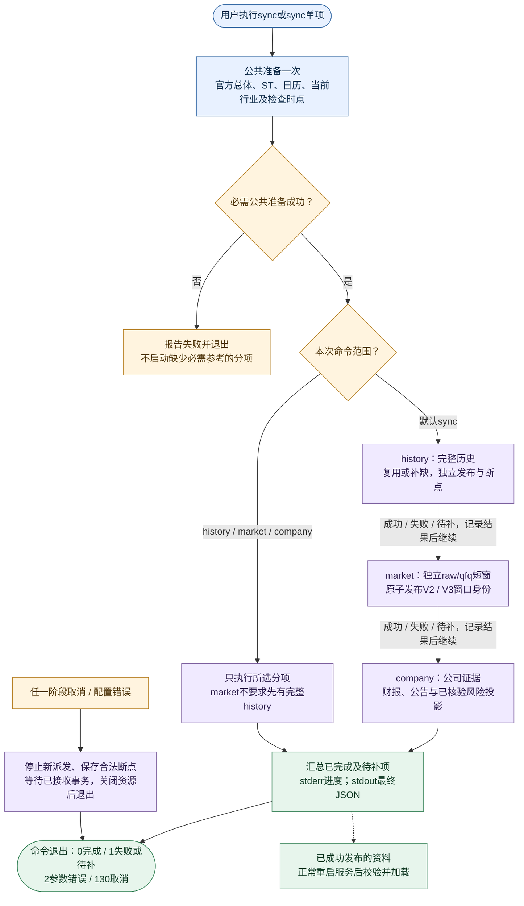
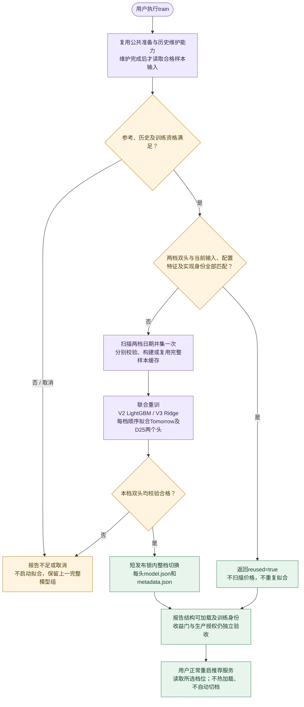
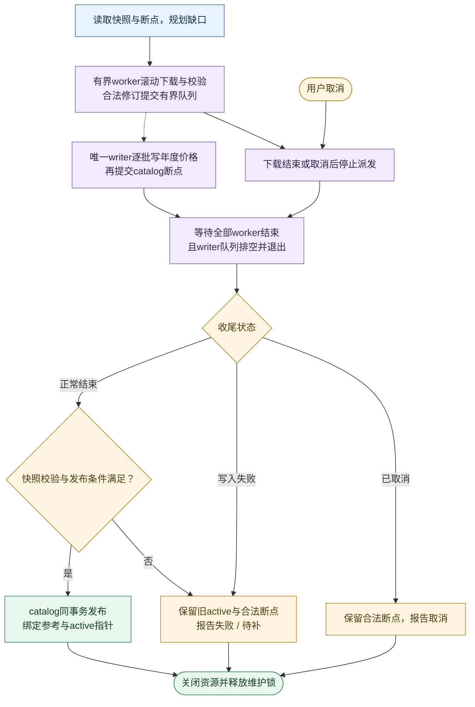

# 下载、训练与回溯

本文是下载、历史数据、独立qfq、训练模型及回溯工程的唯一权威。
评分和收益准入见[评分逻辑](1_评分逻辑.md)，架构、API和资源见[工程设计](2_工程设计.md)，完成证据见[工程实施](3_工程实施.md)。

## 1. 离线入口与消费者

### 1.1 先选命令

| 任务 | 当前命令 | 结果 |
| --- | --- | --- |
| 更新全部本地资料 | ./run.sh sync | 共用一次证券总体/ST/日历/当前行业准备，再依次更新history、market、company |
| 只更新在线日线 | ./run.sh sync market | 发布共享251/61日短窗口 |
| 只更新公告、财务及风险 | ./run.sh sync company | 增量发布公司证据 |
| 维护完整历史并训练 | ./run.sh train | 先维护历史，再联合训练或复用V2/V3双头 |
| 显式训练全新V1 | ./run.sh train --profile v1 | 维护历史后训练排序/收益双组件的Tomorrow/D25整组工程Shadow工件 |
| 只维护完整历史 | ./run.sh sync history | 不受周更门槛限制，更新四头训练到期状态，不自动训练 |
| 卸载已安装的旧系统任务 | trader-cli history-automation-uninstall | 校验归属后显式停止并移除旧任务；启动不执行卸载 |

PowerShell入口保持相同命令语义；sync不接受profile，train仅接受显式--profile v1，不接受自选路径或其它档位覆盖；不指定时仍联合训练V2/V3。
train是用户明确触发的下载加训练，不是只启动一个已有模型；普通run.sh只启动推荐服务，不执行sync/train。慢资料在启动时读取，运行期间不轮询数据库或模型文件变化，手动维护后正常重启加载。
旧人工下载命令和check入口不保留兼容别名，本地检查使用统一诊断。

sync已包含history，通常无需紧接着再执行sync history。需要更新全部资料再训练时，执行sync后再执行train；train仍校验同一历史维护合同，同日身份及数据完整时不请求价格，不会重新下载2000日。只更新公司资料使用sync company，它仍先完成公共参考准备，不下载完整历史或行情窗口。不同命令同时维护同一分项时由该分项锁拒绝重入；train遇历史维护占用时停止，不拿未发布数据训练。

公司首次或未完成运行需要补齐365日公告、财报及正文，后续按断点增量；未完成公告分片先续传，补齐后再定期回看最近7日公告和旧月修订，巨潮物理请求至少间隔1秒。命令开始先提示公共参考准备，首次或跨上海日期的ST核验也可能较慢；不能用CLI环境检查耗时代表业务启动时间。

### 1.2 执行顺序与退出结果

**手动同步：命令运行一轮后退出，没有固定执行间隔。** 当前默认sync仍串行执行三项；单项入口只走所选分项。维护完成后，在线服务在正常重启时才加载新资料。

**手动训练：先完成历史维护，再决定复用还是拟合。** 两档各自发布完整双头；缺模型时推荐服务只降级，不自动进入这条流程。

1. 所有下载共用不可变的官方总体、完整ST证据、上海检查日、可靠日历及参考身份；历史消费者不重新抓取同轮总体/ST。当前行业与历史锚点行业分别消费。
2. sync依次执行history、market、company；独立分项失败或待补保留断点，继续后续项。取消、配置错误或必需公共准备失败则停止。当前行业失败仍允许合法价格降级，训练报告资料不足。
3. train的历史维护失败或参考不足时不启动拟合；已发布历史尚有部分价格缺口时，只用合格样本尝试训练，由样本门决定能否发布。
4. 进度写stderr，最终JSON写stdout；机器输出不夹杂颜色和逐股原始载荷。
5. sync和train的历史维护收到首次SIGINT/SIGTERM后停止派发并等待已接收事务，退出130；进入拟合前恢复信号处理。公司取消保留已提交页及上一发布投影，不继续启动全量投影或新闻发布；尚未查询的待补数量不代表完整覆盖。

| 退出码 | 含义 |
| --- | --- |
| 0 | 本命令达到完成条件 |
| 1 | 失败或仍有待补 |
| 2 | 参数/配置错误 |
| 130 | 已取消；train不继续训练 |

## 2. 数据、资格与资源所有权

### 2.1 持久目录

路径相对于配置data_dir；默认根为data/。runtime_dir只放服务锁、日志及可丢弃临时产物。

| 路径 | 内容 / 写入者 | 消费者 |
| --- | --- | --- |
| market/reference/historical_st.sqlite3 | 曾用名/ST事实，download写入 | 所有下载准备、训练总体、推荐资格 |
| market/reference/inputs.json | 已校验官方总体、完整ST证据、日历及当前行业身份 | 同轮下载准备、推荐固定启动参考及调度 |
| market/reference/industry.sqlite3 | 历史queries、当前current_industry_queries | 历史锚点与当前模型行业分别消费 |
| market/history/catalog.sqlite3 | 任务、缺口、序号、绑定参考和发布指针 | 训练、研究、结算的快照入口 |
| market/history/prices_YYYY.sqlite3 | 年度物理价格分区 | 只读历史消费 |
| market/daily_window.sqlite3 | 共享在线raw/qfq窗口、两档身份及断点 | 推荐内存特征 |
| company/evidence.sqlite3 | 公告、财务、质押、解禁及发布投影 | 推荐风险与财务 |
| company/eligibility.sqlite3 | 当前/永久资格事实与身份 | 推荐过滤 |
| training/models/{v2,v3}/{tomorrow,d25}/ | 每头model.json及metadata.json | 推荐启动加载 |
| training/samples/{v2,v3}/ | samples.sqlite3及complete.json | 可复用训练样本 |
| recommendation/{v2,v3}/ | decisions.sqlite3、snapshots.sqlite3 | 正式记录、当前恢复和发布序号 |
| recommendation/shared/deepseek_budget.sqlite3 | 跨档位物理请求预算 | 复核与只读内存状态 |
| research/{v2,v3}/ | outcomes.sqlite3、按日traces、按身份experiments | 结算与隔离研究 |

1. 历史参考按内容hash写入catalog的bound_references，与快照指针同事务发布，不再依赖旧参考JSON目录。
2. 当前行业查询与历史锚点分表，不得互相替代；当前参考满7日由手动准备更新，推荐侧不联网补查。
3. 模型、样本、业务数据库和诊断产物不因目录固定而进入Git。
4. 各业务独立维护锁；数据锁紧邻数据，模型发布锁位于整档替换目录之外。

#### 字段从下载到消费者

逐字段来源、单位、缺失和评分用途统一见[评分附录](1_评分逻辑.md#附录完整字段与因子表)，本节只解释数据工程路径，避免复制评分权重。

| 输入 owner / 命令 | 发布与读取 | 消费者和具体例子 |
| --- | --- | --- |
| 公共准备；sync各分项、train共享 | 证券/ST/日历/行业固定引用；推荐启动读取同一发布身份 | 静态资格、上市交易日龄、前一交易日风险覆盖、模型行业暴露；当前行业不代替历史锚点行业 |
| history；`./run.sh sync history`或train前维护 | 年度价格分区及catalog发布指针；训练/研究按锚点和快照读取 | 拟合样本、历史回溯与收益结算，不在在线评分中扫描全历史；历史字段合格不等于当前来源新鲜 |
| market；`./run.sh sync market` | 独立raw/qfq短窗原子发布，推荐启动预读251/61日并派生固定基础历史上下文 | 收益、均线、波动、回撤、20日金额/换手基线及模型特征；新V1读自己的251日输入，不借V3短窗 |
| company；`./run.sh sync company` | 正式财报/公告/质押/解禁形成证据及资格发布；推荐一次分批预读，不按股票评分逐次查库 | D25财务质量与估值、本地风险及资格；财报需已披露，公告一年风险覆盖完整性独立判断 |
| 在线行情/分钟；正常服务来源任务 | 内存标准化及有界缓存，按内容/资格变化触发派生；不触发sync/train | 当前价格/实际量/金额与本地历史组合，分钟构成尾盘因子；HTTP/Web读取最终用例，不抓取这些输入 |
| training；`./run.sh train` | 模型双头整档发布，正常启动加载，不热更新 | 使用market派生的同档模型特征做预测诊断和成本门；模型工件不是报价来源，缺失时不制造预测 |

例如昨日以前5个完整交易日实际股数为100、120、80、100、100万股，均值100万股；当日实时60万股产生`volume_to_5d_average=0.60`。分子来自在线Q，分母来自已发布H，缺其中任一端便不能确认缩量形态；供应商volume_ratio=1.5不能替代0.60。又如真实当前换手3.00%、历史20日中位数2.00%，得到冲击1.5；金额2亿元除以历史1亿元得到金额冲击2，两条基线不互换。上述是说明性例子，不是真实测量。

源码审计已明确的I/O边界是：history供长样本，market供独立短窗，二者raw/qfq重复不是删库理由；启动公司预读、固定参考、基础历史上下文及共享模型特征缓存已有owner，不再新增并行缓存。剩余优化先测冷启动各预读阶段的SQL次数/字节/耗时、连续同输入评分的读库增量、模型特征缓存命中及RSS，再比较同发布身份的输出、覆盖与延迟。诊断自身每次加载输入的耗时不能当成运行服务每轮的重复I/O。

复用`diagnose_runtime.py`的history-sqlite、qfq-sqlite及download-performance专用诊断；写入基准只用仓库外隔离副本，活动历史正在维护时不执行竞争性全库实验。尚无完整history/company吞吐实测时，只列未验证边界，不根据字段表推断优化收益。

### 2.2 ST资格

| 情况 | 处理 |
| --- | --- |
| 官方当前简称已确认ST | 直接记ever-ST并排除，不再请求该股其它业务数据 |
| 曾经ST | 永久排除；摘帽不恢复 |
| 当天有效clear证据 | 当前上海检查日内复用 |
| 缺失、过期或未知 | 通过曾用名来源补查；失败则未知，不进入下载 |
| 资格数据库损坏 | 停止，不清空旧排除后继续 |

最多8股滚动在途，每64股或收尾短锁合并；网络期间不持文件锁。
并发合并ever-ST优先；qfq在维护锁内移除已排除代码的派生窗口，history不破坏物理旧行。
推荐端的ST资格固定取自启动时公共参考的完整证据；新确认的历史ST在重启后生效，不再借旧qfq名单作为资格来源。永久ever-ST事实可复用，公共准备仍记录本轮检查日期。
当前名单和事后ever-ST排除存在选择偏差，不等于历史时点资格合格。

### 2.3 公司资料

| 分项 | 当前窗口 | 增量方式 |
| --- | --- | --- |
| 公告与风险 | 最近365天发行人披露 | 新日期、失败页、最近7天重叠、每天一个旧月修订检查 |
| 新闻 | 最近7天，每股最多50条 | 只取最近7日两档有效正式发布名单的去重代码，与本轮合格总体取交集；无名单明确未覆盖，不全市场冷抓 |
| 财务 | 最新正式报告及所需对比，最长550天报告期 | 披露增量及7天回看 |
| 质押 | 最新完整市场快照 | 完整后替换，失败保留旧值 |
| 解禁 | 未来90天 | 完整后替换 |

1. 巨潮按市场/日期分页，每页30条、最多100页；日期片过大或跨日片出现重复页时继续二分。单日返回总数超过3000条或页链接重复时不声明该片覆盖，保留待补并继续其它分片；截断和总数漂移仍保留待补并停止该来源。规划只补现有分片未占据的日期，拆分子片保持已有页游标，重启和旧月复核不会重新创建已拆父片；同轮已完成或已暂缓的子片不会因父片拆分重复派发。
2. 标题只筛正文，风险须核对主体、官方结论及同案结束关系。
3. 事实与页断点使用FULL事务。发布先通过公共只读连接读取一致源快照，在连接私有TEMP表分批构建编码；取得短写事务后重新核对同一读连接的data_version，原子提交投影与指针。源内容变化拒绝本次发布并保留旧结果，清理在发布后独立执行；重启从首个未提交页续传，原有未完成分片（包括第一页）排在本轮新建日期片和到期复核之前。已有覆盖记录不能掩盖未完成复核，该市场存在待补分片时仍标记覆盖不足。进度中的分片完成数与成功页、变更行都是本轮计数，重复核验页可以增加成功页而不增加变更行。
4. 公告已下载且元数据未变时复用正文；一次失败不能清空已确认事实。正文待核验与发布统一从365日前上海日期零点开始、截止本轮观测时间。逐篇失败原因、尝试时间和重试期限随内容摘要持久保存；同一内容在冷却期内不下载，仍计入pending_documents并保持风险未知。摘要或解析参数变化允许立即重试，核验成功清除该篇失败状态。初始化只增加重试状态表，不重建已有事实、页游标或发布投影。
5. 单次请求最多8秒，巨潮至少间隔1秒；传输失败或408/500/502/503/504最多3次物理尝试，等待2/4秒，仍受阶段deadline和取消约束。公司请求超时与间隔在`config/download.json`的`company`段配置，加载时校验上述上限。
6. 403/429、其它HTTP错误、解析或身份错误不做同次请求重试；耗尽后停止该来源扩散，保留断点。单篇正文无法解析、超限或解析超时且阶段预算仍有余量时保留该篇待补并继续其它正文；阶段截止、网络超时和取消仍停止后续处理。正文日志分别显示已尝试、已核验、暂缓重试及待补数，失败篇不会伪装为核验成功。
7. 公司分项默认预算90分钟，由`config/download.json`的`company.budget_seconds`设置；同段配置结构化来源单项预算、公告和正文的截止比例、正文解析超时。必须满足公告截止早于正文截止、正文截止早于总截止。公共准备另有来源超时、并发上限及取消边界。推荐服务不再运行09:15/12:45资料任务。
8. published_codes只表示已有可读投影，不等于完整一年风险覆盖；pending_partitions和pending_documents分别报告待补页片和正文。

正文运行参数同属`config/download.json`的`company`段：

| 配置项 | 默认值 | 含义 |
| --- | --- | --- |
| document_failure_retry_seconds | 86400 | 不可读、加密、无文本、超限等正文失败，24小时后再试 |
| document_transient_retry_seconds | 900 | 网络失败或解析超时等，15分钟后再试 |
| document_limits.max_bytes | 16777216 | PDF下载上限16 MiB，可设置至64 MiB |
| document_limits.max_pages | 200 | 全文页数上限，可设置至1000页 |
| document_limits.max_text_characters | 1000000 | 全文字符上限，可设置至200万字符 |

PDF仍在受单调超时约束的独立子进程内解析，每页展开内容最多8 MiB；加密、无可提取文字、页数/展开内容/文本超限分别报告。只接纳完整提取结果，不把截断文本或扫描件自动当作已核验。增加上限或修改正文解析超时后，下次同步可重新尝试旧失败篇；改配置不会更新已经启动的进程。单日公告仍超供应商上限、扫描件需要OCR等缺口保持显式未知，尚无已验收的额外完整来源。

程序内部采用有界批量读写，读取后结束事务再解码，不在评分请求中联网。
慢数据全部手动维护；推荐生命周期启动后分批预读轻量事实，评分冷项不再触发公司数据库读取。启动前后校验同一发布身份，最多重试3轮，30秒或取消后报告未就绪，不接受混合发布。
both共享同一ResearchEpoch和一次公司预读，公告正文只在生成风险事实时短暂使用；原owner的常驻字节纳入进程缓存预算。DailyFeaturePack同时绑定固定证券、日历、行业、各档qfq、公司、模型和配置身份，未完成绑定的输入不得进入评分。

#### 公司事实的有效性与覆盖截止

| 时间或状态 | 需要说明什么 |
| --- | --- |
| 财报披露及生效时间 | 报告是否在评估时已公开，是否仍是最新可用正式报告 |
| 公告风险覆盖截止 | 已核验到什么时刻，有哪些页片、正文或来源仍待补 |
| 最近查询时间 | 实际何时维护，不等于全部事实的生效日或无风险证明 |
| 本地读取时间 | 仅表示何时加载，不能刷新来源年龄或风险覆盖截止 |

[公司资料读取](../src/trader/recommendation/infra/market_data/published_company_research.py)按可靠交易日历的前一实际交易日判断风险覆盖，节假日不按自然日误失效。财报披露、风险覆盖截止、质押日、解禁前视范围、最近查询、发布及本地加载时间分别保留。
未来披露不参与计算；查询时已经公开的未来解禁可以作为风险。过期风险覆盖限制动作并保留已知硬风险，不否定已披露财报，也不因本地重读而刷新来源年龄；前晚资料不证明盘中新公告已核实。

### 2.4 资源与SQLite边界

| 场景 | 当前限制 |
| --- | --- |
| 下载worker | 默认8，最多12；会话在股票间排他复用 |
| 持久SQLite | 显式事务、FULL、线程持有连接；WAL用于共享读写 |
| 历史待写/在途 | 合计最多64股、32768请求日期单元 |
| qfq待写/在途 | 合计最多32股、8192日期单元 |
| 样本SQLite / LightGBM直方图池 | 32 MiB / 64 MiB |
| 单档计算 | 最多2个计算线程；现有单档资源验收单独核算 |
| Linux train整体scope | 4608 MiB回压、5120 MiB硬限制 |
| 联合并行拟合 | SSD、至少4核、可用/cgroup内存满足5 GiB，并有同CPU/存储类别的外部实测证据 |

联合拟合默认不能仅凭机器“看起来够大”并行。TRADER_JOINT_FIT_EVIDENCE须指向仓库外有效证据：
串行→并行→串行三次同输入训练，要求并行比更快的串行仍快至少10%，峰值RSS不超过5 GiB。
证据入口为scripts/check_joint_training_performance.py，输出、历史副本和临时工作区均为显式仓库外路径。

推荐使用进程共享512 MiB逻辑缓存/2 GiB RSS验收预算，train内存预算独立。配置已切换，真实资源验收按工程设计第7节执行。
SQLite公共边界见[工程设计第4.3节](2_工程设计.md#43-sqlite公共边界)；交付状态和实测证据只查工程实施。

机械盘首次发布前的全量续传沿用初建批量提交策略；读取已写数据与选择写入批量分别判断。恢复读取先用代码索引确认股票在年库中是否存在，整股未写入时不再逐日探测；已有部分数据时仍按请求日期及序号读取。年库写事务先用代码索引证明整批股票在记录及观测中都不存在，才使用首次插入路径；已有股票仍逐项校验冲突、幂等及未发布缺口升级，FULL与落库后确认断点保持不变。历史进度分别显示已返回任务的恢复读库、供应商及校验累计耗时，以及已完成落库和当前批次待确认时间；并发累计耗时不能相加解释为整轮墙钟，尚在执行的读库看在途数量及最久在途。

## 3. 完整历史下载、补缺与发布

### 3.1 请求什么

| 项目 | 当前规则 |
| --- | --- |
| 初始窗口 | 最近2000个可靠市场交易日，新股不补上市前日期 |
| 价格和日历来源 | Tencent；BaoStock只供行业 |
| raw请求 | 每股一次有界窗口 |
| qfq翻页 | 恰好返回640行且未覆盖目标起点时，按重叠锚点向前，最多5页 |
| 停止翻页 | 少于640行、覆盖起点或达到页上限；不无限凑满 |
| 增量 | 新日、可重试缺日和最多5个有效锚点 |
| 同日已完整 | 免价格联网，检查必要身份 |
| 参考单独变化 | 发布新参考身份，复用价格 |

1. 日历来自Tencent指数，日期有序、唯一且不越过截止日；允许附带多1条当日行后再裁剪。
2. 请求跨度按最早至最晚缺日计算，不能把稀疏缺日数量当窗口长度。
3. qfq有限但非正的旧价只隔离受影响日期，同页其它合格行继续保存。
4. 已确认非正qfq日期延迟20个市场交易日再重查；普通单侧缺行、网络失败不延迟。
5. 锚点冲突、分页失败保留已验证近期行，明确待重试，不改为供应商正常少返回。

### 3.2 缺行不是同一种失败

| 结果 | 保存状态 | 后续 |
| --- | --- | --- |
| 同日raw/qfq均有效 | 完整同源价格对 | 可用，后续保留有效行 |
| 两侧成功但该日都未返回 | tencent_inferred_suspended空价格点 | 仅停牌推定，不是交易所证明或可成交价 |
| 只有一侧 | 无完整价格的待重试缺口 | 不跨源拼另一半 |
| 超时、限流、损坏或身份冲突 | 失败/未知 | 保留已验证数据和断点 |
| qfq非正 | 不合格qfq日期 | 有界延迟重查，不平移价格、不以raw冒充 |

已有有效日线先到先用，真实价格可替代推定，推定不能覆盖真实价格。
行业源失败时允许先发布Tencent价格快照，训练保持data_incomplete，后续补行业并复用价格。
成功但少于2000日不等于下载失败，也不代表模型字段一定合格。

### 3.3 正式年库与逻辑快照

这是一次手动历史维护内部的工作队列循环，不是服务每隔数秒自动下载。派发受worker、来源限速及deadline约束；“5秒”是批量写入触发条件之一，不是每5秒重下全部历史。

图中等待节点要求worker完成与writer排空同时成立；没有下一只股票不表示最后一批已持久化。取消后停止新派发，已接收事务完成或回滚，writer退出后才释放维护锁；不会沿正常成功分支发布。合法历史修订和断点可供下次人工续传，未发布价格不会冒充新的active快照。训练、研究按不可变manifest读取，在线结算继续绑定启动捕获的manifest。

1. 年库使用具名价格列，保留逐月logical_hash、修订身份及观察序号；物理合年不改变逻辑月身份。
2. 已发布快照不可变，未发布数据不因已落盘就对读者可见。
3. 日历、总体、绑定参考和active发布指针由控制库维护，参考与指针同事务提交。
4. 正常写入按年度归组，每4096行一个FULL事务；单写线程内最多复用32个年库连接。
5. HDD首建按8股或16384日期单元触发；SSD/unknown及增量按16股或8192单元，另有5秒或网络排空触发。
6. 取消时停止派发，等待已接收事务退出并关闭资源后释放维护锁。
7. 已发布记录不能被同序号内容改写；合法未发布缺失状态只能向更完整已验证事实推进。
8. 旧格式明确拒绝，不做隐藏双读或现场破坏性升级。
9. 未发布断点遇到合格总体变化时，在同一事务更新父身份及任务集合；共同证券保留进度，新增证券下载目标窗口，移除证券不再派发。共同证券的板块、上市/退市日期、日历或来源冲突仍拒绝续传，已发布快照不变。
10. 每次恢复读取按物理年库分组，同一股票在该次读取中每年只打开一次读连接；仍按请求日期和快照序号筛选，不把未来或未请求记录作为已完成数据。
11. 初次发布中断后也遵守非正qfq的20交易日重查间隔，等待重查的已确认任务不重新派发、不整窗重读；其缺口仍保留并计入待补，不计为合格复用。

### 3.4 进度、空间与诊断

等待心跳显示在途股数、待派发股数及最久在途时长，覆盖恢复读取、下载和校验；完成数只在落库确认后推进。“下载”累计已返回任务的耗时，不能代表未返回任务已经等待多久。本地恢复慢可用统一诊断`--profile history-sqlite --history-resume-samples 1`只读测量，最多8股，不请求供应商或写入历史。

| 输出 | 应说明什么 |
| --- | --- |
| 逐股终态 | 实际下载、本地复用、无需下载、本地失败分别说明 |
| 阶段进度 | 股、页、分片、篇单位不能混用；无总数时显示未知 |
| 等待 | 源站等待超过5秒显示心跳，不伪造进度 |
| 汇总 | 成功、残留缺口、未处理及稳定失败原因 |
| 失败 | 原操作及受控异常类型/位置，不输出完整路径或外部载荷 |

耗时用HH:MM:SS；缺口是“股票×交易日”，不是请求次数或股票数。
终端可着色，管道/文件/JSON无ANSI；成功绿色、待补黄色、最终失败红色，不靠颜色替代文字。

空间审计和性能比较使用scripts/diagnose_runtime.py的history-space、history-sqlite、history-write等既有profile。
报告区分正式库、辅助文件、WAL、分配容量、RSS及网络/写入/校验耗时；小fixture不代表全市场性能。
离线压实和维护必须在隔离副本按显式命令执行，不自动清理活动年库。

## 4. 独立qfq短窗口

### 4.1 下载和存放

| 项目 | 当前规则 |
| --- | --- |
| 窗口 | V2最近251、V3最近61个市场交易日范围 |
| 来源 | Tencent同源raw/qfq真实价格对 |
| 请求 | 一次251日范围，尾部增量按需要日期请求，不固定640 |
| 物理库 | 全部板块、两档共用market/daily_window.sqlite3 |
| 逻辑表 | bars、identities、calendars、completions、publications |
| 版本 | 当前SQLite user_version=2；旧板块库或缺发布标识的共享库拒绝 |
| 与完整历史的关系 | 不依赖history，不要求先运行完整历史下载 |

1. 251/61是市场日历范围，不为凑够成交根数向前无限回查。
2. 少量同源缺日只请求尾部和重叠；来源变更或重叠冲突才重取单股251日窗口。
3. 两侧成功缺行不补页、不换源；只写真实价格对，不伪造昨收、换手、停牌或ST。
4. 整窗推定停牌且零真实行时记“无真实日线”，不推进完成断点；单侧价格但零价格对仍待重试。
5. 请求失败或不可信时保留旧有效窗口，继续其它股票；不借BaoStock补价。
6. 每股raw/qfq合计180秒单调deadline，单次45秒、最多2次重试。
7. worker满载最多等5秒，到期停止新派发并保存已接收合法结果；未派发不伪装为供应商失败。

### 4.2 原子提交与读取

下图只描述发布事务与一次启动读取；不是运行中轮询。raw/qfq配对、两档发布和读侧前后身份核验属于同一闭环，价格缺口不会由读侧补造。

1. 无变化不创建写连接，变化只写变更行、删除过期日、更新身份。
2. WAL/FULL事务一起提交价格、两档身份、日历、完成断点及每档publication_id；失败整批回滚。
3. publication_id是同批随机唯一标识；无变化复用不改，移除股票也须更新，最后一只移除则清除该档发布身份。
4. 内容hash仍校验实际价格及日历；发布标识不是内容校验的替代品。
5. 读取manifest时捕获全体身份、日历和发布标识；每批窗口前后仅核对标识，不重复全量扫描。
6. 逐股取行和摘要校验完成后释放事务，再解码；并发标识变化时拒绝混合结果。
7. 启动预读历史派生量及最近20行，前后核对身份，最多重试3轮且受180秒单调时限与取消边界限制；实测全市场qfq窗口超过旧30秒时限，不能把正常慢读误报为数据缺失。预读完成后线程退出，运行中不再轮询发布身份；维护完成后正常重启加载，失败保留合法投影。

### 4.3 固定启动身份

| 场景 | 当前行为 |
| --- | --- |
| 15:10及晚启动 | 不自动下载短窗；收盘后手动维护，正常重启后采用 |
| 候选和评分 | 读取启动时预读的历史派生因子 |
| 收益结算完整历史 | 绑定启动捕获的不可变manifest，active推进后仍读原快照；缺完整history不阻塞独立短窗 |
| 短窗不够则模型输入待补 | 保持字段资格，不伪造日线凑数 |

缺模型时不自动训练；训练模型补齐后需正常重启。最近成交日过旧的股票仍限制动作，不能把“库中有价格”当作“当前新鲜”。

## 5. 训练输入、样本与拟合

### 5.1 预检与样本

1. 两档双头均与当前历史、标签截止、配置、特征、依赖和实现摘要匹配时，reused=true，不扫描价格和拟合。
2. 任一缺失、损坏或身份变化触发联合重训；不受到期提醒周期限制。
3. 首扫前校验行业、切分和样本保守上界；所有行业均不足20000行时提前阻断。
4. 同一市场日期的全部股票处于同一切分，特征按代码和日期对齐，不按每股第N行对齐。
5. 原始特征和在线模型复用纯公式及manifest；横截面暴露先于未来标签可用性固定。
6. 写入唯一最终samples表，不额外保留raw_samples，不把全部历史和行业矩阵放内存。

### 5.2 不同日期窗口各是什么意思

| 数字 | 含义 | 是否要求每只股票都有这么多行 |
| --- | --- | --- |
| 2000 | 完整历史目标市场日历窗口 | 否，新股不补上市前日期 |
| 251 / 61 | 在线历史范围，提供250 / 60日特征及一根前置价格 | 模型字段必须真实完整，不能补造 |
| 1000 / 750 | V2 / V3有效拟合日期 | 是总体切分要求，不是每股上市历史要求 |
| 1250 | 部分旧研究代理/候选窗口的日期约束 | 不是当前每股统一门槛 |
| 5 | 最大标签成熟跨度及切分隔离尺度 | T+5沿共同市场日历定位 |
| 200 | 研究终端留出最低交易日 | 研究准入，不是生产在线窗口 |

新股能否贡献样本取决于足够历史特征及成熟标签。某只股票不足不意味着整场训练必然停止，但不能降低模型必需窗口。
推定停牌跳过成交日特征，未知状态unknown不能跨缺口拼训练窗口或标签；T+1不能解释为“下一根成交日线”。

切分从终端留出向前安排，保留预热和训练/早停/校准/确认/留出隔离。
不能先按比例截出开发集，再让预热挤掉有效拟合日；窗口比较属于研究，不是日常命令自动择优。

### 5.3 缓存、拟合与模型文件

| 步骤 | 当前规则 |
| --- | --- |
| 价格扫描 | 按两档可读日期并集扫描一次 |
| 样本 | 两档分别构建、校验、封存；只有完整同身份缓存可复用 |
| 拟合 | V2只产LightGBM，V3只产Ridge；每档内部顺序拟合两个头 |
| 模型目标 | Tomorrow为T+1；D25是一个完整且唯一的2–5日生产策略头 |
| 标签成本 | 拟合标签扣成本前，在线净效用扣一次成本 |
| 发布 | 双头全部合格后整档切换；每头model.json及metadata.json |
| 失败 | 拟合、校验或切换失败回滚上一完整组 |
| 推荐加载 | 启动读取所选档位，不热加载、不自动切档、不借另一策略头替代 |

样本身份绑定数据、日期切分、特征/标签及实现摘要；学习率等拟合参数属于拟合身份。
每档最多一份完整缓存，失败保留、成功或明确拒绝后释放；未完成缓存不能伪装成可复用。

metadata.json保存模型摘要、同档双头训练身份和嵌套合同，不使用隐藏活动指针或旧bundle兼容。
每档最终切换与双头读取共用目录外短发布锁；拟合、复制和预校验在锁外，竞争等待采用单调时钟且有2秒上限。缺失、损坏、摘要冲突、合同冲突和publication_busy分类关闭模型门，保留合法旧投影及只读Web，不自动训练、切档或借用另一头。
在线加载核对模型自身摘要、双头同源同次训练及推理合同；训练历史hash用于溯源，不要求等于每日推进的history。离线训练复用仍严格核对最新输入。
artifact_structure_valid只表示结构可加载；prediction_return_validation_passed才表示收益门结果。
当前日线工程代理不能凭训练成功将后者改成true，不授予production_authority，也不自动更新模型。

进度按预检、读取/建样本、横截面、索引、标签统计、拟合、发布分别输出，长阶段10秒心跳。
行业顺序拟合、float64原地标准化，不靠降低精度或隐藏行业并发换取表面提速。

### 5.4 全新V1训练与工件

专属源码位于training/domain/v1、training/infra/profile/v1、training/entrypoints/v1以及推荐业务所属层的v1目录。模型写入training/models/learned_rank/model.json；可丢弃样本工作区仅位于training/samples/learned_rank，正常结束或取消清理本轮工作区。不读取退役v1目录，不改写V2/V3模型或已发布推荐。

config/training.json的v1条目是拟合参数唯一来源：默认750日拟合、20日早停、20日校准、20日预测评价，各边界至少5交易日隔离；Tomorrow/D25标签分别等待1/5交易日成熟，所有变换仅在拟合区学习。近期工程拟合不占用或重新授予未见研究留出身份。

每个交易日作为一个排序query，按当日成本后超额标签的并列平均秩分成0–4档，线性label_gain为0,1,2,3,4。样本权重与组内人数成反比，使每天总权重相同；lambdarank_norm=false、截断10、NDCG@6、两计算线程进入固定合同。Ridge拟合扣费前毛超额，校准读取独立过去分区；不会把排名原始值当作收益再扣成本。

训练复用历史维护锁、检查repack围栏，在锁内读取同一已发布历史身份，按日/代码流式建样本；矩阵使用本轮临时文件映射，双头顺序拟合并释放映射。工件在两头全部拟合、验证和重载检查成功后以单文件原子替换发布，发布锁占用、取消或任一头失败均保留旧整组。manifest严格核验算法/分数标尺、参数及合同hash、输入/日历/来源hash、四分区日期、所有变换/排序/收益/校准组件和内容摘要；缺头、跨合同或摘要损坏拒绝加载。

整组JSON同时保存实际拟合/早停/校准/预测行数、股票/日期/行业覆盖，以及基于独立yhat的MAE、RMSE、日期平均RankIC和NDCG@6；样本缺价、缺行业、短窗口和未成熟标签另行计数。报告只表示工程结构和预测评价，production_authority、point_in_time_parity及prediction_return_validation_passed固定false。日线收盘入场代理没有通过可交易完整选择链、独立历史收益及正式Shadow门，不能据此启用生产。

## 6. 回溯、评价与生产隔离

线上冻结前六用于观察；实际“推荐”和“关注”分别按本策略持有期结算，“回避”不计正式推荐业绩。
不能用在线结果回灌训练或自动调参；收益公式、成本、MAE和终端留出只由评分逻辑第12节定义。

### 6.1 点时资格和证据绑定

| 门 | 必须证明 |
| --- | --- |
| 历史日线 | 总体、日期、raw/qfq、缺口、来源及发布身份 |
| 历史行业 | 至少300只分层样本，分类、生效区间及来源 |
| 15:00分钟与事件 | 分层覆盖至少95%，真实时区、披露时间、量额和复权语义 |

1. PointInTimeDataQualificationReport是三门类型化结果，任一不足则不读取下游收益。
2. 数据集每行绑定价格、日历、证券、行业、事件、特征和outcome的父hash。
3. 基准人口在候选阈值和板限之前固定；不使用今天的名单倒推当年。
4. 数据分区至少5日隔离，终端留出至少200日；构建时不访问留出收益。隔离天数与bootstrap区块长度分别核验，统计要求见评分逻辑第12.2节。
5. 研究报告同内容重放幂等，异内容、父身份篡改或覆盖不完整则拒绝发布。

### 6.2 研究如何比较

| 比较内容 | 解释边界 |
| --- | --- |
| 规则、规则加模型门、不同档位与持有期 | 预先固定人口、日期、成本和选择约束，不按结果改比较条件 |
| 60/120/180/240/完整总体 | 仅用于既有预选链的损失归因；新目标不保留中间候选池 |
| 固定前六后执行门、门后选择六席 | 分开配对，不能把不同可行集合当成同一策略 |
| D25四期限均值、固定T+5及预定义退出 | 四期限均值是机会标签；实际资金组合另需仓位和退出定义，不事后挑最高价 |
| 收益及压力结果 | 报告召回、Rank IC、NDCG@6、成本后指标、严重亏损、回撤、换手、容量和不可交易情况；六槽、入选均值与资金收益分别标名 |
| Shadow | 只输出漂移、校准和收益风险聚合，不改生产配置 |

成本场景、统计检验、现金口径与生产约束的唯一要求见[评分逻辑第12节](1_评分逻辑.md#12-收益验证与变更门禁)。

研究适配器只在仓库外隔离运行，不接HTTP、SSE或生产调度。工程接通、fixture通过和历史报告都不能代替当前收益准入。

### 6.3 研究对象与报告绑定

本节只定义研究工程协议；评分、风险和收益准入仍以评分逻辑为准。各对象分别承担以下职责：

| 对象 | 只负责什么 |
| --- | --- |
| AlphaScore | 未扣风险信号、扣成本前预测、模型和特征身份 |
| RiskDecision | 一次性扣分、veto、严重亏损概率及不确定性，不生成正向alpha |
| ExecutionCost | 完整往返成本、容量、参与率和成本场景 |
| SelectionUtility | 隔离研究的预测净效用和风险约束，不接入当前最终分 |

1. 读取样本前绑定点时资格、数据集、calibration或confirmation分区、完整日期、V2/V3和唯一模型ID/hash；不混训练或终端留出。
2. 样本须精确覆盖分区所有candidate_eligible行，包括本地veto/成本否决行；缺股、缺整日、混档、父hash或结果冲突则整份拒绝。
3. 公司事实published_at与行业industry_effective_at不得越过决策可见时点。PointInTimeEventFact逐项匹配事件ID、内容hash、披露/生效/锚点时间；提前公开、未来生效的公告可作为当时已知风险。
4. structured_facts精确覆盖两组引用并集，不能漏、重复或夹带事实；hash一致只证明引用一致，不单独证明外部事实真实。
5. oracle低于实际合法选择时拒绝报告，仅容忍1e-12浮点尾差。无输入日期不能自行认作合法空仓。
6. 自由文本不能直接扣分；数据不足时零读取评价收益，保留historical_data_insufficient，不能用fixture或收盘代理伪造校准。

报告必须标明指标含义、统计单位、区块设置、板块上限及取整方式、行业约束。新目标另绑定新研究身份；不改写旧报告、旧选择或已开启留出，也不把不同约束的结果互相替代。

### 6.4 完整总体配对研究入口

通过现有CLI执行隔离研究，所有证据与报告路径必须位于仓库外；不启动推荐服务、不联网、不训练，不读取活动研究库，也不开启终端留出：

~~~bash
.venv/bin/python3 -m trader.entrypoints.cli --config /absolute/project/config/runtime.json research-selection \
  --evidence-dir /absolute/external/selection-evidence \
  --output /absolute/external/selection-validation.json
~~~

`plan.json`和`rows.jsonl`由点时证据准备方提供，JSON对象只接受当前字段白名单，不加载旧候选池格式。内容摘要证明绑定与一致性，不能单独证明外部事实真实。

| 输入 | 必须绑定 |
| --- | --- |
| plan.specification | Tomorrow或D25、V2/V3、完整研究日期、PointInTimeDateSplit的七组日期、calibration或confirmation分区、总体与数据清单/召回hash、三个独立模型ID/hash、配置hash、完整逐板成本参考hash和预注册随机种子 |
| plan.prerequisite | specification_hash、qualification_hash、点时/召回资格、与specification一致的三个父hash、未开启留出、完整总体的日期/代码/parent_row_hash白名单及失败原因 |
| plan.rows_sha256 | rows.jsonl原始文件SHA-256；改行、漏行、重复行和父身份冲突不能发布评价结果 |
| 每行 | 日期/代码/板块/行业、parent_row_hash、已扣一次本地风险的rule_score、预测往返成本、风险/动作/容量资格、严重亏损及MAE/ATR20标签、三类模型的扣费前预测及已扣同人口基准的实际收益 |
| target_evidence | Tomorrow为t1；D25按t2/t3/t4/t5逐项提供，predefined_exit只用于预注册对比，不代替四期限均值 |

读取顺序为计划与前置门→精确总体覆盖→完整文件摘要及行资格→配对评价。前置不合格时零读取rows.jsonl，返回historical_data_insufficient；每个日期须有完整父人口，不能把缺整日认作现金。文件及单行读取有界，输入输出不得重叠。

报告携带`eleven_layer_full_population`身份、完整十一层合同、分区/父身份、固定席位数与实际入选数；板块上限固定4、无行业限额。四个研究臂及共享模型的Ridge/LightGBM子项在相同人口上比较模型门前后固定六席，复核、动作及容量拒绝均不补位。生产对照使用rule_model_gate、model_gate_then_fixed_top6和本策略原标签，其余臂不获得生产授权。

20/50/100bp对同一已固定选择各扣一次，每个D25期限独立结算后等权平均；六槽指标按父日期等权、空槽贡献0，入选均值按实际入选股票观测另报。严重亏损标签须符合评分逻辑12.1，不能用收益百分数替代MAE/ATR20。报告的六槽累计回撤也不是资金曲线回撤。

统计方案在读取收益前绑定：Tomorrow移动区块5日、D25为10日、10000次bootstrap、95%区间；全体非对照变体的20/50bp构成一个Holm 0.05族，另报对纯规则的配对增量。样本短于区块明确无效，100bp只报告压力。计算完成只表示historical_experiment_completed，仍须独立完成确认期排序/风险/容量门、一次性终端留出、Shadow及人工授权，不把研究状态解释为收益或生产准入通过。

同内容报告重放幂等，已有路径内容冲突明确拒绝，不能覆盖旧报告。`research-status`与统一诊断的research profile只报告目标身份及外部验证要求，不自动扫描或采纳仓库外报告；旧研究和活动history的工程状态分别展示。

## 7. 维护、提醒与验收

### 7.1 当前维护行为

| 情况 | 返回/处理 |
| --- | --- |
| 显式sync history或train | 执行同一历史维护能力，不受时间点或周更门槛限制 |
| 无库或控制库不可读 | 手工初始化或报告失败，推荐只读服务仍可运行 |
| 锁竞争 | already_running，不删除别人锁 |
| 内容和身份无变化 | already_current |
| 模型到期 | 只提醒，不自动训练、切档或重启服务 |

到期由模型label_cutoff、成熟标签及输入/合同修订决定，分别覆盖V2/V3的Tomorrow/D25四头。手动历史维护与训练保存到期结果；推荐服务启动时只读取一次已有结果，HTTP只投影内存中的到期和启动检查捕获的已加载/磁盘身份及重启需求，不调用持久化计算，也不持续检查新发布。
自动安装与定时执行入口已经删除。旧宿主任务须显式卸载；启动不修改宿主调度。

### 7.2 手动维护边界

| 对象 | 当前合同 |
| --- | --- |
| 公司公告、财务及风险证据 | 用户显式维护，取消09:15/12:45自动任务；接受盘中新信息不能自动获知的限制 |
| 在线raw/qfq短窗 | 用户显式维护，取消服务15:10自动更新 |
| 完整历史及模型 | 用户显式下载/训练，不保留15:10/20:30系统自动历史维护及安装能力 |
| 证券、ST、交易日历和行业参考 | 纳入手动准备范围，服务启动读取本地；缺失/过期提示，不现场补下载 |
| 已安装系统任务 | 提供显式卸载方式；启动不静默修改宿主调度 |
| 已维护数据 | 正常重启后加载并验证身份，不通过修改读取时间伪造新鲜度 |

当前命令以第1节为准。卸载仅作用于归属校验通过的旧Trader用户级任务；归属不明或系统命令失败时保留现场并报告失败。
分钟输入和实时行情仍按在线合同处理；启动预读只包含有界的轻量事实及历史派生量，不常驻完整2000日训练库或公告正文。

### 7.3 分开验收

1. 下载：初建、增量、同日复用、真实缺口、锚点冲突、取消、重试与来源失败。
2. 数据库：损坏、磁盘不足、发布失败、未发布隔离、短窗并发读及摘要错配。
3. 训练：切分、样本身份、短历史、行业不足、双头失败恢复及重启加载。
4. 性能：分开测网络、SQL、校验、样本、拟合和RSS；明确合成负载与真实全市场边界。
5. 研究：点时资格、标签、收益门、终端留出和人工授权分别证明。

本地状态使用.venv/bin/python3 scripts/diagnose_runtime.py --profile local --output -。
专项profile及隔离参数见[scripts说明](../scripts/README.md)；全市场2000日、连续日更和真实双档训练仍需独立验收。
