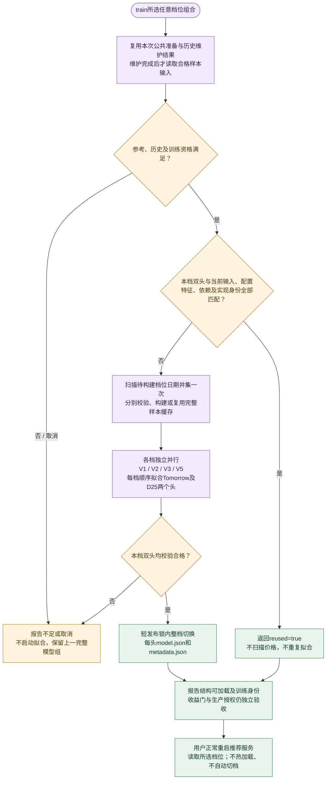
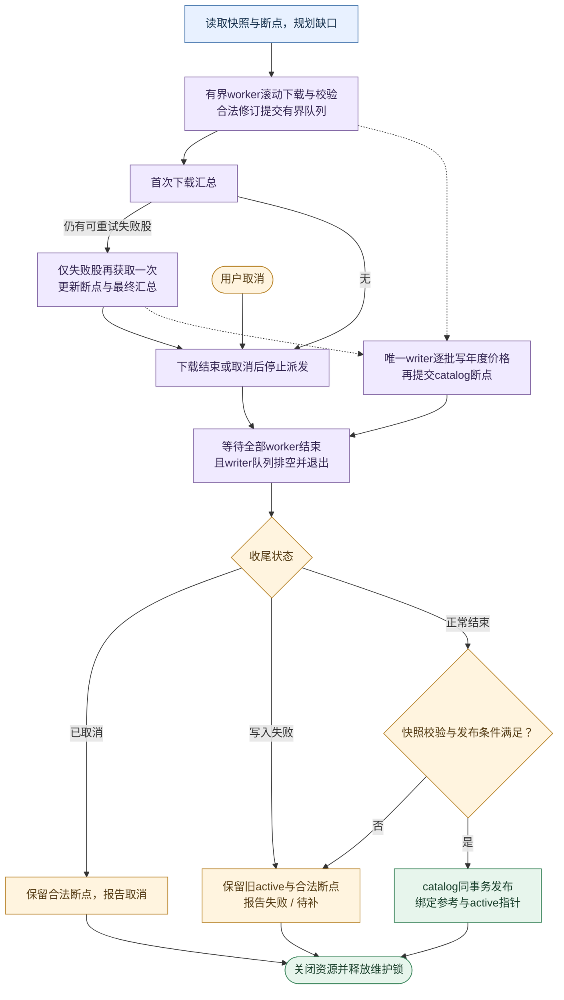
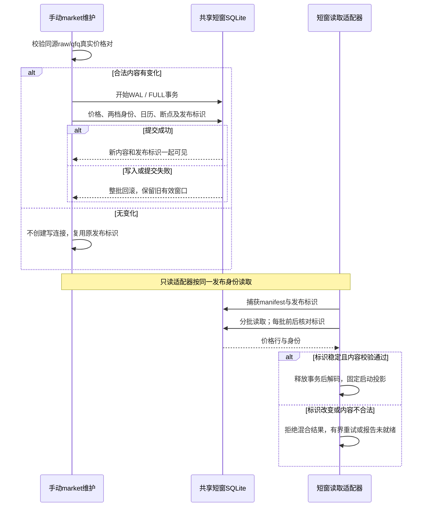

# 下载、训练与回溯

本文是下载、历史数据、独立qfq、训练模型及回溯工程的唯一权威。
评分和收益准入见[评分逻辑](1_评分逻辑.md)，架构、API和资源见[工程设计](2_工程设计.md)，完成证据见[工程实施](3_工程实施.md)。

## 1. 离线入口与消费者

### 1.1 先选命令

| 任务 | 当前命令 | 结果 |
| --- | --- | --- |
| 更新全部本地资料 | ./run.sh sync | 共用一次证券总体/ST/日历/当前行业准备，再依次更新history、market、company |
| 只更新在线日线 | ./run.sh sync market | 发布共享251/61日短窗口 |
| 只更新公告、财务及风险 | ./run.sh sync company | 增量发布公司证据 |
| 维护完整历史并训练全部档位 | ./run.sh train | 维护一次历史，四档共用一次价格扫描并独立并行训练 |
| 只训练任意档位组合 | ./run.sh train v1,v5 | 一次历史维护后只处理所列档位；也支持单独v2或v3 |
| 只训练全新V1 | ./run.sh train v1 | 维护历史后训练排序/收益双组件的Tomorrow/D25整组工件；生产运行权限由独立人工授权决定 |
| 只训练V5 | ./run.sh train v5 | 维护历史后训练或复用按行业TCN的Tomorrow/D25整组工件 |
| 只维护完整历史 | ./run.sh sync history | 不受周更门槛限制，只发布历史事实与缺口，不计算训练资格 |
| 卸载已安装的旧系统任务 | trader-cli history-automation-uninstall | 校验归属后显式停止并移除旧任务；启动不执行卸载 |

PowerShell入口保持相同命令语义；sync不接受档位，train直接接收由v1、v2、v3、v5组成的非空逗号列表，不接受重复档位、--profile或both；省略列表时选择全部。启动入口使用相同列表和默认值，具体见工程设计。
train是用户明确触发的下载加训练，不是只启动一个已有模型；普通run.sh只启动推荐服务，不执行sync/train。慢资料在启动时读取，运行期间不轮询数据库或模型文件变化，手动维护后正常重启加载。
一次train只维护一次历史；公共准备或历史维护失败即停止。bootstrap创建一个执行器，容量等于所选档位数（1～4）；每档独立，不捆绑V2/V3。训练协调器持有一次历史维护锁及所选档位锁，读取并对齐价格流一次，按各档窗口分发；每批256行，每档最多排队2批，禁止整段历史常驻内存。每个worker创建并关闭自己的SQLite连接；建样本后关闭写连接，再用只读连接拟合。同档两个头共享样本与统计，头和行业仍顺序执行。单档失败不阻断其它档位，取消通知全部worker并等待退出，主线程独占信号处理。每档输出profile_training_result，多档最后输出selected_training_result，包含容量、价格扫描次数、原始行数、耗时及退出码。移除原joint_training_result和专用联合调度。汇总退出码为0全部完成、1至少一档失败、130取消；工程成功不授予收益或生产资格。
旧人工下载命令和check入口不保留兼容别名，本地检查使用统一诊断。

sync已包含history，通常无需紧接着再执行sync history。需要更新全部资料再训练时，执行sync后再执行train；train仍校验同一历史维护合同，同日身份及数据完整时不请求价格，不会重新下载2000日。只更新公司资料使用sync company，它仍先完成公共参考准备，不下载完整历史或行情窗口。不同命令同时维护同一分项时由该分项锁拒绝重入；train遇历史维护占用时停止，不拿未发布数据训练。

手动history与market维护以Asia/Shanghai 15:15为当日目标边界：此前只请求最近已完成交易日，15:15起允许今天进入目标日；实际交易日仍由可靠日历确定。Tencent当日raw/qfq尚未配齐时保留明确待重试缺口，后续重跑增量补齐，不把单侧价格视为完成。

公司首次或未完成运行需要补齐365日公告、财报及正文，后续按断点增量；未完成公告分片先续传，补齐后再定期回看最近7日公告和旧月修订，巨潮物理请求至少间隔1秒。命令开始先提示公共参考准备，首次或跨上海日期的ST核验也可能较慢；不能用CLI环境检查耗时代表业务启动时间。

### 1.2 执行顺序与退出结果

**手动同步：命令运行一轮后退出，没有固定执行间隔。** 当前默认sync仍串行执行三项；单项入口只走所选分项。维护完成后，在线服务在正常重启时才加载新资料。

**手动训练：先完成一次历史维护，再处理所选档位。** 各档按原规则独立训练或复用、发布完整双头；缺模型时推荐服务只降级，不自动进入这条流程。所选档位共用以下扫描和调度，V1与V2/V3/V5仍各自保留训练合同。

每档训练结果输出reused及stage_seconds；后者沿用现有进度owner记录的已完成阶段累计单调耗时，不为未完成阶段补零，也不解释为单独测得的排队时间。各档并行阶段耗时不能相加作为整条命令耗时，历史维护与训练总墙钟分别核对。

1. 所有下载共用不可变的官方总体、完整ST证据、上海检查日、可靠日历及参考身份；历史消费者不重新抓取同轮总体/ST。当前行业与历史锚点行业分别消费。
2. sync依次执行history、market、company；独立分项失败或待补保留断点，继续后续项。取消、配置错误或必需公共准备失败则停止。当前行业失败仍允许合法价格降级，训练报告资料不足。
3. train的历史维护失败、取消或没有合法发布快照时不启动拟合；已发布历史尚有部分价格缺口时，只用合格样本尝试训练，由所选档位自己的输入与样本门决定能否发布。V1不查询V2/V3模型到期状态作为前置条件。
4. 进度写stderr，最终JSON写stdout；机器输出不夹杂颜色和逐股原始载荷。
5. sync和train的历史维护收到首次SIGINT/SIGTERM后停止派发并等待已接收事务，退出130；进入拟合前恢复信号处理。公司取消保留已提交页及上一发布投影，不继续启动全量投影或新闻发布；尚未查询的待补数量不代表完整覆盖。

| 退出码 | 含义 |
| --- | --- |
| 0 | 本命令达到完成条件 |
| 1 | 失败或仍有待补 |
| 2 | 参数/配置错误 |
| 130 | 已取消；train不继续训练 |

下载完成只判断发布状态与价格缺口：sync存在待补缺口返回1，已有完整数据不会因其它档位模型缺失、损坏或发布占用返回失败。显式train可在合法快照上按有效样本尝试拟合，不将下载完成解释为训练或收益准入通过。

history_maintenance_status及data_sync.tasks中的历史输出不再包含training_due、training_due_reason、training_heads、matured_label_days_since_training和automatic_training。训练到期与提醒仍通过训练结果、history-automation-status及推荐启动状态读取；逐模型头状态没有持久到期观察时，training_due为null、training_due_reason为unavailable，不伪造数据不足结论。

## 2. 数据、资格与资源所有权

### 2.1 持久目录

路径相对于配置data_dir；默认根为data/。runtime_dir只放服务锁、日志及可丢弃临时产物。

| 路径 | 内容 / 写入者 | 消费者 |
| --- | --- | --- |
| market/reference/historical_st.sqlite3 | 曾用名/ST事实，download写入 | 所有下载准备、训练总体、推荐资格 |
| market/reference/inputs.json | 已校验官方总体、完整ST证据、日历及当前行业身份 | 同轮下载准备、推荐固定启动参考及调度 |
| market/reference/industry.sqlite3 | 历史queries、当前current_industry_queries | 历史锚点与当前模型行业分别消费 |
| market/history/catalog.sqlite3 | 任务、缺口、序号、绑定参考和发布指针 | 训练、研究、结算的快照入口 |
| market/history/prices_YYYY.sqlite3 | 年度物理价格分区 | 只读历史消费 |
| market/daily_window.sqlite3 | 独立raw/qfq短窗口、两档身份及断点 | 短窗维护与核验；模型上下文读取完整历史 |
| company/evidence.sqlite3 | 公告、财务、质押、解禁及发布投影 | 推荐风险与财务 |
| company/eligibility.sqlite3 | 当前/永久资格事实与身份 | 推荐过滤 |
| training/models/{v2,v3}/{tomorrow,d25}/ | 每头model.json及metadata.json | 推荐启动加载 |
| training/models/v1/{tomorrow,d25}/ | 每头model.json及metadata.json；双头整组发布并保留原训练验证报告 | 显式V1启动加载 |
| training/samples/{v2,v3}/ | 待补训练可复用samples.sqlite3及complete.json；完整完成或明确拒绝后清理文件与空目录 | 两档训练工作区 |
| training/samples/v1/ | 仅在V1训练中暂存样本，结束或取消后清理文件与空目录；旧目录有数据时拒绝覆盖 | 显式V1训练工作区 |
| recommendation/{v2,v3}/ | decisions.sqlite3、snapshots.sqlite3 | 正式记录、当前恢复和发布序号 |
| recommendation/shared/deepseek_budget.sqlite3 | 跨档位物理请求预算 | 复核与只读内存状态 |
| research/{v2,v3}/ | outcomes.sqlite3、按日traces、按身份experiments | 结算与隔离研究 |

1. 历史参考按内容hash写入catalog的bound_references，与快照指针同事务发布，不再依赖旧参考JSON目录。
2. 当前行业查询与历史锚点分表，不得互相替代；当前参考满7日由手动准备更新，推荐侧不联网补查。
3. 跨PC共享已训练模型时，仅将`data/training/models/{v1,v2,v3,v5}/{tomorrow,d25}/`下的`model.json`和`metadata.json`纳入Git；每档双头四文件必须作为同一批完整提交，保留原始字节与身份。样本缓存、SQLite、锁文件、暂存目录及其它业务数据仍留在本机；尚未产出完整双头的档位不提交占位模型。
4. 各业务独立维护锁；数据锁紧邻数据，模型发布锁位于整档替换目录之外。

其它PC在`Afuture`分支执行`git pull --ff-only origin Afuture`即可取得已提交模型；拉取前停止本机训练及服务，确认模型目录没有需要保留的本地改动或未跟踪工件，存在冲突时先备份到仓库外并人工处理，不强制覆盖。接收端保持代码、依赖和配置合同匹配，仍须单独维护行情、历史和公司资料；正常启动或重启时由现有加载器校验双头、摘要和合同，不热更新。Git共享只分发训练结果，不授予V1/V5收益或生产资格。

#### 字段从下载到消费者

逐字段来源、单位、缺失和评分用途统一见[评分附录](1_评分逻辑.md#附录完整字段与因子表)，本节只解释数据工程路径，避免复制评分权重。

| 输入 owner / 命令 | 发布与读取 | 消费者和具体例子 |
| --- | --- | --- |
| 公共准备；sync各分项、train共享 | 证券/ST/日历/行业固定引用；推荐启动读取同一发布身份 | 静态资格、上市交易日龄、前一交易日风险覆盖、模型行业暴露；当前行业不代替历史锚点行业 |
| history；`./run.sh sync history`或train前维护 | 年度价格分区及catalog发布指针；训练/研究按锚点和快照读取 | 拟合样本、历史回溯与收益结算，不在在线评分中扫描全历史；历史字段合格不等于当前来源新鲜 |
| market；`./run.sh sync market` | 独立raw/qfq短窗原子发布；模型启动上下文改读已发布完整历史的有界窗口 | 收益、均线、波动、回撤及金额基线；各档窗口按完整历史身份对齐，不把251行短窗当作信号日前251日 |
| company；`./run.sh sync company` | 正式财报/公告/质押/解禁形成证据及资格发布；推荐一次分批预读，不按股票评分逐次查库 | D25财务质量与估值、本地风险及资格；财报需已披露，公告一年风险覆盖完整性独立判断 |
| 在线行情/分钟；正常服务来源任务 | 内存标准化及有界缓存，按内容/资格变化触发派生；不触发sync/train | 当前价格/实际量/金额与本地历史组合，分钟构成尾盘因子；HTTP/Web读取最终用例，不抓取这些输入 |
| training；`./run.sh train` | 模型双头整档发布，正常启动加载，不热更新 | 使用market派生的同档模型特征做预测诊断和成本门；模型工件不是报价来源，缺失时不制造预测 |

例如昨日以前5个完整交易日实际股数为100、120、80、100、100万股，均值100万股；当日实时60万股产生`volume_to_5d_average=0.60`。分子来自在线Q，分母来自已发布H，缺其中任一端便不能确认缩量形态；供应商volume_ratio=1.5不能替代0.60。又如真实当前换手3.00%、历史20日中位数2.00%，得到冲击1.5；金额2亿元除以历史1亿元得到金额冲击2，两条基线不互换。上述是说明性例子，不是真实测量。

源码审计已明确的I/O边界是：history供长样本，market供独立短窗，二者raw/qfq重复不是删库理由；启动公司预读、固定参考、基础历史上下文及共享模型特征缓存已有owner，不再新增并行缓存。剩余优化先测冷启动各预读阶段的SQL次数/字节/耗时、连续同输入评分的读库增量、模型特征缓存命中及RSS，再比较同发布身份的输出、覆盖与延迟。诊断自身每次加载输入的耗时不能当成运行服务每轮的重复I/O。

复用`diagnose_runtime.py`的history-sqlite、qfq-sqlite及download-performance专用诊断；写入基准只用仓库外隔离副本，活动历史正在维护时不执行竞争性全库实验。尚无完整history/company吞吐实测时，只列未验证边界，不根据字段表推断优化收益。

`--profile database-baseline --database-probe-directory <新的仓库外目录>`建立下载与启动基线：每轮新进程，历史五场景、联合/单项下载、启动预读及同日重启分别测量。复用现有业务owner和SQLite封装，验证独立目录、发布身份一致、一次联合准备、共享历史主扫描及预读后的零数据库读取。报告区分合成fixture、真实文件系统I/O与未验收的生产吞吐；tmpfs/ramfs不作为SSD/HDD证据，同文件系统手动介质配置明确标记来源。工作量、计数口径、POSIX进程组超时及已有诊断的显式目录选项见[scripts说明](../scripts/README.md)。

#### 数据目录的硬盘检测

CLI数据命令及推荐服务组合启动时，统一使用infra/storage_probe检查runtime、历史、独立qfq、参考、公司/资格、预算以及V1/V2/V3/V5模型、样本、推荐与研究目录；HTTP/Web工厂不执行检测。检测解析软链接，未创建目录使用最近存在的父目录，同一次检查按设备复用元数据，不扫描业务内容或运行写盘测速。Linux读取物理设备rotational及组合设备的全部成员；Windows使用卷/分区与物理盘唯一标识关联；macOS读取diskutil介质属性及APFS物理成员。命令式系统查询每个设备最多3秒，权限不足、虚拟/网络存储或无法证明物理介质时明确返回unknown；虚拟SCSI的rotational值不能证明宿主介质。

实际加载的runtime配置可添加可选字段：`"storage": {"overrides": [{"path": "data/training/samples", "kind": "hdd"}]}`。路径相对项目根目录，也可为绝对路径；kind只允许hdd或ssd，解析后重复路径报错，最具体路径覆盖上级配置。手动值优先且显示“已使用手动配置”。交互终端启动服务或执行sync/train遇到unknown时，每个未知设备询问一次SSD/HDD，将选择按受影响路径原子写入现有runtime配置，下次启动直接复用；回车跳过或无交互终端时保留unknown并提示手工设置。选择虚拟盘时应先在宿主机确认真实介质。未配置storage等同空覆盖列表。

只读检查使用`.venv/bin/python3 scripts/diagnose_runtime.py --profile storage`；可重复附加`--storage-path /absolute/source-or-output`核查独立源目录及输出目录。该检查只读取文件系统元数据，不修改活动数据。检测结果目前驱动历史下载批量选择；其它数据操作先完成目录覆盖与诊断，后续I/O调优不在本批生效，不把HDD/SSD识别等同于训练提速验收。

| 数据操作审计范围 | 当前owner及后续调优边界 |
| --- | --- |
| 历史读写、校验、重打包与发布 | download/infra/history_*；检测已切换公共owner，写事务、摘要、first-wins保持 |
| qfq、参考、公司证据及资格 | download/infra/qfq_sqlite、reference_publication、company_evidence_index及recommendation/infra/persistence/issuer_eligibility；共享SQLite/FULL保持 |
| 样本、缓存、模型封存与发布 | training/infra/sample_cache、sample_index、profile及model_bundles/profile_publication；紧凑样本与批量读取另批实现 |
| 推荐决策、预算及发布序号 | recommendation/infra/persistence与deepseek/budget；短事务和正式记录不可变保持 |
| 研究快照、残差、回溯与证据索引 | training/infra/research；冷扫描、顺序读取和同盘调度另批实测 |
| 公共文件、序列化、锁、SQLite及诊断源/输出 | infra/atomic_files、serialization、process_lock、sqlite_connection；不在每次open或SQL重复检测，诊断通过显式路径检查 |

### 2.2 ST资格

| 情况 | 处理 |
| --- | --- |
| 官方当前简称已确认ST | 直接记ever-ST并排除，不再请求该股其它业务数据 |
| 曾经ST | 永久排除；摘帽不恢复 |
| 当天有效clear证据 | 当前上海检查日内复用 |
| 缺失、过期或未知 | 通过曾用名来源补查；失败则未知，不进入下载 |
| 资格数据库损坏 | 停止，不清空旧排除后继续 |

最多8股滚动在途，每64股或收尾短锁合并；网络期间不持文件锁。
并发合并ever-ST优先；qfq在维护锁内移除已排除代码的派生窗口，history不破坏物理旧行。
推荐端的ST资格固定取自启动时公共参考的完整证据；新确认的历史ST在重启后生效，不再借旧qfq名单作为资格来源。永久ever-ST事实可复用，公共准备仍记录本轮检查日期。
当前名单和事后ever-ST排除存在选择偏差，不等于历史时点资格合格。

### 2.3 公司资料

| 分项 | 当前窗口 | 增量方式 |
| --- | --- | --- |
| 公告与风险 | 最近365天发行人披露 | 新日期、失败页、最近7天重叠、每天一个旧月修订检查 |
| 新闻 | 最近7天，每股最多50条 | 只取最近7日两档有效正式发布名单的去重代码，与本轮合格总体取交集；无名单明确未覆盖，不全市场冷抓 |
| 财务 | 最新正式报告及所需对比，最长550天报告期 | 披露增量及7天回看 |
| 质押 | 最新完整市场快照 | 完整后替换，失败保留旧值 |
| 解禁 | 未来90天 | 完整后替换 |

1. 巨潮按市场/日期分页，每页30条、最多100页；跨日超限、重复页或旧游标超过100页时继续二分。单日超限或重复页先按主板/创业板或主板/科创板切分，再按巨潮官方证券清单每32项分组，仍超限时二分证券组；单个查询对象仍超限则明确待补。证券筛选同时核对官方发行人身份，允许同一发行人的历史代码，保留返回的原始代码。全部子片完成后，以记录并集而非可重叠子查询总数之和核对父查询总数及新样本；一致后才声明覆盖并清理撤回。当前证券清单不代表历史完整总体，缺记录时保留已完成页，按代码正反序各至多100页有界查找遗漏发行人，只补新增查询并再次核对完整并集；仍不一致保持待补。确证来源撤回或替换记录时保留查询成员、重新核验受影响日期的查询代次。修正查询策略首次接入只释放相应筛选/覆盖失败的冷却，网络冷却及后续新失败保持。规划只补现有分片未占据的日期，已完成宽片也不重复创建日片，重启不重新创建已拆父片；旧月复核重新核验子查询。
   巨潮来源主板计数包含B股披露，来源分组与覆盖核对保留这些记录并按正确交易所处理；推荐发布总体仍只使用已确认的A股代码。日期片完成后的撤回清理使用带日期范围的现有索引查询，只清理对应市场和日期的失效关联。
2. 标题只筛正文，风险须核对主体、官方结论及同案结束关系。
3. 事实与页断点使用FULL事务。发布先通过公共只读连接读取一致源快照，在连接私有TEMP表分批构建编码；取得短写事务后重新核对同一读连接的data_version，原子提交投影与指针。源内容变化拒绝本次发布并保留旧结果，清理在发布后独立执行；重启从首个未提交页续传，原有未完成分片（包括第一页）排在本轮新建日期片和到期复核之前。已有覆盖记录不能掩盖未完成复核，该市场存在待补分片时仍标记覆盖不足。进度分别显示本轮完整日期片、待补片、当前查询页数及证券组标识，历史发行人补查单独标明；动态拆分不显示误导性的整阶段百分比。成功页、变更行是本轮计数，重复核验页可以增加成功页而不增加变更行；仍有效的历史完整片计入复用。阶段耗时与命令累计分别显示，sync的命令累计包括之前的history和market。
4. 公告已下载且元数据未变时复用正文；一次失败不能清空已确认事实。正文待核验与发布统一从365日前上海日期零点开始、截止本轮观测时间。逐篇失败原因、尝试时间和重试期限随内容摘要持久保存；同一内容在冷却期内不下载，仍计入pending_documents并保持风险未知。摘要、解析参数或诊断策略变化允许立即重试，核验成功清除该篇失败状态。初始化只增加重试及子查询表，不重建已有事实、页游标或发布投影。
5. 单次请求最多8秒，巨潮至少间隔1秒；传输失败或408/500/502/503/504最多3次物理尝试，等待2/4秒，仍受阶段deadline和取消约束。公司请求超时与间隔在`config/download.json`的`company`段配置，加载时校验上述上限。
6. 公告查询和PDF下载分别熔断：403/429立即停止对应来源；网络超时、连接失败或可重试HTTP错误耗尽3次物理尝试后只暂缓该任务，连续3个任务传输失败才停止对应来源。公告连续3个查询校验失败也停止公告来源，合法响应及提交成功后重置计数。失败片页游标保留，暂时失败15分钟内不重新下载；其它查询失败默认24小时冷却。PDF的404、解析失败、超限和解析超时仅影响该篇，不累计来源传输失败。阶段截止或取消停止新派发，停止后仍可发布合法降级投影。日志分别显示尝试、核验、冷却和待补计数，以及阶段deadline或来源停止原因。
7. 公司分项默认预算90分钟，由`config/download.json`的`company.budget_seconds`设置；同段配置结构化来源单项预算、公告和正文的截止比例、正文解析超时。必须满足公告截止早于正文截止、正文截止早于总截止。公共准备另有来源超时、并发上限及取消边界。推荐服务不再运行09:15/12:45资料任务。
8. published_codes只表示已有可读投影，不等于完整一年风险覆盖；pending_partitions和pending_documents分别报告待补页片和正文。

正文运行参数同属`config/download.json`的`company`段：

| 配置项 | 默认值 | 含义 |
| --- | --- | --- |
| document_failure_retry_seconds | 86400 | 不可读、加密、无文本、超限等正文失败，24小时后再试 |
| document_transient_retry_seconds | 900 | 正文或公告查询的网络失败、正文解析超时等，15分钟后再试 |
| document_limits.max_bytes | 16777216 | PDF下载上限16 MiB，可设置至64 MiB |
| document_limits.max_pages | 200 | 全文页数上限，可设置至1000页 |
| document_limits.max_text_characters | 1000000 | 全文字符上限，可设置至200万字符 |

PDF仍在受单调超时约束的独立子进程内解析，每页展开内容最多8 MiB；加密、完全无文本、文本不足80字符、页数/展开内容/文本超限分别报告。只接纳完整提取结果，不把截断文本、短文本或扫描件自动当作已核验；本轮不加入OCR。增加上限或修改正文解析超时后，下次同步可重新尝试旧失败篇；改配置不会更新已经启动的进程。单个证券查询仍超供应商上限、官方清单不完整及扫描件等缺口保持显式未知。

程序内部采用有界批量读写，读取后结束事务再解码，不在评分请求中联网。
慢数据全部手动维护；推荐生命周期启动后分批预读轻量事实，评分冷项不再触发公司数据库读取。启动前后校验同一发布身份，最多重试3轮，30秒或取消后报告未就绪，不接受混合发布。
所选档位共享同一ResearchEpoch和一次公司预读，公告正文只在生成风险事实时短暂使用；原owner的常驻字节纳入进程缓存预算。DailyFeaturePack同时绑定固定证券、日历、行业、各档qfq、公司、模型和配置身份，未完成绑定的输入不得进入评分。

#### 公司事实的有效性与覆盖截止

| 时间或状态 | 需要说明什么 |
| --- | --- |
| 财报披露及生效时间 | 报告是否在评估时已公开，是否仍是最新可用正式报告 |
| 公告风险覆盖截止 | 已核验到什么时刻，有哪些页片、正文或来源仍待补 |
| 最近查询时间 | 实际何时维护，不等于全部事实的生效日或无风险证明 |
| 本地读取时间 | 仅表示何时加载，不能刷新来源年龄或风险覆盖截止 |

[公司资料读取](../src/trader/recommendation/infra/market_data/published_company_research.py)按可靠交易日历的前一实际交易日判断风险覆盖，节假日不按自然日误失效。财报披露、风险覆盖截止、质押日、解禁前视范围、最近查询、发布及本地加载时间分别保留。
未来披露不参与计算；查询时已经公开的未来解禁可以作为风险。过期风险覆盖限制动作并保留已知硬风险，不否定已披露财报，也不因本地重读而刷新来源年龄；前晚资料不证明盘中新公告已核实。

### 2.4 资源与SQLite边界

| 场景 | 当前限制 |
| --- | --- |
| 下载worker | 默认8，最多12；会话在股票间排他复用 |
| 持久SQLite | 显式事务、FULL、线程持有连接；WAL用于共享读写 |
| 历史待写/在途 | 合计最多64股、32768请求日期单元 |
| qfq待写/在途 | 合计最多32股、8192日期单元 |
| 样本SQLite / LightGBM直方图池 | 32 MiB / 64 MiB |
| 单档计算 | 最多2个计算线程；现有单档资源验收单独核算 |
| Linux train整体scope | 4608 MiB回压、5120 MiB硬限制 |
| 并行执行器 | 所选档位数1～4；不以硬盘类别或外部证据开关限制为两档 |
| 拟合内存预约 | 共享预算最多3 GiB，并按可用内存保留1.5 GiB余量；按矩阵尺寸估算，预算不足等待，单任务超限明确失败 |

并发执行位置与实际大矩阵分配分开控制：V1按当前模型头的四分区样本数预留矩阵、元数据及拟合工作区，映射释放后归还，再处理下一头；V2/V3按最大行业矩阵及原生计算工作区预留；V5预留批次缓存和网络工作区。预约原子完成，等待可取消，退出归还；不是固定最多两任务。保留Linux整体scope；V1/V2/V3每档2个计算线程，V5按training.json配置1～4线程且不得超过当前CPU亲和性允许的数量。V5同一行业的训练/早停float64批次只读取一次，各轮复用；合计超过256 MiB改用样本工作区临时文件映射，结束或取消清理。网络输入在批次边界按配置转为float32或float64，不改缓存格式及批次顺序。序列块缓存仅保存原小端float64载荷的只读视图，按原32 MiB载荷预算淘汰；连续列选择不再复制整批，训练缓存的最终布局保持。

性能诊断使用统一入口`--profile training-performance --history-root <仓库外历史副本> --training-probe-directory <新的仓库外输出目录>`，可用`--training-profiles`选择组合。串行前测、共享并行、串行后测均使用新子进程及独立输出；加`--baseline-checkout <仓库外旧版源码>`则运行旧版前测、新版、旧版后测，各自首次及同模型目录重复执行，分别记录耗时、复用与扫描次数。比较持久模型数值及评价指标，配置摘要须相同，实现身份另列；不把实现摘要变化当作数值变化，也不把该测量声称为独立预测回放或历史下载耗时。任何一轮样本门不通过时标记不可比较，不将阻断更快解释为训练提速；单组夹测不能代替稳定全市场收益证据。不再读取TRADER_JOINT_FIT_EVIDENCE。
推荐使用进程共享512 MiB逻辑缓存/2 GiB RSS验收预算，train内存预算独立。配置已切换，真实资源验收按工程设计第7节执行。
SQLite公共边界见[工程设计第4.3节](2_工程设计.md#43-sqlite公共边界)；交付状态和实测证据只查工程实施。

机械盘首次发布前的全量续传沿用初建批量提交策略；读取已写数据与选择写入批量分别判断。恢复读取先用代码索引确认股票在年库中是否存在，整股未写入时不再逐日探测；已有部分数据时仍按请求日期及序号读取。年库写事务先用代码索引证明整批股票在记录及观测中都不存在，才使用首次插入路径；已有股票仍逐项校验冲突、幂等及未发布缺口升级，FULL与落库后确认断点保持不变。历史进度分别显示已返回任务的恢复读库、供应商及校验累计耗时，以及已完成落库和当前批次待确认时间；并发累计耗时不能相加解释为整轮墙钟，尚在执行的读库看在途数量及最久在途。

## 3. 完整历史下载、补缺与发布

### 3.1 请求什么

| 项目 | 当前规则 |
| --- | --- |
| 初始窗口 | 最近2000个可靠市场交易日，新股不补上市前日期 |
| 价格和日历来源 | Tencent；BaoStock只供行业 |
| raw请求 | 每股一次有界窗口 |
| qfq翻页 | 恰好返回640行且未覆盖目标起点时，按重叠锚点向前，最多5页 |
| 停止翻页 | 少于640行、覆盖起点或达到页上限；不无限凑满 |
| 增量 | 新日、可重试缺日和最多5个有效锚点 |
| 同日已完整 | 免价格联网，检查必要身份 |
| 参考单独变化 | 发布新参考身份，复用价格 |

1. 日历来自Tencent指数，日期有序、唯一且不越过截止日；允许附带多1条当日行后再裁剪。
2. 请求跨度按最早至最晚缺日计算，不能把稀疏缺日数量当窗口长度。
3. qfq有限但非正的旧价只隔离受影响日期，同页其它合格行继续保存。
4. 已确认非正qfq日期延迟20个市场交易日再重查；普通单侧缺行、网络失败不延迟。
5. 锚点冲突、分页失败保留已验证近期行，明确待重试，不改为供应商正常少返回。
6. 尾部补缺为qfq起点前的交易日额外预留两个请求名额，短窗口至少请求7行；raw重叠日的开高低收与成交量仍须一致。若一侧成交额为整万元精度、另一侧四舍五入至整万元与其相同，可用新完整配对补齐该日；其它重叠冲突仍待重试。
7. 完整历史首次Tencent下载汇总后，同轮仅对仍可重试的失败股票再获取一次并输出最终汇总；再次失败即结束本轮，保留缺口供下次手动同步。已确认非正qfq日期遵守20个市场交易日的延迟重查，不因本轮补取提前请求；部分缺行但没有失败的股票不进入该次补取。

### 3.2 缺行不是同一种失败

| 结果 | 保存状态 | 后续 |
| --- | --- | --- |
| 同日raw/qfq均有效 | 完整同源价格对 | 可用，后续保留有效行 |
| 两侧成功但该日都未返回 | tencent_inferred_suspended空价格点 | 仅停牌推定，不是交易所证明或可成交价 |
| 只有一侧 | 无完整价格的待重试缺口 | 不跨源拼另一半 |
| 超时、限流、损坏或身份冲突 | 失败/未知 | 保留已验证数据和断点 |
| qfq非正 | 不合格qfq日期 | 有界延迟重查，不平移价格、不以raw冒充 |

已有有效日线先到先用，真实价格可替代推定，推定不能覆盖真实价格。
行业源失败时允许先发布Tencent价格快照，训练保持data_incomplete，后续补行业并复用价格。
成功但少于2000日不等于下载失败，也不代表模型字段一定合格。

### 3.3 正式年库与逻辑快照

这是一次手动历史维护内部的工作队列循环，不是服务每隔数秒自动下载。派发受worker、来源限速及deadline约束；“5秒”是批量写入触发条件之一，不是每5秒重下全部历史。

图中等待节点要求worker完成与writer排空同时成立；没有下一只股票不表示最后一批已持久化。取消后停止新派发，已接收事务完成或回滚，writer退出后才释放维护锁；不会沿正常成功分支发布。合法历史修订和断点可供下次人工续传，未发布价格不会冒充新的active快照。训练、研究按不可变manifest读取，在线结算继续绑定启动捕获的manifest。
发布内容校验逐月计时，每月仅在校验完成后输出一次进度与本月耗时；校验开始事件仍用于计时。

1. 年库使用具名价格列，保留逐月logical_hash、修订身份及观察序号；物理合年不改变逻辑月身份。
2. 已发布快照不可变，未发布数据不因已落盘就对读者可见。
3. 日历、总体、绑定参考和active发布指针由控制库维护，参考与指针同事务提交。
4. 正常写入按年度归组，每4096行一个FULL事务；单写线程内最多复用32个年库连接。
5. HDD/unknown首建按8股或16384日期单元触发；SSD及增量按16股或8192单元，另有5秒或网络排空触发。unknown同时提示手动配置，不默认为SSD。
6. 取消时停止派发，等待已接收事务退出并关闭资源后释放维护锁。
7. 已发布记录不能被同序号内容改写；合法未发布缺失状态只能向更完整已验证事实推进。
8. 旧格式明确拒绝，不做隐藏双读或现场破坏性升级。
9. 未发布断点遇到合格总体变化时，在同一事务更新父身份及任务集合；共同证券保留进度，新增证券下载目标窗口，移除证券不再派发。共同证券的板块、上市/退市日期、日历或来源冲突仍拒绝续传，已发布快照不变。
10. 每次恢复读取按物理年库分组，同一股票在该次读取中每年只打开一次读连接；仍按请求日期和快照序号筛选，不把未来或未请求记录作为已完成数据。
11. 初次发布中断后也遵守非正qfq的20交易日重查间隔，等待重查的已确认任务不重新派发、不整窗重读；其缺口仍保留并计入待补，不计为合格复用。

### 3.4 进度、空间与诊断

等待心跳显示在途股数、待派发股数及最久在途时长，覆盖恢复读取、下载和校验；完成数只在落库确认后推进。“下载”累计已返回任务的耗时，不能代表未返回任务已经等待多久。本地恢复慢可用统一诊断`--profile history-sqlite --history-resume-samples 1`只读测量，最多8股，不请求供应商或写入历史。

| 输出 | 应说明什么 |
| --- | --- |
| 逐股终态 | 实际下载、本地复用、无需下载、本地失败分别说明 |
| 阶段进度 | 股、页、分片、篇单位不能混用；无总数时显示未知 |
| 等待 | 源站等待超过5秒显示心跳，不伪造进度 |
| 汇总 | 成功、残留缺口、未处理及稳定失败原因 |
| 失败 | 原操作及受控异常类型/位置，不输出完整路径或外部载荷 |

耗时用HH:MM:SS；缺口是“股票×交易日”，不是请求次数或股票数。
终端可着色，管道/文件/JSON无ANSI；成功绿色、待补黄色、最终失败红色，不靠颜色替代文字。

空间审计和性能比较使用scripts/diagnose_runtime.py的history-space、history-sqlite、history-write等既有profile。
报告区分正式库、辅助文件、WAL、分配容量、RSS及网络/写入/校验耗时；小fixture不代表全市场性能。
离线压实和维护必须在隔离副本按显式命令执行，不自动清理活动年库。

## 4. 独立qfq短窗口

### 4.1 下载和存放

| 项目 | 当前规则 |
| --- | --- |
| 窗口 | V2最近251、V3最近61个市场交易日范围 |
| 来源 | Tencent同源raw/qfq真实价格对 |
| 请求 | 一次251日范围，尾部增量按需要日期请求，不固定640 |
| 物理库 | 全部板块、两档共用market/daily_window.sqlite3 |
| 逻辑表 | bars、identities、calendars、completions、publications |
| 版本 | 当前SQLite user_version=2；旧板块库或缺发布标识的共享库拒绝 |
| 与完整历史的关系 | 不依赖history，不要求先运行完整历史下载 |

1. 251/61是市场日历范围，不为凑够成交根数向前无限回查。
2. 少量同源缺日只请求尾部和重叠；来源变更或重叠冲突才重取单股251日窗口。
3. 两侧成功缺行不补页、不换源；只写真实价格对，不伪造昨收、换手、停牌或ST。
4. 整窗推定停牌且零真实行时记“无真实日线”，不推进完成断点；单侧价格但零价格对仍待重试。
5. 请求失败或不可信时保留旧有效窗口，继续其它股票；不借BaoStock补价。
6. 每股raw/qfq合计180秒单调deadline，单次45秒、最多2次重试。
7. worker满载最多等5秒，到期停止新派发并保存已接收合法结果；未派发不伪装为供应商失败。

### 4.2 原子提交与读取

下图描述短窗发布及其读取适配器的合同；模型启动上下文按第5.2节读取完整历史。raw/qfq配对、两档发布和读侧前后身份核验属于同一闭环，短窗库只保留真实价格事实。

1. 无变化不创建写连接，变化只写变更行、删除过期日、更新身份。
2. WAL/FULL事务一起提交价格、两档身份、日历、完成断点及每档publication_id；失败整批回滚。
3. publication_id是同批随机唯一标识；无变化复用不改，移除股票也须更新，最后一只移除则清除该档发布身份。
4. 内容hash仍校验实际价格及日历；发布标识不是内容校验的替代品。
5. 读取manifest时捕获全体身份、日历和发布标识；每批窗口前后仅核对标识，不重复全量扫描。
6. 逐股取行和摘要校验完成后释放事务，再解码；并发标识变化时拒绝混合结果。
7. 短窗读取不写回完整历史或替代模型所需的信号日前窗口；模型启动预读的来源、时限和内容校验见第5.2节。

### 4.3 固定启动身份

| 场景 | 当前行为 |
| --- | --- |
| 15:10及晚启动 | 不自动下载短窗；收盘后手动维护，正常重启后采用 |
| 候选和评分 | 读取启动时预读的历史派生因子 |
| 收益结算与模型输入完整历史 | 绑定启动捕获的不可变manifest，active推进后仍读原快照；完整history不可用时模型待补，只读Web保留合法旧结果 |
| 完整历史模型窗口不足 | 记录窗口不足、截止日期不匹配或异常价格，保持待补，不借用其它档位 |

缺模型时不自动训练；训练模型补齐后需正常重启。最近成交日过旧的股票仍限制动作，不能把“库中有价格”当作“当前新鲜”。

## 5. 训练输入、样本与拟合

### 5.1 预检与样本

1. 每个V1/V2/V3/V5档位独立核对双头与当前历史、标签截止、配置、特征、依赖和实现摘要；匹配返回reused=true。V1还绑定完整输入描述、总体与上市区间，并在共享扫描前检查；所有所选档位均无须构建样本时，价格扫描次数为0。复用不重新发布或刷新模型来源日期；本轮未建样本时V1的sample_counts为null、coverage为空，模型预测与已保存的评价报告保持。
2. 某档缺失、损坏或身份变化只触发该档重训；不受到期提醒周期限制。完整样本缓存按身份复用，不重复生成特征和横截面。
3. 首扫前校验行业、切分和样本保守上界；所有行业均不足20000行时提前阻断。
4. 同一市场日期的全部股票处于同一切分，特征按代码和日期对齐，不按每股第N行对齐。
5. 原始特征和在线模型复用纯公式及manifest；横截面暴露先于未来标签可用性固定。
6. 只保留唯一最终samples特征表；写入时累计小型日期/行业/标签统计表及每日标签缺失诊断。有效日期、标签均值方差、行业行数改查统计表，不反复扫描宽特征表。统计、切分和样本一起封存并校验摘要。
7. V2/V3行业拟合读取按每批最多4096行、按日期/代码顺序装入NumPy矩阵，批内按训练、早停、校准分组，保留各头独立的特征列、目标缺失过滤和校准日期；读取行数必须与已封存统计一致。V5紧凑序列批次仍由原序列读取路径处理。
8. V1矩阵同样按每批最多4096行读取，逐项核验特征BLOB长度后按原小端float64批量解码；保留每头日期、代码、行业、标签与排序query顺序。每头分配前预约内存，矩阵和映射释放后归还，发布不占用拟合预约；所有训练参数和计算线程保持。

### 5.2 不同日期窗口各是什么意思

| 数字 | 含义 | 是否要求每只股票都有这么多行 |
| --- | --- | --- |
| 2000 | 完整历史目标市场日历窗口 | 否，新股不补上市前日期 |
| 251 / 61 | V2 / V3历史范围，提供250 / 60日特征及一根前置价格 | 保留市场日期，历史停牌/缺行按下述规则对齐；异常价格不填补 |
| 1000 / 750 | V2 / V3有效拟合日期 | 是总体切分要求，不是每股上市历史要求 |
| 1250 | 部分旧研究代理/候选窗口的日期约束 | 不是当前每股统一门槛 |
| 5 | 最大标签成熟跨度及切分隔离尺度 | T+5沿共同市场日历定位 |
| 200 | 研究终端留出最低交易日 | 研究准入，不是生产在线窗口 |

新股能否贡献样本取决于足够历史特征及成熟标签。某只股票不足不意味着整场训练必然停止，但不能降低模型必需窗口。
V1/V2/V3/V5共用一个纯市场日历对齐规则：在上市至退市区间内，确认停牌、推定停牌及已发布快照内的个股缺行保留日期，使用此前同源qfq收盘估值，OHLC持平、量额为零。确认停牌可采用供应商当天估值；推定/缺行始终保留estimated标记，不推进最近已观测价格日期或冒充新鲜行情。不向后借价格、不回填上市前、不修复单侧缺价或异常价格；没有此前有效价格时维持窗口不足。整市场日期缺失属于源数据缺口，不能推定全市场停牌。原始库保持事实不变。

训练预热可从同一2000日已发布范围读取更早前值，各分区边界及模型所需窗口不变；在线先读档位窗口加一日，仅窗口开头无前值时每次增加63日寻找更早估值，最多2000日，足够即停止。V1始终选择信号日前251日，历史已更新到信号日也保留该输入；V5选信号日前61日形成60步序列，辅助特征保留信号日锚点。原始事实、合成估值与训练标签分别保留语义。

推荐启动只读完整历史的有界窗口，核对已发布分区的逻辑摘要，并逐行校验实际载荷与持久化摘要；不重复解码整月未请求载荷，不降低损坏检测或修订隔离。首次校验年度文件时以1 MiB缓冲顺序预读物理页，减少机械盘随机读取，页由操作系统管理；同一文件身份复用已有分区校验，扩窗补查也经过此入口。预读物理页不授予内容信任，仍完整执行所需逻辑证明与载荷校验。按月查询使用日期前导索引定位年度库中的窗口，再按股票排序，避免每月扫描整年；训练窄列扫描与启动窗口的最新修订查找使用相同日期前导的观测主键，保留快照序号上限。派生后仅保留最近20根日线、所需模型输入和历史摘要，纳入既有缓存预算。前后核对发布身份，最多重试3轮，受300秒单调时限及取消边界约束；同一预算传入物理预读、分区逻辑校验、SQLite执行及行解码，不在首个窗口返回后才检查。完成后线程退出，维护后正常重启加载；终态失败明确阻断预览，不继续显示等待输入。完整审计仍校验所有载荷；`--profile model-inputs`只读核验全市场V1输入数量、原因和耗时，不执行预测。

T+1至T+5严格定位市场交易日，不移动到下一成交日；确认停牌的有效估值可以用于估值收益，不能解释为可成交退出。推定停牌/缺行估算不得生成未来标签，也不得沿用估算前值把后续无价停牌升级成已确认价格。Tomorrow只依赖T+1，D25只依赖完整T+2～T+5；一头标签缺失不直接丢弃另一头样本。四档工程训练对每个日期、期限独立取信号时合格人口中实际收益可知的成员，按有效人数计算等权基准；缺收益只排除对应个股标签，整期限无有效收益时仍不可用。横截面特征暴露保留信号时人口，不随未来标签筛选重算。样本诊断分别报告T+1/D25缺失、确认停牌和估算日数；实际日期、行业行数和独立校准门不降低。该目标不替代完整总体的收益研究及正式结算基准；基准合同进入训练身份，旧规则样本和模型不得作为新规则训练结果复用。

对齐合同进入所有档位特征、样本缓存与工件身份。旧合同工件需要显式重训；各档仍须双头全部合格才能原子发布，不热更新或改写已冻结记录。`scripts/diagnose_runtime.py --profile training-alignment --history-root <仓库外历史副本> --training-probe-directory <新的仓库外输出目录>`使用未改动的配置执行八头训练与重载，并区分工程结果和未验收收益；不会修改活动历史或启用工件。

切分从终端留出向前安排，保留预热和训练/早停/校准/确认/留出隔离。通用及V2/V3新切分统一使用供应商无关的training_date_split标识，生成与校验使用同一名称，不保留供应商前缀别名。标识参与切分摘要，旧身份缓存与工件在下次显式训练时按新合同重建；不就地改写已有文件、数据库或冻结记录。
不能先按比例截出开发集，再让预热挤掉有效拟合日；窗口比较属于研究，不是日常命令自动择优。

### 5.3 缓存、拟合与模型文件

| 步骤 | 当前规则 |
| --- | --- |
| 价格扫描 | 所选待构建档位共用一次原始价格扫描和一次日历对齐，按窗口分发 |
| 样本 | 各档分别构建与封存；同档两个头复用一次特征、标签、横截面及统计；只有完整同身份缓存可复用 |
| 拟合 | V2只产LightGBM，V3只产Ridge，显式V5只产TCN；每档内部顺序拟合两个头 |
| 模型目标 | Tomorrow为T+1；D25是一个完整且唯一的2–5日生产策略头 |
| 标签成本 | 拟合标签扣成本前，在线净效用扣一次成本 |
| 发布 | 双头全部合格后整档切换；每头model.json及metadata.json |
| 失败 | 拟合、校验或切换失败回滚上一完整组 |
| 推荐加载 | 启动读取所选档位，不热加载、不自动切档、不借另一策略头替代 |

样本身份绑定数据、日期切分、特征/标签及实现摘要；学习率等拟合参数属于拟合身份。
每档最多一份完整缓存，失败保留、成功或明确拒绝后释放；已清空的工作目录一并移除，未完成缓存不能伪装成可复用。

metadata.json保存模型摘要、同档双头训练身份和嵌套合同，不使用隐藏活动指针或旧bundle兼容。
每档最终切换与双头读取共用目录外短发布锁；拟合、复制和预校验在锁外，竞争等待采用单调时钟且有2秒上限。缺失、损坏、摘要冲突、合同冲突和publication_busy分类关闭模型门，保留合法旧投影及只读Web，不自动训练、切档或借用另一头。
在线加载核对模型自身摘要、双头同源同次训练及推理合同；训练历史hash用于溯源，不要求等于每日推进的history。离线训练复用仍严格核对最新输入。
artifact_structure_valid只表示结构可加载；prediction_return_validation_passed才表示收益门结果。
当前日线工程代理不能凭训练成功将后者改成true，不授予production_authority，也不自动更新模型。

进度按预检、读取/建样本、横截面、索引、标签统计、拟合、发布分别输出，长阶段10秒心跳显示运行中；索引按一次操作计数，完成前0/1不表示未执行。每档任务返回后立即在stderr显示完成、阻塞、失败或取消及已知原因，不等最慢档位；最终JSON明细与组合汇总仍在所有任务收尾后输出。拟合完成仅表示模型已拟合，工件发布完成才表示双头已落盘。
行业顺序拟合、float64原地标准化，不靠降低精度或隐藏行业并发换取表面提速。

行业模型进度由程序自动附带行业标识、训练样本数和内部阶段；V5区分行业样本缓存、标准化统计、训练、早停验证及独立校准，并显示当前轮次/配置上限和当前阶段已完成批次/总批次。行业开始、拟合完成及跳过原因立即输出，内部批次仍按10秒节流与心跳展示最新计数。外层行业计数与整个头的阶段耗时不因换行业或轮次重置；这些诊断不改变样本、参数或模型准入，已启动进程不热更新日志。

V2/V3/V5校准统一使用居中协方差，至少2条样本且覆盖2个校准日期，预测方差必须大于1e-20，输入与参数必须有限。退化校准仅拒绝该行业并记录原因，其它数据或计算异常仍阻断整头；无合格行业、双头不完整或发布失败保留旧整组，不补造默认斜率。实际训练覆盖只累计成功拟合的行业，另报候选行数与被拒行业。日期门阻断时，coverage逐头列出训练、早停、校准、确认及封存留出的预期/有效日期、样本行数、标签行数和全部缺失日期；每个缺日记录候选数及T+1～T+5缺失计数。training_rows=0表示没有完成拟合，不表示样本库为空。只读诊断`--profile training-coverage`也可检查旧缓存；增加`--training-signal-date YYYY-MM-DD`可核对V5已存在T+1总体的五个未来价格期限。历史推定停牌可以对齐特征日期，但不能补造未来标签。

工程预测评价在拟合和校准完成后读取现有日线confirmation代理分区，输出实际yhat的MAE、RMSE、日期等权RankIC和股票/日期/行业覆盖；validation只作报告，不调参。原daily_proxy_holdout改为独立封存分区，只保留行数统计，不读取其特征/目标计算预测评价；阶段213的点时确认和终端留出入口仍独立。评价属于prediction_diagnostic_only，不能授予收益或生产资格。新评价合同与报告字段进入训练/样本身份和严格codec；旧工件字节保持，新运行合同不符明确要求重训，不自动补写指标或借另一档加载。

### 5.4 全新V1训练与工件

专属源码位于training/domain/v1、training/infra/profile/v1以及推荐业务所属层的v1目录；命令入口统一由training/entrypoints/selected_training编排。模型写入training/models/v1/{tomorrow,d25}/，每头各有model.json和metadata.json；可丢弃样本工作区位于training/samples/v1，正常结束或取消后连同空目录清理。旧training/models/learned_rank/model.json及training/samples/learned_rank不再读取或自动迁移，须显式重训生成新格式；若training/models/v1/仍有退役旧V1的单文件模型，或training/samples/v1/已有数据，训练拒绝覆盖，须先在仓库外隔离副本中处理。V1不改写V2/V3模型或已发布推荐。

config/training.json的v1条目是拟合参数唯一来源：默认750日拟合、20日早停、20日校准、20日预测评价，各边界至少5交易日隔离；Tomorrow/D25标签分别等待1/5交易日成熟，所有变换仅在拟合区学习。近期工程拟合不占用或重新授予未见研究留出身份。

V1各分区边界按上述市场日历固定，标签不可知的日期允许没有该头样本，不向相邻分区借日；每个分区必须非空，拟合仍满足minimum_training_rows，实际日期/行数进入工件覆盖。V2/V3/V5原有有效拟合日期及行业行数门保持不变。

V1在任一头开始拟合前统一检查双头全部分区；空分区或拟合行数不足直接输出头、分区及预期/有效日期和行数，避免拟合完Tomorrow才发现D25不可用。已知训练异常保留稳定具体原因，不再一律退化为ValueError。

显式重训发布时，新暂存双头必须通过完整重载校验；已有当前格式目录只核验路径归属，不要求旧模型仍满足新合同，允许替换合同过期、损坏或缺文件的工件。退役单文件、未知条目及符号链接仍拒绝覆盖；切换失败恢复原目录，在线加载的合同与完整性校验不放宽。V1各头拟合完成显示有效模型1，整组发布单独显示开始与完成。

每个交易日作为一个排序query，按当日成本后超额标签的并列平均秩分成0–4档，线性label_gain为0,1,2,3,4。样本权重与组内人数成反比，使每天总权重相同；lambdarank_norm=false、截断10、NDCG@6、两计算线程进入固定合同。Ridge拟合扣费前毛超额，校准读取独立过去分区；不会把排名原始值当作收益再扣成本。

训练复用历史维护锁、检查repack围栏，在锁内读取同一已发布历史身份，按日/代码流式建样本；矩阵使用本轮临时文件映射，双头顺序拟合并释放映射。两头全部拟合、验证和重载检查成功后，在目录外2秒有界发布锁下整组切换v1目录；发布锁占用、取消或任一头失败均保留旧整组。每头model.json保存变换、排序、收益和校准模型组件；metadata.json按V2/V3通用字段名保存profile_id、strategy_head、model_id、model_hash、training_input、validation_report和逐文件content_hash，并绑定特征、参数、四分区日期、覆盖与预测评价。V1的training_input新增必需training_identity_hash，覆盖完整历史输入、参数、训练实现、Python/NumPy/LightGBM版本；缺少该身份的旧V1工件须由train v1完整重训，不补默认身份、不清空历史数据。读取时严格核验两个文件的内容摘要、两头共享的输入/日历/来源身份与整组摘要；缺头、缺文件、跨合同或摘要损坏分别报告missing、integrity_conflict或contract_conflict，锁忙报告publication_busy，均关闭模型门。V1特有的排序加收益组件及工程Shadow报告仍保留各自模型合同。

每头metadata.json保存实际拟合/早停/校准/预测行数、股票/日期/行业覆盖，以及基于独立yhat的MAE、RMSE、日期平均RankIC和NDCG@6；样本缺价、缺行业、短窗口和未成熟标签另行计数。报告只表示工程结构和预测评价，production_authority、point_in_time_parity及prediction_return_validation_passed固定false。日线收盘入场代理没有通过可交易完整选择链、独立历史收益及正式Shadow门，不能据此启用生产。当前V1另获用户明确生产授权，运行加载器记录manual_user_override和production_authority=true，同时保留historical_unavailable；不改写模型文件或训练报告，不要求为权限切换重训。V5继续保持原Shadow权限和训练流程。

### 5.5 V5显式训练与共享量价输入

V5使用training/models/v5/{tomorrow,d25}/，每头固定model.json和metadata.json；training/samples/v5/复用现有samples.sqlite3及complete.json的可恢复缓存生命周期。各行业模型保存在所属头文件内，不创建每行业目录。算法源码按training/domain/v5、training/infra/profile/v5及recommendation所属层的v5组织；标准单档命令统一归training/entrypoints/profile_training.py，组合编排归selected_training.py，公共样本、锁和整组发布复用唯一owner。

V5样本采用无损重叠序列块：samples只存6项辅助特征、六个期限标签与序列起始位置；sample_sequence_blocks按股票与64步块存储小端float64。相邻窗口只有逐字节一致的后缀/前缀才能共享，缺口或不同值照常追加，不改变60×6序列、365/366维输入、日期/代码顺序或标签。写侧最多保留8192股的最近窗口和未满块（V5值载荷不足48MiB），超过后封存并淘汰，只损失复用机会；读侧保留32MiB块缓存及一个在途批次，每批最多256样本、每条取块SQL最多800参数。批量还原与统计仍归唯一样本owner，V2/V3保持列存格式，行业拟合接口不变。

complete.json新增storage格式身份；旧宽表或身份不匹配的可丢弃缓存在下一次显式训练时重建，不在线迁移或双读。新缓存仍在准备切分及索引、同步数据库、完整SHA256和原子manifest后才可复用，取消或损坏不授予完整性。校验和封存分别显示实际MiB、百分比及各自阶段耗时，标签统计单独计时。此变化不降低浮点精度、训练轮数或模型准入门，也不删除已有有效模型。

统一诊断`--profile v5-samples --training-probe-directory /absolute/new/external/directory`比较相同合成输入的宽表与紧凑块；可加`--wide-sample-source /absolute/samples.sqlite3`只读抽取旧宽表一个行业前4096行、最多500个日期，源查询最多30秒。比较保留输入日期、特征和标签，只使用诊断分区，不进行模型拟合；全部写入发生在显式新建的仓库外目录。输出数据库字节数、构建/封存/读取耗时、磁盘类型与逐值等价结果；操作系统缓存未控制，子集收益不能等同于全市场训练收益或90分钟达标。

./run.sh train v5先执行现有完整历史维护，再只训练或复用V5双头；同日完整历史不重复下载2000日。sync history负责完整历史，sync market负责独立在线短窗，二者不是同一份库。V5模型输入绑定已发布完整历史，排除信号日并取得此前61日序列；不依赖V2模型，不改变V3的61日合同。

下载已有OHLC、实际成交量和成交额字段。原始库已有字段而模型未接入时补投影；合法成交日缺字段仍由download原有断点/供应商流程取得完整配对。历史停牌/个股缺行按第5.2节对齐，上市历史不足、非正qfq及供应商失败分别标记。V5训练资格由自身日历窗口及行业样本门决定，不要求不合格股票全部恢复后才训练。

config/training.json的v5条目是拟合参数唯一来源，不新增数据库配置或运行热更新。以下均由严格配置解析读取，缺字段、未知字段、非法范围或非有限数值拒绝训练；CLI的validate-config输出完整V5参数及摘要，训练开始输出实际参数，各头训练前列出行业样本数和资格原因。

| 参数位置 | 用途与边界 | 原配置 | 当前轻量配置 |
| --- | --- | --- | --- |
| v5.fit_dates | 有效拟合交易日数，至少250 | 750 | 250 |
| v5.minimum_industry_training_rows | 每行业训练行数门，至少1 | 20000 | 20000 |
| v5.tcn.hidden_channels | 隐藏通道数，只支持4、8、16 | 16 | 8 |
| v5.tcn.compute_dtype | CPU网络计算精度，float32或float64 | float64 | float32 |
| v5.tcn.epochs | 最大轮数，1～100 | 100 | 30 |
| v5.tcn.early_stopping_rounds | 连续无显著改善的轮数，1～epochs | 10 | 5 |
| v5.tcn.early_stopping_relative_delta | 相对改善阈值，0≤值<1；0恢复原严格改善规则 | 0 | 0.001 |
| v5.tcn.compute_threads | 训练线程数，1～4且不超过可用CPU数 | 2 | 2 |
| v5.tcn.batch_size | 每批行数，1～256 | 256 | 256 |
| v5.tcn.learning_rate | 学习率，0.000001～1 | 0.001 | 0.001 |
| v5.tcn.weight_decay | 权重衰减，0～1 | 0.0001 | 0.0001 |
| v5.tcn.dropout | 丢弃率，0≤值<1 | 0.1 | 0.1 |
| v5.tcn.seed | 非负整数随机种子 | 0 | 0 |

250日约为一个交易年，只缩短原拟合分区的左边界，并非取当前日期向前一年。20日早停、20日独立校准、各5日隔离、200日确认及两类留出沿用原边界，2000日下载和60×6量价输入不缩减。V5切分身份为v5_annual_training_split，通用及V2/V3为training_date_split，两者均不绑定下载供应商。缩短窗口会使部分行业不足20000行，按原资格拒绝，不自动降低门槛。

TCN仍只有一套参数化实现：四个双卷积残差块、核3和1/2/4/8膨胀率，末步表示拼接辅助特征后输出。标准化只学习拟合分区，统计与持久化样本保持float64，网络按配置精度计算；推断一线程，按模型文件声明的精度与宽度重建，不使用当前训练配置猜测旧模型。早停耐心按相对上次显著改善的累计改善量重置，但权重始终恢复实际最小早停误差的一轮；校准退化或非有限结果拒绝发布。

每头metadata.json记录完整training_configuration及内容摘要，model.json携带网络结构版本、宽度、精度和严格张量尺寸。配置改变使模型合同失效；只改优化器、网络或线程参数不改变同一实现下的样本身份，改变拟合日期会使样本失效。缺结构身份的旧V5工件必须重训，不补默认宽度或双读旧格式；V2/V3模型格式保持。

轻量配置的质量评估使用统一v5-lite诊断：5组交替CPU批次耗时中位比值不超过0.5，再在相同评价日期上按250日双头合格行业的样本量选最小、中位、最大三个行业，对照原750日/100轮参数。每一组RMSE不得超过原值1.05倍，日期平均RankIC不得下降超过0.01；真实对照总预算3小时，任一失败即停止，超时或缺结果不得视为通过。用户明确指定配置时按其指令启用，但必须保留质量未通过的结论，不能将配置启用表述为质量或收益验收通过。90分钟是目标，批次加速不等于全市场时长承诺。确认区仅作这次预先定义的对照，不反复搜索参数，不开启终端留出或授予收益资格。

当前默认按用户明确指令启用250日、8隐藏通道、float32、最多30轮、早停耐心5、相对改善阈值0.001及2线程。参数在训练启动时读取，已运行进程必须停止并重新启动训练才能使用新值。此前D25质量对照未通过，结论仍保留；V5继续工程Shadow，完整双头耗时及90分钟目标尚未验证，实际证据见工程实施阶段261。

首次使用先安装pyproject.toml中v5可选依赖（CPU包可通过官方https://download.pytorch.org/whl/cpu索引安装满足范围的torch，再安装.[v5]），执行sync维护资料，再train v5，正常重启run.sh v5加载。缺依赖不影响其它档位。双头按相同训练输入/批次及文件摘要校验后整组发布，失败保留旧整组；收益与生产准入仍由评分逻辑决定。

V5工件的无生产权限须贯通加载、两头运行状态和新决策，包括缺模型、空批及收盘补建；当前只供工程Shadow观察。在线以信号日前61个完整交易日的合法序列判断输入资格，62日读取范围不是最低历史门；预测与成本参考使用同一完整模型输入资格。

## 6. 回溯、评价与生产隔离

线上冻结前六用于观察；实际“推荐”和“关注”分别按本策略持有期结算，“回避”不计正式推荐业绩。
不能用在线结果回灌训练或自动调参；收益公式、成本、MAE和终端留出只由评分逻辑第12节定义。

### 6.1 点时资格和证据绑定

| 门 | 必须证明 |
| --- | --- |
| 历史日线 | 总体、日期、raw/qfq、缺口、来源及发布身份 |
| 历史行业 | 至少300只分层样本，分类、生效区间及来源 |
| 15:00分钟与事件 | 分层覆盖至少95%，真实时区、披露时间、量额和复权语义 |

1. PointInTimeDataQualificationReport是三门类型化结果，任一不足则不读取下游收益。
2. 数据集每行绑定价格、日历、证券、行业、事件、特征和outcome的父hash。
3. 基准人口在候选阈值和板限之前固定；不使用今天的名单倒推当年。
4. 数据分区至少5日隔离，终端留出至少200日；构建时不访问留出收益。隔离天数与bootstrap区块长度分别核验，统计要求见评分逻辑第12.2节。
5. 研究报告同内容重放幂等，异内容、父身份篡改或覆盖不完整则拒绝发布。

### 6.2 研究如何比较

| 比较内容 | 解释边界 |
| --- | --- |
| 规则、规则加模型门、不同档位与持有期 | 预先固定人口、日期、成本和选择约束，不按结果改比较条件 |
| 60/120/180/240/完整总体 | 仅用于既有预选链的损失归因；新目标不保留中间候选池 |
| 固定前六后执行门、门后选择六席 | 分开配对，不能把不同可行集合当成同一策略 |
| D25四期限均值、固定T+5及预定义退出 | 四期限均值是机会标签；实际资金组合另需仓位和退出定义，不事后挑最高价 |
| 收益及压力结果 | 报告召回、Rank IC、NDCG@6、成本后指标、严重亏损、回撤、换手、容量和不可交易情况；六槽、入选均值与资金收益分别标名 |
| Shadow | 只输出漂移、校准和收益风险聚合，不改生产配置 |

成本场景、统计检验、现金口径与生产约束的唯一要求见[评分逻辑第12节](1_评分逻辑.md#12-收益验证与变更门禁)。

研究适配器只在仓库外隔离运行，不接HTTP、SSE或生产调度。工程接通、fixture通过和历史报告都不能代替当前收益准入。

### 6.3 研究对象与报告绑定

本节只定义研究工程协议；评分、风险和收益准入仍以评分逻辑为准。各对象分别承担以下职责：

| 对象 | 只负责什么 |
| --- | --- |
| AlphaScore | 未扣风险信号、扣成本前预测、模型和特征身份 |
| RiskDecision | 一次性扣分、veto、严重亏损概率及不确定性，不生成正向alpha |
| ExecutionCost | 完整往返成本、容量、参与率和成本场景 |
| SelectionUtility | 隔离研究的预测净效用和风险约束，不接入当前最终分 |

1. 读取样本前绑定点时资格、数据集、calibration或confirmation分区、完整日期、V2/V3和唯一模型ID/hash；不混训练或终端留出。
2. 样本须精确覆盖分区所有candidate_eligible行，包括本地veto/成本否决行；缺股、缺整日、混档、父hash或结果冲突则整份拒绝。
3. 公司事实published_at与行业industry_effective_at不得越过决策可见时点。PointInTimeEventFact逐项匹配事件ID、内容hash、披露/生效/锚点时间；提前公开、未来生效的公告可作为当时已知风险。
4. structured_facts精确覆盖两组引用并集，不能漏、重复或夹带事实；hash一致只证明引用一致，不单独证明外部事实真实。
5. oracle低于实际合法选择时拒绝报告，仅容忍1e-12浮点尾差。无输入日期不能自行认作合法空仓。
6. 自由文本不能直接扣分；数据不足时零读取评价收益，保留historical_data_insufficient，不能用fixture或收盘代理伪造校准。

报告必须标明指标含义、统计单位、区块设置、板块上限及取整方式、行业约束。新目标另绑定新研究身份；不改写旧报告、旧选择或已开启留出，也不把不同约束的结果互相替代。

### 6.4 完整总体配对研究入口

通过现有CLI执行隔离研究，所有证据与报告路径必须位于仓库外；不启动推荐服务、不联网、不训练，不读取活动研究库，也不开启终端留出：

~~~bash
.venv/bin/python3 -m trader.entrypoints.cli --config /absolute/project/config/runtime.json research-selection \
  --evidence-dir /absolute/external/selection-evidence \
  --output /absolute/external/selection-validation.json
~~~

`plan.json`和`rows.jsonl`由点时证据准备方提供，JSON对象只接受当前字段白名单，不加载旧候选池格式。内容摘要证明绑定与一致性，不能单独证明外部事实真实。

| 输入 | 必须绑定 |
| --- | --- |
| plan.specification | Tomorrow或D25、V2/V3、完整研究日期、PointInTimeDateSplit的七组日期、calibration或confirmation分区、总体与数据清单/召回hash、三个独立模型ID/hash、配置hash、完整逐板成本参考hash和预注册随机种子 |
| plan.prerequisite | specification_hash、qualification_hash、点时/召回资格、与specification一致的三个父hash、未开启留出、完整总体的日期/代码/parent_row_hash白名单及失败原因 |
| plan.rows_sha256 | rows.jsonl原始文件SHA-256；改行、漏行、重复行和父身份冲突不能发布评价结果 |
| 每行 | 日期/代码/板块/行业、parent_row_hash、已扣一次本地风险的rule_score、预测往返成本、风险/动作/容量资格、严重亏损及MAE/ATR20标签、三类模型的扣费前预测及已扣同人口基准的实际收益 |
| target_evidence | Tomorrow为t1；D25按t2/t3/t4/t5逐项提供，predefined_exit只用于预注册对比，不代替四期限均值 |

读取顺序为计划与前置门→精确总体覆盖→完整文件摘要及行资格→配对评价。前置不合格时零读取rows.jsonl，返回historical_data_insufficient；每个日期须有完整父人口，不能把缺整日认作现金。文件及单行读取有界，输入输出不得重叠。

报告携带`eleven_layer_full_population`身份、完整十一层合同、分区/父身份、固定席位数与实际入选数；板块上限固定4、无行业限额。四个研究臂及共享模型的Ridge/LightGBM子项在相同人口上比较模型门前后固定六席，复核、动作及容量拒绝均不补位。生产对照使用rule_model_gate、model_gate_then_fixed_top6和本策略原标签，其余臂不获得生产授权。

20/50/100bp对同一已固定选择各扣一次，每个D25期限独立结算后等权平均；六槽指标按父日期等权、空槽贡献0，入选均值按实际入选股票观测另报。严重亏损标签须符合评分逻辑12.1，不能用收益百分数替代MAE/ATR20。报告的六槽累计回撤也不是资金曲线回撤。

统计方案在读取收益前绑定：Tomorrow移动区块5日、D25为10日、10000次bootstrap、95%区间；全体非对照变体的20/50bp构成一个Holm 0.05族，另报对纯规则的配对增量。样本短于区块明确无效，100bp只报告压力。计算完成只表示historical_experiment_completed，仍须独立完成确认期排序/风险/容量门、一次性终端留出、Shadow及人工授权，不把研究状态解释为收益或生产准入通过。

同内容报告重放幂等，已有路径内容冲突明确拒绝，不能覆盖旧报告。`research-status`与统一诊断的research profile只报告目标身份及外部验证要求，不自动扫描或采纳仓库外报告；旧研究和活动history的工程状态分别展示。

## 7. 维护、提醒与验收

### 7.1 当前维护行为

| 情况 | 返回/处理 |
| --- | --- |
| 显式sync history或train | 执行同一历史维护能力，不受时间点或周更门槛限制 |
| 无库或控制库不可读 | 手工初始化或报告失败，推荐只读服务仍可运行 |
| 锁竞争 | already_running，不删除别人锁 |
| 内容和身份无变化 | already_current |
| 模型到期 | 只提醒，不自动训练、切档或重启服务 |

到期由模型label_cutoff、成熟标签及输入/合同修订决定，分别覆盖V2/V3的Tomorrow/D25四头，规则与持久化由training唯一拥有。下载只发布历史事实；显式V2/V3训练后保存到期结果。推荐服务启动时只读取一次已有结果，HTTP只投影内存中的到期和启动检查捕获的已加载/磁盘身份及重启需求，不调用持久化计算，也不持续检查新发布。仅下载后缺少匹配到期观察时明确不可用，不在只读状态入口重新计算或写入。

训练切分与标签合同属于training/domain，旧研究切分、标签隔离及模型格式保持。训练到期、提醒与每日claim沿用历史catalog的immutable_records及原kind、字段和哈希，由training的adapter单独读写；download只解码自身发布记录。隔离重建需显式恢复训练记录并核对一致性后才原子替换catalog；不迁移或重写活动数据库。
自动安装与定时执行入口已经删除。旧宿主任务须显式卸载；启动不修改宿主调度。

### 7.2 手动维护边界

| 对象 | 当前合同 |
| --- | --- |
| 公司公告、财务及风险证据 | 用户显式维护，取消09:15/12:45自动任务；接受盘中新信息不能自动获知的限制 |
| 在线raw/qfq短窗 | 用户显式维护，取消服务15:10自动更新 |
| 完整历史及模型 | 用户显式下载/训练，不保留15:10/20:30系统自动历史维护及安装能力 |
| 证券、ST、交易日历和行业参考 | 纳入手动准备范围，服务启动读取本地；缺失/过期提示，不现场补下载 |
| 已安装系统任务 | 提供显式卸载方式；启动不静默修改宿主调度 |
| 已维护数据 | 正常重启后加载并验证身份，不通过修改读取时间伪造新鲜度 |

当前命令以第1节为准。卸载仅作用于归属校验通过的旧Trader用户级任务；归属不明或系统命令失败时保留现场并报告失败。
分钟输入和实时行情仍按在线合同处理；启动预读只包含有界的轻量事实及历史派生量，不常驻完整2000日训练库或公告正文。

### 7.3 分开验收

1. 下载：初建、增量、同日复用、真实缺口、锚点冲突、取消、重试与来源失败。
2. 数据库：损坏、磁盘不足、发布失败、未发布隔离、短窗并发读及摘要错配。
3. 训练：切分、样本身份、短历史、行业不足、双头失败恢复及重启加载。
4. 性能：分开测网络、SQL、校验、样本、拟合和RSS；明确合成负载与真实全市场边界。
5. 研究：点时资格、标签、收益门、终端留出和人工授权分别证明。

本地状态使用.venv/bin/python3 scripts/diagnose_runtime.py --profile local --output -。
专项profile及隔离参数见[scripts说明](../scripts/README.md)；全市场2000日、连续日更和真实双档训练仍需独立验收。
