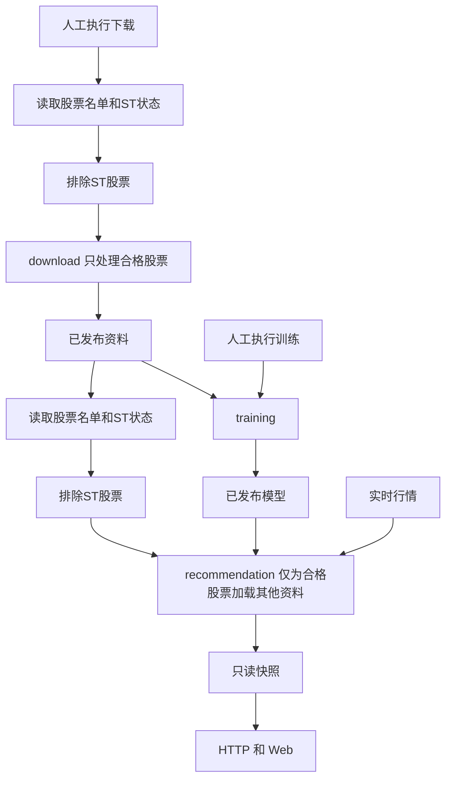

# 总体目标

这个程序是个人 PC 上的 A 股研究看板。下载负责准备资料，训练负责生成模型，荐股负责用最新行情给出结果。三条业务各自能运行；页面负责展示，不能替它们干活。

本目录统一维护八份设计与计划。同名旧稿从Git历史回查，其余历史材料保留供人工查漏。文中的“目标”是要做到的行为，“现状”有代码或历史证据，“候选”必须先测量再决定。文档不授权修改活动资料、删除数据、重建数据库或发布系统；实际执行及证据只查施工进度。

## 1. 三条主线分别解决什么问题

| 主线 | 业务功能 | 最重要的结果 | 性能方向 |
| --- | --- | --- | --- |
| 实时荐股 | 加载资料和模型，采集报价与分钟，过滤、构造特征、评分、选席、发布 | 同一轮结果一致，失败仍能看上一轮，分数和原因说得清楚 | 减少采集等待和重复计算；正常采集到发布不访问数据库；每轮最多120秒 |
| 数据下载 | 手动执行 history、market、company，补齐非实时资料，保存断点，发布可用版本 | 整体资料完整，有缺口能说明，有错误能补，旧公告不能覆盖更新事实 | 减少无用下载、PDF/OCR、碎片事务和重复扫描；先优化实测最慢环节 |
| 模型训练 | 使用固定资料版本，准备样本，并行训练 V1/V2/V3/V5，评价和发布工件 | 四档双头独立、结果可追溯，全部结束的总耗时最短 | 共享读取和相同计算，控制内存及线程，按真实耗时分配资源 |

三条主线独立，不表示把数据再复制三份。它们通过已发布的数据、模型及明确的不可变类型交接，不导入对方业务实现，不互相触发任务。不为三条业务同时运行增加新的全局调度器；性能测量也分别进行。

## 2. 荐股要达到的效果

1. 程序启动时，先读取全部股票的代码、名称和ST状态，排除ST股票，再按其他条件筛选。只为通过者加载历史行情、行业、财务和公告等资料，并准备所需模型。加载时只检查版本、范围、结构和必要字段，不逐条重审历史价格或全文摘要。
2. 一轮只有一份锁定的行情批次。报价、分钟、历史、公司事实保留自己的真实时点，不能把不同来源说成同一秒成交。
3. 采集、过滤、特征、四档双策略计算和发布共用120秒上限。超时整轮作废，停止并回收本轮任务后重新采集；迟到结果不能进入新轮。
4. 新轮完整发布前，页面保留上一轮的名单、分数、报价和解释；来源年龄继续增长，失败提示可以更新。
5. 四档共用相同输入、资格判断、历史基础量和同总体统计；模型、窗口、排序职责不同的部分各自实现。不能为省计算混用模型或预测。
6. Long 只展示名单和报价，保持独立更新，不评分、不排名、不占短线六席、不冻结，不等待四档。
7. 下载缺失或过旧时提示手动维护，不在荐股流程中下载、补历史、执行日更新或训练。
8. ST状态unknown全部通过ST门并保留未核实标记，继续取数和评分，不改写为clear或计入阻断性待补；仅有未知不能作为ST排除依据。本轮报价发现新增ST时，先移出本轮总体，再申请分钟和其他个股输入。四档共用这一筛选结果，不各筛一遍。
9. Tomorrow、D25各自在V1/V2/V3/V5档位保留排名最高的6只股票，八个评分组合独立排名。选席前仍按有效的输入、模型、成本及板限合同判断；固定席位后，评分、风险、动作和复核信息随股票保留，不能按“是否正式推荐”再次删掉已固定的股票。Long保持第6项的完整名单及独立展示。

“四档”统一指 V1/V2/V3/V5；每档有 Tomorrow、D25 两个策略头，不是四种业务策略。详细十一层流程、字段、动作、冻结和耗时计划放在[评分设计](c_评分设计.md)。

## 3. 下载要达到的效果

下载有两个服务对象：提前准备荐股不需要实时查询的资料，以及准备训练历史。history 和 market 的现有功能先保留，用实测决定是否需要调整；company 优先核对需求范围和处理成本。

history、market、company的首次、增量、续传和`--fill`都先读取全部股票的名单和ST状态，排除ST后再安排下载。筛选前不抓取其他个股资料；被排除的股票不再下载日线、行业、财务、公告正文或执行OCR。状态未知单列待核；恢复旧任务也要先按本次ST状态筛选，不能靠旧队列绕过过滤。

company 要先回答：每个 company_fact 字段究竟需要什么资料，是否真要读一年所有公告，哪些可以直接用结构化最新值，哪些必须沿同一案件保留未解除风险。不能用“只下载最新一篇”丢掉持续风险，也不能没有用途就下载两万篇正文。

三个模块都要说明来源、手动执行频率、请求粒度、存储、异步队列、提交后的断点、失败点及 `--fill` 的确切范围。整体完整性检查以覆盖、缺口、行数、版本和可读性为主，不增加全库逐值复算。候选数据写完后做发布检查，通过才切换可用版本。

下载的字段和来源、续传与新旧事实的比较规则只放在[下载设计](d_下载设计.md)。

## 4. 训练要达到的效果

目标是从开始准备到四档全部结束的墙钟时间最短，不是某一档更快、总作业反而更慢。历史发布版本固定，相同读取和计算能共用就共用，不同定义保留差异。

正常训练固定已发布价格和一份最新有效行业映射，用该映射分组全部历史；这项用户要求替代此前按历史时点行业分组的训练前置。它不改写旧价格、行业发布或冻结，也不代表独立点时收益研究已取得历史行业证据。四档双头的成熟标签、日期准入和复用身份由[训练设计第1、3章](e_训练设计.md#1-输入固定双头独立)定义，不能把价格源末日直接当作最新成熟训练日。

现有四档共享历史扫描、有界队列和内存预约，先核对利用效果。下一步要测每档准备、读取、拟合和等待，找出最后结束的一档为什么慢，再比较固定资源与按剩余工作量分配资源。不能直接把线程开满，也不能缩短训练日期、减少样本或降低质量门来宣称工程提速。

训练不重复检查下载数据库全部内容；保留版本、列顺序、形状、日期切分、标签成熟和防未来信息检查。字段作用、共享条件、模型差异和并行方案放在[训练设计](e_训练设计.md)。

## 5. 模块怎样划分

产品代码继续放在 `src/trader`。download、training、recommendation 是三个业务；http_api、web 是荐股的只读交付边界。每个业务按入口、应用用例、领域计算、外部适配器划分，`bootstrap.py` 统一创建外部资源。公共设施只放时钟、网络、事务、存储策略等技术能力，不成为第四个业务。

一个职责由一个模块负责。删旧实现时，必须同时切换全部调用者；不留兼容转发、双读双写和无提示的替代数据。详细依赖图、数据库和配置公共规则放在[系统设计](b_系统设计.md)。

## 6. HDD、SSD 和配置的共同要求

HDD 重点减少寻道、小事务和重复打开，SSD 比较有界并发和批次大小。两种介质使用同一数据合同，分别设置参数、取得实机证据。配置写 `ssd` 不证明硬件就是 SSD；没有 SSD 实测就写“SSD 未验证”。

可调的超时、并发、批次、队列、缓存、内存、训练窗口、权重和阈值尽量进入现有配置文件。每个字段说明中文含义、类型、单位、范围、作用模块、实际调用者和生效时机。数学常数、协议枚举和程序结构留在代码中；配置不能放宽120秒、168次等业务上限。

## 7. 怎样决定改不改

顺序固定：现状实测 → 定位瓶颈 → 提出候选 → 隔离对照 → 达标后实施 → 实施后复测。

允许推倒重写、换字段或重建数据，表示没有历史兼容负担，不表示每处都必须重写。先保留当前数据取得基线。性能候选未达标就停止该候选，已有有效设计可以继续用。

程序只接受当前实际结构，不维护旧数据库或工件的兼容、补列、升级和迁移路径；不兼容的下载资料应明确范围后按授权删除重下，不自动清空，也不扩大到模型或冻结记录。实际删除、活动切换及发布按对应执行任务和已授权范围办理。有效结果仍受失败保留、身份一致和15:00 first-wins保护。

收益研究独立评价：计算快、训练成功、人工允许生产，不等于收益更高。`score.md` 的研究内容已归入评分设计的未来优化章节，DeepSeek 改造和增量研究继续暂缓。

## 8. 文档和交付怎样算完成

读者应能从任一结果找到：用了什么字段、字段从哪来、在哪一步起作用、缺失怎么办、为什么被过滤或只供观察。每张字段表前先写清数据库文件和表名，或配置文件及字段组；实时数据写供应商，计算字段写输入与计算位置，不把它们冒充数据库原列。运行、续传、并行和发布图统一从上向下，复杂内容分图，避免左右铺开后字太小；人工审核用问答检查。

无用代码、测试、脚本先找调用者和替代能力，再列清理清单。`scripts/` 已按业务和功能整理到唯一公开入口 `scripts/tools.py`，所属实现、调用者及现行参数见[b第9章](b_系统设计.md#9-工具脚本全面重整按业务和功能划分只留一个接口)和[scripts说明](../scripts/README.md)。后续诊断扩展既有模块，不恢复独立旧入口；性能及平台欠项仍沿g原记录接续。代码质量、格式修改和破坏性迁移不借诊断自动运行。

全部问题到计划的映射、三份可同时执行且文件范围尽量不冲突的 Codex 任务，只在[施工进度](g_施工进度.md)维护；从历史修复提炼的要求放在[需求文档](h_需求文档.md)。其余历史材料是否删除，留到人工对照完成后决定；同名旧稿从Git历史回查。
