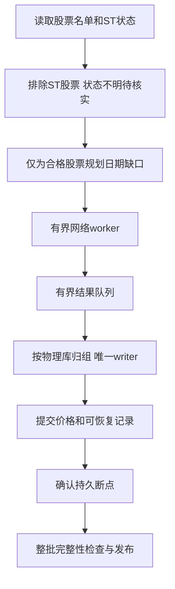
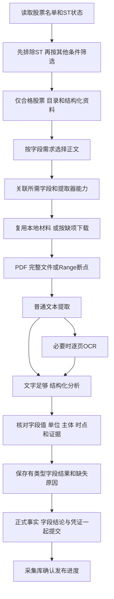

Warning: truncated output (original token count: 47913)
Total output lines: 1058

# 下载设计

下载只由人工执行。它提前准备荐股慢资料和模型训练历史，按 history、market、company 三模块组织。荐股不能调用下载、补缺、日更新；训练也不应隐式下载。

三个模块都先读取全部股票的代码、名称和ST状态，排除ST后，再为通过者安排日线、行业、财务、公告和文件提取等任务。首次、增量、续传、`--fill`和`all`都按这个顺序执行，不能先下载完其他资料再排除ST。

本篇把现有机制、目标和待测方案分开。history/market保留当前合同；company按字段需求核工作量，性能候选先测后采用。字段、配置和表结构按所属源码核对，文档核对不等于活动资料审计或真实字段验收；作业、授权和结果只在g记录。

阶段336的window_population、退出资格保留资料及本地提取资格校验已完成隔离功能和类型验证，旧库声明恢复已在夹具验证；活动库未迁移。下文对应行为的验证范围和证据以g原336记录为准，隔离通过不表示真实全量或性能验收通过。

## 1. 三个模块下载什么

| 模块 | 业务目的 | 主要来源 | 当前范围 | 人工执行建议 |
| --- | --- | --- | --- | --- |
| history | 完整训练历史、长期模型输入 | 腾讯优先，问题股BaoStock同源整窗补缺 | 目标2000个市场交易日，新股按上市日裁剪 | 首次建库；收盘后按需要手动增量 |
| market | 独立qfq短窗口 | 腾讯优先，问题股BaoStock配对整窗补缺 | 当前V2 251日、V3 61日 | 使用前或收盘后手动更新，不替代训练历史 |
| company | 财务、质押、解禁、公告风险/利好事实 | 东方财富结构化、巨潮目录/PDF、受限新闻来源 | 当前公告365天、解禁未来180天；范围重新评估 | 人工更新；事件频率和有效期逐字段确定 |

“建议频率”不创建定时任务。现有 `sync ... --fill` 是显式修复入口，三个模块的任务、问题和断点各自管理；`all` 是人工选择多个下载模块，不合并训练或荐股。

## 2. 共用参考资料和可提前准备的因素

### 2.1 先ST过滤，再准备其他资料

顺序固定：读取全部股票的代码、名称和ST状态 → 排除ST股票 → 按其他条件筛选 → 确定合格名单 → 查缺口并安排下载。ST状态缺失、过旧或相互矛盾的股票先等待核实；此时只补齐判断ST所需的信息，不抓取其他个股资料。ST判定沿用现行规则，不能只看名称里没有ST就默认通过。

参考准备用例 `PrepareReference` 在获取日历、行业前，先检查股票名单与ST证据一一对应，并复用 `PreparedReference.eligible_universe` 的同一选择规则：证据为clear且当前名称不含ST者才通过。没有通过者时以 `sync_population_empty` 拒绝准备，不获取日历或行业、不发布新的完整参考版本，三类下载均不启动；已有正式参考及ST证据不因该拒绝而删除。ST检查后或日历准备后收到取消，也停止后续准备。完整参考仍保存全部名单和各股ST证据，原供应商检查日期通过原发布端口保留。

前置进度按实际调用显示 `sync market`、`sync history`、`sync company` 或 `sync`，不把公共ST和日历准备误标成公司同步。ST核对结束后仍须准备日历、当前行业并发布参考；行业准备和参考发布分别显示开始及结果，行业缺失或失败明确提示继续同步。`sync market`进入价格更新前显示“开始更新 raw/qfq 短窗口”，随后沿用逐股qfq进度。

sync人工日志统一使用`整体耗时 | 业务·来源或阶段 阶段耗时`前缀；普通阶段随后显示状态及诊断，history下载与company使用自身携带请求／确认／待续传状态的紧凑列，不重复状态列。时间均为单调时钟的`HH:MM:SS`，小时不按天归零。整体起点由启动器确认基础Python可用后建立，经过环境检查传入CLI；直接CLI自行建立。三个模块与参考准备共享起点；各阶段按明确任务身份独立计时，股票、月份、分页切换不重置，并行日志交错不改变其它阶段起点。阶段真正结束后以新的执行身份重新开始才重置；重试计入本阶段，重启进程重新计时。最终stdout JSON合同不变，人工日志只写stderr。

普通阶段更新最多每秒一次，开始／结束／失败／重试立即输出，尚未结束的阶段每5秒保留最近真实事实并显示等待，不推进计数。history下载使用紧凑固定列：已确认数、股票请求／确认、实际请求数、待写／写入数、距确认及当前阶段速度／剩余；每次真实股票窗口调用开始与价格及断点持久确认各一行，普通网络返回只更新观测。读库／校验不计请求，本地复用不伪造请求，待写不包含写入中；超过5秒的请求全局每5秒只显示最久等待的一股，无请求时显示实际写入或读库／校验。该请求数是供应商股票窗口调用，不是内部raw/qfq分页及重试形成的物理HTTP次数。

history速度按最近180秒的新增持久确认计算，排除恢复基数；至少观察60秒且新增10股后估算当前Tencent下载阶段，180秒无确认后停止给出剩余时间，不外推补缺／检查／封存／发布。逐股失败或缺口另行显示请求窗口、实际覆盖及必要安全诊断；本地复用不以`0/0`冒充完整。网络／读库／校验／落库／回压累计耗时和完整／部分／失败数量只在阶段结束汇总，累计工作耗时不能相加当作墙钟。抑制无具体月份或错误的“正式月库提交0/1”心跳，真实月库及故障事件保留。紧凑列按中文显示宽度补齐、名称有界截短，完整诊断单列；最终stdout JSON不变。

发布分区检查和数据库文件校验采用进度触发：阶段首次开始、完成数／总数变化及真实结束立即输出，同计数的月份／文件切换、等待与重复完成不再打印，也不生成5秒心跳；失败、重试、取消和必要诊断仍即时报告。其它阶段沿原心跳规则，底层校验与取消检查保持原流程。

history加载上下文只报告开始及结束，行业子阶段保留真实来源和进度，无变化时每30秒报告等待，不再与父阶段重复每5秒输出。在上下文范围内，逐股候选原件N/N只标处理中，行业最终完成延至外层上下文完成时输出一次；失败、重试、取消即时保留，先前暂存的完成不得覆盖后续错误。独立行业供应商在该范围外仍按其真实终态输出，不要求特定来源汇总标识；检查完成不代表行业整窗覆盖就绪，覆盖及来源异常沿最终诊断单独报告。

BaoStock补缺取得完整目标窗口后立即逐股打印“获取成功，待落库”，不等待旧价重叠核对和年度库回写；缺行或错误窗口不报告获取成功。落库失败另报该股错误，落库成功不再重复逐股成功行，阶段汇总只把实际持久确认的股票计为已修复。获取成功不代表已发布，补缺期间不反复打印等待行。

下载日志明确实际来源：history保留Tencent下载／BaoStock补缺，具体BaoStock供应商的登录、日历及日线事件也带来源；官方历史行业来自中上协，巨潮逐股原件及本地官方证据复用分别标原来源，不把CAPCO一概叫巨潮。market按真实下载／补缺／本地检查动作显示来源，本地完整复用保留已核验的Tencent／BaoStock原来源。公共参考由组合根显式注入上交所／深交所、ST新浪／交易所、日历新浪（Akshare SDK）和当前行业巨潮来源，发布标本地；未知注入端口不猜供应商。来源说明是资料出处，不把缓存读取叫网络请求。任务时钟身份只由owner、key及execution决定，来源标签变化不重置阶段时间，也不留下重复心跳。

company正常每5秒输出一组三行快照，分别为总览、范围、任务；整组使用同一整体／阶段时间并一次写入stderr，避免并发交错。九项按准备恢复、财务、质押、解禁、目录、正文、核验发布、补充营收新闻、收尾统计状态，不把页／篇／股相加生成整轮百分比。开始、真实提交边界、失败和终态立即输出，普通批次变化不刷屏。总览区分本轮已获取、去重核验、去重提交、已知待补及尚未核验股票；开场已有正式覆盖单独报告，不计本轮完成。日期范围与当前对象同列，目录显示全市场及各市场真正闭合日期、已知页及待发现查询；批量财务接口明确没有单一当前股票，已获取的合格股票数只表示查询中已见，不证明覆盖。

范围与任务均标东财／巨潮／本地等实际来源，worker保留对应原始供应商，复用标本地缓存及原来源。财务／质押／解禁显示当前查询已保存页、续传新保存页及原始行，分页重开时重置该查询进度；年度营收用组，正文用篇，OCR用实际处理／有效检查点复用的页数。股票卡的财务、质押、解禁及公告状态来自实际编译事实，未知为待核验，逐股核验仍标尚未发布；仅真实正式提交回执增加本轮提交数，反复核验／发布按代码去重。下载、文本、OCR只在worker实际执行后计运行数，排队及节流不当物理HTTP耗时，核验不重置距持久推进时间。正文仅在提取结果提交后计入库，待处理扣除冷却及不可提取；ETA只覆盖当前可处理队列，目录增长、冷却及不可提取另外说明，不预测整轮结束。恢复库存只报告一次，发布收尾仍可观察，批次完成不关闭整项。计数均保留完整整数；失败独立打印股票、稳定公告身份、原因及既有必要诊断。结束保留覆盖不足、待核、目录及正文待补、不可提取、重试和恢复提示，取消后未核对的库存保持未知。命令沿现有观察线程读取有界内存快照，开场旧覆盖只盘点一次；心跳不追加读库或网络，终态关闭owner观察并丢弃迟到事件／快照。

company同时即时输出真实业务结果，不受普通一秒节流或五秒快照限制，也不重置快照周期。分页须在持久确认后报告保存成功，零变更仍与本地复用分开；来源返回零行只确认本查询无记录。正文分别确认原件获取、正文接纳及逐股正式提交，旧修订被替代仅报告未采用；探测页与既有目录一致只报告查询未变化，不冒充新保存或整窗覆盖。逐股提交带实际事务回执标识、四类资料完整／部分状态、风险／利好／待核实及待补原因，重复回执不刷屏，新的真实提交不按旧计数误去重。阶段结束按本轮确认结果、错误、复用及未恢复对象汇总，页／篇／股与业务操作次数分别标注，不当物理HTTP次数；整轮醒目标完成、已发布但待补、失败或取消。worker仅更新操作观测，业务结果在主调用流程确认后输出；通用call正常返回不能证明资料被接纳或有新持久推进。

company失败沿既有诊断owner生成完整证据块，统一终端呈现：运行／实际操作标识、来源及股票／公告修订或窗口／页码、实际接口名称、安全错误码及最多四层因果和代码位置、主动提供的字段／期望／实际差异、采集到的排队及调用／提交耗时、超时上限和四类保存边界。获取调用含节流或解析时明示，不冒充纯网络耗时；未知写未采集／未确认，不凭等待推断磁盘、网络或锁。异常证据先输出，诊断保存及恢复登记分别返回确认，转OCR、冷却、不可提取或来源暂缓依现有实际决定打印；保存错误时保留原错误及安全次级证据。相同原因涉及不同对象或不同尝试分别保留；新的成功只解决相同对象／修订已完成步骤的错误，原件复用不能解决OCR／落库错误。正式事务已提交但后续清理失败时，保留本操作内真实提交回执和失败边界，不把整个调用误报成功或声称没有写入。结果块及错误块原子输出，终态与并发输出串行并拒绝迟到结果；stdout JSON、持久schema及供应商重试策略保持原合同，不新增运行格式版本或诊断数据库。

失败日志保留业务错误码、安全异常链、实际可取得的HTTP状态／SQLite错误码、受影响对象及现有后续恢复动作；无证据时不把等待归因为HDD或锁死。缺日预览最多10日并说明剩余数量。company继续区分日期分页、正文下载／提取／OCR、逐股核验及原子发布，区分本轮失败、持久待补和已发布事实；market明确短窗覆盖。日志和心跳不额外扫描业务库、访问全机进程、改变断点或执行新的修复动作。

续传和`--fill`先用本次资格重新筛选旧断点、失败库存和队列；已不合格者停止新派发，单列“ST排除”或“ST待核”，不算下载成功或待重试的供应商错误。保留既有资料、断点和必要风险证据，本规则不授权删除数据；资格后续通过时再按既有断点规划。能够按股票查询的来源只请求合格者；只能批量返回的公共元数据在接收后立即过滤，不再为被排除股票下载正文、解析或OCR。

记录总体数、ST通过/排除/未知数和资格版本，使每个任务可反查“为什么允许下载”。后续业务覆盖按通过后的总体计算，排除和待核单列，不把它们报成价格缺口、下载成功或全市场资料齐全。先证明无效股票未进入后续派发，再测减少了多少请求、字节、解析和时间；不未经实测就宣称提速。

### 2.2 通过后准备哪些资料

存储去向：证券、ST和日历参考在 `data/market/reference/company_st.sqlite3`，行业参考在 `data/market/reference/industry.sqlite3`；完整历史在 `data/market/history/catalog.sqlite3` 和年度价格库，独立短窗在 `data/market/daily_window.sqlite3`；公司正式事实在 `data/company/company_facts.sqlite3`。下表“来源”列写外部供应商，覆盖各模块的范围、频率和采集参数由 `config/download.json` 控制；数据库路径以 `config/runtime.json` 的 `data_dir=data` 举例。

| 资料 | 当前来源 | 关键字段 | 荐股/训练用途 | 更新条件 |
| --- | --- | --- | --- | --- |
| 全部股票的代码和名称 | 沪深交易所列表 | code/name | 找到每只股票并关联ST状态；通过筛选后才准备其他资料 | 名单或名称变更后手动更新 |
| ST证据 | 当前参考准备中的新浪等既有来源 | st_status/checked_date/st_id | 所有下载业务和荐股其他处理前的第一道资格门 | 先完成核验；未知不派发其他业务 |
| 其他证券资料 | 已通过ST者的正式证券参考 | board/listed_date/delisted_date | 第2/4层其他资格、训练总体和上市边界 | ST过滤后准备 |
| 交易日历 | 当前腾讯指数日历合同 | trade_date/calendar_id | 历史完整性分母、标签成熟、上市交易日龄 | 目标日推进时准备 |
| 行业 | 巨潮中上协分类目录／逐股变更；中上协历次半年度全表仅供显式历史审计 | 当前标准、大类身份、原生层级、最新标识、原件／回执摘要及真实收到时间；审计另保留公告披露日期 | 当前第5/6层及模型路由；训练固定本轮最新有效映射用于全部历史日期 | 当前原件七日复用，新增股补采；正常history不准备历史行业区间 |
| 已完成raw/qfq日线 | history/market | OHLC、实际量额、复权身份、状态 | 第5层基础量和模型输入、训练标签 | 手动同步 |
| 财报/质押/解禁/公告事实 | company | 见第5章 | 第4–11层 | 按来源披露和有效期更新 |

可提前计算：仅用已完成历史的均线、均量/均额、波动、历史高点、V1完成日因子和V5序列基础。是否持久化取决于实测重复成本；不能先增加一套无消费者派生库。

不可提前固定：当前价格、当日累计量额/换手、当前停牌/ST报价状态、涨跌幅、分钟序列、本轮市场/板块/行业横截面、与现价结合的最终特征。历史基线可预备，实时部分仍在锁定批次计算。

### 2.3 当前不可变参考对象与资格消费者

下表来自 `download/domain/prepared_reference.py` 的 `PreparedReference`，是程序对象，不能把其字段名当成数据库原列。持久化对应 `data/market/reference/company_st.sqlite3` 的证券、ST、日历及发布表；SQL定义在 `reference_schema.py`，日期、时间及摘要由 `reference_index.py` 和SQLite codec编码。

| 对象字段 | 类型、单位与空值 | 原始来源及含义 | 写入与实际消费者 |
| --- | --- | --- | --- |
| `official_universe` | 有序不可变 `BaoStockSecurity` 元组，1–12000只，代码不重复 | 交易所证券名单；完整总体保留ST及待核者 | 组合根读取；`PrepareReference`排序；发布器保存证券和成员 |
| `st_evidence` | 与名单逐股对应的 `HistoryStEvidence` 元组，不能缺股或多股 | 新浪名称历史核对；本参考中的`checked_on`为当前上海日期，原供应商证据单独交发布端口 | `PrepareReference`归一化；资格选择、历史参考绑定与正式发布读取 |
| `checked_at` | 带上海时区偏移的`datetime`，非空 | 本次参考准备观察时点，不代替供应商原检查时间 | 组合根注入；构造校验、身份和持久化使用 |
| `open_dates` | 递增无重复的`date`元组，1–20000日，覆盖观察日 | 已发布同日有效日历或日历来源 | ST通过后准备；history/market按截止日和窗口裁剪 |
| `industry_version` | `str`或`None` | 当前行业参考的`data_version`；行业准备按既有异常策略不可用时为None | `PrepareReference`取得；参考身份与发布器使用，不伪造行业可用 |
| `identity` | 构造时计算的摘要字符串，不接受外部赋值 | 证券内容摘要、ST代码/检查日/状态、观察日、日历及行业版本的确定性组合 | 参考版本固定；history控制索引及各下载消费者绑定 |
| `eligible_universe` | 派生的不可变证券元组，可以为空，不是第二份持久人口 | `SelectEligibleSecurities`验证名单与证据对应，再选clear且当前名称无ST者 | `SyncData`防御性检查；history路由、market供应商与company请求共同消费 |

下表解释 `HistoryStEvidence` 的输入字段。数据库对应 `security_st_evidence` 的`code/checked_date/st_status`；`st_id/content_hash`为持久化身份，不能拿当前读取时间重写其原供应商检查日期。

| 字段 | 类型与取值 | 作用和缺失行为 |
| --- | --- | --- |
| `code` | 六位数字字符串 | 与证券代码精确对应，不按公司名称关联 |
| `checked_on` | `date`，不可为空 | 原来源对象保留实际核对日；参考成员使用本次观察日归一化的对象，两个用途不混淆 |
| `status` | `ever_st`、`clear`、`unknown` | 曾ST排除；明确clear再检查当前名称；unknown不进入后续个股任务 |
| `source` | 固定`sina_company_name_history` | 证据出处；名称中发现ST也由同一资格选择规则拦截，不因缓存clear而放行 |

当前资格传递按以下实际消费者核对，不增加另一套ST状态源：

| 消费者 | 当前输入及派发约束 | 仍需区分的边界 |
| --- | --- | --- |
| `application/prepare_reference.py` | 先取ST证据并核对完整性，无合格者不取日历/行业、不发布完整参考 | 参考库结构不兼容返回`preparation_ReferenceDatabaseIncompatibleError`，CLI明确提示清理`market/reference/company_st.sqlite3`及配套文件后重下；锁定或其它数据库异常不归为结构不兼容 |
| `infra/history_supplier_router.py` | `load_context`将`eligible_universe`交给价格准备，沿同一参考绑定日历和资格 | 价格截止日可以是恢复的旧日，资格仍来自本次准备的参考；不再准备历史行业区间 |
| 组合根中的market供应商构造 | 既有`load_universe`回调返回`reference.eligible_universe`，日历沿同一参考 | 普通与补缺共用；公共组合根仍由A拥有，B不另建入口 |
| `domain/company_evidence.py` | `CompanyEvidenceRequest.from_reference`只由合格者形成代码、名称和上市日 | 新闻名单随后与合格总体求交；`fill_missing`不扩大资格 |
| `application/company_evidence.py`、`infra/company_evidence_index.py` | 恢复、正文工作量、待处理任务、下载/文本/OCR和发布使用当前人口；旧目录条目可保留 | 全市场批量结构化来源和目录的被动返回不等于逐股请求，单独计量 |

### 2.4 参考门与完整恢复合同之间的现有差距

源码能够证明上述入口共享资格，不能因此推定旧数据和断点保留已全部满足新目标。以下是具体代码行为，未通过活动库运行确认其实际影响：

| 路径 | 当前代码行为 | 与目标的差距及后续实施约束 |
| --- | --- | --- |
| `history_download_index.py:begin/rebind_context` | 阶段335保留退出总体的任务、日期、尝试、失败及缺口；当前派发和计数显式选择context中的合格代码 | 重新加入未发布总体时按当前窗口规划，退出期间缺日不能被旧成功标记跳过；已提交价格仍复用。新批次只重置本轮任务，不清除其它股票的恢复证据 |
| `history_sync_runner.py`的`--fill` | 阶段335先读取当前context并核对未发布身份，再检查当前合格股票的未完成Tencent任务；阻断发生在父身份/任务重绑定之前 | 只有退出资格的旧任务未完成时不再挡住本次补缺；当前合格者未完成或新增成员需要普通同步时，仍返回`history_download_incomplete`，不发布半成品 |
| `history_price_repair.py:replay` | 阶段335所有调用者显式传入本次允许代码；退出资格的候选不解码、不写价格，保留原序号及内容 | 候选重新合格但序号已过期时仍明确拒绝，不将旧候选改代为新发布。跨序号候选处置仍需独立裁决；本阶段不清理旧候选或迁移资料 |
| `application/update_qfq.py`、`infra/qfq_sqlite.py:select_published_codes` | 普通同步与补缺共用当前资格，在同一事务切换V2/V3发布成员；保留退出者的价格、窗口绑定、完成凭证及问题证据 | 重新合格时仍检查当前日期与来源，只有有效同窗资料可复用；保留资料不计入当前发布或派发分母，不再以删除资料表达资格退出 |
| `infra/qfq_update_runner.py`的`seed_only` | 内部本地提取调用必须显式传入同日且不晚于观察时点的`PreparedReference`；只向历史读取当前合格代码，分32股定向读取 | 缺失/过期参考或合格总体为空明确失败；当前合格者不在历史中、窗口过期或仍有缺口不能算完成。活动普通在线调用不读取历史manifest；本批不新增CLI或修改A的组合根 |

公司普通同步和`--fill`的隔离回归另验证：旧ST与unknown正文留在账本且未被下载或提取，新合格者可正常处理；unknown核实为clear后，其旧任务仍可选出，曾ST者继续排除。该结论只覆盖此测试集合，不替history/market的数据保留或真实全量验收背书。

### 2.5 当前行业与历史证据的分工

当前行业采用巨潮`p_public0002`的008001分类目录与`p_stock2110`逐股变更。请求只处理同一ST筛选后的资格总体，传入已准备日历的开始日与观察日；保留各种原生标准的记录，仅把标准名称明确为“中国上市公司协会上市公司行业分类标准”的记录用于当前归属，按分类目录父链确定大类，不根据代码外观猜映射。分类查询失败、空记录或仅有旧标准时保留明确缺股；失败不覆盖已有有效当前发布，不调用BaoStock行业源。当前模型路由身份以`capco:`隔离旧分类模型，页面只显示行业名称。

标准核对以[证监会公告〔2024〕16号](https://www.csrc.gov.cn/csrc/c101954/c7520291/content.shtml)发布、2024年11月20日起施行的[《上市公司行业统计分类与代码》JR/T 0020—2024](https://www.csrc.gov.cn/csrc/c101954/c7520291/7520291/files/%E9%99%84%E4%BB%B61%EF%BC%9A%E3%80%8A%E4%B8%8A%E5%B8%82%E5%85%AC%E5%8F%B8%E8%A1%8C%E4%B8%9A%E7%BB%9F%E8%AE%A1%E5%88%86%E7%B1%BB%E4%B8%8E%E4%BB%A3%E7%A0%81%E3%80%8B.pdf)为公开基准。其表2分列门类、次类、大类和中类；附录B为19门类、10次类、91大类、456中类。巨潮577条目录与上述数量加一个根节点吻合，只能作为结构计数核对，不能代签逐项代码、名称、父级及修订一致。制造业次类与大类分别保留，`C41`等大类键由门类及两位大类代码组成；当前解析沿原生父链归类，不把次类拼入大类代码。巨潮响应未明确JR/T修订及历史披露时点，完整标准比对和历史资格仍待独立证据。

每个请求最多2MiB／20000条，HTTP超时、deadline及取消由注入的同一传输层控制。组合根持有行业专用HTTP句柄；巨潮返回的`Content-Encoding: normal`由该句柄显式声明为未压缩，其他来源及未知编码不自动接受。授权头按供应商SDK公开的时间戳协议产生，不保留JS运行时。只有完整响应通过取消检查后才进入原件保存批次；目录与逐股查询七日复用、新股补采、刷新不缩窄已取窗口，逐股显示请求／缓存与缺口进度。

当前行业接口仍逐股查询。原件合批由显式`CurrentIndustryPublication.source_batch_rows`选择1–64份，类默认1；实际批次还受`sqlite_policy.transaction_batch_rows`及正文合计2MiB限制，目录单独保存。每份原件保留各自的真实请求、窗口、收到时间、正文SHA和receipt；事务内逐份检查防缩水与同刻冲突，一份失败则整批回滚，`FULL`持久性不变。收到但尚未提交的材料不报告完成；到达边界、遇到缓存记录或本轮结束时先提交，再按原顺序报告。来源失败／取消时保存此前已经完整取得的缓冲原件，最终完整发布仍拒绝；未提交即硬退出的批次下次重新取得，不把内存进度当作断点。正常入口的HDD采用范围见下段；空闲性能对照仍沿g原292／4.5保留。

正常sync入口按用户最新要求采用此前HDD实测的原件合批保存：组合根通过同一DiskProbe及手动介质配置确认HDD后传入64份上限，实际事务仍受SQLite行预算和2MiB正文合计限制；SSD及未知介质保持1份，底层CurrentIndustryPublication默认1不变。逐股HTTP获取、原件／回执校验、FULL提交和完整发布屏障不变，只有整批成功提交后才报告这些股票完成；异常退出最多重新获取尚未提交的一批。此为用户明确采用，未完成的空闲对照、其它负载回退和真实性能准入继续保留，不将9分31秒隔离诊断改签为正常入口耗时承诺。

正常行业日志在阶段开始立即显示配置上限、SQLite行预算、有效单批上限及2MiB正文预算；汇总显示实际最大／最近个股批量、已收到／已保存／未保存原件及保存批次。完整发布缓存复用与个股原件复用分别计数，未命中区分无原件、窗口不足、超过刷新期限；每次长操作前先报告当前操作与股票。分段累计使用单调时钟，分别标为缓存准备/读取、接口获取（含解析）、原件保存及完整发布；它们不是物理HTTP次数、纯网络或纯commit耗时。开始、完整缓存复用和最终汇总即时输出，批次结束不冒充整个阶段完成；缓存读取期间收到取消时不报告行业完成。

`SQLiteIndustryQueryIndex`仍是唯一行业持久化owner。`industry_source_document`以`(request_key,received_at,content_hash)`保留各次原件，BLOB正文的SHA与绑定请求键／窗口／收到时间的receipt摘要分别验证，刷新不覆盖旧原件；`current_industry_query`保存当前完整切片及显式缺股，不再创建旧半年锚点`industry_query`。旧行业库结构明确拒绝，须按实际提示仅删除并重下`market/reference/industry.sqlite3`及配套文件；本批程序不迁移或清空，也不删除历史价格、模型、冻结记录或预算。

正常`sync history`保留前置当前行业公共参考准备，历史上下文只接价格、日历和资格，不再调用`OfficialIndustryHistory`或`PrepareHistoricalIndustries`准备历史行业区间，也不因缺少历史行业覆盖而待补。价格下载、修复、校验及发布规则不变，已有价格和旧历史参考不重建、不改写。

训练通过`CurrentIndustryCache.snapshot(observed_at)`只读固定最新有效完整发布，随后按同一价格资格代码集合投影`CurrentIndustrySnapshot`；不联网，也不在训练中刷新资料。快照保留真实发布`received_at`为`observed_at`、原`refresh_after`、来源、分类和原查询摘要`publication_hash`。目录及个股原件仍经现有内容／回执摘要校验，个股采用有界批读。七日期限按实际收到时间判断，到期、最新发布损坏或原件损坏均明确拒绝，不跳过坏最新发布后静默回用旧记录。未发布的代码产生`current_industry_not_published`缺口，不伪造行业。

投影的`content_hash`只表达分类标准、选定证券到行业ID／中文名称的映射与缺口；收到时间、刷新期限、行业变更日期、原件回执和发布摘要独立保留，不纳入行业语义摘要。同映射刷新不单独使训练身份失效，实际映射或缺口变化必须改变身份。每轮四档使用同一不可变映射覆盖其全部历史日期，训练与工件合同见e第3、7章。

显式历史审计保留官方证据链：只采用同一原生分类的八列全表，从完整PDF解析股票、大类代码和名称，不使用旧分类映射。区间表达当时已经公开可见的最近一次官方分类结果：日期精度公告从披露次日起使用，遇下一次官方发布时结束；最新一段仅延续至本次观察次日。统计期末、附件迁站时间、巨潮`VARYDATE`均不作为更早可用日期。区间按上市／退市边界裁剪；相邻同类可合并，矛盾归属不得静默覆盖。候选与覆盖诊断只属于该审计，不作为正常价格同步或最新行业训练的行业覆盖门。

唯一持久化owner仍是`SQLiteIndustryQueryIndex`，物理文件仍为`data/market/reference/industry.sqlite3`，不增加表或自定义格式编号。`industry_source_document`明确区分巨潮原件、官方目录／公告／PDF及由完整原件派生的解析缓存；原件保留原字节和各次回执，解析缓存须绑定原PDF与实际解析实现摘要，不能用部分已导入证券冒充整份全表处理完成。官方HTML／公告最多2MiB、主bundle8MiB、PDF及解析缓存32MiB；官方大件仅单件事务，不扩大巨潮2MiB合批预算。请求、完整准备及取消均有界。

`official_industry_evidence`保存从完整官方原件派生的当前区间投影。新codec只接受`code/source_url/document_sha256/disclosed_on/effective_from/effective_to/received_at/page/excerpt/native_category/native_name/announcement_url/announcement_sha256`；原生大类形成`capco:`身份，旧人工映射材料不解释成新记录。物理`disclosed_at`列保留ISO披露日期精度，不伪造日内时刻；`received_at`仍为真实上海时区收到时间。相同官方原件／证券的观察边界调整在同一事务内替换派生行，不覆盖原件或旧历史参考；跨来源冲突拒绝整批。

显式历史证据读取采用与请求日期相交的全部正式区间，包括已经结束的旧区间，再排除观察时点之后的收到／披露事实。按4096行批读，最多256000条，超限明确失败而不截断；每行重新校验字段及摘要。旧历史发布绑定的证据、模型及冻结保持原身份，正常训练不再读取这些区间决定行业。最新行业映射的缺口仍按四档原有准入处理，不因此减少日期或训练轮数；已有完整模型仅在当前训练身份一致时复用。

原人工审核文件仍保留原身份供人工查阅；退役的映射类型和导入codec不再作为活动入口。当前数据库或载荷结构不兼容时明确拒绝，不补表、不升级、不静默清空；实际重下范围仅为提示的行业下载资料，不涉及价格、模型、冻结或预算。

此前001381的[官方上市公告书](https://disc.static.szse.cn/disc/disk03/finalpage/2026-11-02/f85204b7-2475-41ad-b05e-f4bf35a0aac9.PDF)及其C29旧模型映射仅是当时的单案例证据，依据[旧指引代码目录](https://www.csisc.cn/zbscbzw/c100138/202206/f697c0f5befd4c4ba91d4171cd68d7ea/files/8500f38c4545b2c366b6abf5af22.pdf)，不是全面跨标准对照，也不由新当前链复用。

#### 官方最新行业分类的隔离候选

`scripts/tools.py --business download --module history --action industry --official-announcements <中上协公告数据URL> --industry-work-root <仓库外绝对目录>`显式核对官方全量来源。公告输入只接受中上协当前`dataFile/zsxfb/hyfl/hyfljg/`数据文件，剥离固定`export const allData = `前缀后按当前字段白名单解析JSON，不执行JavaScript；只选择该期按股票代码排序的官方附件。最多64个唯一公告，单公告2MiB、PDF32MiB，单请求1–45秒，完整动作保留公共命令期限与取消边界。

按公告保留统计期末、原披露日、原件摘要、实际收到时间及官方分类口径；来源仅提供日期时不虚构日内时刻，候选最早可用日保守取披露次日。附件迁站或文件修改日期不替代原披露日。最新表按真实八列解析股票、门类、制造业次类及大类，保留原生代码／名称和物理页码，不转换成旧模型行业名，不把最新行业归属倒填历史。

原件以内容摘要保存在显式外部目录，URL回执绑定摘要及原收到时间；完整热缓存不联网，损坏明确拒绝且保留原件，不静默删除或补签。失败只保留已完整收到的材料，下次继续缺失附件；各来源分别报告解析／失败及缓存命中。这是来源候选，不写`industry.sqlite3`或已发布历史，不赋予训练／收益资格；正式替换仍须完成最新标准核对、行业区间与全部消费者的原子切换，行业链不再采用BaoStock的要求见g原292。

### 2.6 history/market的全天停牌日期检查

ST资格通过后，history与market复用Tencent raw日线响应内的`qt[symbol]`完整报价，不再另外读取东方财富停牌清单或新增全市场报价扫描。[腾讯官方行情页脚本](https://st.gtimg.com/quotes/hs-fund/bundle.13362df9.js)将完整报价第40号字段作为证券状态，`S`明确表示停牌；原项目仅按现价判断会漏掉保留旧成交价的停牌股。

只在代码匹配、状态为`S`、报价时间对应本次查询结束日且已过15:00、当日开盘/最高/最低/量/额均为明确零值且没有该日真实日线时，确认这个交易日全天停牌。零量单独不足以认定，非停牌状态、过期/未来/盘中时间及字段缺失均不据此确认。当前状态不推断此前停牌区间；更早缺行保留原推定或待补身份，不能将腾讯旧停牌详情页的历史记录当作当前证据。

raw请求同时完成价格获取与状态核验；已确认停牌日不再请求qfq，同窗其它日期继续配对下载。非交易事实沿用`supplier_marked_suspended`，OHLC和量额不补造。旧推定可升级明确证据，与已保存真实成交冲突时保留原资料并报告。状态只在本次请求局部传递，不跨线程或下次请求缓存；状态缺失沿用原价格流程，网络失败仍待重试，超时/重试/取消沿用既有Tencent配置及资源owner。删除上批清单adapter、快照类型和两个bootstrap注入点，company不增加查询。

market的结果与公开摘要新增`latest_suspended_codes`和`latest_inferred_suspended_codes`，原`latest_missing_codes`只计未解释缺价。明确停牌不计入缺价重试阈值；大面积来源推定停牌仍作为待核信号，保留后续重查。摘要分别显示三类数量，发布配对、既有数据保护和ST资格不变。

### 2.7 停牌事实复用与有界自动复核

Tencent明确停牌解析沿348复用，不另加清单或报价请求。market的`price_nontrading`在原writer事务中保留`kind/checked_on/source`：`confirmed`是已核验明确非交易事实，`inferred`仍是来源缺行推定，`legacy_unverified`是旧裸日期而非明确停牌。旧表只由唯一writer一次性补齐证据列；读边界不偷偷写库、不双读旧投影，部分升级或未知结构拒绝。价格、两档窗口、完成凭证及事实仍在同一个配对事务提交；原事实只覆盖原日期，来源不符或核验日来自未来时不复用，已确认日期不因随后仅缺行而降为推定。

同日重跑可复用完整同窗内的明确停牌；下一交易日不以旧`S`推断继续停牌。market只读价格接口继续返回真实价格，非交易事实通过有类型规划对象参与覆盖和请求合并。内部seed只有核验合法history发布后才显式传本地读取观察日，并保留`history:<snapshotHash>`；省略观察日仍为未核验，原推定状态不升级明确。history保留原逐日状态，以catalog附加复核元数据记录已发现推定日和轮询游标，不改已发布价格或旧快照。

配置来源：`config/download.json`的唯一`price_review`组，由history和market共用；所有叶子在配置边界严格解析，不缺省回退到另一套配置。

| 字段 | 当前值/单位 | 用途与消费者 |
| --- | --- | --- |
| `interval_sessions` | 5个交易日 | 推定事实的自动复核间隔；成功的实际来源观察才推进核验日期，失败、单纯复用不刷新 |
| `maximum_codes` | 8股/命令 | 额外发现及复核的唯一股票预算，history按代码索引有界轮询，不默认整库扫描 |
| `maximum_requests` | 16次物理HTTP/命令 | raw/qfq、分页、重试及备用Tencent端点全部计入，正常下载不计入此额外额度 |
| `maximum_seconds` | 15秒附加工作 | 单调时钟累计发现/复核段；段间正常下载和发布暂停计时，单次HTTP超时不超过剩余预算；已开始的原子提交/fsync及必要安全封存允许完成，其耗时仍计入完整链路 |

普通下载和既有补缺先执行，已在同次成功请求中核验的日期不再次复核。附加核验耗尽、取消或未得新事实时保留原值及后续机会，不将未知升级明确或污染普通供应商失败/缺口状态。取得迟到价格或明确新事实后，history仅在未发布的新序号写合法修订，market走原配对事务；网络失败不能抹去已保存成交。辅助新批次开始后延期返回`history_review_deferred`并保留pending；辅助延期或取消的安全收尾只封存已变文件，不推进正式快照，使新reader仍能核验并读取旧正式序号。

`sync all`在组合根创建一份预算并交给history与market；独立业务调用各建一份，adapter和domain不隐式创建预算。同步摘要增加`price_review`白名单：已检查股数、实际额外请求及耗尽原因，market还报已知待复核股数和发现是否完成；history报已发现待核股数和`discovery_pending`。发现未完成时数量只是已知下界，0不表示全历史已核实；附加预算耗尽不改变原合法发布和退出合同。

批量规划/旧价读取、稀疏月份统计、摘要读取顺序、catalog重复收尾、Tencent分页前缀/最小行数和BaoStock冷却期探测均为显式隔离性能候选，默认关闭；默认8并发不变。同覆盖、同复核工作量和相同缓存条件的HDD对照达门后才采用，功能或mock结果不签性能。元数据升级本批只在隔离副本演练，未执行活动数据迁移或真实同步；验收与待测记入g原349及第4.5节。

## 3. history：完整历史

`catalog.sqlite3`的控制、下载及修复表由`HistoryControlIndex.initialize`一次创建并统一校验；修复表包括`price_repair_attempt`、`price_tencent_check`、`price_source`和`price_replacement`。已有库缺表或列定义不符时明确拒绝，`HistoryPriceRepair`不单独补表，也不把缺失的来源或恢复候选重建为空。完整当前库重开保留原来源、重查日期、回执和待回放候选；不兼容资料按明确范围删除后重新下载，本批不执行活动资料删除或重建。

`price-repair-audit`只在仓库外工作目录用当前完整结构验证补缺和旧快照不变，不再删表演练旧格式迁移，也不直接修改任务完成标志。首次导出和重跑均通过原同步用例推进状态，始终核对首个实际导出快照与输入窗口匹配且未被后续修复改写。写入前核实际历史／参考输出与输入历史及绑定参考隔离，拒绝目录／文件符号链接及多硬链接；此隔离诊断不授权修改输入资料。

荐股启动的既有`ReadPublishedHistoryUseCase/PublishedHistoryReadPort.iter_windows`增加仅关键字参数`codes: frozenset[str] | None`。`None`表示明确读取完整发布（原训练/诊断路径），空集合表示零个股价格读取；非空集合与原manifest股票总体求交，拒绝可变集合及非法代码。两种SQLite adapter均支持；荐股生产消费者必须显式传入静态资格结果，不捕获缺参数错误退回全量。原完整manifest、内容摘要、发布令牌及取消检查保持原值，不伪造子集manifest。正式收益读取仍可按原发布读取已被当前资格排除的代码。

年度历史的过滤在价格SQL中生效，最多500代码一批、512行读取窗；跨年度仍合并有序流，每个连续年度/sequence组只持有一条价格读取连接，多代码批次在该连接顺序执行，不逐股重开。名单外的行不进入价格codec或窗口构造，空名单仅核对原发布元数据。全发布模式保留整体来源日期完整性检查；子集模式不以少数股票缺行推断全市场缺交易日，各窗口仍由既有上市/停牌对齐owner判断。所有迭代层在取消或投影失败时关闭下层迭代器，关闭各自持有的连接；短窗adapter保留原发布校验及32代码批次。没有改变持久化格式、供应商资料或历史成员/恢复合同。

### 3.1 请求、配对和来源

先完成ST及其他资格，只为合格股票规划历史日期缺口。腾讯完成这些股票的全批正常请求后，汇总其中问题股进入BaoStock串行阶段；补缺派发同样核对ST资格。raw和qfq必须来自同一供应商、相同目标窗口；不按日期拼不同供应商qfq，不缩放或合成价格凑齐窗口。

HTTP成功或来源返回名为day的数据，不足以证明是合格qfq。复权方法、锚点和特殊等价情况都要有明确同源证据，未知不能冒充前复权；不因旧记录曾有某种重建方法就恢复旧算法。

历史增量的raw重叠只证明证券/日期及未复权价格相符，不能证明qfq基准仍相同。已有真实qfq锚点的OHLC任一变化时，普通Tencent路径重新取得该证券当前日历及上市区间的完整同源窗口；若有新交易价格但回读只剩停牌等无真实价格锚，也走完整窗口核验。完整候选核对日期、配对状态及已有raw价格，沿原持久恢复日志在同一未发布序号替换整个目标窗口，旧正式序号及窗口外资料保留；失败、缺行、取消均不把原尾部混写为完成。整窗容量在派发前计入原背压上限，量额单独变化不当作复权价格换基。这只修复后续同步路径，不表示已隔离审计或修正活动库的既有污染。

BaoStock会话串行，物理请求含重试、分页共用限速时间线；现行最小起点间隔1.5秒，history/market/行业准备共用进程锁。供应商不响应的原因尚未闭合，不能把“TCP能连上”等同服务可用。

history和market补缺的每股完整候选共用`history.supplier_timeout_seconds`总请求预算（当前45秒），从该股请求开始覆盖登录、raw、qfq、翻页及配置内重试；阶段切换、翻页和重试不续期。单次物理请求期限仍不超过同一配置值，快速失败可在剩余预算内重试，耗尽后记为待补并继续后续股票，不覆盖原有效价格。取消／超时收尾的优雅等待不超过剩余总预算；耗尽即终止自有供应商子进程，进程回收仍有既有有界等待。因此该预算约束最坏等待，不承诺供应商传输变快；超过预算的合法慢窗口仍会保留为未修复。

### 3.2 下载与写入是否异步

现有 `history_download_flow.py` 已有下载 worker、有界背压和唯一 writer。网络和写入可重叠，同一物理库的写入由一个所有者归组，不是每个网络线程各开连接写。

下载返回不算完成，进入内存队列也不算完成。只在价格提交成功之后确认断点。跨年分区用可重放候选及发布序号保证中断可恢复；旧有效快照不会读到未发布修订。

BaoStock补缺结束后，终端依次显示发布准备、发布分区检查、数据库文件校验及发布快照。分区检查按实际完成月份递增，显示当前月份；旧分区变更查询保留SQLite activity及取消检查，终端只在进度变化时输出。数据库文件校验包含必要月份的逐日证券数统计和整个年度文件及非空WAL的SHA，阶段耗时不是单独的摘要耗时；计数单位是年度数据库文件，不将月份百分比冒充文件摘要读取进度。所有统计和完整摘要仍须完成后才发布。

资格变化只改变本轮派发与发布成员，不删除退出股票的持久任务和价格。普通首建、增量、续传与`--fill`的任务读取、Tencent总结和候选重放均以本次context为准；保留的旧断点不计入本轮成功、失败或缺口分母。股票重新合格时，若已退出未发布总体，重新规划当前窗口，先复用已提交价格再补退出期间缺日和必要锚点；不能把旧`tencent_done`当成新窗口完成。`--fill`仍只修既有问题，新增成员或当前合格任务未完成时提示先完成普通同步，阻断不改写原批次绑定。

普通`sync history`在命令开始时确定最新可用目标日；跨日续传把旧批次剩余缺口和新增交易日合并到同一未发布序号，只准备一次上下文、执行一轮下载与补缺，最后统一检查和发布。已确认股票仅规划新增日期、可重试缺口及必要回读锚点，未确认股票保留当前目标窗口内的剩余任务；持久价格继续复用，不先发布旧目标再另起追新批次。推进目标日、父身份、任务日期和完成标记在同一catalog事务更新，失败整体回滚；已发布快照及缺口尝试/冷却记录保持原身份。恢复时核对新旧日历重叠范围，日历冲突或目标倒退时拒绝推进。

### 3.3 问题和 --fill

问题以库、证券、缺失日期和原因记录，保留尝试时间、状态、来源和修复回执。普通同步的自动机会与显式 `--fill` 分开：后者只修本库既有问题，不顺带全市场腾讯重下或推进目标日。中断优先重放已落盘候选，避免再请求完整窗口。

当前同步、补缺派发和价格缺口汇总同时限定在本次合格总体及目标交易日历；移出窗口的旧缺口、失败和冷却回执保留，但不再让当前窗口显示pending。Tencent的20交易日重查冷却只影响Tencent重试，不从当前缺口总数中排除，也不阻止BaoStock按自己的自动机会或显式fill处理。已采用BaoStock的窗口，仅当所有缺日都落在请求尾部且通过同源锚点校验时复用尾部；窗口中部的缺日即使只有一格也须请求同源整窗候选。

“任务结束”“已发布快照”“仍有价格缺口”分别报告。历史已发布但仍有价格缺口时，history收尾显示“历史已发布、价格缺口待补”，sync总行显示“等待、history待补齐”及具体原因，不再标成“失败、原因无”；JSON仍为pending、退出码仍为1，无前置失败时省略其人工占位。正常history不再准备或报告历史行业整窗覆盖；显式历史审计保留自己的覆盖和异常诊断，不据此推断各档训练资格，也不作为价格pending判据。旧 TODO 中 completed 内嵌 pending 的例子，应说明仍有一个已知缺口，不凭发布日志认定资料完全齐全。

## 4. market：独立短窗

当前 `application/update_qfq.py` 已有有界来源任务、唯一 writer 和问题持久化。一个事务提交配对价格、窗口身份、日历、问题清除、尝试回执、断点及 publication；V2/V3切片必须来自同一合格候选。

短窗普通同步与`--fill`在缺口规划和网络任务前使用准备好的合格总体，不能给已排除或待核股票请求raw/qfq窗口。内部本地提取的资格输入和资料保留按下文切换；当前实现与隔离验证的状态见g，不据此关闭P32–P34的真实全量验收。

`window_binding`保存已取得资料的窗口身份，`window_population`唯一保存当前发布成员；两者用途分开。当前资格仍只来自准备好的参考，不从该表反推ST结论。退出资格只在配对事务中移出两档发布成员并更新发布身份，价格、绑定、完成及问题记录继续保留；manifest及公开窗口读取只暴露发布成员。本地规划读取保留资料时仍显式选择当前合格代码，重新合格后按当前日期、来源和完整性决定复用或补取。

内部`seed_only`先验证显式当前参考，再与历史manifest成员求交；不解码被排除股票。历史目标早于已保留的合格股票短窗时，在切换成员前拒绝，防止倒退覆盖。两档日历、来源和窗口边界匹配，目标范围无问题记录，且当前参考上市区间内的应有日期都有价格或明确非交易日证据时才复用，否则定向提取；直接缺行不能当作停牌或完成，历史缺股或缺价分别计入当前待处理数。每批至多32股，读取内部传递取消检查，取消时保留前批已提交回执并可续传。它只使用已发布历史，不发供应商请求，不继承历史中的旧ST资格。

同源raw/qfq完整性、上市边界、停牌和价格合法性在解析/写入边界处理。阶段328将`verify_integrity`统一为第6.1节的数据库文件指纹核验；`inspect_windows`只读取窗口日期和来源，用于缺口规划，不加载价格列或逐窗重算摘要。无变化配对写入比较输入窗口与已提交身份，不再为比对重复读取原价格；实际写入仍保留差异计数、同源配对和事务约束。

`--fill` 只消费market自己的问题库存；不能拿history的断点和成功状态替代。断电或尾批失败时事务回滚，保留上一有效发布及可重试的问题。

## 5. company：交付从公告取得的结构化字段

本章按用户最新要求重规划。目标是所需事实字段已从来源准确取得、带证据写入正式库，并能被现有荐股消费者读取。下载篇数、文本提取成功、处理回执和SQL提交只说明经过哪些步骤，不能作为字段交付完成。第5.13节列出阶段332的实际行为，第5.14节说明已实现的字段结论协议及覆盖边界；其它新增流程和完整验收仍按g区分待实施/待验证，不能把局部规则验证描述为全部字段已完整支持。

### 5.1 先确定交付字段，再决定下载什么

company先ST过滤，再查合格股票的财务、质押、解禁、公告目录和新闻，之后才派发PDF、文本和OCR。恢复旧正文队列也先核对资格；批量目录不得引出已排除股票的正文处理。不能为了填满company_facts再给无效股票采集整套资料。

用户已经指出：下载数万条公告、耗费大量时间，仍未取得数据库所需字段，不能满足业务需求。旧篇/分钟指标只反映搬运和处理成本。后续先交付字段字典、真实公告对照样本和可复现的提取结果，再扩大正文下载；每项新增下载必须说明要填哪个字段、核验哪项风险或关联哪条修订/解除证据。

财务八项指标当前可从结构化财务接口获取，不必为了这些字段逐篇OCR。风险和利好事件需要可核验证据，但不等于所有目录项都必须处理全文。筛选规则还须证明不会漏掉调查、退市、减持、占用或担保等持续风险。

业务分为两条输入路径：财务、质押、解禁沿已具名的结构化来源；公告事件沿“必要公告→正文/表格→字段候选→单位/主体/时点核验→正式事实”。接口字段填充率不能拿来证明公告结构化成功。一篇公告可以产生多项事件或字段，一个字段也可以依赖同事件多篇公告；不能只存一个“已分析”布尔值。

当前已确认的偏差来自`domain/company_event_extraction.py`、`infra/company_fact_rows.py`和`infra/company_evidence_index.py`：减持比例只有领域/SQL字段，没有正文提取逻辑；回购/增持比例和合同数值主要依赖有限句式；合同营收基数只尝试从同篇文字取得，没有完整的时点依据关联；成功输入凭证的生成不以全部适用字段取得值为条件。只读空值统计是上述问题的线索，尚未逐篇核对原文，不能把全部NULL都定性为漏提，也不能把文字提取成功数当字段召回率。

先把“原文明确披露但未取得”“当前解析器不支持”“来源确未披露”“该事件不适用”分清。解析器未命中不能直接写成来源未披露；暂不支持的字段必须显示为实现缺口，并阻止以该字段为目的继续扩大自动下载，已有事实和其它独立任务继续保留。

### 5.2 公司字段交付原则

保留以下核心：财务、质押、解禁、风险和利好分开建事实；公告主体和案件关联需证据；目录覆盖、正文完成、字段完整、正式发布分别统计；未知不能当无风险；持续风险不能随回看窗口滚动消失；失败原件和OCR成功页保留；`--fill`补失败或缺项，不能用处理完成时间覆盖更新事实。

发现水位D与处理覆盖P也要保留：D表示来源分页已核对、发现的任务已可靠登记；P表示这些输入已有正式有效结果或明确未知结论，且由区间和任务账本推导，不另存一份独立完成真相。OCR失败可以使P落后，但不应让下次从P把D之前已发现的资料重新下载。分页必须有稳定排序/游标和持久去重，来源页面漂移时拆真实查询范围，不能把一个股票或一页完成推定为整个市场完成。

新有效快照确已覆盖旧任务负责的全部字段，或有正式更正/完整替代关系时，可以把旧任务标为已替代；必须等新事实成功提交，有可追溯依据。新资料缺项保留旧有效值及日期，同时标最新不完整，不拼成一份不存在的最新财报。下载、缓存复用、有效替代分别计数，跳过不能算提取成功。

当前一年范围内的增量按来源发现水位推进，短期目录回看用于迟到或修订发现；没有可靠修订索引时，短期回看不能证明发现窗口内所有追溯修改。已过窗口的未处理任务标为范围过期，不冒充核验成功；新上市或新增总体只初始化必要范围，退出总体停止不再需要的派发，保留必要事实和证据。这些是旧company方案的核心要求，当前实现一致性仍需P35/P38/P42核对。

公司事件细字段也须覆盖合同金额/税口径/当时可知年度营收及占比、减持日期/比例/完成披露、回购或增持实际实施比例，以及主体/案件/解除关系。字段状态区分有效、不适用、来源未披露、待获取、提取失败；不能一律折成null或0。不得用未来财报回填过去公告的合同占比。

保留已确认的一年网络采集上限：固定本轮截止T，新增公告及补缺只查询`[T-365天,T]`内披露或正式修订的材料，新上市者再按上市日裁剪。合同依据或同案前置材料在窗口外且本地无合法现成证据时，记录超出范围及依赖缺失，不自动向上市以来回溯。已经保存的有效持续风险不因移出窗口消失；未来180日解禁仍按既有前视合同维护。本次重规划不以盲目缩短窗口换取较少耗时。

一年是网络查找上限，不是一年PDF的下载配额。用户只要当前有效数据：财务与质押选择最新有效快照及更正，解禁保持未来180日；各主体、各事件分别维护最新状态，不能每股或每类只保留最后一篇公告。首次核对允许范围的目录，正文只为字段或风险依据取得；后续沿已登记水位增量发现和核对修订。最新快照缺项时保留上一有效快照的原日期，明确最新不完整，不跨报告期拼表。首次仅查一年不能证明不存在更早的未解除风险。

财务的一年界限约束披露日，不约束报告期，续传和补缺也不得放宽；财务响应按实际请求的披露下界校验。年度营收只补明确依赖的年报，披露或修订时间仍遵守一年约束。质押发现请求显式限定`[T-365天,T]`并校验响应，再按选中的最近快照日批量取股。新闻保持近7日范围，解禁保持未来180日。前置当前行业来自公共参考，行业归属核验可使用历史长范围；日志明确它不属于company披露窗口，且不因本次日志改造缩减原行业查询或清除资料。

原 `docs/company.md` 用 `git show 23624ca0:docs/company.md` 回查。本章接收其有效合同和待核对问题，不把旧候选、历史失败或窗口建议当成已验证结论。

### 5.3 数据源、字段和用途

这是外部资料到本地存储的映射，不是一个数据库表的列。采集任务、版本和重试在 `data/company/raw/company_collection.sqlite3`；合格事实发布到 `data/company/company_facts.sqlite3` 的财务、质押、解禁和事件表。来源调用及处理参数来自 `config/download.json`，正式事实怎样参与评分见c第6.2节。

| 资料 | 当前接口/来源 | 原始字段或内容 | 作用 |
| --- | --- | --- | --- |
| 财务 | 东方财富 `RPT_F10_FINANCE_MAINFINADATA` | 报告期、披露时点及八项指标 | 最新有效财报、亏损过滤、成长/质量 |
| 质押 | 东方财富 `RPT_CSDC_LIST` | TRADE_DATE、PLEDGE_RATIO | 质押日期、比例与有效状态 |
| 解禁 | 东方财富 `RPT_LIFT_STAGE` | FREE_DATE、TOTAL_RATIO | 决策后完整180日安排 |
| 公告目录 | 巨潮 `hisAnnouncement/query` | 来源键、标题、披露日、证券关联、版本 | 判断目录覆盖和是否需正文 |
| 公告正文 | 巨潮PDF | 原文、主体、案件、事件时点和证据 | 风险/利好核验 |
| 新闻 | 东方财富搜索现有路径 | 最近7天，每股最多50条 | 受限补充，不证明全市场覆盖 |

当前新闻总体限定为最近正式发布名单与合格总体交集，不能描述为已拥有全市场完整新闻档案。候选方案若要扩大范围，先给字段用途、请求成本和收益证据。

财务当前实现按15分钟TTL决定是否刷新；到期后分页核对本轮允许的365日`NOTICE_DATE`窗口，每页500条、最多256页。保留原披露日期，允许同报告期、同披露日期但八值发生变化的记录更新；不再只回看最近7日披露，以免漏掉较早披露的更正。中断游标起点比当前窗口窄时，从完整窗口第一页重新取得，已接收财务行保留；完整窗口的已接受分页及旧截止日续传沿原流程。来源失败或最新报告不完整时保留合法旧快照及明确状态，不跨报告期拼表。采集库没有逐行修订身份或接收时点，年窗刷新不证明所有修订单调，也不覆盖原披露早于一年者；实际新增请求、解析和发布成本另行计量，不能当作性能收益。

### 5.4 company_facts 24列业务说明

数据库：`data/company/company_facts.sqlite3`。表：`company_facts`。下表逐项解释该表的24个物理列；下载、正文和OCR的任务进度位于另一份采集库，不混在这24列里。采集参数来自 `config/download.json`，字段如何用于过滤、评分和风险由 `config/filter.json`、`config/scoring.json`、`config/risk.json` 的消费者决定。

| 字段 | 中文意思/单位 | 来源 | 荐股用途与更新规则 |
| --- | --- | --- | --- |
| `code` | 证券代码 | 官方身份关联 | 关联事实，不按名称关联 |
| `report_date` | 财报报告期 | 结构化财务 | 选择最新有效报告期 |
| `disclosed_at` | 财报原披露时间 | 来源披露字段 | 判断可见时点和更正版本 |
| `finance_state` | 财务覆盖状态 | 采集/发布判定 | 区分已知和缺失 |
| `eps` | 每股收益，元/股 | 财务 | 第5/7层估值及质量 |
| `bps` | 每股净资产，元/股 | 财务 | 第5/7层估值 |
| `revenue_growth_pct` | 营收增长，百分点 | 财务 | 第5/7层成长 |
| `profit_growth_pct` | 净利润增长，百分点 | 财务 | 第5/7层成长 |
| `core_profit_growth_pct` | 扣非利润增长，百分点 | 财务 | 第5/7层成长 |
| `roe_pct` | 净资产收益率，百分点 | 财务 | 第5/7层质量 |
| `parent_profit` | 归母净利润，金额单位在解析边界统一 | 财务 | 第4层亏损过滤 |
| `core_profit` | 扣非净利润，金额单位在解析边界统一 | 财务 | 第4层亏损过滤 |
| `pledge_pct` | 质押占比，百分点 | 质押快照 | 第4/8层风险 |
| `pledge_date` | 质押快照对应日期 | 来源交易日期 | 同类快照新旧比较 |
| `pledge_state` | 质押覆盖状态 | 采集判定 | 未知不填0比例 |
| `unlock_checked_at` | 解禁资料实际检查时点 | 采集 | 判断检查年龄 |
| `unlock_end_date` | 解禁已覆盖到哪天 | 采集覆盖 | 判断未来180日是否齐全 |
| `unlock_state` | 解禁覆盖状态 | 采集/发布判定 | 缺覆盖不当成无解禁 |
| `pending_docs` | 未核验正文数 | 采集账本投影 | 风险资料是否待补 |
| `announcement_start_date` | 公告目录覆盖起点 | 已完成目录范围 | 说明窗口，不等于正文全完成 |
| `announcement_end_date` | 公告目录覆盖终点 | 同上 | 同上 |
| `announcement_state` | 公告整体核验状态 | 目录、正文和关联 | 第4/11层风险可用性 |
| `checked_at` | 资料实际检查时点 | 采集 | 来源年龄，不被重新读取刷新 |
| `published_at` | 本地事实快照发布时间 | 正式发布 | 版本追踪，不替代原披露时间 |

SQL类型、可空性、键／索引、codec、写入者和读取者统一见[第8.6节](#86-company正式事实字段结论与凭据)，本表只维护列的业务意义和使用规则。当前财务解析器为 `company_structured_source.py::_financial`：报告期／原披露分别取REPORT_DATE／NOTICE_DATE，八个值依次取EPSJB、BPS、TOTALOPERATEREVETZ、PARENTNETPROFITTZ、KCFJCXSYJLRTZ、ROEJQ、PARENTNETPROFIT、KCFJCXSYJLR；金额原值经有限数值校验直接进入采集对象，没有据字段名增加倍率换算。质押取TRADE_DATE／PLEDGE_RATIO，解禁取FREE_DATE／TOTAL_RATIO；正式写入与时间／状态转换由company_fact_rows完成。供应商原金额单位、修订和逐值正确性仍须真实证据核验，不能用字典补齐代替P36验收。

下面的关联表也全部位于 `data/company/company_facts.sqlite3`，通过证券、事件和证据身份关联；不属于 `company_collection.sqlite3` 的下载任务表。

| 关联表族 | 当前表 | 应说明的内容 |
| --- | --- | --- |
| 风险 | company_risk_event、company_reduction_plan、company_risk_evidence | 主体、案件、事件有效期、解除/完成证据 |
| 利好 | company_positive_event、company_positive_milestone、company_positive_evidence | 事件、里程碑、证据和有效状态 |
| 解禁与未知 | company_unlock、company_review | 日期/比例、覆盖、人工待核原因 |
| 证据与资格 | company_evidence_ref、company_exclusion | 来源键、版本、排除依据 |
| 发布与恢复 | company_publication、company_input_receipt | 输入凭证、正式版本和恢复依据 |

### 5.5 下载、文本和 OCR 怎样并行

当前已有独立下载、文本、OCR执行器和有界队列，网络与分析可以重叠，主流程负责提交。默认下载2、文本2、OCR1、队列128、目录批20页、正文批50篇；这些是当前配置，不是最优结论。

需要测队列等待、背压、网络、文本、OCR、分析、事实编译、发布和检查成本，才能决定并发。PDF和OCR页的版本、策略身份必须匹配才复用；不支持Range时只重取对应文件，不重做所有成功资料。

“普通文字可读”只决定是否需要OCR。结构化步骤还要处理表格、跨页、表头单位、多主体、计划/实际、累计/本期、否定和更正；提取器不能因为全文有多个数字就丢弃整个字段，也不能跨主体或跨事项拼数。先在真实标注材料上选择能覆盖这些版式的提取方法；本规划不新增DeepSeek调用、评分公式或风险门。

### 5.6 中断和 --fill 如何恢复

采集库以 `company_sync_job`、`partitions`、`disclosure_queries`、`structured_progress`、`document_tasks`、`document_retries` 保存不同步骤。PDF完整状态、页检查点、分析结果、正式发布是不同状态，不能压成一个完成百分比。

正式库 `company_input_receipt` 与事实同事务提交；采集库 `document_publications` 可据凭证恢复。因此崩溃在“正式成功、采集未确认”之间，重启应识别成功并补确认，不重复改写事实。两个库不能声称天然跨库原子。

目标凭证需分别回答文件取得、文本取得、各适用字段的处理结论和正式发布。现有`outcome=valid`只能按原语义复用，不能追认为全部字段完整。字段解析、主体核验或单位校验失败时，`--fill`恢复对应本地步骤；已有有效文件不再请求网络，调整提取规则也不重跑无关字段。调度/超时配置变化不使成功结构化结果失效，真正影响值的规则版本变化只重开依赖该规则的字段任务。

失败记录至少包含任务身份、步骤、来源键和版本、失败分类、尝试次数、最后/最早重试时间、可复用产物和中文建议。不保存完整外部载荷到日志。失败原件按现有保留规则独立保存，不在普通重跑中自动清掉证据。

### 5.7 旧公告不能覆…12913 tokens truncated…不再为旧库生成补齐候选或提供双格式reader；新的正式库由正常下载writer按当前完整结构创建。

同入口`--company-field-replay-keys`只复制已通过当前reader及文件凭据校验的正式库，并备份采集库、核验必要文本，再执行真实发布与再次启动复查，不发网络请求或转换格式。报告保存两库备份代际、来源文件变化、两轮原文读取、新字段尝试、原有效回执及字段/发布身份变化；不兼容源库直接失败。缺文本与当前事件/上市范围依据不完整均显式拒绝或降级；第二次无新增字段尝试和零正文读取须实际验证，不代签性能、召回率或生产切换。

## 6. 统一的中断、错误和完整性规则

可下载数据库只支持当前结构；结构不兼容时按整套相关下载资料删除后重新下载恢复，不维护格式版本或升级兼容路径。读取、同步失败不会自动清空文件；模型、正式冻结记录和DeepSeek请求预算不属于可重下资料，不能跟随下载数据库批量删除。

| 中断点 | 重启依据 | 不应发生的事 |
| --- | --- | --- |
| 请求前/中 | 已提交任务与请求状态 | 已成功全量重新下载 |
| 队列内未提交 | 尚未确认的工作单元 | 仅因入队就标完成 |
| 数据已提交、断点未确认 | 事务凭证或可重放候选 | 重复覆盖新版本 |
| 发布失败 | 上一有效版本及候选状态 | 页面/训练读取半成品 |
| 单条源错误 | 问题键、分类、冷却和重试次数 | 清空全部进度重新开始 |

只做整体覆盖、范围、必需列、行数、版本、可读性和配对检查，不重复复算整库价格、全文摘要或业务规则。边界解析仍必须处理类型、非法数字和必要约束。候选写完后检查，通过才发布；发布后可以抽查采用情况，但不能先暴露未合格候选。

日常进度分别使用股、日期单元、目录页、篇、OCR页等真实单位，总量未知就显示已处理和心跳，不编造百分比。原始失败分类保留到最终摘要，不被外层一个“任务失败”掩盖；取消、超时、跳过、合法无资料分别说明。

### 6.1 阶段328的数据库文件发布与加载

三类下载共用`infra/sqlite_publication.py`：writer提交并关闭后，`PublishSqliteFile`按文件字节生成主库和非空WAL的SHA-256，以相邻的`.sha256`文件原子保存版本、长度和摘要。`VerifySqliteFile`只检查SQLite版本、文件及凭据，不查询业务表，不执行`quick_check`或逐行业务摘要。加载者可持有有类型的上次核验结果；主库、WAL或凭据的设备、inode、长度、mtime、ctime任一变化，都必须重新核验。缓存复用还核对主库100字节、WAL32字节文件头代际，识别stat同一时钟刻度内的正常SQLite事务更新；摘要先读候选在统计成功前不落新凭据，封存前后同样核对代际，完整SHA及单writer冻结边界保留。核验期间文件变化、凭据缺失、版本不符和摘要不符均拒绝加载，读取者不补写发布凭据。

| 资料 | 发布所有者 | 加载消费者及必要业务读取 |
| --- | --- | --- |
| history年库和catalog | `HistoryPricePartition`/`HistoryDirectPrices`、`HistoryControlIndex`及同步收尾 | 快照加载检查catalog，`HistorySnapshotReader`按物理年库复用文件核验；实际价格查询、覆盖/行数及原序号隔离保留 |
| market共享短窗 | `SQLiteQfqWindowCache`，同一轮两档写入归入一次文件发布；发布成员切换不删除保留资料 | 所有读入口核验同一物理文件；窗口规划只查日期/来源，manifest只选当前发布成员及其已提交窗口身份，不重复复算价格内容 |
| company正式事实 | `SQLiteCompanyFactsIndex`；正式预读连接在写入前关闭，避免其最后退出改变已封存WAL | `SQLiteCompanyEvidenceReader`及排除证据读取复用文件核验；事实编译和业务投影仍按需查询，采集库不被当成正式发布 |

company发布身份由父版本、本批事实/来源/凭据及发布时点确定，不遍历全部正式表生成逐行摘要；没有事实或凭据变化时保留原身份。正式事实和输入成功凭据仍在同一事务，父版本冲突及回滚不能冒充成功。文件核验与字段提取正确性分别验收，前者不证明公告字段齐全。

market配对价格、窗口、修复与停牌证据表由`SQLiteQfqWindowCache`按完整当前DDL一次创建。`window_population`的`profile TEXT NOT NULL`为评分档位`v2`/`v3`，`code TEXT NOT NULL`为六位代码，联合主键`(profile,code)`，无额外索引，`WITHOUT ROWID`；发布manifest、成员读取及下载诊断共同消费。停牌表直接包含`kind/checked_on/source`，不再补列或从旧绑定重建缺表；缺失当前结构的数据库拒绝读写，删除相关下载资料后重新下载。有效当前库的成员调整和配对价格仍在同一事务发布，不自动删除活动文件或给无凭据旧库补签。

下载诊断`qfq_sqlite.py`的`profiles`仅统计发布成员；`pending_stocks`/`pending_days`保留全库问题库存，另以`published_pending_stocks`和`unpublished_pending_stocks`区分问题归属，`retained_binding_codes`显示未发布但保留绑定的不同代码数。全库配对与凭证审计继续包含保留资料，不能把库存问题数当成本轮下载分母。

以上是代码行为切换，未给活动数据补写指纹、成员声明，未重建数据库或重启服务；历史记录继续按原身份只读。文件发布的历史隔离验证见g阶段328；成员保留及本地提取本次在用户确认的HDD PC完成隔离功能验证，见g阶段336，不据此签署HDD性能通过。

## 7. HDD、SSD 与性能方案

history已有介质批次：首建HDD为8股或16384日期单元、SSD为16股或8192单元；增量两者16股或8192单元，仍受全局上限。不能照搬为company或训练的最优值。

每个模块分别测首建、增量、无变更重跑、中断续传、`--fill`、发布收尾；记录网络等待、读写字节、连接、SQL、事务、锁等待、checkpoint、RSS和文件峰值。同物理库单writer，有界队列按实测调整，HDD减少随机小I/O，SSD比较有界并发。

company优先测：无用途正文比例、重复解析/重试、OCR页成本、发布频率、事实编译及文件指纹。阶段328已撤掉`_write_identity`的整库逐行摘要，不能再把旧实现当现状；完整任务收益仍须同输入实测，旧12篇子集提速不能外推全量。本批只验证用户确认的当前HDD PC，SSD原失败和待验封存，分别保留环境、命令、数据身份及结果；不跨介质外推，虚拟盘ROTA或切换配置不能替代另一台机器的实测。

## 8. 当前数据库与字段字典

### 8.1 核对范围、编码与读写所有权

以下以提交 `2f0a8710` 的 DDL、codec 和读写调用为依据，静态核对当前定义；没有打开活动数据库，也不沿用旧稿的 schema 编号或表列总数。路径以 `data_dir=data` 为例，年度分区只列一套结构。训练在同一 catalog 中维护的到期／提醒关系由 [e 第3.7节](e_训练设计.md#37-训练到期和提醒表)定义，推荐冻结和研究关系由 c 第16.7节定义，本章不复制其它业务的表。

表内按字段类型分组，组内每个名字都是实际列；没有省略为“其它字段”。`?` 表示可空，其余为显式 NOT NULL 或主键隐含非空；普通 rowid 表的 INTEGER PRIMARY KEY 是自动分配的 rowid，不能把 PRAGMA 的 notnull 显示值当成可持久化 NULL。`WR` 表示 WITHOUT ROWID，PK／UQ 分别为主键／唯一约束，均有 SQLite 的相应键索引；“无另建索引”不表示没有这些键索引。除明确列出的 DEFAULT 外没有列默认值。CHECK／FK 的完整表达式以所链接 DDL 为准，下表保留影响解释的范围、关系与编码。

| 记号／列族 | 实际类型、单位与空值含义 |
| --- | --- |
| D、T、H | 分别是 INTEGER 的 epoch 日、INTEGER 的 UTC 微秒、BLOB 的摘要字节；日期／时间由 `infra/sqlite_codec.py` 或 `company_facts_protocol.py` 编解码，时间对象恢复为 Asia/Shanghai。H 通常为32字节，DDL只在明确声明时检查长度，其余由 codec／领域边界核对，不补列或补默认值 |
| TEXT 日期／时间 | reference 行业和 company 采集表使用 ISO 日期／带时区时间文本；它们不是正式事实库的 D／T 整数。`record_hash` 在采集／凭据键中为 TEXT，不能据名字改成 BLOB |
| code、比例、金额 | code 是六位证券代码；除另注外比例为百分点，具有CNY合同的金额为元，eps／bps按元／股消费。财务利润原值的来源单位不因本章记法被重新核验，见5.4。缺值表示未知或尚未取得，不是0；状态列另说明完整性。价格量额和标志见8.4，供应商原字段与业务用途见第2–5章 |
| TEXT payload／members_json／causes／diagnostic | 持久化或诊断边界的规范载荷；不是内部对象另建一套 JSON 状态。摘要、证券／日期／来源身份及解码失败按各 owner 的现行合同拒绝，不能因 SQL 有行就视为业务核验通过 |

| 数据库 | 唯一写入 owner、主要读消费者与事务／发布边界 |
| --- | --- |
| `market/reference/company_st.sqlite3` | `SQLiteReferenceIndex` 写证券、ST、日历和参考发布；`PrepareReference`、`HistoryControlIndex`、`PublishedReferences` 读固定 publication。一次参考事务切 current，保留原供应商检查日；见第2.3节 |
| `market/reference/industry.sqlite3` | `SQLiteIndustryQueryIndex`写当前查询、官方证据和原件；`CurrentIndustryPublication`准备当前分类，`CurrentIndustryCache.snapshot`只读验证最新有效发布，训练投影后固定全历史分组。`OfficialIndustryHistory`及`PrepareHistoricalIndustries`保留显式历史证据审计，正常history不调用；见第2.5节 |
| `market/history/catalog.sqlite3` | `HistoryControlIndex` 安装下载所需完整 schema，控制记录、下载任务、价格修复及推定停牌各 adapter 在调用方事务中写；`ReadPublishedHistoryUseCase`／快照 reader、训练和荐股预载读固定序号。下载断点与正式 published_snapshot 不是同一个完成标志 |
| `market/history/prices_<year>.sqlite3` | `HistoryPricePartition`／`HistoryDirectPrices` 写价格修订和观察关系；同一历史端口供训练／荐股及显式审计读取。年库提交后才封存，catalog 固定可见序号；年／月逻辑分区不能当成多个物理库 |
| `market/daily_window.sqlite3` | `SQLiteQfqWindowCache` 单 writer 写共享 raw/qfq 价格及两个档位视图，修复 adapter 复用其事务；训练／荐股历史端口的短窗实现及下载诊断读取。配对窗口、日历、成员和发布绑定同事务提交，再生成文件凭据 |
| `company/company_facts.sqlite3` | `SQLiteCompanyFactsIndex`／`WriteCompanyFactRows`／字段发布器写正式事实及输入凭据；`SQLiteCompanyEvidenceReader`、排除 reader、正式编译和荐股公司预载读取。事实、字段结论、证据及匹配回执同事务发布；文件封存与跨库恢复见第5.13–5.14、6.1节 |
| `company/raw/company_collection.sqlite3` | `SQLiteCompanyEvidenceIndex` 及其注入连接上的目录、文件、字段恢复 adapter 写；company 调度、编译及有界诊断读。采集提交不等于正式事实发布，正式库先提交后采集确认的恢复只凭精确回执，不把两个数据库称为全局事务 |

### 8.2 证券／ST／日历和行业参考

证券参考定义见 [reference_schema.py](../src/trader/download/infra/reference_schema.py)，读写与 codec 见 [reference_index.py](../src/trader/download/infra/reference_index.py)。以下均无另建二级索引；UQ列出额外唯一键。

| 表 | 全部列及类型 | 主键／关系、用途与读写 |
| --- | --- | --- |
| schema_contract（WR） | schema_id TEXT | PK(schema_id)；参考库合同标识，由初始化写、每次打开验证 |
| security（WR） | security_id H；code/name/board/source_version TEXT；listed_date D；delisted_date D?；content_hash H | PK(security_id)，UQ(content_hash)、UQ(code,security_id)；board=main/chinext/star，退市日为空或晚于上市日。证券版本供 reference_member、资格及历史总体消费 |
| security_st_evidence（WR） | st_id/content_hash H；code/st_status TEXT；checked_date D | PK(st_id)，UQ(content_hash)、UQ(code,st_id)；st_status=ever_st/clear/unknown。保存原检查日，发布端口与当前ST读取共同使用 |
| security_st_current（WR） | code TEXT；st_id H | PK(code)，(code,st_id) FK→security_st_evidence；当前原ST证据指针，不用新读取时间刷新证据 |
| calendar_version（WR） | calendar_id/content_hash H；first_trade_date/last_trade_date D；session_count INTEGER | PK(calendar_id)，UQ(content_hash)；1–20000日且首日≤末日。参考发布和历史 calendar_binding 绑定 |
| trading_calendar（WR） | calendar_id H；trade_date D | PK(calendar_id,trade_date)，FK→calendar_version；按版本读取完整市场日历 |
| reference_publication（WR） | publication_id TEXT；content_hash/calendar_id H；checked_at T；industry_version TEXT?；security_count INTEGER | PK(publication_id)，UQ(content_hash)，calendar_id FK→calendar_version；证券数1–12000。行业不可用时版本为空，不伪造行业齐备 |
| reference_member（WR） | publication_id/code TEXT；security_id/st_id H | PK(publication_id,code)；publication FK→reference_publication，(code,security_id)／(code,st_id)分别FK→security／security_st_evidence；保留发布成员的精确身份 |
| reference_current | singleton INTEGER；publication_id TEXT | PK(singleton=1)，publication FK→reference_publication；一次事务更换当前发布 |

行业定义见 [industry_query_index.py](../src/trader/download/infra/industry_query_index.py) 的 `_SCHEMA`，载荷由 [industry_evidence_codec.py](../src/trader/download/infra/industry_evidence_codec.py)解码；表均 WR。原件完整字节单份上限2 MiB，由原件对象核验，不表示每次连接都重新下载。

| 表 | 全部列及类型 | 主键／索引与消费 |
| --- | --- | --- |
| current_industry_query | as_of_date/source/checked_date/members_json TEXT；content_hash H | PK(as_of_date)，无另建索引；ISO观察日、原核对日、规范成员和摘要，供当前行业发布／复用 |
| official_industry_evidence | evidence_id/code/disclosed_at/effective_from/effective_to/received_at/payload TEXT | PK(evidence_id)；索引 official_industry_interval(code,effective_from,effective_to)。披露、有效区间和真实收到时间不可互换；公开证据装载／历史行业准备读取 |
| industry_source_document | request_key/requested_start/requested_end/received_at TEXT；payload BLOB；content_hash/receipt_hash H | PK(request_key,received_at,content_hash)，无另建索引；完整供应商原件及请求／收到凭据，官方来源核验和历史准备读取；不能把缓存命中当历史时点已准入 |

### 8.3 完整历史 catalog

主定义及codec见 [history_control_rows.py](../src/trader/download/infra/history_control_rows.py)、[history_download_index.py](../src/trader/download/infra/history_download_index.py)、[history_inferred_review.py](../src/trader/download/infra/history_inferred_review.py)。表中未另注索引的只有主键／唯一键索引。正式源、日历、总体和快照身份不可通过下载任务的重试状态改写。

| 表 | 全部列及类型 | 主键／关系与用途 |
| --- | --- | --- |
| schema_contract | singleton INTEGER；schema_id TEXT；reference_file TEXT? | PK(singleton=1)；当前结构标识和参考库相对位置，初始化／打开校验 |
| reference_binding（WR） | reference_hash H；publication_id TEXT | PK(reference_hash)；`HistoryReferenceIndex`绑定外部参考发布，控制记录reader核对；不是另存参考全量JSON |
| history_industry（WR） | reference_hash H；code/industry/classification TEXT；start_date D；end_date D? | PK(reference_hash,code,start_date)，reference FK→reference_binding；结束为空或大于开始，历史训练行／荐股历史投影按日期选行业 |
| source_version（WR） | id H；source/dataset/supplier_contract TEXT；observed_at T | PK(id)；`WriteControlRecord`只追加一致来源，快照reader恢复源身份 |
| calendar_binding（WR） | id/source_hash H；start_date/end_date D；session_count INTEGER；publication_id TEXT | PK(id)，source FK→source_version；session_count>0，按发布参考重建并核日历内容 |
| universe_version（WR） | id/source_hash H；security_count INTEGER；publication_id TEXT | PK(id)，source FK→source_version；security_count>0，按发布成员核合格总体 |
| sync_checkpoint（WR） | id/sync_id/state TEXT；content_hash H；ordinal/completed_units/total_units INTEGER；observed_at T；failure_code TEXT? | PK(id)，UQ(sync_id,ordinal)；ordinal>0，0≤completed≤total；state=pending/running/completed/failed/cancelled，记录同步控制状态 |
| history_snapshot | id INTEGER；content_hash/calendar_hash/universe_hash/source_hash H；data_cutoff_date/label_cutoff_date D | PK(id>0)，UQ(content_hash)，三个hash分别FK→calendar_binding／universe_version／source_version；标签截止≤数据截止，固定正式历史身份 |
| snapshot_partition（WR） | snapshot_id/calendar_year/calendar_month/row_count/sync_sequence INTEGER；relative_path TEXT；logical_hash H | PK(snapshot_id,calendar_year,calendar_month)，snapshot FK→history_snapshot；月1–12、行数≥0、序号>0。月逻辑摘要和年库相对路径供固定版本读取／审计 |
| published_snapshot | singleton/sync_sequence INTEGER；snapshot_hash H | PK(singleton=1)，序号FK→history_snapshot(id)，hash FK→history_snapshot(content_hash)；正式当前指针 |
| download_batch | singleton/sync_sequence INTEGER；source_hash/calendar_hash/universe_hash H；cutoff_date D | PK(singleton=1)；当前恢复批次，与正式发布序号分别核验 |
| download_tasks（WR） | code TEXT；tencent_done INTEGER DEFAULT 0；attempts INTEGER DEFAULT 0；failure TEXT? | PK(code)；done∈{0,1}、attempts∈0–3；逐股任务与有界尝试，HistoryDownloadIndex调度／完成读取 |
| download_task_dates（WR） | code TEXT；trade_date D | PK(code,trade_date)，code FK→download_tasks且级联删除；本批待下载日期 |
| download_gaps（WR） | code TEXT；trade_date D | PK(code,trade_date)；缺口库存，恢复及缺口报告读取 |
| download_qfq_unusable（WR） | code TEXT；trade_date/cutoff_date D | PK(code,trade_date)；qfq不可用及当时核对截止，避免每次重试全部同缺口 |
| price_source（WR） | code/source TEXT；sync_sequence INTEGER | PK(code,sync_sequence)；按发布序号记录价格来源，历史补缺／审计读取 |
| price_replacement（WR） | code/board/source/payload TEXT；trade_date D；sync_sequence INTEGER | PK(code,trade_date)；`HistoryPriceRepair`记录待回放规范价格单元，核证券／日期／序号后才重放 |
| download_inferred_suspension（WR） | code TEXT；trade_date/checked_cutoff D；observation_sequence INTEGER | PK(code,trade_date)；索引 download_inferred_review_due_idx(checked_cutoff,code,trade_date)，有预算的推定停牌复查读取／回写 |
| download_inferred_cursor | singleton INTEGER；after_code TEXT | PK(singleton=1)；有界复查发现游标，不替代逐日已确认状态 |

catalog 还包含第8.5节共同定义的 price_tencent_check、price_repair_attempt；它们由本库writer的原事务持有，没有独立修复数据库。catalog中训练owner的表沿e第3.7节创建、读写，不纳入下载结构所有权。

### 8.4 年度价格表及共享价格列

定义见 [history_prices.py](../src/trader/download/infra/history_prices.py)、[price_columns.py](../src/trader/download/infra/price_columns.py)。同一套结构用于每个 `prices_<year>.sqlite3`，不按年份重复字段表。

| 表 | 全部列及类型 | 主键／关系与消费 |
| --- | --- | --- |
| schema_contract | singleton/calendar_year INTEGER；schema_id TEXT | PK(singleton=1)；年库合同标识和实际日历年，年库打开时核对 |
| daily_price_revision（WR） | trade_date D；code/revision_id/board TEXT；first_seen_sequence INTEGER；下表全部价格列；content_hash H | PK(trade_date,code,revision_id)，first_seen_sequence>0；下载写规范修订，history端口按固定发布读取raw/qfq，训练窄SQL读取raw_volume／qfq_amount，单位追链见第3章及e第3.1节 |
| daily_price_observation（WR） | trade_date D；code/revision_id TEXT；sync_sequence INTEGER | PK(trade_date,code,sync_sequence)，序号>0；(trade_date,code,revision_id) FK→daily_price_revision；记录每次发布看到哪个修订，不把迟到修订回填到旧序号 |

年库另建五个索引：history_price_code_date_idx(code,trade_date,first_seen_sequence DESC,revision_id)、history_price_date_board_code_idx(trade_date,board,code,first_seen_sequence DESC,revision_id)、history_price_observation_code_date_idx(code,trade_date,sync_sequence DESC,revision_id)、history_price_sequence_idx(sync_sequence)，以及仅覆盖 status 为 unknown_missing／qfq_missing／unadjusted_missing 的 history_price_price_gap_idx(code,trade_date,revision_id)。前四者供按证券／日期／发布序号扫描，部分索引供缺口检查；没有用年度重复建字典。

下表逐项展开 PRICE_COLUMNS。raw与qfq是两个原始来源分支，不能用价格比替量额复权。年库的 REAL 列额外 CHECK(typeof为real或null)，market共享窗口沿同一列序但无该SQL typeof CHECK；写入／解码仍核规范单元和有限数值。SQL可空性不代表领域允许任意残缺组合。

| 列 | SQL类型／单位与空值 | codec及消费者 |
| --- | --- | --- |
| status | TEXT?，单元状态 | PublishedHistoryCell／PriceCellFromColumns核实际状态；缺失、停牌与配对分别解释 |
| raw_present、qfq_present | INTEGER?，0／1 | 对应分支不存在时为0，其余该分支十列为空；存在分支为1，由价格codec核对 |
| raw_open、raw_high、raw_low、raw_close；qfq_open、qfq_high、qfq_low、qfq_close | REAL?，元／股 | OHLC；缺失不补0，特征、训练、标签和历史展示分别消费 |
| raw_volume、qfq_volume | REAL?，股 | 来源分支成交量；训练只选raw_volume，不能用qfq_volume替代 |
| raw_amount、qfq_amount | REAL?，元 | 来源分支成交额；训练选qfq_amount，不据列名假设两分支相等 |
| raw_preclose、qfq_preclose | REAL?，元／股 | 来源前收；qfq来源未给时仍为空，不自行反推 |
| raw_change_pct、qfq_change_pct；raw_turnover_pct、qfq_turnover_pct | REAL?，百分点 | 来源涨跌幅／换手率，未披露保持缺失 |
| raw_trading_status、qfq_trading_status | TEXT? | trading／suspended；来源分支不存在时为空 |
| number_flags | INTEGER，非空，0≤值<2^36 | PriceColumnValues／DecodePriceValues保留18个数值位置的原整数类型及负零，不是评分或schema版本；整数／负零标志互斥 |

### 8.5 market窗口及共用修复／失败表

定义见 [qfq_sqlite.py](../src/trader/download/infra/qfq_sqlite.py)，持久化价格列完全复用8.4；下列窗口表无额外二级索引。profile只指当前窗口档位v2／v3，不是格式版本。

| 表 | 全部列及类型 | 主键／用途 |
| --- | --- | --- |
| daily_price（WR） | code TEXT；trade_date D；8.4全部价格列 | PK(code,trade_date)；同一物理价格行供两档窗口选择，不复制两个价格库 |
| window_binding（WR） | profile/code/source TEXT；content_hash H；start_date/end_date D | PK(profile,code)；每档每股已提交窗口身份，原窗口摘要读取／复用 |
| window_calendar（WR） | profile TEXT；trade_date D | PK(profile,trade_date)；档位目标交易日历，规划及manifest读取 |
| window_completion（WR） | code/source TEXT；cutoff_date D | PK(code)；已经到达的来源／截止，不把请求结束当配对完整 |
| window_publication（WR） | profile/publication_id TEXT | PK(profile)；档位正式发布指针 |
| window_population（WR） | profile/code TEXT | PK(profile,code)；当前发布成员，库存仍包含退出成员的保留资料，见6.1 |
| price_issue（WR） | code/reason TEXT；trade_date D | PK(code,trade_date)；待修原因，更新／检查及诊断读取 |
| price_candidate（WR） | code/payload TEXT；trade_date D | PK(code,trade_date)；配对修复候选，规范载荷核验后由原writer采用 |
| price_nontrading（WR） | code/kind TEXT；trade_date D；checked_on D?；source TEXT? | PK(code,trade_date)；ObservedNonTradingFacts／ReadNonTradingFacts区分停牌事实、证据来源和核对日期 |

下列修复表在catalog和market各自创建，失败表在market及company采集库各自创建，语义只在这里定义一次。均复用所在库事务；没有另外的跨业务writer。SQL见 [price_repair_attempts.py](../src/trader/download/infra/price_repair_attempts.py)、[download_failure_diagnostics.py](../src/trader/download/infra/download_failure_diagnostics.py)。

| 表 | 全部列及类型 | 主键／约束、读写及保留 |
| --- | --- | --- |
| price_tencent_check（WR） | code TEXT；trade_date D | PK(code)；最近腾讯来源核对日，TencentRecheckDue／RecordTencentCheck按市场日历处理20日复查，不刷新为任意读取日 |
| price_repair_attempt（WR） | code/batch_id/state/reason TEXT；trade_date D；resolved_source TEXT? | PK(code,trade_date)；state=requested/failed/resolved，只有resolved须有tencent／baostock来源。PriceRepairAttempts在请求前预约，在正式采用事务中解决 |
| download_failure | id/attempt/maximum_attempts INTEGER；run_id/occurred_at/stage/code/supplier/reason/causes/diagnostic/endpoint TEXT；elapsed_seconds/timeout_seconds REAL?；window_start/window_end TEXT? | PK(id)，无另建索引；时间为ISO、时长为秒。DownloadFailureDiagnostics安全分类、WriteDownloadFailure按retention_limit保留，ReadDownloadFailures按query_limit有界读取；取消不记为供应商失败，字段非成功进度 |

### 8.6 company正式事实、字段结论与凭据

全部表定义见 [company_facts_schema.py](../src/trader/download/infra/company_facts_schema.py)，列序及数值／日期／枚举codec见 [company_fact_rows.py](../src/trader/download/infra/company_fact_rows.py)、[company_facts_protocol.py](../src/trader/download/infra/company_facts_protocol.py)，字段结论见 [company_field_result_rows.py](../src/trader/download/infra/company_field_result_rows.py)。正式库只有一个独立命名的二级索引 company_review_identity；其它索引来自下表PK／UQ。所有表除rowid主键自动分配外没有列DEFAULT。

`WriteCompanyFactRows`写公司事实、事件、证据、解禁和待核项，`WriteCompanyFieldResults`写字段结论及定位证据；`SQLiteCompanyFactsIndex`在同一正式事务中管理 publication 和 input_receipt。`ReadCompanyFactRows`、`ReadCompanyFieldResults`、正式凭据检查及 `SQLiteCompanyEvidenceReader`按固定发布读回，荐股消费的是这些类型结果，不是采集库。

| 表 | 全部列及类型 | 主键／关系、约束及具体用途 |
| --- | --- | --- |
| company_facts（WR） | code TEXT；report_date D?；disclosed_at T?；finance_state INTEGER；eps/bps/revenue_growth_pct/profit_growth_pct/core_profit_growth_pct/roe_pct/parent_profit/core_profit REAL?；pledge_pct REAL?；pledge_date D?；pledge_state INTEGER；unlock_checked_at T?；unlock_end_date D?；unlock_state/pending_docs INTEGER；announcement_start_date/announcement_end_date D?；announcement_state INTEGER；checked_at/published_at T | PK(code)，六位数字；各state∈0/1/2，pending_docs≥0，pledge_pct∈0–100；report_date与disclosed_at同空，pledge_pct与pledge_date同空。24列快照的原来源／业务用途见5.4，时间不因读取刷新 |
| company_input_receipt（WR） | source/source_key/code/record_hash/outcome/policy_id TEXT；extraction_hash H；body_hash H?；published_at T | PK(source,source_key,code,record_hash,extraction_hash)；每股精确输入处理凭据，编译与跨库恢复检查；valid／field_attempted的作用见5.13–5.14，不把凭据等同全字段有值 |
| company_risk_event | id/risk_type/subject_type/level/status INTEGER；code/event_key TEXT；case_number TEXT?；first_disclosed_at/last_disclosed_at/effective_at T；resolved_at/expires_at T? | PK(id)，UQ(code,event_key)，code FK→company_facts且级联；risk_type1–10、subject1–4、level1–4、status1–3；后披露／生效不早于首次，已解除／取消须有resolved_at。风险事件身份及严重级别关系由DDL和领域共同核验 |
| company_reduction_plan | risk_id INTEGER；start_date/end_date D?；planned_pct REAL?；completion_disclosed_at T? | PK／FK(risk_id)→company_risk_event且级联；计划比例0–100，已知起止日有序。减持计划不是另一个独立风险事件 |
| company_positive_event | id/event_type/subject_type/status/level INTEGER；code/event_key TEXT；first_disclosed_at/last_disclosed_at T；cancelled_at T?；ineligible_reason INTEGER?；actual_pct REAL?；repurchase_purpose INTEGER?；contract_amount/annual_revenue REAL?；revenue_report_date D?；revenue_disclosed_at T?；contract_revenue_pct REAL?；binding_confirmed/amount_basis INTEGER? | PK(id)，UQ(code,event_key)，code FK→company_facts且级联；event_type1–3、subject1–4、status1–4、level0–3、reason1–25。比例0–100、金额及合同占比≥0；回购用途只属于回购，合同的分子／分母／约束／税口径只属于合同，非合同相关列须空；取消须有原时点 |
| company_evidence_ref | id/source INTEGER；source_key TEXT | PK(id)，UQ(source,source_key)，source1–10；保存有界来源键，不把完整公告原文写入事件表 |
| company_positive_milestone（WR） | positive_id/level/evidence_id INTEGER；qualified_at T；measured_pct REAL | PK(positive_id,level)，positive FK→company_positive_event且级联，evidence FK→company_evidence_ref；level1–3、测量≥0；保存首次达标的值／时点及依据，不从最新值重新编历史里程碑 |
| company_unlock（WR） | code TEXT；unlock_date D；ratio_pct REAL | PK(code,unlock_date)，code FK→company_facts且级联；比例0–100。完整空快照与来源失败的保留规则见5.13 |
| company_review | id/scope/reason INTEGER；code TEXT；evidence_id INTEGER?；detected_at T | PK(id)，code FK→company_facts且级联，evidence FK→company_evidence_ref；scope1–5、reason1–25；唯一表达式索引 company_review_identity(code,scope,reason,COALESCE(evidence_id,-1))，无依据与有依据待核项分别唯一 |
| company_risk_evidence（WR） | risk_id/evidence_id/position INTEGER | PK(risk_id,evidence_id)，UQ(risk_id,position)；risk FK→company_risk_event且级联，evidence FK→company_evidence_ref，position≥0；保持风险证据顺序 |
| company_positive_evidence（WR） | positive_id/evidence_id/position INTEGER | PK(positive_id,evidence_id)，UQ(positive_id,position)；positive FK→company_positive_event且级联，evidence FK→company_evidence_ref，position≥0；保持利好证据顺序 |
| company_exclusion | id/reason/source INTEGER；code/source_key TEXT；effective_at T；evidence_hash H | PK(id)，UQ(code,reason,source,source_key)；code六位数字、reason1/2、source1–3、摘要须为32字节；公共资格准备与正式排除reader消费，不与ST参考另建重复状态源 |
| company_publication | singleton INTEGER；extraction_hash/content_hash H；published_at T | PK(singleton=1)；两hash须为32字节；正式发布身份和当前提取规则摘要，父版本冲突／失败不推进 |
| company_field_result（WR） | code/event_key/field/state/reason TEXT；applicable INTEGER | PK(code,event_key,field)，code FK→company_facts且级联；applicable为0/1，state=not_applicable等价于applicable=0；reason有界。12类字段及状态业务含义只在5.14定义，由字段发布器／正式reader共用 |
| company_field_evidence（WR） | code/event_key/field/source/source_key/record_hash/rule_id/quote/unit TEXT；position/start_line/end_line/subject_type INTEGER；body_hash H；published_at T | PK(code,event_key,field,position)，前三列FK→company_field_result且级联；position≥0，行号≥1且有序，quote为1–1000字符，unit=percent/cny/date/time/text，subject1–4，body_hash32字节。绑定当前原文行段及规则；不是仅凭hash签字段正确 |

company整数协议由 `company_facts_protocol.py`唯一维护，不是自定义schema版本：数据状态0/1/2=unavailable/partial/complete；subject1–4=发行人／控股股东／实控人／主要股东；风险状态1–3=ongoing/resolved/cancelled；利好类型1–3=回购／股东增持／经营合同，状态1–4=planned/implementing/completed/cancelled；回购用途0–4=unknown/cancellation/employee_plan/incentive/other。risk_type、source、review reason/scope的完整枚举分别是同文件的 RISK_TYPES、EVIDENCE_SOURCES、REVIEW_REASONS、REVIEW_SCOPES；无法解码的编号拒绝，不补成默认状态。严重级别、事件关联、适用分母及评分条件仍由第5章和c定义，字段存在不签收益或真实覆盖。

### 8.7 company采集账本与工作关系

核心定义是 [company_evidence_sql.py](../src/trader/download/infra/company_evidence_sql.py) 的 SCHEMA、DOCUMENT_RETRY_SCHEMA、DOCUMENT_EXTRACTION_SCHEMA、DISCLOSURE_QUERY_SCHEMA；安装调用在 `SQLiteCompanyEvidenceIndex.initialize`。下表的日期／时间都是ISO TEXT，NULL只按列的实际可空性表示。除另注和 INTEGER PRIMARY KEY 自动分配外无默认值；明确列出的DEFAULT为当前DDL值，不为旧库补列。

| 表 | 全部列及类型 | 键／索引、实际写读与含义 |
| --- | --- | --- |
| contract | schema_id TEXT? | 普通rowid表的TEXT PK，DDL未显式NOT NULL；CHECK值为company_collection，adapter要求唯一精确合同值，不能将SQL允许NULL解释为合法合同 |
| company_sync_job | singleton INTEGER；initialized_at/cutoff TEXT | PK(singleton=1)；首次作业与冻结截止，由采集初始化／恢复读取，不因新PID重置首次成本 |
| company_expired_ranges（WR） | market/start_date/end_date TEXT；expired_at TEXT? | PK(market,start_date,end_date)，无另建索引；范围到期登记，不把过期范围当当前完整覆盖 |
| disclosures | id INTEGER；source/source_key/kind/title/published_at/url/record_hash TEXT；body_hash H?；body_checked/body_retained INTEGER DEFAULT 0 | PK(id)，UQ(source,source_key)；索引 disclosures_date(kind,published_at)；kind=announcement/news，两个标志为0/1，body_hash为空或32字节。目录接收／正文恢复、编译和材料清理共用 |
| disclosure_codes（WR） | code TEXT；disclosure_id INTEGER | PK(code,disclosure_id)，disclosure FK→disclosures且级联；索引 disclosure_links(disclosure_id,code)；同一公告多证券关联，按股读取材料 |
| partitions（WR） | market/start_date/end_date TEXT；next_page INTEGER DEFAULT 1；expected_rows INTEGER?；received_rows INTEGER DEFAULT 0；is_complete INTEGER DEFAULT 0；checked_at TEXT?；failure TEXT DEFAULT '' | PK(market,start_date,end_date)；目录分区和下一页，目录采集／覆盖检查／恢复使用；unknown总量为空而非0 |
| partition_rows（WR） | market/start_date/end_date/source_key/code TEXT | 五列联合PK；索引 partition_source_rows(source_key)；未完成分区的去重／页覆盖凭据，完成后的释放由原owner控制 |
| coverage（WR） | market/start_date/end_date/checked_at TEXT | PK(market,start_date,end_date)；完整范围证明，ReadCompanySnapshotShared／CompanyCoverageComplete消费 |
| financials（WR） | code/report_date/published_at TEXT；eps/bps/revenue_growth_pct/profit_growth_pct/core_profit_growth_pct/roe_pct/parent_profit/core_profit REAL? | PK(code,report_date)；结构化来源写，同披露更正及期次守卫后供 BuildCompanySnapshot 编译；采集值不直接进入荐股 |
| ratios（WR） | component/code/as_of_date TEXT；ratio_pct REAL | PK(component,code,as_of_date)，component=pledge/unlock、比例0–100；结构化来源／正式快照选择读写 |
| component_checks（WR） | component/scope TEXT；checked_at TEXT?；failure TEXT DEFAULT '' | PK(component,scope)；来源刷新成功／失败及TTL判断；本地读取不刷新核验时间 |
| structured_progress（WR） | component/scope/start_date/end_date TEXT；next_page INTEGER；expected_rows INTEGER?；received_rows INTEGER DEFAULT 0 | PK(component,scope)；结构化分页恢复游标，不把页完成当字段正确 |
| structured_members（WR） | component/code/as_of_date TEXT；ratio_pct REAL? | PK(component,code,as_of_date)；进行中结构化快照的成员，完成后由同一source流程选择正式输入 |
| ratio_snapshots（WR） | component/start_date/end_date/checked_at TEXT | PK(component)；解禁／质押快照覆盖端点及核验时点，与明细共同选择 |
| company_population（WR） | code TEXT | PK(code)；当前合格总体，PrepareCompanyPublication写，工作派发及编译读取；退出成员资料不等同本轮分母 |
| document_supersessions（WR） | disclosure_id/replacement_id INTEGER；code/record_hash/replacement_hash/reason TEXT；extraction_hash H | PK(disclosure_id,code,record_hash)；同股材料替代及原规则身份，supersession owner和发布读取；没有SQL FK，不将ID对应关系误写为DDL约束 |
| document_link_candidates（WR） | source/source_key/record_hash/payload TEXT；extraction_hash H | PK(source,source_key,record_hash,extraction_hash)；关联候选codec及正式编译读取；有候选不等于同案已核实 |
| document_tasks（WR） | source/source_key/record_hash/stage TEXT；path TEXT?；payload_hash H?；size INTEGER? | PK(source,source_key,record_hash)；下载／分析阶段及已验证文件信息，准备发布、取消／重启和文件清理读取 |
| document_publications（WR） | disclosure_id INTEGER；code/record_hash TEXT；extraction_hash H；published_at TEXT | PK(disclosure_id,code)，disclosure FK→disclosures且级联，提取hash32字节；采集侧正式采用投影，必须与正式输入凭据匹配 |
| document_retries | disclosure_id INTEGER；record_hash/retry_policy_id/failure/attempted_at/retry_at TEXT；attempts INTEGER；payload_hash H?；ocr_diagnostic TEXT?；ocr_policy_id TEXT DEFAULT ''；ocr_timeout_attempts INTEGER DEFAULT 0 | PK(disclosure_id)，FK→disclosures且级联；payload_hash为空或32字节。冷却／OCR失败策略及重试派发消费，不无限重开确定性失败 |
| document_extractions | disclosure_id INTEGER；record_hash/method/policy_id/extracted_at TEXT；payload_hash H；quality REAL? | PK(disclosure_id)，FK→disclosures且级联；method=text/ocr、hash32字节、quality为空或0–100；正文提取复用及依赖材料核验读取 |
| disclosure_query_policy | singleton INTEGER；query_policy_id TEXT | PK(singleton=1)；目录查询选择身份，ActivateDisclosureQueryPolicy／恢复核对；不是数据库格式编号 |
| disclosure_queries（WR） | market/start_date/end_date/scope/plate/securities TEXT；next_page INTEGER DEFAULT 1；expected_rows INTEGER?；received_rows/is_complete INTEGER DEFAULT 0；failure TEXT DEFAULT '' | PK(market,start_date,end_date,scope)；前三列FK→partitions且级联；复合目录查询的完整游标和证券／板块限定 |
| disclosure_query_rows（WR） | market/start_date/end_date/scope/source_key/code/record_key TEXT | PK(market,start_date,end_date,scope,source_key,code)；前四列FK→disclosure_queries且级联；索引 disclosure_query_source_rows(source_key)，分页去重和恢复读取 |
| partition_retries（WR） | market/start_date/end_date/scope/retry_at TEXT | PK(market,start_date,end_date,scope)；前三列FK→partitions且级联；目录冷却队列 |

附属工作关系仍由上述采集库连接创建／写入，不能因分散在多个模块就称有第二采集owner。下表列出各实际DDL及最终读取用途；未列二级索引的只有键索引。连接级临时 retained_evidence 只为材料清理查询服务，不是新增持久业务表。

| 表／DDL模块 | 全部列及类型、键和索引 | 写入与实际读取 |
| --- | --- | --- |
| company_dirty_codes（WR）；company_pipeline_queries.py | code TEXT，PK(code) | MarkCompanyDirty／PrepareCompanyPublication写；有界正式编译选择待处理证券 |
| company_document_requirements；同上 | disclosure_id INTEGER PK／FK→disclosures且级联 | 当前正文适用性分类与IndexCompanyDocument写；正文派发和材料清理读 |
| company_document_exclusions；同上 | disclosure_id INTEGER PK／FK→disclosures且级联；reason TEXT非空且固定subject_outside_scope | 同一主体分类写；正文排除、进度和保留逻辑读取，不作为正式字段有值证明 |
| company_work_policy；同上 | singleton INTEGER PK且=1；work_policy_id TEXT非空 | 当前工作分类身份写，启动／分类重建读取；不是原公告版本 |
| disclosure_query_contracts（WR）；同上 | market/start_date/end_date/scope/filter_identity TEXT；page_size INTEGER；PK(market,start_date,end_date,scope)；均非空 | CheckDisclosureQueryContract写／读；page_size固定30，filter_identity固定all_announcements，不能把过滤过的目录冒充完整范围 |
| document_announcement_numbers（WR）；company_announcement_links.py | disclosure_id INTEGER；record_hash/number/rule_id TEXT；body_hash H；role INTEGER；PK(disclosure_id,role,number)；均非空，disclosure FK→disclosures且级联 | WriteCompanyAnnouncementNumbers写，LinkCompanyAnnouncementNumbers按来源／证券／时间读取；role0为自有编号、1为引用，body_hash32字节 |
| company_field_repairs（WR）；company_field_recovery.py | disclosure_id INTEGER；code/record_hash/event_id/field/rule_id/state TEXT；前六列联合PK；均非空，disclosure FK→disclosures且级联 | QueueCompanyFieldRepairs／RegisterCompanyFieldAttempts写，CompleteCompanyFieldRepairs／RestoreCompanyFieldRepairs及材料恢复消费；state=pending/attempted/complete，只表达字段恢复任务，不替代正式字段值 |
| company_material_dependencies（WR）；同上 | disclosure_id INTEGER；code/record_hash/scope/reason_code TEXT；body_hash/extraction_hash H；七列联合PK；均非空，两hash32字节，disclosure FK→disclosures且级联；索引 company_material_dependency_codes(code,disclosure_id) | RegisterCompanyMaterialDependencies写；字段review及材料清理按精确原有效回执读取；无原文只报告缺口，不自动重下 |
| document_contract_link_rules（WR）；company_contract_link_rules.py | source/source_key/code/record_hash/rule_id TEXT；body_hash/extraction_hash/payload_hash H；PK(source,source_key,code,record_hash,extraction_hash)；均非空，body/payload hash32字节 | WriteCompanyContractLinkRules写，ReadCompanyContractLinkRules／ReadCompanyPublicationLinks核当前候选及局部主体规则；不能绕过同案／主体守卫 |
| annual_income（WR）；company_annual_income_index.py | code/report_date/disclosed_at/updated_at/observed_at/currency/record_hash TEXT；operating_revenue REAL?；PK(code,report_date,disclosed_at,updated_at,record_hash) | WriteCompanyAnnualIncome写，PlanCompanyAnnualIncomeRequests／ReadCompanyAnnualIncome和合同编译消费；原披露／修订／收到时间分开，经营收入元，缺值不以营业总收入替代 |

采集库还安装8.5的 download_failure。材料原件、压缩文字及OCR页是 `CompanyRawFiles`／`CompanyDocumentFiles` 管理的文件，不是遗漏在本表的SQLite列；容量、引用保护及清理前提见5.11–5.14。

### 8.8 当前结构核对与后续差集边界

本章替代旧稿DB编号及历史字段改名对照作为当前查询入口；不把旧schema2／3计数或字段别名带入新合同。下载数据库不兼容时仅按第6章明确的下载资料范围拒绝并提示人工删除后重下，本次字典整理没有初始化、补表、补列、迁移或删除任何资料，不涉及模型、冻结记录和预算。

需要保留的源码边界：reference、catalog和market在原owner的完整schema中核对；company正式表由 COMPANY_FACTS_SCHEMA 核对，采集核心表由 SCHEMA 核对。采集附属工作表仍分散在 initialize 调用的 EnsureCompany*、DOCUMENT_* 和 DISCLOSURE_QUERY_SCHEMA 中，部分只读派生查询会在表不存在时返回“没有当前证明”。这是当前静态代码的安装／读取方式，不能由字典反推其已通过全部缺表反例，也不将它写成允许旧库兼容的产品要求；统一结构收口或删除这些分支如需实施，仍沿原业务owner和台账另行核对。

CHECK、codec验证、外键启用及发布凭据检查是不同层次；本章列的是该已提交基线的物理定义及消费者，不证明活动库实际具有这些表、来源逐值正确、公司全字段覆盖、历史公开时点齐备或性能达标。现场行业／历史行业端口、公司运行监控和日志的未提交差集不纳入本字典，由原owner独立核对交付。后续变更只核对受影响DDL／codec／消费者差集，不重复复制年度表、另建一份字典或第二进度记录。

## 9. download.json 配置字典

### 9.1 来源、解析和生效边界

唯一来源为 [config/download.json](../config/download.json)，解析owner为 [download_settings.py](../src/trader/download/infra/download_settings.py)。以下静态核对该提交中的全部64个标量叶子，数组用显式判别模式展开；当前值不是新的推荐值，也不表示已测得最优。

顶层必须且只能包含 failure_diagnostics、price_review、history、company、online_qfq，各配置对象同样拒绝缺字段和未知字段，不补默认值。整数拒绝bool，数值拒绝bool和非有限值，字符串去除首尾空白后必须非空。`LoadHistorySyncConfiguration`、`LoadQfqWindowConfiguration`、`LoadCompanySyncConfiguration`、`LoadDownloadFailureConfiguration`构造不可变领域配置后继续核对字段间约束。配置在相应手工作业准备时生效，不热切换已运行作业。

路径／介质、通用SQLite策略分别由runtime.json／sqlite.json拥有，字典见b第7章；OCR的实际可用能力由运行环境核对，配置声明不等于工具已安装。单纯修改等待和重试布局不自动使原成功正文失效；内容相关参数、实际解析／OCR能力如何进入规则身份，由 `BuildCompanyDocumentPolicies`／`CompanyDocumentOutputIdentity` 负责，不能笼统写成所有配置都影响或都不影响复用身份。

### 9.2 失败诊断与额外价格复查

| JSON路径 | 当前值 | 类型、单位与范围 | 实际消费者 |
| --- | --- | --- | --- |
| failure_diagnostics.retention_limit | 20000 | int，条，1–9223372036854775807 | WriteDownloadFailure按id保留最近失败记录 |
| failure_diagnostics.query_limit | 50 | int，条，1–retention_limit | ReadDownloadFailures限制明细及分组输出 |
| price_review.interval_sessions | 5 | int，市场交易日，≥1 | HistoryInferredReviewIndex及UpdateQfqWindows判断推定停牌复查到期 |
| price_review.maximum_codes | 8 | int，股，1–8 | TencentRequestBudget.reserve_code，仅约束额外价格复查 |
| price_review.maximum_requests | 16 | int，物理请求，1–16 | TencentRequestBudget.reserve_request；重试及备用host尝试同样消耗 |
| price_review.maximum_seconds | 15.0 | number，秒，0.001–15 | TencentRequestBudget维护额外复查剩余预算，不是整次同步期限 |

### 9.3 完整历史

以下字段均以 history. 开头，另列两种介质的实际写批次，不能把配置名称当作已测性能结论。

| 字段 | 当前值 | 类型、单位与范围 | 实际消费者 |
| --- | --- | --- | --- |
| requested_sessions | 2000 | int，市场交易日，1–2000 | DownloadHistoryUseCase取得并核对目标日历 |
| reread_sessions | 5 | int，市场交易日，1–requested_sessions | PlanHistoryDownloadTasks及恢复规划选择重读尾窗 |
| download_batch_size | 64 | int，1–256；尚无运行消费单位 | 当前只解析／领域校验，未找到下载执行路径读取，不能当作真实写入批次 |
| history_workers | 8 | int，worker，1–12 | bootstrap历史线程池／HTTP会话数及HistoryDownloadFlow在途派发 |
| minimum_free_bytes | 1073741824 | int，字节，≥0 | DownloadHistoryUseCase经HistorySyncIo.has_space做空间准入 |
| supplier_timeout_seconds | 45.0 | number，秒，≥0.001，无配置上限 | BaoStock物理请求期限，且history/market补缺每股登录、raw/qfq、分页及重试共用同值总预算 |
| supplier_retries | 2 | int，重试次数，0–2 | BaoStock请求策略，物理失败请求仍实际发生 |
| query_interval_seconds | 1.5 | number，秒，≥1.5 | BaoStock worker的BaoStockQueryLimiter |
| cancellation_grace_seconds | 10.0 | number，秒，0.001–10 | BaoStockHistorySupplier子进程取消等待 |
| progress_heartbeat_seconds | 5.0 | number，秒，0.001–supplier_timeout_seconds | BaoStock供应商等待心跳，且不得超过实际价格请求策略timeout |
| write_batches.maximum_codes | 64 | int，股，1–64 | HistoryWriteTuning.max_codes，所有介质写入批次的全局上限 |
| write_batches.maximum_cells | 32768 | int，日期单元，1–32768 | HistoryWriteTuning.max_cells，全局上限 |
| write_batches.hdd.fresh_codes | 8 | int，股，1–maximum_codes | HDD首建flush_codes |
| write_batches.hdd.fresh_cells | 16384 | int，日期单元，1–maximum_cells | HDD首建flush_cells |
| write_batches.hdd.incremental_codes | 16 | int，股，1–maximum_codes | HDD增量flush_codes |
| write_batches.hdd.incremental_cells | 8192 | int，日期单元，1–maximum_cells | HDD增量flush_cells |
| write_batches.ssd.fresh_codes | 16 | int，股，1–maximum_codes | SSD首建flush_codes |
| write_batches.ssd.fresh_cells | 8192 | int，日期单元，1–maximum_cells | SSD首建flush_cells |
| write_batches.ssd.incremental_codes | 16 | int，股，1–maximum_codes | SSD增量flush_codes |
| write_batches.ssd.incremental_cells | 8192 | int，日期单元，1–maximum_cells | SSD增量flush_cells |

`ChooseHistoryWriteTuning`按介质选择，unknown沿现行保守HDD策略；HistorySyncIo将实际批次交下载流。`download_batch_size`不能与这些已消费字段混同。完整历史中的腾讯价格分支仍消费 online_qfq.source_timeout_seconds／source_retries，并非所有供应商都使用 history.supplier_*。

### 9.4 公司目录、正文、文本与OCR

以下省略共同前缀 company.。范围同时受表后跨字段关系约束，不能只逐项通过后就声明整个配置可用。

| 字段 | 当前值 | 类型、单位与标量范围 | 实际消费者 |
| --- | --- | --- | --- |
| source_timeout_seconds | 8.0 | number，秒，0.1–8 | CninfoMarketDisclosureSource目录及EastmoneyCompanySource结构化请求 |
| document_download_timeout_seconds | 120.0 | number，秒，0.1–120，且≥source_timeout_seconds | 巨潮正文下载总期限 |
| document_parse_timeout_seconds | 10.0 | number，秒，0.1–30 | 标准／扩限解析及BuildCompanyDocumentPolicies |
| request_interval_seconds | 1.0 | number，秒，≥1 | CompanyRequestPacer；目录与文件host分别限速，同host共用时间线 |
| directory_batch_pages | 20 | int，页，1–100 | SyncCompanyEvidence的目录批次 |
| document_batch_size | 50 | int，篇，1–128，且≤document_queue_limit | pending_documents(limit=...)本批任务数 |
| document_workers | 2 | int，worker，1–8 | bootstrap创建文档来源／会话和文档executor，流水线核对数量 |
| text_workers | 2 | int，worker，1–8 | 文本executor及在途派发 |
| ocr_workers | 1 | int，worker，1–4 | OCR executor及在途派发 |
| document_queue_limit | 128 | int，篇，1–128 | 当前只约束document／publication批次合法性，未找到运行队列独立读取此值 |
| publication_batch_size | 50 | int，篇，1–128，且≤document_queue_limit | 已完成待发布量达到阈值时触发正式发布 |
| publication_interval_seconds | 5.0 | number，秒，0.1–60 | 正式发布等待阈值，与批次阈值共同判断 |
| text_task_reserve_bytes | 16777216 | int，字节，≥1，另受并行约束 | CompanyRawFiles分析预约及正文来源文本任务 |
| ocr_task_reserve_bytes | 314572800 | int，字节，≥300MiB，另受并行约束 | OCR任务分析预约 |
| document_failure_retry_seconds | 86400.0 | number，秒，≥1 | 一般失败的冷却／下次尝试 |
| document_transient_retry_seconds | 900.0 | number，秒，≥1 | 瞬时失败的冷却／下次尝试 |
| document_ocr_timeout_seconds | 600.0 | number，秒，1–600 | CompanyOcrEngine整次OCR期限及策略身份 |
| document_ocr_page_timeout_seconds | 120.0 | number，秒，1–600，且≤整次OCR期限 | OCR单页期限及策略身份 |
| document_ocr_max_pages | 50 | int，页，1–200 | OCR页数上限及策略身份 |
| document_ocr_dpi | 150 | int，dpi，72–300 | OCR渲染及策略身份 |
| document_ocr_languages | chi_sim+eng | 非空string，以+分隔，每段仅字母／数字／下划线 | DetectCompanyOcr能力核对及OCR策略身份 |
| raw_capacity_bytes | 2147483648 | int，字节，≥1，另受容量约束 | CompanyRawFiles.capacity，受管原件容量 |
| raw_analysis_reserve_bytes | 536870912 | int，字节，≥320MiB，另受容量／并行约束 | CompanyRawFiles.analysis_reserve |
| temporary_text_capacity_bytes | 268435456 | int，字节，≥1，另受容量约束 | CompanyDocumentFiles.max_bytes，临时文本容量 |
| temporary_disk_reserve_bytes | 536870912 | int，字节，≥1 | 原件及临时文本写入的磁盘空余保留 |
| document_limits.max_bytes | 16777216 | int，字节，1–67108864 | 标准正文大小、解析边界及标准策略身份 |
| document_limits.max_pages | 200 | int，页，1–1000 | 标准解析页上限及策略身份 |
| document_limits.max_text_characters | 1000000 | int，字符，80–2000000 | 标准正文文本上限及策略身份 |
| extended_document_limits.max_bytes | 67108864 | int，字节，1–67108864，且≥标准值 | 扩限正文、下载响应及原件预约上限 |
| extended_document_limits.max_pages | 1000 | int，页，1–1000，且≥标准值 | 扩限解析上限及策略身份 |
| extended_document_limits.max_text_characters | 2000000 | int，字符，80–2000000，且≥标准值 | 扩限解析、CompanyDocumentFiles文本上限及策略身份 |

必须同时满足：document_batch_size和publication_batch_size均≤document_queue_limit；text_task_reserve_bytes≥扩限字符数×8；text_workers×text_task_reserve_bytes＋ocr_workers×ocr_task_reserve_bytes≤raw_analysis_reserve_bytes；temporary_text_capacity_bytes≥扩限字符数×4，且temporary_text_capacity_bytes≤raw_analysis_reserve_bytes<raw_capacity_bytes。扩限字节／页／字符上限不小于标准上限，OCR单页期限不大于整次期限。这是预约与容量关系，不是操作系统RSS硬隔离或实测收益证明。

### 9.5 独立在线短窗

| JSON路径 | 当前值 | 类型、单位与范围 | 实际消费者 |
| --- | --- | --- | --- |
| online_qfq.workers | 8 | int，worker，1–12 | bootstrap短窗线程池／HTTP会话及UpdateQfqWindows并发 |
| online_qfq.source_timeout_seconds | 15.0 | number，秒，0.1–120 | TencentQfqOptions，独立短窗及完整历史的腾讯价格分支 |
| online_qfq.source_retries | 2 | int，重试次数，0–2 | 腾讯raw／qfq窗口请求策略 |
| online_qfq.profiles[].profile | v2、v3各一个 | string判别字段；数组恰好2项、身份唯一且正好v2／v3 | ProfileMapping选择窗口配置，不是模型启用开关 |
| online_qfq.profiles[profile=v2].sessions | 251 | int，市场交易日，v3.sessions≤本值≤2000 | QfqWindowConfiguration.maximum_sessions／sessions_for及窗口规划 |
| online_qfq.profiles[profile=v3].sessions | 61 | int，市场交易日，1–v2.sessions | V3独立窗口覆盖、成员及发布规划 |

profiles每项只允许profile和sessions，当前没有V1／V5的独立在线短窗配置；窗口档位与荐股档位不能按同名互相替代。

### 9.6 配置差集与核对限制

history.download_batch_size仅发现解析／校验，company.document_queue_limit仅发现批次合法性约束；后续如需接线或删除，先由原业务owner核所有消费者，不能让字典替实现生效。巨潮目录单页条数、结构化财务分页、刷新TTL等行为并非以上64个配置叶，不为凑齐字典写成已有配置项。

本次没有新增默认值、格式编号、兼容、补列或迁移，也没有发供应商请求、同步、活动库查询、调参或性能测量。DDL及codec的当前事实与最新严格结构要求分别见8.8；真实资料、逐字段正确性、完整恢复和性能仍沿唯一施工台账取证。

## 10. 交付与验收入口

company的交付合同按第5.9–5.12节：字段取得、证据及数据库读回正确性先于扩大下载和吞吐量结论。不得先让用户再下载几万篇、事后才检查提取器是否支持字段。施工顺序、owner及状态只维护在[g第7.4节](g_施工进度.md#74-第三轮先交付公告结构化字段再扩大下载和优化耗时)，本篇不另存实施计划。history/market正常路径无瓶颈证据则保留，整体检查与异常状态的正确性核对单独完成。

正文错误分类、`--fill`修复、旧结果保护、续传和失败原件保护是最小关键回归；真实全量完整性、吞吐及完成时间还需实测。本篇没有把历史代码交付升级成当前全量验收。

## 11. 下载检测功能与P61交接清单

本节保留P61迁移前的下载源码清点，表中的旧路径、profile与目标建议仅供回溯，当时没有执行脚本。当前统一入口为`scripts/tools.py`，下载模块位于`scripts/download/{history,market,company}/`；有效business/module/action、现行参数、去留及消费者以[scripts说明](../scripts/README.md)为准，实际迁移和验证只记g原阶段338。

### 11.1 history、market及相邻公共能力

| 现有文件与功能 | 现行选择、输入与输出 | 联网、写入及消费者 | 去留和目标职责 |
| --- | --- | --- | --- |
| `history_sources.py`、`history_fallback.py`：来源与raw/qfq样本 | `history`及组合profiles；代码、采样轮、worker、日数、来源、超时及腾讯host；JSON采样结果 | 联网；统一入口子进程，`test_history_sources.py`，`component/market_data_test_support.py`复用fallback | 保留有界来源检查；history/source。fallback是内部实现，不能成为第二个入口；测试辅助消费者一并切换 |
| `history_daily_capability.py`：来源能力、口径及可达性 | `history-daily-capability`及组合profiles；runtime配置、代码、日数、超时；能力报告 | 联网、不写历史库；统一入口和同名测试 | 保留history/capability；与逐源采样有交叉但检查结论不同，未证明重复前不删除 |
| `history_publication_audit.py`：正式历史内容与回执 | `history-publication`；history根、runtime配置；发布身份、分区证明、缺口回执和findings | 显式完整内容只读审计；统一入口、`test_history_publication_audit.py` | 保留history/publication；普通同步必要检查与显式全内容审计分开，不能自动给普通路径增加全库扫描 |
| `baostock_qfq_shadow.py`：历史raw/qfq可复用性 | `baostock-qfq-shadow`；history根；251/61日覆盖及shadow报告 | 本地只读；统一入口、同名测试 | 保留history/coverage中有实际用途的口径比较；shadow不是正式生产或收益证据，不因名称含旧词删除有效研究 |
| `history_source_compare.py`：同输入供应商流程对照 | `history-source-compare`；发布历史、代码、窗口、超时；各来源时间与一致性 | 读固定发布、联网、写临时隔离库；统一入口 | 保留history/source-compare，必须显式联网/性能选择，不能并入默认只读覆盖 |
| `history_industry_preparation.py`：冷/热行业缓存 | `history-industry`；history根与来源超时；查询日、缓存命中、登录次数和结果一致性 | 读取发布、联网、写临时行业库；统一入口 | 保留history/industry；行业准备与价格网络分别计量 |
| `history_write_benchmark.py`：首建/增量写入 | `history-write`；规模、交易日数、介质、批次和可选baseline checkout；耗时/写入比较 | 合成供应商、隔离库；统一入口；`database_layout_comparison.py`还引用其fixture供应商 | 保留history/persistence-benchmark；该fixture消费者必须同步处理，合成结果不签真实全市场性能 |
| `history_sqlite_performance.py`：布局、查询、恢复样本和预载 | `history-sqlite`、`history-space`及预载参数；history根、采样、轮数和runtime配置 | `--inventory-only`为本地清点；其他模式有读取/性能成本，写入样本须核对隔离位置；统一入口、历史训练输入测试及诊断测试有导入 | 按职责拆分：B拥有历史存储读取，A拥有荐股预载，公共测量交A；两个profile调用同一实现不是两个独立能力 |
| `qfq_sqlite.py`：配对窗口、完整性及缺口；含失败留痕视图 | `qfq-sqlite`、`download-failures`；短窗库与失败查询配置；两档身份、问题和脱敏失败报告 | 本地只读，内容审计会遍历窗口；统一入口、`test_qfq_sqlite.py`、入口测试及诊断合同 | 保留market/publication与market/failures，分清元数据快查和完整内容审计；不复制业务窗口规则 |
| `tencent_download.py`：真实短窗下载与历史尾窗 | `tencent-download`、`tencent-history-window`；代码、规模/窗口和来源超时；下载/尾窗报告 | 联网、隔离短窗输出；统一入口、腾讯历史覆盖测试 | 保留market/source及history/tail有差异的工作量；相同输入可共享采集，但不能假定两项结果相同 |
| `price_repair_audit.py`：真实缺口隔离恢复 | `price-repair-audit`；history根、可选仓库外work-root；缺口导出、修复和父发布不变验证 | 原历史只读，隔离库写入，修复会调用供应商；统一入口 | 保留history/recovery，不能伪装普通只读检查；与旧292证据关联而不改活动库 |
| `download_performance.py`：公司写入/发布/预读及历史基础量 | `download-performance`；可选baseline checkout；离线测量与比较JSON | 合成总体和正文、临时库，含自身子进程调用；统一入口 | 保留有明确用途的company/persistence-benchmark；荐股预载部分交A。自身`-m`调用也是必切消费者，不能只改外层入口 |

`database_baseline.py`、`database_measurement.py`、`database_workspace.py`及`database_layout_comparison.py`属于跨业务测量/隔离设施，由A协调公共部分，B只交下载工作量与消费者。`history_parquet.py`是训练样本候选的内部投影，实际消费者含 `training_samples.py` 和其测试，交C核对，不按history文件名前缀抢改。`baostock_concurrency.py`的供应商并发属于公共来源/资源边界，和A确认归属后再切；不顺带执行。

### 11.2 company检查及不同副作用

| 现有文件与功能 | 现行选择、输入与输出 | 联网/写入边界和消费者 | 去留和目标职责 |
| --- | --- | --- | --- |
| `company_resume.py`：模式分派与隔离恢复 | `company-resume`；采集/正式库、预算及可选仓库外目录；恢复或各审计JSON | 无审计开关的默认模式会联网并写隔离副本，不是纯只读；统一入口子进程、`test_company_resume_diagnostic.py` | 检查实现下沉company各功能；公开模式分派归A统一入口，切换后删除旧模块CLI和重复参数分派 |
| `company_query_audit.py:AuditCompanyDatabase`：库存和覆盖 | `--company-database-audit`；采集/正式库、时间、预算；工作量/重试/正式发布报告 | 无目录时本地只读；附外部目录会比较隔离压实结果。被resume调用，测试还由company流水线和发布审计文件导入 | 保留company/disk；只读库存与隔离写入分成明确选择，不能让一个disk名称隐藏两种副作用 |
| `company_publication_audit.py`、`company_field_audit.py`：事实、凭证与来源一致性 | 经disk调用；两库固定读视图、预算；事实状态、回执、字段类型/非有限值、来源对照和findings | 本地只读，但会遍历正式表及关联来源；`company_query_audit.py`调用，统一入口直接导入字段报告投影，专项测试直接导入 | 保留company/publication与company/fields，复用同一读视图/字段实现；入口投影导入也须切换，不新增另一份字段审计 |
| `company_query_audit.py:AuditCompanyQueries`：目录计数与过滤 | `--company-query-audit`；本地已保存查询、预算；真实巨潮查询对照 | 原库只读、联网；resume及专项测试调用 | 保留company/directory-query，不能与无网络disk合为一个隐式检查 |
| `company_pagination_audit.py`：不同页大小的完整集合 | `--company-pagination-audit`；保存分区、预算；完整集合对照 | 联网，原库不写；resume及专项测试调用 | 保留company/pagination；与查询筛选审计分别保留结论，待相同输入成本证据后考虑共享来源读取 |
| `company_document_download_audit.py`：失败PDF请求对照 | `--company-document-audit`；持久失败样本及预算；至多2篇下载对照、加密输入另列 | 联网、有临时文件/外部工具检查，不写活动库；resume及同名测试 | 保留company/document-download，不等于文本/OCR成功，也不代表最新财务资料已可用 |
| `company_pipeline_audit.py`：同PDF串行/并行 | `--company-pipeline-audit`；采集样本、外部目录、预算；文档/载荷/事实签名和耗时 | 真实网络与PDF处理，写外部隔离索引/文件；resume及专项测试 | 保留company/pipeline-benchmark；最多12篇样本是局部候选对照，不能替本轮完整任务基线 |
| `company_ocr_audit.py`：失败PDF OCR候选 | `--company-ocr-audit`；失败样本、外部目录、预算；OCR对比与证据文件 | 联网、OCR子进程及外部目录写入；resume及专项测试 | 保留company/ocr，资源与退出由公共执行合同约束，不自动混入普通正文检查 |
| `company_resume.py`目录恢复分支 | `--company-directory-audit`及外部目录；原库备份、选定失败区间和预算 | 联网，只在仓库外副本恢复，生成恢复证据；resume专项测试 | 保留company/directory-recovery；与纯查询审计分开，不能删除有效恢复研究或对原库执行 |

`company_ledger_browser.py`虽以company命名，实际生成示例评分账本并启动桌面Chrome，读取Web静态资源，由统一入口的`company-ledger`选择。它属于A的荐股/Web展示验收，B不移动或删除；不读取采集库存证明公司下载成功。`scripts/repack_history_partitions.py`是实际重排维护入口，不是另一个只读检测器，检查模式与维护去留由A按b第9章裁决，本轮不执行。

以上能力仍有真实消费者，源码清点没有证明可整项判为无用的下载检查。可明确收掉的是重整后的旧内部CLI、重复参数路由及旧路径；须在A接线、全部导入/子进程/测试/文档切换后同批删除，当前不能先删。未来统一结果需同时表示失败、超时、取消、跳过和合法空；不能只看退出码或HTTP 200，尤其现有company部分审计分支打印报告后直接返回0，调用者还须解释报告状态。

### 11.3 给公共入口和实测的输入合同

下载检查至少交接：明确的业务/模块/检查选择、原数据只读路径、固定发布及参考身份、允许的网络与隔离输出、总deadline、股票/日期/篇/页/字节上限和取消信号。实际读取量、联网请求、写入位置、结果状态与未验证项由各功能返回；公共解析、执行和白名单报告由A唯一拥有。B不定义平行的公开参数或报告状态类型。

性能准备必须区分三类输入：合成写入负载、固定真实样本、同输入完整任务。`history-write`和`download-performance`偏离线合成写入；company流水线/OCR是有上限的真实局部样本；普通库存检查没有网络/文本/OCR阶段计时。这些现成工具都不能仅凭名称当作第7章要求的完整真实基线。补测时应扩展对应业务功能的计量，保留已有请求/页复用/正式凭证实现，原始输出写明确的仓库外位置，g只记证据摘要。
