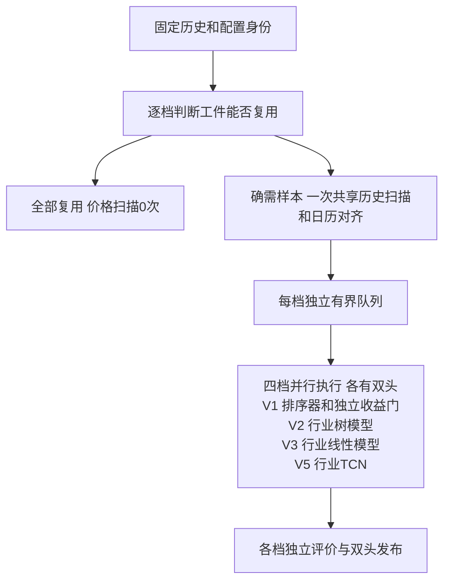

# 训练设计

训练的目标是四档全部结束的总时间最短，同时保留样本、预测和质量的正确性。先测哪里耗时，再决定共享计算、调整线程或改变存储。减少日期、行业、样本或训练质量不能算工程提速。

本篇只管训练输入、样本、资源和模型工件。收益研究放c第15章，下载和数据库源字段放d；训练独立运行，不下载缺失资料。

## 1. 输入固定，双头独立

每次作业固定一个已发布价格历史版本、一份最新有效当前行业映射及配置、特征身份。四档共用该行业映射处理全部历史日期，不按历史行业变更切换；各有 Tomorrow、D25，共八个模型头，每档双头合格才发布该档模型。某档失败不污染其它档位，不覆盖旧有效工件。

正常训练先形成近期生产诊断模型，再将最终模型重新拟合到该头最新标签成熟日。`BuildFinalFitDatePlan`按冻结交易日历，从源截止日回退Tomorrow的1个交易日或D25的5个交易日，取配置的最近N个成熟信号日；V1/V2/V3/V5分别仍为750/1000/750/61日。读取源末日用于观测标签，不把源末日本身当成成熟信号日，也不把`label_cutoff`当作诊断模型的实际拟合终点。源版本没有最近资料时，训练不会自行下载或伪补，须先完成历史同步。

例如价格源截止2026-11-06、相关日期按冻结市场日历正常交易时，Tomorrow最新成熟训练信号为11-05，D25为10-30；11-06价格仍可提供标签观测及最新已完成历史特征。预测按合法信号各自的特征锚点和实时锚点取数，未来目标价格无需先存在。以11-06信号为例，Tomorrow目标是11-09，D25对应第2–5个市场日11-10至11-13；11-09等后续信号须重新按实际市场日历定位，不能沿用该例目标日期。价格截止、成熟训练信号和预测输入分别核对，行业规则切换不改变这些日期或预测公式。

V2/V3/V5的近期生产诊断由`BuildProductionDiagnosticDatePlan`拥有：两头共用D25的5交易日成熟末日，倒序分配20日验证、5日隔离、20日校准、需要时5日隔离及20日早停、5日隔离、配置N日拟合和原特征预热。共用分区只是诊断的保守日期选择，最终拟合仍分别到各头1/5交易日成熟末日。研究的`BuildTrainingDateSplit`保留原200日确认及留出合同，研究模型和旧记录只按各自身份解释；正常生产诊断不再使用这套长期留出决定轮次、行业资格或校准。

近期诊断保留自己的拟合、早停、校准和验证日期及实际模型。V1/V2最终重拟合以近期诊断选出的树轮数为固定上限，无法继续分裂时如实保存实际树数；V3按原Ridge设置重拟合；V5最终按当前配置10轮拟合，不再对最终训练行做早停或伪装成未见验证。最终模型重新估计训练变换及模型权重，冻结并转移近期诊断模型的收益校准系数，明确标为校准转移；诊断指标只属于受评价的诊断模型，不能证明最终模型的校准或收益已经通过独立验证。最终重拟合可能使用研究留出中的日期，不能继续把这些日期称为最终模型的未见留出；历史记录和独立研究日期类型保持原身份。新行业必须满足近期诊断与最终样本门，不能仅凭最终窗口有样本就声明全行业覆盖。

CLI的`train`通过唯一组合根 `bootstrap.ExecuteSelectedTraining`独立启动，只使用本地已发布资料，不补下载。入口、训练诊断及历史消费者的核对见[第9.2节](#92-p61训练检测清单与a交接)；旧基线只作历史定位，交付状态统一见g。

### 1.1 命令进度与诊断

`./run.sh train`及直接CLI训练的stderr统一为`整体耗时HH:MM:SS | train·档位·策略头·阶段 HH:MM:SS | 状态 | 诊断详情`。环境／配置／存储／资源准备也使用同一前缀；多档位共用命令启动的单调时钟，阶段各自从首次出现计时，切换行业、轮次或批次不重置展示时间。stdout继续保留原JSON结果，原`stage_seconds`测量口径不变。

每个运行档位正常每5秒只输出一条当前阶段，开始、完成、失败、取消及真实进入验证立即输出；行业切换及普通批次不逐条刷屏，也不重复父阶段等待。各档位共用总起点，短阶段名及固定列按中文显示宽度对齐；等待保留真实计数，只有实际工作量或阶段／行业／轮次／批次推进才重置“未推进”，诊断值或总量上界变化不重置。配置和资源准备只同步报告实际阶段，环境启动脚本保留自有准备反馈，不另建脱离训练关闭scope的观察线程。完成、失败或取消后停止对应心跳，命令沿原有关闭期限回收观察线程，未完成回收显式登记且不报告成功。

详情按真实单位显示扫描行与生成样本、缓存MiB、行业／有效模型、当前轮次／批次及验证行数。扫描总量仅为上界或分子／分母不同单位时不显示百分比；V1全局拟合使用任务计数，不冒称行业。V2/V3/V5逐批验证及V1实际验证独立标为验证阶段，行业拟合达到N/N不提前宣布训练结束。V5 ETA仅按同一档位、头、阶段、行业和轮次的批次推进估算当前轮，身份切换清空窗口，未知或停滞时不报整轮或整作业假ETA。跳过原因、缺行业／价格／窗口／特征／标签、停牌与估算缺行及累计耗时放到结束汇总。资源预检只说明CPU、原生线程、拟合内存、扫描批次与队列的配置预算，不把预算称为实时占用，也不依据通用`model_fit`心跳推断具体CPU或内存预约等待。

实现身份沿原合同摘要训练及相关领域源码，因此日志升级也可能要求重新构建样本／模型，由原身份校验明确报告。

## 2. 四档比较

参数来源：`config/training.json` 的各档训练设置；特征定义见 `config/features.json` 和各档特征合同。算法和样本组织来自对应训练实现，不是数据库原列。下表当前窗口和拟合日期是只读核对值，不是新的调参建议。

| 项目 | V1 | V2 | V3 | V5 |
| --- | --- | --- | --- | --- |
| 算法 | LightGBM LambdaRank＋独立Ridge收益门 | 行业LightGBM回归 | 行业Ridge回归 | 行业TCN回归 |
| 历史回看 | 251完整日 | 251日 | 61日 | 61日形成60×6序列 |
| 当前有效拟合日期 | 750 | 1000 | 750 | 61 |
| 主要输入 | 十个完成日因子 | 长短动量、收益、流动性等 | 短窗收益、动量、流动性 | 序列及辅助输入 |
| 样本组织 | 日期排序query＋独立收益门 | 行业、日期、头 | 行业、日期、头 | 行业、序列、头 |
| 主要待测开销 | 矩阵读取、排序器与收益门 | 特征长窗、行业树拟合 | 矩阵转换、线性拟合/校准 | 序列、张量、逐行业迭代和线程 |

当前V5为行业5000行门、网络8通道、float32计算、最多10轮、早停耐心3、相对改善阈值0.005、请求1线程；网络隐藏通道与输入6通道不是一回事。

## 3. 用什么数据库、字段做什么

### 3.1 原始历史与参考

数据库：`data/market/history/catalog.sqlite3` 保存发布/日历/总体身份，年度 `data/market/history/prices_<year>.sqlite3` 的 `daily_price_revision`、`daily_price_observation` 提供对应版本价格；行业从 `data/market/reference/industry.sqlite3` 的最新有效完整发布只读固定，不再使用历史发布绑定的行业区间。`HistoryTrainingRow`、`HistoryTrainingPoint` 是读取后形成的程序对象，不是数据库表名。路径以 `config/runtime.json` 的 `data_dir=data` 举例。

| 数据库/对象 | 字段 | 中文意思及训练作用 |
| --- | --- | --- |
| history catalog | 快照、数据截止、标签截止、发布序号 | 固定同一次输入，后续修订不可混入 |
| history catalog | 交易日历、证券总体、上市/退市区间 | 同日切分、持有期、有效日期边界 |
| 年度 `daily_price_revision` | trade_date、code、board | 日期、证券、板块 |
| 同表 | revision_id、first_seen_sequence | 选择该发布可见的价格修订 |
| 同表 | 价格列、status | raw/qfq及有效/停牌/缺失语义 |
| `daily_price_observation` | sync_sequence、revision_id | 观察与修订的可见关系 |
| `HistoryTrainingRow` | code、trade_date、board、industry、cell_status | 训练窄投影、行业和日历对齐 |
| `HistoryTrainingPoint` | qfq_close_price、qfq_open、qfq_high、qfq_low | 收益、动量、波动及V5价格通道 |
| 同对象 | raw_volume | 未复权分支的成交量，下载合同单位为股；进入V5量通道，不取qfq_volume |
| 同对象 | qfq_amount | qfq分支随价格取得的成交额，下载合同单位为元；用于20日均额、V1金额因子和V5金额通道，未按价格复权比重新计算 |
| `CurrentIndustrySnapshot` | 选定证券的行业ID／中文名称、分类、缺口及发布凭据 | 本轮固定最新行业用于全历史分组；V1仅准入，V2/V3/V5用于残差暴露及行业模型 |

源表全列的SQL类型、单位、来源和索引归d第8章；本表只解释训练消费。尤其量额必须沿真实解析链核对，不因qfq字段名猜测或改公式。

训练开始后由组合根注入的只读加载器取得一份最新有效`CurrentIndustrySnapshot`，再投影到同一价格发布的资格代码集合；四档、双头、近期诊断和最终拟合共享该不可变映射。`HistorySnapshotReader`只在程序对象上给历史价格行附加固定行业，不改写年度价格或旧历史参考。V1仍是全市场排序器与独立收益门，行业只用于原有准入及诊断；V2/V3/V5按这份映射构造残差暴露并分行业拟合。缺发布、过期或原件损坏明确拒绝，缺代码保留原因，不用“其他行业”凑行；各分区日期、样本行数和新股边界继续按原门槛核验，V1/V2/V3/V5仍为750/1000/750/61日，V5仍10轮。

`BuildTrainingInputHash`以价格快照摘要、行业语义摘要和`latest_snapshot`策略共同生成训练输入身份。行业语义摘要只包含分类标准、所选代码到行业ID／中文名称的映射及缺口；发布时间、刷新期限、变更日期、回执和原查询摘要保留为独立凭据，不单独导致重训。同一价格和分组允许按原规则复用完整模型；映射、缺口、价格或其它语义合同变化则不得复用旧样本／模型。模型封存完整所选映射与来源凭据供重建和核查，旧工件不补字段、不重贴身份，也不删除或重建现有数据。此分组规则不证明历史当时行业归属或点时收益验证通过。

当前消费者追链与b第5.1节一致：年度库`history_prices._TRAINING_RANGE_SQL`的量额列只取`raw_volume`及`qfq_amount`，`_decode_training_row`构造`HistoryTrainingPoint`；`AlignTrainingRows`再按市场日历保留交易、确认停牌及估值状态。V1的`profile/v1/samples._complete_point`把金额交给完成日十因子；V2/V3/V5的`sample_builder._pending_sample`计算20日均额，V5的`_sequence_point`将原始量和qfq分支金额交给唯一序列公式，分别形成`log1p(volume)`和`log1p(amount)`。停牌估值的零量额由共享日历对齐规则产生，不改写年度原始事实；缺失、非有限或不满足各档准入的值不能通过换列或补0掩盖。

这份追链确认当前代码读取的列及消费方式。腾讯解析的手→股、万元→元换算与raw/qfq分支写入由b第5.1节及d维护；未据此断言各供应商历史逐值一致、`raw_amount == qfq_amount`或已完成B的全历史审计。当前输入/工件的实际身份与覆盖另由本轮真实训练报告交接。

### 3.2 样本数据库

数据库：V2/V3/V5在 `data/training/samples/<profile>/` 保存 `samples.sqlite3` 和 `complete.json`；V1在同一样本根的 `v1` 子目录下创建临时作业目录，退出时清理，当前没有跨作业封存样本复用。常规字段在 `samples`，分区和统计分别在下表列出的 `sample_*` 表，V5序列块在 `sample_sequence_blocks`。这些值由第3.1节的历史输入生成，列定义/顺序受特征合同约束，构建窗口来自 `config/training.json`。

| 表/字段 | 用途 | 正确性检查 |
| --- | --- | --- |
| `samples.trade_date/code/board/industry/avg_amount_20d` | 行身份、板块/行业和流动性暴露 | 日期与代码对齐、列语义 |
| 具名特征列 | 各档输入 | 公式版本、顺序、维度和必需缺失 |
| `target_t1` | Tomorrow标签 | 未来第1个市场交易日，成熟后使用 |
| `target_t2`～`target_t5` | D25分期证据 | 市场日历定位，缺失分期如实保留 |
| `target_d25_aggregate` | D25唯一聚合头 | 按现行标签合同生成，不混成四头模型 |
| `sample_split_dates` | 训练、早停、校准、评价分区 | 同日股票同区，边界隔离 |
| `sample_statistics` | 日期、行业、标签统计 | 避免反复扫宽表；与封存行数一致 |
| `sample_day_diagnostics` | 每日标签缺失归因 | 不以缺标签者反向改变当日特征总体 |
| V5 `sequence_start` | 当前样本对应序列起点 | 时间步顺序不变 |
| `sample_sequence_blocks.code/block_id/sequence_bytes` | 相邻样本复用重叠序列 | 无损解码、身份匹配，释放缓存 |
| V1十因子、`target_t1/target_d25/zero_signs` | 排序器与收益门样本 | 独立目标和query，保留约定负零语义 |

V1十因子和V5的60×6通道在c第7章逐项解释；物理字段、列顺序和消费者见第3.4–3.6节。公式owner仍在recommendation，不在训练另建计算定义。

### 3.3 日期与标签

2000日是整体历史目标，251/61日是特征回看，750/1000/61日是各档有效拟合日期，200日属于原研究/诊断切分的终端留出最低范围，不能据此把正常最终模型长期停在旧数据窗口。它们不是同一门槛。新股不要求上市前有数据，不统一要求每股拥有全部历史。

同一市场日历定位标签。已发布资料中的确认停牌、推定停牌、个股缺行和整市场缺日分别处理；可按合同用此前同源收盘作估值时保留estimated标志，量额为0不等于随意填缺失为0。异常单侧价格不能补造，不能向后借值；原始库事实不改写。

训练准入按每头全局有效日期核验拟合、早停、校准、验证与最终拟合分区；缺日不得静默缩短分区后继续，也不要求每个证券或每个行业都拥有全部日期。上市前无数据、个别股票某期限缺标签分别按原合同处理，缺T+1不自动删除有效D25。标准档最终N日覆盖检查必须在任何拟合之前执行，不能依赖可选内存预约端口才触发。

### 3.4 V2/V3/V5物理样本字典

以下表来自 `training/infra/sample_schema.py::TrainingSampleSchema`、`sample_index.py`，不是活动数据库审计。数据库位置见第3.2节；日期由 `infra/sqlite_codec.py` 编为距1970-01-01的整数日，程序边界解码为 `date`。主写入者是 `BuildTrainingSamples` 调用的 `SQLiteTrainingSampleIndex`；拟合、校准和评价通过同一index读取，训练覆盖诊断只读相同统计和列合同。

| 表 | 主键、索引和生命周期 | 读取者 |
| --- | --- | --- |
| `sample_contract` | 单行 `singleton=1`；封存前写入split身份 | index初始化、复用校验 |
| `samples` | `(trade_date,code)`，`WITHOUT ROWID`；分区准备时建立 `samples_industry_date(industry,trade_date,code)`，封存后只读 | 同档双头行业共享读取、V5批次、显式样本/读取诊断 |
| `sample_split_dates` | `trade_date`，`WITHOUT ROWID` | 拟合/早停/校准/评价按日期关联 |
| `sample_statistics` | `(trade_date,industry,target)`，`WITHOUT ROWID` | 逐行业行数、标签矩和有效日期覆盖 |
| `sample_day_diagnostics` | `trade_date`，`WITHOUT ROWID` | 每日候选及标签缺口归因、training-coverage |
| V5 `sample_sequence_blocks` | `(code,block_id)`；普通rowid表 | `SampleSequenceReader` 批读/缓存，两个头共用只读块 |

除上述行业日期索引外，这组schema没有另建二级索引。样本库是可重建中间产物，构建使用独立事务，统计随样本写入，日期分区和索引准备后提交；正式模型的持久性和发布边界另见第7章，不能把样本库的可重建写策略套到正式库。

| 表/列 | 类型、单位与空值 | 中文含义、来源和使用 |
| --- | --- | --- |
| `sample_contract.singleton` | INTEGER主键，固定1 | 单份列合同 |
| `feature_hash` | BLOB非空，32字节 | schema、特征有序列和序列布局的SHA-256 |
| `split_hash` | BLOB可空，32字节 | 构建期可空；分区准备/封存后必须匹配split身份 |
| `samples.trade_date` | INTEGER非空，日 | 信号日；同日股票必须进入同一分区 |
| `code` | TEXT非空 | 六位证券代码，与日期构成行身份 |
| `board` | TEXT非空 | 板块暴露，来自历史窄投影 |
| `industry` | TEXT非空 | 本轮固定最新行业，供残差化及行业模型选择 |
| `avg_amount_20d` | REAL非空，金额沿输入合同 | 20日均额，供对数流动性暴露；写入前检查有效性 |
| 第3.5节具名特征列 | REAL非空、有限数 | 按有序manifest生成，不能用0填必需缺失 |
| V5 `sequence_start` | INTEGER非空，≥0，时间步 | 当前证券的60步序列在重叠块流中的起点；不是BLOB字节偏移 |
| `target_t1` | REAL可空，收益小数 | T+1个股收益减同日该期限已观察收益的等权基准；缺失表示标签不可用 |
| `target_t2` | REAL可空，收益小数 | T+2累计收益减对应期限基准，D25诊断分期 |
| `target_t3` | REAL可空，收益小数 | T+3同义分期 |
| `target_t4` | REAL可空，收益小数 | T+4同义分期 |
| `target_t5` | REAL可空，收益小数 | T+5同义分期 |
| `target_d25_aggregate` | REAL可空，收益小数 | `target_t2`至`target_t5`全部有效后取算术均值；是D25一个头的标签 |
| `sample_split_dates.trade_date` | INTEGER主键，日 | 分区的信号日期 |
| `split_name` | TEXT非空，枚举 | `training/early_stopping/calibration/validation/holdout`；由split写入，不能由模型自行切行 |
| `sample_statistics.trade_date` | INTEGER非空，日 | 同日统计，不重新读全部宽行 |
| `industry` | TEXT非空 | 统计所属行业 |
| `target` | TEXT非空 | `rows`表示样本总数，其余是上述六个目标名 |
| `sample_count` | INTEGER非空，行 | 有效标签数；`rows`项为样本行数 |
| `target_sum` | REAL非空 | 有效目标值之和；`rows`项为0 |
| `target_sum_squares` | REAL非空 | 有效目标平方和；用于计算标准差，`rows`项为0 |
| `sample_day_diagnostics.trade_date` | INTEGER主键，日 | 每日缺口归因的日期 |
| `candidate_count` | INTEGER非空，股 | 构造当日特征总体的候选数 |
| `missing_t1` | INTEGER非空，股 | 当日T+1未来收益缺失数 |
| `missing_t2` | INTEGER非空，股 | 当日T+2未来收益缺失数 |
| `missing_t3` | INTEGER非空，股 | 当日T+3未来收益缺失数 |
| `missing_t4` | INTEGER非空，股 | 当日T+4未来收益缺失数 |
| `missing_t5` | INTEGER非空，股 | 当日T+5未来收益缺失数 |
| `sample_sequence_blocks.code` | TEXT非空 | 与样本证券身份一致 |
| `block_id` | INTEGER非空 | 每块64步的逻辑块号，末块可不足64步 |
| `sequence_bytes` | BLOB非空 | 小端float64、每步6通道；`SampleSequenceWriter`无损编码、reader解码 |

标签生成的实际owner为 `sample_builder.py::_finalize_sample_day` 和 `domain/label_benchmark.py::ObservedTrainingBenchmark`。各期限缺未来收益只影响该证券/期限，不反向删去已形成的特征总体；某行Tomorrow与D25聚合目标都不可用才不写样本。标签未预扣交易成本，不能在训练和运行门各扣一次。

### 3.5 有序输入列与V5序列

来源：`config/features.json.model_contracts`、各档 `training/infra/profile/*/contracts.py` 与 `sample_schema.py::TrainingFeatureNames`。下表只解释训练消费和存储位置；收益/动量公式、残差化和在线锚点仍由c及recommendation纯函数拥有。V2/V3/V5辅助列的收益单位为小数，不是百分点。

| 列 | 中文用途 | 当前使用 |
| --- | --- | --- |
| `qfq_return_1d` | 信号收盘的1日收益 | 三档Tomorrow；双头合并样本中保留 |
| `qfq_return_3d` | 3日收益 | 三档双头 |
| `qfq_return_5d` | 5日收益 | 三档双头 |
| `qfq_residual_momentum_20d_skip5` | 剔除市场、板块、行业及对数均额暴露后的20日动量，跳过近5日 | 三档双头 |
| `qfq_residual_momentum_40d_skip5` | 同定义40日残差动量 | 三档双头 |
| `qfq_residual_momentum_60d_skip5` | 同定义60日残差动量 | 三档双头 |
| `qfq_residual_momentum_120d_skip5` | 同定义120日残差动量 | 仅V2双头 |
| `qfq_residual_momentum_250d_skip5` | 同定义250日残差动量 | 仅V2双头 |
| `market_qfq_momentum_120d_skip5` | 当日有效样本总体120日动量等权均值 | 仅V2双头，不是外部指数收益 |
| `market_qfq_momentum_250d_skip5` | 同总体250日动量均值 | 仅V2双头 |

V2物理辅助列按上表10列顺序，Tomorrow取10列，D25去掉第一列取9列。V3/V5物理辅助列只取前6列，Tomorrow取6列，D25去掉第一列取5列。manifest顺序不是集合：调换列顺序会改变身份，必须同时切换训练与推断消费者。

V5在各头辅助列后接360个序列值；两个头完整输入维数分别366与365。序列逻辑次序由 `recommendation/domain/market/v5/features.py::CalculatePriceVolumeSequence` 固定为“旧时间步在前，每步按下表通道顺序”。物理样本只保存辅助列、`sequence_start`与重叠块，不展开360个REAL列；样本块始终float64，拟合时才按 `tcn.compute_dtype` 转换。

| 通道顺序 | 原始输入 | 每步含义及单位 |
| --- | --- | --- |
| `open_return` | `qfq_open`、前日 `qfq_close_price` | 开盘/前收减1，收益小数 |
| `high_return` | `qfq_high`、前日qfq收盘 | 最高/前收减1 |
| `low_return` | `qfq_low`、前日qfq收盘 | 最低/前收减1 |
| `close_return` | 当日/前日qfq收盘 | 收盘收益小数 |
| `log_volume` | `raw_volume` | 实际成交股数的 `log1p` |
| `log_amount` | `qfq_amount` | 输入金额的 `log1p`；供应商到存储的金额口径需由d确认 |

序列使用信号日前61个完整日生成60步，不含信号日。训练滚动容器另保留信号行，故内部会需要62个点；不能把这个容器宽度改写成62日序列合同。辅助收益与标签仍以信号收盘为锚，V5不能直接复用另一档的完整可变输入矩阵。

### 3.6 V1独立样本

来源：`training/infra/profile/v1/samples.py::_SAMPLE_SCHEMA` 和 `recommendation/domain/market/v1/features.py`。V1样本库的结构与V2/V3/V5不同，按实际DDL、特征顺序及内容身份校验，不使用数字schema编号区分。以下所有列除两个标签外均非空；`samples`以 `(trade_date,code)` 为主键、`WITHOUT ROWID`，没有额外二级索引。`sample_contract`只有 `singleton INTEGER PRIMARY KEY CHECK(singleton=1)` 和32字节非空 `feature_hash BLOB`。

| `samples`列，按实际顺序 | 类型/单位 | 含义和消费者 |
| --- | --- | --- |
| `trade_date` | INTEGER，日 | 信号日期，四分区和query共同使用 |
| `code` | TEXT | 六位代码，排序/追溯使用 |
| `industry` | TEXT | 本轮固定最新行业的准入及诊断，不据此换成行业V2模型 |
| `return_1d` | REAL，收益小数 | 前一完整日锚点的1日收益 |
| `return_3d` | REAL，收益小数 | 同锚点3日收益 |
| `return_5d` | REAL，收益小数 | 同锚点5日收益 |
| `return_20d` | REAL，收益小数 | 同锚点20日收益 |
| `return_60d` | REAL，收益小数 | 同锚点60日收益 |
| `return_120d` | REAL，收益小数 | 同锚点120日收益 |
| `return_250d` | REAL，收益小数 | 同锚点250日收益 |
| `volatility_20d` | REAL，收益小数尺度 | 20日波动，具体估计式由特征owner维护 |
| `drawdown_60d` | REAL，比例 | 60日回撤 |
| `log_avg_amount_20d` | REAL，对数 | 20日平均金额的对数特征 |
| `zero_signs` | INTEGER，0–1023 | 上述十因子的负零位掩码，读取时恢复符号位 |
| `target_t1` | REAL可空，收益小数 | T+1超额标签，不可用则NULL |
| `target_d25` | REAL可空，收益小数 | T+2～T+5超额均值，四期齐全后有效 |

写入者 `BuildLearnedRankSamples` 先从251个历史完成日构造特征，再加入当前信号日；因此不能将V2同名收益列直接借给V1。`LearnedRankSampleIndex.read_matrices` 一次按日期/代码排序读取，最多分发双头四分区共8个独立矩阵，4096行批读并恢复负零；query组内同日、两个头分别按自身有效标签过滤。

V1独立诊断日期切分由 `BuildLearnedRankDateSplit` 拥有：拟合、早停、校准、验证四段，每段之间至少5个市场日隔离；两头成熟期分别1/5日。正常最终拟合另用`FinalFitDatePlan`。八份诊断矩阵关闭后，独立重读双头最终原始矩阵，避免拼接已标准化的诊断矩阵污染最终变换。它没有V2/V3/V5的 `sample_split_dates`、统计表和 `complete.json`。只有当前最终工件身份匹配才允许正常训练复用；旧诊断工件仍按原身份只读，不能补签成最终拟合。工件不能复用时，V1从历史重建临时样本，“样本缓存复用”实验对V1须记为不适用，不能伪报缓存命中或另造缓存。

### 3.7 训练到期和提醒表

数据库是 `data/market/history/catalog.sqlite3`，表owner是 `training/infra/history/training_maintenance_index.py::TrainingMaintenanceIndex`；同文件中的历史发布表仍归download。`history_training_due.py`和训练提醒流程写入，状态/提醒读取及隔离重排复制流程消费；同身份冲突拒绝覆盖。三个表都是 `WITHOUT ROWID`，没有额外二级索引；提醒表与领取表的 `due_id`外键指向 `training_due`。

日期仍用整数日，时刻用UTC纪元微秒并在程序边界解为上海时区；不能按文本或毫秒猜测。

| 表/列 | 类型、空值 | 用途 |
| --- | --- | --- |
| `training_due.due_id` | TEXT主键 | 不可变到期身份，含档位/头等业务身份编码 |
| `reason` | TEXT非空 | 到期/未到期/资料不足等类型化原因，具体枚举由domain校验 |
| `baseline_date` | INTEGER可空 | 上次有效训练标签截止，无基线可空 |
| `cutoff_date` | INTEGER可空 | 当前可用标签截止，资料不足可空 |
| `matured_days` | INTEGER非空，≥0 | 自基线以来新增成熟标签日数 |
| `input_revision` | INTEGER非空，0/1 | 输入是否发生真实语义修订 |
| `observed_at` | INTEGER非空，微秒 | 本次到期观察时刻，不冒充拟合时间 |
| `content_hash` | BLOB非空，32字节 | 记录完整性，读取解码后复核 |
| `training_reminder_claim.due_id` | TEXT非空 | 已领取的到期身份 |
| `reminder_date` | INTEGER非空 | 上海提醒日期，与due_id组成主键 |
| `claimed_at` | INTEGER非空，微秒 | 先持久提交领取，再做桌面通知；同日first-wins |
| `content_hash` | BLOB非空，32字节 | 领取证据完整性 |
| `training_reminder.due_id` | TEXT非空 | 通知结果所属到期身份 |
| `reminder_date` | INTEGER非空 | 与due_id组成主键 |
| `outcome` | TEXT非空 | 仅 `sent/notification_degraded` |
| `attempted_at` | INTEGER非空，微秒 | 实际尝试通知的时刻 |
| `failure_code` | TEXT可空 | 通知降级原因，不含完整异常载荷 |
| `content_hash` | BLOB非空，32字节 | 通知结果完整性 |

读取不会为缺表自动建库；写入在确认 `history_catalog` 实际结构和合同标识后创建完整表组并事务提交，不使用数字schema编号。仅完成训练模型可读不能替代到期状态检查；提醒领取也不代表训练或桌面通知已经成功。

## 4. 一次作业如何并行

现有 `application/selected_training.py` 按注入的`TrainingFanoutSettings`分发不可变批次；当前配置为每批256行、每档队列容量2，来源见[第6.2节](#62-作业资源配置与仍待核对的常量)。`infra/selected_training.py`固定SQLite快照并在扫描前判断复用。全部复用时零价格扫描；共享扫描与日历对齐已存在，四档样本/特征仍各自构建。

慢消费者会背压公共扫描。先量出是哪档计算、写入、资源等待造成背压，再比较“先算公共基础量”“调整批次”“隔离慢消费者”等候选。不能为了取消背压引入无限队列或四份完整历史。

## 5. 什么能共用

| 工作 | 共用条件 | 保持独立的部分 |
| --- | --- | --- |
| 历史扫描与解码 | 同快照、时间范围取并集 | 每档取自身有效日期和列 |
| 日历对齐 | 同日历与停牌/估值语义 | 原始事实、估值标志、标签 |
| 基础收益、均额、波动等 | 同窗口、公式、末日、缺失规则 | V1完成日与其它实时锚点定义 |
| 市场/板块/行业统计 | 同日期、同资格总体及公式 | 不同历史长度和输入集合 |
| 标签 | 同期限、成本与成熟定义 | 两头有效标签过滤和不同目标 |
| 样本读取 | 同档双头使用同一行特征 | 标签、切分、可变矩阵和模型 |
| 存储/内存 | 只读批次、连续数组或映射 | 不共享会被模型原地修改的矩阵 |

不能只因名称相同就共享。每个候选先记录当前重复次数、CPU、读写字节、RSS，再证明结果一致和总时间改善。

## 6. 怎样让四档全部尽快结束

当前CPU预算按实际亲和性和cgroup约束，拟合总预算为`max(1, 可用CPU-cpu.coordinator_cpus)`，再由非null的`cpu.maximum_threads`收紧；默认预留1个CPU。原生基线和各档请求线程也由配置注入，并限制BLAS/OpenMP线程。现有内存原子预约、批读和临时映射避免四档同时膨胀；这些机制先复用，不另建资源中心。

“慢档多分资源”是待测策略。先测每档/算法随线程数变化的边际收益：I/O或Python单线程瓶颈加模型线程可能无用；小任务获得太多线程也会挤压长任务。比较现有固定申请、长任务优先、有空闲时借用等候选，以全部完成的时间裁决。

下表是资源说明，不是数据库字段。训练窗口和拟合参数来自`config/training.json.profiles`，CPU、内存、共享扫描、队列和样本I/O预算来自同文件的`resources`；通用SQLite策略来自`config/sqlite.json`，介质选择来自`config/runtime.json`。CPU/cgroup、RSS和队列等待是运行时测量，已接线的资源字段及保留常量分别列在[第6.2节](#62-作业资源配置与仍待核对的常量)。

| 资源 | 要测什么 | 配置化核对 |
| --- | --- | --- |
| CPU | 模型原生线程、等待、超额竞争、实际利用 | 总预算、每算法上限、协调预留；不得每档各占全CPU |
| 内存 | 只读共享、矩阵、张量、缓存、换页、预约等待 | `resources.<介质>.memory`已提供3GiB上限、1.5GiB预留和256MiB宿主低水位；实际容量仍受宿主及cgroup收紧 |
| 磁盘 | 公共顺序扫描、样本写入、映射随机I/O | HDD/SSD各自批次和并发，保持唯一策略来源 |
| 队列 | 长度、阻塞、批次字节和取消清理 | 批次、容量、最大驻留 |

`training.json`、`features.json`逐叶字段要写当前值、类型、单位、范围、各档含义、解析和最终消费者、身份影响及生效时机。V5早停/拟合日期属于质量相关配置，不能作为纯工程参数随意缩减。

### 6.1 training.json现有逐叶配置

`config/training.json`根对象精确包含`profiles`和`resources`：前者是四档拟合设置，后者是HDD/SSD两份作业资源策略，字段见[第6.2节](#62-作业资源配置与仍待核对的常量)。本节先列`profiles[]`；它是按`profile`选择的对象数组。记`V1=profiles[profile=v1]`、`V2=profiles[profile=v2]`，其它同理；这只是文档定位写法，不是新增JSON字段。

所有字段在训练作业准备时读取。V1经 `LoadV1TrainingSettings → ParseV1TrainingSettings → V1TrainingSettings` 进入独立构造/拟合；V2/V3/V5经 `LoadProfileTrainingSettings → ProfileTrainingSettings` 进入 `engine.py`，V5参数再经 `ParseTcnParameters → TcnFittingParameters` 校验。字段名必须精确匹配，整数不接受bool，数值必须有限；下表范围按实际解析和类型校验写，不虚构额外上限。

| JSON叶字段 | 当前值 | 类型/单位、范围 | 具体用途/最终消费者 |
| --- | --- | --- | --- |
| 各档 `.profile` | `v1/v2/v3/v5` | string，选中档位必须唯一 | profile选择；不是随意改名的显示文本 |
| V1 `.fit_dates` | 750 | int，≥1，市场日 | `BuildLearnedRankDateSplit`拟合段 |
| V1 `.early_stopping_dates` | 20 | int，≥1，日 | 独立早停分区 |
| V1 `.calibration_dates` | 20 | int，≥1，日 | 收益门校准分区 |
| V1 `.validation_dates` | 20 | int，≥1，日 | 工程评价分区 |
| V1 `.embargo_dates` | 5 | int，≥5，日 | 分区隔离，不能短于两头成熟要求 |
| V1 `.minimum_training_rows` | 1000 | int，≥1，行 | V1训练覆盖准入 |
| V1 `.learning_rate` | 0.05 | number，0–1且>0；解析下限0.000001 | LambdaRank学习率 |
| V1 `.max_depth` | 3 | int，≥1 | LambdaRank树深 |
| V1 `.num_leaves` | 7 | int，≥2 | LambdaRank叶数 |
| V1 `.minimum_leaf_rows` | 20 | int，≥1，行 | 单叶最少样本 |
| V1 `.boosting_rounds` | 200 | int，≥1，轮 | 最大提升轮数 |
| V1 `.early_stopping_rounds` | 20 | int，≥1，轮 | 排序器早停耐心 |
| V1 `.maximum_bins` | 63 | int，≥2 | 连续值分箱上限 |
| V1 `.histogram_pool_mib` | 64 | int，≥1，MiB | LightGBM直方图池 |
| V1 `.seed` | 0 | int，≥0 | 复现实验随机种子 |
| V1 `.ridge_penalty` | 10.0 | number，>0；解析下限0.000001 | 独立Ridge收益门 |
| V1 `.ranking_round_trip_cost` | 0.002 | number，≥0，收益小数 | 排序标签等级构造的往返成本参考；不授权改运行成本 |
| V2 `.fit_dates` | 1000 | int，≥1，日 | 行业树模型拟合日期 |
| V2 `.minimum_industry_training_rows` | 20000 | int，≥1，行 | 每行业覆盖门 |
| V2 `.lightgbm.learning_rate` | 0.05 | number，≥0.000001 | 行业LightGBM学习率 |
| V2 `.lightgbm.max_depth` | 3 | int，≥1 | 行业树深 |
| V2 `.lightgbm.num_leaves` | 7 | int，≥2 | 行业叶数 |
| V2 `.lightgbm.minimum_leaf_rows` | 20 | int，≥1，行 | 单叶覆盖 |
| V2 `.lightgbm.boosting_rounds` | 200 | int，≥1，轮 | 最大拟合轮数 |
| V2 `.lightgbm.early_stopping_rounds` | 20 | int，≥1，轮 | 独立早停区上的耐心 |
| V2 `.lightgbm.maximum_bins` | 63 | int，≥2 | 分箱 |
| V2 `.lightgbm.histogram_pool_mib` | 64 | int，≥1，MiB | 直方图池 |
| V2 `.lightgbm.seed` | 0 | int，≥0 | 随机种子 |
| V3 `.fit_dates` | 750 | int，≥1，日 | 行业Ridge拟合日期 |
| V3 `.minimum_industry_training_rows` | 20000 | int，≥1，行 | 每行业覆盖门 |
| V3 `.ridge.penalty` | 10.0 | number，≥0.000001 | 行业Ridge正则惩罚 |
| V5 `.fit_dates` | 61 | int，≥61，日 | 最近拟合日期；不减少独立确认和留出区 |
| V5 `.minimum_industry_training_rows` | 5000 | int，≥1，行 | 每行业训练覆盖门 |
| V5 `.tcn.learning_rate` | 0.001 | number，≥0.000001且≤1 | TCN优化器学习率 |
| V5 `.tcn.weight_decay` | 0.0001 | number，0–1 | 优化器权重衰减 |
| V5 `.tcn.dropout` | 0.1 | number，0≤值<1 | 训练dropout，工件保存网络参数 |
| V5 `.tcn.batch_size` | 256 | int，1–256，行 | 张量批次，不是共享扫描批次 |
| V5 `.tcn.epochs` | 10 | int，1–100，轮 | 最大迭代；默认和后台均按当前10轮方案 |
| V5 `.tcn.early_stopping_rounds` | 3 | int，1–epochs，轮 | 早停耐心 |
| V5 `.tcn.seed` | 0 | int，≥0 | 网络随机种子 |
| V5 `.tcn.hidden_channels` | 8 | int，仅4/8/16 | 网络隐藏宽度，不是6个输入通道 |
| V5 `.tcn.compute_dtype` | `float32` | string，仅float32/float64 | 拟合计算精度，不改变样本块float64编码 |
| V5 `.tcn.early_stopping_relative_delta` | 0.005 | number，0≤值<1 | 早停相对改善门 |
| V5 `.tcn.compute_threads` | 1 | int，1–4，线程 | TCN请求线程；实际授权仍受全作业CPU预算约束 |

拟合日期还要满足历史预算和split的关系约束，不能把“单字段≥1”理解为任意组合都能训练。V2/V3/V5配置中的算法参数由各拟合器使用，V1/V5还直接保存配置身份；现实现会把整组拟合设置纳入训练身份，改变线程、批次也可能失去工件复用资格。后续若区分纯运行参数与语义参数，须由A/C一起核对全部身份消费者后切换，不能先在文档声称日志、端口或所有资源参数都会触发重训。

`config/features.json.model_contracts[]`目前只含V2/V3/V5，下列每个叶字段都由 `LoadProfileTrainingSettings` 解析并与各档合同逐项比较；数组元素顺序也属于合同。V1十项完成日特征由自身纯合同拥有，不在JSON新增一份。

| 字段 | 当前值V2 / V3 / V5 | 类型与约束、最终用途 |
| --- | --- | --- |
| `profile` | v2 / v3 / v5 | 唯一选中profile |
| `history_sessions` | 251 / 61 / 61 | int≥61，匹配profile合同；滚动回看 |
| `momentum_horizons[]` | `[20,40,60,120,250]` / `[20,40,60]` / 同V3 | 严格递增、不重复正整数；基础动量和残差化列 |
| `market_state_momentum_horizons[]` | `[120,250]` / `[]` / `[]` | 可为空的递增正整数；当日总体均值 |
| `heads.tomorrow[]` | 第3.5节10 / 6 / 6列 | 非空、不重复字符串；特征选择和列序 |
| `heads.d25[]` | 第3.5节9 / 5 / 5列 | 同上；不能把Tomorrow首列自动补入D25 |

`factor_index/factor_contract/news_signal`由A维护公式与解析，C只提出列、单位、锚点和缺失需求，不修改这些公共配置。

### 6.2 作业资源配置与仍待核对的常量

`config/training.json.resources`必含`hdd`及`ssd`两份独立机器策略，每份具有下表字段；默认保持原值，不以磁盘名称推定CPU/内存大小或启用性能候选。两台个人电脑分别依据自身实测调整对应策略，另一策略不随之变化。组合根按runtime的`disk_medium`或原磁盘探测结果选取，unknown明确沿用现行保守HDD策略；无静默补默认值，任一机器段缺字段、未知字段、bool冒充整数或非法范围均拒绝。

| 每机器策略字段 | 默认值、单位与范围 | 最终消费者 |
| --- | --- | --- |
| `cpu.coordinator_cpus` | 1，整数≥0，CPU | 从当前进程亲和性/cgroup可用CPU中预留；至少留下1个拟合槽 |
| `cpu.maximum_threads` | null或整数≥1，线程；null不另加配置上限 | 总拟合预约容量再受当前机器可用CPU收紧 |
| `cpu.native_threads` | 2，整数≥1，线程 | 环境变量及全作业原生库基线，实际不超过总预约容量 |
| `cpu.profile_threads.v1/v2/v3` | 各2，整数≥1，线程 | 三档分别请求拟合CPU；V5仍只读原`tcn.compute_threads`，不允许在此重复定义 |
| `memory.maximum_bytes` | 3221225472，整数≥1，字节 | 拟合预约上限，不是RSS硬隔离 |
| `memory.reserve_bytes` | 1610612736，整数≥0，字节 | 当前宿主MemAvailable及每个可见cgroup限制减去此预留 |
| `memory.minimum_available_bytes` | 268435456，整数1–maximum_bytes，字节 | 宿主低水位延续原行为；不抬高更紧的cgroup限制 |
| `fanout.batch_rows` | 256，整数≥1，行 | 公共历史流每次取数/派发行数 |
| `fanout.queue_batches` | 2，整数≥1，批/档 | 每档独立队列容量；另外有一个接收中批次及公共派发批次 |
| `samples.sqlite_cache_bytes` | 33554432，整数≥1024且为1024倍数，字节 | V2/V3/V5样本连接页缓存；连接边界转换为KiB |
| `samples.sqlite_mmap_bytes` | 0，整数≥0，字节 | V2/V3/V5样本SQLite mmap；不控制NumPy映射 |
| `samples.matrix_memory_bytes` | 268435456，整数≥0，字节 | 单行业独立矩阵超过此值用受管文件映射；0允许强制映射 |
| `samples.sequence_cache_bytes` | 33554432，整数≥0，字节 | 每个V5序列reader的已完成块缓存；另有原256窗在途批次 |
| `samples.sequence_writer_codes` | 8192，整数≥1，证券 | 序列writer保留尾部的证券数；逐出只减少压缩机会，不改变值 |
| `samples.v1_sqlite_cache_bytes` | 16777216，整数≥1024且为1024倍数，字节 | V1独立临时样本连接页缓存 |
| `samples.v1_batch_rows` | 4096，整数≥1，行 | V1具名矩阵有序流每次取行；跨批排序、query和负零不变 |
| `samples.tcn_batch_memory_bytes` | 268435456，整数≥0，字节 | 单头训练/早停TCN批次超过此值映射；0允许强制映射 |

`training/infra/resource_settings.py`是根schema和资源解析唯一owner：`ReadTrainingConfiguration`核根键，`LoadTrainingResourceSettings`完整校验两份介质策略后选择一份。仅训练启动及明确训练诊断读取，不让推荐或只读Web因训练资源错误而失效。不可变资源对象由bootstrap显式传至准入、训练请求及fanout，无消费者自行重读资源JSON。配置改后下次训练作业生效，不热切换运行中的作业。V1/V2/V3的请求线程数由必填`cpu.profile_threads`提供，默认仍各2；请求数进入各档模型复用身份，改变请求后不得误用原线程合同的模型。V5仍使用原`tcn.compute_threads/batch_size`，其它纯资源值不加入模型/样本参数身份。训练源码变化仍会改变既有宽范围implementation identity，不自动重训、发布或改写旧工件。线程设置可能影响实际数值路径，候选调值须核对数值/质量与C后台实测，不承诺任意调值逐位相等。

八项样本I/O运行参数由同一解析器生成不可变`TrainingSampleSettings`，训练组合根显式传到四档、缓存及所有读写者；普通生产构造不补默认值。完整`hdd/ssd`段都须符合schema，缺字段、未知字段、bool/小数冒充整数及非法字节单位明确拒绝。阶段345的HDD验收与SSD那台PC的进度分别保留在g，不把配置接线解释为任一介质的最优值或性能验收。训练诊断从同一配置边界注入，历史对照worker只按明确选定的冻结checkout及其已声明配置schema使用对应API，不向产品安装兼容分支。

纯I/O参数不加入拟合参数或样本语义身份；配置变值不会单独强制重训，训练源码变化仍沿既有implementation identity生效。删除训练合同hash中原固定的两项SQLite缓存常量，实际八项值在`selected_training_result.sample_resources`按白名单报告。任何改值仍需数值、质量与完整资源/性能对照；软件内存预算不是OS隔离，不保证任意增大缓存或批次均满足RSS门。

下表区分已迁运行参数、保留安全估计及格式/算法常数，不能将参数接线视为性能通过。

| 实现与现值 | 实际消费者/作用 | 给A的要求及身份边界 |
| --- | --- | --- |
| CPU现值留1、原生基线2 | `TrainingCpuBudget`及训练启动环境/原生上下文 | 已由cpu资源段注入；普通拟合请求2仍保留独立算法合同 |
| 每档队列2、公共批次256行 | `_TrainingFanout`发送/接收与取消清空 | 已由fanout资源段注入；不是V5张量batch_size |
| 拟合容量最多3GiB、预留1.5GiB、宿主低水位256MiB | `FittingMemoryCapacity → TrainingMemoryBudget` | 已由memory资源段注入；实际cgroup各级上限继续收紧，约束不可核验时拒绝 |
| `engine.py`TCN预约512MiB＋最终最大行业矩阵估计×2，普通模型256MiB＋诊断/最终较大行业矩阵估计×4 | 拟合前内存预约 | 最终近期行业可能比旧诊断行业更大，不能只按旧窗口预约；估计与RSS误差仍待实测 |
| `sample_index.py`页缓存/mmap、独立矩阵阈值 | 样本index及行业独立矩阵 | 已由samples前三字段注入；共享行业矩阵仍按原设计始终映射，不被此阈值改成驻内存 |
| V1 `samples.py`页缓存及具名批读 | V1临时样本及最多8矩阵 | 已由samples.v1两字段独立注入；矩阵仍按原设计映射 |
| `sample_sequences.py`reader缓存及writer尾部证券数 | V5重叠序列读写 | 已由samples.sequence两字段注入所有入口；256窗在途上限为批次安全边界，保留 |
| `profile/v5/batch_cache.py`训练/早停矩阵阈值 | 单头TCN批次缓存 | 已由samples.tcn_batch_memory_bytes注入；取消及异常均关闭映射 |
| 序列块64步、float64小端；序列60×6 | 样本codec/特征合同 | 格式/算法合同，暂不列为自由运行参数；变化需重建身份和全部消费者 |
| 序列查询每组400对键；每批最多256窗 | SQLite变量可移植性及在途内存 | 安全/结构边界，保留原值，不开放为绕过999变量上限的参数 |
| `cpu_admission.py/memory_admission.py`预约心跳0.25秒，fanout队列轮询0.1秒 | 等待与取消 | 停止响应约束；是否开放配置须有用途和等待证据 |

### 6.3 预约顺序与资源生命周期

当前 `engine.py` 在样本检查完成后，先预约CPU，再估计并等待内存，预约持有到双头行业拟合及后续准备范围退出；这是源码顺序，不是等待耗时实测。可用CPU为4时容量3、原生基线2，每项至少预约2，两个拟合无法同时入场；V5请求1也不绕过原生基线预约。限制原生线程有正确性作用，不能只删门让四档竞争宿主。

| 资源 | 创建/唯一owner | 消费与退出 |
| --- | --- | --- |
| 执行器 | `bootstrap.ExecuteSelectedTraining`，按所选档数创建 | entrypoint启动；取消后停止、等待，不在工作任务中同步提交并等待同池任务 |
| CPU/原生线程限制 | bootstrap创建 `TrainingCpuBudget`；`TrainSelectedProfiles`统一上下文 | 全部worker结束后才恢复原生库；reserve的finally归还额度 |
| 内存额度 | bootstrap创建 `TrainingMemoryBudget` | context退出归还，超预算明确拒绝；预约前/等待中进度回调检查取消 |
| 固定历史/训练锁 | `TrainSelectedProfiles`的ExitStack | 所选profile锁和历史维护锁覆盖作业，退出释放；不随新发布切换输入 |
| 每档有界队列 | `_TrainingFanout` | 消费者退出后停止派发；异常等future退出，finally清空遗留批次 |
| V2/V3/V5样本/矩阵 | `TrainingSampleCache`及 `SQLiteTrainingSampleIndex` | 已封存样本可复用，临时矩阵上下文关闭；异常不能把未封存样本当成功 |
| V1临时库/矩阵 | `TemporaryTrainingSamples`与V1 ExitStack | 映射关闭后清理临时目录，不承诺跨作业样本恢复 |

Linux cgroup路径由training内部`ReadTrainingCgroupScopes`唯一解析，CPU和内存共用membership、mountinfo、挂载根及可见父级，支持v1/v2和挂载路径转义；不受无关bind mount影响，不越过可见挂载根猜测宿主限制。CPU无法核验仍按1核保守运行；内存约束无法映射、读取或解析时抛出`training_memory_limit_unavailable`并保留原因，不退回宿主3GiB预算。内存容量和预约都要求正整数，拒绝bool、小数及非有限值。

内存v1读取`memory.limit_in_bytes`，v2读取`memory.max`及`memory.high`，沿可见父级按每个有限限制减去配置预留（默认仍1.5GiB），再收紧现有拟合预算；没有启用控制器或明确无限值不增加限制。`memory.high`用于保守预算，不是硬隔离，语义见[Linux cgroup v2文档](https://docs.kernel.org/admin-guide/cgroup-v2.html)；v1字段见[Linux内存控制器文档](https://docs.kernel.org/admin-guide/cgroup-v1/memory.html)。预约顺序、安全常量和调度策略不因资源配置接线而改变；线程/RSS峰值及性能由C唯一后台按[g第4.5节](g_施工进度.md#45-codexc后台承接原d全部性能实测)实测。

测量必须分别输出请求、授权和实际原生线程数，预约等待、持CPU等内存时长、实际并行区间、取消至归还时间和最终在途数。`model_fit` 心跳把多种等待放在同一阶段，不能据该阶段总时长反推CPU或内存等待各占多少；现有作业计量按第6.4节分开报告预约与队列区间。

### 6.4 作业耗时的实际计量口径

来源：`training/application/resources.py`的不可变计量类型、`infra/execution_timing.py::TrainingExecutionMeasurements`和 `entrypoints/training_timing_projection.py`的白名单投影。每次所选档位作业一份计量对象，注入单调时钟；不增加后台采样线程、不读取活动数据库，也不参与资源准入决策。

`selected_training_result.timing`在成功、失败和取消报告中提供观测。纯编排测试或没有返回计量的调用保留null；尚未开始的档位起止为null，不能以0秒冒充已完成。现有统一训练诊断把该结果保留在 `summary.initial.execution`和 `summary.repeat.execution`，没有增加第二个入口或改A的公共分派。

| 字段路径，相对timing | 单位与含义 | 不能据此推断 |
| --- | --- | --- |
| `source_read_seconds` | 秒；共享流每批取数的累计耗时，含价格读取、解码、日历对齐 | 不等于纯磁盘I/O，未包含打开历史和前期复用检查 |
| `source_read_thread_cpu_seconds` | 秒；相同来源读取区间中调用线程实际消耗的累计CPU，真实观测无读取为0，手工构造旧计量缺观测为null | 不等于墙钟或整进程CPU，不包含其它线程和原生worker |
| `peak_cpu_reservations` | 同时进入CPU预约体的观测峰值，次数 | 不等于实际同时拟合的模型数或原生线程数 |
| `peak_memory_reservations` | 同时进入内存预约体的观测峰值，次数 | 不等于实际RSS或宿主硬隔离 |
| `profiles[].profile` | v1/v2/v3/v5，保持请求顺序 | 不按完成顺序重排档位身份 |
| `started_after_seconds` | 秒；该档worker相对计量对象创建时点的开始偏移，可空 | 不包括该档worker开始前的准备工作 |
| `finished_after_seconds` | 秒；worker退出偏移，可空；异常/取消也记录 | 不等于全部作业的收尾/提醒完成时点 |
| `native_id`、`thread_cpu_seconds` | 本次worker的操作系统线程号及该任务区间调用线程CPU秒；未开始为null，CPU仅在成功/失败/取消退出后定格，运行中仍为null | 线程号不是业务身份，不能跨作业复用；CPU不包含其它线程或原生库worker，不能把运行中null写成0 |
| `queue_send_seconds` | 秒；向该档队列发送的累计区间，含阻塞、轮询及终止通知 | 不全是纯阻塞时间，不能当特征计算时间 |
| `queue_receive_seconds` | 秒；该档取下一批的累计区间，含空队列轮询 | 不等于源读取时间；不同worker之间会重叠 |
| `sample_build.count/completed_count/inflight_count` | 次；样本构造进入、成功返回及尚未退出的次数 | 构造成功不表示拟合、模型发布或收益验收通过 |
| `sample_build.wall_seconds/thread_cpu_seconds` | 秒；样本构造区间累计墙钟与调用线程CPU，未进入时为null；异常/取消退出也累计 | 墙钟包含输入等待和SQLite，CPU不含其它线程或原生worker；在途快照未包含未退出区间 |
| `sample_build.first_started_after_seconds/last_finished_after_seconds` | 秒；首次进入及最近一次退出相对本作业计量起点的偏移，未发生为null | 最近退出可能是失败或取消，不能当全部作业结束 |
| `first_batch_after_seconds` | 秒；该档首次取得非空数据批的偏移，未收到为null | 结束哨兵不是数据批，也不是样本就绪或拟合开始时点 |
| `queue_full_wait_seconds/queue_empty_wait_seconds`、对应`*_count` | 秒及次数；真实Full/Empty后进入阻塞重试的区间及次数，含成功和超时重试 | 是原send/receive区间的子集且含调用开销，不是纯内核阻塞；不得与总秒数重复相加 |
| `queue_peak_batches` | 批；数据批入队时在原队列mutex内取得的精确占用峰值，结束哨兵不计 | 不是事后qsize抽样，不等于字节峰值或RSS |
| `cpu.wait_seconds`、`memory.wait_seconds` | 秒；进入原预约端口至授权的耗时，失败等待同样累计 | 包含快速路径、心跳与进入开销，不只统计Condition阻塞 |
| `cpu.hold_seconds`、`memory.hold_seconds` | 秒；已授权预约体的累计持有区间，退出体时结束 | 不含底层释放收尾，CPU持有可能包含等内存和矩阵准备 |
| `cpu.acquired_count`、`memory.acquired_count` | 次；成功授权数 | 不是拟合行业数或新训练次数 |
| `cpu.failed_acquisitions`、`memory.failed_acquisitions` | 次；进入预约时未获授权即失败或取消 | 拟合体内失败不计为预约失败 |
| `cpu.inflight_count`、`memory.inflight_count` | 次；快照时尚未退出的预约体数 | 归零不单独证明原生线程、映射和底层资源都已释放；仍需生命周期回归 |
| `cpu_held_while_memory_wait_seconds` | 秒；该档已持CPU时进入内存预约的累计等待，包含失败等待 | 不能把CPU持有整段都当这类等待 |

等待、持有、任务、队列、样本构造和来源区间会相互重叠，不能把所有项相加当墙钟。全作业墙钟仍看 `selected_training_result.elapsed_seconds`；实际请求/授权线程沿用CPU预算字段，真实原生线程及RSS另测。计量只在批次、样本构造和预约边界读时钟，不逐历史行采样。V1及标准三档由既有编排显式注入同一observer；复用样本而未进入构造时次数为0、构造秒数为null，不把未测阶段写成零秒。新增观测开销仍须计入后续同输入性能对照，不能据此签提速。

线程CPU由可注入`thread_time`读取，`thread_cpu_scope`及样本/队列scope白名单说明调用线程、嵌套和观测点边界；observer提供具名类型端口，不参与调度或资源准入。需要从另一个进程监控正常train时，沿`scripts/training/resources/training_process_measurement.py::ReadTrainingProcessSnapshot`读取目标`/proc`累计计数，并以`ProjectTrainingProcessSnapshot`显式投影；前后校验PID出生ticks，后续调用须携带原出生身份，退出/复用返回null、线程消失单列，其它读取/格式错误保留。进程和线程读数位于明确的非原子读取时间窗，分别按相同PID/出生身份、native_id/出生身份计算差值，不拿观察者`process_time`或`RUSAGE_SELF`替代目标CPU/缺页。原`TrainingProcessMeasurement`继续只服务当前诊断调用的自身资源计量；新能力不改变原生线程或模型计算。

计量继续包住原 `TrainingCpuAdmission/TrainingMemoryAdmission`，原请求、授权、心跳、异常及释放语义不变；V1和其它三档都接入。全部工件复用时没有源批读或拟合预约，必须同时看到扫描0和预约授权0，不能只看耗时很短。

当前 `TrainingImplementationIdentity`覆盖training全部源码；加入计量也会改变该实现摘要。这是现有身份范围的实际限制，不代表特征、标签或参数改变，不会自动重训或改写旧工件。复用验收要在同一源码身份内做，是否将纯观测从语义身份中分离另行核对全部消费者后裁决。

### 6.5 调度策略的隔离对照

P53候选仅由既有`training_alignment`worker的`--scheduling-candidate`显式选择，默认baseline；生产组合根及训练准入不导入该诊断模块。fixed使用每档份额上限，long_task_first在当前已就绪的等待者中按C后台提供的拟合耗时降序授权，borrowing允许就绪者一次借用当前空闲容量；都不抢占运行中的拟合，不把尚未就绪的长任务当作必须等待的任务。

份额为max(原生基线, 总CPU预算/本次档数的整数部分)，是每档上限而非各自独立的一份总预算。实际授权始终≤算法请求且≤原CPU容量，原生基线必需预约仍扣除；借用可以在只剩部分空闲容量时少于原请求，不能超请求加线程，模型拟合中不动态升降线程。原`TrainingCpuBudget`仍最终预约及管理原生限制，原CPU后内存顺序和内存预算不变。默认普通请求2/V5请求1及原生基线2可能让策略没有可用收益，不能因此删除约束或宣称已提速。

三个非baseline候选都必须另给`--scheduling-evidence <对应PC证据.json>`。输入根字段严格为schema_version、source_hash、configuration_hash、implementation_hash、medium、available_cpus、cpu_capacity、native_threads及profiles；schema_version固定training-scheduling-evidence，三个摘要分别匹配本次快照、既有training/features组合摘要与训练实现身份。medium必须是本次已确认hdd/ssd，未知介质拒绝。profiles按本次请求顺序列出唯一profile及有限正数fit_seconds（拟合耗时秒），由C后台在该PC相同输入上实测提供，不用猜测排序或另一台机器的数据填充。CPU三项在实际端口创建时再次比较，不能跨机器预算或在同一计量对象中偷换预算。

候选输出原计量与请求/实际授权/原生扣额/超固定份额借用数，以及规范化证据摘要、候选源码摘要、排队/预约残留。全部复用仍零扫描/零拟合预约；结束时排队和预约不归零不计完整通过。finally恢复计量端口的原绑定；非法模式、错误证据、取消、拟合失败不得使候选留在后续正常作业中。baseline及历史版本比较不导入新候选模块，保留原比较能力。

C后台可在原内部worker命令追加`--scheduling-candidate fixed|long_task_first|borrowing --scheduling-evidence <证据>`，其它历史、四档、样本复用与工件复用参数沿用[第9.1节](#91-三种负载与可复用的测量入口)。HDD/SSD需各自比较全作业关键路径、数值/质量、资源峰值与取消收尾；实际执行哪台PC及暂停条件统一按g第4.5节，不因一台待验阻塞另一台。单个fixture或单档回归不签四档性能。当前只有隔离候选与功能证据，production_enabled/performance_evidence保持false；C后台达标后，C沿原P53记录完成唯一生产owner及全部消费者的原子切换。

## 7. 缓存、复用、检查与工件发布

正常复用检查当前结构、字段、维度、封存元数据和身份，不重算下载全库内容或每次做整文件摘要。完整内容审计单独显式运行。训练、早停、校准、评价的隔离、标签成熟、特征顺序和目标对齐必须保留。

特征公式、历史端点、单位、列顺序和缺失掩码由同一合同维护，训练、在线和回放不能各写一份近似版本。到期判断看成熟标签和真实语义修订；文档提交、纯物理压实和无变化重跑不能伪装成新标签或已重新拟合。

当前已有同档双头行业共享读取、4096行批读、较大矩阵临时映射、V5重叠序列块和统计小表；下一步核对是否实际命中及退出释放。V1/V5模型、样本和决策身份独立，不借别档补工件。

每档先写候选双头和报告，再检查完整工件组、输入/配置/特征身份和工程资格，通过才切换。取消、单头失败、校准拒绝或落盘失败均保留上一有效模型；复用不刷新拟合日期，不把复用标成新训练。

标准生产发布入口只接受含可重建近期诊断计划的双头工件，在目录写入前和复制后分别核验；该门只证明用途和工程一致性，不代表收益质量通过。

当前工件要求是只接受当前实际结构，不维护旧格式兼容、升级或迁移路径，也不增加自定义格式版本控制。当前结构在发布中断后恢复上一完整双头组，仍按[第7.3节](#73-双头模型目录发布的中断恢复)处理；目录发布恢复与旧格式兼容是两件事。历史研究及冻结记录保持原身份，不因本规则改写、升级或删除；下载库不兼容的人工删除重下规则也不扩大到模型和冻结记录。

现有源码仍保留历史格式读取分支，尚未完成上述要求：`model_bundles/bundle_codec.py::DecodeHeadBundle`接受普通`*_head_metadata`、旧`*_head_refit_metadata`和当前`*_head_recent_refit_metadata`三类标识；V1的`models.py::_read_pair_directory`接受诊断`learned_rank_head_model/metadata`和最终`learned_rank_final_head_model/metadata`两组标识。`RecoverProfileBundles/RecoverLearnedRankPublication`恢复目录时仍调用这些decoder，服务加载也经`profile_factory.LoadScoringProfile`使用相同reader。这是历史实现残留，不是继续兼容的要求，不能据本文认定已删除。C须会同A核销decoder、目录恢复、`engine._reuse_profile`、V1训练复用、服务加载及`training_alignment/v5_training`诊断消费者；施工与验证状态只记g。

当前写入的V2/V3/V5最终metadata标识为`*_head_recent_refit_metadata`，`final_fit`保存完整源日历及其绑定、最终实际拟合日期/行业行数、近期诊断模型完整载荷及摘要、近期计划完整分区/摘要、校准转移政策和`final_model_unseen_validation_passed=false`。`validation_report.model_hash`始终指向实际受评价的诊断模型，顶层`model_hash`指向最终模型；读取时同时校验两者，不能用最终模型摘要替代诊断摘要。近期诊断的holdout为0并明确不适用，不称研究封存。V1当前写入独立`learned_rank_final_head_model/metadata`并保存完整近期诊断头与最终计划；这些是现存边界字段值，不构成新增格式版本制度。前台进度分别报告`model_fit`和`final_model_refit`；命令回执分别列源截止、标签成熟截止、最终拟合首尾/N、诊断拟合首尾、校准首尾和独立评价首尾。

训练工件字典至少说明：档位、策略头、算法、样本/特征/数据身份、日期范围、拟合/早停/校准区、行业覆盖、质量状态、模型文件及摘要、发布版本。定义和全部消费者由训练负责，不由Web推断。

### 7.1 封存样本与模型文件

以下是持久化边界字段，不是内部业务对象要求自行序列化。V2/V3/V5样本缓存的 `complete.json`由 `TrainingSampleCache.seal`写、`inspect/audit`读；六个字段均必需，不允许空值。

| 字段 | 类型/单位 | 作用 |
| --- | --- | --- |
| `identity` | string，摘要 | 当前历史、split、特征与存储语义身份 |
| `sha256` | string，64位十六进制 | 首次封存计算的全文件摘要；显式audit重新计算 |
| `sample_format` | string | 命名列schema/特征和序列布局合同 |
| `split_hash` | string，SHA-256 | 日期分区身份，与库内BLOB解码值一致 |
| `size_bytes` | int，字节 | 封存大小，普通复用检查 |
| `modified_ns` | int，纳秒 | 文件修改戳，普通复用检查；不是训练业务时间 |

普通复用比较身份、布局、split、大小、修改戳及库内合同；首次封存做fsync和全文件摘要，显式 `audit()`再次逐字节读。不能将“普通复用不重算摘要”写成“从不校验内容”，也不能把未封存库当可用缓存。

模型路径固定为 `data/training/models/<profile>/{tomorrow,d25}/{model.json,metadata.json}`。V2/V3/V5由 `engine.py`准备、`PublishProfileBundles`切换；V1由 `PublishLearnedRankPair`切换。每档双头共用本次作业身份但保持独立模型和目标；单头候选不能单独替换正式目录。读取路径分别为 `LoadHeadBundle/InspectPublishedProfileBundles` 与 `ReadLearnedRankPair`，推荐在启动时通过 `profile_factory.LoadScoringProfile`采用。

V2/V3/V5的 `metadata.json`顶层白名单如下，JSON字段类型及非空要求由 `model_bundles/bundle_codec.py`校验；除表内明确说明外均必需。

| 字段 | 类型/中文含义 | 来源和消费者 |
| --- | --- | --- |
| `schema_version` | string，档位头metadata格式 | 必须匹配档位 |
| `profile_id` | string，v2/v3/v5 | 不跨档读取 |
| `model_id` | string，具体算法头身份 | 必须匹配 `TrainedHeadContract` |
| `strategy_head` | string，tomorrow/d25 | 不按目录名擅自重解释内容 |
| `feature_ids` | 有序string数组 | 与该头manifest完全一致 |
| `feature_units` | 有序string数组 | 与列一一对应，V5序列含ratio/log_shares/log_yuan |
| `exposure_contract` | object，市场/板块/行业/对数均额及顺序 | 残差化语义，decoder严格核对 |
| `algorithm` | string，lightgbm/ridge/tcn | 决定行业模型decoder |
| `dependencies` | object，库名→版本string | V2为numpy/lightgbm，V3为numpy，V5为numpy/torch |
| `training_input` | object，训练输入凭证 | 见下表，不能混入另一历史或头 |
| `validation_report` | object，工程评价报告 | 切分/目标/模型身份及实际覆盖、预测诊断；收益资格独立 |
| `industry_sample_counts` | object，行业→计数 | 每行业 `training_rows/validation_rows`，与报告预测覆盖交叉核对 |
| `model_hash` | string，SHA-256 | 与model文档content_hash一致 |
| 当前最终工件 `final_fit` | object，最终成熟日拟合及诊断凭证 | 当前写入保存近期诊断凭证；旧refit读取分支仍待清理，要求与实际差距见第7章 |
| V5 `training_configuration` | object，fit_dates/parameters/content_hash | 完整TCN参数及架构摘要，非V5不能带此字段 |
| `content_hash` | string，SHA-256 | metadata自身规范化内容摘要 |

`training_input`的嵌套字段按持久化白名单核对如下。表中摘要均为64位十六进制string，日期为ISO日期string，计数为int；不含可随意补零的缺失字段。

| 字段 | 中文含义/约束 |
| --- | --- |
| `schema_version` | 该档头训练输入格式 |
| `profile_id`、`strategy_head` | 所属档位、策略头，各自独立校验 |
| `training_input_scope` | 固定 `complete_manifest` |
| `training_input_hash` | 价格快照、所选行业语义摘要与`latest_snapshot`共同生成的训练输入身份 |
| `price_snapshot_hash` | 原已发布价格快照摘要，独立保留，不改写价格manifest |
| `industry_policy` | 固定`latest_snapshot`，本轮最新行业映射用于全部历史日期 |
| `industry_content_hash` | 所选代码映射及缺口的语义摘要，不含刷新时间及原件回执 |
| `industry_snapshot` | 完整所选members／gaps、原生中文名称、引用、真实发布时间、刷新期限、来源、分类及publication_hash／content_hash；由训练codec白名单封存与校验 |
| `training_run_hash` | 同档本次作业身份，双头一致 |
| `label_cutoff` | 标签截止，早于source_cutoff |
| `source_identity_hash` | 已发布历史源身份 |
| `calendar_hash` | 训练用 `BaoStockCalendar` 的内容摘要，由工件中的完整日期序列重建；历史发布日历及其来源仍由 `training_input_hash` 指向的原快照绑定，不混用两种摘要 |
| `source_cutoff` | 已发布历史资料截止 |
| `requested_sessions` | 请求历史日期数，1250–2000；不是fit_dates |
| `input_descriptor_hash` | 输入描述身份 |
| `training_input_codes`、`training_universe_codes` | 实际输入数与固定总体数，均>0且相等 |
| `codes` | 唯一、排序的六位代码数组，长度等于输入数 |
| `feature_manifest_hash` | 有序特征与单位合同 |
| `split_hash` | 日期分区身份 |
| `training_contract_hash` | 该档模型训练合同 |
| `label_target` | 该头目标定义，与合同一致 |
| `training_cost_bps` | 固定0，标签未预扣成本 |
| `validation_scope` | 固定 `daily_close_engineering_proxy` |
| `production_authority` | bool，固定false，工程文件不能授权收益或自动生产切换 |
| `content_hash` | 输入文档自身摘要 |

`model.json`由 `industries`及自身 `content_hash`组成。每行业必须有逐列 `transformer_means/transformer_scales`与 `calibration_intercept/calibration_slope`，标准差尺度>0、向量维数匹配；V2另有 `lightgbm_model/lightgbm_best_iteration`，V3另有 `ridge_intercept/ridge_coefficients`，V5另有 `tcn_network`。TCN网络记录contract、architecture、hidden_channels、compute_dtype、dropout及具名权重的shape/values；不能只取一个能加载的权重文件就当完整工件。

V1的两个文件使用独立白名单：model包含 `schema_version/profile_id/strategy_head/pair_content_hash/head_content_hash/components/content_hash`；metadata除共同身份外还含 `model_id/score_scale/model_hash/contract_hash/feature_ids/algorithm/training_input/validation_report`。其中pair摘要保证双头同组、head摘要保证各头独立；components保存排序器、独立收益门、标准化和校准等具名分量。V1输入记录完整settings、训练/价格源/日历身份、`latest_snapshot`策略、行业语义摘要、完整所选行业映射及发布凭据、资料截止、分区及头输入证据；报告明确 `feature_anchor=previous_completed_session` 与 `label_anchor=signal_close_proxy`。字段细节以 `profile/v1/models.py`与domain类型为准，不能用通用metadata解码器猜测。

评价报告的逐项预测指标由 `model_bundles/evaluation_codec.py`维护，研究准入归c第15章；本节不复制第二份指标公式。报告必须保留工程结构、预测诊断和 `daily_close_proxy_not_point_in_time`的收益缺口；人工生产授权不改写这些证据。

### 7.2 临时样本和拟合映射的中断恢复

临时对象仍由 `training/infra/sample_cache.py`负责，调用者在整个使用与恢复期间持有该档训练锁。正常完成或取消先退出样本连接、映射和资源上下文，再清理临时目录；进程硬退出由操作系统释放连接、映射和锁，下次显式训练在取得同一锁后恢复遗留对象，不依赖旧进程执行清理。

V1临时样本位于 `data/training/samples/v1/.temporary-training/training-<32位十六进制标识>/`，仅识别 `samples.sqlite3`及其journal、`matrices/0`至`matrices/7`下的 `features.bin/targets.bin`。空命名空间和部分创建的上述对象也可恢复；重启后重新建样本，不把临时样本升级为可复用封存缓存。清理前先核对全部受管工作目录，发现未知文件、目录或符号链接就拒绝清理并保留全部现场；旧版或用户自有文件不能仅因位于v1目录被删除。

共用样本index的拟合矩阵由`sample_index.py`创建，恢复仍由`TrainingSampleCache`负责。`sample-fit-<8位标识>`只包含`training/early_stopping/calibration`各自的`-features.bin/-labels.bin`，`sample-shared-<8位标识>`只包含`common-features.bin/common-labels.bin`；标识仅小写字母、数字及下划线。空目录或固定文件的部分创建可恢复，名称不符合、未知文件、子目录或符号链接均拒绝清理。目录名只有前缀相似不能证明归属。

V5大行业的 `tcn-batches-*`目录仅包含只读拟合缓存 `training/early_stopping`，属于封存样本之外的临时映射。`TrainingSampleCache.open()`在锁内先核对固定缓存路径，再统一检查fit、shared及TCN三类残留，全部通过后才开始清理；预检发现任何一类异常都保留其它类现场。合法遗留映射可清理后重开原封存样本，不改写 `samples.sqlite3/complete.json`。小行业的内存缓存沿用同一上下文释放语义；成功、填充中取消或拟合中取消均关闭本轮映射。

固定缓存路径`complete.json`、`samples.sqlite3`及其`-journal`在检查、打开、审计和清理入口共用普通文件/符号链接预检。清理先核对全组路径，随后仍按完成标记优先的原顺序删除；预检发现DB或journal为符号链接、目录等异常类型时，完成标记和其它临时映射都保持原样。实际删除遇I/O错误或再次硬退出仍可能留下已核对布局的部分残留，下次按同一合同恢复。不增加数据库行或完整内容扫描；实现与验证证据只记g对应阶段。

上述临时样本恢复不处理模型发布目录；模型发布使用下节独立边界。全市场训练的实际资源峰值、SSD和性能对照仍需各自验证，不能用恢复夹具代替。

### 7.3 双头模型目录发布的中断恢复

显式训练在持有该档训练锁时，于复用检查之前恢复中断的目录发布；直接模型发布也执行同一恢复检查。恢复操作另持有该档发布锁，唯一实现位于`model_bundles/profile_publication.py`，V1使用自己的双头decoder，V2/V3/V5使用各自训练合同。推荐、HTTP/Web及普通模型加载保持只读，不通过加载触发恢复。

正式档位目录缺失时，只接受唯一的`.<profile>.previous.<32位小写十六进制标识>`。先核对受管路径、两头固定文件和实际模型内容及同组身份，再将旧目录整体移回；不把`.<profile>.publication.*`中的候选提升为正式模型。正常训练中的`.bundle-staging.<8位受管标识>`可以随旧目录保留，但只允许普通目录和固定模型文件；未知条目、符号链接、多份旧目录、半套旧头或模型损坏均保留现场并明确失败，不选择某个目录猜测恢复。

首次安装若只留下空目录或合法暂存工作目录，恢复该工作目录后仍无可复用模型，训练按原规则重新构建。新目录已经完成移入时保留该新组及其身份，不回滚到旧组；恢复流程不自动清理硬退出留下的其它候选或旧目录。这里的“旧组”指一次目录切换前的上一完整组，不授予旧格式兼容资格；现有decoder的历史分支差距见[第7章](#7-缓存复用检查与工件发布)。恢复后，配置、源资料、训练实现和日期分区仍须通过原复用合同；身份不匹配时正常重新拟合，不改写旧模型身份或收益资格。进程硬退出回归与SSD/HDD性能实测分别记录在g，不能互相替代。

### 7.4 公共计算与校验的隔离候选

P52/P55的候选由既有`sample_comparison_worker --construct-features`或完整作业`training_alignment`注册worker显式选择，生产训练不导入`computation_candidates.py`。`--computation-candidate`为`baseline/indexed_anchors/schema_cache/combined`，缺省baseline；样本worker离开特征构建模式、完整worker处于inputs-only模式均不能启用候选。C后台从同一冻结checkout、配置和输入在当前PC运行，数值摘要一致后再比较整作业成本；两台PC进度分别保留，不能把单轮报告或fixture当性能通过。

- indexed_anchors在同一次纯计算中构造一次只读lag索引，再调用现有`CalculateProfileQfqAlpha`，不重写公式，也不跨股票、日期、总体或档位复用原始特征。V1独立完成日输入不切换，V2不同窗口及V3/V5不同总体不会被合并。
- schema_cache最多保留64个完全相同的不可变列序/序列布局校验摘要；实际摘要仍由`SampleFeatureHash`首次校验/计算。列序、布局值与标量类型均区分，异常不缓存。库内schema、feature/split身份、样本形状/值、标签成熟和防泄漏检查全部保留，不把“曾校验”当作跳过逐行或外部内容审计的资格。
- 候选只允许在隔离worker主线程安装；完整作业的四档线程沿原执行器运行并在退出候选作用域前收尾，计数加锁，LRU允许并发首次计算同一键。样本构建/拟合过程中可按原语义失败或取消；finally恢复三个原调用绑定并清空本轮缓存。唯一白名单投影列出索引调用、schema请求/实际计算和缓存容量，production_enabled及performance_evidence均为false；计数锁与钩子开销包含在候选耗时内，完整对照另行裁决。

使用既有统一入口的内部worker参数，在外部输出目录运行：`python3 -m scripts.tools --internal-worker scripts.training.samples.sample_comparison_worker -- --checkout <冻结版本> --root <全新仓库外目录> --size 64 --sessions 2000 --medium ssd --construct-features --computation-candidate combined --runtime-config <对应PC配置>`。`--medium`必须明确选择本轮hdd/ssd，并透传给样本资源配置；上层采用探测后的介质，不能仍硬编码另一机器段。baseline及两种单候选分别运行，不能只测组合后将收益归给某一项；该fixture最大128代码，不替代真实完整负载。

仅在上述特征构造模式显式加`--profile-functions`，用进程CPU时钟的cProfile在四档实际样本builder调用期间启用，报告最多30项调用次数和自身/累计CPU；夹具准备、配置和摘要扫描在启用区间之外，不执行模型拟合。不保证线程隔离：解释器事件覆盖随Python运行时而异，较新运行时可记录同进程其它Python线程，进程CPU计时也包含其它线程及原生计算。已有`sys.getprofile`状态或解释器保留的profiler槽已占用时明确拒绝，避免覆盖调用者；成功、失败及取消均退出本轮profiler作用域。源码路径只给相对checkout/工具路径，运行库绝对路径省略；累计时间相互重叠且含插桩开销，始终标fixture/instrumented、性能与生产授权false。默认不开profiler；当前1000日V2拟合加预热和隔离要求下，四档完整夹具应保留2000日，不能为凑1800日降低训练合同。

完整三负载沿用同一个注册worker：`python3 -m scripts.tools --internal-worker scripts.training.jobs.training_alignment -- --history-root <本机合法历史> --work-root <全新仓库外目录> --profiles v1,v2,v3,v5 --product-checkout <冻结版本> --runtime-config <冻结且绑定本机资料的配置> --published-history-read-only --sample-cache-transfer hardlink --computation-candidate combined`。同一候选覆盖首次全训练、全工件复用及样本复用重拟合，保留每次资源计量、数值/指标指纹、源只读守卫和身份核对；V1样本复用仍明确不适用。baseline不安装候选钩子，单候选及combined分别与同输入baseline比较；这里只提供诊断选择，不授权生产启用、活动模型切换或调整10轮方案。

### 7.5 四档总耗时的执行候选

`training_alignment`及公开`--business training --module models --action alignment`支持显式`--execution-candidate`和`--cpu-candidate`。普通训练请求的五项执行选项均为false，不从环境变量或另一份配置暗中开启；诊断作用域只在主线程安装，等待四档工作完成后恢复函数绑定与原生线程环境。输入检查模式拒绝这些候选。

| execution候选 | 对照内容 |
| --- | --- |
| baseline | 保留原准入、矩阵、验证及V5批次路径 |
| resources | 先预约内存再预约CPU，内存等待不占拟合CPU；完成评价及暂存后，在目录发布前归还CPU，内存保留至原作用域退出 |
| ram_matrices | 仅在已有矩阵阈值和本作业明确剩余预约预算内将行业公共矩阵放RAM；追加额计入同一次内存预约，未知预算或超限沿原mmap路径 |
| shared_validation | 一次有序SQL/特征读取供双头验证，分别过滤空标签、按原256行组批并计算指标；增加同时持有两个预测器的内存裕量 |
| normalized_tcn | 每行业每头完成原float64统计后，一次标准化并转换目标dtype；训练前释放raw输入，训练/早停批次跨epoch复用；早停标签仍float64，原RNG/顺序/优化器不变 |
| combined | 同时比较上述四项，仍须先取得单项对照 |
| selected | 用`--execution-components`给出已测胜者的非空子集；允许resources、ram_matrices、shared_validation、normalized_tcn，拒绝重复或未知值，记录固定顺序 |

CPU候选为baseline、two_plus_one及three_single。后两者仅在诊断作用域将原生线程基线设1；two_plus_one保留配置中的三档请求（默认各2）及V5原请求1，three_single将前三档请求各设1。实际预约仍受可用CPU、协调者预留、总容量及原生floor约束，名称不保证任意机器都能同时运行相同数量任务。V5仍使用当前10轮，不缩短数据窗口、修改质量门或保留成功样本来制造收益。

`--fanout-candidate`仅用于隔离诊断：baseline保持配置，batch_double只将当前batch_rows倍增，queue_double只将当前queue_batches倍增；实验上限分别2048和8，超限拒绝，不能同时倍增两个维度。只调整fanout时保持原CPU配置。先按本机完整baseline的分段及背压证据判断是否值得试验，慢消费者问题不能用扩大队列冒充解决；报告记录实际batch_rows/queue_batches和明确选择的执行子集。

完整worker同时覆盖首次全训练、全工件复用与样本复用重拟合（V1样本复用不适用），每次报告所用选项及有效预算。公开`--business training --module resources --action performance`可给`--baseline-checkout <独立冻结基线>`、上述两项候选和`--training-benchmark-rounds 5`；每组顺序为baseline_before、candidate、baseline_after，候选参数只传candidate。基线必须支持同一必填配置schema；比较这些执行选项时，采用同一冻结源码的默认路径与显式候选，不能将新配置交给不识别它的旧版本。

计算候选仍沿7.4的`--computation-candidate`，与执行combined分开记录。首个完整baseline完成后先核对热点；最终五组固定已测执行子集、CPU、计算和可选fanout组合，各角色的源码与有效配置跨组冻结，不默认把全部执行项合并。

五组汇总锁定四档完整输入、配置、八头数值/指标和各自冻结实现/候选，核对源未改及复用零扫描；每组取前后基线较快值，至少4组初训胜出、初训比值中位数≤0.90、另外两负载比值中位数≤1.05才通过timing_acceptance。该值只证明计时门；performance_acceptance与生产授权仍为false，尚须C后台核对独占窗口、CPU/RSS/I/O/换页/空间和取消回收后裁决。样本/模型身份校验、当前2000日因果预热、实现身份范围及成功清理规则均保留。

正常训练结果投影本次实际CPU容量、三档线程、内存与fanout预算；五组按基线和候选各自冻结，缺失或漂移拒绝比较。逐负载资源记录增加VmSwap采样峰值、当前进程major/minor缺页增量和整机pswpin/pswpout页数增量，无法取得时保留null；缺页包含文件映射读取，整机换页包含其它进程活动，采样峰值只表示已观察下界，核对时保留各自范围。

完整三负载曾在同机耗9113秒，不能套通用工具外层7200秒上限。持久后台沿已注册`training_alignment`内部worker逐child执行，另设6小时监督上限并立即落盘stdout、stderr、GNU time和核对记录；不缩负载躲超时。核对成功才原子固定输入/配置/数值身份，恢复时重验原报告摘要；候选纯数值差异明确拒绝该候选，源/配置/缺证据或基线失败停止依赖轮次。只停止本队列实际拥有的子树，跨session也按进程出生身份核对，不按名称停止其它进程；监督期限使用持久单调起点，重启不重置，跨boot先核验再续。

已有`benchmark_process.py`通过`RunTrainingBenchmarkProcess`监督单个真实负载，复用同文件的受管进程树取消；调用方先核算实际输出盘和峰值预算，再显式传入恢复空间下限。监督每秒检查剩余空间、累计墙钟及stdout/stderr大小，超限只取消该child并保留日志，观察失败或Python的`KeyboardInterrupt`也先回收；返回实际退出码、退出原因、完整墙钟和观察到的最小可用空间。单child期限至多6小时，默认日志上限64MiB，日志采用独占新建，已有报告不得覆盖；这些是运行保护和诊断证据，不是性能或质量通过结论。

V1/V2诊断数值指纹对已存LightGBM文本用SDK导出全部树的完整JSON，保留目标、树值、特征/类别信息及外层系数、校准、iteration和原报告；不把`num_threads`等拟合记录当预测数值。任何真实树值（含一个ULP）、变换、校准或指标变化仍拒绝等价，V3/V5保留原完整值。此投影只用于诊断比较，不改模型文件、正式身份或预测器。

## 8. 质量和收益的边界

工程可读、预测诊断合格、收益验证通过、人工允许生产是四种结论。训练报告不能把Rank IC或拟合成功写成赚钱证明。样本外研究、成本、风险及一次终端留出统一按c第15章及待迁入的现行收益合同。

研究/回溯的字段和存储字典由其实际owner核对：训练拥有样本与工件，推荐拥有决策及结果评价，不为了文档分篇搬动业务owner。历史研究身份、参数和留出记录不能改写成新候选通过。

## 9. 先测再实施的执行顺序

所有性能基线、候选对照和完整负载资源实测统一由C唯一后台按[g第4.5节](g_施工进度.md#45-codexc后台承接原d全部性能实测)顺序执行，不另设D或第三组执行者。原D历史报告保留原责任与输入身份，不改署名或补签；当前机器、可用输入、暂停条件和欠项只在g维护。

1. 固定真实历史、八头参数、代码、硬件和介质，测首次全训练、样本缓存复用、工件全部复用三种负载。
2. 拆出扫描、对齐、队列阻塞、每档特征、样本写入/封存、矩阵读取、CPU/内存预约等待、逐行业双头拟合、校准、评价、发布与收尾。
3. 找出最后完成的一档和真正瓶颈，量化重复计算占比。先做低风险、可证明相同的共享，再比较资源调度和存储候选。
4. 同输入、覆盖、参数、质量、输出语义做同介质交替或夹测对照；HDD与SSD分别测，不能只改配置名。
5. 达标后原子切换实现和全部消费者，再做必要回归和总耗时复测。验证取消、资源归还、失败保留、部分工件、重启复用。

历史记录：阶段289有V1读取回退5.97%，Parquet没有接生产；阶段297仅部分V5质量组完成，不能签完整质量门。旧台账另记四档一次完整真实作业5822.446秒、7249083行一次扫描；这是一次运行事实，不是同输入串并行性能对照，也不说明90分钟目标或SSD已通过。

窗口、线程或调度候选须经同输入实测后再决定；本篇的字段和计量不表示已取得真实全量性能结果。全部计划和证据状态只记g的P49–P60。

长任务进度还要面向日常操作：当前阶段、真实行/日期/行业/头的单位、已完成工作、预约等待和心跳。未知总量不显示假百分比；软件资源目标和实际宿主硬限制分别报告。

### 9.1 三种负载与可复用的测量入口

以下是三负载测量合同，实际运行状态和结果只记g对应阶段。每次在同机独占测量窗口固定代码提交、配置摘要、发布快照/日历/总体、模型与样本状态、实际磁盘类型和宿主限制；配置写ssd不是设备证明。历史默认从仓库外冻结副本读取；显式选择下述已发布历史只读模式时，可以直接使用配置指向的历史，不复制整套价格文件。训练输出始终使用新建且与历史不嵌套、在项目和活动数据之外的仓库外目录，不清空活动数据或当前模型。

已有`training_alignment`内部worker支持`--published-history-read-only`和`--sample-cache-transfer hardlink`，统一入口的参数由A按P61维护，338已交付对应训练参数与路由。前者只接受配置指向的已发布历史，真实训练继续取得原历史/档位锁；诊断边界强制源目录的SQLite连接使用`mode=ro`，将到期提醒查询的`persist`改为false，实际拟合函数保持原样。整次测量前后核对源快照及catalog/价格/参考文件、非空WAL和`.sha256`发布凭证的身份、大小、mtime与ctime；等长改写后恢复mtime仍算变化，凭证为符号链接或非普通文件明确拒绝。变化后报告不可比，不写源库或切换模型。只读模式的这两项守卫在报告中明确标记，不把它写成无诊断干预的产品整链。

硬链接选项只连接本轮隔离准备目录中的合法封存样本，不能连接活动样本或模型；失败明确报告，不隐藏回退为复制。目标执行真实重新拟合及成功清理，前后用流式摘要核验保留的源缓存不变；单列`linked_bytes`，`copied_bytes`必须为0，V1仍不适用。成功核验后仅释放本轮受管准备样本，报告保留前后摘要与释放标记，下一轮不累积整套缓存；发现未知对象先全量拒绝，不删除任何准备样本。该选项减少诊断额外副本，不改变生产样本生命周期或模型参数。资源报告采样文件系统开始及最小可用字节；它包含同盘其它进程的占用，不能冒称本作业精确文件峰值。

隔离历史复制通过SQLite在线备份携带已提交WAL内容，只复制catalog、年度价格及catalog绑定的`company_st.sqlite3`参考，不要求下载准备使用的`industry.sqlite3`缓存。复制前验证源catalog与价格库已有的发布凭证，缺失或损坏直接拒绝；复制后仅为本轮新建副本生成与备份字节匹配的凭证，不补签源文件。前后核对源文件签名及发布/参考身份，副本必须能由当前训练读取者读取；复制、源校验和副本封存共用同一deadline，报告分别列出数据库和凭证数量。

| 负载 | 输入状态 | 必须证明 |
| --- | --- | --- |
| 首次全训练 | 新输出目录，合法历史和原参数完整 | 必要原始扫描1次，四档八头结束时点、质量、总墙钟和峰值RSS |
| 样本复用后拟合 | V2/V3/V5相同有效封存样本，模型确需训练 | 仅从封存样本读取，单列矩阵/序列/拟合成本；V1记不适用。准备该负载需显式隔离布局，不能删除活动模型 |
| 全工件复用 | 同配置/输入，八头工件合法 | 原始价格扫描0次、拟合0次、原工件身份/拟合时点不刷新 |

现有`tools.py --business training --module resources --action performance`由`scripts/training/commands.py::BuildCommands`调用 `BuildTrainingBenchmarkCommands`，继而运行 `training_alignment`；不能仅看profile映射就判成无完整训练。它支持串行前/并行/串行后夹测，或指定隔离baseline checkout作基线前/候选/基线后；子进程的 `_train_once`调用 `ExecuteSelectedTraining`，初次与重复训练会检查八头可读、复用、数值/指标指纹及源身份未变。

生产训练成功后会清理封存样本，样本复用负载对应的是失败后合法保留的缓存。该入口在首次及全工件复用后，用独立准备目录构造V2/V3/V5的这一状态：仍调用真实训练编排，仅在准备期间于拟合入口注入明确失败，核对三档均完成样本封存及覆盖检查、各自恰好到达一次拟合入口、没有生成模型，并恢复原拟合函数。准备报告明确标为故障注入，不能算作正常训练成功，也不计入首次或复用拟合耗时；取消、缺依赖或未到拟合入口不能当成准备完成。

随后把准备目录的`samples.sqlite3`与`complete.json`复制到新的隔离子目录，核对摘要、大小及修改时间，不复制模型，调用恢复后的真实训练用例。报告分别保留准备运行、复制核对和重新拟合的耗时及失败原因；复用拟合必须证明原始价格扫描及读取均为0、模型确实重新拟合、输入身份和模型数值/验证指标一致。准备目录的源封存样本保持不变，复用目标样本在成功后按生产合同清理，不要求成功后仍保留缓存。V1没有封存样本缓存，明确记为不适用，不补造样本命中。

每次训练调用另外采样当前进程的RSS与操作系统线程数，并记录进程CPU时间及`/proc/self/io`物理读写字节差。采样周期0.25秒，峰值是观测下界；线程数包含一个诊断采样线程，不能证明原生线程实际忙碌数量。三个负载及额外准备在同一进程内执行，后续RSS可能包含前一负载保留的内存；整进程峰值单列，不能当成各负载独立峰值。操作系统缓存未主动清空，准备扫描、复制及摘要核对会预热输入和样本，报告保留这一条件。

CPU/内存预约、队列与源批读已有第6.4节计量，但真实全量分段基线、实际拟合重叠及原生线程利用率仍须实测；`stage_seconds`或采样线程数不能替代。重放的工件/报告指纹一致也不等于独立输入上的全部预测回放一致。历史准备复用同一诊断模块的SQLite只读在线备份能力，镜像catalog、价格分区及关联资格/行业库，备份前后核对发布输入身份；备份超时或来源变化不产生成功凭据，不能将目录存在当作冻结完成。实现与实测状态只记g中的对应阶段。

长作业在显式`work-root/workload-checkpoints/`逐段原子保存`initial.json`、`all_artifacts_reuse.json`、`sample_preparation.json`、`sample_refit.json`及`sample_reuse.json`，只写实际已返回的步骤；后续中断不删除已保存结果。初训未完成时不生成复用文件，V1仍没有样本重拟合步骤。每份使用`training-workload-checkpoint`，`audit_state`始终为`pending_final_source_and_reuse_audit`，性能/生产授权均为false；它保留局部事实，不替代整轮最终报告。审核须同时绑定该作业冻结清单、配置/输入/模型身份和最终源稳定性、数值及零扫描复用核对；缺最终报告时继续保留未验。目录/文件符号链接及既有同名报告会被拒绝，不覆盖旧证据。原子落盘发生在对应训练/准备返回之后，工具总墙钟包含其开销，比较仍须统一工具版本和计量口径。

### 9.2 P61训练检测清单与A交接

下表保留训练工具的用途和消费者清点；当前路径与公共命令以scripts/README及b第9章为准。公共入口、报告白名单、Makefile与README由A拥有；训练参数、校验、不可变TrainingOptions和命令构造由scripts/training持有，core不再保存全业务DiagnosticOptions。公开选择统一为tools.py的business/module/action，训练内部worker仍由同一入口限定调用；迁移不改变训练输出schema或性能验收结论。

| 当前路径，均在scripts下 | 功能/输入输出与副作用 | 消费者及去留建议 |
| --- | --- | --- |
| `training/jobs/training_alignment.py` | 隔离历史全训练/复用/工件加载；也含只读V1 model-inputs；训练模式写外部模型/样本 | `tools.py`、`jobs/training_performance.py`及对应测试；保留功能，按输入与整作业检查分组，不能误删model-inputs |
| `training/jobs/training_performance.py` | 生成串并行/隔离checkout子进程命令，比较总耗时、身份、复用；无网络，子进程写隔离输出 | 公共入口及alignment的复用检查、`test_training_performance.py`；保留编排与唯一比较实现，不能删除仍被alignment调用的函数 |
| `training/jobs/benchmark_process.py` | 监督单负载的期限/输出/剩余空间，按出生身份取消受管进程树；日志只新建，停止范围不含其它作业 | performance后台与`test_training_benchmark_process.py`；内部复用，无第二公开入口，运行保护不签性能通过 |
| `training/samples/training_coverage.py` | 格式2样本统计、标签覆盖，只读；不重训 | 公共入口、`test_training_coverage.py`；保留，不将T+1观察投影当完整D25结果 |
| `training/resources/training_resources.py` | 合成64×64矩阵，CPU预约/原生限制/取消归还；不读历史、不训练 | 公共入口、`test_training_resources.py`；保留资源冒烟，不作为真实四档并行基线 |
| `training/resources/training_process_measurement.py`、`training/jobs/training_source_guard.py`（325新增/扩展） | 内部资源采样及已发布历史只读守卫；无独立入口，源SQLite只读、提醒不持久化，退出恢复函数/采样线程 | training_alignment及其定向测试；沿338的当前scripts/training目录交付，保留显式模式、空间口径和守卫标记 |
| `training/samples/training_samples.py` | 五轮样本布局/SQLite–Parquet读取对照，外部checkout及新目录；生成合成库/报告 | 公共入口、`test_training_samples.py`；保留显式实验，不接生产Parquet |
| `training/samples/sample_comparison_worker.py` | 指定checkout的样本构建/读取工作进程；写外部夹具 | training_samples子进程；保留为内部worker，随模块路径一起切换 |
| `training/samples/training_read_comparison.py` | 已发布历史夹具及SQLite/Parquet准备、对齐、哈希和读测；写外部夹具 | training_samples导入/子进程；保留内部能力，避免与history布局检查重复建夹具 |
| `training/samples/v5_samples.py` | 合成或显式只读源子集，宽表/重叠块等价及耗时；写外部样本 | 公共入口、`test_v5_samples.py`；保留序列存储专项，不能当整行业双头训练 |
| `training/models/v5_training.py` | 最多40股隔离导出及有界行业拟合/加载；写外部历史和模型 | 公共入口、`test_v5_diagnostic.py`；保留有界验证，不能关闭最大行业验收 |
| `training/models/v5_kernels.py` | V5数值核对/计时，不读活动历史或生产工件 | v5_training的显式kernel模式、`test_v5_diagnostic.py`；保留内部纯计算检查 |
| `training/models/v5_lite.py` | 配置候选计算及指定样本行业双头质量对照，写外部副本/报告 | 公共入口、`test_v5_lite.py`；保留既有质量门，不把缺少样本的计算结果写质量通过 |
| `training/resources/memory.py` | 受限V3隔离重排训练、重复一致性、RSS及报告，显式history/train/sample/output路径；只在执行后设置资源环境，导入无资源设置副作用 | 统一`training/resources/memory`动作及`test_check_tomorrow_training_memory.py`；无独立脚本入口，保留原重排证据schema及隔离围栏 |

还要与A共同核对`infra/database/database_layout_comparison.py`的训练样本/窄扫描负载、`download/history/history_sqlite_performance.py`的training_projection，以及`download/history/history_parquet.py`的共享投影，owner不能仅凭文件名判定。前两者是跨业务检查，不由C擅自搬走；Parquet仅供现有诊断比较，不能因生产未采用就删除有效研究能力。

内存检查由`core/catalog.py`的memory动作注册，对应回归位于`tests/training/unit/scripts/test_check_tomorrow_training_memory.py`，`tests/conftest.py`按`tests/training/`目录推导`train`标记；`scripts/engineering/quality/debt.py::TOP_LEVEL_SCRIPT_MANIFEST`只核对tools.py公开根入口，不维护另一份内存入口名单。其输出schema `tomorrow_training_memory_gate`被产品`src/trader/training/infra/history/repack_training_evidence.py::ReadTomorrowTrainingMemoryEvidence`用于重排证据核验；该证据消费者必须同步保留字段、摘要和身份要求，不能只更新入口命令就删旧报告合同。

以下交接记录保留原接口需求及核销位置；321/338/345已交付部分不重复派发，真实采用和性能仍按g取证：

1. 独立train继续使用 `ExecuteSelectedTraining(runtime, scoring_profiles, *, history_root=None, training_root=None)`；它返回聚合退出码，所选档位和资源由唯一组合根组装。切换CLI时保留主线程取消及原有档位选择，不添加自动下载fallback。
2. 基线 `e69d3e02`的 `ExecuteDownloadTrain`旧消费者包括 `entrypoints/cli.py::_run_history_download`及两项期待“先下载”的训练测试；321已切换独立训练入口并删除旧组合函数和相应断言。它们只作历史定位，不能再按旧路径新增兼容层或作为当前验收用例。
3. 作业级不可变资源类型及第6.2节参数已经345接通，C获授权完成该批公共解析、bootstrap注入和全部训练消费者；后续公共边界仍由A维护。`features.json`由A定义，C维护第3.5节列序、单位和缺失需求，不改变公式owner。
4. 统一检测需要保留原history/config/样本根、所选profile、隔离输出目录、baseline checkout、候选配置、超时与取消语义；显式标记纯检查、合成写入和真实隔离拟合。当前每项报告的失败/取消/超时/不适用不能压成一个空结果；最终参数与白名单由A统一裁决。

独立train验收至少包含：供应商调用为0、下载断点不变、资料缺失明确失败、所选档位及八头工件按合同、取消退出与资源归还、单头/校准/部分落盘失败保留旧模型。各切片已有功能及真实训练证据见g原325/333/334/337/343–347；本节不新增或补签证据，当前身份的整体验收和服务采用仍分列。

### 9.3 V1/V5专项数值与相对质量验收

V1以具名列的float64位模式、负零、每头缺失标签、日期/代码/行业顺序及按日query分组为数值合同；同一次双头读取各有可写矩阵，改动一头不得影响另一头。跨4096行批次的取消或非法值失败由调用者ExitStack关闭全部映射，连接仍可用于下一次合法读取。V5宽列与重叠序列、共享行业读取及TCN批次缓存分别检查数值、顺序、独立双头和异常/取消关闭；这些功能证据不替代C后台的完整负载性能实测。

当前`scripts/training/models/v5_lite.py`注册worker支持`--quality-only`跳过内核性能探针，使用显式`--reference-config`及`--candidate-config`固定两组配置。两组拟合日和行业行数门相同，按双方合格行业的Tomorrow训练行数选择最小/中位/最大行业，对每个行业的两头各比较一次；六组全部通过才形成完整相对质量证据。原RMSE不超过参考1.05倍、日期平均RankIC下降不超过0.01的门和失败即停、三小时质量预算保持。数值、确认区、门槛不因结果而调整，不授予收益或生产资格；原确认区不用于反复搜索参数。

用户最新明确默认和后台都用10轮，沿用早停耐心3、相对阈值0.005和1线程；61日、5000行、8通道、float32及batch256保持。此前短暂选择的30轮恢复/参考运行已撤销，未启动真实30轮作业；旧30轮报告只读保留。10轮方案在C27 D25未过原相对质量门的结论不变，不能用10对10补签为通过，也不在同一确认区调参搜索。数值一致性/生命周期、预测相对质量和扣成本后的荐股收益分别判断；较多轮数不构成荐股更好的证据。历史HDD恢复时已获授权新建独立HDD诊断样本，不能视作旧SSD输入的恢复；两台机器原质量结论及证据分别保留，当前介质与作业状态只按g的最新接续记录。

已有诊断封存样本直接以--sample-root配合--quality-only使用，不传--prepare-samples，不从完整历史重新生成，也不改旧清单/生产者身份以迎合新实现或拟合配置。显式输入仍按原SampleFormatId、split、源清单摘要及只读复制保护核验，报告保留原来源身份；这不授予新普通训练缓存的复用资格。双副本和缓存使用仓库外独立目录并核对实际设备/文件系统；/tmp是否tmpfs必须逐机核实，不以路径名判介质。质量结果和完整全负载性能分别记录，争用观测不当性能通过。

同一已注册worker的`--largest-only --candidate-config <training.json> --sample-root <封存目录> --work-root <新仓库外目录>`只执行最大双头合格行业的独立数值/生命周期验收。按Tomorrow训练行数及行业名取最大，两头都须满足原行业覆盖门；仅单行业合格也可验。每头按所选配置拟合一次，通过生产模型文档owner序列化、严格TCN解码后逐批核对全部确认区预测精确相等且有限；核对实际预测行数与覆盖，输出独立模型文档，不调用正式工件发布。

该模式显式跳过内核探针及相对质量比较，`quality_evidence/performance_evidence=false`、`models_published=0`。`--cancel-after-batches <正整数>`改为两头各在指定训练批次完成后协作取消，未抵达取消点明确失败，报告`fit_completed=false`，不与成功双头拟合合并成通过；两模式均检查批次目录退出、恢复Torch设置并复核源清单/数据库的文件身份与摘要。输出目录保留报告及独立模型，两个确切快照在入口finally删除；未知文件不清理。不得混用`--quality-only`、`--reference-config`或`--prepare-only`，不得用本模式补签原六组质量门、全工件发布或CPU/内存预约验收。

缺少封存输入时显式使用`--prepare-samples --sample-root <配置samples下的独立子目录>`；`--prepare-only`只准备输入，并明确`quality_evidence=false`。`v5_quality_samples.py`复用同一生产日历/对齐/特征/标签/切分owner，只读已发布历史，在历史及V5训练锁内构建独立诊断身份的封存缓存，保留`samples.sqlite3/complete.json/quality-input.json`供后续复核。正式窗口前的因果预热也报告物理行进度并检查预算，所有源迭代器由调用者关闭。已有目录身份或摘要不符时保留现场并拒绝；合法封存缓存可显式审计后零扫描复用。

质量比较只在新外部工作目录创建两份快照，先检查空间、源文件/完成标记身份、修改时间与ctime，校验两份摘要后再按相同日期读取；源样本及活动模型保持只读。Torch设置在比较退出时恢复，快照仅按确切文件名清理，源缓存和报告保留。执行仍经过唯一`tools.py`入口的已注册内部worker，高层参数解析及统一投影由A拥有。实际命令、冻结版本、输入及配置身份、功能和真实质量结果只记g阶段344。
