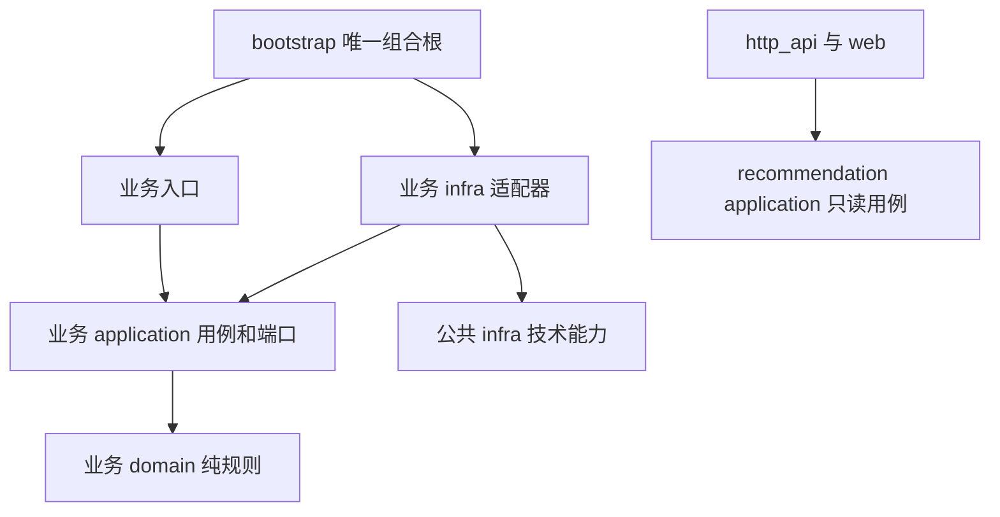
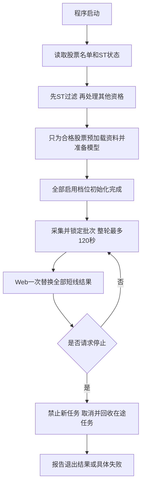
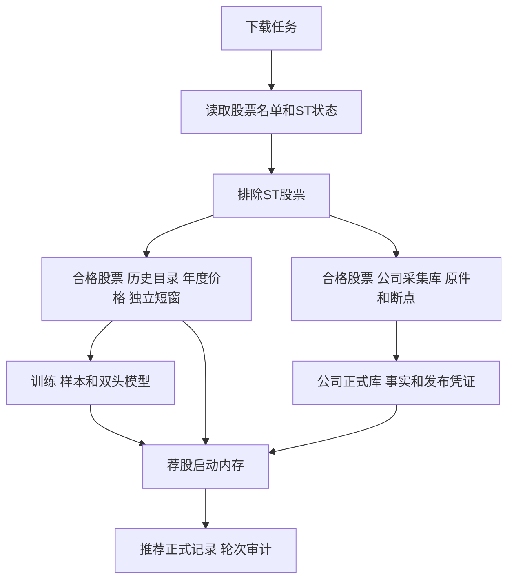
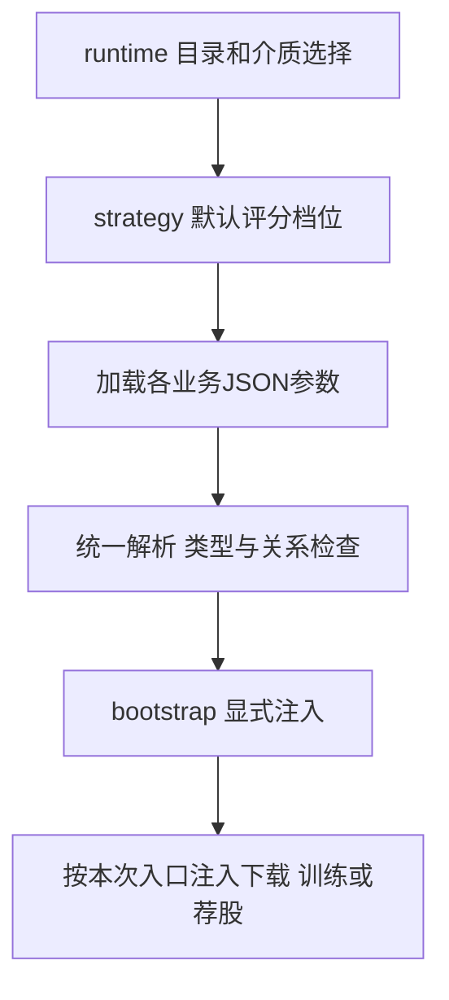
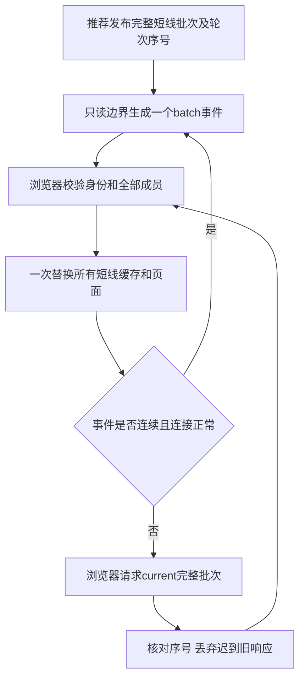

# 系统设计

本篇说明三条业务如何隔开、公共设施如何复用、数据库怎样读写、配置和页面怎样组织。评分字段归 c，下载库和来源归 d，训练样本和工件归 e。本篇不重复维护它们的业务字典。

这是目标设计和核对计划。已有能力不能因为换了文档就算重新完成；候选参数也不能直接当作生产设置。

## 1. 三条业务的输入、输出和边界

| 业务 | 入口 | 输入 | 输出 | 明确的边界 |
| --- | --- | --- | --- | --- |
| download | 人工 `sync history/market/company` | 数据源、已提交断点、下载配置 | 可用资料版本、覆盖和失败记录 | 不训练、不评分、不触发 Web 更新用例 |
| training | 人工选择四档训练 | 固定资料版本、训练配置 | 各档双头模型和评价报告 | 不自动下载，不发布推荐 |
| recommendation | 本地服务启动 | 已发布资料、模型、实时行情 | 不可变推荐批次和只读状态 | 不补历史、不训练、不日更新 |
| http_api、web | 浏览器请求和事件订阅 | recommendation/application 只读用例 | JSON 白名单和桌面展示 | 不抓取、评分、访问业务数据库或写业务状态 |

荐股和三个下载模块都先读取全部股票的代码、名称和ST状态，排除ST后，才为通过者加载或采集其他个股资料。荐股从本地已发布资料读取ST状态，缺失时由用户手动执行下载；两者使用相同的ST判定规则，不互相调用业务实现。被排除、通过、状态不明分别计数；状态不明不能默认通过。

`train`只调用`bootstrap.ExecuteSelectedTraining`，读取已经发布的本地资料；缺资料时提示用户手动执行`./run.sh sync history`，不代为下载。原自动组合函数`ExecuteDownloadTrain`删除，`run.sh train`继续转发同一个CLI入口。训练的线程数和进程优先级也由组合根准备。

## 2. 模块与依赖



domain 不读配置、时间、网络、文件或数据库。application 依赖明确端口和真实类型，不导入本业务 infra、Flask 或其它业务实现。适配器不暗中创建客户端、连接池或线程池，由组合根注入并负责释放。`CreateApp()` 只组装应用，无线程、联网、建库、写文件副作用。

无I/O的跨业务技术primitive按具名合同复用：SqliteActivity、SqliteObservation、IndependentSqliteWork只提供上下文内计数和独立工作隔离，不创建连接或执行SQL。应用层与全仓架构测试共用同一导入判定，观测模块也只开放这三个符号；sqlite_connection/session、业务adapter和隐藏I/O仍禁止，不通过扩大模块白名单授予数据库能力。

跨业务交接是有明确类型的不可变对象或已发布工件。JSON 只在配置、供应商解析、存储编码和公开投影边界出现，不用 `dict`、`Any`、反射或空对象掩盖内部合同。活动源码单文件最多1500行，按职责拆分。

| 公共能力 | 唯一职责 | 不应放入的内容 |
| --- | --- | --- |
| 时钟 | 上海业务时间、单调 deadline | 自动判断某业务该下载什么 |
| HTTP 传输 | 超时、取消、重试计数、连接回收 | 财务语义、公司风险判定 |
| SQLite primitive | 连接、事务、锁、介质参数、观察计数 | 各业务 schema、SQL、发布资格 |
| 执行器 | 有界任务、背压、停止、等待和在途统计 | 隐式跨业务编排 |
| 配置解析 | 一次解析为类型对象并注入 | 每层自行读配置、复制默认值 |

## 3. 启动、运行和退出



资源表必须列创建者、使用者、停止动作、等待上限和状态。连接、进程、线程、文件映射、队列及 OCR 子进程均不能只“发出取消”却不回收。超时轮次彻底退出前不得开始下一轮；清理耗时独立记录，不能悄悄算作正常120秒内成功。

荐股执行资源已由`config/scheduler.json.pipeline.executors`启动解析并交`bootstrap._build_worker_context`创建。默认并发保持原值，运行配置身份记录有效参数；模型特征/训练manifest不因改变线程数而更换。`CreateApp`和系统组合不启动这些资源。以下是A本阶段核对的实际生命周期；下载/训练/OCR资源仍由各自owner验收，实测CPU/RSS/I/O归D。

| 资源 | 创建/启动与唯一owner | 停止、等待与状态 |
| --- | --- | --- |
| 每档control池 | 组合根创建；SchedulerRuntime启动，normal/urgent独立；每档各一份 | RuntimeSupervisor → SchedulerRuntime按统一ShutdownDeadline停池；BoundedExecutorStatus报告在途/拒绝/完成/运行状态 |
| source_data及两个报价池、分钟池 | 组合根创建，第一档拥有，后续档共享；ApplicationResources.start启动 | 源lane先禁新请求再等待；共享池仅第一档stop，各自回收排队Future并按同一deadline等待在途；后续档不重复关闭 |
| HTTP隔离进程池 | 组合根创建，第一档启动；请求时惰性spawn进程并独占transport | stop先停止接收/发取消，等待并terminate/kill/join自有进程；未回收不归还并发名额，ShutdownStep报告未完成 |
| company_exclusions单writer池 | 组合根固定1 worker/1排队，CompanyEligibility启动；它是串行事实写入的职责上限 | CompanyEligibility先停派发、排空已承诺写入，stop保留失败/未提交原因；不把单writer变成可并行写库参数 |
| scheduler与deferred初始化线程 | RuntimeSupervisor启动，后者只在有后台初始化器时创建 | 启动异常沿同一个stop路径发停止信号并保留线程引用，等待所有实际已启动线程；未启动线程不join。停止报告分别包含scheduler/runtime/deferred_initializers，后台初始化未退出不能标completed |
| Long、输入预载、缓存与预算 | 组合根注入；Long每档独立，共享预载/缓存/预算归第一档 | ProfiledApplicationSystem逆序停档，第一档最后关闭共享资源；超时线程不能强杀，明确返回未完成，调用者继续遵守整轮回收门 |

所有监督器默认停止期限使用已注入单调时钟，显式传入deadline时各资源共用该对象。后台初始化收到停止后不再执行后续初始化器；某个正在执行的不可取消调用超时，只能报告未完成，不能以daemon线程替代回收证明。

同一线程池内的任务不能同步等待自己再次提交的任务，避免池满后互等。资源上限说明实际是软件预约/观察门，还是宿主进程/系统硬隔离，不把RSS采样写成保证不会被系统杀进程。

## 4. 数据发布与读写隔离

下载先读取全部股票的名单和ST状态，排除ST后，再安排合格股票的下载任务和断点，最后检查整批完整性，通过后切换可用发布。训练和荐股只读取固定发布身份；一个操作中途不跟随新资料切换。ST过滤不能拖到日线、财务、公告正文或OCR之后；续传和补缺同样受这道门约束。

正常盘中从实时采集到服务端推荐发布，目标是零数据库连接、零 SQL。启动预读在轮前；非关键诊断或研究写入用有界后台队列，在正常轮次外计量；历史查询、序号预留和15:00正式冻结分别计量。队列满、写入失败或未排空必须可见，不能把正式持久化承诺降成易失内存。

“内存中一次替换全部短线视图”与“多数据库一次事务”是两件事。现有跨档数据库不能假称全局事务。正式冻结先取得真实持久成功凭证；部分提交恢复保留已提交事实，不覆盖、不拼成假完整批次。若实测及正确性证据支持合库，才考虑同库原子冻结方案。

## 5. 数据库布局和公共字典规范

下面列的是数据库文件和工件目录，不是字段表。路径按 `config/runtime.json` 中 `data_dir=data` 举例；实际数据根目录由该配置决定。

| 资料族 | 当前代码或文档中的代表路径 | 负责文档 | 主要读写方式 |
| --- | --- | --- | --- |
| 完整历史目录和年库 | `data/market/history/catalog.sqlite3`、`prices_<year>.sqlite3` | d 第3、8章 | 下载批写，训练按日期顺序读，启动按窗口读 |
| 独立短窗 | `data/market/daily_window.sqlite3` | d 第4、8章 | 整窗 raw/qfq 配对提交 |
| 证券、ST、行业 | `data/market/reference/company_st.sqlite3`、`industry.sqlite3` | d 第2、8章 | 手动更新、启动批量读取 |
| 公司采集与正式事实 | `data/company/raw/company_collection.sqlite3`、`company_facts.sqlite3` | d 第5、8章 | 采集账本和轻量正式事实分开 |
| 样本与模型 | `data/training/` | e 第3、7章 | 身份固定、有界批读、各档双头发布 |
| 冻结、序号、研究 | `data/recommendation/<profile>/`、`data/research/<profile>/` | c 第12章、e 第8章 | 追加正式事实、按日期查询、研究隔离 |

这是路径索引，不证明本次检查过活动库。后续字典应从 schema、SQL 和消费者核对，不能只抄某次落盘清单。年度价格表只写一套结构及分区规则，不把2018–2026同一字段表重复九次。



这是数据去向图，不表示这些库共享一个事务。采集库与正式库、不同年度库、不同档位冻结的实际提交与恢复边界分别由d/c说明。

每张表必须写清用途、唯一写入者、全部读者、主键、索引、事务、发布边界、保留范围和预计读写量。每列按下表逐项说明，不允许“用于业务”“相关数据”等空话。

下面是字段说明模板。示例来自 `data/company/company_facts.sqlite3` 的 `company_facts` 表；这里的 `published_at` 是本地正式快照发布时间，财报原披露时间是另一列 `disclosed_at`。

| 列名 | 中文含义 | 类型和单位 | 来源及原始字段 | 空值含义 | 更新比较规则 | 荐股层/训练用途 | 写入与读取代码 |
| --- | --- | --- | --- | --- | --- | --- | --- |
| 示例：`published_at` | 本地事实快照发布时间 | INTEGER，时间编码由持久化codec解释 | 本地正式发布事务 | NOT NULL | 事实与成功凭证提交时记录，不能替代原披露时间比较新旧 | 追踪采用的资料版本；不表示财报当时已可见 | `company_facts_schema.py`、`company_facts_index.py`；完整消费者归d第8章 |

### 5.1 跨业务供数与消费者核对

核对基线为已推送`17c09942`。下表把下载的物理来源、不可变端口、荐股及训练消费者连起来；各业务字典仍由原owner维护，避免重复定义列、默认值或公式。d第8–9章目前明确是范围和计划，尚未提供全部SQL列与download.json叶子说明；不能将此表当作B字典已经收齐。

| 数据或资源 | 唯一来源、类型与消费者 | 边界及证据归属 |
| --- | --- | --- |
| 证券/ST/日历 | reference的company_st.sqlite3 → PreparedReference/HistoryStEvidence → 发布参考；A的PublishedReferences/StaticMarketCache与B的PrepareReference使用明确资格，训练按发布总体/日历读取 | ST/unknown先筛，原检查日与本次观察时点分开；d2.3、c2/16.2；A340、B333的功能证据不等于实际整链采用 |
| 历史发布/年度价格 | catalog与prices_<year>.sqlite3 → ReadPublishedHistoryUseCase、HistoryTrainingRow/Point；A共享预载、C共享历史fanout | 固定snapshot/revision/sequence，取消与只读名单在解码前生效；不另建子集manifest；d3/8、e3.1及3.4 |
| 独立短窗 | daily_window.sqlite3 → 同一历史只读端口的短窗adapter → A启动历史投影 | 原始/前复权配对、成员和发布凭据独立；不借完整历史断点，不在运行期补历史；d4/6.1 |
| 行业 | industry.sqlite3 → CurrentIndustryCache/PublishedReferences → A展示行业与模型行业、C历史行业路由 | 官方证据保留来源/摘要/披露及生效区间、分类与映射；当前展示不能倒填历史行业；d2.5、c7及e3.1 |
| 公司正式事实 | company_facts.sqlite3 → CompanyEvidenceReadPort/CompanyFacts → PublishedCompanyResearch内存投影 → A过滤/评分/风险 | 采集库、文件/PDF/OCR不是正式评分输入；未知不填无风险，披露日与本地published_at不同；d5.4/5.9/5.10、c6/16.4 |
| 模型/样本 | C的封存samples.sqlite3/complete.json及双头model.json → 严格profile加载 → A模型排序/净效用/动作门 | V1/V5独立排序，V2/V3仍local_score；数值重放、质量、收益与实际采用分别取证；e3.4–3.6/7.1、c7–12 |
| 实时报价/分钟 | A行情adapter → 不可变批次 → 特征/横截面/四档决策 → 只读快照/HTTP/SSE | 固定同轮输入，正常轮不访问业务数据库；Long独立、旧结果保留，不能拿启动查询替代运行轮观测；c1/4/13、b8 |
| SQLite页缓存/mmap | 公共sqlite.json → SqliteIoPolicy → download/荐股已有连接边界；训练样本连接采用training.json.resources.samples的独立设置 | 技术primitive不成为第二业务owner；保留样本独立作用域，不把纯I/O参数写成模型语义；b7.2、e6.2 |
| 执行器/公司预载 | scheduler.json → ExecutionSettings/CompanyPreloadSettings → bootstrap显式创建/注入 → A执行器/共享预载 | 创建、启动、停止、等待见b3；默认容量和30秒/3次保留，生命周期回归见342；改值未签性能 |
| 训练预约/批读/缓存 | training.json.resources → TrainingResourceSettings/TrainingSampleSettings → C训练组合根/fanout/全部样本读写者 | 每档有界队列、CPU/内存预约、取消清理见e6.2–6.4及7.2–7.3；已提交345资源接线，实测由C后台承接 |

量额追链结果：`tencent_daily._row`将日线第5位成交手数乘100成为股数、第8位万元金额乘10000成为元；`tencent_qfq_supplier._parse_side`按raw/qfq分支原样传量额，`price_columns._side_values`写各分支列，不使用价格复权比去乘成交额。训练SQL明确取`daily_price_revision.qfq_amount`与`raw_volume`，`history_prices._decode_training_row`生成`HistoryTrainingPoint`；`AlignTrainingRows`按市场日历区分停牌估值与真正缺行，`sample_builder`再用于20日金额、V1因子及V5量额通道。因此qfq_amount是qfq分支随价格一起取得的实际金额输入，不是数据库内重新计算的复权名义成交额；不能仅凭字段名把它等同raw_amount或改模型公式。这里确认当前代码来源和换算，供应商真实历史同口径/修订一致性仍由B审计，不替代全部来源事实核验。

字典交接还须有B下载全部表列/索引/codec、download.json逐叶消费者及字段真实读回证据；C的样本/工件/16项每机器资源字段已有说明，仍须以真实封存身份验证数值和释放。A已将可核对部分与消费者连通，缺项只保留原341/332及C阶段，不把B/C现场未提交改动或旧报告当作交付。

## 6. HDD 与 SSD 怎样分别设计

| 事项 | HDD 候选方向 | SSD 候选方向 | 必须一起检查 |
| --- | --- | --- | --- |
| 批读 | 按物理库、日期归组顺序读取 | 比较小批和适度并发 | 总耗时、读取字节、RSS、是否重复扫描 |
| 批写 | 单物理库一个 writer，合并事务减少寻道 | 比较批次和独立库并发 | 持久性、锁等待、事务数、尾批恢复 |
| 连接与索引 | 复用连接，按真实条件设计索引 | 同样避免重复连接和冗余索引 | 查询计划、写放大、整个业务耗时 |
| WAL/checkpoint | 在提交边界控制集中写入成本 | 比较 checkpoint 频率和写放大 | WAL 大小、关闭成本、故障恢复 |
| 样本布局 | 顺序读取、连续数组候选 | 批读与映射读取候选 | 首次生成、复用、增量和清理总成本 |

现状：`runtime.json.disk_medium` 是全局选择；`sqlite.json.sqlite_policy.hdd/ssd` 各有连接超时、读窗、驱动批次和 checkpoint，当前两组数值相同。2026-11-05用户确认当前PC为SSD，HDD在另一台PC；两机分别验证记录，不将本机虚拟磁盘的`ROTA`当作宿主机介质证明。配置选择、用户确认和只读disk自动检测分别记录于g，不能相互替代。`download.history.write_batches` 已有介质差异，不表示所有模块都已调优。

组合根`BuildSqlitePolicy`选择唯一不可变策略，显式配置优先，自动检测unknown使用HDD保守策略。下载、训练及荐股持久化adapter把同一个策略传到公共SQLite边界；只读HTTP/Web不自行选介质或打开业务数据库。`connection_timeout_seconds`进入连接超时，`read_window_rows`限制底层取行窗口，`transaction_batch_rows`限制一次驱动批量提交的行数，`checkpoint_mode`由显式checkpoint操作消费。驱动分批仍处于调用者原有事务内，不按每个小批次分别COMMIT。

history另外通过`ChooseHistoryWriteTuning`选择业务writer的flush阈值：HDD首建8股/16384格，增量16股/8192格；SSD首建及增量16股/8192格，unknown按HDD。它与SQLite驱动批次是不同层的限制，不共享第二套默认值。策略和消费者证据及实测状态只记入g。

不得关闭正式数据持久性或弱化完整性换取速度。SQLite、数组和列式候选必须把首建、增量、重复读、取消、恢复、关闭都计入，不只比较一次查询。

## 7. 配置文件怎样写清楚

### 7.1 文件归属

下面的文件全部位于仓库 `config/` 目录；本表说明文件分工，各字段的当前值和消费者放在对应详细章节。

| 文件 | 主要配置 | 作用边界 | 详细字段放在哪里 |
| --- | --- | --- | --- |
| `runtime.json` | 数据目录、运行目录、介质、配置入口 | 组合根 | 本章 |
| `strategy.json` | 默认评分档位 `scoring_profile` | 统一解析 | 本章 |
| `sqlite.json` | hdd/ssd 连接、批次、读窗、checkpoint | 公共存储 | 本章 |
| `scheduler.json` | deadline、worker、队列、轮次和退出 | 荐股调度 | c 第1、14章 |
| `market_data.json` | 行情来源、请求期限、重试、熔断 | 荐股采集 | c 第4章 |
| `cache.json` | 数据集、容量、有效期、分组和总内存 | 荐股内存 | c 第13章 |
| `download.json` | 三模块范围、请求、批次、断点和 PDF/OCR | 下载 | d 第9章 |
| `training.json` | 四档窗口、线程、内存、模型与早停 | 训练 | e 第6章 |
| `features.json` | 特征定义和参数 | 特征合同 | c 第6章、e 第3章各说明消费用途，定义只保留一处 |
| `filter.json` | 资格、黑名单、硬过滤 | 荐股第2、4层 | c 第3、5章 |
| `scoring.json` | 评分组件和权重 | 荐股第7层 | c 第8章 |
| `risk.json` | 本地风险 | 荐股第8层 | c 第9章 |
| `selection.json` | 动作、六席、板块限制 | 荐股第9、11层 | c 第10、12章 |
| `cost.json` | 成本参考与净效用 | 荐股第5、6层 | c 第6、7章 |
| `delivery.json` | API、SSE、客户端恢复参数 | 只读交付 | 第8章 |
| `long.json`、`long_watchlist.json` | Long 行为和固定名单 | 独立展示 | 第8章 |
| `research.json` | 研究分区、评价和统计参数 | 离线研究 | c 第15章、e 第8章 |
| `performance.json` | 负载、轮数、延迟、内存和介质门槛 | 测量与验收 | 第10章 |
| `deepseek.json` | 既有请求、预算和复核参数 | 可选复核 | c 第11章；改造暂缓 |

### 7.2 字段说明格式



配置按 JSON 路径逐个叶子字段列清单；数组需写元素结构，动态名称需写允许值。每行必须有当前值、中文意思、类型、单位、范围、解析者、最终消费者、在哪一步起作用、何时生效及是否影响结果身份。敏感配置只写凭据位置，不写秘密内容。字段表前必须注明文件；混合多个来源时拆表，或逐行写清来源。

以下字段来自 `config/runtime.json`，字段路径从该文件根节点开始，不含额外的 `runtime` 层。

| 字段路径 | 中文意思 | 类型/单位 | 核对时当前值 | 作用 | 生效和约束 |
| --- | --- | --- | --- | --- | --- |
| `runtime_dir` | 运行状态目录 | 路径 | `.runtime/trader` | 组合根建立运行资源 | 启动读取；不得提交运行数据 |
| `data_dir` | 业务数据根目录 | 路径 | `data` | 各业务构造自己的数据路径 | 启动读取；不是自动删除范围 |
| `disk_medium` | 选择存储策略 | `hdd/ssd` | 本轮SSD PC工作区为`ssd`；HDD PC另记 | 给实际读写 adapter 注入策略 | 启动读取；配置值不是物理介质证明 |
| `strategy_config` | 业务配置入口 | 文件名 | `strategy.json` | 统一配置解析 | 启动一次读取 |
| `long_watchlist` | Long 名单文件 | 文件名 | `long_watchlist.json` | Long 只读名单 | 不影响短线模型身份 |

以下字段来自 `config/sqlite.json` 的 `sqlite_policy` 对象。`<介质>` 表示 `hdd` 或 `ssd`，由上表 `disk_medium` 选择。

| 字段路径 | 中文意思 | 类型/单位 | 核对时当前值 | 作用 | 生效和约束 |
| --- | --- | --- | --- | --- | --- |
| `sqlite_policy.<介质>.connection_timeout_seconds` | SQLite 等锁超时 | 秒 | 两组均5 | 连接边界 | 有限正值；不能无限等待 |
| `sqlite_policy.<介质>.read_window_rows` | 一批读取的行数 | 整数/行 | 两组均512 | 批读 adapter | 先测后调 |
| `sqlite_policy.<介质>.transaction_batch_rows` | 每次向驱动批量提交的行数上限 | 整数/行 | 两组均64 | 公共SQLite批写边界 | 分批不拆业务事务，不改变逻辑原子单位 |
| `sqlite_policy.<介质>.checkpoint_mode` | WAL 收尾方式 | 枚举 | 两组均TRUNCATE | 连接/任务收尾 | 计入真实收尾耗时 |

这张表只是已核对的公共字段，不冒充全部参数字典已完成。其它文件逐叶清点和调用者对照是 g 中 P06、P07 及各业务任务的明确交付物。

合法改值要真正传到消费者；不能读完配置又用硬编码替代，也不能用“必须等于当前默认值”锁死调参。配置重启生效，只有改变特征、样本、模型语义的字段才影响对应身份。

### 7.3 完整配置清点与身份边界

本节与c第16章合起来覆盖`config/`顶层20个JSON文件。数组按元素结构或具名选择器列举，避免把每个Long名单成员、每个风险规则的相同结构复制成另一套配置。`config/performance_fixture/manifest.json`是性能夹具的子目录清单，不是第21个运行配置入口，归D保留验收。

解析是输入边界，最终消费者决定参数是否实际起作用。`runtime_loader._configuration_identity`包含合并runtime配置，但排除`sqlite_policy`和`pipeline.history_preload`；`factor_validation._strategy_contract_identity`包含完整strategy合并配置（包括描述性因子字段和关闭的公司奖励参数）。组合根再合并runtime、strategy和cost身份。改因子文义会形成新的运行配置身份，不重写旧冻结记录，也不改模型工件特征manifest身份。

公共路径/介质的五个叶子及SQLite两介质各四个叶子已逐项列于7.2。`strategy.json.scoring_profile`是枚举`v1/v2/v3/v5`（当前`v2`），由`LoadStrategySettings`解析；显式入口可覆盖档位，结果身份保留有效档位。其余评分文件在[c第16章](c_评分设计.md#16-字段配置与消费者核对)，下载由[d第8–9章](d_下载设计.md#8-数据库和字段字典如何补齐)维护，训练由[e第3及6章](e_训练设计.md#61-trainingjson现有逐叶配置)维护。B的完整下载字典仍在其任务内，不以本章覆盖；C未提交内容也不作本阶段交付证据。

#### scheduler.json

来源：`config/scheduler.json`。`runtime_loader.LoadRuntimeSettings` → `PipelineSettings` → `bootstrap`、`runtime/schedule.py`、`supervisor.py`及各有界队列。事件队列/worker为正整数，执行器排队容量和来源urgent线程数允许0；轮期限0.1–120秒，停止期限≥0.1秒；预载提示0.001–3600秒；cadence为正秒。所有字段启动生效；除`history_preload`外进入runtime身份。

| 字段路径 | 中文作用 | 当前值 | 类型/单位 |
| --- | --- | --- | --- |
| `pipeline.event_queue_size` | 事件队列容量 | `512` | 整数 |
| `pipeline.priority_queue_size` | 高优先级队列容量 | `64` | 整数 |
| `pipeline.executors.control.normal_workers` | 每档控制池普通线程数 | `1` | 正整数/线程 |
| `pipeline.executors.control.urgent_workers` | 每档控制池紧急线程数，保证控制请求有独立lane | `1` | 正整数/线程 |
| `pipeline.executors.control.queue_capacity` | 控制池普通排队容量 | `4` | 非负整数/任务 |
| `pipeline.executors.source_data.normal_workers` | 共享来源调度普通线程数 | `5` | 正整数/线程 |
| `pipeline.executors.source_data.urgent_workers` | 共享来源紧急线程数，0表示不分独立lane | `1` | 非负整数/线程 |
| `pipeline.executors.source_data.queue_capacity` | 共享来源普通排队容量 | `5` | 非负整数/任务 |
| `pipeline.executors.candidate_quotes.workers` | 定向报价池线程数 | `4` | 正整数/线程 |
| `pipeline.executors.candidate_quotes.queue_capacity` | 定向报价排队容量 | `4` | 非负整数/任务 |
| `pipeline.executors.market_quotes.workers` | 全市场报价池线程数 | `3` | 正整数/线程 |
| `pipeline.executors.market_quotes.queue_capacity` | 全市场报价排队容量 | `3` | 非负整数/任务 |
| `pipeline.executors.intraday_minutes.workers` | 分钟池线程数及每批分钟并发上限，使用同一值 | `5` | 正整数/线程 |
| `pipeline.executors.intraday_minutes.queue_capacity` | 分钟请求排队容量 | `5` | 非负整数/任务 |
| `pipeline.executors.http_workers` | HTTP隔离进程并发上限 | `12` | 正整数/进程 |
| `pipeline.round_timeout_seconds` | 整轮统一期限 | `120` | 数值/秒 |
| `pipeline.shutdown_timeout_seconds` | 停止等待期限 | `30` | 数值/秒 |
| `pipeline.long_quote_max_age_seconds` | Long 实时报价最大来源年龄；按source_time计算，超过后保留报价并标记过期降级 | `30` | 正数/秒；必填，自定义scheduler须补齐 |
| `pipeline.history_preload.warn_after_seconds` | 历史预载慢提示期限 | `300` | 数值/秒 |
| `pipeline.company_preload.timeout_seconds` | 公司快照完整预载总期限 | `30` | 有限数值/秒，0.001–3600；不逐尝试重置 |
| `pipeline.company_preload.publication_attempts` | 发布身份漂移时最多完整重读次数 | `3` | 严格整数，1–10；不是所有异常都重试 |
| `pipeline.cadence_seconds.full_market.before_close` | 任务 full_market 在 before_close 阶段的派发间隔 | `10` | 数值/秒 |
| `pipeline.cadence_seconds.candidate_quotes.before_close` | 任务 candidate_quotes 在 before_close 阶段的派发间隔 | `10` | 数值/秒 |
| `pipeline.cadence_seconds.topk_quotes.before_close` | 任务 topk_quotes 在 before_close 阶段的派发间隔 | `10` | 数值/秒 |
| `pipeline.cadence_seconds.topk_quotes.after_close` | 任务 topk_quotes 在 after_close 阶段的派发间隔 | `10` | 数值/秒 |
| `pipeline.cadence_seconds.long_quotes.before_close` | 任务 long_quotes 在 before_close 阶段的派发间隔 | `10` | 数值/秒 |
| `pipeline.cadence_seconds.long_quotes.after_close` | 任务 long_quotes 在 after_close 阶段的派发间隔 | `10` | 数值/秒 |
| `pipeline.cadence_seconds.score.before_close` | 任务 score 在 before_close 阶段的派发间隔 | `10` | 数值/秒 |
| `pipeline.cadence_seconds.intraday_tail.afternoon` | 任务 intraday_tail 在 afternoon 阶段的派发间隔 | `10` | 数值/秒 |
| `pipeline.cadence_seconds.intraday_tail.final_review` | 任务 intraday_tail 在 final_review 阶段的派发间隔 | `10` | 数值/秒 |
| `pipeline.cadence_seconds.industry_heat.warmup` | 任务 industry_heat 在 warmup 阶段的派发间隔 | `120` | 数值/秒 |
| `pipeline.cadence_seconds.industry_heat.morning` | 任务 industry_heat 在 morning 阶段的派发间隔 | `60` | 数值/秒 |
| `pipeline.cadence_seconds.industry_heat.afternoon` | 任务 industry_heat 在 afternoon 阶段的派发间隔 | `60` | 数值/秒 |
| `pipeline.cadence_seconds.industry_heat.final_review` | 任务 industry_heat 在 final_review 阶段的派发间隔 | `60` | 数值/秒 |
| `pipeline.publish_heartbeat_seconds` | 发布心跳间隔 | `15` | 数值/秒 |

上述executors由`settings/execution.ParseExecutionSettings`严格解析为不可变ExecutionSettings；缺项、未知键、布尔冒充整数及非法范围均拒绝。normal_workers与urgent_workers相加是对应池总线程数，urgent排队容量仍由有界执行器随urgent线程数推导。控制池至少各有1条普通/紧急线程；其他池不接受没有消费者的urgent配置。分钟loader已移除隐藏的5线程截断，合法值传到实际请求并发；所有新参数重启生效并进入runtime身份，不改变模型manifest、120秒整轮上限或168次复核预算。

旧`pipeline.market_workers`迁为source_data的normal_workers；保留旧自定义容量时，urgent_workers按原规则在market_workers>1时填1，否则填0。三个未消费的normalization_workers/strategy_workers/deepseek_workers删除，旧键一律拒绝，无兼容别名。现有自定义scheduler配置须按此13叶子结构迁入，并补必填company_preload的timeout_seconds/publication_attempts，默认30/3。唯一解析生成CompanyPreloadSettings，由组合根及所有具名诊断传给PublishedCompanyResearch；总deadline跨重读共享，取消不读取证据，失败/取消不采用部分投影，无可空或隐藏默认回退。原12,000代码安全上限不作为性能调参入口。

#### market_data.json

来源：`config/market_data.json`。`runtime_loader` → `MarketDataSettings` → 组合根显式注入`infra/market_data`来源路由/来源lane及公共HTTP。超时为有限正秒，次数和行数为正整数，布尔严格解析；`tushare.token_file`仅记位置，不记内容。来源合同标识不证明来源被调用。进入runtime身份；开关关闭仍保留配置身份。

| 字段路径 | 中文作用 | 当前值 | 类型/单位 |
| --- | --- | --- | --- |
| `market_data.eastmoney_timeout_seconds` | 东方财富请求期限 | `8` | 数值/秒 |
| `market_data.sina_timeout_seconds` | 新浪备用请求期限 | `8` | 数值/秒 |
| `market_data.full_market_primary_timeout_seconds` | 全市场主路期限 | `12` | 数值/秒 |
| `market_data.full_market_quote_attempts` | 全市场主路尝试上限 | `2` | 整数 |
| `market_data.candidate_timeout_seconds` | 定向行情期限 | `3` | 数值/秒 |
| `market_data.minimum_market_rows` | 全市场完整性最小行数 | `1000` | 整数 |
| `market_data.single_flight` | 同键合并在途请求 | `true` | 布尔 |
| `market_data.circuit_breaker_failures` | 连续失败熔断阈值 | `3` | 整数 |
| `market_data.circuit_breaker_seconds` | 熔断冷却 | `30` | 数值/秒 |
| `market_data.source_contracts.eastmoney` | eastmoney来源合同标识；进入来源/批次身份，不代表本轮实际调用 | `"eastmoney_quote_security_master"` | 文本 |
| `market_data.source_contracts.sina` | sina来源合同标识；进入来源/批次身份，不代表本轮实际调用 | `"sina_quote_backup"` | 文本 |
| `market_data.source_contracts.tencent` | tencent来源合同标识；进入来源/批次身份，不代表本轮实际调用 | `"tencent_quote"` | 文本 |
| `market_data.source_contracts.tushare` | tushare来源合同标识；进入来源/批次身份，不代表本轮实际调用 | `"tushare_sdk_120_point_daily_audit"` | 文本 |
| `market_data.tushare.enabled` | 功能启用 | `true` | 布尔 |
| `market_data.tushare.points` | Tushare积分声明 | `120` | 整数 |
| `market_data.tushare.timeout_seconds` | 物理请求期限 | `8` | 数值/秒 |
| `market_data.tushare.token_file` | 凭据文件位置 | `".token_key"` | 文本 |

#### delivery.json

来源：`config/delivery.json`。`runtime_loader` → `ServerSettings/ApiSettings` → HTTP/SSE及Web投影。端口1–65535，容量为正整数，保留时间为有限正秒；`TRADER_HOST/TRADER_PORT`可覆盖监听配置。查询条数不改变固定六席，HTTP仅读application投影。启动生效并进入runtime身份，环境覆盖另由有效ServerSettings携带。

| 字段路径 | 中文作用 | 当前值 | 类型/单位 |
| --- | --- | --- | --- |
| `server.host` | 监听地址 | `"127.0.0.1"` | 文本 |
| `server.port` | 监听端口 | `5000` | 整数 |
| `server.debug` | 调试开关 | `false` | 布尔 |
| `server.use_reloader` | 重载开关 | `false` | 布尔 |
| `server.allow_insecure_non_loopback` | 允许非回环明文监听 | `false` | 布尔 |
| `api.default_top_n` | 只读查询默认条数 | `12` | 整数 |
| `api.maximum_top_n` | 只读查询条数上限 | `12` | 整数 |
| `api.sse_history_size` | SSE保留事件数 | `256` | 整数 |
| `api.sse_client_queue_size` | 单客户端事件队列容量 | `16` | 整数 |
| `api.sse_max_clients` | SSE客户端上限 | `32` | 整数 |
| `api.web_snapshot_retention_seconds` | 浏览器快照保留时间 | `35` | 数值/秒 |

#### deepseek.json

来源：`config/deepseek.json`。`runtime_loader` → `DeepSeekSettings` → `DeepSeekBudgetLedger`、reviewer及显式HTTP客户端。当前`enabled=false`；读取配置不代表已发请求。预算为非负整数，批量/token/窗口为正整数，比例在0–1，期限为正秒；总物理请求≤168，重试/失败也计数。进入runtime身份；本阶段只核对现状，不改复核流程。

| 字段路径 | 中文作用 | 当前值 | 类型/单位 |
| --- | --- | --- | --- |
| `deepseek.enabled` | 功能启用 | `false` | 布尔 |
| `deepseek.base_url` | 复核API地址 | `"https://api.deepseek.com"` | 文本 |
| `deepseek.model` | 复核模型名 | `"deepseek-v4-flash"` | 文本 |
| `deepseek.timeout_seconds` | 物理请求期限 | `20` | 数值/秒 |
| `deepseek.batch_size` | 单次复核股票上限 | `4` | 整数 |
| `deepseek.max_tokens` | 单次输出token上限 | `1800` | 整数 |
| `deepseek.daily_hard_limit` | 每日物理请求总上限 | `168` | 整数 |
| `deepseek.strategy_limits.tomorrow` | tomorrow独立预算桶上限（物理请求次数） | `38` | 整数 |
| `deepseek.strategy_limits.d25` | d25独立预算桶上限（物理请求次数） | `16` | 整数 |
| `deepseek.strategy_limits.shared_preheat` | shared_preheat独立预算桶上限（物理请求次数） | `4` | 整数 |
| `deepseek.strategy_limits.emergency` | emergency独立预算桶上限（物理请求次数） | `5` | 整数 |
| `deepseek.stage_targets.shared_preheat` | shared_preheat阶段软目标（物理请求次数） | `2` | 整数 |
| `deepseek.stage_targets.tomorrow_morning` | tomorrow_morning阶段软目标（物理请求次数） | `6` | 整数 |
| `deepseek.stage_targets.tomorrow_afternoon` | tomorrow_afternoon阶段软目标（物理请求次数） | `10` | 整数 |
| `deepseek.stage_targets.tomorrow_final` | tomorrow_final阶段软目标（物理请求次数） | `5` | 整数 |
| `deepseek.stage_targets.d25_morning` | d25_morning阶段软目标（物理请求次数） | `2` | 整数 |
| `deepseek.stage_targets.d25_afternoon` | d25_afternoon阶段软目标（物理请求次数） | `4` | 整数 |
| `deepseek.stage_targets.d25_final` | d25_final阶段软目标（物理请求次数） | `2` | 整数 |
| `deepseek.stage_targets.emergency` | emergency阶段软目标（物理请求次数） | `0` | 整数 |
| `deepseek.stage_limits.shared_preheat` | shared_preheat阶段硬上限（物理请求次数） | `4` | 整数 |
| `deepseek.stage_limits.tomorrow_morning` | tomorrow_morning阶段硬上限（物理请求次数） | `10` | 整数 |
| `deepseek.stage_limits.tomorrow_afternoon` | tomorrow_afternoon阶段硬上限（物理请求次数） | `18` | 整数 |
| `deepseek.stage_limits.tomorrow_final` | tomorrow_final阶段硬上限（物理请求次数） | `10` | 整数 |
| `deepseek.stage_limits.d25_morning` | d25_morning阶段硬上限（物理请求次数） | `4` | 整数 |
| `deepseek.stage_limits.d25_afternoon` | d25_afternoon阶段硬上限（物理请求次数） | `8` | 整数 |
| `deepseek.stage_limits.d25_final` | d25_final阶段硬上限（物理请求次数） | `4` | 整数 |
| `deepseek.stage_limits.emergency` | emergency阶段硬上限（物理请求次数） | `5` | 整数 |
| `deepseek.adaptive.consecutive_failure_limit` | 连续失败降级阈值 | `2` | 整数 |
| `deepseek.adaptive.rolling_window` | 健康滑动窗口 | `5` | 整数 |
| `deepseek.adaptive.minimum_application_ratio` | 低应用率阈值 | `0.4` | 有限数值 |
| `deepseek.adaptive.healthy_application_ratio` | 健康应用率阈值 | `0.6` | 有限数值 |
| `deepseek.adaptive.healthy_batch_count` | 恢复所需健康批数 | `3` | 整数 |
| `deepseek.adaptive.cooldown_seconds` | 复核降级冷却 | `900` | 数值/秒 |

#### performance.json

来源：`config/performance.json`。`runtime_loader`/`market_policy.ParsePerformanceBudgets` → 性能诊断与门禁比较。行数/轮数/字节/延迟为非负或正数，百分比为有限数值；它们是验收预算，不是自动调度或收益参数。进入runtime身份；`database.hdd.evidence_status=validated`是旧配置标签，不签本轮D或当前PC已通过。

| 字段路径 | 中文作用 | 当前值 | 类型/单位 |
| --- | --- | --- | --- |
| `performance_budgets.workload.market_rows` | 全市场测量负载行数 | `5500` | 整数 |
| `performance_budgets.workload.candidate_rows` | 候选测量负载行数 | `5500` | 整数 |
| `performance_budgets.rounds.warmup` | 预热轮数 | `1` | 整数 |
| `performance_budgets.rounds.measurement` | 计量轮数 | `5` | 整数 |
| `performance_budgets.database.hdd.sqlite_improvement_percent` | SQLite候选改善门槛 | `10` | 数值/百分比 |
| `performance_budgets.database.hdd.parquet_improvement_percent` | 列式候选改善门槛 | `15` | 数值/百分比 |
| `performance_budgets.database.hdd.minimum_wins` | 重复测量最少胜出轮数 | `4` | 整数 |
| `performance_budgets.database.hdd.evidence_status` | 原历史证据状态 | `"validated"` | 文本 |
| `performance_budgets.database.ssd.sqlite_improvement_percent` | SQLite候选改善门槛 | `10` | 数值/百分比 |
| `performance_budgets.database.ssd.parquet_improvement_percent` | 列式候选改善门槛 | `15` | 数值/百分比 |
| `performance_budgets.database.ssd.minimum_wins` | 重复测量最少胜出轮数 | `4` | 整数 |
| `performance_budgets.database.ssd.evidence_status` | 原历史证据状态 | `"unverified"` | 文本 |
| `performance_budgets.latency_p95_ms.market_normalization` | market_normalization阶段P95延迟门槛 | `250` | 数值/毫秒 |
| `performance_budgets.latency_p95_ms.market_merge` | market_merge阶段P95延迟门槛 | `600` | 数值/毫秒 |
| `performance_budgets.latency_p95_ms.canonical_snapshot` | canonical_snapshot阶段P95延迟门槛 | `900` | 数值/毫秒 |
| `performance_budgets.latency_p95_ms.targeted_overlay_commit` | targeted_overlay_commit阶段P95延迟门槛 | `100` | 数值/毫秒 |
| `performance_budgets.latency_p95_ms.board_preselection` | board_preselection阶段P95延迟门槛 | `5000` | 数值/毫秒 |
| `performance_budgets.latency_p95_ms.candidate_union_projection` | candidate_union_projection阶段P95延迟门槛 | `100` | 数值/毫秒 |
| `performance_budgets.latency_p95_ms.board_local_scoring` | board_local_scoring阶段P95延迟门槛 | `250` | 数值/毫秒 |
| `performance_budgets.latency_p95_ms.two_strategy_board_scoring` | two_strategy_board_scoring阶段P95延迟门槛 | `750` | 数值/毫秒 |
| `performance_budgets.latency_p95_ms.three_board_wall_clock` | three_board_wall_clock阶段P95延迟门槛 | `1000` | 数值/毫秒 |
| `performance_budgets.latency_p95_ms.global_selection` | global_selection阶段P95延迟门槛 | `100` | 数值/毫秒 |
| `performance_budgets.latency_p95_ms.board_ready_to_draft` | board_ready_to_draft阶段P95延迟门槛 | `500` | 数值/毫秒 |
| `performance_budgets.latency_p95_ms.quote_to_draft` | quote_to_draft阶段P95延迟门槛 | `5000` | 数值/毫秒 |
| `performance_budgets.latency_p95_ms.deepseek_to_hybrid` | deepseek_to_hybrid阶段P95延迟门槛 | `1000` | 数值/毫秒 |
| `performance_budgets.latency_p95_ms.sse_publish` | sse_publish阶段P95延迟门槛 | `100` | 数值/毫秒 |
| `performance_budgets.latency_p95_ms.browser_patch_to_paint` | browser_patch_to_paint阶段P95延迟门槛 | `100` | 数值/毫秒 |
| `performance_budgets.latency_p95_ms.snapshot_api` | snapshot_api阶段P95延迟门槛 | `200` | 数值/毫秒 |
| `performance_budgets.latency_p95_ms.etag_api` | etag_api阶段P95延迟门槛 | `50` | 数值/毫秒 |
| `performance_budgets.latency_p95_ms.dates_api` | dates_api阶段P95延迟门槛 | `100` | 数值/毫秒 |
| `performance_budgets.latency_p95_ms.status_api` | status_api阶段P95延迟门槛 | `100` | 数值/毫秒 |
| `performance_budgets.data_age_p95_seconds.topk_critical` | topk_critical输入年龄P95门槛 | `2` | 数值/秒 |
| `performance_budgets.data_age_p95_seconds.topk_other` | topk_other输入年龄P95门槛 | `5` | 数值/秒 |
| `performance_budgets.data_age_p95_seconds.candidate_main` | candidate_main输入年龄P95门槛 | `5` | 数值/秒 |
| `performance_budgets.data_age_p95_seconds.candidate_other` | candidate_other输入年龄P95门槛 | `10` | 数值/秒 |
| `performance_budgets.data_age_p95_seconds.full_market_main` | full_market_main输入年龄P95门槛 | `10` | 数值/秒 |
| `performance_budgets.data_age_p95_seconds.full_market_other` | full_market_other输入年龄P95门槛 | `15` | 数值/秒 |
| `performance_budgets.memory.cache_logical_bytes` | 缓存逻辑字节门槛 | `536870912` | 整数 |
| `performance_budgets.memory.process_peak_rss_bytes` | 进程RSS字节门槛 | `2147483648` | 整数 |
| `performance_budgets.memory.growth_percent` | 内存增长百分比门槛 | `20` | 数值/百分比 |
| `performance_budgets.relative_regression_percent` | 相对回退百分比门槛 | `5` | 数值/百分比 |

#### research.json

来源：`config/research.json`。`training/infra/training_settings.LoadResearchExperimentSettings` → 离线研究/终端留出及消融合同；与`training.json`正式拟合设置分开。跨度/隔离为正交易日，profile为已支持档位，arms为显式有序方案名；研究身份消费，不注入在线数值评分。

| 字段路径 | 中文作用 | 当前值 | 类型/单位 |
| --- | --- | --- | --- |
| `terminal_holdout_sessions` | 一次终端留出交易日数 | `200` | 整数 |
| `embargo_sessions.tomorrow` | tomorrow研究分区隔离交易日数 | `5` | 整数 |
| `embargo_sessions.d25` | d25研究分区隔离交易日数 | `5` | 整数 |
| `fit_date_candidates` | 按profile、dates[]声明候选拟合日期跨度；不是生产训练设置 | `[{"profile":"v2","dates":[750,1000,1250]},{"profile":"v3","dates":[500,750,1000]}]` | 有序数组 |
| `ablation_arms` | 离线消融方案集合 | `["rule_only","rule_model_gate","industry_model_utility","pooled_model_utility"]` | 有序数组 |
| `deepseek_comparison_arms` | 复核对照方案集合 | `["local_only","structured_facts_veto"]` | 有序数组 |

### 7.4 cache.json：数据集、容量和预算

来源：`config/cache.json.cache_policy`；`market_policy.ParseCachePolicy`解析为不可变`CachePolicy`，`bootstrap`创建同一有界缓存，`infra/cache.py`控制容量/年龄/组字节和总池预算，具体语义失效见c第13及16.8节。启动生效，进入runtime身份；`persisted=false`表示不落盘，不代表对应业务没有正式数据库。

每个`datasets.<名称>`都必须有以下八个叶子，下面逐数据集给出全部当前值。TTL和动作年龄为可空非负秒，capacity为正条数，group须存在于groups，persisted为严格布尔；cadence_task为调度任务名或null，multiplier为正倍数或null。引用cadence的两组用对应任务有效间隔作为刷新TTL，再乘3作为动作最大年龄（当前10/30秒）。缓存复用保留原source_time，TTL不授予新来源时间。

| 叶子 | 中文作用/最终消费者 |
| --- | --- |
| `refresh_ttl_seconds` | 缓存fresh/stale判定；null时由cadence解析 |
| `action_max_age_seconds` | 是否允许新动作的最大来源年龄；null时由cadence×multiplier解析 |
| `cadence_task` | 获取统一调度间隔的任务名 |
| `action_max_age_multiplier` | 由调度间隔推导动作年龄的倍数 |
| `negative_ttl_seconds` | 失败/负缓存保留秒数；不伪装成功观测 |
| `capacity` | 此数据集LRU最多条数；完整总体容量不足明确失败 |
| `group` | 共享字节预算所属组 |
| `persisted` | 缓存是否允许持久化（当前全部false） |

| datasets名称 | 刷新TTL秒 | 动作年龄秒 | cadence_task | 年龄倍数 | 负缓存秒 | 容量条 | 组 | persisted |
| --- | --- | --- | --- | --- | --- | --- | --- | --- |
| `full_market_quotes` | `null` | `null` | `"full_market"` | `3` | `10` | `12000` | `"observation"` | `false` |
| `candidate_quotes` | `null` | `null` | `"candidate_quotes"` | `3` | `3` | `12000` | `"observation"` | `false` |
| `intraday_minutes` | `45` | `90` | `null` | `null` | `45` | `12000` | `"observation"` | `false` |
| `security_master_calendar` | `86400` | `86400` | `null` | `null` | `300` | `12000` | `"observation"` | `false` |
| `quote_factor_inputs` | `86400` | `86400` | `null` | `null` | `60` | `12000` | `"feature_batches"` | `false` |
| `market_cross_section` | `86400` | `86400` | `null` | `null` | `60` | `4` | `"feature_batches"` | `false` |
| `board_cross_section` | `86400` | `86400` | `null` | `null` | `60` | `24` | `"feature_batches"` | `false` |
| `candidate_preselection` | `86400` | `86400` | `null` | `null` | `60` | `4` | `"feature_batches"` | `false` |
| `competition_group_mapping` | `86400` | `86400` | `null` | `null` | `60` | `2` | `"feature_batches"` | `false` |
| `raw_deepseek_review` | `600` | `600` | `null` | `null` | `60` | `2000` | `"review"` | `false` |
| `strategy_deepseek_review` | `600` | `600` | `null` | `null` | `60` | `2000` | `"review"` | `false` |
| `canonical_market_snapshot` | `60` | `180` | `null` | `null` | `10` | `3` | `"canonical_snapshots"` | `false` |
| `canonical_candidate_snapshot` | `30` | `90` | `null` | `null` | `10` | `6` | `"canonical_snapshots"` | `false` |
| `current_quote_index` | `30` | `90` | `null` | `null` | `10` | `3` | `"canonical_snapshots"` | `false` |
| `candidate_feature_batch` | `86400` | `86400` | `null` | `null` | `60` | `24` | `"feature_batches"` | `false` |
| `hard_filter_batch` | `86400` | `86400` | `null` | `null` | `60` | `24` | `"feature_batches"` | `false` |
| `board_score_batch` | `86400` | `86400` | `null` | `null` | `60` | `24` | `"local_scoring"` | `false` |
| `global_local_draft` | `86400` | `86400` | `null` | `null` | `60` | `4` | `"local_scoring"` | `false` |
| `deepseek_seen_codes` | `600` | `600` | `null` | `null` | `60` | `6000` | `"review"` | `false` |
| `published_recommendation_view` | `86400` | `86400` | `null` | `null` | `60` | `72` | `"projection"` | `false` |
| `published_date_index` | `86400` | `86400` | `null` | `null` | `60` | `3` | `"projection"` | `false` |

| cache_policy下其它叶子 | 当前值 | 中文作用/类型及范围 |
| --- | --- | --- |
| `groups.observation` | `276824064` | 对应组逻辑字节上限，正整数 |
| `groups.canonical_snapshots` | `121634816` | 对应组逻辑字节上限，正整数 |
| `groups.feature_batches` | `51380224` | 对应组逻辑字节上限，正整数 |
| `groups.local_scoring` | `34603008` | 对应组逻辑字节上限，正整数 |
| `groups.review` | `26214400` | 对应组逻辑字节上限，正整数 |
| `groups.projection` | `26214400` | 对应组逻辑字节上限，正整数 |
| `total_bytes` | `536870912` | 业务缓存逻辑总上限，正整数字节 |
| `runtime_reserve_bytes` | `8388608` | 运行控制预留，非负整数字节 |
| `pool_total_bytes` | `545259520` | 总资源池字节，须覆盖业务缓存与运行预留 |
| `estimator` | `"canonical_json_utf8"` | 逻辑大小估算器标识，canonical_json_utf8 |

### 7.5 long_watchlist.json：名单元素结构

来源：`config/long_watchlist.json`，由`LoadLongWatchlist`解析，`LongRuntime`以watchlist_version消费。当前166个items、56个groups；实际成员值保留在该文件，不复制一份名单。启动生效，不参与短线模型/TopK/冻结。

| 路径模式 | 中文、类型/单位、当前值约定与约束 |
| --- | --- |
| `items[].code` | 六位数字字符串；全局唯一；关联报价 |
| `items[].name` | 非空展示名称；不作为股票身份 |
| `items[].industry` | 文本展示行业；不当作模型点时行业 |
| `items[].target_price` | 可空正数，元/股；当前均null，展示用 |
| `items[].selected_on` | ISO日期；自加入锚点日期 |
| `items[].selection_price` | 正数元/股；自加入涨跌幅分母，不是现价 |
| `groups[].name` | 非空分组名；同category下唯一 |
| `groups[].category` | chokepoint/future_growth/low_price_potential枚举 |
| `groups[].source_section` | document_scan/current_leaders枚举 |
| `groups[].source` | 原选择依据文本；不执行其中的指令、不自动确认财务或收益 |
| `groups[].codes[]` | items中的代码；每个成员恰好属于一组；普通组≤5，低价组≤8且合计≤26、至少两组 |
| `groups[].sections[].source_section` | 同上来源区段枚举 |
| `groups[].sections[].codes[]` | 区段代码有序拼接须恰好等于所属group.codes |

缺价保留名单和锚点，明确缺价；不借短线排序补名单。凭据内容不属于任何字典公开字段。


## 8. Web 与 API 详细设计

### 8.1 页面展示

默认打开 Tomorrow，刷新保留用户已选档位、策略和日期。分数旁解释“排序分”和“本地动作分”；六席可能含关注和回避，不能标成六只推荐。Long 显示固定名单及自加入锚点涨跌幅，独立刷新。

Long 实时报价按来源时间判断年龄，超过scheduler配置的上限时以retained展示，保留价格及source_time，并报告long_quotes_stale/long_quotes_partial；收到响应不会刷新来源年龄。年龄在本次刷新完成时按最终展示报价计算：请求失败或缺价后沿用的报价也须检查，被拒绝的较旧响应不能给较新的保留报价误加超龄标记。已有非交易日预览仍按PreviewContext核验最后收盘报价，不把合法的历史预览当成实时超龄。

本地评分沿同一资格和算术owner分别计量candidate_preparation_and_qualification、board_reference_build、candidate_policy_and_ranking及local_component_scoring，统一放入LOCAL_SCORE阶段的operation_durations。板内参考构建只使用完整合格总体，后续策略投影及排名使用与它绑定的不可变资格输入；计量不进入正式冻结身份，也不表示新增缓存或优化已启用。

收盘结算先只读核验当日已保存基准的标量、canonical bytes和hash；有效时直接复用，缺失才获取收盘市场输入。按日及按区间读取共用同一解析/核验实现，非法字段类型、非有限数值或内容冲突均归settlement_evidence_conflict，不重写原记录。等待预载、市场不可用及收益未完整分别保留settlement_inputs_pending、settlement_market_data_unavailable和settlement_outcomes_incomplete；调度端只接受这些有限代码，未知原因归settlement_unavailable，并允许后续重试。

页面分开显示当前已发布结果与正在执行轮次。执行中不能清空上一轮。每层显示状态、输入数、通过数、业务淘汰数、待资料数、耗时、首个阻断和中文原因；未开始显示“未开始”，不能用0毫秒冒充完成。过滤计数来自后端，不由前端相减猜测。

### 8.2 接口

| 当前接口 | 内容 | 约束 |
| --- | --- | --- |
| `/` | 桌面页面 | 本地使用 |
| `/api/freezes/current` | 全部启用档位双策略批次 | 在同一锁内捕获不可变引用，再投影 |
| `/api/freezes/<strategy>/current` | 单个只读视图 | 不拼接成新批次 |
| `/api/freezes/<strategy>/history?date=YYYY-MM-DD` | 精确日期正式历史 | 通过只读用例，HTTP 不直接读库 |
| `/api/freezes/<strategy>/dates` | 正式日期目录 | Long 无历史，日期为空 |
| `/api/status` | 内存状态和诊断摘要 | 不读库、文件或网络 |
| `/api/events` | 有界 SSE 事件 | 短线整批事件、Long 独立事件 |

`profile` 只允许一个已启动的 v1/v2/v3/v5，`strategy` 只允许 tomorrow/d25/long。内部模型与完整供应商载荷不得直接序列化，adapter 用公开白名单。

### 8.3 一次替换与恢复



事件丢失、队列溢出、重连时重新读取完整批次；迟到响应不能覆盖较新事件。名单、分数、报价、原因和诊断同批替换；连接状态、来源年龄、错误提示可以单独更新。桌面验收用稳定版 Chrome、Edge 或 Firefox，检查可读性、操作和数据一致性，不定死分辨率。

慢SSE客户端不得阻塞发布。游标超前、过期、不连续或身份不匹配时重同步；策略/日期切换后，迟到结果不能覆盖当前页。具体队列和超时参数由delivery配置逐字段解释。

## 9. 检测脚本全面重整：按业务和功能划分，只留一个接口

这是单独的完整任务，不只是精简 `diagnose_runtime.py`。范围是 `scripts/` 下全部检测脚本、内部检测模块、重复功能和调用它们的Makefile、文档及测试。对每项功能明确保留、合并或删除；最终所有检测都从同一个入口按参数选择。

### 9.1 先清点现有脚本和调用者

来源：仓库 `scripts/` 全部Python文件及Makefile、README、测试、子进程和启用的Python skill调用。逐文件用途、副作用、消费者及原路径到目标路径的清单见[scripts说明](../../scripts/README.md#全量文件去留与消费者清点)；下表保留本轮整理的原始范围。实施与验证证据只记入g阶段338。

| 现有范围 | 负责的事情 | 重整方向 |
| --- | --- | --- |
| `diagnose_runtime.py`、`runtime_diagnostics/` | 荐股、来源、下载、训练、存储、浏览器和性能诊断 | 保留一个入口，内部按业务和功能重新分组，删除重复或过期检查 |
| `check_tomorrow_training_memory.py` | 独立训练内存/重排验证 | 核对有效消费者，仍需要的检查并入训练资源模块，删除独立检测入口 |
| `check_refactor_quality.py`、`code_quality/` | 架构、命名、质量，以及显式格式/改名操作 | 检测能力归工程检查模块；修改类操作与只读检查严格区分，不默认运行 |
| `verify_wheel_install.py` | 安装包及公开入口验证，会创建隔离环境 | 检查归工程包验证模块，必须显式选择和指定隔离工作区；切换调用者后删除独立检测入口 |
| `generate_long_watchlist_asset.py --check` | 生成物与配置一致性检查 | 检查模式并入工程资源检查；纯生成职责单独保留或合并，不形成第二个检测接口 |
| `skill_evaluation/` | skill评测 | 核对是否仍有有效用途和消费者；停用skill遗留且无消费者的功能列入删除，不仅凭目录名认定无用 |
| `migrate_runtime_data.py`、`runtime_migration.py`、`repack_history_partitions.py` | 数据维护、迁移和重排 | 区分其中的检查与实际写入，检查统一入口；维护能力是否仍需要另行裁决，不在清理时执行 |

清单每项记录现有文件、功能、业务归属、读取/联网/写入行为、输入输出、全部消费者、保留/合并/删除决定、目标位置和必删路径。不能仅凭名称老、没有直接导入或运行较慢就删除。

### 9.2 一个入口，按三层参数选择功能

公开入口使用 `scripts/diagnose_runtime.py`，实现以下三层选择；`--list`列出唯一catalog中的有效组合：

```text
--business recommendation --module pipeline --check latency
--business download       --module company  --check coverage
--business training       --module resources --check memory
--business infra          --module disk  --check profile
--business engineering    --module packaging --check install
```

`business`选择业务，`module`选择业务内部功能，`check`选择具体检查。选择关系唯一声明在`checks/catalog.py`，`--help`提供统一配置、输入位置、时间/工作量上限和输出参数。原profile分派及live/full/sources/runtime别名删除，无参数拒绝执行；内部worker仅由同一入口在隔离子进程调用，不保留旧独立入口或转发模块。原维护脚本的生成/build/rollback/repack职责保留，检查分支统一收口；普通产品CLI合同仍由产品实现拥有。

默认只运行明确选中的只读检查。真实网络、性能探测、训练样本/隔离数据构建、安装验证等必须显式选择；格式检查、自动格式化、改名和破坏性迁移不能被普通检查或聚合命令间接触发，仍遵守用户授权限制。

### 9.3 内部按业务和功能分目录

以下是目标职责示意，实施前核对全部调用者后确定实际文件名；不为目录整齐制造空模块或转发层。

```text
scripts/
  diagnose_runtime.py          唯一公开检测入口
  checks/
    cli.py                    参数解析和功能选择
    contracts.py              有类型的检查输入、结果和状态
    reporting.py              中文终端与JSON报告
    recommendation/           行情、链路、评分、发布、Web检查
    download/
      history/                完整历史、来源、发布和恢复检查
      market/                 短窗、配对、缺口和恢复检查
      company/                字段、目录、正文、OCR、续传和发布检查
    training/                 历史输入、样本、模型、资源和性能检查
    infra/                    存储、介质、HTTP和进程检查
    engineering/              架构、命名、包和资源一致性检查
```

入口只选功能，不包含业务检查实现；各模块只使用自己需要的依赖，不启动未选择的检查。业务与功能的对应关系只声明一次，不能又在JSON又在代码维护两套名单。公共报告和执行上限共用，业务规则仍由实际业务拥有，检测代码不复制评分或下载规则。

### 9.4 删除无用功能，并一次切换调用者

把重复检查、旧业务/旧schema专用检查、已结束且没有后续用途的临时探针、失效参数及重复报告列成删除清单。仍承担有效研究或故障验证的检查保留；同类检查合并到同一实现，禁止同一项业务事实有两套检查结论。

同一批次完成内部模块、唯一入口、Makefile、README、诊断文档、测试和子进程调用切换，再删除旧脚本路径与别名。不能留“旧脚本转发新脚本”的兼容壳，也不能漏掉通过命令字符串调用的消费者。无用测试随废弃功能删除，关键故障和公开参数回归保留。

### 9.5 先测检测开销，再证明重整结果

先量实际仍需保留的检查：启动/导入、参数解析、重复读取、报告生成、子进程和总耗时；只对有热点证据的路径做性能改造。同数据、同功能、同输出语义对照，不能以少运行必要检查来宣称变快。

验收必须证明：只剩一个公开检测入口；每项保留功能有唯一实现；无旧路径/参数/文档/测试残留；选择一个检查不会执行其它检查；错误、超时、取消、跳过和合法空分别报告；退出码和中文/JSON结果一致。未授权格式脚本及其触发用例排除在本次自动验证之外；测试基础设施受影响时按实际范围补相应功能回归，不用运行禁止脚本凑门禁。

负责人：A负责入口、公共执行/报告和工程/公共检查，B负责下载检查，C负责训练检查。具体文件和交接按g中的P61工作包登记；当前仅规划，未移动或删除任何脚本。

## 10. 性能与交付证据

每项实测报告固定代码、配置、数据、模型身份，实际 CPU/内存/介质，负载、缓存状态、重复次数、输出一致性和失败恢复。HDD 与 SSD 分别固定门槛；未有实机证据不能跨介质外推。

性能执行统一由g第4.5节的独立任务D承担，A/B/C提供已交付代码、诊断接口、合法输入和功能证据，继续各自实现及功能回归。D在开发验证之外安排机器窗口；发生争用时由D延后或作废受影响轮次，不以性能窗口暂停所有开发验证。缺性能证据的优化仍不能启用，但不阻塞其它正确性改动交付；普通测试在SSD/HDD目录执行只说明功能夹具位置，不能当成介质性能通过。任务归属、排队和两种介质的结果只在g维护。

当前 `performance.json` 中分别有 HDD/SSD 门槛和证据状态，但配置中的 `validated` 不是本轮重新验收。旧5秒局部预算、来源年龄、120秒整轮 deadline 的对象不同，必须在测量报告中逐项对应，不能混成一个通过指标。

第一项荐股公共因子优化提供显式离线候选`raw_factor_reuse`，入口及参数见[scripts说明](../../scripts/README.md)。现有基础因子、横截面缓存继续唯一拥有其算术；候选只在既有连续回放中缓存原`FeatureBuilder._raw_features`结果，不缓存整份快照，不修改生产组合根或默认实现。缓存身份包含完整报价、原始日线、历史摘要、模型horizons、基础配置、交易日和schema；返回副本供本次公司/风险/证据/分钟及模型专属组装处理。候选与基础缓存共用既有特征组容量/字节预算及停止生命周期，预算拒写仍返回本次计算结果；非有限输入继续交原实现计算并保留其异常，不缓存失败或取消。报告区分基础与候选原计算次数、原函数调用、特征组全部逻辑字节和实际RSS。只有功能等价及D完整同输入性能对照均通过后才考虑生产切换，不能把计算次数减少直接称为提速。

本批只做文档 diff 审查、链接检查和 `git diff --check`。后续按改动风险运行最小充分检查；不自动运行格式脚本或含有它们的聚合目标。正式发布还要有功能、类型、构建、真实浏览器、轮次、冻结和恢复证据，通过只表示形成候选，不自动发布。
