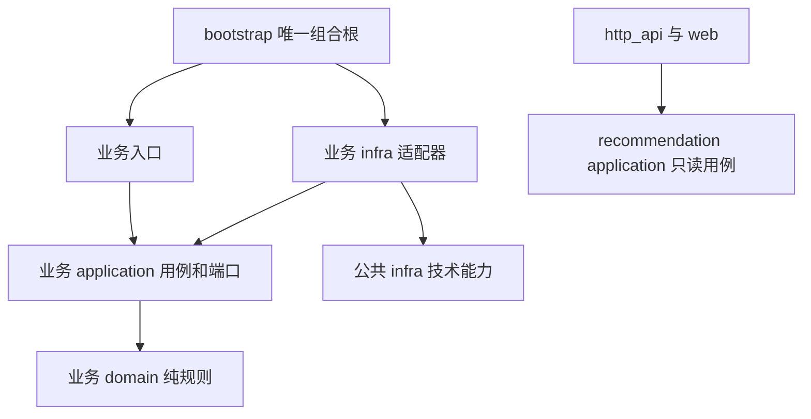
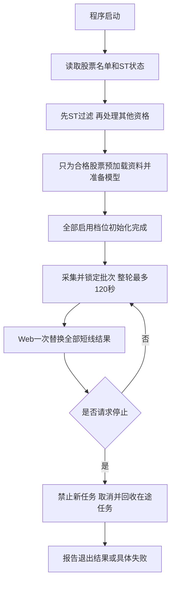
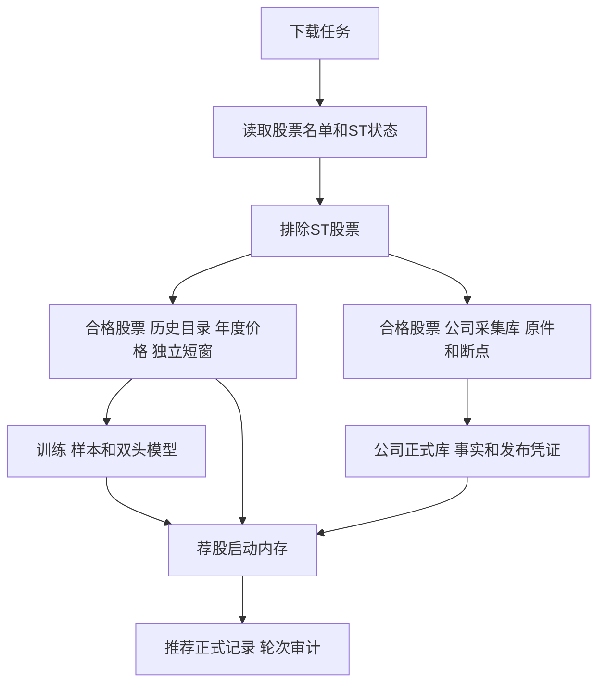
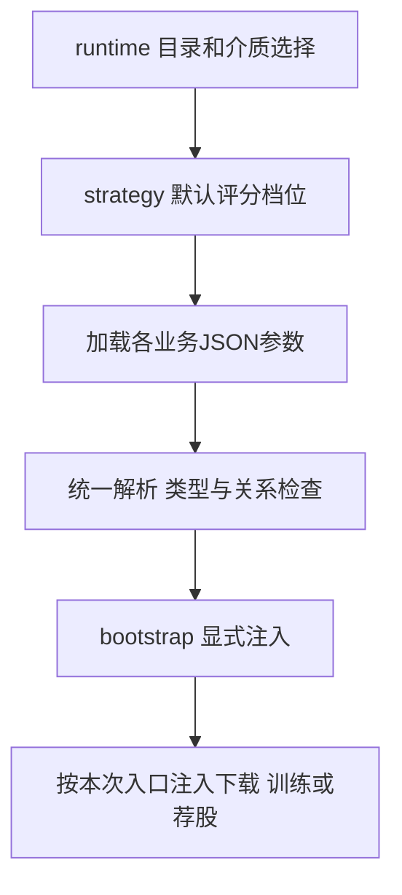
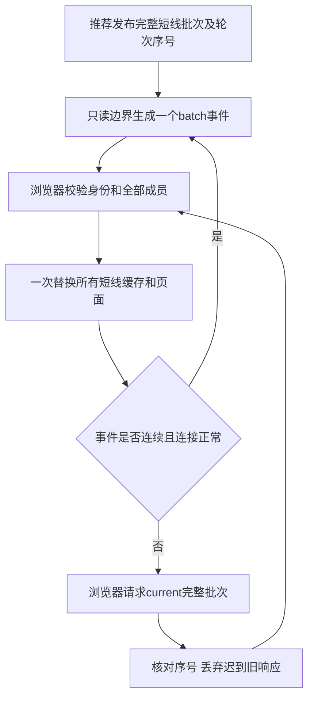

# 系统设计

本篇说明三条业务如何隔开、公共设施如何复用、数据库怎样读写、配置和页面怎样组织。评分字段归 c，下载库和来源归 d，训练样本和工件归 e。本篇不重复维护它们的业务字典。

这是目标设计和核对计划。已有能力不能因为换了文档就算重新完成；候选参数也不能直接当作生产设置。

## 1. 三条业务的输入、输出和边界

| 业务 | 入口 | 输入 | 输出 | 明确的边界 |
| --- | --- | --- | --- | --- |
| download | 人工 `sync history/market/company` | 数据源、已提交断点、下载配置 | 可用资料版本、覆盖和失败记录 | 不训练、不评分、不触发 Web 更新用例 |
| training | 人工选择四档训练 | 固定资料版本、训练配置 | 各档双头模型和评价报告 | 不自动下载，不发布推荐 |
| recommendation | 本地服务启动 | 已发布资料、模型、实时行情 | 不可变推荐批次和只读状态 | 不补历史、不训练、不日更新 |
| http_api、web | 浏览器请求和事件订阅 | recommendation/application 只读用例 | JSON 白名单和桌面展示 | 不抓取、评分、访问业务数据库或写业务状态 |

荐股和三个下载模块都先读取全部股票的代码、名称和ST状态，排除ST后，才为通过者加载或采集其他个股资料。荐股从本地已发布资料读取ST状态，缺失时由用户手动执行下载；两者使用相同的ST判定规则，不互相调用业务实现。被排除、通过、状态不明分别计数；状态不明不能默认通过。

`train`只调用`bootstrap.ExecuteSelectedTraining`，读取已经发布的本地资料；缺资料时提示用户手动执行`./run.sh sync history`，不代为下载。原自动组合函数`ExecuteDownloadTrain`删除，`run.sh train`继续转发同一个CLI入口。训练的线程数和进程优先级也由组合根准备。

## 2. 模块与依赖



domain 不读配置、时间、网络、文件或数据库。application 依赖明确端口和真实类型，不导入本业务 infra、Flask 或其它业务实现。适配器不暗中创建客户端、连接池或线程池，由组合根注入并负责释放。`CreateApp()` 只组装应用，无线程、联网、建库、写文件副作用。

跨业务交接是有明确类型的不可变对象或已发布工件。JSON 只在配置、供应商解析、存储编码和公开投影边界出现，不用 `dict`、`Any`、反射或空对象掩盖内部合同。活动源码单文件最多1500行，按职责拆分。

| 公共能力 | 唯一职责 | 不应放入的内容 |
| --- | --- | --- |
| 时钟 | 上海业务时间、单调 deadline | 自动判断某业务该下载什么 |
| HTTP 传输 | 超时、取消、重试计数、连接回收 | 财务语义、公司风险判定 |
| SQLite primitive | 连接、事务、锁、介质参数、观察计数 | 各业务 schema、SQL、发布资格 |
| 执行器 | 有界任务、背压、停止、等待和在途统计 | 隐式跨业务编排 |
| 配置解析 | 一次解析为类型对象并注入 | 每层自行读配置、复制默认值 |

## 3. 启动、运行和退出



资源表必须列创建者、使用者、停止动作、等待上限和状态。连接、进程、线程、文件映射、队列及 OCR 子进程均不能只“发出取消”却不回收。超时轮次彻底退出前不得开始下一轮；清理耗时独立记录，不能悄悄算作正常120秒内成功。

同一线程池内的任务不能同步等待自己再次提交的任务，避免池满后互等。资源上限说明实际是软件预约/观察门，还是宿主进程/系统硬隔离，不把RSS采样写成保证不会被系统杀进程。

## 4. 数据发布与读写隔离

下载先读取全部股票的名单和ST状态，排除ST后，再安排合格股票的下载任务和断点，最后检查整批完整性，通过后切换可用发布。训练和荐股只读取固定发布身份；一个操作中途不跟随新资料切换。ST过滤不能拖到日线、财务、公告正文或OCR之后；续传和补缺同样受这道门约束。

正常盘中从实时采集到服务端推荐发布，目标是零数据库连接、零 SQL。启动预读在轮前；非关键诊断或研究写入用有界后台队列，在正常轮次外计量；历史查询、序号预留和15:00正式冻结分别计量。队列满、写入失败或未排空必须可见，不能把正式持久化承诺降成易失内存。

“内存中一次替换全部短线视图”与“多数据库一次事务”是两件事。现有跨档数据库不能假称全局事务。正式冻结先取得真实持久成功凭证；部分提交恢复保留已提交事实，不覆盖、不拼成假完整批次。若实测及正确性证据支持合库，才考虑同库原子冻结方案。

## 5. 数据库布局和公共字典规范

下面列的是数据库文件和工件目录，不是字段表。路径按 `config/runtime.json` 中 `data_dir=data` 举例；实际数据根目录由该配置决定。

| 资料族 | 当前代码或文档中的代表路径 | 负责文档 | 主要读写方式 |
| --- | --- | --- | --- |
| 完整历史目录和年库 | `data/market/history/catalog.sqlite3`、`prices_<year>.sqlite3` | d 第3、8章 | 下载批写，训练按日期顺序读，启动按窗口读 |
| 独立短窗 | `data/market/daily_window.sqlite3` | d 第4、8章 | 整窗 raw/qfq 配对提交 |
| 证券、ST、行业 | `data/market/reference/company_st.sqlite3`、`industry.sqlite3` | d 第2、8章 | 手动更新、启动批量读取 |
| 公司采集与正式事实 | `data/company/raw/company_collection.sqlite3`、`company_facts.sqlite3` | d 第5、8章 | 采集账本和轻量正式事实分开 |
| 样本与模型 | `data/training/` | e 第3、7章 | 身份固定、有界批读、各档双头发布 |
| 冻结、序号、研究 | `data/recommendation/<profile>/`、`data/research/<profile>/` | c 第12章、e 第8章 | 追加正式事实、按日期查询、研究隔离 |

这是路径索引，不证明本次检查过活动库。后续字典应从 schema、SQL 和消费者核对，不能只抄某次落盘清单。年度价格表只写一套结构及分区规则，不把2018–2026同一字段表重复九次。



这是数据去向图，不表示这些库共享一个事务。采集库与正式库、不同年度库、不同档位冻结的实际提交与恢复边界分别由d/c说明。

每张表必须写清用途、唯一写入者、全部读者、主键、索引、事务、发布边界、保留范围和预计读写量。每列按下表逐项说明，不允许“用于业务”“相关数据”等空话。

下面是字段说明模板。示例来自 `data/company/company_facts.sqlite3` 的 `company_facts` 表；这里的 `published_at` 是本地正式快照发布时间，财报原披露时间是另一列 `disclosed_at`。

| 列名 | 中文含义 | 类型和单位 | 来源及原始字段 | 空值含义 | 更新比较规则 | 荐股层/训练用途 | 写入与读取代码 |
| --- | --- | --- | --- | --- | --- | --- | --- |
| 示例：`published_at` | 本地事实快照发布时间 | INTEGER，时间编码由持久化codec解释 | 本地正式发布事务 | NOT NULL | 事实与成功凭证提交时记录，不能替代原披露时间比较新旧 | 追踪采用的资料版本；不表示财报当时已可见 | `company_facts_schema.py`、`company_facts_index.py`；完整消费者归d第8章 |

## 6. HDD 与 SSD 怎样分别设计

| 事项 | HDD 候选方向 | SSD 候选方向 | 必须一起检查 |
| --- | --- | --- | --- |
| 批读 | 按物理库、日期归组顺序读取 | 比较小批和适度并发 | 总耗时、读取字节、RSS、是否重复扫描 |
| 批写 | 单物理库一个 writer，合并事务减少寻道 | 比较批次和独立库并发 | 持久性、锁等待、事务数、尾批恢复 |
| 连接与索引 | 复用连接，按真实条件设计索引 | 同样避免重复连接和冗余索引 | 查询计划、写放大、整个业务耗时 |
| WAL/checkpoint | 在提交边界控制集中写入成本 | 比较 checkpoint 频率和写放大 | WAL 大小、关闭成本、故障恢复 |
| 样本布局 | 顺序读取、连续数组候选 | 批读与映射读取候选 | 首次生成、复用、增量和清理总成本 |

现状：`runtime.json.disk_medium` 是全局选择；`sqlite.json.sqlite_policy.hdd/ssd` 各有连接超时、读窗、驱动批次和 checkpoint，当前两组数值相同。本机当前配置为 `hdd`；实际介质由只读disk检测独立报告，不能用配置值代替检测证据。`download.history.write_batches` 已有介质差异，不表示所有模块都已调优。

组合根`BuildSqlitePolicy`选择唯一不可变策略，显式配置优先，自动检测unknown使用HDD保守策略。下载、训练及荐股持久化adapter把同一个策略传到公共SQLite边界；只读HTTP/Web不自行选介质或打开业务数据库。`connection_timeout_seconds`进入连接超时，`read_window_rows`限制底层取行窗口，`transaction_batch_rows`限制一次驱动批量提交的行数，`checkpoint_mode`由显式checkpoint操作消费。驱动分批仍处于调用者原有事务内，不按每个小批次分别COMMIT。

history另外通过`ChooseHistoryWriteTuning`选择业务writer的flush阈值：HDD首建8股/16384格，增量16股/8192格；SSD首建及增量16股/8192格，unknown按HDD。它与SQLite驱动批次是不同层的限制，不共享第二套默认值。策略和消费者证据及实测状态只记入g。

不得关闭正式数据持久性或弱化完整性换取速度。SQLite、数组和列式候选必须把首建、增量、重复读、取消、恢复、关闭都计入，不只比较一次查询。

## 7. 配置文件怎样写清楚

### 7.1 文件归属

下面的文件全部位于仓库 `config/` 目录；本表说明文件分工，各字段的当前值和消费者放在对应详细章节。

| 文件 | 主要配置 | 作用边界 | 详细字段放在哪里 |
| --- | --- | --- | --- |
| `runtime.json` | 数据目录、运行目录、介质、配置入口 | 组合根 | 本章 |
| `strategy.json` | 默认评分档位 `scoring_profile` | 统一解析 | 本章 |
| `sqlite.json` | hdd/ssd 连接、批次、读窗、checkpoint | 公共存储 | 本章 |
| `scheduler.json` | deadline、worker、队列、轮次和退出 | 荐股调度 | c 第1、14章 |
| `market_data.json` | 行情来源、请求期限、重试、熔断 | 荐股采集 | c 第4章 |
| `cache.json` | 数据集、容量、有效期、分组和总内存 | 荐股内存 | c 第13章 |
| `download.json` | 三模块范围、请求、批次、断点和 PDF/OCR | 下载 | d 第9章 |
| `training.json` | 四档窗口、线程、内存、模型与早停 | 训练 | e 第6章 |
| `features.json` | 特征定义和参数 | 特征合同 | c 第6章、e 第3章各说明消费用途，定义只保留一处 |
| `filter.json` | 资格、黑名单、硬过滤 | 荐股第2、4层 | c 第3、5章 |
| `scoring.json` | 评分组件和权重 | 荐股第7层 | c 第8章 |
| `risk.json` | 本地风险 | 荐股第8层 | c 第9章 |
| `selection.json` | 动作、六席、板块限制 | 荐股第9、11层 | c 第10、12章 |
| `cost.json` | 成本参考与净效用 | 荐股第5、6层 | c 第6、7章 |
| `delivery.json` | API、SSE、客户端恢复参数 | 只读交付 | 第8章 |
| `long.json`、`long_watchlist.json` | Long 行为和固定名单 | 独立展示 | 第8章 |
| `research.json` | 研究分区、评价和统计参数 | 离线研究 | c 第15章、e 第8章 |
| `performance.json` | 负载、轮数、延迟、内存和介质门槛 | 测量与验收 | 第10章 |
| `deepseek.json` | 既有请求、预算和复核参数 | 可选复核 | c 第11章；改造暂缓 |

### 7.2 字段说明格式



配置按 JSON 路径逐个叶子字段列清单；数组需写元素结构，动态名称需写允许值。每行必须有当前值、中文意思、类型、单位、范围、解析者、最终消费者、在哪一步起作用、何时生效及是否影响结果身份。敏感配置只写凭据位置，不写秘密内容。字段表前必须注明文件；混合多个来源时拆表，或逐行写清来源。

以下字段来自 `config/runtime.json`，字段路径从该文件根节点开始，不含额外的 `runtime` 层。

| 字段路径 | 中文意思 | 类型/单位 | 核对时当前值 | 作用 | 生效和约束 |
| --- | --- | --- | --- | --- | --- |
| `runtime_dir` | 运行状态目录 | 路径 | `.runtime/trader` | 组合根建立运行资源 | 启动读取；不得提交运行数据 |
| `data_dir` | 业务数据根目录 | 路径 | `data` | 各业务构造自己的数据路径 | 启动读取；不是自动删除范围 |
| `disk_medium` | 选择存储策略 | `hdd/ssd` | `hdd`，是工作区值 | 给实际读写 adapter 注入策略 | 不是物理介质证明 |
| `strategy_config` | 业务配置入口 | 文件名 | `strategy.json` | 统一配置解析 | 启动一次读取 |
| `long_watchlist` | Long 名单文件 | 文件名 | `long_watchlist.json` | Long 只读名单 | 不影响短线模型身份 |

以下字段来自 `config/sqlite.json` 的 `sqlite_policy` 对象。`<介质>` 表示 `hdd` 或 `ssd`，由上表 `disk_medium` 选择。

| 字段路径 | 中文意思 | 类型/单位 | 核对时当前值 | 作用 | 生效和约束 |
| --- | --- | --- | --- | --- | --- |
| `sqlite_policy.<介质>.connection_timeout_seconds` | SQLite 等锁超时 | 秒 | 两组均5 | 连接边界 | 有限正值；不能无限等待 |
| `sqlite_policy.<介质>.read_window_rows` | 一批读取的行数 | 整数/行 | 两组均512 | 批读 adapter | 先测后调 |
| `sqlite_policy.<介质>.transaction_batch_rows` | 每次向驱动批量提交的行数上限 | 整数/行 | 两组均64 | 公共SQLite批写边界 | 分批不拆业务事务，不改变逻辑原子单位 |
| `sqlite_policy.<介质>.checkpoint_mode` | WAL 收尾方式 | 枚举 | 两组均TRUNCATE | 连接/任务收尾 | 计入真实收尾耗时 |

这张表只是已核对的公共字段，不冒充全部参数字典已完成。其它文件逐叶清点和调用者对照是 g 中 P06、P07 及各业务任务的明确交付物。

合法改值要真正传到消费者；不能读完配置又用硬编码替代，也不能用“必须等于当前默认值”锁死调参。配置重启生效，只有改变特征、样本、模型语义的字段才影响对应身份。

## 8. Web 与 API 详细设计

### 8.1 页面展示

默认打开 Tomorrow，刷新保留用户已选档位、策略和日期。分数旁解释“排序分”和“本地动作分”；六席可能含关注和回避，不能标成六只推荐。Long 显示固定名单及自加入锚点涨跌幅，独立刷新。

页面分开显示当前已发布结果与正在执行轮次。执行中不能清空上一轮。每层显示状态、输入数、通过数、业务淘汰数、待资料数、耗时、首个阻断和中文原因；未开始显示“未开始”，不能用0毫秒冒充完成。过滤计数来自后端，不由前端相减猜测。

### 8.2 接口

| 当前接口 | 内容 | 约束 |
| --- | --- | --- |
| `/` | 桌面页面 | 本地使用 |
| `/api/freezes/current` | 全部启用档位双策略批次 | 在同一锁内捕获不可变引用，再投影 |
| `/api/freezes/<strategy>/current` | 单个只读视图 | 不拼接成新批次 |
| `/api/freezes/<strategy>/history?date=YYYY-MM-DD` | 精确日期正式历史 | 通过只读用例，HTTP 不直接读库 |
| `/api/freezes/<strategy>/dates` | 正式日期目录 | Long 无历史，日期为空 |
| `/api/status` | 内存状态和诊断摘要 | 不读库、文件或网络 |
| `/api/events` | 有界 SSE 事件 | 短线整批事件、Long 独立事件 |

`profile` 只允许一个已启动的 v1/v2/v3/v5，`strategy` 只允许 tomorrow/d25/long。内部模型与完整供应商载荷不得直接序列化，adapter 用公开白名单。

### 8.3 一次替换与恢复



事件丢失、队列溢出、重连时重新读取完整批次；迟到响应不能覆盖较新事件。名单、分数、报价、原因和诊断同批替换；连接状态、来源年龄、错误提示可以单独更新。桌面验收用稳定版 Chrome、Edge 或 Firefox，检查可读性、操作和数据一致性，不定死分辨率。

慢SSE客户端不得阻塞发布。游标超前、过期、不连续或身份不匹配时重同步；策略/日期切换后，迟到结果不能覆盖当前页。具体队列和超时参数由delivery配置逐字段解释。

## 9. 检测脚本全面重整：按业务和功能划分，只留一个接口

这是单独的完整任务，不只是精简 `diagnose_runtime.py`。范围是 `scripts/` 下全部检测脚本、内部检测模块、重复功能和调用它们的Makefile、文档及测试。对每项功能明确保留、合并或删除；最终所有检测都从同一个入口按参数选择。

### 9.1 先清点现有脚本和调用者

来源：当前仓库 `scripts/` 文件、`Makefile`、`README.md`、`scripts/README.md` 及测试中的调用。下表是本次已找到的入口范围，不是完整扫描已结束的声明；后续必须继续核对导入、子进程命令和间接调用。

| 现有范围 | 负责的事情 | 重整方向 |
| --- | --- | --- |
| `diagnose_runtime.py`、`runtime_diagnostics/` | 荐股、来源、下载、训练、存储、浏览器和性能诊断 | 保留一个入口，内部按业务和功能重新分组，删除重复或过期检查 |
| `check_tomorrow_training_memory.py` | 独立训练内存/重排验证 | 核对有效消费者，仍需要的检查并入训练资源模块，删除独立检测入口 |
| `check_refactor_quality.py`、`code_quality/` | 架构、命名、质量，以及显式格式/改名操作 | 检测能力归工程检查模块；修改类操作与只读检查严格区分，不默认运行 |
| `verify_wheel_install.py` | 安装包及公开入口验证，会创建隔离环境 | 检查归工程包验证模块，必须显式选择和指定隔离工作区；切换调用者后删除独立检测入口 |
| `generate_long_watchlist_asset.py --check` | 生成物与配置一致性检查 | 检查模式并入工程资源检查；纯生成职责单独保留或合并，不形成第二个检测接口 |
| `skill_evaluation/` | skill评测 | 核对是否仍有有效用途和消费者；停用skill遗留且无消费者的功能列入删除，不仅凭目录名认定无用 |
| `migrate_runtime_data.py`、`runtime_migration.py`、`repack_history_partitions.py` | 数据维护、迁移和重排 | 区分其中的检查与实际写入，检查统一入口；维护能力是否仍需要另行裁决，不在清理时执行 |

清单每项记录现有文件、功能、业务归属、读取/联网/写入行为、输入输出、全部消费者、保留/合并/删除决定、目标位置和必删路径。不能仅凭名称老、没有直接导入或运行较慢就删除。

### 9.2 一个入口，按三层参数选择功能

目标公开入口继续使用 `scripts/diagnose_runtime.py`，不再增加第二个检测命令。下面是拟定参数形式，只是设计，当前尚未实现：

```text
--business recommendation --module pipeline --check latency
--business download       --module company  --check coverage
--business training       --module resources --check memory
--business infra          --module disk  --check profile
--business engineering    --module packaging --check install
```

`business`选择业务，`module`选择业务内部功能，`check`选择具体检查。`--help`按这三层列出功能和副作用；另提供统一的配置、输入位置、时间/工作量上限和输出参数。公开名称、默认值和范围在实现前按全量清点确认，不能一边保留旧profile分派，一边再建一套平行入口。

默认只运行明确选中的只读检查。真实网络、性能探测、训练样本/隔离数据构建、安装验证等必须显式选择；格式检查、自动格式化、改名和破坏性迁移不能被普通检查或聚合命令间接触发，仍遵守用户授权限制。

### 9.3 内部按业务和功能分目录

以下是目标职责示意，实施前核对全部调用者后确定实际文件名；不为目录整齐制造空模块或转发层。

```text
scripts/
  diagnose_runtime.py          唯一公开检测入口
  checks/
    cli.py                    参数解析和功能选择
    contracts.py              有类型的检查输入、结果和状态
    reporting.py              中文终端与JSON报告
    recommendation/           行情、链路、评分、发布、Web检查
    download/
      history/                完整历史、来源、发布和恢复检查
      market/                 短窗、配对、缺口和恢复检查
      company/                字段、目录、正文、OCR、续传和发布检查
    training/                 历史输入、样本、模型、资源和性能检查
    infra/                    存储、介质、HTTP和进程检查
    engineering/              架构、命名、包和资源一致性检查
```

入口只选功能，不包含业务检查实现；各模块只使用自己需要的依赖，不启动未选择的检查。业务与功能的对应关系只声明一次，不能又在JSON又在代码维护两套名单。公共报告和执行上限共用，业务规则仍由实际业务拥有，检测代码不复制评分或下载规则。

### 9.4 删除无用功能，并一次切换调用者

把重复检查、旧业务/旧schema专用检查、已结束且没有后续用途的临时探针、失效参数及重复报告列成删除清单。仍承担有效研究或故障验证的检查保留；同类检查合并到同一实现，禁止同一项业务事实有两套检查结论。

同一批次完成内部模块、唯一入口、Makefile、README、诊断文档、测试和子进程调用切换，再删除旧脚本路径与别名。不能留“旧脚本转发新脚本”的兼容壳，也不能漏掉通过命令字符串调用的消费者。无用测试随废弃功能删除，关键故障和公开参数回归保留。

### 9.5 先测检测开销，再证明重整结果

先量实际仍需保留的检查：启动/导入、参数解析、重复读取、报告生成、子进程和总耗时；只对有热点证据的路径做性能改造。同数据、同功能、同输出语义对照，不能以少运行必要检查来宣称变快。

验收必须证明：只剩一个公开检测入口；每项保留功能有唯一实现；无旧路径/参数/文档/测试残留；选择一个检查不会执行其它检查；错误、超时、取消、跳过和合法空分别报告；退出码和中文/JSON结果一致。未授权格式脚本及其触发用例排除在本次自动验证之外；测试基础设施受影响时按实际范围补相应功能回归，不用运行禁止脚本凑门禁。

负责人：A负责入口、公共执行/报告和工程/公共检查，B负责下载检查，C负责训练检查。具体文件和交接按g中的P61工作包登记；当前仅规划，未移动或删除任何脚本。

## 10. 性能与交付证据

每项实测报告固定代码、配置、数据、模型身份，实际 CPU/内存/介质，负载、缓存状态、重复次数、输出一致性和失败恢复。HDD 与 SSD 分别固定门槛；未有实机证据不能跨介质外推。

当前 `performance.json` 中分别有 HDD/SSD 门槛和证据状态，但配置中的 `validated` 不是本轮重新验收。旧5秒局部预算、来源年龄、120秒整轮 deadline 的对象不同，必须在测量报告中逐项对应，不能混成一个通过指标。

本批只做文档 diff 审查、链接检查和 `git diff --check`。后续按改动风险运行最小充分检查；不自动运行格式脚本或含有它们的聚合目标。正式发布还要有功能、类型、构建、真实浏览器、轮次、冻结和恢复证据，通过只表示形成候选，不自动发布。
