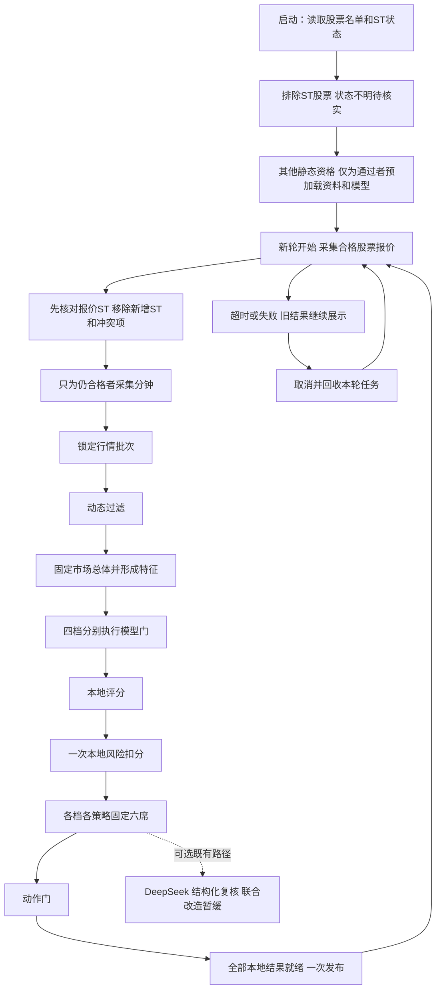
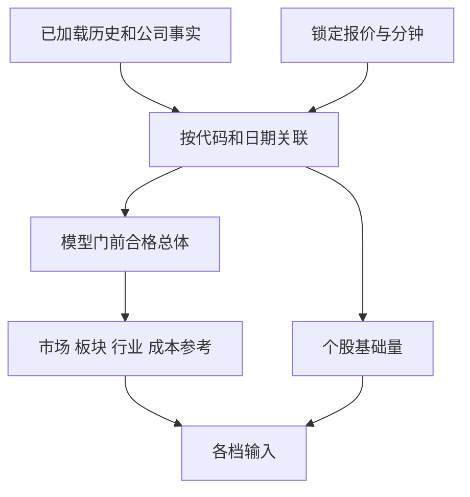

# 评分设计

本篇按十一层顺序解释荐股。先说每一步干什么，再说输入、输出、字段和失败处理。V1/V2/V3/V5 是四个评分档位，每档包含 Tomorrow、D25；Long 独立展示。

本篇的轮次和评分规则是本次规划要保留的合同。字段表是根据现有文档和代码整理的核对底稿；完整字段与配置的逐项调用者核对仍须按施工进度完成，不能把本篇当作已完成真实运行验收。

## 1. 一轮怎样开始和结束

程序启动时，先读取全部股票的代码、名称和ST状态，排除ST股票；状态不明的股票先等待核实。通过ST和其他条件筛选后，再加载这些股票的历史行情、行业、财务、公告等资料，以及所需模型。加载完成后，每轮从行情采集开始计时，共用一个单调时钟 deadline，最长120秒。各阶段超时和物理重试只能用剩余时间，不各自重新领取120秒。超时后本轮计算结果全部作废；取消、等待和回收完成后才能重新采集，不允许新旧轮重叠。

“同一时间点”落实为同一锁定批次：所有档位使用相同报价批次及同一组资料、模型版本。实际来源时间可能不同，必须分别保留；不把接收时间伪装成来源时间，不为凑齐输入拼接下一轮行情。



这是业务步骤图，不要求新建十一套服务。第1层读取全部股票的名单和ST状态；第2层先排除ST股票，再按其他条件筛选，最后加载通过者的其他资料。这两层主要在启动执行，可复用未变化的筛选结果。第3层先核对报价中的ST再取分钟，第3–11层形成每轮结果。DeepSeek 联合轮次改造暂缓，本地完整发布不等待新增的联合复核；既有复核仍受原父决策与版本保护。

## 2. 第1层：读取全部股票的名单和ST状态

程序启动时，先从本地数据库读取全部股票的代码、名称和ST状态，用来判断哪些股票需要排除。此时不加载历史行情、财务和公告等其他资料，也不计算评分。

ST状态同时保留来源、检查时间和发布版本。确认需要排除的股票不再继续处理；状态缺失、过旧或相互矛盾的股票先等待核实。通过ST及其他条件筛选后，才加载其余资料。荐股程序不自动联网补资料，缺失时提示用户手动执行下载。

下表中其余资料在第2层ST及其他静态资格通过后才预加载，并在首轮采集前完成；不是第1层先把所有股票资料读完。

来源：证券/ST取自 `data/market/reference/company_st.sqlite3`；日历和行业按已发布参考及历史身份读取；历史来自 `data/market/history/catalog.sqlite3` 与年度 `prices_<year>.sqlite3`；公司资料来自 `data/company/company_facts.sqlite3`。模型来自 `data/training/models/<档位>/<策略>/model.json`、`metadata.json`，不是数据库列。配置来自 `config/runtime.json` 及b第7章列出的各业务JSON文件。上述路径以 `data_dir=data` 举例。

| 加载内容 | 来源 | 保留什么 | 不做什么 |
| --- | --- | --- | --- |
| 全部股票的代码、名称和ST状态 | 本地已发布的证券/ST资料 | 版本、来源、原检查日期和筛选结果 | 未排除ST就加载其他个股资料 |
| 交易日历、板块、行业 | ST及其他静态资格通过后加载 | 版本、生效日、覆盖、原检查日期 | 现场抓取缺失参考 |
| 已完成历史 raw/qfq | 已发布历史及档位所需窗口 | 交易日、复权来源、停牌/估值状态 | 全库逐值验证、逐股重复连接 |
| 财务、质押、解禁、公告事实 | 正式 company_facts 及关联表 | 披露时间、有效期、证据、未知项 | 在线下载和解析 PDF |
| 四档双头工件 | training 正式发布 | 特征合同、拟合日期、配置和模型身份 | 缺模型时自动训练或借用他档 |
| 配置和黑名单 | 启动配置快照 | 唯一版本及有类型设置 | 每轮重读配置 |

轻量检查包含：能否打开、schema/版本是否支持、所需时间范围和必需列是否存在、模型形状和列顺序是否匹配。历史价格正确性由下载发布承担，不在启动时重新扫描复算整库内容。

历史基础量按定义共享；模型只为实际不同档位、策略头和行业加载一份。模型常驻内存的实际字节、历史窗口字节、缓存容量和释放时机都要测，不只统计模型文件大小。预加载失败可显示最近合法快照和明确缺项，不能阻塞 Web 读取。

## 3. 第2层：先过滤ST，再处理其他资格和预加载

先根据第1层读取的ST状态排除股票，再检查支持市场、永久事实和配置黑名单等条件。只为通过筛选的股票加载历史行情、行业和公司资料，并准备所需模型。筛选结果记录合格名单、待核名单、排除原因和使用的ST资料版本。四档共用相同条件下的筛选结果；名单或资料版本改变才重新筛选。

不要在这里把盘中缺报价、模型缺失当作永久淘汰。ST 历史证据、当前报价 ST 标志、上市特殊交易日属于不同事实，分别记录来源和作用。可逆公司事件不得错误存成永久黑名单。

来源：证券身份和ST取自 `data/market/reference/company_st.sqlite3` 的 `security`、`security_st_evidence` 及对应发布关系；黑名单和资格参数来自 `config/filter.json`。当前报价名称/ST来自腾讯或新浪；上市交易日龄、交易限制和规则身份由程序依据参考与交易规则生成。下表是内存输入字段，不是同一数据库表的原列清单。

| 字段 | 中文意思与来源 | 作用 | 未知怎么办 |
| --- | --- | --- | --- |
| `code` | 官方六位证券代码 | 关联全部资料、同分排序 | 身份不明不进入决策 |
| `name` | 官方名称、报价名称 | 展示及名称状态辅助判断 | 不凭空确认非ST |
| `exchange` | 官方交易所 | 判断支持市场 | 待核 |
| `board` | 已核验板块 | 适用规则、板内比较和六席限制 | 不支持或未知不能执行 |
| `board_source` | 板块判定依据 | 第2/4层追溯来源 | 不伪造权威来源 |
| `board_reliability` | 板块来源可靠性 | 第4/11层执行资格 | unknown不能当已核验 |
| `is_blacklisted` | `filter.json` 黑名单 | 静态排除 | 错误配置明确报错 |
| `is_st`、ST证据状态 | 已发布参考与当前报价各保留 | 第2层优先过滤；第3层报价到达先复核；第4层复用结果 | 未知待核，不取其余个股资料 |
| `listing_date`、退市日期 | 官方证券参考 | 日期边界和第4层特殊交易日 | 日期不足保持待核 |
| `listing_age_sessions` | 上市日期结合可靠交易日历 | 第4层上市交易日龄 | 不按自然日猜测 |
| `is_relisted_first_session` | 证券事件参考 | 第4层重新上市首日 | 未知不填false |
| `is_delisting_period_first_session` | 证券事件参考 | 第4层退市整理首日 | 未知不填false |
| `has_price_limit` | 证券与日期对应的交易规则 | 第4/5层能否计算限幅 | 不套普通限幅 |
| `exchange_limit_pct` | 适用涨跌幅限制，百分点 | 第5/8层涨停接近度 | 未知保持缺失 |
| `strategy_hot_cap_pct` | 策略过热配置，百分点 | 第4层过热过滤 | 不等于交易所限幅 |
| `rule_version` | 交易规则版本 | 第1/4/11层规则身份 | 不混不同版本 |
| `rule_effective_date` | 交易规则生效日期 | 第4层判断可用 | 不用未来规则 |
| `execution_restrictions` | 参考与资格校验产生的限制 | 第4/11层执行原因 | 未知限制单列 |
| `has_major_regulatory_risk` | 规范化携带的风险输入 | 第4层辅助核验 | false不能证明公司风险覆盖齐全 |

## 4. 第3层：实时行情采集与批次锁定

全市场报价主路为腾讯，失败或超时才顺序使用新浪，主路成功不额外请求备路。分钟资料使用现有东方财富/AKShare适配路径，按真正需要的输入范围采集；不能先取部分股票评分后又用不同分钟批次补其余档位。

定向请求只派发给ST已通过者。供应商只能返回全市场批次时，接收后立即按ST资格剔除无效股票；再核对报价中新出现的ST信息，命中者排除、冲突者待核，之后才为剩余股票取分钟和处理后续业务。不得为已排除股票追加任何个股请求；这一核对只用本地资格和本轮报价，不新增资格网络查询或轮内读库。

要先测真实全市场请求、分钟覆盖和排队成本，再决定合并请求、减少重复请求或缓存相同分钟内容。保留每个来源自己的真实时间，复用旧内容不刷新年龄。

来源：下表实时值来自腾讯主路、新浪备路和现有东方财富/AKShare分钟接口，不从数据库读取。请求期限、重试、熔断等来自 `config/market_data.json`，轮次和并发来自 `config/scheduler.json`；来源时间、接收时间、版本和批次身份由adapter保留或生成。

| 实时字段 | 中文含义/单位 | 原始来源和标准化 | 使用层 | 缺失处理 |
| --- | --- | --- | --- | --- |
| `price` | 最新价格，元/股 | 腾讯/新浪标准化 | 4、5、11 | 非正、非有限、缺失为资料待补 |
| `previous_close` | 前收，元/股 | 报价前收字段 | 3、5 | 相关基准待补 |
| `open_price` | 开盘价，元/股 | 报价 | 3、5 | 不确认依赖它的形态 |
| `high` | 当日最高，元/股 | 报价 | 5、8、11 | 风险或保护保持未知 |
| `low` | 当日最低，元/股 | 报价 | 5、7 | 形态待补 |
| `pct_change` | 涨跌幅，百分点 | 报价适配器统一口径 | 4、5、8 | 不计作业务淘汰 |
| `amount` | 累计成交额，元 | 报价金额单位换算 | 4、5、7 | 不从成交量猜测 |
| `volume` | 累计实际成交量，股 | 腾讯手数乘100，新浪按股 | 5、11 | 不用量比替代 |
| `turnover_rate` | 换手率，百分点 | 供应商真实字段 | 4、5、7 | 不用成交额/市值反推 |
| `volume_ratio` | 供应商量比，倍 | 供应商定义 | 8 | 不等于当前量/历史五日均量 |
| `amplitude` | 振幅，百分点 | 报价 | 5 | 缺失不新增来源补取 |
| `market_cap` | 市值，元 | 按供应商口径换算 | 5、成本参考 | 不补造真实换手 |
| `is_suspended` | 当前停牌 | 标准化报价状态 | 4 | 保持待核 |
| `is_one_price_limit` | 一字板 | 开高低等价格结构 | 4 | 结构不全不伪造确认 |
| `industry` | 展示行业 | 报价或本地参考 | 5、展示 | 不代替点时模型行业 |
| `source` | 来源名称 | adapter记录 | 3、11 | 不伪造 |
| `source_time` | 来源观察时刻 | 供应商/适配器明确合同 | 3–11新鲜度 | 未来或过旧不能形成新执行动作 |
| `received_time` | 本地接收时刻 | 接收边界 | 3延迟 | 不替代来源时刻 |
| `data_version` | 内容版本 | 标准化批次 | 3–11关联 | 不跨版本拼接 |
| `merge_epoch` | 合并批次身份 | 批次锁定 | 3–11一致性 | 不混用另一轮 |
| `cross_source_verified` | 必要交叉核验完成 | 既有核验边界 | 3、11 | 未核验不冒充完成 |
| `cross_source_deviation_pct` | 跨源价格差异 | 真实核验结果 | 3、11 | 未知不填0 |
| `change_5m`、`speed` | 供应商附加涨幅/涨速 | 报价附加字段 | 当前辅助展示 | 不是新增评分必需项，不现场补取 |
| 分钟时间、OHLC、量额 | 每分钟价格和成交 | 分钟 adapter | 5、7、11 | 连续性/时间不够则相关项待补 |

## 5. 第4层：动态过滤

ST已经在其他业务前过滤，报价中的新增ST也在申请分钟前处理；本层复用其结果，不把ST首次判断拖到这里。随后用锁定行情和本地已发布资料检查停牌、特殊交易日、价格与流动性、公司财务和风险有效性。来源过旧或字段缺失是“待资料”，确认违反规则才是“业务淘汰”。同一股票只归一个终态，全部证据可以并列保存。

公司财报、质押、解禁及公告事实从启动内存视图读取，不在这里查询供应商或数据库。当前主板8%、创业板/科创板16%的过热线、亏损排除、质押/解禁硬门等作为现行规则保留；删除或重写它们属于需收益和风险证据的候选，不能在整理文档时顺便改。

公司资料未知不解释为无风险。已确认未解除的调查、强退、资金占用和违规担保不能因为公告变旧自动消失；未来180日解禁覆盖独立判断。历史财报亏损不永久排除已经有更新有效财报的公司。

## 6. 第5层：市场总体和特征

先固定模型门之前的完整合格总体，再计算市场、板块、行业、流动性和成本参考。不能用模型通过者反过来改变成本分母，或用当前小请求子集重新算百分位。



### 6.1 历史及本地计算字段

这里列清“原始量”和“转换后的分数”，同名近似不表示可互换。小数收益0.03表示3%；百分点3也表示3%，禁止混用。表中同一行列出的多个字段必须在后续完整字典逐项核对，不用分组掩盖漏项。

来源：历史量价取自 `data/market/history/prices_<year>.sqlite3`，通过 `catalog.sqlite3` 固定发布版本；与本轮腾讯/新浪报价、分钟及公司正式事实的内存视图结合计算。公式定义见 `config/features.json`，评分转换和权重见 `config/scoring.json`，财务输入所在库见下一节。这些派生字段在本轮内存计算，不是年度价格表里同名的物理列。

| 字段 | 中文说明/来源与计算 | 使用层与作用 |
| --- | --- | --- |
| `amount_median_20d` | 已完成20日成交额中位数，元 | 4流动性；5、7金额冲击基线 |
| `turnover_median_20d` | 已完成20日真实换手中位数，百分点 | 5、7换手冲击基线 |
| `amount_percentile_20d` | 历史均态金额在固定同板总体的位置 | 7 D25流动性 |
| `ma20_slope_pct` | 历史MA20相对五个交易日前MA20变化，百分点 | 5、11趋势/回踩 |
| `ma_slope` | MA5/MA20转换为0–100分 | 7趋势，不是上一行换单位 |
| `ma20_60_position` | 现价与MA20/MA60的位置分 | 7 Tomorrow趋势 |
| `ma20_60_structure` | 当前实现使用相同位置分 | 7 D25趋势；同定义可共享 |
| `prior_high_20d` | 前20个完整交易日最高价 | 5、11突破基准 |
| `breakout_20d` | 现价/历史高点转换后的突破分 | 7趋势 |
| `breakout_deviation_pct` | 现价/前20日高点减1，百分点 | 11突破偏离 |
| `ma20_deviation_pct` | 现价偏离MA20，百分点 | 5、8过热和趋势破坏 |
| `ma20_deviation_inverse` | 贴近MA20的辅助分 | 形态辅助，不能另加重复权重 |
| `volatility_20d` | 21根历史收盘形成20个收益的总体标准差，百分点 | 7稳定性、11保护 |
| `low_volatility_score` | 上项在固定同板总体的反向百分位 | 7、11 |
| `max_drawdown_20d` | 20日路径最大收盘回撤，百分点 | 7稳定性、11保护 |
| `low_drawdown_score` | 上项同板百分位，浅回撤分高 | 7、11 |
| `atr20_pct` | 20日真实波幅/前收均值，百分点 | 11冲高回落尺度 |
| `turnover_shock_20` | 当前换手/历史换手中位数 | 5中间量 |
| `turnover_shock_score` | 换手倍数按适中区间转换为分 | 7流动性 |
| `amount_shock_20` | 当前成交额/历史成交额中位数 | 5中间量 |
| `amount_shock_score` | 金额倍数按适中区间转换为分 | 7流动性 |
| `flow_confirmation_score` | 收益方向与金额冲击结合 | 7 Tomorrow量价确认 |
| `tail_return_30m_pct` | 连续31个有效分钟首末价收益，百分点 | 5尾盘原始量 |
| `tail_return_30m` | 上项转换为0–100分 | 7 Tomorrow尾盘 |
| `tail_volume_ratio_raw` | 尾部30分钟均量/此前有效分钟均量 | 5尾盘原始量 |
| `tail_volume_ratio` | 尾盘量比按配置转换的0–100分 | 7 Tomorrow尾盘 |
| `close_location` | 现价在当日高低价之间的位置，0–100 | 7尾盘、8/11回落保护与突破确认 |
| `volume_to_5d_average` | 当日实际股数/前5完整日平均股数，倍 | 5/11缩量回踩和放量突破 |
| `market_breadth` | 同轮完整有效总体中上涨股票占比，0–100 | 5市场状态、11弱市保护 |
| `market_regime` | 广度按配置分为risk_on/neutral/risk_off | 7市场分、11保护；缺失退中性不证明真实中性 |
| `industry_strength` | 同轮行业平均涨幅在行业间的相对位置 | 5聚合和展示，不另加行业奖励 |
| `industry_breadth` | 同轮行业内上涨股票占比 | 5背景和有条件的入场核验 |
| `industry_trend` | 当前复用industry_strength | 辅助展示，不重复奖励 |
| `quality_score` | 财报年化ROE与扣非/归母利润比例按配置转换 | 7公司质量 |
| `value_score` | 现价与合格财报形成PE/PB再转换 | 7公司价值；无效PE不当便宜 |
| `growth_score` | 财报营收、归母、扣非增长的有效值转换 | 7公司成长 |
| `entry_quality` | 均线、斜率、实际五日量比、高点与位置确认形态 | 7入场组件、11解释 |
| `return_3d` | 现价/3日前对齐qfq收盘减1，百分点 | 5区间收益和辅助 |
| `return_5d` | 现价/5日前对齐qfq收盘减1，百分点 | 5/8方向与过热 |
| `return_10d` | 现价/10日前对齐qfq收盘减1，百分点 | 5/8过热 |
| `return_20d` | 现价/20日前对齐qfq收盘减1，百分点 | 5区间表现 |
| `return_60d` | 现价/60日前对齐qfq收盘减1，百分点 | 5区间表现 |
| `relative_strength_3d` | return_3d在固定同板总体中的百分位 | 5辅助，不另加权重 |
| `relative_strength_5d` | return_5d同板百分位 | 5辅助 |
| `relative_strength_10d` | return_10d同板百分位 | 5辅助 |
| `relative_strength_20d` | return_20d同板百分位 | 5辅助 |
| `ma5` | 前5完整日qfq收盘均值，元/股 | 5/7/11趋势和入场 |
| `ma10` | 前10完整日qfq收盘均值，元/股 | 5/7/11趋势和入场 |
| `ma20` | 前20完整日qfq收盘均值，元/股 | 5/7/8/11趋势与保护 |

以下辅助字段也要列清用途，不能因为“程序有算”就当作新增生产权重：

来源：历史输入来自 `data/market/history/prices_<year>.sqlite3`，公司输入来自 `data/company/company_facts.sqlite3`，实时输入来自本轮报价/分钟；新闻取自有来源和时间的新闻证据。字段定义见 `config/features.json`，转换参数以 `config/scoring.json` 及实际消费者为准。它们是程序计算/研究字段，不表示存在一张同名数据库表。

| 字段 | 中文说明/来源与计算 | 作用和缺失 |
| --- | --- | --- |
| `speed_percentile` | 报价涨速在同板总体百分位 | 展示，不恢复旧候选分；缺涨速/总体则缺失 |
| `trend_score` | 均线位置与斜率按配置组合 | 辅助；中性替代不证明已观测 |
| `capacity_score` | 当日额/20日中位额转换 | 容量辅助，不是新排名分 |
| `moderate_amplitude` | 当日振幅按适中带转换 | 辅助，缺振幅则缺失 |
| `price_executability` | 现价按适中价格带转换 | 辅助，不是完整可交易性证明 |
| `limit_distance_safety` | 100×(1-limit_proximity) | 辅助，未知不当安全 |
| `low_crowding_score` | 当前与limit_distance_safety同定义 | 辅助，不重复拥挤扣分 |
| `moderate_daily_return` | 当日涨跌幅按适中带转换 | 形态辅助，不独立加权 |
| `price_volume_confirmation` | 5日方向与当前金额信号转换 | 辅助，不是flow_confirmation_score别名 |
| `upward_consistency` | 前20日正收益日占比 | 研究辅助，历史不足则缺失 |
| `risk_adjusted_return_20d` | 20日收益/波动转换为分 | 研究辅助，不是资金收益率 |
| `industry_policy_score` | 行业强度与证据基准组合 | 研究辅助，不是行业生产奖励 |
| `risk_protection_score` | 低波动与低回撤分组合 | 研究辅助，不代替第11层逐项保护 |
| `news_sentiment` | 有来源标题按配置关键词计算 | 证据/研究，不直接扣分或硬过滤 |
| `evidence_freshness` | 新闻时间与观察时间的衰减 | 证据展示，不代替行情/公司时效门 |

历史不足、输入非法、分钟不连续均保持缺失。模型必需项不填0；一般评分项可能以中性值进入计算，但必须扣掉缺失贡献。下行保护关键项缺失，动作最多关注。完整公式、子权重、阈值、边界例子与代码调用者还需按 P21/P22 逐项核对；不复制旧文档中互相矛盾的描述。

### 6.2 公司字段怎样进入荐股

来源：`data/company/company_facts.sqlite3` 的 `company_facts` 提供财务、质押和覆盖；`company_unlock` 提供解禁；`company_risk_event`、`company_reduction_plan` 及证据表提供风险；`company_positive_event`、里程碑和证据表提供利好。下表风险等级和评分值由这些事实派生，使用 `config/filter.json`、`config/risk.json`、`config/scoring.json` 的相应规则；它们不一定是物理列名。

| 评分字段/事实 | 来自哪里 | 生效层 | 含义和缺失处理 |
| --- | --- | --- | --- |
| `eps`、`bps` | 正式财务每股收益/净资产 | 5、7 | 与价格组成估值，不能靠新闻猜 |
| `revenue_growth_pct`、`profit_growth_pct`、`core_profit_growth_pct`、`roe_pct` | 最新有效财报 | 5、7 | 营收、利润、扣非增长和ROE；保留披露时间 |
| `parent_profit`、`core_profit` | 同一有效财报 | 4 | 归母/扣非利润亏损硬门 |
| `latest_disclosed_report_loss` | 最新有效财报的亏损判定 | 4 | 不将旧期亏损永久固化 |
| `financial_deterioration` | 有效财务指标派生的恶化程度 | 4、8 | 规则和缺失语义按财务合同核对 |
| `pledge_risk` | 最新质押比例及日期 | 4、8 | 风险分级，未知不填0 |
| `unlock_risk` | 决策后180日解禁安排 | 4、8 | 独立覆盖和分级，不只查过去公告 |
| `major_illegal_history` | 已核验重大违法事件 | 4 | 主体及有效状态核验 |
| `official_investigation_history` | 同案调查与结案证据 | 4 | 不能以无关公告清除 |
| `fund_occupation_history` | 资金占用事件及解决状态 | 4 | 未解除继续有效 |
| `illegal_guarantee_history` | 违规担保事件及解决状态 | 4 | 未知不解释成无风险 |
| `forced_delisting_risk` | 强退程序与同案状态 | 4 | 已确认风险硬过滤 |
| 减持计划与状态 | 正式减持计划/关联事件 | 4、8 | 按公告、完成/终止及有效窗口 |
| `major_shareholder_reduction` | 主要股东减持的有效事实 | 4 | 主体、期间和状态核验 |
| `shareholder_reduction_level` | 减持事件按配置分级 | 5、8 | 不与解禁重复计同一风险 |
| `financial_fraud_history` | 已核实财务造假事实 | 4 | 窗口滚动不自动解除已确认有效风险 |
| `reduction_or_unlock` | 减持与解禁的有效等级 | 5、8 | 综合解释，不重复扣同一风险 |
| `negative_announcement_level` | 有效负面事件最高等级 | 8 | 结构化解释，扣分受配置控制 |
| `corporate_risk_window_unavailable` | 目录、正文、同案关联覆盖 | 4、11 | 覆盖不足只能观察，不冒充无风险 |
| 利好事件、里程碑与证据 | 正式 positive 表族 | 5、7 | 只按实际使能的公司评分规则使用 |

物理表逐列、来源原字段、新旧版本规则和下载时间范围由 d 第5、8章维护。本表回答“在哪层起什么作用”，不是另一份物理 schema。

## 7. 第6层：模型预测、净效用与四档差异

模型来源：`data/training/models/<档位>/<策略>/model.json`、`metadata.json`；训练窗口和算法参数来自 `config/training.json`，特征定义见 `config/features.json` 与各档合同。本地分、风险、成本和动作分别由 `config/scoring.json`、`risk.json`、`cost.json`、`selection.json` 约束。下表对比模型职责，不是数据库列清单。

| 对比项 | V1 | V2 | V3 | V5 |
| --- | --- | --- | --- | --- |
| 算法 | LightGBM排序器＋独立Ridge收益门 | 行业LightGBM回归 | 行业Ridge回归 | 行业量价TCN |
| 特征回看 | 251个完整历史日 | 251日 | 61日 | 61个完整日形成60步 |
| 主要输入 | 完成日十因子 | 长短收益、残差动量、长期市场和流动性 | 短窗收益、残差动量和流动性 | 60×6量价序列＋辅助因子 |
| 模型门 | 独立收益预测与成本净效用 | 预测及成本净效用 | 预测及成本净效用 | 预测及成本净效用 |
| 最终排序分 | 排序器独立模型百分位 | `local_score` | `local_score` | 本档预测百分位 |
| 动作比较 | `local_score` | `local_score` | `local_score` | `local_score` |
| 加载区别 | 双头排序器及收益门 | 双头各行业树模型 | 双头各行业线性系数 | 双头各行业网络权重 |
| 应测资源 | 预测调用、模型数、输入矩阵/RSS | 行业调用与线程、长窗特征 | 矩阵转换与线性校验成本 | 序列解码、张量/线程、最大行业 |

四档不共用预测和排序身份。V1/V5 已获人工生产授权，这不表示收益验证通过；旧 Shadow 记录不升级。V5 独立发展，不能替换 V3。

### 7.1 模型输入明细

来源：原始量价在 `data/market/history/prices_<year>.sqlite3`，发布和日历身份在 `catalog.sqlite3`，模型行业依据已绑定的历史行业参考；实时锚点来自本轮腾讯/新浪报价。字段定义和顺序由 `config/features.json` 与各档特征合同约束，窗口及模型参数来自 `config/training.json`；已发布模型列合同保存在 `data/training/models/<档位>/<策略>/metadata.json`。下表为模型输入计算字段，不能按名称直接查询某张表。

| 字段族 | 定义和来源 | 使用档位 |
| --- | --- | --- |
| `completed_return_1d` | 完成历史窗口末日/前1日收盘减1，小数收益 | V1两头排序器与收益门 |
| `completed_return_3d` | 完成末日/前3日收盘减1 | V1 |
| `completed_return_5d` | 完成末日/前5日收盘减1 | V1 |
| `completed_return_20d` | 完成末日/前20日收盘减1 | V1 |
| `completed_return_60d` | 完成末日/前60日收盘减1 | V1 |
| `completed_return_120d` | 完成末日/前120日收盘减1 | V1 |
| `completed_return_250d` | 完成末日/前250日收盘减1 | V1 |
| `completed_volatility_20d` | 完成窗口20日小数收益总体标准差 | V1 |
| `completed_drawdown_60d` | 末日/60日最高收盘减1，不等于路径最大回撤 | V1 |
| `completed_log_average_amount_20d` | 20日均额再取自然对数 | V1 |
| `qfq_return_1d` | 本轮锚点/前1日qfq收盘减1，小数收益 | V2/V3/V5 Tomorrow；D25不用 |
| `qfq_return_3d` | 本轮锚点/前3日qfq收盘减1 | V2/V3/V5双头 |
| `qfq_return_5d` | 本轮锚点/前5日qfq收盘减1 | V2/V3/V5双头 |
| `qfq_momentum_20d_skip5` | 第5日前收盘/第20日前收盘减1 | 5基础量，V2/V3/V5 |
| `qfq_momentum_40d_skip5` | 第5日前收盘/第40日前收盘减1 | 同上 |
| `qfq_momentum_60d_skip5` | 第5日前收盘/第60日前收盘减1 | 同上 |
| `qfq_momentum_120d_skip5` | 第5日前收盘/第120日前收盘减1 | 仅V2 |
| `qfq_momentum_250d_skip5` | 第5日前收盘/第250日前收盘减1 | 仅V2 |
| `qfq_residual_momentum_20d_skip5` | 20日动量去除同轮市场/板块/行业/流动性暴露 | 6模型输入，V2/V3/V5 |
| `qfq_residual_momentum_40d_skip5` | 40日动量去除相同共同暴露 | 同上 |
| `qfq_residual_momentum_60d_skip5` | 60日动量去除相同共同暴露 | 同上 |
| `qfq_residual_momentum_120d_skip5` | 120日动量去除相同共同暴露 | 仅V2 |
| `qfq_residual_momentum_250d_skip5` | 250日动量去除相同共同暴露 | 仅V2 |
| `market_qfq_momentum_120d_skip5` | 本档完整总体120日动量均值 | 仅V2 |
| `market_qfq_momentum_250d_skip5` | 本档完整总体250日动量均值 | 仅V2 |
| `qfq_amihud_20d` | 20日绝对收益/百万元成交额均值，流动性代理 | V2/V3/V5成本和输入资格 |
| `qfq_average_amount_20d` | 20日均额，不是中位数 | 模型流动性和成本参考 |
| `model_industry` | 带生效日期、来源、分类和版本的行业引用 | 行业模型路由；V1为全市场模型 |

V5 的全部序列坐标用 `t=0..59`、以下6个通道明确表示，共360项，不抄360行相同解释。`t=0` 是61日窗口第二天，`t=59` 是信号日前最近完整日，顺序由旧到新。

来源：下面6个通道由 `data/market/history/prices_<year>.sqlite3` 中已发布的qfq价格和模型合同量额计算；训练时写入 `data/training/samples/` 下V5样本库，在线从已预加载历史生成。60步、列序及单位由V5特征合同和 `config/training.json` 约束，不来自实时分钟数据库。

| 字段模式 | 每一步含义 | 来源与单位 |
| --- | --- | --- |
| `sequence_<t>_open_return` | 当日开盘/前收减1 | 历史qfq价格，小数收益 |
| `sequence_<t>_high_return` | 当日最高/前收减1 | 同上 |
| `sequence_<t>_low_return` | 当日最低/前收减1 | 同上 |
| `sequence_<t>_close_return` | 当日收盘/前收减1 | 同上 |
| `sequence_<t>_log_volume` | `ln(1+实际成交股数)` | 历史原始量，股 |
| `sequence_<t>_log_amount` | `ln(1+模型合同金额)` | 金额先统一为元；raw/qfq金额投影须按e第3章核对，不能凭名称更换 |

模型未加载、行业覆盖不足、校准不合格和必需输入缺失分别报告。不得为凑满六席换用他档预测、放宽门或伪造模型分。

## 8. 第7层：本地评分

对通过模型门且输入合格者计算证据分。组件和子项的定义、权重以配置实际调用链为准：趋势、流动性、稳定性、Tomorrow尾盘、D25相应结构及公司事实各自说明，不把辅助字段当新增权重。

```text
signal_score = 各组件分 × 对应权重之和
quality_penalty = 缺失项原本中性贡献之和
base_score = clamp(signal_score - quality_penalty, 0, 100)
```

百分位来自预先固定的同板总体，并列使用平均秩。越低越好的量才反向。缺失不允许白得中性分，也不能把一只股票同时算成模型待补和本地评分淘汰。

数值相同的预测、成本或因子必须同分，不先按代码拆成不同百分位；单样本按中性50处理，不天然满分。代码只参与最终已经同分后的稳定顺序。

后续详细字典每个评分项必须给出：原始单位、转换公式、权重、边界示例、输入来源、缺失处理、作用头和调用者。相同输入、窗口、总体、公式、参数版本才可共享结果。

## 9. 第8层：本地风险只扣一次

```text
local_score = clamp(base_score - local_risk_penalty, 0, 100)
```

来源：下表使用本轮腾讯/新浪报价、从 `data/market/history/prices_<year>.sqlite3` 预加载的历史量价及证券规则派生，依赖字段的公式见 `config/features.json`。风险触发和扣分配置来自 `config/risk.json`，后续动作限制来自 `config/selection.json`；这些是内存风险字段，不是独立风险数据库的物理列。

| 风险字段 | 当前依据 | 作用 |
| --- | --- | --- |
| `limit_proximity` | 当前涨幅/适用涨跌幅限制 | 拥挤风险；不适用限幅时不计算 |
| `price_volume_divergence` | 收益方向与金额冲击不一致 | 价量背离 |
| `short_term_overheat` | 5/10日收益和MA20偏离 | 短期过热，不等于当日过热线 |
| `intraday_reversal` | 有效交易分钟、最高价回落和日内位置 | 反转风险 |
| `liquidity_contraction` | 供应商量比或金额冲击低 | 流动性收缩 |
| `trend_breakdown` | 现价、MA20、均线结构和5日收益 | 趋势破坏及动作收紧 |

公司硬过滤已排除的风险不能再次当作另一份数值罚分。所有风险展示原始事实、触发规则、扣分和缺失状态；自由文本不得扣分。具体扣分权重及风险间去重须按 `risk.json` 和纯规则逐项核对。

## 10. 第9层：固定六席

V1 按自己的模型排序分、V5 按自己的预测百分位，V2/V3 按 `local_score` 排名。稳定同分按代码升序；应用当前单板最多四席约束，无行业限额。先固定六席，之后复核和动作不得重排、补第七名。

六席是最多六个已选观察位置，不保证六个“推荐”动作，也不为凑齐牺牲输入质量或净效用。V5 不足六席时，页面必须分解总体、输入、行业模型、净效用、板限和动作的影响，再决定是否存在问题。

## 11. 第10层：可选 DeepSeek 复核

本轮不重做 DeepSeek 流程、缓存、请求合并、配置或增量研究。保留既有固定六席、经证据核验的结构化风险 veto；不改变数值分、顺序或补位。

每日物理 HTTP 请求全局不超过168次，失败与重试也计数，预热与 emergency 有独立原子桶。复核失败不能阻断合法本地降级及只读页面；父决策、来源版本、预算和降级必须可追踪。

## 12. 第11层：动作、整批发布和冻结

动作门比较 `local_score`，不是 V1/V5 模型排序分；分数按 `ROUND_HALF_UP` 保留两位。当前 Tomorrow 推荐/关注门78/72、D25为76/70，另有输入与风险限制，整理文档不调阈值。

收齐所有启用档位的 Tomorrow/D25 本地结果后一次切换。缺一档执行结果、超时或失败都不拼接新旧；资料不足和合法空结果按各自业务合同判断，不能把无效报价造成的空集发布成“全部淘汰”。

决策保存自己的十一层审计，冻结、重启、历史查询、API和SSE读取该决策携带的计数、原因与指标，不拼接当前进程状态。旧记录没有的审计明确未知，不回写编造。提交被拒绝时，运行状态、检查点和事件都不得抢先前进。

15:00 first-wins 冻结，已有同日正式记录不被迟到结果覆盖。同日缺失才允许按合法条件生成一次 `close_fallback`。冻结先确保持久事实成功，再标正式。跨库部分成功按 b 第4章恢复；Long 不冻结、不进入推荐历史。

推荐冻结、发布序号及研究表字典在本章维护，列清日期、档位、策略、轮次、输入版本、模型身份、模式、发布时间及只读查询索引。具体结构变更必须先核对现有 `recommendation/infra/persistence/` 全部消费者，不在本批发明新表。

## 13. 哪些共享，哪些必须分开

| 工作 | 可共享条件 | 必须隔离的情况 |
| --- | --- | --- |
| 资料读取和加载 | 同一发布版本、同一物理输入 | 不同数据版本和复权来源 |
| 报价与分钟 | 同一锁定采集批次 | 不同轮次或真实时点超出合同 |
| 静态资格与动态事实 | 同一规则、时间和总体 | 档位有真实不同资格合同 |
| 历史均量、均线、波动等 | 同窗、同公式、同末日 | V1完成日特征与实时锚点特征 |
| 市场/板块/行业统计 | 完全相同的合格总体及输入 | 总体、窗口、参数或缺失集合不同 |
| 本地评分与风险事实 | 同输入、规则与参数 | 策略权重、动作门和结果身份 |
| 模型矩阵准备 | 列顺序、变换和数据完全一致 | 各档预测、收益门、排序器、TCN |

缓存键应包含真正影响结果的资料、批次、总体、窗口、公式和参数身份。TTL不是数据版本；重新读取不刷新年龄。每个缓存有容量、字节预算、命中/失效和释放指标，避免保留多轮完整副本。

## 14. 耗时、过滤分析与优化计划

用户报告约一分钟是待复测现象。旧台账有42.924秒单次预览，不能代替本轮盘中基线。先按以下口径测量，再排序优化。

| 阶段 | 必须记录 | 候选方向，均须先测 |
| --- | --- | --- |
| 启动 | 各资料/模型加载、读库字节、RSS | 批读、共享加载、去掉重复审计 |
| 实时采集 | 排队、各来源请求/重试、分钟覆盖、来源年龄 | 同批请求复用、限并发、避免无用附加源 |
| 动态过滤 | 输入/通过/业务拒绝/待资料、规则耗时 | 相同资格事实只算一次 |
| 总体与特征 | 历史基础量、横截面次数、缓存命中 | 同总体共享、按依赖变化复算 |
| 模型门 | 逐档逐行业调用、矩阵转换和CPU | 行业批量推断；线性输入校验减少重复 |
| 本地分/风险 | 两头组件次数、对象分配、GC | 相同纯计算复用，减少中间对象 |
| 发布和Web | 锁等待、投影、事件到达、浏览器绘制 | 减少重复投影，保持一次替换 |
| 恢复与资源 | 超时清理、在途任务、队列、100 tick RSS | 及时释放旧轮引用和资源 |

阶段计数采用明确终态：通过、业务淘汰、待刷新、待资料、执行失败；不要把“未完成”和“淘汰”混在一起。Web 的字段、展示和重连见 b 第8章；后端要提供真实计数，不产生伪耗时。

完整总体不能被缓存或候选容量静默截断，缺资料者保留在对应覆盖分母和待补统计里；来源健康包含全部尝试过的来源，不能只报告最后成功的一路。复用保留原成功时点，不以本次读取刷新时效。

至少5个不同完整盘中轮次测总耗时和P50/P95；另测100 tick内存、取消/超时、失败保留旧批次、Long独立及冻结恢复。源码推断、离线回放、同一序号重复查询、HTTP 200和旧进程结果都不能替代。

## 15. 未来荐股与收益优化：合入 score.md

以下完整承接原 `docs/score.md` 的六条研究主线。它们是研究计划，不直接改生产参数，不新增算法档位、不比较XGBoost，DeepSeek增量研究暂缓。进度只记 g，原文件保留供人工对照。

### 15.1 建立八个模型头的收益基线

固定数据版本、评价日期、当时股票总体、成本、六席和约束。分别报告四档双头：前六成本后超额收益、空槽率、换手、回撤、严重亏损、模型覆盖、缺模型行业、拒绝原因、Rank IC、NDCG@6、校准、模型年龄、分年/行业/板块/市场状态结果。

不同覆盖同时报告共同覆盖配对结果和完整总体实际结果，不删缺模型对象制造改善。同日股票放同日期分区；训练、早停、校准和评价隔开。当前V1的20日工程预测评价不替代长期收益验证。

### 15.2 先查输入和时间偏差

逐字段核对历史与在线特征的时间、单位、复权、停牌和缺失语义；研究盘中累计量价与整日基线的可比性；解释模型年龄及重训周期、行业覆盖不足的来源。历史证券人口、行业、财报和公告必须满足当时已可见。

确定性错误先修复再重建基线。缺真实历史人口或分钟证据，只能说明日频代理结果，不能签点时收益资格。滚动变换、校准和重训只能使用该评分日前成熟资料和标签。

### 15.3 四档各自研究，保持算法类型

首轮每档最多三个预先登记的候选，每次只改一个因素；预算、日期、停止条件在看评价结果前固定，不做参数笛卡尔积搜索。

| 档位 | 依次研究什么 |
| --- | --- |
| V1 | 固定排序器研究Ridge收益门，再固定收益门研究排序器约束、窗口，最后少量新特征；同时看排名和成本后前六收益 |
| V2 | 行业模型稳定性、行业独立与共享拟合、窗口、近期权重、树约束；覆盖增加本身不算收益改善 |
| V3 | 系数跨窗方向/幅度/贡献、相关特征、惩罚强度、窗口及共享拟合；删除特征也须样本外对照 |
| V5 | 先比较61/120/250个有效拟合日，占用首轮候选预算，固定60步和网络；再拆序列/辅助特征贡献，最后研究轮数、宽度、dropout和权重衰减 |

V5 同时报共同覆盖与完整总体，不能通过缩窄样本、降低行业门取得表面改善。模型训练行数多不证明日期跨度足够。每档交付包含失败候选和边界的配对报告。

### 15.4 研究特征和各道门的增量

依次研究波动调整趋势/反转、量额变化与价格关系、跳空/振幅/收盘位置、市场/板块/行业状态。一次增删一组，核对跨日期和市场状态稳定性。财务与公告新特征须先有披露时点证据。

拆分模型门、本地分、动作门、风险门的贡献，比较预先登记的纯规则和规则加模型等方案，分别统计误拒、排名落后和风险否决损失。生产仍保持V1/V5模型排序、V2/V3本地分排序、固定六席、板限和不补位；改权重/阈值另列候选，不放宽已知硬风险制造收益。

### 15.5 独立验收与一次终端留出

按交易日滚动验证，同日同分区，边界至少隔离5个交易日并核对标签成熟；隔离期与统计区块不是同一个参数。调参、校准、独立确认、终端留出分别隔离，多个候选比较须考虑区块依赖和统计校正。

在20bp、50bp完整往返成本下评价成本后收益，报告相对基线配对增量及置信区间；100bp只作压力。回撤、严重亏损、换手、覆盖、不可交易率、容量、滑点和延迟退出一起报告。固定完整方案后，至少200个未见交易日的终端留出只开启一次，失败不继续在留出调参。

具体收益数值门槛和统计参数须从现行评分合同第12节逐项核对到新文档，未核对前不得自行另定或声称通过。D25机会标签、固定六槽贡献、入选均值和真实资金收益分开；没有重叠持仓、占用与退出规则不年化为资金收益。

D25完整评价包含T+2、T+3、T+4、T+5四个期限，聚合取四项算术平均；只补已成熟且缺失的结算，已保存结果不因后来价格修订改写。raw用于交易可行性事实，qfq用于可比收益；盘中raw锚点按推荐日同源raw/qfq关系换算，不能直接和另一口径的退出价相除。缺交易日、停牌、不可退出和基准缺失分别记录。未建模的风险概率保持“未建模”，不拿总体严重亏损频率冒充个股概率。

### 15.6 前瞻观察与生产切换

历史通过的候选再前瞻观察真实输入、模型年龄、名单、成本、拒绝和风险，提前固定停止条件。历史证据、前瞻观察、人工生产授权分别记录；形成具体切换方案后按授权交付。

四档双头独立发布，不覆盖别档，旧正式和Shadow记录保持原身份，遵守15:00 first-wins。研究顺序：统一基线与偏差核查 → V3低成本诊断 → V1排序/收益门 → V2过滤 → V5日期跨度 → 特征增量 → 独立验收 → 前瞻观察与切换。

## 16. 本篇后续必须补齐的详细设计

P21/P22/P24/P25/P27/P28/P29负责完整逐项公式、配置路径、物理字段到输入的映射、公开字段白名单及实现一致性；P30/P31负责测量和收益研究。每项都要有来源路径、当前值或公式、作用层、四档适用性、缺失和边界例子。没有完成的核对在 g 保持未开始或待证据，不用一句“参见代码”代替交付。
