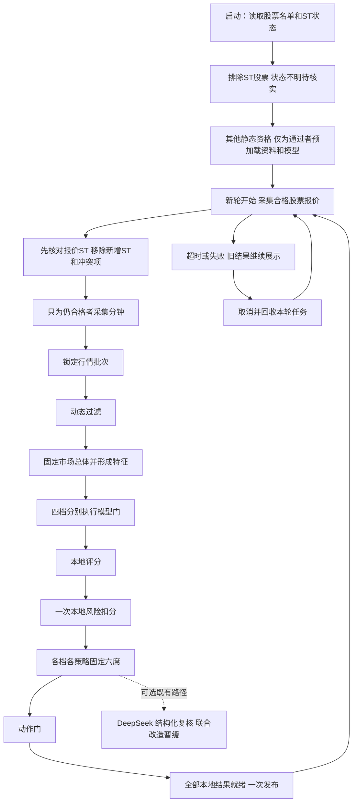
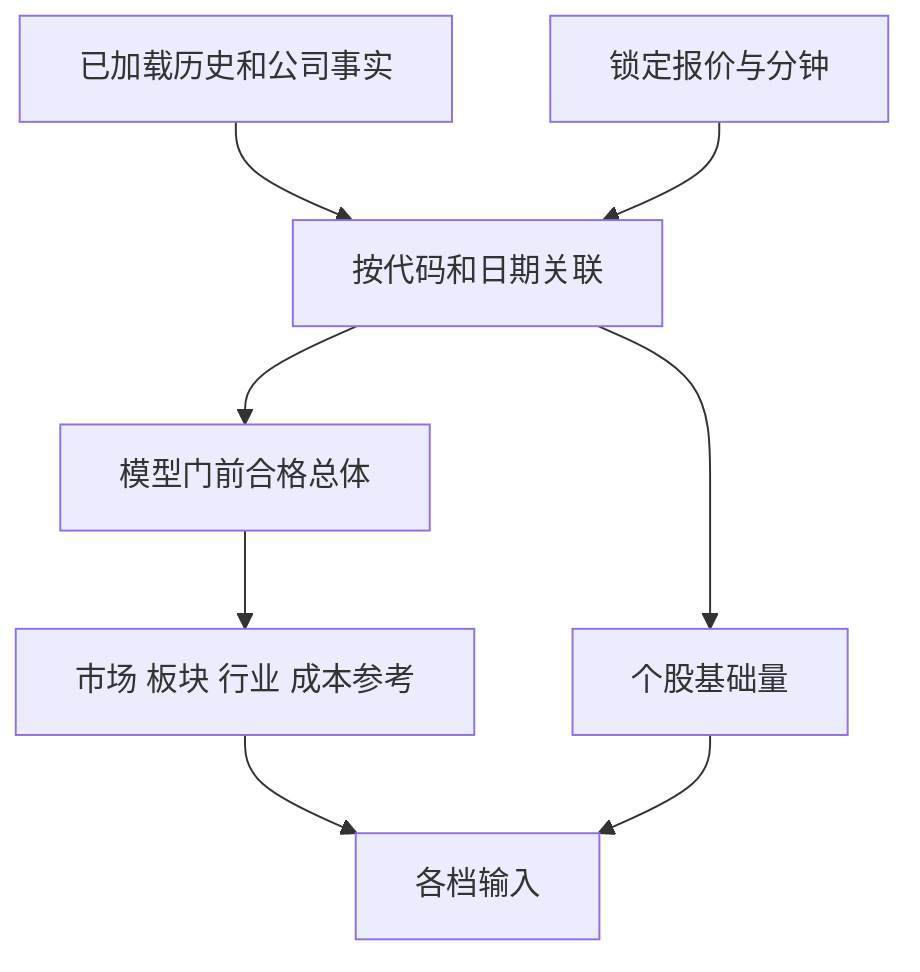

# 评分设计

本篇按十一层顺序解释荐股。先说每一步干什么，再说输入、输出、字段和失败处理。V1/V2/V3/V5 是四个评分档位，每档包含 Tomorrow、D25；Long 独立展示。

本篇的轮次和评分规则是本次规划要保留的合同。第16章已核对A的当前配置、因子、评分/风险/六席、推荐持久化和缓存消费者；下载完整物理字典仍归B，训练字典归C。源码及功能核对不代表真实资料覆盖、收益或性能验收。

阶段340已切换A可独立完成的ST请求门：行业投影只采用ST明确合格者；静态资格先于公司预载，未知/过期资格不派发定向报价，新增ST/退市报价在历史、研究和分钟请求前排除并计入采集阶段的拒绝原因。四档仍复用同一原始报价切片，一个分钟等待者超时不取消其他档位的共享Future，Long走独立只读报价入口。启动历史流仍按原发布名单扫描；用户已指定由B补只读筛选接口，A随后沿340接入本次资格。因此下文的完整启动历史过滤仍是待完成合同，不能据本批请求门或功能回归签整组完成。

## 1. 一轮怎样开始和结束

程序启动时，先读取全部股票的代码、名称和ST状态，排除ST股票；状态不明的股票先等待核实。通过ST和其他条件筛选后，再加载这些股票的历史行情、行业、财务、公告等资料，以及所需模型。加载完成后，每轮从行情采集开始计时，共用一个单调时钟 deadline，最长120秒。各阶段超时和物理重试只能用剩余时间，不各自重新领取120秒。超时后本轮计算结果全部作废；取消、等待和回收完成后才能重新采集，不允许新旧轮重叠。

“同一时间点”落实为同一锁定批次：所有档位使用相同报价批次及同一组资料、模型版本。实际来源时间可能不同，必须分别保留；不把接收时间伪装成来源时间，不为凑齐输入拼接下一轮行情。



这是业务步骤图，不要求新建十一套服务。第1层读取全部股票的名单和ST状态；第2层先排除ST股票，再按其他条件筛选，最后加载通过者的其他资料。这两层主要在启动执行，可复用未变化的筛选结果。第3层先核对报价中的ST再取分钟，第3–11层形成每轮结果。DeepSeek 联合轮次改造暂缓，本地完整发布不等待新增的联合复核；既有复核仍受原父决策与版本保护。

## 2. 第1层：读取全部股票的名单和ST状态

程序启动时，先从本地数据库读取全部股票的代码、名称和ST状态，用来判断哪些股票需要排除。此时不加载历史行情、财务和公告等其他资料，也不计算评分。

ST状态同时保留来源、检查时间和发布版本。确认需要排除的股票不再继续处理；状态缺失、过旧或相互矛盾的股票先等待核实。通过ST及其他条件筛选后，才加载其余资料。荐股程序不自动联网补资料，缺失时提示用户手动执行下载。

下表中其余资料在第2层ST及其他静态资格通过后才预加载，并在首轮采集前完成；不是第1层先把所有股票资料读完。

来源：证券/ST取自 `data/market/reference/company_st.sqlite3`；日历和行业按已发布参考及历史身份读取；历史来自 `data/market/history/catalog.sqlite3` 与年度 `prices_<year>.sqlite3`；公司资料来自 `data/company/company_facts.sqlite3`。模型来自 `data/training/models/<档位>/<策略>/model.json`、`metadata.json`，不是数据库列。配置来自 `config/runtime.json` 及b第7章列出的各业务JSON文件。上述路径以 `data_dir=data` 举例。

| 加载内容 | 来源 | 保留什么 | 不做什么 |
| --- | --- | --- | --- |
| 全部股票的代码、名称和ST状态 | 本地已发布的证券/ST资料 | 版本、来源、原检查日期和筛选结果 | 未排除ST就加载其他个股资料 |
| 交易日历、板块、行业 | ST及其他静态资格通过后加载 | 版本、生效日、覆盖、原检查日期 | 现场抓取缺失参考 |
| 已完成历史 raw/qfq | 已发布历史及档位所需窗口 | 交易日、复权来源、停牌/估值状态 | 全库逐值验证、逐股重复连接 |
| 财务、质押、解禁、公告事实 | 正式 company_facts 及关联表 | 披露时间、有效期、证据、未知项 | 在线下载和解析 PDF |
| 四档双头工件 | training 正式发布 | 特征合同、拟合日期、配置和模型身份 | 缺模型时自动训练或借用他档 |
| 配置和黑名单 | 启动配置快照 | 唯一版本及有类型设置 | 每轮重读配置 |

轻量检查包含：能否打开、schema/版本是否支持、所需时间范围和必需列是否存在、模型形状和列顺序是否匹配。历史价格正确性由下载发布承担，不在启动时重新扫描复算整库内容。

历史基础量按定义共享；模型只为实际不同档位、策略头和行业加载一份。模型常驻内存的实际字节、历史窗口字节、缓存容量和释放时机都要测，不只统计模型文件大小。预加载失败可显示最近合法快照和明确缺项，不能阻塞 Web 读取。

## 3. 第2层：先过滤ST，再处理其他资格和预加载

先根据第1层读取的ST状态排除股票，再检查支持市场、永久事实和配置黑名单等条件。只为通过筛选的股票加载历史行情、行业和公司资料，并准备所需模型。筛选结果记录合格名单、待核名单、排除原因和使用的ST资料版本。四档共用相同条件下的筛选结果；名单或资料版本改变才重新筛选。

不要在这里把盘中缺报价、模型缺失当作永久淘汰。ST 历史证据、当前报价 ST 标志、上市特殊交易日属于不同事实，分别记录来源和作用。可逆公司事件不得错误存成永久黑名单。

来源：证券身份和ST取自 `data/market/reference/company_st.sqlite3` 的 `security`、`security_st_evidence` 及对应发布关系；黑名单和资格参数来自 `config/filter.json`。当前报价名称/ST来自腾讯或新浪；上市交易日龄、交易限制和规则身份由程序依据参考与交易规则生成。下表是内存输入字段，不是同一数据库表的原列清单。

| 字段 | 中文意思与来源 | 作用 | 未知怎么办 |
| --- | --- | --- | --- |
| `code` | 官方六位证券代码 | 关联全部资料、同分排序 | 身份不明不进入决策 |
| `name` | 官方名称、报价名称 | 展示及名称状态辅助判断 | 不凭空确认非ST |
| `exchange` | 官方交易所 | 判断支持市场 | 待核 |
| `board` | 已核验板块 | 适用规则、板内比较和六席限制 | 不支持或未知不能执行 |
| `board_source` | 板块判定依据 | 第2/4层追溯来源 | 不伪造权威来源 |
| `board_reliability` | 板块来源可靠性 | 第4/11层执行资格 | unknown不能当已核验 |
| `is_blacklisted` | `filter.json` 黑名单 | 静态排除 | 错误配置明确报错 |
| `is_st`、ST证据状态 | 已发布参考与当前报价各保留 | 第2层优先过滤；第3层报价到达先复核；第4层复用结果 | 未知待核，不取其余个股资料 |
| `listing_date`、退市日期 | 官方证券参考 | 日期边界和第4层特殊交易日 | 日期不足保持待核 |
| `listing_age_sessions` | 上市日期结合可靠交易日历 | 第4层上市交易日龄 | 不按自然日猜测 |
| `is_relisted_first_session` | 证券事件参考 | 第4层重新上市首日 | 未知不填false |
| `is_delisting_period_first_session` | 证券事件参考 | 第4层退市整理首日 | 未知不填false |
| `has_price_limit` | 证券与日期对应的交易规则 | 第4/5层能否计算限幅 | 不套普通限幅 |
| `exchange_limit_pct` | 适用涨跌幅限制，百分点 | 第5/8层涨停接近度 | 未知保持缺失 |
| `strategy_hot_cap_pct` | 策略过热配置，百分点 | 第4层过热过滤 | 不等于交易所限幅 |
| `rule_version` | 交易规则版本 | 第1/4/11层规则身份 | 不混不同版本 |
| `rule_effective_date` | 交易规则生效日期 | 第4层判断可用 | 不用未来规则 |
| `execution_restrictions` | 参考与资格校验产生的限制 | 第4/11层执行原因 | 未知限制单列 |
| `has_major_regulatory_risk` | 规范化携带的风险输入 | 第4层辅助核验 | false不能证明公司风险覆盖齐全 |

## 4. 第3层：实时行情采集与批次锁定

全市场报价主路为腾讯，失败或超时才顺序使用新浪，主路成功不额外请求备路。分钟资料使用现有东方财富/AKShare适配路径，按真正需要的输入范围采集；不能先取部分股票评分后又用不同分钟批次补其余档位。

定向请求只派发给ST已通过者。供应商只能返回全市场批次时，接收后立即按ST资格剔除无效股票；再核对报价中新出现的ST信息，命中者排除、冲突者待核，之后才为剩余股票取分钟和处理后续业务。不得为已排除股票追加任何个股请求；这一核对只用本地资格和本轮报价，不新增资格网络查询或轮内读库。

要先测真实全市场请求、分钟覆盖和排队成本，再决定合并请求、减少重复请求或缓存相同分钟内容。保留每个来源自己的真实时间，复用旧内容不刷新年龄。

来源：下表实时值来自腾讯主路、新浪备路和现有东方财富/AKShare分钟接口，不从数据库读取。请求期限、重试、熔断等来自 `config/market_data.json`，轮次和并发来自 `config/scheduler.json`；来源时间、接收时间、版本和批次身份由adapter保留或生成。

| 实时字段 | 中文含义/单位 | 原始来源和标准化 | 使用层 | 缺失处理 |
| --- | --- | --- | --- | --- |
| `price` | 最新价格，元/股 | 腾讯/新浪标准化 | 4、5、11 | 非正、非有限、缺失为资料待补 |
| `previous_close` | 前收，元/股 | 报价前收字段 | 3、5 | 相关基准待补 |
| `open_price` | 开盘价，元/股 | 报价 | 3、5 | 不确认依赖它的形态 |
| `high` | 当日最高，元/股 | 报价 | 5、8、11 | 风险或保护保持未知 |
| `low` | 当日最低，元/股 | 报价 | 5、7 | 形态待补 |
| `pct_change` | 涨跌幅，百分点 | 报价适配器统一口径 | 4、5、8 | 不计作业务淘汰 |
| `amount` | 累计成交额，元 | 报价金额单位换算 | 4、5、7 | 不从成交量猜测 |
| `volume` | 累计实际成交量，股 | 腾讯手数乘100，新浪按股 | 5、11 | 不用量比替代 |
| `turnover_rate` | 换手率，百分点 | 供应商真实字段 | 4、5、7 | 不用成交额/市值反推 |
| `volume_ratio` | 供应商量比，倍 | 供应商定义 | 8 | 不等于当前量/历史五日均量 |
| `amplitude` | 振幅，百分点 | 报价 | 5 | 缺失不新增来源补取 |
| `market_cap` | 市值，元 | 按供应商口径换算 | 5、成本参考 | 不补造真实换手 |
| `is_suspended` | 当前停牌 | 标准化报价状态 | 4 | 保持待核 |
| `is_one_price_limit` | 一字板 | 开高低等价格结构 | 4 | 结构不全不伪造确认 |
| `industry` | 展示行业 | 报价或本地参考 | 5、展示 | 不代替点时模型行业 |
| `source` | 来源名称 | adapter记录 | 3、11 | 不伪造 |
| `source_time` | 来源观察时刻 | 供应商/适配器明确合同 | 3–11新鲜度 | 未来或过旧不能形成新执行动作 |
| `received_time` | 本地接收时刻 | 接收边界 | 3延迟 | 不替代来源时刻 |
| `data_version` | 内容版本 | 标准化批次 | 3–11关联 | 不跨版本拼接 |
| `merge_epoch` | 合并批次身份 | 批次锁定 | 3–11一致性 | 不混用另一轮 |
| `cross_source_verified` | 必要交叉核验完成 | 既有核验边界 | 3、11 | 未核验不冒充完成 |
| `cross_source_deviation_pct` | 跨源价格差异 | 真实核验结果 | 3、11 | 未知不填0 |
| `change_5m`、`speed` | 供应商附加涨幅/涨速 | 报价附加字段 | 当前辅助展示 | 不是新增评分必需项，不现场补取 |
| 分钟时间、OHLC、量额 | 每分钟价格和成交 | 分钟 adapter | 5、7、11 | 连续性/时间不够则相关项待补 |

## 5. 第4层：动态过滤

ST已经在其他业务前过滤，报价中的新增ST也在申请分钟前处理；本层复用其结果，不把ST首次判断拖到这里。随后用锁定行情和本地已发布资料检查停牌、特殊交易日、价格与流动性、公司财务和风险有效性。来源过旧或字段缺失是“待资料”，确认违反规则才是“业务淘汰”。同一股票只归一个终态，全部证据可以并列保存。

公司财报、质押、解禁及公告事实从启动内存视图读取，不在这里查询供应商或数据库。当前主板8%、创业板/科创板16%的过热线、亏损排除、质押/解禁硬门等作为现行规则保留；删除或重写它们属于需收益和风险证据的候选，不能在整理文档时顺便改。

公司资料未知不解释为无风险。已确认未解除的调查、强退、资金占用和违规担保不能因为公告变旧自动消失；未来180日解禁覆盖独立判断。历史财报亏损不永久排除已经有更新有效财报的公司。

## 6. 第5层：市场总体和特征

先固定模型门之前的完整合格总体，再计算市场、板块、行业、流动性和成本参考。不能用模型通过者反过来改变成本分母，或用当前小请求子集重新算百分位。



### 6.1 历史及本地计算字段

这里列清“原始量”和“转换后的分数”，同名近似不表示可互换。小数收益0.03表示3%；百分点3也表示3%，禁止混用。完整登记及实际消费者边界逐项见第16章。

来源：历史量价取自 `data/market/history/prices_<year>.sqlite3`，通过 `catalog.sqlite3` 固定发布版本；与本轮腾讯/新浪报价、分钟及公司正式事实的内存视图结合计算。公式定义见 `config/features.json`，评分转换和权重见 `config/scoring.json`，财务输入所在库见下一节。这些派生字段在本轮内存计算，不是年度价格表里同名的物理列。

| 字段 | 中文说明/来源与计算 | 使用层与作用 |
| --- | --- | --- |
| `amount_median_20d` | 已完成20日成交额中位数，元 | 4流动性；5、7金额冲击基线 |
| `turnover_median_20d` | 已完成20日真实换手中位数，百分点 | 5、7换手冲击基线 |
| `amount_percentile_20d` | 历史均态金额在固定同板总体的位置 | 7 D25流动性 |
| `ma20_slope_pct` | 历史MA20相对五个交易日前MA20变化，百分点 | 5、11趋势/回踩 |
| `ma_slope` | MA5/MA20转换为0–100分 | 7趋势，不是上一行换单位 |
| `ma20_60_position` | 现价与MA20/MA60的位置分 | 7 Tomorrow趋势 |
| `ma20_60_structure` | 当前实现使用相同位置分 | 7 D25趋势；同定义可共享 |
| `prior_high_20d` | 前20个完整交易日最高价 | 5、11突破基准 |
| `breakout_20d` | 现价/历史高点转换后的突破分 | 7趋势 |
| `breakout_deviation_pct` | 现价/前20日高点减1，百分点 | 11突破偏离 |
| `ma20_deviation_pct` | 现价偏离MA20，百分点 | 5、8过热和趋势破坏 |
| `ma20_deviation_inverse` | 贴近MA20的辅助分 | 形态辅助，不能另加重复权重 |
| `volatility_20d` | 21根历史收盘形成20个收益的总体标准差，百分点 | 7稳定性、11保护 |
| `low_volatility_score` | 上项在固定同板总体的反向百分位 | 7、11 |
| `max_drawdown_20d` | 20日路径最大收盘回撤，百分点 | 7稳定性、11保护 |
| `low_drawdown_score` | 上项同板百分位，浅回撤分高 | 7、11 |
| `atr20_pct` | 20日真实波幅/前收均值，百分点 | 11冲高回落尺度 |
| `turnover_shock_20` | 当前换手/历史换手中位数 | 5中间量 |
| `turnover_shock_score` | 换手倍数按适中区间转换为分 | 7流动性 |
| `amount_shock_20` | 当前成交额/历史成交额中位数 | 5中间量 |
| `amount_shock_score` | 金额倍数按适中区间转换为分 | 7流动性 |
| `flow_confirmation_score` | 收益方向与金额冲击结合 | 7 Tomorrow量价确认 |
| `tail_return_30m_pct` | 连续31个有效分钟首末价收益，百分点 | 5尾盘原始量 |
| `tail_return_30m` | 上项转换为0–100分 | 7 Tomorrow尾盘 |
| `tail_volume_ratio_raw` | 尾部30分钟均量/此前有效分钟均量 | 5尾盘原始量 |
| `tail_volume_ratio` | 尾盘量比按配置转换的0–100分 | 7 Tomorrow尾盘 |
| `close_location` | 现价在当日高低价之间的位置，0–100 | 7尾盘、8/11回落保护与突破确认 |
| `volume_to_5d_average` | 当日实际股数/前5完整日平均股数，倍 | 5/11缩量回踩和放量突破 |
| `market_breadth` | 同轮完整有效总体中上涨股票占比，0–100 | 5市场状态、11弱市保护 |
| `market_regime` | 广度按配置分为risk_on/neutral/risk_off | 7市场分、11保护；缺失退中性不证明真实中性 |
| `industry_strength` | 同轮行业平均涨幅在行业间的相对位置 | 5聚合和展示，不另加行业奖励 |
| `industry_breadth` | 同轮行业内上涨股票占比 | 5背景和有条件的入场核验 |
| `industry_trend` | 当前复用industry_strength | 辅助展示，不重复奖励 |
| `quality_score` | 财报年化ROE与扣非/归母利润比例按配置转换 | 7公司质量 |
| `value_score` | 现价与合格财报形成PE/PB再转换 | 7公司价值；无效PE不当便宜 |
| `growth_score` | 财报营收、归母、扣非增长的有效值转换 | 7公司成长 |
| `entry_quality` | 均线、斜率、实际五日量比、高点与位置确认形态 | 7入场组件、11解释 |
| `return_3d` | 现价/3日前对齐qfq收盘减1，百分点 | 5区间收益和辅助 |
| `return_5d` | 现价/5日前对齐qfq收盘减1，百分点 | 5/8方向与过热 |
| `return_10d` | 现价/10日前对齐qfq收盘减1，百分点 | 5/8过热 |
| `return_20d` | 现价/20日前对齐qfq收盘减1，百分点 | 5区间表现 |
| `return_60d` | 现价/60日前对齐qfq收盘减1，百分点 | 5区间表现 |
| `relative_strength_3d` | return_3d在固定同板总体中的百分位 | 5辅助，不另加权重 |
| `relative_strength_5d` | return_5d同板百分位 | 5辅助 |
| `relative_strength_10d` | return_10d同板百分位 | 5辅助 |
| `relative_strength_20d` | return_20d同板百分位 | 5辅助 |
| `ma5` | 前5完整日qfq收盘均值，元/股 | 5/7/11趋势和入场 |
| `ma10` | 前10完整日qfq收盘均值，元/股 | 5/7/11趋势和入场 |
| `ma20` | 前20完整日qfq收盘均值，元/股 | 5/7/8/11趋势与保护 |

以下辅助字段也要列清用途，不能因为“程序有算”就当作新增生产权重：

来源：历史输入来自 `data/market/history/prices_<year>.sqlite3`，公司输入来自 `data/company/company_facts.sqlite3`，实时输入来自本轮报价/分钟；新闻取自有来源和时间的新闻证据。字段定义见 `config/features.json`，转换参数以 `config/scoring.json` 及实际消费者为准。它们是程序计算/研究字段，不表示存在一张同名数据库表。

| 字段 | 中文说明/来源与计算 | 作用和缺失 |
| --- | --- | --- |
| `speed_percentile` | 报价涨速在同板总体百分位 | 展示，不恢复旧候选分；缺涨速/总体则缺失 |
| `trend_score` | 均线位置与斜率按配置组合 | 辅助；中性替代不证明已观测 |
| `capacity_score` | 当日额/20日中位额转换 | 容量辅助，不是新排名分 |
| `moderate_amplitude` | 当日振幅按适中带转换 | 辅助，缺振幅则缺失 |
| `price_executability` | 现价按适中价格带转换 | 辅助，不是完整可交易性证明 |
| `limit_distance_safety` | 100×(1-limit_proximity) | 辅助，未知不当安全 |
| `low_crowding_score` | 当前与limit_distance_safety同定义 | 辅助，不重复拥挤扣分 |
| `moderate_daily_return` | 当日涨跌幅按适中带转换 | 形态辅助，不独立加权 |
| `price_volume_confirmation` | 5日方向与当前金额信号转换 | 辅助，不是flow_confirmation_score别名 |
| `upward_consistency` | 前20日正收益日占比 | 研究辅助，历史不足则缺失 |
| `risk_adjusted_return_20d` | 20日收益/波动转换为分 | 研究辅助，不是资金收益率 |
| `industry_policy_score` | 行业强度与证据基准组合 | 研究辅助，不是行业生产奖励 |
| `risk_protection_score` | 低波动与低回撤分组合 | 研究辅助，不代替第11层逐项保护 |
| `news_sentiment` | 有来源标题按配置关键词计算 | 证据/研究，不直接扣分或硬过滤 |
| `evidence_freshness` | 新闻时间与观察时间的衰减 | 证据展示，不代替行情/公司时效门 |

历史不足、输入非法、分钟不连续均保持缺失。模型必需项不填0；一般评分项可能以中性值进入计算，但必须扣掉缺失贡献。下行保护关键项缺失，动作最多关注。当前公式、精确权重、阈值、边界例子及消费者见16.2–16.5；真实输入和收益资格仍分别验收。

### 6.2 公司字段怎样进入荐股

来源：`data/company/company_facts.sqlite3` 的 `company_facts` 提供财务、质押和覆盖；`company_unlock` 提供解禁；`company_risk_event`、`company_reduction_plan` 及证据表提供风险；`company_positive_event`、里程碑和证据表提供利好。下表风险等级和评分值由这些事实派生，使用 `config/filter.json`、`config/risk.json`、`config/scoring.json` 的相应规则；它们不一定是物理列名。

| 评分字段/事实 | 来自哪里 | 生效层 | 含义和缺失处理 |
| --- | --- | --- | --- |
| `eps`、`bps` | 正式财务每股收益/净资产 | 5、7 | 与价格组成估值，不能靠新闻猜 |
| `revenue_growth_pct`、`profit_growth_pct`、`core_profit_growth_pct`、`roe_pct` | 最新有效财报 | 5、7 | 营收、利润、扣非增长和ROE；保留披露时间 |
| `parent_profit`、`core_profit` | 同一有效财报 | 4 | 归母/扣非利润亏损硬门 |
| `latest_disclosed_report_loss` | 最新有效财报的亏损判定 | 4 | 不将旧期亏损永久固化 |
| `financial_deterioration` | 有效财务指标派生的恶化程度 | 4、8 | 规则和缺失语义按财务合同核对 |
| `pledge_risk` | 最新质押比例及日期 | 4、8 | 风险分级，未知不填0 |
| `unlock_risk` | 决策后180日解禁安排 | 4、8 | 独立覆盖和分级，不只查过去公告 |
| `major_illegal_history` | 已核验重大违法事件 | 4 | 主体及有效状态核验 |
| `official_investigation_history` | 同案调查与结案证据 | 4 | 不能以无关公告清除 |
| `fund_occupation_history` | 资金占用事件及解决状态 | 4 | 未解除继续有效 |
| `illegal_guarantee_history` | 违规担保事件及解决状态 | 4 | 未知不解释成无风险 |
| `forced_delisting_risk` | 强退程序与同案状态 | 4 | 已确认风险硬过滤 |
| 减持计划与状态 | 正式减持计划/关联事件 | 4、8 | 按公告、完成/终止及有效窗口 |
| `major_shareholder_reduction` | 主要股东减持的有效事实 | 4 | 主体、期间和状态核验 |
| `shareholder_reduction_level` | 减持事件按配置分级 | 5、8 | 不与解禁重复计同一风险 |
| `financial_fraud_history` | 已核实财务造假事实 | 4 | 窗口滚动不自动解除已确认有效风险 |
| `reduction_or_unlock` | 减持与解禁的有效等级 | 5、8 | 综合解释，不重复扣同一风险 |
| `negative_announcement_level` | 有效负面事件最高等级 | 8 | 结构化解释，扣分受配置控制 |
| `corporate_risk_window_unavailable` | 目录、正文、同案关联覆盖 | 4、11 | 覆盖不足只能观察，不冒充无风险 |
| 利好事件、里程碑与证据 | 正式 positive 表族 | 5、7 | 只按实际使能的公司评分规则使用 |

物理表逐列、来源原字段、新旧版本规则和下载时间范围由 d 第5、8章维护。本表回答“在哪层起什么作用”，不是另一份物理 schema。

## 7. 第6层：模型预测、净效用与四档差异

模型来源：`data/training/models/<档位>/<策略>/model.json`、`metadata.json`；训练窗口和算法参数来自 `config/training.json`，特征定义见 `config/features.json` 与各档合同。本地分、风险、成本和动作分别由 `config/scoring.json`、`risk.json`、`cost.json`、`selection.json` 约束。下表对比模型职责，不是数据库列清单。

| 对比项 | V1 | V2 | V3 | V5 |
| --- | --- | --- | --- | --- |
| 算法 | LightGBM排序器＋独立Ridge收益门 | 行业LightGBM回归 | 行业Ridge回归 | 行业量价TCN |
| 特征回看 | 251个完整历史日 | 251日 | 61日 | 61个完整日形成60步 |
| 主要输入 | 完成日十因子 | 长短收益、残差动量、长期市场和流动性 | 短窗收益、残差动量和流动性 | 60×6量价序列＋辅助因子 |
| 模型门 | 独立收益预测与成本净效用 | 预测及成本净效用 | 预测及成本净效用 | 预测及成本净效用 |
| 最终排序分 | 排序器独立模型百分位 | `local_score` | `local_score` | 本档预测百分位 |
| 动作比较 | `local_score` | `local_score` | `local_score` | `local_score` |
| 加载区别 | 双头排序器及收益门 | 双头各行业树模型 | 双头各行业线性系数 | 双头各行业网络权重 |
| 应测资源 | 预测调用、模型数、输入矩阵/RSS | 行业调用与线程、长窗特征 | 矩阵转换与线性校验成本 | 序列解码、张量/线程、最大行业 |

四档不共用预测和排序身份。V1/V5 已获人工生产授权，这不表示收益验证通过；旧 Shadow 记录不升级。V5 独立发展，不能替换 V3。

### 7.1 模型输入明细

来源：原始量价在 `data/market/history/prices_<year>.sqlite3`，发布和日历身份在 `catalog.sqlite3`，模型行业依据已绑定的历史行业参考；实时锚点来自本轮腾讯/新浪报价。字段定义和顺序由 `config/features.json` 与各档特征合同约束，窗口及模型参数来自 `config/training.json`；已发布模型列合同保存在 `data/training/models/<档位>/<策略>/metadata.json`。下表为模型输入计算字段，不能按名称直接查询某张表。

| 字段族 | 定义和来源 | 使用档位 |
| --- | --- | --- |
| `completed_return_1d` | 完成历史窗口末日/前1日收盘减1，小数收益 | V1两头排序器与收益门 |
| `completed_return_3d` | 完成末日/前3日收盘减1 | V1 |
| `completed_return_5d` | 完成末日/前5日收盘减1 | V1 |
| `completed_return_20d` | 完成末日/前20日收盘减1 | V1 |
| `completed_return_60d` | 完成末日/前60日收盘减1 | V1 |
| `completed_return_120d` | 完成末日/前120日收盘减1 | V1 |
| `completed_return_250d` | 完成末日/前250日收盘减1 | V1 |
| `completed_volatility_20d` | 完成窗口20日小数收益总体标准差 | V1 |
| `completed_drawdown_60d` | 末日/60日最高收盘减1，不等于路径最大回撤 | V1 |
| `completed_log_average_amount_20d` | 20日均额再取自然对数 | V1 |
| `qfq_return_1d` | 本轮锚点/前1日qfq收盘减1，小数收益 | V2/V3/V5 Tomorrow；D25不用 |
| `qfq_return_3d` | 本轮锚点/前3日qfq收盘减1 | V2/V3/V5双头 |
| `qfq_return_5d` | 本轮锚点/前5日qfq收盘减1 | V2/V3/V5双头 |
| `qfq_momentum_20d_skip5` | 第5日前收盘/第20日前收盘减1 | 5基础量，V2/V3/V5 |
| `qfq_momentum_40d_skip5` | 第5日前收盘/第40日前收盘减1 | 同上 |
| `qfq_momentum_60d_skip5` | 第5日前收盘/第60日前收盘减1 | 同上 |
| `qfq_momentum_120d_skip5` | 第5日前收盘/第120日前收盘减1 | 仅V2 |
| `qfq_momentum_250d_skip5` | 第5日前收盘/第250日前收盘减1 | 仅V2 |
| `qfq_residual_momentum_20d_skip5` | 20日动量去除同轮市场/板块/行业/流动性暴露 | 6模型输入，V2/V3/V5 |
| `qfq_residual_momentum_40d_skip5` | 40日动量去除相同共同暴露 | 同上 |
| `qfq_residual_momentum_60d_skip5` | 60日动量去除相同共同暴露 | 同上 |
| `qfq_residual_momentum_120d_skip5` | 120日动量去除相同共同暴露 | 仅V2 |
| `qfq_residual_momentum_250d_skip5` | 250日动量去除相同共同暴露 | 仅V2 |
| `market_qfq_momentum_120d_skip5` | 本档完整总体120日动量均值 | 仅V2 |
| `market_qfq_momentum_250d_skip5` | 本档完整总体250日动量均值 | 仅V2 |
| `qfq_amihud_20d` | 20日绝对收益/百万元成交额均值，流动性代理 | V2/V3/V5成本和输入资格 |
| `qfq_average_amount_20d` | 20日均额，不是中位数 | 模型流动性和成本参考 |
| `model_industry` | 带生效日期、来源、分类和版本的行业引用 | 行业模型路由；V1为全市场模型 |

V5 的全部序列坐标用 `t=0..59`、以下6个通道明确表示，共360项，不抄360行相同解释。`t=0` 是61日窗口第二天，`t=59` 是信号日前最近完整日，顺序由旧到新。

来源：下面6个通道由 `data/market/history/prices_<year>.sqlite3` 中已发布的qfq价格和模型合同量额计算；训练时写入 `data/training/samples/` 下V5样本库，在线从已预加载历史生成。60步、列序及单位由V5特征合同和 `config/training.json` 约束，不来自实时分钟数据库。

| 字段模式 | 每一步含义 | 来源与单位 |
| --- | --- | --- |
| `sequence_<t>_open_return` | 当日开盘/前收减1 | 历史qfq价格，小数收益 |
| `sequence_<t>_high_return` | 当日最高/前收减1 | 同上 |
| `sequence_<t>_low_return` | 当日最低/前收减1 | 同上 |
| `sequence_<t>_close_return` | 当日收盘/前收减1 | 同上 |
| `sequence_<t>_log_volume` | `ln(1+实际成交股数)` | 历史原始量，股 |
| `sequence_<t>_log_amount` | `ln(1+模型合同金额)` | 金额先统一为元；raw/qfq金额投影须按e第3章核对，不能凭名称更换 |

模型未加载、行业覆盖不足、校准不合格和必需输入缺失分别报告。不得为凑满六席换用他档预测、放宽门或伪造模型分。

## 8. 第7层：本地评分

对通过模型门且输入合格者计算证据分。组件和子项的定义、权重以配置实际调用链为准：趋势、流动性、稳定性、Tomorrow尾盘、D25相应结构及公司事实各自说明，不把辅助字段当新增权重。

```text
signal_score = 各组件分 × 对应权重之和
quality_penalty = 缺失项原本中性贡献之和
base_score = clamp(signal_score - quality_penalty, 0, 100)
```

百分位来自预先固定的同板总体，并列使用平均秩。越低越好的量才反向。缺失不允许白得中性分，也不能把一只股票同时算成模型待补和本地评分淘汰。

数值相同的预测、成本或因子必须同分，不先按代码拆成不同百分位；单样本按中性50处理，不天然满分。代码只参与最终已经同分后的稳定顺序。

第16章给出原始单位、转换公式、权重、边界示例、输入来源、缺失处理、作用头和消费者。相同输入、窗口、总体、公式、参数版本才可共享结果。

## 9. 第8层：本地风险只扣一次

```text
local_score = clamp(base_score - local_risk_penalty, 0, 100)
```

来源：下表使用本轮腾讯/新浪报价、从 `data/market/history/prices_<year>.sqlite3` 预加载的历史量价及证券规则派生，依赖字段的公式见 `config/features.json`。风险触发和扣分配置来自 `config/risk.json`，后续动作限制来自 `config/selection.json`；这些是内存风险字段，不是独立风险数据库的物理列。

| 风险字段 | 当前依据 | 作用 |
| --- | --- | --- |
| `limit_proximity` | 当前涨幅/适用涨跌幅限制 | 拥挤风险；不适用限幅时不计算 |
| `price_volume_divergence` | 收益方向与金额冲击不一致 | 价量背离 |
| `short_term_overheat` | 5/10日收益和MA20偏离 | 短期过热，不等于当日过热线 |
| `intraday_reversal` | 有效交易分钟、最高价回落和日内位置 | 反转风险 |
| `liquidity_contraction` | 供应商量比或金额冲击低 | 流动性收缩 |
| `trend_breakdown` | 现价、MA20、均线结构和5日收益 | 趋势破坏及动作收紧 |

公司硬过滤已排除的风险不能再次当作另一份数值罚分。所有风险展示原始事实、触发规则、扣分和缺失状态；自由文本不得扣分。完整16条规则、七项本地触发及去重见16.5。

## 10. 第9层：固定六席

V1 按自己的模型排序分、V5 按自己的预测百分位，V2/V3 按 `local_score` 排名。稳定同分按代码升序；应用当前单板最多四席约束，无行业限额。先固定六席，之后复核和动作不得重排、补第七名。

六席是最多六个已选观察位置，不保证六个“推荐”动作，也不为凑齐牺牲输入质量或净效用。V5 不足六席时，页面必须分解总体、输入、行业模型、净效用、板限和动作的影响，再决定是否存在问题。

## 11. 第10层：可选 DeepSeek 复核

本轮不重做 DeepSeek 流程、缓存、请求合并、配置或增量研究。保留既有固定六席、经证据核验的结构化风险 veto；不改变数值分、顺序或补位。

每日物理 HTTP 请求全局不超过168次，失败与重试也计数，预热与 emergency 有独立原子桶。复核失败不能阻断合法本地降级及只读页面；父决策、来源版本、预算和降级必须可追踪。

## 12. 第11层：动作、整批发布和冻结

动作门比较 `local_score`，不是 V1/V5 模型排序分；分数按 `ROUND_HALF_UP` 保留两位。当前 Tomorrow 推荐/关注门78/72、D25为76/70，另有输入与风险限制，整理文档不调阈值。

收齐所有启用档位的 Tomorrow/D25 本地结果后一次切换。缺一档执行结果、超时或失败都不拼接新旧；资料不足和合法空结果按各自业务合同判断，不能把无效报价造成的空集发布成“全部淘汰”。

决策保存自己的十一层审计，冻结、重启、历史查询、API和SSE读取该决策携带的计数、原因与指标，不拼接当前进程状态。旧记录没有的审计明确未知，不回写编造。提交被拒绝时，运行状态、检查点和事件都不得抢先前进。

15:00 first-wins 冻结，已有同日正式记录不被迟到结果覆盖。同日缺失才允许按合法条件生成一次 `close_fallback`。冻结先确保持久事实成功，再标正式。跨库部分成功按 b 第4章恢复；Long 不冻结、不进入推荐历史。

推荐冻结、发布序号及研究物理表逐列字典见16.7；轮次、输入版本、模型身份等封装在规范payload中，不伪装成独立SQL原列。本次不改schema或活动数据库。

## 13. 哪些共享，哪些必须分开

| 工作 | 可共享条件 | 必须隔离的情况 |
| --- | --- | --- |
| 资料读取和加载 | 同一发布版本、同一物理输入 | 不同数据版本和复权来源 |
| 报价与分钟 | 同一锁定采集批次 | 不同轮次或真实时点超出合同 |
| 静态资格与动态事实 | 同一规则、时间和总体 | 档位有真实不同资格合同 |
| 历史均量、均线、波动等 | 同窗、同公式、同末日 | V1完成日特征与实时锚点特征 |
| 市场/板块/行业统计 | 完全相同的合格总体及输入 | 总体、窗口、参数或缺失集合不同 |
| 本地评分与风险事实 | 同输入、规则与参数 | 策略权重、动作门和结果身份 |
| 模型矩阵准备 | 列顺序、变换和数据完全一致 | 各档预测、收益门、排序器、TCN |

缓存键应包含真正影响结果的资料、批次、总体、窗口、公式和参数身份。TTL不是数据版本；重新读取不刷新年龄。每个缓存有容量、字节预算、命中/失效和释放指标，避免保留多轮完整副本。

281提供显式离线候选，默认生产不注入：prepared_reuse以完整特征、策略/配置、资格时间、总体身份、模型资格集合和执行门为身份，复用原资格owner及板内参考构建结果；排名、组件评分、风险和六席继续每次执行。同一feature_batches预算同时容纳原始因子和准备结果，异常/非有限输入不缓存，拒写仍返回本次完整结果；身份与查缓存成本单列。metrics_reuse仅复用原SummarizeHistoryMetrics的相同末60根输入，最多两份工作区统计，61/251日的锚点、日期和样本数分别构造。v5_industry_parallel在调用者显式持有的独立两worker执行器中同时处理不同的行业，同一行业的256行批次仍串行，收集顺序、原预测校验和deadline保留，失败/取消等自己的已派发任务回收后再返回。入口及参数见[scripts说明](../../scripts/README.md)；这些是功能候选，必须由C后台取得同输入完整耗时及CPU/RSS/I/O证据后才可另行启用。

荐股执行并发统一取`config/scheduler.json.pipeline.executors`，默认容量和多档共享关系见b第3及7章。分钟池与批次内并发采用同一配置，改变线程数不改变因子/模型manifest或允许混用批次；120秒仍是整轮统一期限。后台初始化或调度线程未退出时停止报告明确未完成，不能据缓存仍可读签资源已回收。

## 14. 耗时、过滤分析与优化计划

用户报告约一分钟是待复测现象。旧台账有42.924秒单次预览，不能代替本轮盘中基线。先按以下口径测量，再排序优化。

| 阶段 | 必须记录 | 候选方向，均须先测 |
| --- | --- | --- |
| 启动 | 各资料/模型加载、读库字节、RSS | 批读、共享加载、去掉重复审计 |
| 实时采集 | 排队、各来源请求/重试、分钟覆盖、来源年龄 | 同批请求复用、限并发、避免无用附加源 |
| 动态过滤 | 输入/通过/业务拒绝/待资料、规则耗时 | 相同资格事实只算一次 |
| 总体与特征 | 历史基础量、横截面次数、缓存命中 | 同总体共享、按依赖变化复算 |
| 模型门 | 逐档逐行业调用、矩阵转换和CPU | 行业批量推断；线性输入校验减少重复 |
| 本地分/风险 | 两头组件次数、对象分配、GC | 相同纯计算复用，减少中间对象 |
| 发布和Web | 锁等待、投影、事件到达、浏览器绘制 | 减少重复投影，保持一次替换 |
| 恢复与资源 | 超时清理、在途任务、队列、100 tick RSS | 及时释放旧轮引用和资源 |

阶段计数采用明确终态：通过、业务淘汰、待刷新、待资料、执行失败；不要把“未完成”和“淘汰”混在一起。Web 的字段、展示和重连见 b 第8章；后端要提供真实计数，不产生伪耗时。

完整总体不能被缓存或候选容量静默截断，缺资料者保留在对应覆盖分母和待补统计里；来源健康包含全部尝试过的来源，不能只报告最后成功的一路。复用保留原成功时点，不以本次读取刷新时效。

至少5个不同完整盘中轮次测总耗时和P50/P95；另测100 tick内存、取消/超时、失败保留旧批次、Long独立及冻结恢复。源码推断、离线回放、同一序号重复查询、HTTP 200和旧进程结果都不能替代。

## 15. 未来荐股与收益优化：合入 score.md

以下完整承接原 `docs/score.md` 的六条研究主线。它们是研究计划，不直接改生产参数，不新增算法档位、不比较XGBoost，DeepSeek增量研究暂缓。进度只记 g，原文件保留供人工对照。

### 15.1 建立八个模型头的收益基线

固定数据版本、评价日期、当时股票总体、成本、六席和约束。分别报告四档双头：前六成本后超额收益、空槽率、换手、回撤、严重亏损、模型覆盖、缺模型行业、拒绝原因、Rank IC、NDCG@6、校准、模型年龄、分年/行业/板块/市场状态结果。

不同覆盖同时报告共同覆盖配对结果和完整总体实际结果，不删缺模型对象制造改善。同日股票放同日期分区；训练、早停、校准和评价隔开。当前V1的20日工程预测评价不替代长期收益验证。

### 15.2 先查输入和时间偏差

逐字段核对历史与在线特征的时间、单位、复权、停牌和缺失语义；研究盘中累计量价与整日基线的可比性；解释模型年龄及重训周期、行业覆盖不足的来源。历史证券人口、行业、财报和公告必须满足当时已可见。

确定性错误先修复再重建基线。缺真实历史人口或分钟证据，只能说明日频代理结果，不能签点时收益资格。滚动变换、校准和重训只能使用该评分日前成熟资料和标签。

### 15.3 四档各自研究，保持算法类型

首轮每档最多三个预先登记的候选，每次只改一个因素；预算、日期、停止条件在看评价结果前固定，不做参数笛卡尔积搜索。

| 档位 | 依次研究什么 |
| --- | --- |
| V1 | 固定排序器研究Ridge收益门，再固定收益门研究排序器约束、窗口，最后少量新特征；同时看排名和成本后前六收益 |
| V2 | 行业模型稳定性、行业独立与共享拟合、窗口、近期权重、树约束；覆盖增加本身不算收益改善 |
| V3 | 系数跨窗方向/幅度/贡献、相关特征、惩罚强度、窗口及共享拟合；删除特征也须样本外对照 |
| V5 | 先比较61/120/250个有效拟合日，占用首轮候选预算，固定60步和网络；再拆序列/辅助特征贡献，最后研究轮数、宽度、dropout和权重衰减 |

V5 同时报共同覆盖与完整总体，不能通过缩窄样本、降低行业门取得表面改善。模型训练行数多不证明日期跨度足够。每档交付包含失败候选和边界的配对报告。

### 15.4 研究特征和各道门的增量

依次研究波动调整趋势/反转、量额变化与价格关系、跳空/振幅/收盘位置、市场/板块/行业状态。一次增删一组，核对跨日期和市场状态稳定性。财务与公告新特征须先有披露时点证据。

拆分模型门、本地分、动作门、风险门的贡献，比较预先登记的纯规则和规则加模型等方案，分别统计误拒、排名落后和风险否决损失。生产仍保持V1/V5模型排序、V2/V3本地分排序、固定六席、板限和不补位；改权重/阈值另列候选，不放宽已知硬风险制造收益。

### 15.5 独立验收与一次终端留出

按交易日滚动验证，同日同分区，边界至少隔离5个交易日并核对标签成熟；隔离期与统计区块不是同一个参数。调参、校准、独立确认、终端留出分别隔离，多个候选比较须考虑区块依赖和统计校正。

在20bp、50bp完整往返成本下评价成本后收益，报告相对基线配对增量及置信区间；100bp只作压力。回撤、严重亏损、换手、覆盖、不可交易率、容量、滑点和延迟退出一起报告。固定完整方案后，至少200个未见交易日的终端留出只开启一次，失败不继续在留出调参。

具体收益数值门槛和统计参数须从现行评分合同第12节逐项核对到新文档，未核对前不得自行另定或声称通过。D25机会标签、固定六槽贡献、入选均值和真实资金收益分开；没有重叠持仓、占用与退出规则不年化为资金收益。

D25完整评价包含T+2、T+3、T+4、T+5四个期限，聚合取四项算术平均；只补已成熟且缺失的结算，已保存结果不因后来价格修订改写。raw用于交易可行性事实，qfq用于可比收益；盘中raw锚点按推荐日同源raw/qfq关系换算，不能直接和另一口径的退出价相除。缺交易日、停牌、不可退出和基准缺失分别记录。未建模的风险概率保持“未建模”，不拿总体严重亏损频率冒充个股概率。

### 15.6 前瞻观察与生产切换

历史通过的候选再前瞻观察真实输入、模型年龄、名单、成本、拒绝和风险，提前固定停止条件。历史证据、前瞻观察、人工生产授权分别记录；形成具体切换方案后按授权交付。

四档双头独立发布，不覆盖别档，旧正式和Shadow记录保持原身份，遵守15:00 first-wins。研究顺序：统一基线与偏差核查 → V3低成本诊断 → V1排序/收益门 → V2过滤 → V5日期跨度 → 特征增量 → 独立验收 → 前瞻观察与切换。

## 16. 字段、配置与消费者核对

本章按`eca4a2bd`及本批文义修正核对A的现行消费者，不代表收益、真实资料覆盖或性能验收。公共配置见b第7章；下载物理字典/提取证据归B的d第8–9章，训练样本/工件与配置归C的e第3/6/7章；未交付项不在这里冒充完成。

### 16.1 字段与身份边界

数据库原列经published只读adapter解析为不可变历史/公司对象，单位在边界统一。`normalization/features.py.FEATURE_SCHEMA`有87个可空float列；`features.json.factor_index`登记80项，描述字符串不是通用公式解释器。另7列为`return_3d`、`relative_strength_3d`、`speed_percentile`、`ma20_deviation_pct`、`low_crowding_score`、`news_sentiment`、`evidence_freshness`：依次是3日收益/同板百分位、涨速百分位、100×(price/MA20−1)、100×(1−limit_proximity)、有来源标题关键词情绪及时间衰减，辅助用途见6.1，不新增权重。V2长窗、残差/市场聚合及V5序列由各自模型manifest定义，不用87列冒充模型矩阵全集。模型列顺序、单位、窗口和缺失见7.1；V1/V5不借V2/V3预测或身份。

因子描述元数据进入strategy hash，实际模型列manifest独立。文义修正使新运行使用新配置身份，不改旧冻结字节，不自动重训/替换模型。来源/批次/总体/窗口/参数不同均不能只凭同名因子复用。

### 16.2 评分配置逐叶字典

以下路径从各文件根开始；全部启动生效。每行给当前标量/标量数组或展开到叶子的映射，类型由JSON值明确：数字须有限，布尔严格解析，数组有序。评分文件进入strategy身份，cost独立摘要进入有效配置身份。范围除下述枚举外由policy的非负、递增、权重和为1及跨字段关系校验；合法参数仍受生产评分和收益候选授权约束。

#### scoring.json

来源：`config/scoring.json`。`settings/loading.LoadStrategySettings`、`settings/company.ParseCompanyScoringPolicy` → 外/子权重由`ScoreBoardStrategy`消费，辅助权重由`FeatureBuilder/DeriveLongResearchFeatures`消费，尾盘由`DeriveTailSignals`消费，市场门由`DeriveMarketRegime`消费，公司参数由`AssessCompanyAdjustments/BuildScoreLedger`和正式company投影消费。company_scoring.enabled=false，额外公司奖励/软扣均0，D25的quality_value财报组件仍启用。小数位固定2、ROUND_HALF_UP；复核覆盖0.5/已知2维固定校验，dimension_weights只影响复核应用资格，不生成数值最终分。

| 字段路径 | 中文作用 | 当前值 |
| --- | --- | --- |
| `fusion.confidence_coverage_min` | 复核置信覆盖门 | `0.5` |
| `fusion.minimum_known_dimensions` | 复核最少已知维数 | `2` |
| `fusion.local_risk_cap` | 本地风险总扣分上限 | `25` |
| `fusion.score_decimals` | 分数小数位 | `2` |
| `fusion.rounding` | 舍入模式 | `"ROUND_HALF_UP"` |
| `board_local_strategy_weights.tomorrow.main.tail_structure` | tomorrow/main的尾盘结构权重 | `0.1666666666666667` |
| `board_local_strategy_weights.tomorrow.main.turnover_flow` | tomorrow/main的换手/成交确认权重 | `0.0555555555555556` |
| `board_local_strategy_weights.tomorrow.main.trend` | tomorrow/main的趋势权重 | `0.2222222222222222` |
| `board_local_strategy_weights.tomorrow.main.stability` | tomorrow/main的稳定性权重 | `0.2777777777777778` |
| `board_local_strategy_weights.tomorrow.main.market_state` | tomorrow/main的市场状态权重 | `0.1111111111111111` |
| `board_local_strategy_weights.tomorrow.main.entry_quality` | tomorrow/main的确定性入场质量权重 | `0.1666666666666667` |
| `board_local_strategy_weights.tomorrow.chinext.tail_structure` | tomorrow/chinext的尾盘结构权重 | `0.25` |
| `board_local_strategy_weights.tomorrow.chinext.turnover_flow` | tomorrow/chinext的换手/成交确认权重 | `0.1875` |
| `board_local_strategy_weights.tomorrow.chinext.trend` | tomorrow/chinext的趋势权重 | `0.1875` |
| `board_local_strategy_weights.tomorrow.chinext.stability` | tomorrow/chinext的稳定性权重 | `0.125` |
| `board_local_strategy_weights.tomorrow.chinext.market_state` | tomorrow/chinext的市场状态权重 | `0.0625` |
| `board_local_strategy_weights.tomorrow.chinext.entry_quality` | tomorrow/chinext的确定性入场质量权重 | `0.1875` |
| `board_local_strategy_weights.tomorrow.star.tail_structure` | tomorrow/star的尾盘结构权重 | `0.1666666666666667` |
| `board_local_strategy_weights.tomorrow.star.turnover_flow` | tomorrow/star的换手/成交确认权重 | `0.0555555555555556` |
| `board_local_strategy_weights.tomorrow.star.trend` | tomorrow/star的趋势权重 | `0.2777777777777778` |
| `board_local_strategy_weights.tomorrow.star.stability` | tomorrow/star的稳定性权重 | `0.2777777777777778` |
| `board_local_strategy_weights.tomorrow.star.market_state` | tomorrow/star的市场状态权重 | `0.0555555555555556` |
| `board_local_strategy_weights.tomorrow.star.entry_quality` | tomorrow/star的确定性入场质量权重 | `0.1666666666666667` |
| `board_local_strategy_weights.d25.main.trend` | d25/main的趋势权重 | `0.2941176470588235` |
| `board_local_strategy_weights.d25.main.quality_value` | d25/main的财务质量/价值/成长权重 | `0.2941176470588235` |
| `board_local_strategy_weights.d25.main.stability` | d25/main的稳定性权重 | `0.1764705882352941` |
| `board_local_strategy_weights.d25.main.flow_liquidity` | d25/main的流动性权重 | `0.1176470588235294` |
| `board_local_strategy_weights.d25.main.entry_quality` | d25/main的确定性入场质量权重 | `0.1176470588235294` |
| `board_local_strategy_weights.d25.chinext.trend` | d25/chinext的趋势权重 | `0.2857142857142857` |
| `board_local_strategy_weights.d25.chinext.quality_value` | d25/chinext的财务质量/价值/成长权重 | `0.1428571428571429` |
| `board_local_strategy_weights.d25.chinext.stability` | d25/chinext的稳定性权重 | `0.1428571428571429` |
| `board_local_strategy_weights.d25.chinext.flow_liquidity` | d25/chinext的流动性权重 | `0.2857142857142857` |
| `board_local_strategy_weights.d25.chinext.entry_quality` | d25/chinext的确定性入场质量权重 | `0.1428571428571429` |
| `board_local_strategy_weights.d25.star.trend` | d25/star的趋势权重 | `0.3529411764705882` |
| `board_local_strategy_weights.d25.star.quality_value` | d25/star的财务质量/价值/成长权重 | `0.2941176470588235` |
| `board_local_strategy_weights.d25.star.stability` | d25/star的稳定性权重 | `0.1764705882352941` |
| `board_local_strategy_weights.d25.star.flow_liquidity` | d25/star的流动性权重 | `0.1176470588235294` |
| `board_local_strategy_weights.d25.star.entry_quality` | d25/star的确定性入场质量权重 | `0.0588235294117647` |
| `local_component_weights.tomorrow.tail_structure.tail_return_30m` | tomorrow/tail_structure的尾盘30分钟收益分权重 | `0.35` |
| `local_component_weights.tomorrow.tail_structure.tail_volume_ratio` | tomorrow/tail_structure的尾盘量比分权重 | `0.3` |
| `local_component_weights.tomorrow.tail_structure.close_location` | tomorrow/tail_structure的收盘位置权重 | `0.35` |
| `local_component_weights.tomorrow.turnover_flow.turnover_shock_score` | tomorrow/turnover_flow的turnover_shock_score权重 | `0.35` |
| `local_component_weights.tomorrow.turnover_flow.amount_shock_score` | tomorrow/turnover_flow的amount_shock_score权重 | `0.35` |
| `local_component_weights.tomorrow.turnover_flow.flow_confirmation_score` | tomorrow/turnover_flow的flow_confirmation_score权重 | `0.3` |
| `local_component_weights.tomorrow.trend.ma20_60_position` | tomorrow/trend的MA20/60位置权重 | `0.375` |
| `local_component_weights.tomorrow.trend.ma_slope` | tomorrow/trend的均线斜率权重 | `0.375` |
| `local_component_weights.tomorrow.trend.breakout_20d` | tomorrow/trend的20日突破权重 | `0.25` |
| `local_component_weights.tomorrow.stability.low_volatility_score` | tomorrow/stability的低波动分权重 | `0.5` |
| `local_component_weights.tomorrow.stability.low_drawdown_score` | tomorrow/stability的低回撤分权重 | `0.5` |
| `local_component_weights.d25.trend.ma20_60_structure` | d25/trend的MA20/60结构权重 | `0.4117647058823529` |
| `local_component_weights.d25.trend.ma_slope` | d25/trend的均线斜率权重 | `0.3529411764705882` |
| `local_component_weights.d25.trend.breakout_20d` | d25/trend的20日突破权重 | `0.2352941176470588` |
| `local_component_weights.d25.quality_value.quality_score` | d25/quality_value的质量分权重 | `0.5` |
| `local_component_weights.d25.quality_value.value_score` | d25/quality_value的价值分权重 | `0.3` |
| `local_component_weights.d25.quality_value.growth_score` | d25/quality_value的成长分权重 | `0.2` |
| `local_component_weights.d25.stability.low_volatility_score` | d25/stability的低波动分权重 | `0.5` |
| `local_component_weights.d25.stability.low_drawdown_score` | d25/stability的低回撤分权重 | `0.5` |
| `local_component_weights.d25.flow_liquidity.amount_percentile_20d` | d25/flow_liquidity的20日成交额分位权重 | `0.5` |
| `local_component_weights.d25.flow_liquidity.turnover_shock_score` | d25/flow_liquidity的turnover_shock_score权重 | `0.25` |
| `local_component_weights.d25.flow_liquidity.amount_shock_score` | d25/flow_liquidity的amount_shock_score权重 | `0.25` |
| `feature_component_weights.trend_score.ma20_60_position` | trend_score的MA20/60位置权重 | `0.6` |
| `feature_component_weights.trend_score.ma_slope` | trend_score的均线斜率权重 | `0.4` |
| `feature_component_weights.industry_policy_score.industry_strength` | industry_policy_score的行业强度权重 | `0.6` |
| `feature_component_weights.industry_policy_score.evidence_score` | industry_policy_score的证据辅助分权重 | `0.4` |
| `feature_component_weights.risk_protection_score.low_volatility_score` | risk_protection_score的低波动分权重 | `0.5` |
| `feature_component_weights.risk_protection_score.low_drawdown_score` | risk_protection_score的低回撤分权重 | `0.5` |
| `tomorrow_tail_signal.lookback_minutes` | 尾盘连续分钟窗口 | `30` |
| `tomorrow_tail_signal.minimum_baseline_minutes` | 尾盘均量基线分钟数 | `30` |
| `tomorrow_tail_signal.return_score_points_per_pct` | 收益每百分点分数 | `25` |
| `tomorrow_tail_signal.volume_score_points_per_ratio` | 量比每单位差值分数 | `50` |
| `market_regime.risk_on_breadth_min` | 强市广度下界（含） | `60` |
| `market_regime.risk_off_breadth_max` | 弱市广度上界（含） | `40` |
| `dimension_weights.tomorrow.value_quality` | tomorrow的价值质量复核维权重（仅复核完整性） | `0.1875` |
| `dimension_weights.tomorrow.financial_health` | tomorrow的财务健康复核维权重（仅复核完整性） | `0.25` |
| `dimension_weights.tomorrow.market_flow` | tomorrow的市场量价复核维权重（仅复核完整性） | `0.3125` |
| `dimension_weights.tomorrow.industry_policy` | tomorrow的行业政策复核维权重（仅复核完整性） | `0` |
| `dimension_weights.tomorrow.risk_quality` | tomorrow的风险复核维权重（仅复核完整性） | `0.25` |
| `dimension_weights.d25.value_quality` | d25的价值质量复核维权重（仅复核完整性） | `0.25` |
| `dimension_weights.d25.financial_health` | d25的财务健康复核维权重（仅复核完整性） | `0.3125` |
| `dimension_weights.d25.market_flow` | d25的市场量价复核维权重（仅复核完整性） | `0.25` |
| `dimension_weights.d25.industry_policy` | d25的行业政策复核维权重（仅复核完整性） | `0` |
| `dimension_weights.d25.risk_quality` | d25的风险复核维权重（仅复核完整性） | `0.1875` |
| `company_scoring.enabled` | 公司加分/软风险开关 | `false` |
| `company_scoring.tomorrow_cap` | Tomorrow公司加分上限 | `2` |
| `company_scoring.d25_cap` | D25公司加分上限 | `5` |
| `company_scoring.financial_max_bonus` | Tomorrow财务奖励上限 | `2` |
| `company_scoring.financial_neutral` | 财务奖励中性门 | `50` |
| `company_scoring.financial_weights` | 财务质量/价值/成长权重 | `[0.5,0.3,0.2]` |
| `company_scoring.positive_points` | 一/二/三级利好分 | `[1,2,3]` |
| `company_scoring.risk_points` | 一/二/三级公司风险分 | `[3,5,8]` |
| `company_scoring.tomorrow_sessions` | Tomorrow利好有效交易日 | `5` |
| `company_scoring.d25_sessions` | D25利好有效交易日 | `20` |
| `company_scoring.share_thresholds` | 实际回购/增持占比三级门（百分点） | `[0.1,0.3,0.5]` |
| `company_scoring.contract_thresholds` | 合同/上年收入三级门（百分点） | `[5,10,20]` |
| `company_scoring.risk_days` | 非持续风险自然日窗口 | `365` |
| `company_scoring.reduction_tail_days` | 减持完成后自然日尾期 | `90` |
| `company_scoring.unlock_days` | 正式解禁前向自然日窗口 | `180` |

#### filter.json

来源：`config/filter.json`。`LoadStrategySettings` → `HardFilterSettings` → 静态黑名单及`ApplyHardFilters`。代码为唯一六位数字字符串，11项结构化门为非负数且全集必填，actual>threshold才拒绝；同公司硬门因子禁止再启用本地罚分。

| 字段路径 | 中文作用 | 当前值 |
| --- | --- | --- |
| `hard_filters.blacklist_codes` | 静态黑名单六位代码数组 | `[]` |
| `hard_filters.structured_risk_thresholds.major_shareholder_reduction` | 大股东减持硬风险硬门上界，actual>本值才拒绝 | `0` |
| `hard_filters.structured_risk_thresholds.financial_fraud_history` | 财务造假历史硬门上界，actual>本值才拒绝 | `0` |
| `hard_filters.structured_risk_thresholds.official_investigation_history` | 正式立案调查历史硬门上界，actual>本值才拒绝 | `0` |
| `hard_filters.structured_risk_thresholds.major_illegal_history` | 重大违法历史硬门上界，actual>本值才拒绝 | `0` |
| `hard_filters.structured_risk_thresholds.fund_occupation_history` | 资金占用历史硬门上界，actual>本值才拒绝 | `0` |
| `hard_filters.structured_risk_thresholds.illegal_guarantee_history` | 违规担保历史硬门上界，actual>本值才拒绝 | `0` |
| `hard_filters.structured_risk_thresholds.forced_delisting_risk` | 强制退市程序风险硬门上界，actual>本值才拒绝 | `0` |
| `hard_filters.structured_risk_thresholds.unlock_risk` | 已发布日程在公司策略前向窗口内的解禁等级硬门上界，actual>本值才拒绝 | `0` |
| `hard_filters.structured_risk_thresholds.pledge_risk` | 质押风险硬门上界，actual>本值才拒绝 | `0` |
| `hard_filters.structured_risk_thresholds.latest_disclosed_report_loss` | 最新正式财报亏损硬门上界，actual>本值才拒绝 | `0` |
| `hard_filters.structured_risk_thresholds.financial_deterioration` | 财务恶化硬门上界，actual>本值才拒绝 | `0.5` |

#### selection.json

来源：`config/selection.json`。`LoadStrategySettings` → `RecommendationPolicy/ScoredFreezePolicy`。thresholds在0–100，margin≥0，board_fraction在(0,1]，default≤maximum≤18；review_candidate_limit固定6。正式六席实现直接采用6，ceil(6×0.6)=4席/板；default/maximum_top_k不改变正式六席，competition_group_limits不进入新六席选择。

| 字段路径 | 中文作用 | 当前值 |
| --- | --- | --- |
| `selection.default_top_k` | 兼用选择/复核默认条数 | `6` |
| `selection.maximum_top_k` | 兼用选择最大条数 | `12` |
| `selection.maximum_board_fraction` | 固定六席同板占比上限 | `0.6` |
| `selection.competition_group_limits` | 兼用选择的分组上限 | `{}` |
| `selection.minimum_board_reliability` | 板内输入可靠性下界 | `0.85` |
| `selection.review_candidate_limit` | 复核候选数合同 | `6` |
| `selection.observation_margin` | 推荐门以下关注分差 | `6` |
| `selection.thresholds.tomorrow` | Tomorrow动作门 | `78` |
| `selection.thresholds.d25` | D25动作门 | `76` |

#### cost.json

来源：`config/cost.json`。`infra/scoring/cost_settings.LoadExecutionCostPolicy/LoadEvaluationCostScenarios` → 在线成本与离线成本场景。基础小数收益/倍数非负；评估场景当前合同固定20/50/100bp；在线0.002为20bp，不是0.002个百分点。

| 字段路径 | 中文作用 | 当前值 |
| --- | --- | --- |
| `online_round_trip_base_rate` | 在线完整往返基础成本（小数收益） | `0.002` |
| `online_liquidity_rank_multiplier` | 成本流动性百分位倍数 | `1` |
| `evaluation_round_trip_bps` | 离线完整往返场景（bp） | `[20,50,100]` |

#### long.json

来源：`config/long.json`。`LoadStrategySettings._parse_long_research_policy` → `LongResearchPolicy` → 财报质量/估值/成长、质押/解禁分级；该文件虽名long，财报分服务D25，Long当前快照不评分。年龄/窗口/行数正整数，PE/PB零分界大于满分界，三级比例非负且递增。正式解禁窗由company_scoring.unlock_days消费，unlock.forward_days目前只解析/校验；announcements.lookback_days/maximum_rows不控制正式company事件覆盖和条数。

| 字段路径 | 中文作用 | 当前值 |
| --- | --- | --- |
| `long_research.financial.maximum_age_days` | 财报最大自然日年龄 | `550` |
| `long_research.valuation.pe_full_score_max` | PE满分界（倍） | `10` |
| `long_research.valuation.pe_zero_score_min` | PE零分界（倍） | `50` |
| `long_research.valuation.pb_full_score_max` | PB满分界（倍） | `1` |
| `long_research.valuation.pb_zero_score_min` | PB零分界（倍） | `8` |
| `long_research.growth.score_points_per_pct` | 增长每百分点对应分数 | `2` |
| `long_research.quality.roe_neutral_pct` | ROE中性百分点 | `10` |
| `long_research.quality.roe_score_points_per_pct` | ROE每百分点对应分数 | `2.5` |
| `long_research.financial_deterioration.revenue_growth_lte` | 营收恶化上界（含） | `-10` |
| `long_research.financial_deterioration.net_profit_growth_lte` | 归母恶化上界（含） | `-20` |
| `long_research.financial_deterioration.core_profit_growth_lte` | 扣非恶化上界（含） | `-20` |
| `long_research.pledge_thresholds` | 质押三级比例门（百分点） | `[10,20,35]` |
| `long_research.unlock.forward_days` | 旧研究前向自然日声明 | `180` |
| `long_research.unlock.thresholds` | 解禁三级比例门（百分点） | `[1,5,10]` |
| `long_research.announcements.lookback_days` | 公告自然日窗口声明 | `180` |
| `long_research.announcements.maximum_rows` | 公告条数声明 | `100` |

### 16.3 features.json完整结构与80项登记

来源：`config/features.json`，`LoadStrategySettings/_parse_factor_definition`解析。顶层恰好model_contracts/factor_index/factor_contract/news_signal。`model_contracts[]`按profile具名：history_sessions为正交易日，horizons为不重复正整数，heads为有序列名数组，由模型合同与training_settings对照；V1有独立manifest，不在此数组。各头全部列名见7.1。

| profile | history_sessions | momentum_horizons | market_state_momentum_horizons | heads列数Tomorrow/D25 |
| --- | --- | --- | --- | --- |
| `v2` | 251 | `[20,40,60,120,250]` | `[120,250]` | 10/9 |
| `v3` | 61 | `[20,40,60]` | `[]` | 6/5 |
| `v5` | 61 | `[20,40,60]` | `[]` | 6/5 |

`factor_contract`是合同元数据，schema id/可选全集可校验；其余字段不会通用解释执行新公式。`news_signal`由`DeriveNewsSignals`实际消费，只产生证据辅助量，不硬过滤或数值扣风险分。

| 路径 | 中文作用 | 当前值 |
| --- | --- | --- |
| `factor_contract.feature_schema` | 标准化schema标识 | `"market_feature_batch"` |
| `factor_contract.percentage_unit` | 普通收益单位声明，模型小数收益另列 | `"percentage_points"` |
| `factor_contract.realtime_price_adjustment` | 实时原始价格口径 | `"none"` |
| `factor_contract.history_price_adjustment` | 历史复权口径 | `"forward"` |
| `factor_contract.cross_section_ties` | 并列秩口径 | `"average_rank"` |
| `factor_contract.non_finite` | 非法值处理声明 | `"missing"` |
| `factor_contract.missing_score` | 一般评分中性值声明 | `50` |
| `factor_contract.winsor_lower_quantile` | 截尾下分位声明 | `0.025` |
| `factor_contract.winsor_upper_quantile` | 截尾上分位声明 | `0.975` |
| `factor_contract.minimum_history_days` | 基础窗口长度声明 | `20` |
| `news_signal.lookback_hours` | 新闻有效自然小时 | `72` |
| `news_signal.freshness_full_score_hours` | 新闻新鲜满分小时 | `1` |
| `news_signal.positive_score` | 正关键词情绪分 | `75` |
| `news_signal.neutral_score` | 无倾向情绪分 | `50` |
| `news_signal.negative_score` | 负关键词情绪分 | `25` |
| `news_signal.positive_keywords` | 正关键词数组 | `["回购","增持","预增","扭亏","中标","获批","签订重大合同","分红","业绩增长","创新高"]` |
| `news_signal.negative_keywords` | 负关键词数组 | `["减持","亏损","预亏","立案","处罚","问询","诉讼","违约","冻结","退市","终止","业绩下滑"]` |

每个`factor_index.<id>`有14个直接字段，winsorization内另有3叶子：factor_id=id；strategies是tomorrow/d25/long非空数组；raw_inputs非空字符串数组；formula/unit/direction/observation_time/adjustment/normalization/missing_policy为文本；lookback_window/minimum_samples为非负整数；output_range为两个有序有限数；winsorization.enabled为布尔，lower/upper_quantile在0–1且有序。下面两表按id配对给出全部当前值，不把窗口描述当读取参数。实际计算调用者及边界见16.4。

| id（中文） | raw_inputs | formula | unit |
| --- | --- | --- | --- |
| `atr20_pct`（20日平均真实波幅百分比） | `["forward_adjusted_high","forward_adjusted_low","forward_adjusted_previous_close"]` | `"mean(max(high-low,abs(high-previous_close),abs(low-previous_close))/previous_close*100 over 20 sessions)"` | `percentage_points` |
| `ma5`（5日均线） | `["forward_adjusted_close"]` | `"mean(last 5 closes)"` | `CNY` |
| `ma10`（10日均线） | `["forward_adjusted_close"]` | `"mean(last 10 closes)"` | `CNY` |
| `ma20`（20日均线） | `["forward_adjusted_close"]` | `"mean(last 20 closes)"` | `CNY` |
| `ma20_slope_pct`（MA20五日斜率） | `["ma20","ma20_t_minus_5"]` | `"(ma20/ma20_t_minus_5-1)*100"` | `percentage_points` |
| `volume_to_5d_average`（当日累计成交股数/前5个完整交易日均量） | `["unadjusted_intraday_volume_shares","completed_daily_volume_shares"]` | `"intraday_volume_shares/mean(last 5 completed-session daily_volume_shares); missing_or_nonpositive_baseline=missing"` | `ratio` |
| `prior_high_20d`（前20日最高价） | `["forward_adjusted_high"]` | `"max(last 20 completed-session highs)"` | `CNY` |
| `breakout_deviation_pct`（相对前20日高点偏离） | `["unadjusted_price","prior_high_20d"]` | `"(price/prior_high_20d-1)*100"` | `percentage_points` |
| `entry_quality`（确定性入场质量） | `["ma5","ma10","ma20","ma20_slope_pct","volume_to_5d_average","prior_high_20d","breakout_deviation_pct","close_location"]` | `"100 for confirmed shrink_pullback or volume_breakout; 50 for trend_unconfirmed; 0 for broken trend"` | `score_0_100` |
| `amount_median_20d`（20日成交额中位数） | `["forward_adjusted_daily_amount"]` | `"median(last 20 valid daily amounts)"` | `CNY` |
| `qfq_return_1d`（前复权1日收益率小数） | `["unadjusted_price","forward_adjusted_close"]` | `"price/close_t_minus_1-1"` | `decimal_return` |
| `qfq_return_3d`（前复权3日收益率小数） | `["unadjusted_price","forward_adjusted_close"]` | `"price/close_t_minus_3-1"` | `decimal_return` |
| `qfq_return_5d`（前复权5日收益率小数） | `["unadjusted_price","forward_adjusted_close"]` | `"price/close_t_minus_5-1"` | `decimal_return` |
| `qfq_momentum_20d_skip5`（跳过近5日的20日动量） | `["forward_adjusted_close"]` | `"close_t_minus_5/close_t_minus_20-1"` | `decimal_return` |
| `qfq_momentum_40d_skip5`（跳过近5日的40日动量） | `["forward_adjusted_close"]` | `"close_t_minus_5/close_t_minus_40-1"` | `decimal_return` |
| `qfq_momentum_60d_skip5`（跳过近5日的60日动量） | `["forward_adjusted_close"]` | `"close_t_minus_5/close_t_minus_60-1"` | `decimal_return` |
| `qfq_amihud_20d`（20日Amihud成本代理） | `["forward_adjusted_daily_pct_change","daily_amount"]` | `"mean(abs(decimal_return)/max(amount/1000000,1e-9) over 20 sessions)"` | `cost_proxy` |
| `qfq_average_amount_20d`（20日平均成交额） | `["daily_amount"]` | `"mean(last 20 positive daily amounts)"` | `CNY` |
| `turnover_median_20d`（20日换手率中位数） | `["point_in_time_daily_turnover_rate"]` | `"median(last 20 valid daily turnover rates)"` | `percentage_points` |
| `amount_percentile_20d`（20日成交额分位） | `["amount_median_20d"]` | `"winsorized average-rank percentile(amount_median_20d)"` | `score_0_100` |
| `breakout_20d`（20日突破） | `["unadjusted_price","forward_adjusted_high_20d"]` | `"clamp((price/max(high_20d)-0.90)*1000)"` | `score_0_100` |
| `capacity_score`（成交容量） | `["intraday_amount","amount_median_20d"]` | `"clamp(50+25*intraday_amount/amount_median_20d)"` | `score_0_100` |
| `close_location`（收盘位置） | `["unadjusted_price","intraday_high","intraday_low"]` | `"clamp((price-low)/(high-low)*100)"` | `score_0_100` |
| `latest_disclosed_report_loss`（最新正式财报亏损） | `["point_in_time_financial_history"]` | `"1 if either parent or core net profit is negative in the latest formally disclosed report, else 0"` | `risk_indicator` |
| `financial_deterioration`（财务恶化） | `["point_in_time_financial_report"]` | `"1 if revenue_yoy<=-10 or net_profit_yoy<=-20 or core_profit_yoy<=-20 else 0"` | `risk_indicator` |
| `major_shareholder_reduction`（大股东减持硬风险） | `["official_corporate_risk_rules"]` | `"1 from controlling shareholder, actual controller or >=5% holder reduction plan through official completion/termination plus 90 days; unresolved remains 1"` | `risk_indicator` |
| `financial_fraud_history`（财务造假历史） | `["official_corporate_risk_rules"]` | `"1 while a published financial_fraud_history fact is effective at observation; expiry and same-case resolution remain authoritative"` | `risk_indicator` |
| `official_investigation_history`（正式立案调查历史） | `["official_corporate_risk_rules"]` | `"1 while a published official_investigation_history fact is effective at observation; expiry and same-case resolution remain authoritative"` | `risk_indicator` |
| `major_illegal_history`（重大违法历史） | `["official_corporate_risk_rules"]` | `"1 while a published major_illegal_history fact is effective at observation; expiry and same-case resolution remain authoritative"` | `risk_indicator` |
| `fund_occupation_history`（资金占用历史） | `["official_corporate_risk_rules"]` | `"1 while a published fund_occupation_history fact is effective at observation; expiry and same-case resolution remain authoritative"` | `risk_indicator` |
| `illegal_guarantee_history`（违规担保历史） | `["official_corporate_risk_rules"]` | `"1 while a published illegal_guarantee_history fact is effective at observation; expiry and same-case resolution remain authoritative"` | `risk_indicator` |
| `forced_delisting_risk`（强制退市程序风险） | `["official_corporate_risk_rules"]` | `"1 while a published forced_delisting_risk fact is effective at observation; expiry and same-case resolution remain authoritative"` | `risk_indicator` |
| `corporate_risk_window_unavailable`（近一年公司风险披露覆盖不完整） | `["official_corporate_risk_rules_status"]` | `"1 when official severe-risk history coverage is unavailable or incomplete else 0"` | `risk_indicator` |
| `intraday_reversal`（冲高回落极端结构） | `["unadjusted_intraday_high","unadjusted_price","close_location","completed_trading_minutes"]` | `"1 if completed_trading_minutes>=30 and (high-price)/high*100>=3 and close_location<=35 else 0"` | `risk_indicator` |
| `growth_score`（成长分） | `["point_in_time_financial_report"]` | `"clamp(50+2*mean_known(TOTALOPERATEREVETZ,PARENTNETPROFITTZ,KCFJCXSYJLRTZ))"` | `score_0_100` |
| `industry_breadth`（行业上涨宽度） | `["industry","pct_change"]` | `"100*positive valid members/valid industry members"` | `score_0_100` |
| `industry_policy_score`（行业政策分） | `["industry_strength","validated_announcements"]` | `"weighted(industry_strength,evidence_score;feature_component_weights.industry_policy_score)"` | `score_0_100` |
| `industry_strength`（行业强度） | `["industry","pct_change"]` | `"winsorized average-rank percentile(mean valid industry pct_change)"` | `score_0_100` |
| `industry_trend`（行业趋势） | `["industry_strength"]` | `"industry_strength"` | `score_0_100` |
| `limit_distance_safety`（距涨停安全度） | `["pct_change","board_limit_pct"]` | `"100*(1-min(1,abs(pct_change)/board_limit_pct))"` | `score_0_100` |
| `limit_proximity`（涨停接近度） | `["pct_change","board_limit_pct"]` | `"min(1,abs(pct_change)/board_limit_pct)"` | `ratio` |
| `liquidity_contraction`（流动性骤降极端结构） | `["volume_ratio","intraday_amount","amount_median_20d"]` | `"1 if volume_ratio<=0.6 or intraday_amount/amount_median_20d<=0.6 else 0"` | `risk_indicator` |
| `low_drawdown_score`（低回撤分） | `["max_drawdown_20d"]` | `"winsorized average-rank percentile(max_drawdown_20d)"` | `score_0_100` |
| `low_volatility_score`（低波动分） | `["volatility_20d"]` | `"100-winsorized average-rank percentile(volatility_20d)"` | `score_0_100` |
| `ma20_60_position`（MA20/60位置） | `["unadjusted_price","forward_adjusted_ma20","forward_adjusted_ma60"]` | `"ordered price/MA20/MA60 structure mapped to 15,45,75,100"` | `score_0_100` |
| `ma20_60_structure`（MA20/60结构） | `["ma20_60_position"]` | `"ma20_60_position"` | `score_0_100` |
| `ma20_deviation_inverse`（MA20偏离反向） | `["unadjusted_price","forward_adjusted_ma20"]` | `"clamp(100-abs(price/ma20-1)*1000)"` | `score_0_100` |
| `ma_slope`（均线斜率） | `["forward_adjusted_ma5","forward_adjusted_ma20"]` | `"clamp(50+(ma5/ma20-1)*1000)"` | `score_0_100` |
| `market_breadth`（市场宽度） | `["pct_change"]` | `"100*positive valid stocks/valid stocks in identical data_version"` | `score_0_100` |
| `max_drawdown_20d`（20日最大回撤） | `["forward_adjusted_close"]` | `"min(close/running_peak-1)*100 over 20 sessions"` | `percentage_points` |
| `moderate_amplitude`（振幅适中） | `["amplitude"]` | `"band_score(amplitude,0,1,5,12)"` | `score_0_100` |
| `moderate_daily_return`（当日涨幅适中） | `["pct_change"]` | `"band_score(pct_change,-2,0.5,5,8)"` | `score_0_100` |
| `negative_announcement_level`（负面公告等级） | `["published_company_risk_events"]` | `"min(3,max(effective published company risk event levels,default=0)); unavailable=missing"` | `severity_level` |
| `pledge_risk`（质押风险） | `["point_in_time_ACCUM_PLEDGE_TSR"]` | `"severity(ACCUM_PLEDGE_TSR,[10,20,35]); empty_success=0"` | `severity_level` |
| `price_executability`（价格可执行性） | `["unadjusted_price"]` | `"band_score(price,1,5,100,300)"` | `score_0_100` |
| `price_volume_confirmation`（量价确认） | `["return_5d","intraday_amount","amount_median_20d"]` | `"clamp(50+sign(return_5d)*clamp(amount/median*50)/2)"` | `score_0_100` |
| `price_volume_divergence`（量价背离） | `["return_5d","intraday_amount","amount_median_20d"]` | `"1 if (return_5d>0 and intraday_amount/amount_median_20d<0.8) or (return_5d<0 and intraday_amount/amount_median_20d>1.2) else 0"` | `risk_indicator` |
| `quality_score`（质量分） | `["point_in_time_financial_report"]` | `"mean_known(clamp(50+(ROEJQ*annualizer-10)*2.5),clamp(KCFJCXSYJLR/PARENTNETPROFIT*100))"` | `score_0_100` |
| `reduction_or_unlock`（减持/解禁） | `["shareholder_reduction_level","unlock_risk"]` | `"max(known positive shareholder_reduction_level and unlock_risk); both_known_clear=0; otherwise=missing"` | `severity_level` |
| `shareholder_reduction_level`（股东减持等级） | `["published_company_risk_events"]` | `"3 if any effective published major_shareholder_reduction event else 0; unavailable=missing"` | `severity_level` |
| `short_term_overheat`（短期过热极端结构） | `["return_5d","return_10d","ma20_deviation_pct"]` | `"1 if return_5d>=12 or return_10d>=20 or ma20_deviation_pct>=15 else 0"` | `risk_indicator` |
| `relative_strength_10d`（10日相对强度） | `["return_10d"]` | `"winsorized average-rank percentile(return_10d)"` | `score_0_100` |
| `relative_strength_20d`（20日相对强度） | `["return_20d"]` | `"winsorized average-rank percentile(return_20d)"` | `score_0_100` |
| `relative_strength_5d`（5日相对强度） | `["return_5d"]` | `"winsorized average-rank percentile(return_5d)"` | `score_0_100` |
| `return_10d`（10日收益率） | `["unadjusted_price","forward_adjusted_close"]` | `"(price/close_t_minus_10-1)*100"` | `percentage_points` |
| `return_20d`（20日收益率） | `["unadjusted_price","forward_adjusted_close"]` | `"(price/close_t_minus_20-1)*100"` | `percentage_points` |
| `return_5d`（5日收益率） | `["unadjusted_price","forward_adjusted_close"]` | `"(price/close_t_minus_5-1)*100"` | `percentage_points` |
| `return_60d`（60日收益率） | `["unadjusted_price","forward_adjusted_close"]` | `"(price/close_t_minus_60-1)*100"` | `percentage_points` |
| `risk_adjusted_return_20d`（20日风险调整收益） | `["return_20d","volatility_20d"]` | `"clamp(50+return_20d/volatility_20d*5)"` | `score_0_100` |
| `risk_protection_score`（风险保护分） | `["low_volatility_score","low_drawdown_score"]` | `"weighted(low_volatility_score,low_drawdown_score;feature_component_weights.risk_protection_score)"` | `score_0_100` |
| `tail_return_30m_pct`（尾盘30分钟原始收益） | `["unadjusted_completed_minute_close"]` | `"(latest_close/close_30_continuous_trading_minutes_ago-1)*100"` | `percentage_points` |
| `tail_return_30m`（尾盘30分钟收益分） | `["tail_return_30m_pct"]` | `"clamp(50+tail_return_30m_pct*25)"` | `score_0_100` |
| `tail_volume_ratio_raw`（尾盘原始量比） | `["unadjusted_completed_minute_volume"]` | `"mean(last_30_continuous_trading_minute_volume)/mean(valid_same_day_pre_tail_volume)"` | `ratio` |
| `tail_volume_ratio`（尾盘量比分） | `["tail_volume_ratio_raw"]` | `"clamp(50+(tail_volume_ratio_raw-1)*50)"` | `score_0_100` |
| `trend_score`（趋势综合分） | `["ma20_60_position","ma_slope"]` | `"weighted(ma20_60_position,ma_slope;feature_component_weights.trend_score)"` | `score_0_100` |
| `trend_breakdown`（趋势破位极端结构） | `["ma20_deviation_pct","ma_slope","return_5d"]` | `"1 if ma20_deviation_pct<0 and ma_slope<50 and return_5d<0 else 0"` | `risk_indicator` |
| `unlock_risk`（已发布日程在公司策略前向窗口内的解禁等级） | `["published_unlock_schedule_ratio_pct"]` | `"severity(sum(published_unlock_schedule_ratio_pct in company_scoring.unlock_days),long_research.unlock.thresholds); incomplete_window=missing"` | `severity_level` |
| `upward_consistency`（上涨一致性） | `["forward_adjusted_daily_pct_change"]` | `"100*positive sessions/20 valid sessions"` | `score_0_100` |
| `value_score`（价值分） | `["unadjusted_price","point_in_time_financial_report"]` | `"mean_known(inverse_linear(price/(EPSJB*annualizer),10,50),inverse_linear(price/BPS,1,8))"` | `score_0_100` |
| `volatility_20d`（20日波动率） | `["forward_adjusted_close"]` | `"population standard deviation of 20 daily returns in percentage points"` | `percentage_points` |

| id | strategies；observation_time；adjustment | 窗口；最少样本 | direction；normalization；missing_policy | output_range；winsorization(enabled/lower/upper) |
| --- | --- | --- | --- | --- |
| `atr20_pct` | `["tomorrow","d25"]`；`point_in_time`；`forward` | 20；21 | `lower_better`；`none`；`missing_and_record` | `[0,1000]`；`[false,0.025,0.975]` |
| `ma5` | `["tomorrow","d25"]`；`point_in_time`；`forward` | 5；5 | `structure`；`none`；`missing_and_record` | `[0,1000000]`；`[false,0.025,0.975]` |
| `ma10` | `["tomorrow","d25"]`；`point_in_time`；`forward` | 10；10 | `structure`；`none`；`missing_and_record` | `[0,1000000]`；`[false,0.025,0.975]` |
| `ma20` | `["tomorrow","d25"]`；`point_in_time`；`forward` | 20；20 | `structure`；`none`；`missing_and_record` | `[0,1000000]`；`[false,0.025,0.975]` |
| `ma20_slope_pct` | `["tomorrow","d25"]`；`point_in_time`；`forward` | 25；25 | `higher_better`；`none`；`missing_and_record` | `[-100,1000]`；`[false,0.025,0.975]` |
| `volume_to_5d_average` | `["tomorrow","d25"]`；`point_in_time`；`none` | 5；5 | `setup_dependent`；`none`；`missing_and_record` | `[0,1000000]`；`[false,0.025,0.975]` |
| `prior_high_20d` | `["tomorrow","d25"]`；`point_in_time`；`forward` | 20；20 | `structure`；`none`；`missing_and_record` | `[0,1000000]`；`[false,0.025,0.975]` |
| `breakout_deviation_pct` | `["tomorrow","d25"]`；`point_in_time`；`mixed_anchor_unadjusted_history_forward` | 20；20 | `band_reference`；`none`；`missing_and_record` | `[-100,1000]`；`[false,0.025,0.975]` |
| `entry_quality` | `["tomorrow","d25"]`；`point_in_time`；`mixed_anchor_unadjusted_history_forward` | 25；25 | `higher_better`；`configured_setup`；`missing_and_record` | `[0,100]`；`[false,0.025,0.975]` |
| `amount_median_20d` | `["tomorrow","d25"]`；`point_in_time`；`forward` | 20；20 | `higher_better`；`none`；`missing_and_record` | `[0,1000000000000000]`；`[false,0.025,0.975]` |
| `qfq_return_1d` | `["tomorrow"]`；`point_in_time`；`mixed_anchor_unadjusted_history_forward` | 1；2 | `model_input`；`artifact_transformer`；`missing_and_unscored` | `[-1,10]`；`[false,0.025,0.975]` |
| `qfq_return_3d` | `["tomorrow"]`；`point_in_time`；`mixed_anchor_unadjusted_history_forward` | 3；4 | `model_input`；`artifact_transformer`；`missing_and_unscored` | `[-1,10]`；`[false,0.025,0.975]` |
| `qfq_return_5d` | `["tomorrow"]`；`point_in_time`；`mixed_anchor_unadjusted_history_forward` | 5；6 | `model_input`；`artifact_transformer`；`missing_and_unscored` | `[-1,10]`；`[false,0.025,0.975]` |
| `qfq_momentum_20d_skip5` | `["tomorrow"]`；`point_in_time`；`forward` | 20；21 | `model_input`；`same_candidate_cohort_market_board_log_amount_residual_then_artifact_transformer`；`missing_and_unscored` | `[-1,10]`；`[false,0.025,0.975]` |
| `qfq_momentum_40d_skip5` | `["tomorrow"]`；`point_in_time`；`forward` | 40；41 | `model_input`；`same_candidate_cohort_market_board_log_amount_residual_then_artifact_transformer`；`missing_and_unscored` | `[-1,10]`；`[false,0.025,0.975]` |
| `qfq_momentum_60d_skip5` | `["tomorrow"]`；`point_in_time`；`forward` | 60；61 | `model_input`；`same_candidate_cohort_market_board_log_amount_residual_then_artifact_transformer`；`missing_and_unscored` | `[-1,10]`；`[false,0.025,0.975]` |
| `qfq_amihud_20d` | `["tomorrow"]`；`point_in_time`；`forward` | 20；20 | `lower_better`；`candidate_cohort_percent_rank`；`missing_and_unscored` | `[0,1000000]`；`[false,0.025,0.975]` |
| `qfq_average_amount_20d` | `["tomorrow"]`；`point_in_time`；`none` | 20；20 | `residualization_control`；`board_log_amount_center`；`missing_and_unscored` | `[0,1000000000000000]`；`[false,0.025,0.975]` |
| `turnover_median_20d` | `["tomorrow","d25"]`；`point_in_time`；`none` | 20；20 | `band_reference`；`none`；`missing_and_record` | `[0,100]`；`[false,0.025,0.975]` |
| `amount_percentile_20d` | `["tomorrow","d25"]`；`point_in_time`；`forward` | 20；20 | `higher_better`；`cross_section_average_rank`；`neutral_50_and_record` | `[0,100]`；`[true,0.025,0.975]` |
| `breakout_20d` | `["tomorrow","d25"]`；`point_in_time`；`mixed_anchor_unadjusted_history_forward` | 20；20 | `higher_better`；`formula_0_100`；`neutral_50_and_record` | `[0,100]`；`[false,0.025,0.975]` |
| `capacity_score` | `["tomorrow","d25"]`；`point_in_time`；`none` | 20；20 | `higher_better`；`formula_0_100`；`neutral_50_and_record` | `[0,100]`；`[false,0.025,0.975]` |
| `close_location` | `["tomorrow","d25"]`；`point_in_time`；`none` | 0；1 | `higher_better`；`formula_0_100`；`neutral_50_and_record` | `[0,100]`；`[false,0.025,0.975]` |
| `latest_disclosed_report_loss` | `["tomorrow","d25","long"]`；`latest_disclosed_report_before_observation`；`none` | 0；1 | `higher_worse`；`none`；`observe_only` | `[0,1]`；`[false,0.025,0.975]` |
| `financial_deterioration` | `["tomorrow","d25","long"]`；`latest_published_before_observation`；`none` | 550；1 | `higher_worse`；`none`；`missing_and_record` | `[0,1]`；`[false,0.025,0.975]` |
| `major_shareholder_reduction` | `["tomorrow","d25","long"]`；`latest_published_before_observation`；`none` | 0；1 | `higher_worse`；`official_fact_state`；`observe_only` | `[0,1]`；`[false,0.025,0.975]` |
| `financial_fraud_history` | `["tomorrow","d25","long"]`；`latest_published_before_observation`；`none` | 0；1 | `higher_worse`；`official_fact_state`；`observe_only` | `[0,1]`；`[false,0.025,0.975]` |
| `official_investigation_history` | `["tomorrow","d25","long"]`；`latest_published_before_observation`；`none` | 0；1 | `higher_worse`；`official_fact_state`；`observe_only` | `[0,1]`；`[false,0.025,0.975]` |
| `major_illegal_history` | `["tomorrow","d25","long"]`；`latest_published_before_observation`；`none` | 0；1 | `higher_worse`；`official_fact_state`；`observe_only` | `[0,1]`；`[false,0.025,0.975]` |
| `fund_occupation_history` | `["tomorrow","d25","long"]`；`latest_published_before_observation`；`none` | 0；1 | `higher_worse`；`official_fact_state`；`observe_only` | `[0,1]`；`[false,0.025,0.975]` |
| `illegal_guarantee_history` | `["tomorrow","d25","long"]`；`latest_published_before_observation`；`none` | 0；1 | `higher_worse`；`official_fact_state`；`observe_only` | `[0,1]`；`[false,0.025,0.975]` |
| `forced_delisting_risk` | `["tomorrow","d25","long"]`；`latest_published_before_observation`；`none` | 0；1 | `higher_worse`；`official_fact_state`；`observe_only` | `[0,1]`；`[false,0.025,0.975]` |
| `corporate_risk_window_unavailable` | `["tomorrow","d25","long"]`；`point_in_time`；`none` | 0；0 | `higher_worse`；`coverage_state`；`observe_only` | `[0,1]`；`[false,0.025,0.975]` |
| `intraday_reversal` | `["tomorrow","d25"]`；`point_in_time`；`none` | 0；30 | `higher_worse`；`none`；`missing_and_record` | `[0,1]`；`[false,0.025,0.975]` |
| `growth_score` | `["d25","long"]`；`latest_published_before_observation`；`none` | 550；1 | `higher_better`；`configured_formula_0_100`；`neutral_50_and_record` | `[0,100]`；`[false,0.025,0.975]` |
| `industry_breadth` | `["tomorrow","d25"]`；`point_in_time`；`none` | 0；1 | `higher_better`；`ratio_0_100`；`neutral_50_and_record` | `[0,100]`；`[false,0.025,0.975]` |
| `industry_policy_score` | `["long"]`；`latest_published_before_observation`；`none` | 180；1 | `higher_better`；`configured_formula_0_100`；`neutral_50_and_record` | `[0,100]`；`[false,0.025,0.975]` |
| `industry_strength` | `["tomorrow","d25","long"]`；`point_in_time`；`none` | 0；1 | `higher_better`；`cross_section_average_rank`；`neutral_50_and_record` | `[0,100]`；`[true,0.025,0.975]` |
| `industry_trend` | `["tomorrow","d25"]`；`point_in_time`；`none` | 0；1 | `higher_better`；`cross_section_average_rank`；`neutral_50_and_record` | `[0,100]`；`[true,0.025,0.975]` |
| `limit_distance_safety` | `["tomorrow"]`；`point_in_time`；`none` | 0；1 | `higher_better`；`formula_0_100`；`neutral_50_and_record` | `[0,100]`；`[false,0.025,0.975]` |
| `limit_proximity` | `["tomorrow","d25"]`；`point_in_time`；`none` | 0；1 | `higher_worse`；`none`；`missing_and_record` | `[0,1]`；`[false,0.025,0.975]` |
| `liquidity_contraction` | `["tomorrow","d25"]`；`point_in_time`；`none` | 20；20 | `higher_worse`；`none`；`missing_and_record` | `[0,1]`；`[false,0.025,0.975]` |
| `low_drawdown_score` | `["tomorrow","d25","long"]`；`point_in_time`；`forward` | 20；20 | `higher_better`；`cross_section_average_rank`；`neutral_50_and_record` | `[0,100]`；`[true,0.025,0.975]` |
| `low_volatility_score` | `["tomorrow","d25","long"]`；`point_in_time`；`forward` | 20；21 | `higher_better`；`inverse_cross_section_average_rank`；`neutral_50_and_record` | `[0,100]`；`[true,0.025,0.975]` |
| `ma20_60_position` | `["tomorrow"]`；`point_in_time`；`mixed_anchor_unadjusted_history_forward` | 60；20 | `higher_better`；`formula_0_100`；`neutral_50_and_record` | `[0,100]`；`[false,0.025,0.975]` |
| `ma20_60_structure` | `["d25"]`；`point_in_time`；`mixed_anchor_unadjusted_history_forward` | 60；20 | `higher_better`；`formula_0_100`；`neutral_50_and_record` | `[0,100]`；`[false,0.025,0.975]` |
| `ma20_deviation_inverse` | `["d25"]`；`point_in_time`；`mixed_anchor_unadjusted_history_forward` | 20；20 | `higher_better`；`formula_0_100`；`neutral_50_and_record` | `[0,100]`；`[false,0.025,0.975]` |
| `ma_slope` | `["tomorrow","d25"]`；`point_in_time`；`forward` | 20；20 | `higher_better`；`formula_0_100`；`neutral_50_and_record` | `[0,100]`；`[false,0.025,0.975]` |
| `market_breadth` | `["tomorrow","d25"]`；`point_in_time`；`none` | 0；1 | `higher_better`；`ratio_0_100`；`exclude_from_denominator_and_record` | `[0,100]`；`[false,0.025,0.975]` |
| `max_drawdown_20d` | `["tomorrow","d25","long"]`；`point_in_time`；`forward` | 20；20 | `higher_better`；`none`；`missing_and_record` | `[-100,0]`；`[false,0.025,0.975]` |
| `moderate_amplitude` | `["tomorrow","d25"]`；`point_in_time`；`none` | 0；1 | `band_optimal`；`formula_0_100`；`neutral_50_and_record` | `[0,100]`；`[false,0.025,0.975]` |
| `moderate_daily_return` | `["tomorrow"]`；`point_in_time`；`none` | 0；1 | `band_optimal`；`formula_0_100`；`neutral_50_and_record` | `[0,100]`；`[false,0.025,0.975]` |
| `negative_announcement_level` | `["tomorrow","d25","long"]`；`latest_published_before_observation`；`none` | 0；0 | `higher_worse`；`configured_severity_0_3`；`missing_and_record` | `[0,3]`；`[false,0.025,0.975]` |
| `pledge_risk` | `["tomorrow","d25","long"]`；`point_in_time`；`none` | 0；0 | `higher_worse`；`configured_severity_0_3`；`missing_and_record` | `[0,3]`；`[false,0.025,0.975]` |
| `price_executability` | `["d25"]`；`point_in_time`；`none` | 0；1 | `band_optimal`；`formula_0_100`；`neutral_50_and_record` | `[0,100]`；`[false,0.025,0.975]` |
| `price_volume_confirmation` | `["tomorrow","d25"]`；`point_in_time`；`mixed_anchor_unadjusted_history_forward` | 20；20 | `higher_better`；`formula_0_100`；`neutral_50_and_record` | `[0,100]`；`[false,0.025,0.975]` |
| `price_volume_divergence` | `["tomorrow","d25"]`；`point_in_time`；`mixed_anchor_unadjusted_history_forward` | 20；20 | `higher_worse`；`none`；`missing_and_record` | `[0,1]`；`[false,0.025,0.975]` |
| `quality_score` | `["d25","long"]`；`latest_published_before_observation`；`none` | 550；1 | `higher_better`；`configured_formula_0_100`；`neutral_50_and_record` | `[0,100]`；`[false,0.025,0.975]` |
| `reduction_or_unlock` | `["tomorrow","d25","long"]`；`latest_published_before_observation`；`none` | 180；0 | `higher_worse`；`configured_severity_0_3`；`missing_and_record` | `[0,3]`；`[false,0.025,0.975]` |
| `shareholder_reduction_level` | `["tomorrow","d25","long"]`；`latest_published_before_observation`；`none` | 0；0 | `higher_worse`；`configured_severity_0_3`；`missing_and_record` | `[0,3]`；`[false,0.025,0.975]` |
| `short_term_overheat` | `["tomorrow","d25"]`；`point_in_time`；`forward` | 20；6 | `higher_worse`；`none`；`missing_and_record` | `[0,1]`；`[false,0.025,0.975]` |
| `relative_strength_10d` | `["d25"]`；`point_in_time`；`forward` | 10；11 | `higher_better`；`cross_section_average_rank`；`neutral_50_and_record` | `[0,100]`；`[true,0.025,0.975]` |
| `relative_strength_20d` | `["tomorrow","d25"]`；`point_in_time`；`forward` | 20；21 | `higher_better`；`cross_section_average_rank`；`neutral_50_and_record` | `[0,100]`；`[true,0.025,0.975]` |
| `relative_strength_5d` | `["tomorrow","d25"]`；`point_in_time`；`forward` | 5；6 | `higher_better`；`cross_section_average_rank`；`neutral_50_and_record` | `[0,100]`；`[true,0.025,0.975]` |
| `return_10d` | `["d25"]`；`point_in_time`；`mixed_anchor_unadjusted_history_forward` | 10；11 | `higher_better`；`none`；`missing_and_record` | `[-100,1000]`；`[false,0.025,0.975]` |
| `return_20d` | `["tomorrow","d25"]`；`point_in_time`；`mixed_anchor_unadjusted_history_forward` | 20；21 | `higher_better`；`none`；`missing_and_record` | `[-100,1000]`；`[false,0.025,0.975]` |
| `return_5d` | `["tomorrow","d25"]`；`point_in_time`；`mixed_anchor_unadjusted_history_forward` | 5；6 | `higher_better`；`none`；`missing_and_record` | `[-100,1000]`；`[false,0.025,0.975]` |
| `return_60d` | `["long"]`；`point_in_time`；`mixed_anchor_unadjusted_history_forward` | 60；61 | `higher_better`；`none`；`missing_and_record` | `[-100,1000]`；`[false,0.025,0.975]` |
| `risk_adjusted_return_20d` | `["tomorrow"]`；`point_in_time`；`forward` | 20；21 | `higher_better`；`formula_0_100`；`neutral_50_and_record` | `[0,100]`；`[false,0.025,0.975]` |
| `risk_protection_score` | `["long"]`；`point_in_time`；`forward` | 20；20 | `higher_better`；`formula_0_100`；`neutral_50_and_record` | `[0,100]`；`[false,0.025,0.975]` |
| `tail_return_30m_pct` | `["tomorrow"]`；`latest_completed_minute_at_or_before_observation`；`none` | 30；31 | `higher_better`；`none`；`missing_and_record` | `[-100,1000]`；`[false,0.025,0.975]` |
| `tail_return_30m` | `["tomorrow"]`；`latest_completed_minute_at_or_before_observation`；`none` | 30；31 | `higher_better`；`formula_0_100`；`neutral_50_and_record` | `[0,100]`；`[false,0.025,0.975]` |
| `tail_volume_ratio_raw` | `["tomorrow"]`；`latest_completed_minute_at_or_before_observation`；`none` | 30；60 | `higher_better`；`none`；`missing_and_record` | `[0,1000000]`；`[false,0.025,0.975]` |
| `tail_volume_ratio` | `["tomorrow"]`；`latest_completed_minute_at_or_before_observation`；`none` | 30；60 | `higher_better`；`formula_0_100`；`neutral_50_and_record` | `[0,100]`；`[false,0.025,0.975]` |
| `trend_score` | `["tomorrow","d25"]`；`point_in_time`；`forward` | 60；20 | `higher_better`；`formula_0_100`；`neutral_50_and_record` | `[0,100]`；`[false,0.025,0.975]` |
| `trend_breakdown` | `["tomorrow","d25"]`；`point_in_time`；`forward` | 20；20 | `higher_worse`；`none`；`missing_and_record` | `[0,1]`；`[false,0.025,0.975]` |
| `unlock_risk` | `["tomorrow","d25","long"]`；`latest_published_before_observation`；`none` | 180；0 | `higher_worse`；`configured_severity_0_3`；`missing_and_record` | `[0,3]`；`[false,0.025,0.975]` |
| `upward_consistency` | `["tomorrow"]`；`point_in_time`；`forward` | 20；20 | `higher_better`；`ratio_0_100`；`neutral_50_and_record` | `[0,100]`；`[false,0.025,0.975]` |
| `value_score` | `["d25","long"]`；`latest_published_before_observation`；`mixed_anchor_unadjusted_financial_point_in_time` | 550；1 | `higher_better`；`configured_formula_0_100`；`neutral_50_and_record` | `[0,100]`；`[false,0.025,0.975]` |
| `volatility_20d` | `["tomorrow","d25","long"]`；`point_in_time`；`forward` | 20；21 | `lower_better`；`none`；`missing_and_record` | `[0,1000]`；`[false,0.025,0.975]` |


### 16.4 可执行公式、缺失与边界例子

实际计算由`normalization/{feature_math,feature_risks,factor_history,features}.py`、`domain/market/{factors,research,tail}.py`及`scoring/{scoring,scoring_calculations,company}.py`拥有。C(x)=clamp(x,0,100)；普通收益为百分点，模型收益为小数。上表登记文义不能覆盖以下真实边界。

| 转换/事实 | 可执行规则、例子和缺失 |
| --- | --- |
| 适中带B(x,l,a,b,u) | x≤l或x≥u为0，a≤x≤b为100，两侧线性；缺失/非有限为None。换手冲击带(0.8,1.1,2,4)，金额冲击(0.8,1.2,3,6)，振幅(0,1,5,12)，日涨幅(−2,0.5,5,8)，价格(1,5,100,300) |
| 均线位置 | price≥MA20≥MA60给100；price≥MA20给75；price≥MA60给45；其余15。缺MA60按MA20给70/30；缺price或MA20为None |
| MA斜率/突破 | C(50+(MA5/MA20−1)×1000)；C((price/prior_high20−0.90)×1000)。分母非正为None；MA5=MA20给50，price=前高给100 |
| 股数/额/换手 | 真实五日量比=累计股数/前5完整日均股数；金额冲击=当前额/20日中位额；换手冲击=真实换手/20日中位换手。分母非正或缺失为None；供应商量比/金额不能替代股数。flow_confirmation=C(50+sign(return5)×min(50,金额冲击×25)) |
| 百分位P | 固定完整同板总体，2.5%/97.5%线性分位截尾，再平均并列秩。P=100×(L+R−1)/(2×(n−1))，L/R为左右插入位置；n=1给50。低波动反向，回撤为负值正向；缺失不计有效分母，原值仍None。截尾由函数实际决定，不由因子winsorization字符串驱动 |
| 本地组件 | signal=Σ外权重×组件，组件=Σ子权重×0–100值。Tomorrow市场状态risk_on/neutral/risk_off给60/50/40；D25没有额外市场/过热乘数。精确权重见16.2 |
| 缺失贡献 | 一般子项先用50后扣Σ缺失项(50×外权重×子权重)，base=C(signal−quality_penalty)。Tomorrow主板缺close_location扣50×0.1666666666666667×0.35≈2.9167，使该项贡献0；可靠性按已知比例另算，不把中性当观测 |
| 财报年化/估值 | 3/6/9/12月年化4/2/4⁄3/1；EPS和ROE年化，BPS不年化。PE≤10满100/≥50为0，PB≤1满100/≥8为0，中间线性；有效项等权均值。非正/缺EPS/BPS不算便宜 |
| 质量/成长 | 质量=已知C(50+(年化ROE−10)×2.5)与C(扣非/归母×100)均值（归母须>0）；成长=C(50+2×已知三增长率均值)。缺全部为None；部分有效不伪造其余值 |
| 亏损/恶化 | 最新已披露同财报归母或扣非<0记亏损；任一已知营收≤−10/归母≤−20/扣非≤−20记恶化1；无已知增长为None。旧期亏损不覆盖更新财报 |
| 入场形态 | 缩量回踩须MA5≥MA10≥MA20、MA20五日斜率>0、价≥MA20、距MA5≤1%或距MA10≤2%、真实五日量比≤0.70。放量突破须价≥前高、量比≥2、日内位置≥70、偏离0–5%。确认100、趋势正常未确认50、破坏0、必需项缺None；当前动作不强制行业广度 |
| 尾盘 | 连续31个已完成分钟形成30分钟收益；尾30根均量/此前至少30根有效分钟均量。C(50+收益百分点×25)，C(50+(量比−1)×50)。收益0给50、2个百分点给100，量比0给0；分钟缺/不连续为None |
| 公司额外分 | enabled=false时奖励/公司软扣0。启用时Tomorrow财务奖≤2；利好1/2/3分，同类型取最高；双头总奖≤2/5且不超过100−base。有有效风险/覆盖缺口/未实施/过期不给奖；D25已有财务组件不叠Tomorrow财务奖 |
| 唯一账本 | Decimal计算：bonus=min(合格加分,策略cap,100−base)，risk=min(去重风险和,25)，local=ROUND_HALF_UP(C(base+bonus−risk),2)。基分不足时实际扣至0，分别保留规则分与应用分，不再二次扣local |
| 四档差异/净效用 | V1为独立LightGBM排序器+Ridge收益门，V2为行业树、V3为行业Ridge、V5为行业TCN。在线cost=0.002×(1+同板Amihud百分位×1)，utility=预测收益−cost，必须>0。分母是该档模型前锁定总体，不用当前小请求重算。V1排序器/V5预测独立平均秩百分位，单例50、同值同分；V2/V3按local |
| 动作/下行保护 | 动作只比local：Tomorrow推荐/关注78/72，D25为76/70；执行门/veto优先。ATR/波动/回撤/稳定性关键项缺或非法最多关注；回撤≥1ATR且日内位置≤35、趋势破位、双稳定分≤20、弱市广度≤30且弱收盘/负尾盘可收紧。动作不重新计算排名分 |

本次修正配置中的真实五日量比、正式180日解禁及结构化事件文义，并同步校验器；不改变既有数值算法、权重或门。持续风险按发布的到期/同案解除判断，不把旧“永久”/“三年尾期”文字强加给消费者。硬编码转换/形态/保护常数及未消费的重复参数仍归第三组公共工程裁决，不凭文档核对启用性能优化。

### 16.5 risk.json全部规则与一次扣分

来源：`config/risk.json.risk_rules[]`；`_parse_risk_rule`解析为RiskRuleSettings/RiskRule，`DeriveLocalRiskFacts`触发，`DeduplicateRiskFacts`按risk_fact_id去重、同exclusive组取最大、additive独立相加，最后统一cap。缺/非有限不触发，不等于无风险；未来或过期证据不触发。

元素完整结构：risk_code唯一文本；strategies[]使用头；trigger.factor/operator/thresholds[]触发（gte/eq各1数，gte_lt为2个递增数）；severity为low/medium/high；penalty为0–30分；minimum_confidence为0–1；evidence_ttl_hours为正小时；group为文本；combination_mode为additive/exclusive；risk_fact_id_fields[]恰为stock_code/risk_code/actual/source/trade_date；veto为布尔；allowed_evidence_types[]为证据类型；可选local_trigger_enabled默认true。当前每条confidence=0.7、veto=false、id_fields为上述五项，其余叶子全部列出。

| risk_code | strategies；factor/operator/thresholds | severity；penalty分；TTL小时 | group；mode；local_trigger_enabled | allowed_evidence_types |
| --- | --- | --- | --- | --- |
| `near_limit_crowding` | `["tomorrow","d25"]`；`limit_proximity`/gte/`[0.75]` | medium；5；4 | market_crowding；additive；true | `["structured_point_in_time"]` |
| `price_volume_divergence` | `["tomorrow","d25"]`；`price_volume_divergence`/gte/`[0.5]` | medium；4；24 | market_structure_divergence；additive；true | `["structured_point_in_time"]` |
| `high_volatility` | `["tomorrow","d25"]`；`volatility_20d`/gte/`[4]` | low；3；24 | market_structure_volatility；additive；true | `["structured_point_in_time"]` |
| `short_term_overheat` | `["tomorrow","d25"]`；`short_term_overheat`/gte/`[0.5]` | low；3；24 | market_structure_overheat；additive；true | `["structured_point_in_time"]` |
| `intraday_reversal` | `["tomorrow","d25"]`；`intraday_reversal`/gte/`[0.5]` | medium；4；4 | market_structure_reversal；additive；true | `["structured_point_in_time"]` |
| `liquidity_contraction` | `["tomorrow","d25"]`；`liquidity_contraction`/gte/`[0.5]` | low；3；4 | market_structure_liquidity；additive；true | `["structured_point_in_time"]` |
| `trend_breakdown` | `["tomorrow","d25"]`；`trend_breakdown`/gte/`[0.5]` | low；3；24 | market_structure_breakdown；additive；true | `["structured_point_in_time"]` |
| `reduction_or_unlock_low` | `["tomorrow","d25","long"]`；`reduction_or_unlock`/eq/`[1]` | low；0；720 | ownership_change；exclusive；false | `["announcement","ownership_filing"]` |
| `reduction_or_unlock_medium` | `["tomorrow","d25","long"]`；`reduction_or_unlock`/eq/`[2]` | medium；0；720 | ownership_change；exclusive；false | `["announcement","ownership_filing"]` |
| `reduction_or_unlock_high` | `["tomorrow","d25","long"]`；`reduction_or_unlock`/eq/`[3]` | high；0；720 | ownership_change；exclusive；false | `["announcement","ownership_filing"]` |
| `pledge_risk_low` | `["tomorrow","d25","long"]`；`pledge_risk`/eq/`[1]` | low；0；720 | pledge；exclusive；false | `["announcement","ownership_filing"]` |
| `pledge_risk_medium` | `["tomorrow","d25","long"]`；`pledge_risk`/eq/`[2]` | medium；0；720 | pledge；exclusive；false | `["announcement","ownership_filing"]` |
| `pledge_risk_high` | `["tomorrow","d25","long"]`；`pledge_risk`/eq/`[3]` | high；0；720 | pledge；exclusive；false | `["announcement","ownership_filing"]` |
| `financial_deterioration` | `["tomorrow","d25","long"]`；`financial_deterioration`/gte/`[0.5]` | high；0；2160 | financial；additive；false | `["financial_snapshot","financial_report"]` |
| `negative_announcement` | `["tomorrow","d25","long"]`；`negative_announcement_level`/gte_lt/`[1,3]` | medium；0；720 | event；exclusive；false | `["announcement","news"]` |
| `regulatory_risk` | `["tomorrow","d25","long"]`；`negative_announcement_level`/gte/`[3]` | high；0；2160 | event；exclusive；false | `["announcement","regulatory_filing"]` |

七个短线触发：近限幅abs(涨幅)/适用限幅≥0.75；背离为五日上涨且金额冲击<0.8或下跌且冲击>1.2；波动≥4个百分点；过热为五日≥12/十日≥20/MA20偏离≥15任一；反转须≥30有效分钟且高点回落≥3、位置≤35；收缩为供应商真实量比≤0.6或金额冲击≤0.6；破位为MA20偏离<0、斜率分<50、五日收益<0。七项规则和25分，重复事实不叠加。

公司硬门命中者未进入本地分；九条公司/事件映射local_trigger=false且penalty=0，禁止同硬门再触发本地罚分。`ApplyStructuredReview`核对证据类型/年龄/置信并去重，映射罚分强制0，local/final数值不变，只允许本地规则授权的veto收紧动作。当前所有规则veto=false，不能凭模型说high就认定会否决。自由文本、五维分及dimension_weights均不数值扣分。

### 16.6 公司事实消费与六席原因

| 正式输入/对象 | 荐股adapter与作用 |
| --- | --- |
| company_facts最新财报/披露日 | `PublishedCompanyResearch._observation` → FinancialReport；EPS/BPS/三增长/ROE/归母/扣非 → 第4层亏损/恶化、第5/7层质量/价值/成长；超龄/未知与确认亏损是不同原因 |
| company_facts质押比例/检查时点/状态 | 正式观察 → pledge_risk按10/20/35个百分点分级；硬门>0排除，不再数值罚分，旧覆盖不确认为0 |
| company_unlock日程及覆盖起止/检查时点 | `_qualified_unlock`按决策日含首尾180自然日求ratio_pct之和、上限100；须COMPLETE、检查不在未来且覆盖整个前向窗。覆盖缺保留原日程，输出None及unlock:coverage_incomplete；ratio_pct已是百分点，不再乘100 |
| company_risk_event及状态/同案证据 | CorporateRiskFact与有效事件 → 重大减持、造假、调查、重大违法、占用、担保、强退的第4层硬门；按生效/到期/合法同案解除判断，不用公告年龄抹持续风险 |
| company_reduction_plan与关联 | 由B发布端建立减持事件/状态；A只消费正式事实，不另从原公告建立第二风险状态源 |
| company_positive_event/milestone/evidence | 实施后的实际回购/增持/经营合同及等级资格时点 → CompanyScoringContext窗口、ScoreLedger解释；当前公司开关关闭，有事件不等于加分 |
| 四类COMPLETE、风险覆盖与review_reasons | 独立覆盖/执行限制/账本原因；事件有值与目录完整互不替代；风险可保留而覆盖仍未知 |

物理列/约束/提取失败分母由d维护，B未提交字段不算已发布事实。source_errors/coverage随同一冻结输入保留，Web不再查业务库。

六席由`SelectFixedScoredSeats`与十一层stage输出消费：已通过输入、模型、净效用门者按ranking_score（V1/V5）或local（V2/V3）降序、代码升序，每板最多4，最多6。复核和动作保留座位/次序，不补第七只。

| 层/原因族 | 应解释的分母及结果 |
| --- | --- |
| 静态/动态资格 | ST/unknown、停牌、特殊交易日、价格/量额/财务/风险；拒绝与待资料分别计，不叫模型漏选 |
| 必需输入 | 历史、模型列、实际量额、分钟/行业身份缺失；保留覆盖分母，不填0凑行 |
| 模型能力 | 未加载、工件身份/校准/日期/行业覆盖不合法；各档各头独立，不借他档 |
| 预测/净效用 | utility≤0等模型门；完整固定成本参考，不用小请求重算 |
| 六席板限/排序 | 合格不足、同板最多4、六席外；不是动作否决，稳定同分最后按代码 |
| 动作/复核 | local不足推荐/关注门、执行限制、observe_only、保护/veto；减少推荐动作数，不减少已固定席位或补位 |

V5少于六个推荐须取该决策真实各层计数与首阻断；源码核对不能签当前实盘不足原因。完整总体包含缺资料者，模型覆盖和可推荐覆盖分别报告。


### 16.7 推荐持久化物理字典

以下按源码SqliteSchema/SQL与codec核对，在仅内存SQLite执行DDL读取table_info/index_list，未打开活动业务数据库。路径以data_dir=data为例，profile为v1/v2/v3/v5。四处共8张表、42个列实例（两个schema_contract分别列出），无年度重复字典；全部列默认无DEFAULT，除failure_code外NOT NULL。日为epoch日、时为UTC微秒，由`infra/sqlite_codec`转换；BLOB哈希为32字节。schema版本同时由SQLite user_version及各自严格schema/codec校验，不把本章当迁库授权。

#### `data/recommendation/<profile>/freeze.sqlite3`

来源：`recommendation/infra/persistence/freeze_records.py`，SqliteSchema版本2。`SQLiteFreezeRecords`创建/提交，first-wins `(strategy,trade_date)`；同字节重入幂等，冲突拒绝。application只读用例加载，冻结日期索引和规范字节codec共同验证；HTTP不自行查库。schema_contract固定freeze_record/2，freeze_id唯一，两项哈希及规范载荷由codec核验，failure_code是唯一可空列。

表：`schema_contract`。

| 原列 | SQL类型/单位与作用 | 空值/主键 |
| --- | --- | --- |
| `schema_id` | TEXT；库的合同标识；非业务股票身份 | 必填；联合主键第1项 |
| `schema_version` | INTEGER；schema合同版本；trace此列是事件schema文本 | 必填 |

表：`freeze_record`。

| 原列 | SQL类型/单位与作用 | 空值/主键 |
| --- | --- | --- |
| `strategy` | TEXT；tomorrow/d25；Long没有正式冻结或结果 | 必填；联合主键第1项 |
| `trade_date` | INTEGER；交易日期；自1970-01-01起整数天 | 必填；联合主键第2项 |
| `freeze_id` | TEXT；原冻结唯一身份 | 必填 |
| `freeze_hash` | BLOB；原freeze载荷SHA-256，32字节 | 必填 |
| `record_hash` | BLOB；规范record_bytes的SHA-256，32字节 | 必填 |
| `record_bytes` | BLOB；完整不可变规范字节，由严格codec解析；不是可随意更新的JSON列 | 必填 |
| `committed_at` | INTEGER；提交时刻；UTC epoch微秒，解码Asia/Shanghai | 必填 |
| `commit_kind` | TEXT；正式提交方式/close_fallback身份，由冻结合同校验 | 必填 |
| `status` | TEXT；freeze为committed/quarantined；outcome为结算状态 | 必填 |
| `failure_code` | TEXT；隔离失败类别；正常可空 | 可空 |

#### `data/recommendation/<profile>/publication_state.sqlite3`

来源：`recommendation/infra/persistence/publication_sequence.py`，SqliteSchema版本1。`PublicationSequence.initialize/prepare`在控制路径先持久预留，allocate只用内存；崩溃可跳号不复用。schema_contract固定publication_sequence/1，singleton CHECK=1，reserved_until CHECK≥0；默认块大小是工程参数，不是收益参数。

表：`schema_contract`。

| 原列 | SQL类型/单位与作用 | 空值/主键 |
| --- | --- | --- |
| `schema_id` | TEXT；库的合同标识；非业务股票身份 | 必填；联合主键第1项 |
| `schema_version` | INTEGER；schema合同版本；trace此列是事件schema文本 | 必填 |

表：`publication_sequence`。

| 原列 | SQL类型/单位与作用 | 空值/主键 |
| --- | --- | --- |
| `singleton` | INTEGER；唯一计数器行，固定1 | 必填；联合主键第1项 |
| `reserved_until` | INTEGER；已经持久预留的最大序号 | 必填 |

#### `data/research/<profile>/traces/<YYYY-MM-DD>.sqlite3`

来源：`recommendation/infra/persistence/trace_schema.py`，SqliteSchema版本1。`SQLiteFreezeTraceIndex`消费原committed event并分日保留；日期/策略/观察时点索引供研究只读查询，解码失败转quarantine，不改正式freeze。committed_events_trade_date索引为(trade_date DESC,strategy,observed_at DESC)；每个hash约束长度32。

表：`committed_events`。

| 原列 | SQL类型/单位与作用 | 空值/主键 |
| --- | --- | --- |
| `freeze_id` | TEXT；原冻结唯一身份 | 必填；联合主键第1项 |
| `strategy` | TEXT；tomorrow/d25；Long没有正式冻结或结果 | 必填 |
| `trade_date` | INTEGER；交易日期；自1970-01-01起整数天 | 必填 |
| `observed_at` | INTEGER；原观察时刻；UTC epoch微秒 | 必填 |
| `freeze_hash` | BLOB；原freeze载荷SHA-256，32字节 | 必填 |
| `schema_version` | TEXT；schema合同版本；trace此列是事件schema文本 | 必填 |
| `event_hash` | BLOB；原event_bytes的SHA-256，32字节 | 必填 |
| `event_bytes` | BLOB；原committed event规范字节，保留当时审计/版本 | 必填 |

表：`committed_event_quarantine`。

| 原列 | SQL类型/单位与作用 | 空值/主键 |
| --- | --- | --- |
| `freeze_id` | TEXT；原冻结唯一身份 | 必填；联合主键第1项 |
| `reason` | TEXT；隔离原因，不能当成功记录 | 必填 |
| `event_hash` | BLOB；原event_bytes的SHA-256，32字节 | 必填 |
| `event_bytes` | BLOB；原committed event规范字节，保留当时审计/版本 | 必填 |

#### `data/research/<profile>/outcomes.sqlite3`

来源：`recommendation/infra/persistence/outcome_evidence_index.py`，SqliteSchema版本1。`SQLiteOutcomeEvidenceIndex`及OutcomeSettlement追加已成熟结果，已有结果不可覆盖；只读summary按正式freeze身份关联。recommendation_outcomes_date_idx为(freeze_date,strategy)，主键含snapshot_id/strategy/code/horizon；benchmark按trade_date唯一，hash长度32。

表：`benchmark_returns`。

| 原列 | SQL类型/单位与作用 | 空值/主键 |
| --- | --- | --- |
| `trade_date` | INTEGER；交易日期；自1970-01-01起整数天 | 必填；联合主键第1项 |
| `return_pct` | REAL；市场基准收益，百分点REAL，非小数收益 | 必填 |
| `observed_at` | INTEGER；原观察时刻；UTC epoch微秒 | 必填 |
| `record_hash` | BLOB；规范record_bytes的SHA-256，32字节 | 必填 |
| `record_bytes` | BLOB；完整不可变规范字节，由严格codec解析；不是可随意更新的JSON列 | 必填 |

表：`recommendation_outcomes`。

| 原列 | SQL类型/单位与作用 | 空值/主键 |
| --- | --- | --- |
| `snapshot_id` | TEXT；结算所属原freeze身份，不绑定当前模型 | 必填；联合主键第1项 |
| `strategy` | TEXT；tomorrow/d25；Long没有正式冻结或结果 | 必填；联合主键第2项 |
| `freeze_date` | INTEGER；冻结日期；同日期codec | 必填 |
| `code` | TEXT；六位证券代码 | 必填；联合主键第3项 |
| `horizon` | INTEGER；退出交易日期限；Tomorrow=1、D25=2/3/4/5 | 必填；联合主键第4项 |
| `status` | TEXT；freeze为committed/quarantined；outcome为结算状态 | 必填 |
| `settled_at` | INTEGER；结算时刻；UTC epoch微秒 | 必填 |
| `record_hash` | BLOB；规范record_bytes的SHA-256，32字节 | 必填 |
| `record_bytes` | BLOB；完整不可变规范字节，由严格codec解析；不是可随意更新的JSON列 | 必填 |

### 16.8 共享与缓存失效的实际合同

| 唯一owner/缓存 | 命中必须相同 | 必须失效/隔离；年龄与容量 |
| --- | --- | --- |
| `StaticMarketCache` | StaticEligibilityInputs：完整reference、historical_st不可变快照、blacklist frozenset | 参考/历史ST/黑名单改变重建；snapshot带原来源时点。由组合根共享并通过reserve记账，不在轮内重读库；340历史筛选接线仍待B |
| `FeatureBuilder`的quote_factor_inputs | 股票/观察日、辅助权重policy hash、schema；并复核真实_QuoteFactorInputs及FactorHistory等值 | 价/高低/涨幅/量/额/振幅/限幅事实、历史修订或policy变则重算；仅接收时间/模型长窗列变不重算共同基础量。并发coalesce返回后再次核实事实，不能借latest槽消费别人新输入 |
| `BuildCrossSectionFeatures` | 全总体代码/顺序、行业/涨速/涨幅/来源日期、所有实际历史基础量、data_version | 成员、实际值/缺失集合或版本变化失效；接收时间/模型专用值不影响算术身份。定向请求投影完整reference，不重算小样本分母；受market_cross_section容量/组预算约束 |
| 板内cross-section | board、merge_epoch、交易日、phase、data/schema版本、reference_hash；population_version绑定回退日/年龄 | 不同板、阶段、总体、窗口/批次隔离；固定参照可对不同请求子集投影。当前有效样本不足100才考虑≤5交易日旧参照，过龄为stale，不能当当前齐备 |
| `SharedModelFeatureCache` | `_ModelRowContract`与每个代码的typed row identity；矩阵按FeatureFactRevision和ExposureContract复用 | horizon/列合同/真实行业/流动性/输入/总体改变失效。只共享相同计算的行/矩阵，不共享不同模型预测；LRU默认1份，真实驻留/峰值仍由D测量 |
| 各头ModelScoringService | 模型实例身份、阶段依赖修订、变换输入；预测/成本参考/缺失集合都相同才复用最终batch | 各档各头独立状态。成本参考键含profile/strategy/model/population、成本参数、代码/板/Amihud及merge_epoch，最多留1份；小请求使用原完整参考，V5必需输入先核验 |
| 分钟内容身份 | `MinuteContentVersion`含排序后的来源时间/source/close/volume内容 | 真实分钟或来源时间改变失效；仅received_time改变不使内容变新；原年龄不刷新。跨档Future等待者取消只结束自己的等待（340） |
| 正式freeze只读缓存 | 库路径摘要、strategy、日期与规范记录身份 | committed字节不可变；新增commit先丢弃日期目录scope；quarantine不伪造原记录。Long无此缓存路径；查询不得创建缺失库 |

以上只签源码合同与定向功能正确性；没有把逻辑估算字节/命中次数当真实RSS或性能改善。缓存大小、数据集/组/总预算完整值见b第7.4；关闭后释放和全部后台资源回收仍属第三组。收益研究、真实盘中V5不足原因、完整B物理字典、D生命周期对照仍保持各自待验，不由本文结项。
