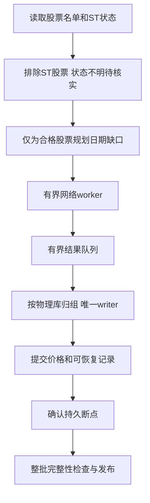
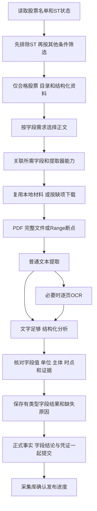

# 下载设计

下载只由人工执行。它提前准备荐股慢资料和模型训练历史，按 history、market、company 三模块组织。荐股不能调用下载、补缺、日更新；训练也不应隐式下载。

三个模块都先读取全部股票的代码、名称和ST状态，排除ST后，再为通过者安排日线、行业、财务、公告和文件提取等任务。首次、增量、续传、`--fill`和`all`都按这个顺序执行，不能先下载完其他资料再排除ST。

本篇把现有机制、目标和待测方案分开。当前 history/market 功能先保留；company 重点按字段需求重算工作量，不先决定改库或缩短到某个天数。本批未访问活动数据库、下载供应商资料或重建数据。

## 1. 三个模块下载什么

| 模块 | 业务目的 | 主要来源 | 当前范围 | 人工执行建议 |
| --- | --- | --- | --- | --- |
| history | 完整训练历史、长期模型输入 | 腾讯优先，问题股BaoStock同源整窗补缺 | 目标2000个市场交易日，新股按上市日裁剪 | 首次建库；收盘后按需要手动增量 |
| market | 独立qfq短窗口 | 腾讯优先，问题股BaoStock配对整窗补缺 | 当前V2 251日、V3 61日 | 使用前或收盘后手动更新，不替代训练历史 |
| company | 财务、质押、解禁、公告风险/利好事实 | 东方财富结构化、巨潮目录/PDF、受限新闻来源 | 当前公告365天、解禁未来180天；范围重新评估 | 人工更新；事件频率和有效期逐字段确定 |

“建议频率”不创建定时任务。现有 `sync ... --fill` 是显式修复入口，三个模块的任务、问题和断点各自管理；`all` 是人工选择多个下载模块，不合并训练或荐股。

## 2. 共用参考资料和可提前准备的因素

### 2.1 先ST过滤，再准备其他资料

顺序固定：读取全部股票的代码、名称和ST状态 → 排除ST股票 → 按其他条件筛选 → 确定合格名单 → 查缺口并安排下载。ST状态缺失、过旧或相互矛盾的股票先等待核实；此时只补齐判断ST所需的信息，不抓取其他个股资料。ST判定沿用现行规则，不能只看名称里没有ST就默认通过。

参考准备用例 `PrepareReference` 在获取日历、行业前，先检查股票名单与ST证据一一对应，并复用 `PreparedReference.eligible_universe` 的同一选择规则：证据为clear且当前名称不含ST者才通过。没有通过者时以 `sync_population_empty` 拒绝准备，不获取日历或行业、不发布新的完整参考版本，三类下载均不启动；已有正式参考及ST证据不因该拒绝而删除。ST检查后或日历准备后收到取消，也停止后续准备。完整参考仍保存全部名单和各股ST证据，原供应商检查日期通过原发布端口保留。

前置进度按实际调用显示 `sync market`、`sync history`、`sync company` 或 `sync`，不把公共ST和日历准备误标成公司同步。ST核对结束后仍须准备日历、当前行业并发布参考；行业准备和参考发布分别显示开始及结果，行业缺失或失败明确提示继续同步。`sync market`进入价格更新前显示“开始更新 raw/qfq 短窗口”，随后沿用逐股qfq进度。

续传和`--fill`先用本次资格重新筛选旧断点、失败库存和队列；已不合格者停止新派发，单列“ST排除”或“ST待核”，不算下载成功或待重试的供应商错误。保留既有资料、断点和必要风险证据，本规则不授权删除数据；资格后续通过时再按既有断点规划。能够按股票查询的来源只请求合格者；只能批量返回的公共元数据在接收后立即过滤，不再为被排除股票下载正文、解析或OCR。

记录总体数、ST通过/排除/未知数和资格版本，使每个任务可反查“为什么允许下载”。后续业务覆盖按通过后的总体计算，排除和待核单列，不把它们报成价格缺口、下载成功或全市场资料齐全。先证明无效股票未进入后续派发，再测减少了多少请求、字节、解析和时间；不未经实测就宣称提速。

### 2.2 通过后准备哪些资料

存储去向：证券、ST和日历参考在 `data/market/reference/company_st.sqlite3`，行业参考在 `data/market/reference/industry.sqlite3`；完整历史在 `data/market/history/catalog.sqlite3` 和年度价格库，独立短窗在 `data/market/daily_window.sqlite3`；公司正式事实在 `data/company/company_facts.sqlite3`。下表“来源”列写外部供应商，覆盖各模块的范围、频率和采集参数由 `config/download.json` 控制；数据库路径以 `config/runtime.json` 的 `data_dir=data` 举例。

| 资料 | 当前来源 | 关键字段 | 荐股/训练用途 | 更新条件 |
| --- | --- | --- | --- | --- |
| 全部股票的代码和名称 | 沪深交易所列表 | code/name | 找到每只股票并关联ST状态；通过筛选后才准备其他资料 | 名单或名称变更后手动更新 |
| ST证据 | 当前参考准备中的新浪等既有来源 | st_status/checked_date/st_id | 所有下载业务和荐股其他处理前的第一道资格门 | 先完成核验；未知不派发其他业务 |
| 其他证券资料 | 已通过ST者的正式证券参考 | board/listed_date/delisted_date | 第2/4层其他资格、训练总体和上市边界 | ST过滤后准备 |
| 交易日历 | 当前腾讯指数日历合同 | trade_date/calendar_id | 历史完整性分母、标签成熟、上市交易日龄 | 目标日推进时准备 |
| 行业 | BaoStock历史/当前行业准备 | 行业ID、生效日期、分类、来源、版本 | 第5/6层行业总体、模型路由及历史行业 | 来源更新时发布新版本 |
| 已完成raw/qfq日线 | history/market | OHLC、实际量额、复权身份、状态 | 第5层基础量和模型输入、训练标签 | 手动同步 |
| 财报/质押/解禁/公告事实 | company | 见第5章 | 第4–11层 | 按来源披露和有效期更新 |

可提前计算：仅用已完成历史的均线、均量/均额、波动、历史高点、V1完成日因子和V5序列基础。是否持久化取决于实测重复成本；不能先增加一套无消费者派生库。

不可提前固定：当前价格、当日累计量额/换手、当前停牌/ST报价状态、涨跌幅、分钟序列、本轮市场/板块/行业横截面、与现价结合的最终特征。历史基线可预备，实时部分仍在锁定批次计算。

### 2.3 当前不可变参考对象与资格消费者

下表来自 `download/domain/prepared_reference.py` 的 `PreparedReference`，是程序对象，不能把其字段名当成数据库原列。持久化对应 `data/market/reference/company_st.sqlite3` 的证券、ST、日历及发布表；SQL定义在 `reference_schema.py`，日期、时间及摘要由 `reference_index.py` 和SQLite codec编码。

| 对象字段 | 类型、单位与空值 | 原始来源及含义 | 写入与实际消费者 |
| --- | --- | --- | --- |
| `official_universe` | 有序不可变 `BaoStockSecurity` 元组，1–12000只，代码不重复 | 交易所证券名单；完整总体保留ST及待核者 | 组合根读取；`PrepareReference`排序；发布器保存证券和成员 |
| `st_evidence` | 与名单逐股对应的 `HistoryStEvidence` 元组，不能缺股或多股 | 新浪名称历史核对；本参考中的`checked_on`为当前上海日期，原供应商证据单独交发布端口 | `PrepareReference`归一化；资格选择、历史参考绑定与正式发布读取 |
| `checked_at` | 带上海时区偏移的`datetime`，非空 | 本次参考准备观察时点，不代替供应商原检查时间 | 组合根注入；构造校验、身份和持久化使用 |
| `open_dates` | 递增无重复的`date`元组，1–20000日，覆盖观察日 | 已发布同日有效日历或日历来源 | ST通过后准备；history/market按截止日和窗口裁剪 |
| `industry_version` | `str`或`None` | 当前行业参考的`data_version`；行业准备按既有异常策略不可用时为None | `PrepareReference`取得；参考身份与发布器使用，不伪造行业可用 |
| `identity` | 构造时计算的摘要字符串，不接受外部赋值 | 证券内容摘要、ST代码/检查日/状态、观察日、日历及行业版本的确定性组合 | 参考版本固定；history控制索引及各下载消费者绑定 |
| `eligible_universe` | 派生的不可变证券元组，可以为空，不是第二份持久人口 | `SelectEligibleSecurities`验证名单与证据对应，再选clear且当前名称无ST者 | `SyncData`防御性检查；history路由、market供应商与company请求共同消费 |

下表解释 `HistoryStEvidence` 的输入字段。数据库对应 `security_st_evidence` 的`code/checked_date/st_status`；`st_id/content_hash`为持久化身份，不能拿当前读取时间重写其原供应商检查日期。

| 字段 | 类型与取值 | 作用和缺失行为 |
| --- | --- | --- |
| `code` | 六位数字字符串 | 与证券代码精确对应，不按公司名称关联 |
| `checked_on` | `date`，不可为空 | 原来源对象保留实际核对日；参考成员使用本次观察日归一化的对象，两个用途不混淆 |
| `status` | `ever_st`、`clear`、`unknown` | 曾ST排除；明确clear再检查当前名称；unknown不进入后续个股任务 |
| `source` | 固定`sina_company_name_history` | 证据出处；名称中发现ST也由同一资格选择规则拦截，不因缓存clear而放行 |

当前资格传递按以下实际消费者核对，不增加另一套ST状态源：

| 消费者 | 当前输入及派发约束 | 仍需区分的边界 |
| --- | --- | --- |
| `application/prepare_reference.py` | 先取ST证据并核对完整性，无合格者不取日历/行业、不发布完整参考 | 返回给`SyncData`的仍为既有准备失败类别；不是资料完整成功 |
| `infra/history_supplier_router.py` | `load_context`将`eligible_universe`交给价格和历史行业准备 | 价格截止日可以是恢复的旧日，资格仍来自本次准备的参考 |
| 组合根中的market供应商构造 | 既有`load_universe`回调返回`reference.eligible_universe`，日历沿同一参考 | 普通与补缺共用；公共组合根仍由A拥有，B不另建入口 |
| `domain/company_evidence.py` | `CompanyEvidenceRequest.from_reference`只由合格者形成代码、名称和上市日 | 新闻名单随后与合格总体求交；`fill_missing`不扩大资格 |
| `application/company_evidence.py`、`infra/company_evidence_index.py` | 恢复、正文工作量、待处理任务、下载/文本/OCR和发布使用当前人口；旧目录条目可保留 | 全市场批量结构化来源和目录的被动返回不等于逐股请求，单独计量 |

### 2.4 参考门与完整恢复合同之间的现有差距

源码能够证明上述入口共享资格，不能因此推定旧数据和断点保留已全部满足新目标。以下是具体代码行为，未通过活动库运行确认其实际影响：

| 路径 | 当前代码行为 | 与目标的差距及后续实施约束 |
| --- | --- | --- |
| `history_download_index.py:begin/rebind_context` | 阶段335保留退出总体的任务、日期、尝试、失败及缺口；当前派发和计数显式选择context中的合格代码 | 重新加入未发布总体时按当前窗口规划，退出期间缺日不能被旧成功标记跳过；已提交价格仍复用。新批次只重置本轮任务，不清除其它股票的恢复证据 |
| `history_sync_runner.py`的`--fill` | 阶段335先读取当前context并核对未发布身份，再检查当前合格股票的未完成Tencent任务；阻断发生在父身份/任务重绑定之前 | 只有退出资格的旧任务未完成时不再挡住本次补缺；当前合格者未完成或新增成员需要普通同步时，仍返回`history_download_incomplete`，不发布半成品 |
| `history_price_repair.py:replay` | 阶段335所有调用者显式传入本次允许代码；退出资格的候选不解码、不写价格，保留原序号及内容 | 候选重新合格但序号已过期时仍明确拒绝，不将旧候选改代为新发布。跨序号候选处置仍需独立裁决；本阶段不清理旧候选或迁移资料 |
| `application/update_qfq.py`、`infra/qfq_sqlite.py:retain_codes` | 普通同步移除退出名单的窗口绑定和完成记录；两档都无引用后删除相应价格 | 与“仅停止派发、保留旧资料和断点”的目标有差距。不能直接删除检查或留下错误发布人口来规避；须同时明确价格保留、发布成员、完成凭证和重新合格时复用 |
| `infra/qfq_update_runner.py`的`seed_only` | 本地提取使用历史manifest人口；普通在线路径不读取该manifest | 是独立本地消费者，不能借普通在线路径已有资格检查证明其相同；需由A确认入口用途再统一输入合同 |

公司普通同步和`--fill`的隔离回归另验证：旧ST与unknown正文留在账本且未被下载或提取，新合格者可正常处理；unknown核实为clear后，其旧任务仍可选出，曾ST者继续排除。该结论只覆盖此测试集合，不替history/market的数据保留或真实全量验收背书。

## 3. history：完整历史

### 3.1 请求、配对和来源

先完成ST及其他资格，只为合格股票规划历史日期缺口。腾讯完成这些股票的全批正常请求后，汇总其中问题股进入BaoStock串行阶段；补缺派发同样核对ST资格。raw和qfq必须来自同一供应商、相同目标窗口；不按日期拼不同供应商qfq，不缩放或合成价格凑齐窗口。

HTTP成功或来源返回名为day的数据，不足以证明是合格qfq。复权方法、锚点和特殊等价情况都要有明确同源证据，未知不能冒充前复权；不因旧记录曾有某种重建方法就恢复旧算法。

BaoStock会话串行，物理请求含重试、分页共用限速时间线；现行最小起点间隔1.5秒，history/market/行业准备共用进程锁。供应商不响应的原因尚未闭合，不能把“TCP能连上”等同服务可用。

### 3.2 下载与写入是否异步

现有 `history_download_flow.py` 已有下载 worker、有界背压和唯一 writer。网络和写入可重叠，同一物理库的写入由一个所有者归组，不是每个网络线程各开连接写。

下载返回不算完成，进入内存队列也不算完成。只在价格提交成功之后确认断点。跨年分区用可重放候选及发布序号保证中断可恢复；旧有效快照不会读到未发布修订。

资格变化只改变本轮派发与发布成员，不删除退出股票的持久任务和价格。普通首建、增量、续传与`--fill`的任务读取、Tencent总结和候选重放均以本次context为准；保留的旧断点不计入本轮成功、失败或缺口分母。股票重新合格时，若已退出未发布总体，重新规划当前窗口，先复用已提交价格再补退出期间缺日和必要锚点；不能把旧`tencent_done`当成新窗口完成。`--fill`仍只修既有问题，新增成员或当前合格任务未完成时提示先完成普通同步，阻断不改写原批次绑定。

普通`sync history`在命令开始时确定最新可用目标日；跨日续传把旧批次剩余缺口和新增交易日合并到同一未发布序号，只准备一次上下文、执行一轮下载与补缺，最后统一检查和发布。已确认股票仅规划新增日期、可重试缺口及必要回读锚点，未确认股票保留当前目标窗口内的剩余任务；持久价格继续复用，不先发布旧目标再另起追新批次。推进目标日、父身份、任务日期和完成标记在同一catalog事务更新，失败整体回滚；已发布快照及缺口尝试/冷却记录保持原身份。恢复时核对新旧日历重叠范围，日历冲突或目标倒退时拒绝推进。

### 3.3 问题和 --fill

问题以库、证券、缺失日期和原因记录，保留尝试时间、状态、来源和修复回执。普通同步的自动机会与显式 `--fill` 分开：后者只修本库既有问题，不顺带全市场腾讯重下或推进目标日。中断优先重放已落盘候选，避免再请求完整窗口。

当前同步、补缺派发和价格缺口汇总同时限定在本次合格总体及目标交易日历；移出窗口的旧缺口、失败和冷却回执保留，但不再让当前窗口显示pending。Tencent的20交易日重查冷却只影响Tencent重试，不从当前缺口总数中排除，也不阻止BaoStock按自己的自动机会或显式fill处理。已采用BaoStock的窗口，仅当所有缺日都落在请求尾部且通过同源锚点校验时复用尾部；窗口中部的缺日即使只有一格也须请求同源整窗候选。

“任务结束”“已发布快照”“仍有价格缺口”分别报告。旧 TODO 中 completed 内嵌 pending 的例子，应说明仍有一个已知缺口，不凭发布日志认定资料完全齐全。

## 4. market：独立短窗

当前 `application/update_qfq.py` 已有有界来源任务、唯一 writer 和问题持久化。一个事务提交配对价格、窗口身份、日历、问题清除、尝试回执、断点及 publication；V2/V3切片必须来自同一合格候选。

短窗下载在缺口规划、网络任务及`--fill`派发前先套用ST资格，不能给已排除或待核股票请求raw/qfq窗口。该顺序是本次补充的目标，现有全部入口和消费者是否满足仍须按P32–P34核对。

同源raw/qfq完整性、上市边界、停牌和价格合法性在解析/写入边界处理。阶段328将`verify_integrity`统一为第6.1节的数据库文件指纹核验；`inspect_windows`只读取窗口日期和来源，用于缺口规划，不加载价格列或逐窗重算摘要。无变化配对写入比较输入窗口与已提交身份，不再为比对重复读取原价格；实际写入仍保留差异计数、同源配对和事务约束。

`--fill` 只消费market自己的问题库存；不能拿history的断点和成功状态替代。断电或尾批失败时事务回滚，保留上一有效发布及可重试的问题。

## 5. company：交付从公告取得的结构化字段

本章按用户最新要求重规划。目标是所需事实字段已从来源准确取得、带证据写入正式库，并能被现有荐股消费者读取。下载篇数、文本提取成功、处理回执和SQL提交只说明经过哪些步骤，不能作为字段交付完成。第5.13节列出阶段332实际切换的行为，其余新增流程和验收仍是待实施目标，不能把局部规则验证描述为全部字段已完整支持。

### 5.1 先确定交付字段，再决定下载什么

company先ST过滤，再查合格股票的财务、质押、解禁、公告目录和新闻，之后才派发PDF、文本和OCR。恢复旧正文队列也先核对资格；批量目录不得引出已排除股票的正文处理。不能为了填满company_facts再给无效股票采集整套资料。

用户已经指出：下载数万条公告、耗费大量时间，仍未取得数据库所需字段，不能满足业务需求。旧篇/分钟指标只反映搬运和处理成本。后续先交付字段字典、真实公告对照样本和可复现的提取结果，再扩大正文下载；每项新增下载必须说明要填哪个字段、核验哪项风险或关联哪条修订/解除证据。

财务八项指标当前可从结构化财务接口获取，不必为了这些字段逐篇OCR。风险和利好事件需要可核验证据，但不等于所有目录项都必须处理全文。筛选规则还须证明不会漏掉调查、退市、减持、占用或担保等持续风险。

业务分为两条输入路径：财务、质押、解禁沿已具名的结构化来源；公告事件沿“必要公告→正文/表格→字段候选→单位/主体/时点核验→正式事实”。接口字段填充率不能拿来证明公告结构化成功。一篇公告可以产生多项事件或字段，一个字段也可以依赖同事件多篇公告；不能只存一个“已分析”布尔值。

当前已确认的偏差来自`domain/company_event_extraction.py`、`infra/company_fact_rows.py`和`infra/company_evidence_index.py`：减持比例只有领域/SQL字段，没有正文提取逻辑；回购/增持比例和合同数值主要依赖有限句式；合同营收基数只尝试从同篇文字取得，没有完整的时点依据关联；成功输入凭证的生成不以全部适用字段取得值为条件。只读空值统计是上述问题的线索，尚未逐篇核对原文，不能把全部NULL都定性为漏提，也不能把文字提取成功数当字段召回率。

先把“原文明确披露但未取得”“当前解析器不支持”“来源确未披露”“该事件不适用”分清。解析器未命中不能直接写成来源未披露；暂不支持的字段必须显示为实现缺口，并阻止以该字段为目的继续扩大自动下载，已有事实和其它独立任务继续保留。

### 5.2 把 company.md 的核心归到这里

保留以下核心：财务、质押、解禁、风险和利好分开建事实；公告主体和案件关联需证据；目录覆盖、正文完成、字段完整、正式发布分别统计；未知不能当无风险；持续风险不能随回看窗口滚动消失；失败原件和OCR成功页保留；`--fill`补失败或缺项，不能用处理完成时间覆盖更新事实。

发现水位D与处理覆盖P也要保留：D表示来源分页已核对、发现的任务已可靠登记；P表示这些输入已有正式有效结果或明确未知结论，且由区间和任务账本推导，不另存一份独立完成真相。OCR失败可以使P落后，但不应让下次从P把D之前已发现的资料重新下载。分页必须有稳定排序/游标和持久去重，来源页面漂移时拆真实查询范围，不能把一个股票或一页完成推定为整个市场完成。

新有效快照确已覆盖旧任务负责的全部字段，或有正式更正/完整替代关系时，可以把旧任务标为已替代；必须等新事实成功提交，有可追溯依据。新资料缺项保留旧有效值及日期，同时标最新不完整，不拼成一份不存在的最新财报。下载、缓存复用、有效替代分别计数，跳过不能算提取成功。

当前一年范围内的增量按来源发现水位推进，短期目录回看用于迟到或修订发现；没有可靠修订索引时，短期回看不能证明发现窗口内所有追溯修改。已过窗口的未处理任务标为范围过期，不冒充核验成功；新上市或新增总体只初始化必要范围，退出总体停止不再需要的派发，保留必要事实和证据。这些是旧company方案的核心要求，当前实现一致性仍需P35/P38/P42核对。

公司事件细字段也须覆盖合同金额/税口径/当时可知年度营收及占比、减持日期/比例/完成披露、回购或增持实际实施比例，以及主体/案件/解除关系。字段状态区分有效、不适用、来源未披露、待获取、提取失败；不能一律折成null或0。不得用未来财报回填过去公告的合同占比。

保留已确认的一年网络采集上限：固定本轮截止T，新增公告及补缺只查询`[T-365天,T]`内披露或正式修订的材料，新上市者再按上市日裁剪。合同依据或同案前置材料在窗口外且本地无合法现成证据时，记录超出范围及依赖缺失，不自动向上市以来回溯。已经保存的有效持续风险不因移出窗口消失；未来180日解禁仍按既有前视合同维护。本次重规划不以盲目缩短窗口换取较少耗时。

一年是网络查找上限，不是一年PDF的下载配额。用户只要当前有效数据：财务与质押选择最新有效快照及更正，解禁保持未来180日；各主体、各事件分别维护最新状态，不能每股或每类只保留最后一篇公告。首次核对允许范围的目录，正文只为字段或风险依据取得；后续沿已登记水位增量发现和核对修订。最新快照缺项时保留上一有效快照的原日期，明确最新不完整，不跨报告期拼表。首次仅查一年不能证明不存在更早的未解除风险。

旧 `docs/company.md` 保留人工比对。本章接收其有效合同和待核对问题，不把旧候选、历史失败或窗口建议当成已验证结论。

### 5.3 数据源、字段和用途

这是外部资料到本地存储的映射，不是一个数据库表的列。采集任务、版本和重试在 `data/company/raw/company_collection.sqlite3`；合格事实发布到 `data/company/company_facts.sqlite3` 的财务、质押、解禁和事件表。来源调用及处理参数来自 `config/download.json`，正式事实怎样参与评分见c第6.2节。

| 资料 | 当前接口/来源 | 原始字段或内容 | 作用 |
| --- | --- | --- | --- |
| 财务 | 东方财富 `RPT_F10_FINANCE_MAINFINADATA` | 报告期、披露时点及八项指标 | 最新有效财报、亏损过滤、成长/质量 |
| 质押 | 东方财富 `RPT_CSDC_LIST` | TRADE_DATE、PLEDGE_RATIO | 质押日期、比例与有效状态 |
| 解禁 | 东方财富 `RPT_LIFT_STAGE` | FREE_DATE、TOTAL_RATIO | 决策后完整180日安排 |
| 公告目录 | 巨潮 `hisAnnouncement/query` | 来源键、标题、披露日、证券关联、版本 | 判断目录覆盖和是否需正文 |
| 公告正文 | 巨潮PDF | 原文、主体、案件、事件时点和证据 | 风险/利好核验 |
| 新闻 | 东方财富搜索现有路径 | 最近7天，每股最多50条 | 受限补充，不证明全市场覆盖 |

当前新闻总体限定为最近正式发布名单与合格总体交集，不能描述为已拥有全市场完整新闻档案。候选方案若要扩大范围，先给字段用途、请求成本和收益证据。

### 5.4 company_facts 当前24列底稿

数据库：`data/company/company_facts.sqlite3`。表：`company_facts`。下表逐项解释该表的24个物理列；下载、正文和OCR的任务进度位于另一份采集库，不混在这24列里。采集参数来自 `config/download.json`，字段如何用于过滤、评分和风险由 `config/filter.json`、`config/scoring.json`、`config/risk.json` 的消费者决定。

| 字段 | 中文意思/单位 | 来源 | 荐股用途与更新规则 |
| --- | --- | --- | --- |
| `code` | 证券代码 | 官方身份关联 | 关联事实，不按名称关联 |
| `report_date` | 财报报告期 | 结构化财务 | 选择最新有效报告期 |
| `disclosed_at` | 财报原披露时间 | 来源披露字段 | 判断可见时点和更正版本 |
| `finance_state` | 财务覆盖状态 | 采集/发布判定 | 区分已知和缺失 |
| `eps` | 每股收益，元/股 | 财务 | 第5/7层估值及质量 |
| `bps` | 每股净资产，元/股 | 财务 | 第5/7层估值 |
| `revenue_growth_pct` | 营收增长，百分点 | 财务 | 第5/7层成长 |
| `profit_growth_pct` | 净利润增长，百分点 | 财务 | 第5/7层成长 |
| `core_profit_growth_pct` | 扣非利润增长，百分点 | 财务 | 第5/7层成长 |
| `roe_pct` | 净资产收益率，百分点 | 财务 | 第5/7层质量 |
| `parent_profit` | 归母净利润，金额单位在解析边界统一 | 财务 | 第4层亏损过滤 |
| `core_profit` | 扣非净利润，金额单位在解析边界统一 | 财务 | 第4层亏损过滤 |
| `pledge_pct` | 质押占比，百分点 | 质押快照 | 第4/8层风险 |
| `pledge_date` | 质押快照对应日期 | 来源交易日期 | 同类快照新旧比较 |
| `pledge_state` | 质押覆盖状态 | 采集判定 | 未知不填0比例 |
| `unlock_checked_at` | 解禁资料实际检查时点 | 采集 | 判断检查年龄 |
| `unlock_end_date` | 解禁已覆盖到哪天 | 采集覆盖 | 判断未来180日是否齐全 |
| `unlock_state` | 解禁覆盖状态 | 采集/发布判定 | 缺覆盖不当成无解禁 |
| `pending_docs` | 未核验正文数 | 采集账本投影 | 风险资料是否待补 |
| `announcement_start_date` | 公告目录覆盖起点 | 已完成目录范围 | 说明窗口，不等于正文全完成 |
| `announcement_end_date` | 公告目录覆盖终点 | 同上 | 同上 |
| `announcement_state` | 公告整体核验状态 | 目录、正文和关联 | 第4/11层风险可用性 |
| `checked_at` | 资料实际检查时点 | 采集 | 来源年龄，不被重新读取刷新 |
| `published_at` | 本地事实快照发布时间 | 正式发布 | 版本追踪，不替代原披露时间 |

后续要补每列真实SQL类型、空值、原始接口字段、解析器、写入者、读取者和索引。金额单位必须沿adapter核实，不仅凭字段名推断；这项列为P36，不能把底稿当成完整schema验收。

下面的关联表也全部位于 `data/company/company_facts.sqlite3`，通过证券、事件和证据身份关联；不属于 `company_collection.sqlite3` 的下载任务表。

| 关联表族 | 当前表 | 应说明的内容 |
| --- | --- | --- |
| 风险 | company_risk_event、company_reduction_plan、company_risk_evidence | 主体、案件、事件有效期、解除/完成证据 |
| 利好 | company_positive_event、company_positive_milestone、company_positive_evidence | 事件、里程碑、证据和有效状态 |
| 解禁与未知 | company_unlock、company_review | 日期/比例、覆盖、人工待核原因 |
| 证据与资格 | company_evidence_ref、company_exclusion | 来源键、版本、排除依据 |
| 发布与恢复 | company_publication、company_input_receipt | 输入凭证、正式版本和恢复依据 |

### 5.5 下载、文本和 OCR 怎样并行

当前已有独立下载、文本、OCR执行器和有界队列，网络与分析可以重叠，主流程负责提交。默认下载2、文本2、OCR1、队列128、目录批20页、正文批50篇；这些是当前配置，不是最优结论。

需要测队列等待、背压、网络、文本、OCR、分析、事实编译、发布和检查成本，才能决定并发。PDF和OCR页的版本、策略身份必须匹配才复用；不支持Range时只重取对应文件，不重做所有成功资料。

“普通文字可读”只决定是否需要OCR。结构化步骤还要处理表格、跨页、表头单位、多主体、计划/实际、累计/本期、否定和更正；提取器不能因为全文有多个数字就丢弃整个字段，也不能跨主体或跨事项拼数。先在真实标注材料上选择能覆盖这些版式的提取方法；本规划不新增DeepSeek调用、评分公式或风险门。

### 5.6 中断和 --fill 如何恢复

采集库以 `company_sync_job`、`partitions`、`disclosure_queries`、`structured_progress`、`document_tasks`、`document_retries` 保存不同步骤。PDF完整状态、页检查点、分析结果、正式发布是不同状态，不能压成一个完成百分比。

正式库 `company_input_receipt` 与事实同事务提交；采集库 `document_publications` 可据凭证恢复。因此崩溃在“正式成功、采集未确认”之间，重启应识别成功并补确认，不重复改写事实。两个库不能声称天然跨库原子。

目标凭证需分别回答文件取得、文本取得、各适用字段的处理结论和正式发布。现有`outcome=valid`只能按原语义复用，不能追认为全部字段完整。字段解析、主体核验或单位校验失败时，`--fill`恢复对应本地步骤；已有有效文件不再请求网络，调整提取规则也不重跑无关字段。调度/超时配置变化不使成功结构化结果失效，真正影响值的规则版本变化只重开依赖该规则的字段任务。

失败记录至少包含任务身份、步骤、来源键和版本、失败分类、尝试次数、最后/最早重试时间、可复用产物和中文建议。不保存完整外部载荷到日志。失败原件按现有保留规则独立保存，不在普通重跑中自动清掉证据。

### 5.7 旧公告不能覆盖新事实

必须区分三种时间：原披露/事件时点、资料实际检查时点、本地发布时点。不能用下载更晚、OCR更晚或本地新hash就认定公告更新。

下表比较的是 `data/company/raw/company_collection.sqlite3` 中的来源版本/任务结果，与 `data/company/company_facts.sqlite3` 中的财报、质押、解禁和事件事实。它是跨步骤的新旧规则表，不表示这些比较字段都存放在同一张表。

| 对象 | 新旧判定 | 必须保护的行为 |
| --- | --- | --- |
| 同一公告版本 | 来源键＋版本＋处理状态 | 旧版本、重复完成结果拒绝任何正文/关联旁路写入 |
| 同一报告期财报 | 原披露时间和有效更正 | 迟到旧披露不盖新披露 |
| 不同报告期财报 | 报告期及披露时点 | 最新有效报表优先，保留必要比较事实 |
| 质押快照 | 来源快照日期与可排序版本 | 旧快照不盖新值 |
| 解禁安排 | 同一计划身份、修订和生效 | 撤销/变更按计划关联，不只比全股时间 |
| 调查与结案等事件 | 同主体、同案和证据时序 | 无关新公告不清除旧有效风险，旧立案不推翻已核验结案 |

当前代码已在同一写事务先检查公告版本和未处理状态，再写正文与关联；财报同 code/report_date 有披露时间保护。其它字段和同URL无可排序版本的来源仍需单独审计，不能据两处保护声称全库绝无覆盖。

因此“是否必须重建”的当前回答是：未证明需要。先核对现有schema与数据证据，确定无法表达或已损坏的范围才讨论隔离重建。本次不重建。

### 5.8 怎样评估只取最新资料

先把每个字段分为最新快照、有效事件、长期未解除事件、未来日程、覆盖证明。比较三种工作量：当前365天流程、最新结构化快照＋必要事件追溯、目录覆盖保留但只处理有用途正文。

对同一真实样本报告：有效字段、持续风险召回、未知率、目录/PDF/OCR量、网络字节、CPU、存储、总耗时与恢复。没有足够同案历史时不能把更短窗口当无风险。实际需要多长时间，测量后按正文类型和股票规模分层估算区间，不能先承诺几分钟。

### 5.9 公告必须交付哪些字段

下表指向`data/company/company_facts.sqlite3`现有物理列；采集与字段提取结论仍由`data/company/raw/company_collection.sqlite3`的唯一协调器管理。它是业务交付清单，不表示这些列已有完整提取器。原值、单位、币种/税口径、证据页/段定位及字段状态目前没有完整的统一落库合同；P36须先确定有类型对象和最小关系结构，再原子切换生产者、编译器、持久化、读取器及诊断，不用自由JSON或第二份完成账本补洞。

持久职责分开：采集库拥有逐篇提取候选、任务与恢复状态；正式库拥有已发布字段、对应结论和证据。同事务提交仅指正式库的事实、字段结论与凭证，随后由采集库确认发布；不把两库写入描述为天然原子，也不让采集状态覆盖正式事实。

| 事件及现有目标列 | 要从哪项依据取得 | 提取及核验要求 | 缺失怎样交代 |
| --- | --- | --- | --- |
| 风险/利好表的`code/event_key/subject_type`及证据关联表 | 官方证券关联、正文当事人和同事件依据 | 证券身份与事件主体分开；发行人、控股股东、实控人和大股东不能互换；同主体多事件不合并 | 主体或事件不确定则待核验，保留已取得的独立数值候选 |
| `company_risk_event.risk_type/level/status/case_number` | 正式事实结论、监管/司法主体和案件编号 | 原文结论先核实，等级由既有规则派生；案号按适用事件提取，多案分开，不因多案丢掉全部信息 | 无适用案号可以不适用；有案号却未解析是提取失败，不是无案号 |
| 风险及利好表的`first_disclosed_at/last_disclosed_at`；风险表`effective_at` | 来源披露时点、正文生效条款和关联进展 | 首次/最新披露不等于下载时间，正文生效日不能无说明复制披露日 | 未披露生效时点按现行可解释规则处理并标依据，不伪造已提取日期 |
| `company_risk_event.resolved_at/expires_at` | 同案解除/结案证据，以及既有有效期规则 | 解除须关联原事件；到期属于规则派生，不能靠新公告没有提风险推断 | 未解除者的解除时间正常为空；解除公告无法关联则待核验 |
| `company_reduction_plan.start_date/end_date/planned_pct/completion_disclosed_at` | 减持计划、变更、结果或届满公告的正文及表格 | 实现计划比例提取，区分比例分母/多股东/合计与单人，日期和实际完成按同计划关联 | 各字段独立记录结论；计划比例提取未实现不得列为任务成功 |
| `company_positive_event.actual_pct`，限回购/增持 | 实施进展或结果公告中的实际股份及股本占比 | 计划上限不是实际值；累计与本期分开；只有股份数时还需同时点、同口径的分母才能派生 | 只有计划时实际值可为空并说明尚未实施；有实际值但句式未命中仍属缺口 |
| `repurchase_purpose/status/cancelled_at` | 回购用途、原计划及后续实施/变更/取消公告 | 原文事实状态与评分资格分开；金额/比例缺失不能一律把事件改成计划状态；取消必须关联原事件 | 用途未知、状态不明、没有发生取消分别说明，不能混成同一空值 |
| `contract_amount/binding_confirmed/amount_basis` | 正式经营合同的金额、币种、税口径及生效条款 | 保存可核实金额和原始口径；是否具有约束力、金额能否比较分别核验，不能以未满足评分条件抹掉原值 | 金额未披露、区间/框架上限、多合同金额及核验失败分别记录，不能默认0或任取一个数 |
| `annual_revenue/revenue_report_date/revenue_disclosed_at` | 合同明确引用的已披露年度依据，或可合法关联的官方报告 | 从合同公告时点可知的对应年度来源关联，不能只要求同篇恰有固定句式；当前财务八指标不含营收金额，需补明确的依据获取/解析/关联能力 | 无可取得依据时说明缺哪个年度/来源；窗口外缺依据单列，不能用后来报告填回过去 |
| `contract_revenue_pct` | 原公告明确且口径一致的占比，或核验后的合同金额和年度营收 | 同主体、年度、币种和税口径才比较；派生值记录分子/分母依赖，原文占比与计算冲突须核对 | 不可比是待核验，不应使已经核实的合同金额丢失 |
| `company_positive_milestone.level/qualified_at/measured_pct/evidence_id`及风险/利好证据表 | 已核实测量、对应公告及现有阈值 | 先存事实再由现行评分规则确定里程碑；保留首次达标及后续取消、更正的关联 | 字段提取完整与利好得分为0是不同结果，不通过降低阈值提高提取成功率 |

财务八指标、质押、解禁沿第5.3/5.4节的独立来源交付，不计入公告提取成功分子。所有新增字段都须有真实消费者、类型/单位、适用事件、有效时点、来源、解析者和读取者；没有用途的正文不因数据库存在某列就扩大采集。

### 5.10 字段状态、证据及业务完成

目标以“公告来源及版本＋事件/主体＋字段＋结构化规则版本”保存唯一字段结果，多个相关公告可共同提供证据。它从现有任务和事实结果推导汇总，不另存一个会漂移的全市场完成百分比。

| 字段状态 | 要有的依据 | 完成口径 |
| --- | --- | --- |
| 已取得有效值 | 原值、规范值、单位/口径、时点、来源版本及页/段定位；派生值另有输入依赖 | 可计入该字段已取得；仍由原消费者判断是否满足准入 |
| 不适用 | 事件类型或事实状态明确排除该字段 | 单列，不进入该字段适用分母，也不算取得值 |
| 来源未披露 | 已核对相关正文/表格及必要同事件材料，具备支持该判断的解析覆盖或人工证据 | 可结束无意义重试，仍不算字段有值；不能由正则未命中直接推出 |
| 待获取/待提取 | 缺文件、已有文字待处理或提取器未实现，并说明恢复步骤 | 业务未完成；实现缺口优先修解析，不扩大无效网络任务 |
| 提取失败/核验待定 | 版式失败、多主体歧义、相互矛盾、单位/时点不可比等具体原因 | 业务未完整，保留可用旧事实及已核实字段；按字段恢复 |
| 依赖超出采集范围 | 需要的前置公告/年度依据在允许窗口之外且本地不存在 | 公开限制，不自动扩大范围、不伪造值，也不计为已取得 |

字段的事实值与评分资格分开：合同金额已核实但税口径不可比，金额仍入库，合同占比待核验；回购用途不符合现有加分条件，已核实的实际比例仍入库；风险解除尚未成立，已知的计划日期/比例仍保留。以现有规则计算资格，不更改其阈值、身份、风险扣分或动作语义。

证据最少保留来源键/版本、原文件/文本摘要、必要的有限原文片段及页/段定位、提取规则和单位/数值转换。单有文件hash不能证明字段值来自正文。待处理和提取失败材料按既有受管容量保留，达到容量时背压停止新增下载，不删未完成原件腾空间；成功材料仅在对应适用字段已形成可复核结论及发布凭证后，按明确生命周期清理。新增保留和schema策略先隔离验证，本批不改变正在运行的清理行为。

命令结束分别报告：资料发现/文件与文字处理、适用字段已取得及各类缺失、正式发布/旧事实保留、评分可用性。关键字段未实现、提取失败或核验待定时，即使下载队列为空也要显示业务未完成；处理范围已闭合但来源未披露可以明确结束该项工作，同时报告缺失和下游限制。具体公开状态及退出码在P46与现有消费者一起设计和切换，不能先悄悄改现行CLI合同。

### 5.11 已经下载的材料怎样利用

先只读盘点正式事实、逐篇回执、本地完整PDF、提取文字、OCR页、链接候选、缺失字段及来源版本。按字段任务绑定已有材料，不把原有几万条记录全表重置。

1. 已有正式字段及证据能通过新验收的直接复用，保存原时点；原`valid`回执保留原身份，不升级解释为新字段验收通过。
2. 有有效结构化结果但尚未发布的先发布；有文字的只重跑缺失字段；仅有PDF的从本地提取开始；有OCR页的只恢复必要未完成页。
3. 正文/PDF已按旧流程清理，只剩hash或回执的，明确列为本地原件缺失，不能声称可以直接复用。确需修复时只为受影响字段定向取回允许范围内的同版本来源，核对版本；其它成功公告不重下。
4. 确定性规则没有能力取得某字段时，先修提取器并做样本验证，不能靠反复`--fill`下载同一文件补实现缺口。
5. 在仓库外一致副本中重放候选，核对独立事件、最新事实、证据及旧发布保护；实际数据切换、数据删除或重建另按授权执行。现有资料保留，不要求用户再次清空`data/company`。

### 5.12 验收先看原文到字段，再看吞吐量

先为第5.9节每个适用字段建立可复查的真实公告标注：来源版本、页/段、原始值/单位、主体/事件、时点、预期规范值或明确缺失原因。覆盖正文、表格/跨页、多主体、多事件、不同数值句式、计划与实际、累计与本期、更正、取消/解除、年度基数和单位/税口径；对未披露和不适用另设反例。原文样本不足的字段明确未验证，不能只用按现有正则编造的fixture证明有效。

实现后通过同一条路径读取隔离数据库并与标注比较：既核对类型/单位/数值和关联，也测试字段是否遗漏、是否误取别人的值、证据能否定位、最新值是否被旧公告覆盖。已标注的必需字段不得有已知漏提/错提，所有声明支持字段都要有真实案例；另用未参与规则编写的留出样本报告正确率、召回率、误提和未知原因，不将小样本通过外推为全市场100%。

汇总必须同时给适用事件总数、来源明确有值的标注数、正确取得数、错误/漏提数、不适用、来源未披露、未实现和失败数。批量审计的非空率不能代替原文召回率；缺失事件不从分母删掉，0得分事件不从提取统计中删掉。

只有字段链路及真实样本验收形成结果后，才在固定输入、相同字段正确性和风险覆盖下比较候选：每类字段新增/复用的有效值、每小时正确取得的必需字段、必要PDF/OCR量、请求/字节、分阶段及全部结束耗时、内存/磁盘、取消/恢复、无变化重跑新增下载数。按P39/P40/P44实测后决定并发、顺序和资料范围，不用少读字段、降低核验或较快输出未知冒充提速。施工顺序及状态只记g中的原company计划。

### 5.13 最新资料优先与定向字段恢复的实施边界

`sync company`先取得并发布财务、质押及解禁，再处理一个有界本地正文批次，其余沿原目录/正文交错流程继续。正文选择先按披露时间倒序，同时间优先本地文件；本地恢复在批量限制前筛选，不能被较新网络任务挤出。取消后报告已知成功发布数，结构化来源失败不阻止合法本地恢复。该顺序是资料可见性合同，不表示已取得吞吐量或HDD性能提升证据。

字段诊断增加只读补缺清单，列证券、事件、依据、字段、原因、最短恢复步骤及是否需要网络；从正式事实、现有任务与物理文件推导，不另存全市场完成百分比。计划未实施不因实际比例为空就被判漏提；旧状态因比例缺失而误落为计划时，明确的进展/实施/结果标题仍进入核验和补提取。普通文字和旧valid不是字段候选凭证。

采集库`company_field_repairs`只拥有受影响来源版本、事件、字段与规则的恢复任务。已支持的明确减持计划比例、实际总股本比例及人民币合同金额规则可定向重提，来源与规则未变且已尝试仍缺项时转为核验，不自动无限重下。字段规则处理凭证用正式库已有`company_input_receipt`的独立规则身份、`field_attempted`结果与事实同事务提交；它不冒充字段有值，也不修改旧valid身份。采集确认失败可凭正式凭证恢复，未解决任务保护其本地材料。

同一事件的字段已在当前正式事实中取得值后，关闭该字段对应的旧恢复任务，包括此前已排队但尚未重下的材料；不能仅凭补缺清单中不再出现该项就认定有值。旧材料没有其它未完成字段任务，且仍有来源、证券、目录版本、正文hash及提取规则均匹配的原正式文档凭证时，才恢复原处理投影并退出下载队列。不同事件、修订版本、其它缺项及同篇公告其它股票的需求分别核对；恢复不新增文档成功或字段提取凭证。正式已提交而采集确认未提交时，重启按同样条件恢复。

现行验证器原已排除的明确董监高、子公司、参股主体，前移到正文派发前判断；董事会、监事会、具有控股股东/实控人/5%以上股东身份的董监高及“公司及”类标题仍进入原验证流程。队列规则身份单独更新，不变更提取身份或重开全量已发布资料。采集库保留排除原因及目录行，排除不计为已提取、不制造成功凭证；风险完整性和待处理计数使用同一主体范围判断。

首轮正式发布也按本次实际接受的来源、证券、版本、正文hash核对缺项，先登记字段任务，再把事实和字段处理凭证一起提交。仍缺值的材料不因已有正文`valid`凭证而清理，避免下次启动为同一来源版本重新下载。年度依据、税口径及无自动提取规则的缺项使用`required_field_evidence:1`记录证据需求评估：它仅表示仍需核验，保留必要材料，不代表字段已提取或来源未披露，也不进入自动重下队列。正式提交失败时采集任务回滚；正式已提交而采集确认回滚时，只凭精确匹配的正式字段凭证恢复，不追认旧valid。没有自动恢复规则的字段不再展示为可自动下载或重提，原依赖核验和范围限制继续保留。

正向事件的事实实施状态与评分资格分别判定。已实施的员工持股回购、已生效但缺少可比基数的正式合同，仍记录实际行为和已取得数值；原用途、主体、税口径和阈值决定是否得分。直接否定“用于注销”不能取得注销用途资格；跨主体进展不能替换旧事件。新旧公告的测量值及其原时点尚不能无条件拼接，合同分子分母不跨来源盲目计算。

解禁列表、核验时间与覆盖终点作为一份快照选择。来源不可用时保留仍在目标窗口内的旧有效日程及原核验日期，标记不完整；已完整核验的新空快照仍可撤回旧日程。不因本轮失败而刷新旧覆盖日期，也不新增24小时等时效门槛。

本批只补明确单主体、明确总股本分母、明确单位/金额的句式，不声明已覆盖跨页表格、多主体、全部年度依据。较旧原计划或合同依据仍需证明未被后续修订，不能以旧值覆盖最新状态；无充分关联证据走核验。合同年度营收、税口径等依赖缺项不靠反复下载同一进展补齐；窗口外无本地依据明确未知，只有旧PDF的材料先核验本地处理条件，不自动产生窗口外网络任务。真实公告标注、全市场召回及性能对照按第5.12节另行验收。

结构化来源已有部分所需字段，免费Eastmoney批量路径优先核对和接入。2026-11-05已实调下表四个接口，每类一页500行，返回列和样本日期过滤符合请求；尚未完成原文逐值、修订历史及正式事实接入，当前财务八指标仍由原Eastmoney来源提供。样本非空率只说明这一页的字段返回情况，不能代替全市场召回或评分资格。

| 所需资料 | 免费结构化来源及实调样本 | 仍需核对的关联条件 |
| --- | --- | --- |
| 回购实际数量和金额 | [Eastmoney股票回购](https://data.eastmoney.com/gphg/hglist.html)，`RPTA_WEB_GETHGLIST_NEW`；`REPURNUM/REPURAMOUNT`各373/500条非空，另有用途、进度和回购标识 | 计划比例与实际比例分别处理；核对用途枚举、总股本分母、同一计划的累计关系及原披露时点 |
| 股东实际增减持 | [Eastmoney股东增减持](https://data.eastmoney.com/executive/gdzjc.html)，`RPT_SHARE_HOLDER_INCREASE`；官方表头对应的总股本变动比例为`AFTER_CHANGE_RATE`，变动数量`CHANGE_NUM_SYMBOL`单位万股，`CHANGE_FREE_RATIO`为流通口径 | 已纠正候选诊断选列；旧500行报告的`CHANGE_RATE`非空率不能当作总股本比例核验。仍须核对股东资格、累计事件关联及修订时点，不能把计划或单笔数值冒充累计实施 |
| 合同金额及年度依据 | [Eastmoney重大合同](https://data.eastmoney.com/zdht/)，`RPTA_WEB_ZDHT_LIST`；金额`AMOUNTS`349/500、上年营收`SNDYYSR`14/500、上年占比`ZSNDYYSRBL`0/500条非空 | 金额可作为核验候选；签署主体、合同约束性、币种/税口径及当时可知年度依赖需逐项验证，不能由最新财报营收补过去的合同 |
| 独立年度财务依据 | Eastmoney利润表`RPT_DMSK_FN_INCOME`，报告期限定2025-12-31；`OPERATE_INCOME`3/500、`TOTAL_OPERATE_INCOME`500/500条非空 | 已证明当前批量利润表的大部分样本没有独立营业收入值，不能直接用营业总收入替换；仍需核对其它财报结构化路径及原始年度版本 |

Tushare作为补充候选：[利润表](https://tushare.pro/document/2?doc_id=33)区分营业收入/营业总收入及实际公告日，[回购](https://tushare.pro/document/2?doc_id=124)提供进度/数量/金额，[增减持](https://tushare.pro/document/2?doc_id=175)的比例则是流通口径。本轮配置声明120积分；官方利润表和回购要求至少2000积分，全市场季度利润表5000积分。本轮没有发出这些业务请求、改积分或用它们替代免费来源；配置声明不代替账户实际权限验证。

以上四路一年过滤查询分别报告1317/8044/5599/1102条记录，每页500行分别为3/17/12/3页；本轮仅各取首页，没有遍历或核对完整并集。4次调用、2000条样本约0.91秒，不能把该采样耗时外推为完整同步或来源完整性通过。已有来源诊断增加`--field-sources-only`及`--field-source-rows 1..500`的有界只读模式，固定字段白名单输出，不保存原行或写公司库。

接入顺序为批量结构化测量、按事件核对缺项及证据、仅为剩余必要事项读取正文。现有资料发现、必要正文及持续风险覆盖在正式切换前仍按已实施合同执行；来源/字段验收沿g阶段332，冻结候选的完整作业成本及8小时目标证据沿第4.5节CodexC后台和原授权真实同步登记，不以缩窗、漏字段或排除恢复时间达标。

年度营业收入已增加独立的按需链路：合同正文须明确引用唯一年度，且现有财务采集账本已确认该年报在一年窗口内、早于合同披露；只为仍缺营收或原披露日期的合同请求对应公司、对应年度。采用Eastmoney F10的公司类型页和`lrbAjaxNew`年度利润表，每组最多5个已知报告期，沿现有注入的HTTP客户端、超时、取消和熔断边界执行。采集账本`annual_income`按公司、年度、原披露、更新时间及选定字段hash保留版本；正式事实与`eastmoney_annual_income`输入凭证同事务发布，重启复用已落库输入。该路径不取`TOTAL_OPERATE_INCOME`代替`OPERATE_INCOME`，不猜未注明的年度；同日或合同之后修订、早于财务账本已知版本、冲突版本、非CNY和空值均不能补为可用依据。补齐营收不会自行计算合同占比或改变税口径、资格、分数及历史等级里程碑。没有可用依据仍显式缺项，来源失败保留本地已发布事实。

生产解码器只读实调已取得600519的2025年度营业收入168838102514.79元（原披露及更新时间2026-04-17），与[发行人2025年报](https://big5.sse.com.cn/site/cht/www.sse.com.cn/disclosure/listedinfo/announcement/c/new/2026-04-17/600519_20260417_9QS4.pdf)第6、61页营业收入一致；营业总收入172054171890.91元不同。该单样本只证明这一路及这两个标量可核对，不代表所有公司、修订历史或完整合同关联通过。既有来源诊断的`--annual-income-period YYYY-12-31 --codes 单一代码`可有界复核生产解码器，输出选定标量及版本摘要，不写公司库。run-04已采用年度链路，运行终态及暂停交接见g阶段332，尚未取得全量或8小时验收。

取消时若未完成最终库存查询，JSON中的目录、正文、OCR及不可提取计数为`null`，同时输出`pending_counts_checked=false`；终端显示数量未核对，仍保留已知正式发布数。普通完成或有缺口的结果保留实际整数计数，`pending_counts_checked=true`。这避免把中断后的未知库存显示为零，也不在取消后重新打开数据库清点。

目录主机`www.cninfo.com.cn`与文件主机`static.cninfo.com.cn`使用各自的请求限速器；同一主机的客户端仍共用限速时间线，间隔继续来自`company.request_interval_seconds`。客户端、worker、超时、目录30条分页和全部资料范围沿用原配置。切换前用既有pipeline诊断的`--pacing-only`在隔离目录核对同一完整目录与同一批PDF，比较目录、PDF、正文及正式事实摘要和零新增下载恢复；g阶段332登记实测，不把该样本的提速比例当作整作业8小时验收。

## 6. 统一的中断、错误和完整性规则

| 中断点 | 重启依据 | 不应发生的事 |
| --- | --- | --- |
| 请求前/中 | 已提交任务与请求状态 | 已成功全量重新下载 |
| 队列内未提交 | 尚未确认的工作单元 | 仅因入队就标完成 |
| 数据已提交、断点未确认 | 事务凭证或可重放候选 | 重复覆盖新版本 |
| 发布失败 | 上一有效版本及候选状态 | 页面/训练读取半成品 |
| 单条源错误 | 问题键、分类、冷却和重试次数 | 清空全部进度重新开始 |

只做整体覆盖、范围、必需列、行数、版本、可读性和配对检查，不重复复算整库价格、全文摘要或业务规则。边界解析仍必须处理类型、非法数字和必要约束。候选写完后检查，通过才发布；发布后可以抽查采用情况，但不能先暴露未合格候选。

日常进度分别使用股、日期单元、目录页、篇、OCR页等真实单位，总量未知就显示已处理和心跳，不编造百分比。原始失败分类保留到最终摘要，不被外层一个“任务失败”掩盖；取消、超时、跳过、合法无资料分别说明。

### 6.1 阶段328的数据库文件发布与加载

三类下载共用`infra/sqlite_publication.py`：writer提交并关闭后，`PublishSqliteFile`按文件字节生成主库和非空WAL的SHA-256，以相邻的`.sha256`文件原子保存版本、长度和摘要。`VerifySqliteFile`只检查SQLite版本、文件及凭据，不查询业务表，不执行`quick_check`或逐行业务摘要。加载者可持有有类型的上次核验结果；主库、WAL或凭据的设备、inode、长度、mtime、ctime任一变化，都必须重新核验。核验期间文件变化、凭据缺失、版本不符和摘要不符均拒绝加载，读取者不补写发布凭据。

| 资料 | 发布所有者 | 加载消费者及必要业务读取 |
| --- | --- | --- |
| history年库和catalog | `HistoryPricePartition`/`HistoryDirectPrices`、`HistoryControlIndex`及同步收尾 | 快照加载检查catalog，`HistorySnapshotReader`按物理年库复用文件核验；实际价格查询、覆盖/行数及原序号隔离保留 |
| market共享短窗 | `SQLiteQfqWindowCache`，同一轮两档写入归入一次文件发布 | 所有读入口核验同一物理文件；窗口规划只查日期/来源，manifest保留已提交窗口身份，不重复复算价格内容 |
| company正式事实 | `SQLiteCompanyFactsIndex`；正式预读连接在写入前关闭，避免其最后退出改变已封存WAL | `SQLiteCompanyEvidenceReader`及排除证据读取复用文件核验；事实编译和业务投影仍按需查询，采集库不被当成正式发布 |

company发布身份由父版本、本批事实/来源/凭据及发布时点确定，不遍历全部正式表生成逐行摘要；没有事实或凭据变化时保留原身份。正式事实和输入成功凭据仍在同一事务，父版本冲突及回滚不能冒充成功。文件核验与字段提取正确性分别验收，前者不证明公告字段齐全。

以上是代码行为切换，未给活动数据补写指纹、重建数据库或重启服务；历史记录继续按原身份只读。隔离夹具和SSD结果见g阶段328，HDD在另一台PC上另行验证记录。

## 7. HDD、SSD 与性能方案

history已有介质批次：首建HDD为8股或16384日期单元、SSD为16股或8192单元；增量两者16股或8192单元，仍受全局上限。不能照搬为company或训练的最优值。

每个模块分别测首建、增量、无变更重跑、中断续传、`--fill`、发布收尾；记录网络等待、读写字节、连接、SQL、事务、锁等待、checkpoint、RSS和文件峰值。同物理库单writer，有界队列按实测调整，HDD减少随机小I/O，SSD比较有界并发。

company优先测：无用途正文比例、重复解析/重试、OCR页成本、发布频率、事实编译及文件指纹。阶段328已撤掉`_write_identity`的整库逐行摘要，不能再把旧实现当现状；完整任务收益仍须同输入实测，旧12篇子集提速不能外推全量。当前PC为用户确认的SSD，HDD在另一台PC，分别记录环境、命令、数据身份及结果；虚拟盘ROTA或切换介质配置不能替代另一台机器的实测。

## 8. 数据库和字段字典如何补齐

按 b 第5章格式逐表逐列核对，下列是明确范围，不按年份抄重复字典。

数据库范围：history为 `data/market/history/catalog.sqlite3` 和 `prices_<year>.sqlite3`；market为 `data/market/daily_window.sqlite3`；reference为 `data/market/reference/company_st.sqlite3`、`industry.sqlite3`；company正式与采集分别为 `data/company/company_facts.sqlite3`、`data/company/raw/company_collection.sqlite3`。下表按这些文件分组，避免只写业务简称而找不到库。

| 范围 | 必须逐项覆盖 |
| --- | --- |
| history catalog | 发布、总体、交易日历、断点、问题/尝试、来源及可重放候选 |
| history年度价格 | raw/qfq价格、量额、状态、revision及发布序号可见性 |
| market | 配对窗口、日历、价格、发布、问题、失败诊断和完成断点 |
| reference | 证券、ST证据、行业及来源/生效/版本 |
| company正式 | 24列company_facts及全部关联表 |
| company采集 | 目录查询、分区、结构化进度、文件/页/分析、失败与发布凭证 |

字段说明同时回答数据库原列、适配器字段、荐股层和训练用途。无消费者的列先查实际使用再列删除候选；不把旧字段别名保留成兼容层。未核对完的表不得标记“完整字典已交付”。

## 9. 下载配置字段说明计划

配置来源：`config/download.json`。每个叶子字段按 b 第7章格式逐个列出，至少包括：目标日期/窗口、来源与重试/限速、worker、队列、读写批次、目录分页、PDF总时限与I/O时限、文本/OCR页预算及进程限制、文件容量、冷却、失败保留/查询、检查和发布。公共介质选择来自 `config/runtime.json`，通用SQLite参数来自 `config/sqlite.json`，说明见b，不在本篇再定义默认值。

参数调整必须有真实消费者和实测依据；凭据只写引用。字段覆盖清单及未使用/重复配置一并交付，不能只说明顶层模块名。

## 10. 交付与验收入口

company的交付合同按第5.9–5.12节：字段取得、证据及数据库读回正确性先于扩大下载和吞吐量结论。不得先让用户再下载几万篇、事后才检查提取器是否支持字段。施工顺序、owner及状态只维护在[g第7.4节](g_施工进度.md#74-第三轮先交付公告结构化字段再扩大下载和优化耗时)，本篇不另存实施计划。history/market正常路径无瓶颈证据则保留，整体检查与异常状态的正确性核对单独完成。

正文错误分类、`--fill`修复、旧结果保护、续传和失败原件保护是最小关键回归；真实全量完整性、吞吐及完成时间还需实测。本篇没有把历史代码交付升级成当前全量验收。

## 11. 下载检测功能与P61交接清单

这是下载范围的源码清点，供A整合b第9章的唯一检测入口；不代表全部scripts已清点或已迁移。以下路径均相对 `scripts/runtime_diagnostics/`，读取的是脚本定义、参数和消费者，没有执行这些脚本。表中的目标位置按 `scripts/checks/download/{history,market,company}/` 职责分组，实际文件名和公共结果类型由A统一确定。

### 11.1 history、market及相邻公共能力

| 现有文件与功能 | 现行选择、输入与输出 | 联网、写入及消费者 | 去留和目标职责 |
| --- | --- | --- | --- |
| `history_sources.py`、`history_fallback.py`：来源与raw/qfq样本 | `history`及组合profiles；代码、采样轮、worker、日数、来源、超时及腾讯host；JSON采样结果 | 联网；统一入口子进程，`test_history_sources.py`，`component/market_data_test_support.py`复用fallback | 保留有界来源检查；history/source。fallback是内部实现，不能成为第二个入口；测试辅助消费者一并切换 |
| `history_daily_capability.py`：来源能力、口径及可达性 | `history-daily-capability`及组合profiles；runtime配置、代码、日数、超时；能力报告 | 联网、不写历史库；统一入口和同名测试 | 保留history/capability；与逐源采样有交叉但检查结论不同，未证明重复前不删除 |
| `history_publication_audit.py`：正式历史内容与回执 | `history-publication`；history根、runtime配置；发布身份、分区证明、缺口回执和findings | 显式完整内容只读审计；统一入口、`test_history_publication_audit.py` | 保留history/publication；普通同步必要检查与显式全内容审计分开，不能自动给普通路径增加全库扫描 |
| `baostock_qfq_shadow.py`：历史raw/qfq可复用性 | `baostock-qfq-shadow`；history根；251/61日覆盖及shadow报告 | 本地只读；统一入口、同名测试 | 保留history/coverage中有实际用途的口径比较；shadow不是正式生产或收益证据，不因名称含旧词删除有效研究 |
| `history_source_compare.py`：同输入供应商流程对照 | `history-source-compare`；发布历史、代码、窗口、超时；各来源时间与一致性 | 读固定发布、联网、写临时隔离库；统一入口 | 保留history/source-compare，必须显式联网/性能选择，不能并入默认只读覆盖 |
| `history_industry_preparation.py`：冷/热行业缓存 | `history-industry`；history根与来源超时；查询日、缓存命中、登录次数和结果一致性 | 读取发布、联网、写临时行业库；统一入口 | 保留history/industry；行业准备与价格网络分别计量 |
| `history_write_benchmark.py`：首建/增量写入 | `history-write`；规模、交易日数、介质、批次和可选baseline checkout；耗时/写入比较 | 合成供应商、隔离库；统一入口；`database_layout_comparison.py`还引用其fixture供应商 | 保留history/persistence-benchmark；该fixture消费者必须同步处理，合成结果不签真实全市场性能 |
| `history_sqlite_performance.py`：布局、查询、恢复样本和预载 | `history-sqlite`、`history-space`及预载参数；history根、采样、轮数和runtime配置 | `--inventory-only`为本地清点；其他模式有读取/性能成本，写入样本须核对隔离位置；统一入口、历史训练输入测试及诊断测试有导入 | 按职责拆分：B拥有历史存储读取，A拥有荐股预载，公共测量交A；两个profile调用同一实现不是两个独立能力 |
| `qfq_sqlite.py`：配对窗口、完整性及缺口；含失败留痕视图 | `qfq-sqlite`、`download-failures`；短窗库与失败查询配置；两档身份、问题和脱敏失败报告 | 本地只读，内容审计会遍历窗口；统一入口、`test_qfq_sqlite.py`、入口测试及诊断合同 | 保留market/publication与market/failures，分清元数据快查和完整内容审计；不复制业务窗口规则 |
| `tencent_download.py`：真实短窗下载与历史尾窗 | `tencent-download`、`tencent-history-window`；代码、规模/窗口和来源超时；下载/尾窗报告 | 联网、隔离短窗输出；统一入口、腾讯历史覆盖测试 | 保留market/source及history/tail有差异的工作量；相同输入可共享采集，但不能假定两项结果相同 |
| `price_repair_audit.py`：真实缺口隔离恢复 | `price-repair-audit`；history根、可选仓库外work-root；缺口导出、修复和父发布不变验证 | 原历史只读，隔离库写入，修复会调用供应商；统一入口 | 保留history/recovery，不能伪装普通只读检查；与旧292证据关联而不改活动库 |
| `download_performance.py`：公司写入/发布/预读及历史基础量 | `download-performance`；可选baseline checkout；离线测量与比较JSON | 合成总体和正文、临时库，含自身子进程调用；统一入口 | 保留有明确用途的company/persistence-benchmark；荐股预载部分交A。自身`-m`调用也是必切消费者，不能只改外层入口 |

`database_baseline.py`、`database_measurement.py`、`database_workspace.py`及`database_layout_comparison.py`属于跨业务测量/隔离设施，由A协调公共部分，B只交下载工作量与消费者。`history_parquet.py`是训练样本候选的内部投影，实际消费者含 `training_samples.py` 和其测试，交C核对，不按history文件名前缀抢改。`baostock_concurrency.py`的供应商并发属于公共来源/资源边界，和A确认归属后再切；不顺带执行。

### 11.2 company检查及不同副作用

| 现有文件与功能 | 现行选择、输入与输出 | 联网/写入边界和消费者 | 去留和目标职责 |
| --- | --- | --- | --- |
| `company_resume.py`：模式分派与隔离恢复 | `company-resume`；采集/正式库、预算及可选仓库外目录；恢复或各审计JSON | 无审计开关的默认模式会联网并写隔离副本，不是纯只读；统一入口子进程、`test_company_resume_diagnostic.py` | 检查实现下沉company各功能；公开模式分派归A统一入口，切换后删除旧模块CLI和重复参数分派 |
| `company_query_audit.py:AuditCompanyDatabase`：库存和覆盖 | `--company-database-audit`；采集/正式库、时间、预算；工作量/重试/正式发布报告 | 无目录时本地只读；附外部目录会比较隔离压实结果。被resume调用，测试还由company流水线和发布审计文件导入 | 保留company/disk；只读库存与隔离写入分成明确选择，不能让一个disk名称隐藏两种副作用 |
| `company_publication_audit.py`、`company_field_audit.py`：事实、凭证与来源一致性 | 经disk调用；两库固定读视图、预算；事实状态、回执、字段类型/非有限值、来源对照和findings | 本地只读，但会遍历正式表及关联来源；`company_query_audit.py`调用，统一入口直接导入字段报告投影，专项测试直接导入 | 保留company/publication与company/fields，复用同一读视图/字段实现；入口投影导入也须切换，不新增另一份字段审计 |
| `company_query_audit.py:AuditCompanyQueries`：目录计数与过滤 | `--company-query-audit`；本地已保存查询、预算；真实巨潮查询对照 | 原库只读、联网；resume及专项测试调用 | 保留company/directory-query，不能与无网络disk合为一个隐式检查 |
| `company_pagination_audit.py`：不同页大小的完整集合 | `--company-pagination-audit`；保存分区、预算；完整集合对照 | 联网，原库不写；resume及专项测试调用 | 保留company/pagination；与查询筛选审计分别保留结论，待相同输入成本证据后考虑共享来源读取 |
| `company_document_download_audit.py`：失败PDF请求对照 | `--company-document-audit`；持久失败样本及预算；至多2篇下载对照、加密输入另列 | 联网、有临时文件/外部工具检查，不写活动库；resume及同名测试 | 保留company/document-download，不等于文本/OCR成功，也不代表最新财务资料已可用 |
| `company_pipeline_audit.py`：同PDF串行/并行 | `--company-pipeline-audit`；采集样本、外部目录、预算；文档/载荷/事实签名和耗时 | 真实网络与PDF处理，写外部隔离索引/文件；resume及专项测试 | 保留company/pipeline-benchmark；最多12篇样本是局部候选对照，不能替本轮完整任务基线 |
| `company_ocr_audit.py`：失败PDF OCR候选 | `--company-ocr-audit`；失败样本、外部目录、预算；OCR对比与证据文件 | 联网、OCR子进程及外部目录写入；resume及专项测试 | 保留company/ocr，资源与退出由公共执行合同约束，不自动混入普通正文检查 |
| `company_resume.py`目录恢复分支 | `--company-directory-audit`及外部目录；原库备份、选定失败区间和预算 | 联网，只在仓库外副本恢复，生成恢复证据；resume专项测试 | 保留company/directory-recovery；与纯查询审计分开，不能删除有效恢复研究或对原库执行 |

`company_ledger_browser.py`虽以company命名，实际生成示例评分账本并启动桌面Chrome，读取Web静态资源，由统一入口的`company-ledger`选择。它属于A的荐股/Web展示验收，B不移动或删除；不读取采集库存证明公司下载成功。`scripts/repack_history_partitions.py`是实际重排维护入口，不是另一个只读检测器，检查模式与维护去留由A按b第9章裁决，本轮不执行。

以上能力仍有真实消费者，源码清点没有证明可整项判为无用的下载检查。可明确收掉的是重整后的旧内部CLI、重复参数路由及旧路径；须在A接线、全部导入/子进程/测试/文档切换后同批删除，当前不能先删。未来统一结果需同时表示失败、超时、取消、跳过和合法空；不能只看退出码或HTTP 200，尤其现有company部分审计分支打印报告后直接返回0，调用者还须解释报告状态。

### 11.3 给公共入口和实测的输入合同

下载检查至少交接：明确的业务/模块/检查选择、原数据只读路径、固定发布及参考身份、允许的网络与隔离输出、总deadline、股票/日期/篇/页/字节上限和取消信号。实际读取量、联网请求、写入位置、结果状态与未验证项由各功能返回；公共解析、执行和白名单报告由A唯一拥有。B不定义平行的公开参数或报告状态类型。

性能准备必须区分三类输入：合成写入负载、固定真实样本、同输入完整任务。`history-write`和`download-performance`偏离线合成写入；company流水线/OCR是有上限的真实局部样本；普通库存检查没有网络/文本/OCR阶段计时。这些现成工具都不能仅凭名称当作第7章要求的完整真实基线。补测时应扩展对应业务功能的计量，保留已有请求/页复用/正式凭证实现，原始输出写明确的仓库外位置，g只记证据摘要。
