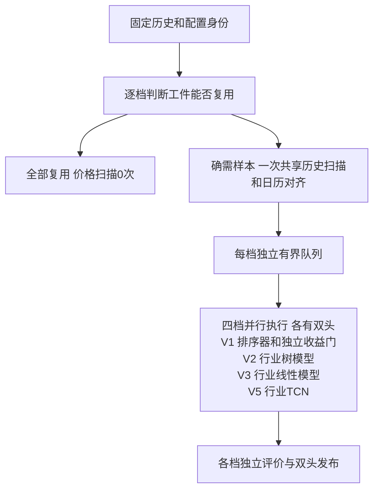

# 训练设计

训练的目标是四档全部结束的总时间最短，同时保留样本、预测和质量的正确性。先测哪里耗时，再决定共享计算、调整线程或改变存储。减少日期、行业、样本或训练质量不能算工程提速。

本篇只管训练输入、样本、资源和模型工件。收益研究放c第15章，下载和数据库源字段放d；训练独立运行，不下载缺失资料。

## 1. 输入固定，双头独立

每次作业固定一个已发布历史版本及配置、特征身份。四档各有 Tomorrow、D25，共八个模型头；每档双头合格才发布该档模型。某档失败不污染其它档位，不覆盖旧有效工件。

独立训练入口已有 `ExecuteSelectedTraining`。本篇源码核对基线为 `e69d3e02`，该基线的 `bootstrap.py::ExecuteDownloadTrain` 仍先下载再训练；目标是CLI和交互直接调用独立训练并删除组合路径，不保留兼容入口。公共入口切换由A交付，C的字段字典与静态核对不表示入口切换已经验证。

## 2. 四档比较

参数来源：`config/training.json` 的各档训练设置；特征定义见 `config/features.json` 和各档特征合同。算法和样本组织来自对应训练实现，不是数据库原列。下表当前窗口和拟合日期是只读核对值，不是新的调参建议。

| 项目 | V1 | V2 | V3 | V5 |
| --- | --- | --- | --- | --- |
| 算法 | LightGBM LambdaRank＋独立Ridge收益门 | 行业LightGBM回归 | 行业Ridge回归 | 行业TCN回归 |
| 历史回看 | 251完整日 | 251日 | 61日 | 61日形成60×6序列 |
| 当前有效拟合日期 | 750 | 1000 | 750 | 61 |
| 主要输入 | 十个完成日因子 | 长短动量、收益、流动性等 | 短窗收益、动量、流动性 | 序列及辅助输入 |
| 样本组织 | 日期排序query＋独立收益门 | 行业、日期、头 | 行业、日期、头 | 行业、序列、头 |
| 主要待测开销 | 矩阵读取、排序器与收益门 | 特征长窗、行业树拟合 | 矩阵转换、线性拟合/校准 | 序列、张量、逐行业迭代和线程 |

表中数值是本次只读配置核对结果，不是优化后的推荐值。当前V5为行业5000行门、网络8通道、float32计算、最多10轮、早停耐心3、相对改善阈值0.005、请求1线程；网络隐藏通道与输入6通道不是一回事。

## 3. 用什么数据库、字段做什么

### 3.1 原始历史与参考

数据库：`data/market/history/catalog.sqlite3` 保存发布/日历/总体身份，年度 `data/market/history/prices_<year>.sqlite3` 的 `daily_price_revision`、`daily_price_observation` 提供对应版本价格；行业使用该历史发布绑定的参考。`HistoryTrainingRow`、`HistoryTrainingPoint` 是读取后形成的程序对象，不是数据库表名。路径以 `config/runtime.json` 的 `data_dir=data` 举例。

| 数据库/对象 | 字段 | 中文意思及训练作用 |
| --- | --- | --- |
| history catalog | 快照、数据截止、标签截止、发布序号 | 固定同一次输入，后续修订不可混入 |
| history catalog | 交易日历、证券总体、上市/退市区间 | 同日切分、持有期、有效日期边界 |
| 年度 `daily_price_revision` | trade_date、code、board | 日期、证券、板块 |
| 同表 | revision_id、first_seen_sequence | 选择该发布可见的价格修订 |
| 同表 | 价格列、status | raw/qfq及有效/停牌/缺失语义 |
| `daily_price_observation` | sync_sequence、revision_id | 观察与修订的可见关系 |
| `HistoryTrainingRow` | code、trade_date、board、industry、cell_status | 训练窄投影、行业和日历对齐 |
| `HistoryTrainingPoint` | qfq_close_price、qfq_open、qfq_high、qfq_low | 收益、动量、波动及V5价格通道 |
| 同对象 | raw_volume | 实际成交股数及V5量通道 |
| 同对象 | qfq_amount | 模型合同金额输入；须追到存储及adapter确认与原始实际金额的关系 |
| 历史行业参考 | 行业ID、日期、生效与版本 | 当时行业、横截面、行业模型，不能用当前行业倒填 |

源表全列的SQL类型、单位、来源和索引归d第8章；本表只解释训练消费。尤其量额必须沿真实解析链核对，不因qfq字段名猜测或改公式。

### 3.2 样本数据库

数据库：V2/V3/V5在 `data/training/samples/<profile>/` 保存 `samples.sqlite3` 和 `complete.json`；V1在同一样本根的 `v1` 子目录下创建临时作业目录，退出时清理，当前没有跨作业封存样本复用。常规字段在 `samples`，分区和统计分别在下表列出的 `sample_*` 表，V5序列块在 `sample_sequence_blocks`。这些值由第3.1节的历史输入生成，列定义/顺序受特征合同约束，构建窗口来自 `config/training.json`。

| 表/字段 | 用途 | 正确性检查 |
| --- | --- | --- |
| `samples.trade_date/code/board/industry/avg_amount_20d` | 行身份、板块/行业和流动性暴露 | 日期与代码对齐、列语义 |
| 具名特征列 | 各档输入 | 公式版本、顺序、维度和必需缺失 |
| `target_t1` | Tomorrow标签 | 未来第1个市场交易日，成熟后使用 |
| `target_t2`～`target_t5` | D25分期证据 | 市场日历定位，缺失分期如实保留 |
| `target_d25_aggregate` | D25唯一聚合头 | 按现行标签合同生成，不混成四头模型 |
| `sample_split_dates` | 训练、早停、校准、评价分区 | 同日股票同区，边界隔离 |
| `sample_statistics` | 日期、行业、标签统计 | 避免反复扫宽表；与封存行数一致 |
| `sample_day_diagnostics` | 每日标签缺失归因 | 不以缺标签者反向改变当日特征总体 |
| V5 `sequence_start` | 当前样本对应序列起点 | 时间步顺序不变 |
| `sample_sequence_blocks.code/block_id/sequence_bytes` | 相邻样本复用重叠序列 | 无损解码、身份匹配，释放缓存 |
| V1十因子、`target_t1/target_d25/zero_signs` | 排序器与收益门样本 | 独立目标和query，保留约定负零语义 |

V1十因子和V5的60×6通道在c第7章逐项解释；物理字段、列顺序和消费者见第3.4–3.6节。公式owner仍在recommendation，不在训练另建计算定义。

### 3.3 日期与标签

2000日是整体历史目标，251/61日是特征回看，750/1000/61日是各档有效拟合日期，200日是终端留出最低范围，它们不是同一门槛。新股不要求上市前有数据，不统一要求每股拥有全部历史。

同一市场日历定位标签。已发布资料中的确认停牌、推定停牌、个股缺行和整市场缺日分别处理；可按合同用此前同源收盘作估值时保留estimated标志，量额为0不等于随意填缺失为0。异常单侧价格不能补造，不能向后借值；原始库事实不改写。

### 3.4 V2/V3/V5物理样本字典

以下表来自 `training/infra/sample_schema.py::TrainingSampleSchema`、`sample_index.py`，不是活动数据库审计。数据库位置见第3.2节；日期由 `infra/sqlite_codec.py` 编为距1970-01-01的整数日，程序边界解码为 `date`。主写入者是 `BuildTrainingSamples` 调用的 `SQLiteTrainingSampleIndex`；拟合、校准和评价通过同一index读取，训练覆盖诊断只读相同统计和列合同。

| 表 | 主键、索引和生命周期 | 读取者 |
| --- | --- | --- |
| `sample_contract` | 单行 `singleton=1`；封存前写入split身份 | index初始化、复用校验 |
| `samples` | `(trade_date,code)`，`WITHOUT ROWID`；分区准备时建立 `samples_industry_date(industry,trade_date,code)`，封存后只读 | 同档双头行业共享读取、V5批次、显式样本/读取诊断 |
| `sample_split_dates` | `trade_date`，`WITHOUT ROWID` | 拟合/早停/校准/评价按日期关联 |
| `sample_statistics` | `(trade_date,industry,target)`，`WITHOUT ROWID` | 逐行业行数、标签矩和有效日期覆盖 |
| `sample_day_diagnostics` | `trade_date`，`WITHOUT ROWID` | 每日候选及标签缺口归因、training-coverage |
| V5 `sample_sequence_blocks` | `(code,block_id)`；普通rowid表 | `SampleSequenceReader` 批读/缓存，两个头共用只读块 |

除上述行业日期索引外，这组schema没有另建二级索引。样本库是可重建中间产物，构建使用独立事务，统计随样本写入，日期分区和索引准备后提交；正式模型的持久性和发布边界另见第7章，不能把样本库的可重建写策略套到正式库。

| 表/列 | 类型、单位与空值 | 中文含义、来源和使用 |
| --- | --- | --- |
| `sample_contract.singleton` | INTEGER主键，固定1 | 单份列合同 |
| `schema_version` | INTEGER非空，固定2 | 命名列样本格式 |
| `feature_hash` | BLOB非空，32字节 | schema、特征有序列和序列布局的SHA-256 |
| `split_hash` | BLOB可空，32字节 | 构建期可空；分区准备/封存后必须匹配split身份 |
| `samples.trade_date` | INTEGER非空，日 | 信号日；同日股票必须进入同一分区 |
| `code` | TEXT非空 | 六位证券代码，与日期构成行身份 |
| `board` | TEXT非空 | 板块暴露，来自历史窄投影 |
| `industry` | TEXT非空 | 历史发布绑定的行业，供残差化及行业模型选择 |
| `avg_amount_20d` | REAL非空，金额沿输入合同 | 20日均额，供对数流动性暴露；写入前检查有效性 |
| 第3.5节具名特征列 | REAL非空、有限数 | 按有序manifest生成，不能用0填必需缺失 |
| V5 `sequence_start` | INTEGER非空，≥0，时间步 | 当前证券的60步序列在重叠块流中的起点；不是BLOB字节偏移 |
| `target_t1` | REAL可空，收益小数 | T+1个股收益减同日该期限已观察收益的等权基准；缺失表示标签不可用 |
| `target_t2` | REAL可空，收益小数 | T+2累计收益减对应期限基准，D25诊断分期 |
| `target_t3` | REAL可空，收益小数 | T+3同义分期 |
| `target_t4` | REAL可空，收益小数 | T+4同义分期 |
| `target_t5` | REAL可空，收益小数 | T+5同义分期 |
| `target_d25_aggregate` | REAL可空，收益小数 | `target_t2`至`target_t5`全部有效后取算术均值；是D25一个头的标签 |
| `sample_split_dates.trade_date` | INTEGER主键，日 | 分区的信号日期 |
| `split_name` | TEXT非空，枚举 | `training/early_stopping/calibration/validation/holdout`；由split写入，不能由模型自行切行 |
| `sample_statistics.trade_date` | INTEGER非空，日 | 同日统计，不重新读全部宽行 |
| `industry` | TEXT非空 | 统计所属行业 |
| `target` | TEXT非空 | `rows`表示样本总数，其余是上述六个目标名 |
| `sample_count` | INTEGER非空，行 | 有效标签数；`rows`项为样本行数 |
| `target_sum` | REAL非空 | 有效目标值之和；`rows`项为0 |
| `target_sum_squares` | REAL非空 | 有效目标平方和；用于计算标准差，`rows`项为0 |
| `sample_day_diagnostics.trade_date` | INTEGER主键，日 | 每日缺口归因的日期 |
| `candidate_count` | INTEGER非空，股 | 构造当日特征总体的候选数 |
| `missing_t1` | INTEGER非空，股 | 当日T+1未来收益缺失数 |
| `missing_t2` | INTEGER非空，股 | 当日T+2未来收益缺失数 |
| `missing_t3` | INTEGER非空，股 | 当日T+3未来收益缺失数 |
| `missing_t4` | INTEGER非空，股 | 当日T+4未来收益缺失数 |
| `missing_t5` | INTEGER非空，股 | 当日T+5未来收益缺失数 |
| `sample_sequence_blocks.code` | TEXT非空 | 与样本证券身份一致 |
| `block_id` | INTEGER非空 | 每块64步的逻辑块号，末块可不足64步 |
| `sequence_bytes` | BLOB非空 | 小端float64、每步6通道；`SampleSequenceWriter`无损编码、reader解码 |

标签生成的实际owner为 `sample_builder.py::_finalize_sample_day` 和 `domain/label_benchmark.py::ObservedTrainingBenchmark`。各期限缺未来收益只影响该证券/期限，不反向删去已形成的特征总体；某行Tomorrow与D25聚合目标都不可用才不写样本。标签未预扣交易成本，不能在训练和运行门各扣一次。

### 3.5 有序输入列与V5序列

来源：`config/features.json.model_contracts`、各档 `training/infra/profile/*/contracts.py` 与 `sample_schema.py::TrainingFeatureNames`。下表只解释训练消费和存储位置；收益/动量公式、残差化和在线锚点仍由c及recommendation纯函数拥有。V2/V3/V5辅助列的收益单位为小数，不是百分点。

| 列 | 中文用途 | 当前使用 |
| --- | --- | --- |
| `qfq_return_1d` | 信号收盘的1日收益 | 三档Tomorrow；双头合并样本中保留 |
| `qfq_return_3d` | 3日收益 | 三档双头 |
| `qfq_return_5d` | 5日收益 | 三档双头 |
| `qfq_residual_momentum_20d_skip5` | 剔除市场、板块、行业及对数均额暴露后的20日动量，跳过近5日 | 三档双头 |
| `qfq_residual_momentum_40d_skip5` | 同定义40日残差动量 | 三档双头 |
| `qfq_residual_momentum_60d_skip5` | 同定义60日残差动量 | 三档双头 |
| `qfq_residual_momentum_120d_skip5` | 同定义120日残差动量 | 仅V2双头 |
| `qfq_residual_momentum_250d_skip5` | 同定义250日残差动量 | 仅V2双头 |
| `market_qfq_momentum_120d_skip5` | 当日有效样本总体120日动量等权均值 | 仅V2双头，不是外部指数收益 |
| `market_qfq_momentum_250d_skip5` | 同总体250日动量均值 | 仅V2双头 |

V2物理辅助列按上表10列顺序，Tomorrow取10列，D25去掉第一列取9列。V3/V5物理辅助列只取前6列，Tomorrow取6列，D25去掉第一列取5列。manifest顺序不是集合：调换列顺序会改变身份，必须同时切换训练与推断消费者。

V5在各头辅助列后接360个序列值；两个头完整输入维数分别366与365。序列逻辑次序由 `recommendation/domain/market/v5/features.py::CalculatePriceVolumeSequence` 固定为“旧时间步在前，每步按下表通道顺序”。物理样本只保存辅助列、`sequence_start`与重叠块，不展开360个REAL列；样本块始终float64，拟合时才按 `tcn.compute_dtype` 转换。

| 通道顺序 | 原始输入 | 每步含义及单位 |
| --- | --- | --- |
| `open_return` | `qfq_open`、前日 `qfq_close_price` | 开盘/前收减1，收益小数 |
| `high_return` | `qfq_high`、前日qfq收盘 | 最高/前收减1 |
| `low_return` | `qfq_low`、前日qfq收盘 | 最低/前收减1 |
| `close_return` | 当日/前日qfq收盘 | 收盘收益小数 |
| `log_volume` | `raw_volume` | 实际成交股数的 `log1p` |
| `log_amount` | `qfq_amount` | 输入金额的 `log1p`；供应商到存储的金额口径需由d确认 |

序列使用信号日前61个完整日生成60步，不含信号日。训练滚动容器另保留信号行，故内部会需要62个点；不能把这个容器宽度改写成62日序列合同。辅助收益与标签仍以信号收盘为锚，V5不能直接复用另一档的完整可变输入矩阵。

### 3.6 V1独立样本

来源：`training/infra/profile/v1/samples.py::_SAMPLE_SCHEMA` 和 `recommendation/domain/market/v1/features.py`。V1样本库也标schema 2，但结构与V2/V3/V5不同，不能仅按数字2互读。以下所有列除两个标签外均非空；`samples`以 `(trade_date,code)` 为主键、`WITHOUT ROWID`，没有额外二级索引。`sample_contract`只有 `singleton INTEGER PRIMARY KEY CHECK(singleton=1)` 和32字节非空 `feature_hash BLOB`。

| `samples`列，按实际顺序 | 类型/单位 | 含义和消费者 |
| --- | --- | --- |
| `trade_date` | INTEGER，日 | 信号日期，四分区和query共同使用 |
| `code` | TEXT | 六位代码，排序/追溯使用 |
| `industry` | TEXT | 历史行业证据及诊断，不据此换成行业V2模型 |
| `return_1d` | REAL，收益小数 | 前一完整日锚点的1日收益 |
| `return_3d` | REAL，收益小数 | 同锚点3日收益 |
| `return_5d` | REAL，收益小数 | 同锚点5日收益 |
| `return_20d` | REAL，收益小数 | 同锚点20日收益 |
| `return_60d` | REAL，收益小数 | 同锚点60日收益 |
| `return_120d` | REAL，收益小数 | 同锚点120日收益 |
| `return_250d` | REAL，收益小数 | 同锚点250日收益 |
| `volatility_20d` | REAL，收益小数尺度 | 20日波动，具体估计式由特征owner维护 |
| `drawdown_60d` | REAL，比例 | 60日回撤 |
| `log_avg_amount_20d` | REAL，对数 | 20日平均金额的对数特征 |
| `zero_signs` | INTEGER，0–1023 | 上述十因子的负零位掩码，读取时恢复符号位 |
| `target_t1` | REAL可空，收益小数 | T+1超额标签，不可用则NULL |
| `target_d25` | REAL可空，收益小数 | T+2～T+5超额均值，四期齐全后有效 |

写入者 `BuildLearnedRankSamples` 先从251个历史完成日构造特征，再加入当前信号日；因此不能将V2同名收益列直接借给V1。`LearnedRankSampleIndex.read_matrices` 一次按日期/代码排序读取，最多分发双头四分区共8个独立矩阵，4096行批读并恢复负零；query组内同日、两个头分别按自身有效标签过滤。

V1日期切分由 `BuildLearnedRankDateSplit` 拥有：拟合、早停、校准、验证四段，每段之间至少5个市场日隔离；两头成熟期分别1/5日。它没有V2/V3/V5的 `sample_split_dates`、统计表和 `complete.json`。当前工件有效时可直接复用工件；工件不能复用时，V1从历史重建临时样本，“样本缓存复用”实验对V1须记为不适用，不能伪报缓存命中或另造缓存。

### 3.7 训练到期和提醒表

数据库是 `data/market/history/catalog.sqlite3`，表owner是 `training/infra/history/training_maintenance_index.py::TrainingMaintenanceIndex`；同文件中的历史发布表仍归download。`history_training_due.py`和训练提醒流程写入，状态/提醒读取及隔离重排复制流程消费；同身份冲突拒绝覆盖。三个表都是 `WITHOUT ROWID`，没有额外二级索引；提醒表与领取表的 `due_id`外键指向 `training_due`。

日期仍用整数日，时刻用UTC纪元微秒并在程序边界解为上海时区；不能按文本或毫秒猜测。

| 表/列 | 类型、空值 | 用途 |
| --- | --- | --- |
| `training_due.due_id` | TEXT主键 | 不可变到期身份，含档位/头等业务身份编码 |
| `reason` | TEXT非空 | 到期/未到期/资料不足等类型化原因，具体枚举由domain校验 |
| `baseline_date` | INTEGER可空 | 上次有效训练标签截止，无基线可空 |
| `cutoff_date` | INTEGER可空 | 当前可用标签截止，资料不足可空 |
| `matured_days` | INTEGER非空，≥0 | 自基线以来新增成熟标签日数 |
| `input_revision` | INTEGER非空，0/1 | 输入是否发生真实语义修订 |
| `observed_at` | INTEGER非空，微秒 | 本次到期观察时刻，不冒充拟合时间 |
| `content_hash` | BLOB非空，32字节 | 记录完整性，读取解码后复核 |
| `training_reminder_claim.due_id` | TEXT非空 | 已领取的到期身份 |
| `reminder_date` | INTEGER非空 | 上海提醒日期，与due_id组成主键 |
| `claimed_at` | INTEGER非空，微秒 | 先持久提交领取，再做桌面通知；同日first-wins |
| `content_hash` | BLOB非空，32字节 | 领取证据完整性 |
| `training_reminder.due_id` | TEXT非空 | 通知结果所属到期身份 |
| `reminder_date` | INTEGER非空 | 与due_id组成主键 |
| `outcome` | TEXT非空 | 仅 `sent/notification_degraded` |
| `attempted_at` | INTEGER非空，微秒 | 实际尝试通知的时刻 |
| `failure_code` | TEXT可空 | 通知降级原因，不含完整异常载荷 |
| `content_hash` | BLOB非空，32字节 | 通知结果完整性 |

读取不会为缺表自动建库；写入在确认 `history_catalog` schema 2 后创建完整表组并事务提交。仅完成训练模型可读不能替代到期状态检查；提醒领取也不代表训练或桌面通知已经成功。

## 4. 一次作业如何并行

现有 `application/selected_training.py` 按256行不可变批次分发，每档队列容量2；`infra/selected_training.py` 固定SQLite快照并在扫描前判断复用。全部复用时零价格扫描；共享扫描与日历对齐已存在，四档样本/特征仍各自构建。

慢消费者会背压公共扫描。先量出是哪档计算、写入、资源等待造成背压，再比较“先算公共基础量”“调整批次”“隔离慢消费者”等候选。不能为了取消背压引入无限队列或四份完整历史。

## 5. 什么能共用

| 工作 | 共用条件 | 保持独立的部分 |
| --- | --- | --- |
| 历史扫描与解码 | 同快照、时间范围取并集 | 每档取自身有效日期和列 |
| 日历对齐 | 同日历与停牌/估值语义 | 原始事实、估值标志、标签 |
| 基础收益、均额、波动等 | 同窗口、公式、末日、缺失规则 | V1完成日与其它实时锚点定义 |
| 市场/板块/行业统计 | 同日期、同资格总体及公式 | 不同历史长度和输入集合 |
| 标签 | 同期限、成本与成熟定义 | 两头有效标签过滤和不同目标 |
| 样本读取 | 同档双头使用同一行特征 | 标签、切分、可变矩阵和模型 |
| 存储/内存 | 只读批次、连续数组或映射 | 不共享会被模型原地修改的矩阵 |

不能只因名称相同就共享。每个候选先记录当前重复次数、CPU、读写字节、RSS，再证明结果一致和总时间改善。

## 6. 怎样让四档全部尽快结束

当前CPU预算按实际亲和性和cgroup约束，拟合总预算约为 `max(1, 可用CPU-1)`，为扫描和协调保留资源，并限制BLAS/OpenMP线程。现有内存原子预约、批读和临时映射避免四档同时膨胀；这些机制先复用，不另建资源中心。

“慢档多分资源”是待测策略。先测每档/算法随线程数变化的边际收益：I/O或Python单线程瓶颈加模型线程可能无用；小任务获得太多线程也会挤压长任务。比较现有固定申请、长任务优先、有空闲时借用等候选，以全部完成的时间裁决。

下表是资源说明，不是数据库字段。训练线程、窗口和拟合参数来自 `config/training.json`；通用存储策略来自 `config/storage.json`，介质选择来自 `config/runtime.json`。CPU/cgroup、RSS和队列等待是运行时测量；尚未配置化的预算需沿实际实现清点，不能写成配置中已有字段。

| 资源 | 要测什么 | 配置化核对 |
| --- | --- | --- |
| CPU | 模型原生线程、等待、超额竞争、实际利用 | 总预算、每算法上限、协调预留；不得每档各占全CPU |
| 内存 | 只读共享、矩阵、张量、缓存、换页、预约等待 | 核对现有3GiB上限、1.5GiB预留等硬编码是否迁出 |
| 磁盘 | 公共顺序扫描、样本写入、映射随机I/O | HDD/SSD各自批次和并发，保持唯一策略来源 |
| 队列 | 长度、阻塞、批次字节和取消清理 | 批次、容量、最大驻留 |

`training.json`、`features.json`逐叶字段要写当前值、类型、单位、范围、各档含义、解析和最终消费者、身份影响及生效时机。V5早停/拟合日期属于质量相关配置，不能作为纯工程参数随意缩减。

### 6.1 training.json现有逐叶配置

以下来自 `config/training.json`，`profiles[]`是按 `profile` 选择的对象数组。记 `V1=profiles[profile=v1]`、`V2=profiles[profile=v2]`，其它同理；这只是文档定位写法，不是新增JSON字段。当前文件只有这四个profile，不含CPU总预算、内存预算、扫描批次或队列配置。

所有字段在训练作业准备时读取。V1经 `LoadV1TrainingSettings → ParseV1TrainingSettings → V1TrainingSettings` 进入独立构造/拟合；V2/V3/V5经 `LoadProfileTrainingSettings → ProfileTrainingSettings` 进入 `engine.py`，V5参数再经 `ParseTcnParameters → TcnFittingParameters` 校验。字段名必须精确匹配，整数不接受bool，数值必须有限；下表范围按实际解析和类型校验写，不虚构额外上限。

| JSON叶字段 | 当前值 | 类型/单位、范围 | 具体用途/最终消费者 |
| --- | --- | --- | --- |
| 各档 `.profile` | `v1/v2/v3/v5` | string，选中档位必须唯一 | profile选择；不是随意改名的显示文本 |
| V1 `.fit_dates` | 750 | int，≥1，市场日 | `BuildLearnedRankDateSplit`拟合段 |
| V1 `.early_stopping_dates` | 20 | int，≥1，日 | 独立早停分区 |
| V1 `.calibration_dates` | 20 | int，≥1，日 | 收益门校准分区 |
| V1 `.validation_dates` | 20 | int，≥1，日 | 工程评价分区 |
| V1 `.embargo_dates` | 5 | int，≥5，日 | 分区隔离，不能短于两头成熟要求 |
| V1 `.minimum_training_rows` | 1000 | int，≥1，行 | V1训练覆盖准入 |
| V1 `.learning_rate` | 0.05 | number，0–1且>0；解析下限0.000001 | LambdaRank学习率 |
| V1 `.max_depth` | 3 | int，≥1 | LambdaRank树深 |
| V1 `.num_leaves` | 7 | int，≥2 | LambdaRank叶数 |
| V1 `.minimum_leaf_rows` | 20 | int，≥1，行 | 单叶最少样本 |
| V1 `.boosting_rounds` | 200 | int，≥1，轮 | 最大提升轮数 |
| V1 `.early_stopping_rounds` | 20 | int，≥1，轮 | 排序器早停耐心 |
| V1 `.maximum_bins` | 63 | int，≥2 | 连续值分箱上限 |
| V1 `.histogram_pool_mib` | 64 | int，≥1，MiB | LightGBM直方图池 |
| V1 `.seed` | 0 | int，≥0 | 复现实验随机种子 |
| V1 `.ridge_penalty` | 10.0 | number，>0；解析下限0.000001 | 独立Ridge收益门 |
| V1 `.ranking_round_trip_cost` | 0.002 | number，≥0，收益小数 | 排序标签等级构造的往返成本参考；不授权改运行成本 |
| V2 `.fit_dates` | 1000 | int，≥1，日 | 行业树模型拟合日期 |
| V2 `.minimum_industry_training_rows` | 20000 | int，≥1，行 | 每行业覆盖门 |
| V2 `.lightgbm.learning_rate` | 0.05 | number，≥0.000001 | 行业LightGBM学习率 |
| V2 `.lightgbm.max_depth` | 3 | int，≥1 | 行业树深 |
| V2 `.lightgbm.num_leaves` | 7 | int，≥2 | 行业叶数 |
| V2 `.lightgbm.minimum_leaf_rows` | 20 | int，≥1，行 | 单叶覆盖 |
| V2 `.lightgbm.boosting_rounds` | 200 | int，≥1，轮 | 最大拟合轮数 |
| V2 `.lightgbm.early_stopping_rounds` | 20 | int，≥1，轮 | 独立早停区上的耐心 |
| V2 `.lightgbm.maximum_bins` | 63 | int，≥2 | 分箱 |
| V2 `.lightgbm.histogram_pool_mib` | 64 | int，≥1，MiB | 直方图池 |
| V2 `.lightgbm.seed` | 0 | int，≥0 | 随机种子 |
| V3 `.fit_dates` | 750 | int，≥1，日 | 行业Ridge拟合日期 |
| V3 `.minimum_industry_training_rows` | 20000 | int，≥1，行 | 每行业覆盖门 |
| V3 `.ridge.penalty` | 10.0 | number，≥0.000001 | 行业Ridge正则惩罚 |
| V5 `.fit_dates` | 61 | int，≥61，日 | 最近拟合日期；不减少独立确认和留出区 |
| V5 `.minimum_industry_training_rows` | 5000 | int，≥1，行 | 每行业训练覆盖门 |
| V5 `.tcn.learning_rate` | 0.001 | number，≥0.000001且≤1 | TCN优化器学习率 |
| V5 `.tcn.weight_decay` | 0.0001 | number，0–1 | 优化器权重衰减 |
| V5 `.tcn.dropout` | 0.1 | number，0≤值<1 | 训练dropout，工件保存网络参数 |
| V5 `.tcn.batch_size` | 256 | int，1–256，行 | 张量批次，不是共享扫描批次 |
| V5 `.tcn.epochs` | 10 | int，1–100，轮 | 最大迭代 |
| V5 `.tcn.early_stopping_rounds` | 3 | int，1–epochs，轮 | 早停耐心 |
| V5 `.tcn.seed` | 0 | int，≥0 | 网络随机种子 |
| V5 `.tcn.hidden_channels` | 8 | int，仅4/8/16 | 网络隐藏宽度，不是6个输入通道 |
| V5 `.tcn.compute_dtype` | `float32` | string，仅float32/float64 | 拟合计算精度，不改变样本块float64编码 |
| V5 `.tcn.early_stopping_relative_delta` | 0.005 | number，0≤值<1 | 早停相对改善门 |
| V5 `.tcn.compute_threads` | 1 | int，1–4，线程 | TCN请求线程；实际授权仍受全作业CPU预算约束 |

拟合日期还要满足历史预算和split的关系约束，不能把“单字段≥1”理解为任意组合都能训练。V2/V3/V5配置中的算法参数由各拟合器使用，V1/V5还直接保存配置身份；现实现会把整组拟合设置纳入训练身份，改变线程、批次也可能失去工件复用资格。后续若区分纯运行参数与语义参数，须由A/C一起核对全部身份消费者后切换，不能先在文档声称日志、端口或所有资源参数都会触发重训。

`config/features.json.model_contracts[]`目前只含V2/V3/V5，下列每个叶字段都由 `LoadProfileTrainingSettings` 解析并与各档合同逐项比较；数组元素顺序也属于合同。V1十项完成日特征由自身纯合同拥有，不在JSON新增一份。

| 字段 | 当前值V2 / V3 / V5 | 类型与约束、最终用途 |
| --- | --- | --- |
| `profile` | v2 / v3 / v5 | 唯一选中profile |
| `history_sessions` | 251 / 61 / 61 | int≥61，匹配profile合同；滚动回看 |
| `momentum_horizons[]` | `[20,40,60,120,250]` / `[20,40,60]` / 同V3 | 严格递增、不重复正整数；基础动量和残差化列 |
| `market_state_momentum_horizons[]` | `[120,250]` / `[]` / `[]` | 可为空的递增正整数；当日总体均值 |
| `heads.tomorrow[]` | 第3.5节10 / 6 / 6列 | 非空、不重复字符串；特征选择和列序 |
| `heads.d25[]` | 第3.5节9 / 5 / 5列 | 同上；不能把Tomorrow首列自动补入D25 |

`factor_index/factor_contract/news_signal`由A维护公式与解析，C只提出列、单位、锚点和缺失需求，不修改这些公共配置。

### 6.2 硬编码资源与给A的注入清单

下表是源码现值及候选配置归属，均未迁出、未调数。A负责公共设置解析/组合根，C负责训练消费者；没有接口交接前不在training自行读取另一份JSON。算法常数、格式合同和运行参数必须先分类，再决定哪些可调。

| 实现与现值 | 实际消费者/作用 | 给A的要求及身份边界 |
| --- | --- | --- |
| `cpu_admission.py`留1 CPU，原生基线最多2；普通拟合请求2 | `TrainingCpuBudget`、V1拟合、`engine.py`、`TrainSelectedProfiles`原生库上下文 | 一份作业级不可变资源设置，启动显式注入；先保持现值，约束请求≤授权和总预约≤预算 |
| `application/selected_training.py`每档队列2、公共批次256行 | `_TrainingFanout`发送/接收与取消清空 | 正整数，容量与最大驻留有界；不是V5张量batch_size |
| `memory_admission.py`拟合容量最多3GiB、预留1.5GiB、宿主可用内存低时通常至少256MiB；cgroup可进一步收紧 | `FittingMemoryCapacity → TrainingMemoryBudget` | 保留实际宿主约束，软件预约不冒充RSS硬隔离 |
| `engine.py`TCN预约512MiB，普通模型256MiB＋最大行业矩阵估计×4 | 拟合前内存预约 | 先实测估计与RSS误差；不能因常量小就直接降低预约 |
| `sample_index.py`SQLite页缓存32MiB、SQLite mmap为0、矩阵阈值256MiB | 样本index、行业共享矩阵/临时映射 | 区分SQLite mmap与NumPy矩阵映射，单位统一字节；取消关闭句柄 |
| V1 `samples.py`SQLite缓存16MiB、矩阵4096行批读 | V1临时样本及最多8矩阵 | 独立消费者，不拿V2缓存设置冒充已覆盖V1 |
| `sample_sequences.py`reader缓存32MiB、一次最多256窗、writer最多8192证券 | V5重叠序列读写 | reader缓存与在途batch分别计量；同一设置传到全部入口 |
| 序列块64步、float64小端；序列60×6 | 样本codec/特征合同 | 格式/算法合同，暂不列为自由运行参数；变化需重建身份和全部消费者 |
| `cpu_admission.py/memory_admission.py`预约心跳0.25秒，fanout队列轮询0.1秒 | 等待与取消 | 停止响应约束；是否开放配置须有用途和等待证据 |

### 6.3 预约顺序与资源生命周期

当前 `engine.py` 在样本检查完成后，先预约CPU，再估计并等待内存，预约持有到双头行业拟合及后续准备范围退出；这是源码顺序，不是等待耗时实测。可用CPU为4时容量3、原生基线2，每项至少预约2，两个拟合无法同时入场；V5请求1也不绕过原生基线预约。限制原生线程有正确性作用，不能只删门让四档竞争宿主。

| 资源 | 创建/唯一owner | 消费与退出 |
| --- | --- | --- |
| 执行器 | `bootstrap.ExecuteSelectedTraining`，按所选档数创建 | entrypoint启动；取消后停止、等待，不在工作任务中同步提交并等待同池任务 |
| CPU/原生线程限制 | bootstrap创建 `TrainingCpuBudget`；`TrainSelectedProfiles`统一上下文 | 全部worker结束后才恢复原生库；reserve的finally归还额度 |
| 内存额度 | bootstrap创建 `TrainingMemoryBudget` | context退出归还，超预算明确拒绝；预约前/等待中进度回调检查取消 |
| 固定历史/训练锁 | `TrainSelectedProfiles`的ExitStack | 所选profile锁和历史维护锁覆盖作业，退出释放；不随新发布切换输入 |
| 每档有界队列 | `_TrainingFanout` | 消费者退出后停止派发；异常等future退出，finally清空遗留批次 |
| V2/V3/V5样本/矩阵 | `TrainingSampleCache`及 `SQLiteTrainingSampleIndex` | 已封存样本可复用，临时矩阵上下文关闭；异常不能把未封存样本当成功 |
| V1临时库/矩阵 | `TemporaryTrainingSamples`与V1 ExitStack | 映射关闭后清理临时目录，不承诺跨作业样本恢复 |

测量必须分别输出请求、授权和实际原生线程数，预约等待、持CPU等内存时长、实际并行区间、取消至归还时间和最终在途数。已有进度的 `model_fit` 心跳把多种等待放在同一阶段，目前不能据该阶段总时长反推CPU或内存等待各占多少。

## 7. 缓存、复用、检查与工件发布

正常复用检查版本、字段、维度、封存元数据和身份，不重算下载全库内容或每次做整文件摘要。完整内容审计单独显式运行。训练、早停、校准、评价的隔离、标签成熟、特征顺序和目标对齐必须保留。

特征公式、历史端点、单位、列顺序和缺失掩码由同一合同维护，训练、在线和回放不能各写一份近似版本。到期判断看成熟标签和真实语义修订；文档提交、纯物理压实和无变化重跑不能伪装成新标签或已重新拟合。

当前已有同档双头行业共享读取、4096行批读、较大矩阵临时映射、V5重叠序列块和统计小表；下一步核对是否实际命中及退出释放。V1/V5模型、样本和决策身份独立，不借别档补工件。

每档先写候选双头和报告，再检查完整工件组、输入/配置/特征身份和工程资格，通过才切换。取消、单头失败、校准拒绝或落盘失败均保留上一有效模型；复用不刷新拟合日期，不把复用标成新训练。

训练工件字典至少说明：档位、策略头、算法、样本/特征/数据身份、日期范围、拟合/早停/校准区、行业覆盖、质量状态、模型文件及摘要、发布版本。定义和全部消费者由训练负责，不由Web推断。

### 7.1 封存样本与模型文件

以下是持久化边界字段，不是内部业务对象要求自行序列化。V2/V3/V5样本缓存的 `complete.json`由 `TrainingSampleCache.seal`写、`inspect/audit`读；六个字段均必需，不允许空值。

| 字段 | 类型/单位 | 作用 |
| --- | --- | --- |
| `identity` | string，摘要 | 当前历史、split、特征与存储语义身份 |
| `sha256` | string，64位十六进制 | 首次封存计算的全文件摘要；显式audit重新计算 |
| `storage` | string | 命名列schema/特征和序列布局合同 |
| `split_hash` | string，SHA-256 | 日期分区身份，与库内BLOB解码值一致 |
| `size_bytes` | int，字节 | 封存大小，普通复用检查 |
| `modified_ns` | int，纳秒 | 文件修改戳，普通复用检查；不是训练业务时间 |

普通复用比较身份、布局、split、大小、修改戳及库内合同；首次封存做fsync和全文件摘要，显式 `audit()`再次逐字节读。不能将“普通复用不重算摘要”写成“从不校验内容”，也不能把未封存库当可用缓存。

模型路径固定为 `data/training/models/<profile>/{tomorrow,d25}/{model.json,metadata.json}`。V2/V3/V5由 `engine.py`准备、`PublishProfileBundles`切换；V1由 `PublishLearnedRankPair`切换。每档双头共用本次作业身份但保持独立模型和目标；单头候选不能单独替换正式目录。读取路径分别为 `LoadHeadBundle/InspectPublishedProfileBundles` 与 `ReadLearnedRankPair`，推荐在启动时通过 `profile_factory.LoadScoringProfile`采用。

V2/V3/V5的 `metadata.json`顶层白名单如下，JSON字段类型及非空要求由 `model_bundles/bundle_codec.py`校验；除表内明确说明外均必需。

| 字段 | 类型/中文含义 | 来源和消费者 |
| --- | --- | --- |
| `schema_version` | string，档位头metadata格式 | 必须匹配档位 |
| `profile_id` | string，v2/v3/v5 | 不跨档读取 |
| `model_id` | string，具体算法头身份 | 必须匹配 `TrainedHeadContract` |
| `strategy_head` | string，tomorrow/d25 | 不按目录名擅自重解释内容 |
| `feature_ids` | 有序string数组 | 与该头manifest完全一致 |
| `feature_units` | 有序string数组 | 与列一一对应，V5序列含ratio/log_shares/log_yuan |
| `exposure_contract` | object，市场/板块/行业/对数均额及顺序 | 残差化语义，decoder严格核对 |
| `algorithm` | string，lightgbm/ridge/tcn | 决定行业模型decoder |
| `dependencies` | object，库名→版本string | V2为numpy/lightgbm，V3为numpy，V5为numpy/torch |
| `training_input` | object，训练输入凭证 | 见下表，不能混入另一历史或头 |
| `validation_report` | object，工程评价报告 | 切分/目标/模型身份及实际覆盖、预测诊断；收益资格独立 |
| `industry_sample_counts` | object，行业→计数 | 每行业 `training_rows/validation_rows`，与报告预测覆盖交叉核对 |
| `model_hash` | string，SHA-256 | 与model文档content_hash一致 |
| V5 `training_configuration` | object，fit_dates/parameters/content_hash | 完整TCN参数及架构摘要，非V5不能带此字段 |
| `content_hash` | string，SHA-256 | metadata自身规范化内容摘要 |

`training_input`的嵌套字段按持久化白名单核对如下。表中摘要均为64位十六进制string，日期为ISO日期string，计数为int；不含可随意补零的缺失字段。

| 字段 | 中文含义/约束 |
| --- | --- |
| `schema_version` | 该档头训练输入格式 |
| `profile_id`、`strategy_head` | 所属档位、策略头，各自独立校验 |
| `training_input_scope` | 固定 `complete_manifest` |
| `training_input_hash` | 完整训练输入身份 |
| `training_run_hash` | 同档本次作业身份，双头一致 |
| `label_cutoff` | 标签截止，早于source_cutoff |
| `source_identity_hash` | 已发布历史源身份 |
| `calendar_hash` | 固定市场日历身份 |
| `source_cutoff` | 已发布历史资料截止 |
| `requested_sessions` | 请求历史日期数，1250–2000；不是fit_dates |
| `input_descriptor_hash` | 输入描述身份 |
| `training_input_codes`、`training_universe_codes` | 实际输入数与固定总体数，均>0且相等 |
| `codes` | 唯一、排序的六位代码数组，长度等于输入数 |
| `feature_manifest_hash` | 有序特征与单位合同 |
| `split_hash` | 日期分区身份 |
| `training_contract_hash` | 该档模型训练合同 |
| `label_target` | 该头目标定义，与合同一致 |
| `training_cost_bps` | 固定0，标签未预扣成本 |
| `validation_scope` | 固定 `daily_close_engineering_proxy` |
| `production_authority` | bool，固定false，工程文件不能授权收益或自动生产切换 |
| `content_hash` | 输入文档自身摘要 |

`model.json`由 `industries`及自身 `content_hash`组成。每行业必须有逐列 `transformer_means/transformer_scales`与 `calibration_intercept/calibration_slope`，标准差尺度>0、向量维数匹配；V2另有 `lightgbm_model/lightgbm_best_iteration`，V3另有 `ridge_intercept/ridge_coefficients`，V5另有 `tcn_network`。TCN网络记录contract、architecture、hidden_channels、compute_dtype、dropout及具名权重的shape/values；不能只取一个能加载的权重文件就当完整工件。

V1的两个文件使用独立白名单：model包含 `schema_version/profile_id/strategy_head/pair_content_hash/head_content_hash/components/content_hash`；metadata除共同身份外还含 `model_id/score_scale/model_hash/contract_hash/feature_ids/algorithm/training_input/validation_report`。其中pair摘要保证双头同组、head摘要保证各头独立；components保存排序器、独立收益门、标准化和校准等具名分量。V1输入记录完整settings、训练/源/日历身份、资料截止、分区及头输入证据；报告明确 `feature_anchor=previous_completed_session` 与 `label_anchor=signal_close_proxy`。字段细节以 `profile/v1/models.py`与domain类型为准，不能用通用metadata解码器猜测。

评价报告的逐项预测指标由 `model_bundles/evaluation_codec.py`维护，研究准入归c第15章；本节不复制第二份指标公式。报告必须保留工程结构、预测诊断和 `daily_close_proxy_not_point_in_time`的收益缺口；人工生产授权不改写这些证据。

## 8. 质量和收益的边界

工程可读、预测诊断合格、收益验证通过、人工允许生产是四种结论。训练报告不能把Rank IC或拟合成功写成赚钱证明。样本外研究、成本、风险及一次终端留出统一按c第15章及待迁入的现行收益合同。

研究/回溯的字段和存储字典由其实际owner核对：训练拥有样本与工件，推荐拥有决策及结果评价，不为了文档分篇搬动业务owner。历史研究身份、参数和留出记录不能改写成新候选通过。

## 9. 先测再实施的执行顺序

1. 固定真实历史、八头参数、代码、硬件和介质，测首次全训练、样本缓存复用、工件全部复用三种负载。
2. 拆出扫描、对齐、队列阻塞、每档特征、样本写入/封存、矩阵读取、CPU/内存预约等待、逐行业双头拟合、校准、评价、发布与收尾。
3. 找出最后完成的一档和真正瓶颈，量化重复计算占比。先做低风险、可证明相同的共享，再比较资源调度和存储候选。
4. 同输入、覆盖、参数、质量、输出语义做同介质交替或夹测对照；HDD与SSD分别测，不能只改配置名。
5. 达标后原子切换实现和全部消费者，再做必要回归和总耗时复测。验证取消、资源归还、失败保留、部分工件、重启复用。

历史记录：阶段289有V1读取回退5.97%，Parquet没有接生产；阶段297仅部分V5质量组完成，不能签完整质量门。旧台账另记四档一次完整真实作业5822.446秒、7249083行一次扫描；这是一次运行事实，不是同输入串并行性能对照，也不说明90分钟目标或SSD已通过。

本轮不重训、不测量、不改变窗口或线程。全部计划和证据状态只记g的P49–P60。

长任务进度还要面向日常操作：当前阶段、真实行/日期/行业/头的单位、已完成工作、预约等待和心跳。未知总量不显示假百分比；软件资源目标和实际宿主硬限制分别报告。

### 9.1 三种负载与可复用的测量入口

以下是后续测量设计，当前没有运行这些命令。每次在同机独占测量窗口固定代码提交、配置摘要、发布快照/日历/总体、模型与样本状态、实际磁盘类型和宿主限制；配置写ssd不是设备证明。完整历史只在仓库外冻结副本读取，训练输出使用新建且与历史不嵌套的仓库外目录，不清空活动数据或当前模型。

| 负载 | 输入状态 | 必须证明 |
| --- | --- | --- |
| 首次全训练 | 新输出目录，合法历史和原参数完整 | 必要原始扫描1次，四档八头结束时点、质量、总墙钟和峰值RSS |
| 样本复用后拟合 | V2/V3/V5相同有效封存样本，模型确需训练 | 仅从封存样本读取，单列矩阵/序列/拟合成本；V1记不适用。准备该负载需显式隔离布局，不能删除活动模型 |
| 全工件复用 | 同配置/输入，八头工件合法 | 原始价格扫描0次、拟合0次、原工件身份/拟合时点不刷新 |

现有 `diagnose_runtime.py --profile training-performance`在 `build_commands`中专门调用 `BuildTrainingBenchmarkCommands`，继而运行 `training_alignment`；不能仅看profile映射就判成无完整训练。它支持串行前/并行/串行后夹测，或指定隔离baseline checkout作基线前/候选/基线后；子进程的 `_train_once`调用 `ExecuteSelectedTraining`，初次与重复训练会检查八头可读、复用、数值/指标指纹及源身份未变。

该入口仍不自动构造“只复用样本、重新拟合”负载，也没有CPU/内存等待、完整队列背压及实际拟合重叠的分段计量。现有 `stage_seconds`不足以代替这些指标；重放的工件/报告指纹一致也不等于独立输入上的全部预测回放一致。后续扩展原诊断模块，不能新开第二个公开训练检测入口。

### 9.2 P61训练检测清单与A交接

下表是静态清点和去留建议，未实施搬移或删除。公共入口、报告白名单、`DiagnosticOptions`、Makefile与README由A拥有；训练模块的移动、参数和退出码在A确定统一合同后由C原子切换。新接口拟采用b第9章的业务/模块/检查选择，当前调用仍是现有profile体系，不能把拟定命令写成已可执行。

| 现有路径，均在scripts下 | 功能/输入输出与副作用 | 消费者及去留建议 |
| --- | --- | --- |
| `runtime_diagnostics/training_alignment.py` | 隔离历史全训练/复用/工件加载；也含只读V1 model-inputs；训练模式写外部模型/样本 | `diagnose_runtime.py`、`training_performance.py`及对应测试；保留功能，按输入与整作业检查分组，不能误删model-inputs |
| `runtime_diagnostics/training_performance.py` | 生成串并行/隔离checkout子进程命令，比较总耗时、身份、复用；无网络，子进程写隔离输出 | 公共入口及alignment的复用检查、`test_training_performance.py`；保留编排与唯一比较实现，不能删除仍被alignment调用的函数 |
| `runtime_diagnostics/training_coverage.py` | 格式2样本统计、标签覆盖，只读；不重训 | 公共入口、`test_training_coverage.py`；保留，不将T+1观察投影当完整D25结果 |
| `runtime_diagnostics/training_resources.py` | 合成64×64矩阵，CPU预约/原生限制/取消归还；不读历史、不训练 | 公共入口、`test_training_resources.py`；保留资源冒烟，不作为真实四档并行基线 |
| `runtime_diagnostics/training_samples.py` | 五轮样本布局/SQLite–Parquet读取对照，外部checkout及新目录；生成合成库/报告 | 公共入口、`test_training_samples.py`；保留显式实验，不接生产Parquet |
| `runtime_diagnostics/sample_comparison_worker.py` | 指定checkout的样本构建/读取工作进程；写外部夹具 | training_samples子进程；保留为内部worker，随模块路径一起切换 |
| `runtime_diagnostics/training_read_comparison.py` | 已发布历史夹具及SQLite/Parquet准备、对齐、哈希和读测；写外部夹具 | training_samples导入/子进程；保留内部能力，避免与history布局检查重复建夹具 |
| `runtime_diagnostics/v5_samples.py` | 合成或显式只读源子集，宽表/重叠块等价及耗时；写外部样本 | 公共入口、`test_v5_samples.py`；保留序列存储专项，不能当整行业双头训练 |
| `runtime_diagnostics/v5_training.py` | 最多40股隔离导出及有界行业拟合/加载；写外部历史和模型 | 公共入口、`test_v5_diagnostic.py`；保留有界验证，不能关闭最大行业验收 |
| `runtime_diagnostics/v5_kernels.py` | V5数值核对/计时，不读活动历史或生产工件 | v5_training的显式kernel模式、`test_v5_diagnostic.py`；保留内部纯计算检查 |
| `runtime_diagnostics/v5_lite.py` | 配置候选计算及指定样本行业双头质量对照，写外部副本/报告 | 公共入口、`test_v5_lite.py`；保留既有质量门，不把缺少样本的计算结果写质量通过 |
| `check_tomorrow_training_memory.py` | 实为V3隔离重排训练/重复一致性/RSS及报告，显式history/train/sample/output路径；导入时设置原生线程环境 | `test_check_tomorrow_training_memory.py`直接导入；保留有效能力并入训练资源检查后删除独立入口，改掉误导名称；导入副作用须随迁移消除 |

还要与A共同核对 `storage_layout_comparison.py`的训练样本/窄扫描负载、`history_sqlite_performance.py`的training_projection，以及 `history_parquet.py`的共享投影，owner不能仅凭文件名判定。前两者是跨业务检查，不由C擅自搬走；Parquet仅供现有诊断比较，不能因生产未采用就删除有效研究能力。

内存检查的间接消费者还包括 `scripts/check_refactor_quality.py::TOP_LEVEL_SCRIPT_MANIFEST`、`scripts/README.md`的工具表、`tests/conftest.py::_TRAINING_SCRIPT_PATHS`。其输出schema `tomorrow_training_memory_gate`被 `training/infra/history/repack_training_evidence.py::ReadTomorrowTrainingMemoryEvidence`用于重排证据核验；该证据消费者必须同步保留字段、摘要和身份要求，不能只更新入口命令就删旧报告合同。

A需接收的具体接口需求如下：

1. 独立train继续使用 `ExecuteSelectedTraining(runtime, scoring_profiles, *, history_root=None, training_root=None)`；它返回聚合退出码，所选档位和资源由唯一组合根组装。切换CLI时保留主线程取消及原有档位选择，不添加自动下载fallback。
2. 基线 `e69d3e02`的 `ExecuteDownloadTrain`活动消费者有 `entrypoints/cli.py::_run_history_download`、`test_profile_selection.py::test_training_selection_prepares_history_once_and_runs_only_selected_profiles`、`test_entry_contract.py::test_train_stops_before_training_on_history_failure`；还须清理CLI中训练专用的下载日历错误投影。两项旧测试期待“先下载”，不能直接当独立训练合同的通过证据。A完成调用者切换时同批删除旧组合函数和旧断言。
3. C接收A的作业级不可变资源类型，字段/单位覆盖第6.2节运行参数；A改公共解析与bootstrap注入，C改训练消费及必要回归。`features.json`由A修改，C只提交第3.5节列序、单位和缺失需求；不改变公式owner。
4. 统一检测需要保留原history/config/样本根、所选profile、隔离输出目录、baseline checkout、候选配置、超时与取消语义；显式标记纯检查、合成写入和真实隔离拟合。当前每项报告的失败/取消/超时/不适用不能压成一个空结果；最终参数与白名单由A统一裁决。

独立train验收至少包含：供应商调用为0、下载断点不变、资料缺失明确失败、所选档位及八头工件按合同、取消退出与资源归还、单头/校准/部分落盘失败保留旧模型。这里只列验收和消费者，没有运行这些测试或业务命令。
