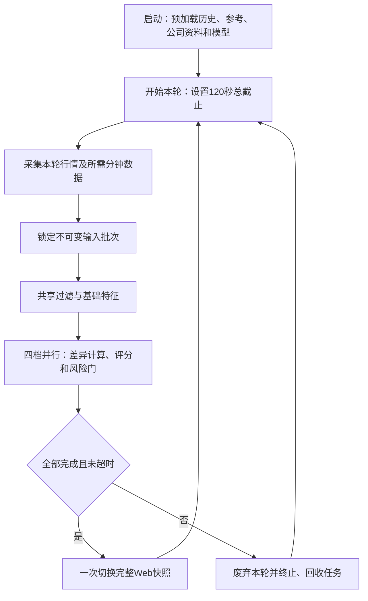

# 统一下载、训练与实时荐股框架计划

本文记录本轮框架目标，不表示代码已经切换或通过验收。评分规则以[评分逻辑](1_评分逻辑.md)为准，架构与运行合同以[工程设计](2_工程设计.md)为准，下载和训练合同以[下载训练](4_下载训练.md)为准；实施状态与验证证据只记录在[工程实施](3_工程实施.md)。后续实施时同步更新相应权威文档。

本轮补充要求：可调参数尽量全部配置化；不要求兼容旧数据，允许重新设计数据库、表、字段、索引及存储布局，旧业务数据可删除重建。**所有性能优化先实测再实施**，允许重设计不等于必须重设计，更不能代替性能证据。本次更新计划不执行数据删除或代码改造。

DeepSeek 相关改造暂缓，包括请求合并、缓存、配置迁出及复核流程调整；启用状态沿现有配置，不因本计划自动切换。现行物理请求预算、证据核验及风险边界继续有效。历史优化方向和取舍统一见第 9 节，并落实到第 7 节对应步骤，不另建实施阶段或进度表。

## 1. 总体结构

下载、训练、实时荐股各自单独运行，不设计三者同时运行的资源调度。

| 模块 | 核心目标 | 职责 |
| --- | --- | --- |
| 下载 | 数据完整、存储高效 | 采集、批量落盘、整批校验、发布可用数据 |
| 训练 | 四档并行，总耗时最短 | 共享历史读取和基础计算，分别训练、评价及发布模型 |
| 推荐 | 实时性优先 | 启动预加载，整轮采集、过滤、评分、原子发布 |
| HTTP/Web | 展示一致 | 只读已发布快照及状态 |
| 公共基础设施 | 复用技术能力 | 时钟、网络、存储策略、执行器和资源回收 |

保留 `src/trader` 三业务结构、单一组合根及 `entrypoints/infra → application → domain` 的依赖方向。公共业务公式保留唯一所有者，通过明确类型和纯函数复用；不增加含糊的公共业务层。

“四种策略”统一称为 **V1/V2/V3/V5 四档**；每档包含 Tomorrow、D25。按用户后续明确要求，Long 维持现有独立更新频率和不评分展示，不参与四档双策略的采集、计算及原子发布屏障，双方互不等待。

## 2. 实时荐股：一批输入，一次完整发布



- **全链共用 120 秒单调截止时间**，覆盖排队、采集、重试、计算及服务端发布；各阶段不能重新计时。完成后无需等满 120 秒即可开始下一轮。
- “同一时点”采用**同一输入批次**：保留供应商真实时间戳及新鲜度约束，采齐锁定后不混入新行情。
- 四档及其双策略全部形成结果后，一次发布名单、分数、报价、原因和对应诊断。合法降级必须明确表达；未完成或异常分支不能拼接上一轮冒充完整结果。
- 发布前，Web 完整保留上一短线批次内容。删除短线独立报价更新及迟到结果修改本轮决策的路径；连接状态、失败提示和数据年龄可独立更新。
- 超时立即撤销本轮发布资格；无法协作取消的外部调用使用可终止隔离执行。回收完成后立即重采，不允许旧轮与新轮重叠；清理耗时单独记录。
- 历史、参考、公司事实、模型和可共享派生特征在启动时一次加载；运行中不补历史、不扫描慢库、不重复做完整性校验。训练样本库不进入推荐链路。历史预读超过配置的耗时提示阈值只打印时间并继续读取，不重新扫描；真实读取错误明确失败，用户取消或进程停止仍终止读取。此规则不改变启动完成后的120秒推荐整轮截止。
- 共享基础计算按输入身份复用；各档窗口、模型输入、排名及动作门保持差异。Long 保持现有独立报价通道和10秒更新频率；非交易日预览独立读取收盘报价，缺失或失败按其after_close配置频率恢复，每次保留3秒预算，完整后停止；保留完整名单且不参与评分，细则见工程设计第5节。
- DeepSeek 复核流程改造暂缓，本轮推荐性能验收以本地链路为范围，并显式记录 DeepSeek 启用状态；保留现行合法降级、结构化风险及每日 168 次物理请求预算约束，不将本地链路通过表述为 DeepSeek 联合验收通过。
- **盘中采集到发布不操作数据库**，研究记录由有界后台写入器批量落盘，不参与本轮完成判定；积压或失败显式报告。
- **15:00 正式冻结为明确例外**：先持久化成功，再标为正式；仍遵守 first-wins 和合法 `close_fallback`，不等待迟到评分覆盖已有记录。冻结提交与内存发布串行协调，避免跨档部分更新。

## 3. 下载、训练与 HDD/SSD

### 下载

- 按缺口规划一次任务，有界并发采集，单写入者按物理库归组批量写入；复用连接、准备语句和断点，减少逐股逐日查询及小事务。
- 落盘后统一进行整批检查，发布内容附带覆盖范围、缺口、行数、版本及校验结论。
- 校验以“整体完整、结构可读、满足使用条件”为准，不逐条重复复算价格、哈希或业务规则；解析边界保留必要类型和非法值检查。
- 整批检查通过才切换可用发布版本。失败保留旧有效版本和续传断点，不要求重新下载全部数据。

### 训练

- 默认四档同时调度，固定同一个历史发布版本；所需历史区间取并集，一次扫描、一次解码和日历对齐。
- 共用相同窗口、公式及总体下的基础特征、标签和横截面统计；不同窗口或定义分别处理，避免错误共用。
- 共享只读批次和数组，按需产生各档专属输入，避免四份完整历史副本。保留有界队列及内存预约，防止换页拖慢整体。
- 不重复审计下载数据，不逐行重验历史内容；只保留版本、字段、维度、切分及标签成熟度等必要检查。模型早停、评价和双头发布门保留。
- 线程总量受实际 CPU 约束，避免四档与底层计算库重复扩张线程。优化依据是四档全部完成的墙钟耗时。

### 存储

- 沿用全局 `hdd/ssd` 配置，两套策略共用数据合同和存储实现。
- HDD 侧重顺序批读、大批写入、连接复用及减少寻道；SSD 允许更细粒度批次和适度并发。
- 各业务数据库统一使用介质策略；减少重复扫描、事务、索引更新和内容重写，不以降低正式数据持久性换速度。
- 数据库边界、表结构、字段类型、主键、索引、分区及存储格式均允许重新设计；只实施有实测依据的方案，不为介质差异维护两份业务代码。

### 参数配置化

- 所有具有运行、业务或性能调整意义的参数尽量放入配置文件，包括超时、重试、并发、批次、队列、缓存、内存、训练窗口和拟合参数、评分权重与阈值、存储策略及验收预算。纯数学常数、协议枚举和 schema 结构仍由对应实现定义，不把程序结构变成任意配置。
- 扩展现有 `config/*.json` 及配置加载器，每个参数只在一个文件定义；启动时解析为有类型的不可变对象，由组合根注入。业务代码不自行读配置、不维护另一份默认值、不在每轮重新解析。
- 配置迁出先保持当前值和行为。120 秒整轮上限、168 次请求上限等已有业务约束继续有效，配置化不自动授权放宽；类型、单位、范围及参数间关系在启动边界一次校验。
- 配置修改正常重启后生效，相关特征、样本和模型身份绑定真正影响结果的配置，不因监听端口或日志参数改变而无效重训。
- DeepSeek 配置迁出暂缓，现有字段仍由 `deepseek.json` 唯一维护；本轮不新增字段、改默认值或调整其消费流程。

### 无历史兼容的重设计与重建

- 新存储只支持新 schema，不编写旧库迁移、旧字段别名、旧工件解码、双读双写或兼容 fallback；新库从空目录初始化，旧数据不导入。
- 可清理重建的范围包括历史行情、短窗、参考、公司采集与事实、样本、模型、冻结及研究数据。配置、凭据、源码、Git 记录和未知用户文件不属于业务数据删除范围。
- 删除旧数据前，先完成现有系统的基线测量、候选方案隔离对照及受管数据路径核对。已有删除授权在后续实施时沿用，不重复询问同一范围；活动切换及发布仍按具体授权和仓库规则执行。
- 新系统重建后产生的有效发布、模型及正式记录仍须遵守失败保留、版本一致和 first-wins；不需要兼容旧数据不等于可以覆盖新运行期已经发布的事实。
- 下文“保留旧有效版本”指新运行期的上一有效发布，不代表保留旧 schema 或旧数据兼容能力。

### 性能实测门槛

- **顺序固定为：现状实测 → 确认瓶颈 → 候选方案 → 隔离对照实测 → 达标后实施 → 实施后复测。** 无瓶颈证据的路径不改；不得先改完整套数据库，再补测量作为理由。
- 测量使用实际数据规模、真实输入和对应 HDD/SSD 文件系统，固定输入、配置、硬件及测量口径，下载、训练和推荐分开运行。fixture、源码推断、SQL 数量下降或单个查询变快不能替代业务总耗时收益。
- 当前执行机器的物理介质为 HDD；本机基线和候选只允许同机、同一 HDD 文件系统对照。不直接比较 HDD 与 SSD 的耗时，未有真实 SSD 实机对照时统一记为“SSD 未验证”，不用配置标签换算或外推。
- HDD 和 SSD 必须建立彼此独立的测试矩阵、基线分布、候选参数和验收门槛。HDD 重点验证顺序读写、寻道、大批次、连接复用和 checkpoint；SSD 重点验证有界并发、较细批次、随机 I/O 及写放大。两种介质不共用同一绝对耗时、吞吐、并发或批次标准，也不能用另一种介质的通过门槛判定本介质通过。
- 同一介质内才在同等工作量、输出语义和完整性条件下，比较业务总耗时及阶段耗时、SQL/连接/事务、物理 I/O、峰值 RSS 和恢复行为；分别复用该介质已登记的性能门槛，不临时降低标准使候选通过。尚未建立某介质门槛时，先取得该介质的重复基线并在实施前固定门槛，不能临时借用另一介质标准。
- 候选原型只在仓库外隔离副本演练，不接入活动消费者。真实数据、对应介质或合法交易时点不足时记录“未验证”，不实施该项性能优化；可继续不依赖这些证据的已授权任务。
- 代码正确性修复和已明确的原子发布合同不能用“更快”替代验收；若同时声称性能收益，仍须满足以上实测门槛。
- 同时检查第 9.2 节的历史未获稳定收益方案；重新评估须说明瓶颈、工作负载或实现方法的变化，再取得新对照证据。历史失败不永久否决候选，历史局部通过也不代替当前完整验收。

## 4. 文档与无用代码收口

- `docs/1_评分逻辑.md`：统一批次输入、共享计算和档位差异，更新整批发布约束；保留评分公式、模型算法及风险门，DeepSeek 改造按暂缓边界处理。
- `docs/2_工程设计.md`：统一 120 秒轮次、取消回收、内存预加载、原子展示、持久化例外及模块所有权。
- `docs/4_下载训练.md`：统一整批校验、共享扫描、四档并行和 HDD/SSD 读写策略。
- 整理导航、人工审查清单及其余方案文档。核对 `fix.md`、`plan_sqlite.md` 的有效内容和 `startup.md` 转发入口是否已由原任务完成归并；已归并者只检查消费者，不恢复或重复迁移。尚存重复评分文档先保留独有有效内容，再消除重复来源；删除 `docs/V4.md` 及其导航链接，不保留转发页或重新建立该方案文档。
- 目标与当前实现明确区分；既有实施证据不改写成新框架已完成。进度仍只维护原工程台账。
- 后续代码切换同步更新全部消费者并删除旧路径、重复计算、失效配置及无用测试。测试以是否保护有效行为判断，保留原子性、超时、冻结、完整性和评分关键回归。

## 5. 验收与默认边界

- 慢档、供应商卡住、评分失败和迟到回包均不能造成半轮发布或采集重叠；120 秒后上一完整快照仍可读。
- 检查推荐热路径数据库读写次数为零，15:00 冻结例外单独验证；核对四档使用同一批次身份。
- 下载中断、写入失败和整批检查失败保留旧有效版本；确认不会逐条重复审计。
- 四档训练对比串行基线，记录总耗时、历史扫描次数、共享计算次数和峰值内存，并核对结果语义一致。
- HDD/SSD 分别验证读写策略及失败恢复；耗时和内存改善以实测为准。
- 配置参数有唯一来源，默认迁出行为一致，非法类型及相互冲突的组合在启动时拒绝；无历史兼容路径，新 schema 可从空目录重建。
- 每项性能优化都有改动前基线、瓶颈结论、隔离候选对照及改动后复测；没有实测证据不实施，不用删除旧数据制造“没有基线”的既成事实。
- 已实现的依赖失效、历史/实时因子分离、行业批推断和有效参考复用按第 9 节核对保持；未闭合的回退与瓶颈先测后裁决，不因历史记录重新实现已有能力。
- 本轮文档整理只做完整 diff 审查、引用核对和 `git diff --check`；代码实施后再运行必要定向测试、Ruff 及类型检查，不自动运行格式脚本。
- 默认保持当前评分、数据新鲜度、模型评价及收益准入规则；保留工作区已有修改，不随框架整理删除活动数据、重训模型或执行发布。

## 6. Codex 执行约定

以下是第 1–5 节的执行步骤。步骤编号用于表示依赖和范围，不是工程阶段号；本文不记录执行状态、测试结果或完成勾选，所有实际进度仍只写入 `docs/3_工程实施.md`。补充本计划本身不启动下面的代码改造。

### 6.0 系统终局与阶段边界

1. `total_plan.md`定义的是必须达成的系统终局，不是可任意挑选的小任务清单。用户要求“继续按计划执行”时，必须沿当前未闭合的系统关键路径推进，不得解读为选择最小、最容易完成或与主线无关的未完成阶段。
2. 工程阶段只是可审查、可验证、可回退的交付与提交边界，不是系统目标或停止条件。完成一个阶段后可按仓库规则停在已推送的稳定点，但不得将“阶段 completed”表述为“问题已系统解决”；下次接续必须返回同一终局的下一关键缺口。
3. `AGENTS.md`中“最小未完成阶段”的“最小”只表示不混入可独立交付的其它任务，不得用于缩小当前系统问题的根因、所有者、全部消费者、必删旧路径或验收范围。一个业务切片必须端到端完整，不能为了尽快标记 completed 而人为拆掉必需的下游切换、清理或证据。
4. 若主线被真实前置条件阻断，可以先交付前置修复，但必须在台账记录它服务的系统完成条件、剩余缺口和恢复主线的明确入口；不得连续选择局部前置件而回避系统闭环。
5. 只有第 7 节步骤零至九的适用完成条件、第 5 节验收边界及工程台账中属于本框架的真实运行/性能/恢复缺口全部闭合，才能宣称本计划取得系统性结局。交付时必须分别说明“本批完成”与“整体仍未完成”，直到该终局真正成立。

### 6.1 每次开始时

1. 读取 `AGENTS.md`、`trader-delivery` skill、本计划、工程台账及本步涉及的权威章节；设计或修改 Python 时再使用 `python-engineering-guide` skill。
2. 核对 `Afuture`、同名上游、最后已推送提交、未推送提交、暂存区和工作树。记录本批范围；保护已有模型、草稿及其它任务修改，不擅自推送不属于本批的本地提交。
3. 对照实际代码确认本步的剩余缺口。已存在的共享扫描、缓存、批量写入及轮次控制直接扩展，不因出现在本计划中就重新实现。
4. 在原工程台账确定任务归属。阶段 281 的 Web、历史预读和公司验收继续沿原记录；阶段 292 的活动下载回执及阶段 213 的研究验收保留原归属，不接管其它负责人任务。独立新任务开工时才分配新阶段号，不在本文预分配。
5. 在原台账写清当前所有者、目标所有者、全部消费者和必删路径。每次只实施一个沿系统关键路径的完整业务切片，范围以端到端退出条件决定，不以改动最小决定；同一任务仍有未完成项时继续原阶段，不另起阶段拆走剩余工作。
6. 用户已授权计划内的只读检查、实现、定向验证、提交和推送按本计划自动连续执行，不为普通命令逐项请求口头确认；仅在系统权限机制强制授权、破坏性目标不明确、需要新增外部权限或会扩大任务范围时停下请求。该执行授权不扩大活动数据删除、真实发布、外部配额或其它显著副作用的既有边界。

可先执行以下只读命令，随后按本步范围用 `rg` 检索定义、调用、序列化、测试及文档引用：

```bash
git status --short --branch
git branch -vv
git log -5 --oneline
git log --oneline '@{upstream}..HEAD'
git diff --stat
git diff --cached --name-only
```

### 6.2 接口与状态约束

- **轮次上下文**：扩展现有 `RoundAdmission` / `RecommendationRounds`，携带轮次身份、启用档位集合、启动时间及唯一单调截止时间；取消和完成状态仍由该协调器拥有，不另建一套调度状态。
- **共享输入**：使用不可变类型对象绑定行情批次、真实来源时间、启动固定的资料与模型版本，以及共享特征引用。所有档位从该对象取输入，档位专属窗口和模型矩阵保留独立身份。
- **整批输出**：包含本轮全部启用档位的 Tomorrow/D25 结果；Long 快照独立更新，不参与汇齐，结果区分成功、合法降级、合法空结果和执行失败。执行失败或超时不具备整批发布资格；缺模型等可按既有合同形成明确的不可用状态，不能伪造推荐。
- **发布接口**：现有发布所有者提供跨档整批提交，提交前检查轮次、取消、截止时间和预期版本；通过后一次替换完整内存快照。每档视图从该快照派生，不保留独立可写的第二份 current。
- **公开投影**：HTTP、SSE 和 Web 使用相同批次身份；只新增表达本轮一致性所必需的字段，并同步类型、白名单序列化和前端消费者。旧数据不要求恢复展示，不增加旧协议解码；新运行期正式记录保持不可变。

## 7. Codex 实施顺序与完成条件

按下面顺序实施，始终以本节的系统完成条件选择下一关键缺口，不按改动量最小或容易标记 completed 选任务。性能任务必须先通过步骤零及所属步骤的候选对照，才能修改生产实现；确认方案后完成代码及消费者切换，再集中补必要回归和实施后复测。一次“继续”的阶段交付边界按 `AGENTS.md` 执行，不把这些步骤拆成零散提交；该交付边界只是稳定点，不是本计划的终点。真实条件缺失时记录未验证项，不用 fixture 或旧进程结果关闭阶段。

### 步骤零：先实测现状并裁决优化范围

**入口与所有者：** 复用 `scripts/diagnose_runtime.py` 及其现有诊断模块；业务所有者解释热点，台账保存结论和证据入口。先保留当前数据取得基线，不提前清空。

1. 记录代码、数据发布、模型、配置身份，以及实际 CPU、可用内存、磁盘介质和测量范围。服务使用新进程，测量期间不同时执行下载或训练。
2. 推荐分别测启动预加载、采集排队、输入准备、四档计算、发布和 Web 到达；统计热路径 SQL、共享命中、重复计算及模型原生调用次数，确认 120 秒预算花在哪里。追加对象分配、旧批次引用、队列驻留和 GC 暂停诊断，CPU/GC 采样与普通延迟测量分开运行；离线计算回放单独标注，不充当真实盘中整链。
3. 下载分别测首建、增量、同日重跑、续传和发布收尾；统计供应商等待、解码、批量写入、断点、检查及 checkpoint 成本，区分网络慢和存储慢。
4. 训练使用固定已发布历史，分别测四档串行与并行、首次建样本与缓存复用；拆分扫描、对齐、特征、样本写入、矩阵装载、拟合及发布，并记录峰值 RSS。V1 读取回退、V5 按行业规模的拟合热点分别设测量项，不能由四档总耗时改善抵消；冷启动和暖缓存分开说明，不为制造冷缓存清理全机缓存。
5. 对每个实际热点记录“证据、根因、候选变化、需切换的消费者、比较指标和现有通过门槛”。没有测到问题的库、表、索引和计算路径继续使用，不机械重做。
6. 在仓库外用同一实际输入对照候选原型；按现有诊断规定的重复轮数、串行前后夹测或交替测量方法排除波动。没有原版可比资料时先补齐实际工作量基线，不将失败、更少输入或缺档位当作提速。
7. 对照第 9.1 节九项专项，记录当前复现情况和对应实施步骤。已实现能力重点查调用者和失效条件；历史回退未复现时保留测量事实，不为完成表格制造修改。DeepSeek 专项不进入本轮测量清单。

**完成条件：** 有可重复的基线及明确的优化清单。每项性能改造的生产实施前，必须已有该项隔离候选达标证据；未达标则放弃候选，不以“数据库可重设计”为理由继续实施。

### 步骤一：集中配置可调参数

**入口与所有者：** `infra/settings` 负责统一加载和类型解析；下载、训练及推荐各自拥有业务参数语义，组合根只负责注入。沿用现有 JSON 配置体系，不另建 YAML、环境变量配置中心或动态服务定位器。

| 配置归属 | 应集中维护的参数 |
| --- | --- |
| `runtime.json` | 数据与运行根目录、现有配置入口及全局 `storage` 介质选择 |
| `scheduler.json`、`market_data.json` | 整轮预算、调度、请求与重试、来源限速、并发、队列和关停 |
| `cache.json`、新增 `storage.json` | 缓存与内存预算；共享 HDD/SSD 连接、批量、事务、读取窗口及 checkpoint 策略 |
| `download.json` | 下载范围、worker、批次、续传、解析与 OCR 限制、整批检查参数 |
| `training.json`、`features.json` | 四档窗口、特征配置、样本批次、计算线程、内存预约、拟合与早停参数 |
| `filter.json`、`scoring.json`、`selection.json`、`risk.json`、`cost.json` | 过滤门、评分权重、排名与动作门、风险规则及成本参数 |
| `delivery.json`、`research.json`、`performance.json` | HTTP/SSE、研究参数及分组的 HDD/SSD 性能验收门槛 |

`deepseek.json` 维持现有唯一配置归属，相关参数迁出和调整暂缓。

1. 沿实际调用链清点可调常量及重复默认值，将名称、单位、当前值、消费者和目标配置归属登记到工程设计的配置说明。复用已有字段，不给同一参数另起别名。
2. 新增 `storage.json` 只承载跨业务存储策略，HDD/SSD 两套参数各有明确分组；全局介质选择仍只在 `runtime.json`。下载专属批次留在 `download.json`，不得两边重复定义。
3. `performance.json` 中 HDD 与 SSD 分别维护性能基线口径和验收门槛；公共正确性、资源上限和恢复行为可共用合同，耗时、吞吐、并发和批次标准不共用。介质分组及测量身份必须进入诊断报告，不允许未知介质或手动标签选中实机通过门槛。
4. 将配置解析、不可变设置类型、组合根注入和全部调用者一次切换。关键参数在配置文件显式给出默认值，业务构造函数不再持有同名硬编码默认值；派生值从配置和实际资源计算，不伪造另一份真相源。
   已在现有`config/*.json`出现的可调字段，其当前数值只能由该配置文件拥有；加载器和消费者不得再复制同一数值、用“必须等于当前值”的校验把配置锁死，或读入后改用代码常量。代码只保留必需字段/枚举/schema结构、类型与有限范围、跨字段关系及不可放宽的业务上限。
5. 启动检查类型、单位、正负、上下界及参数关系，不用“必须等于原硬编码值”限制正常调参。已有 120 秒和 168 次等业务上限仍单独约束，不能借配置化放宽；程序结构、协议版本和 schema 不做任意可配置字段。
6. 默认迁出不调数值。任何为提速而改变线程、批次、SQLite 参数、缓存或训练参数的动作先通过步骤零；评分与模型规则参数改变还须满足所属业务合同和收益准入。
7. 配置按启动快照使用，相关配置身份在结果、样本和模型中绑定；HTTP 监听、日志和存储批量等不影响特征语义的参数不得触发全部样本重建。

**完成条件：** 可调参数无活动的重复定义；当前配置启动行为一致；修改一个合法配置能到达全部消费者；缺失必需字段、非法组合和超业务上限均明确拒绝。参数说明、类型与配置文件同步。

### 步骤二：按实测访问模式重设计数据库

**入口与所有者：** 各业务拥有自己的 schema、SQL 和 codec；`infra` 只拥有通用连接、事务和介质策略。范围包括全部活动库，不受旧文件名、旧表或旧字段限制。

1. 依步骤零结果盘点库、表、字段、主键、索引、实际查询和写入频率，剔除无消费者数据。先确定每份事实的唯一写入者和全部读者，再裁决合库、拆库、分区及关系，避免只换字段名却未减少 I/O。
2. 在 `docs/4_下载训练.md` 维护唯一新字典，写明库与表职责、字段含义及单位、类型、空值、主外键、必要索引、读写路径、事务及发布边界。每项结构变化关联实测热点和候选结果，不另建第二份数据库计划。
3. 按以下工作负载验证候选布局；有益的现有结构可保留，无需为满足“全面重设计”而改写所有表。

| 数据族 | 候选布局与访问目标 |
| --- | --- |
| 证券、日历、ST、行业与发布目录 | 统一证券和日期键，批量绑定版本；减少每股重复元数据及启动 join |
| 历史价格与短窗 | 按时间范围和证券批读选择分区与聚簇主键；raw/qfq 可共用物理结构，语义及复权身份必须明确 |
| 公司采集和事实 | 采集续传与正式轻量事实分开；一次读受影响股票，避免在线解析大载荷或重复存储正文 |
| 样本与序列 | 公共历史基础只存一份，按特征身份和窗口投影专属数据；对照具名数值列、连续数组或现有依赖支持的列式格式 |
| 正式冻结、发布序号与研究 | 评估跨档整批冻结同库事务、整批追加和必要查询索引；发布序号单一所有者，研究负载不挤入推荐热路径 |

4. 优先使用现有 SQLite、NumPy/Polars 能力完成对照；允许调整存储格式或引擎，但必须证明完整业务负载的收益、恢复正确性和依赖代价，不以新技术名称作为选择理由。
5. 主键和索引按实际过滤、范围扫描及排序设计；删除重复或无查询消费者的索引，必要约束保留。日期、时间、枚举及数值选择含义明确的紧凑类型，减少重复 JSON、宽行、BLOB 解包及多余对象转换，不损失业务精度。
6. 在隔离目录创建全新 schema 和候选数据，使用相同输入做读写、整批发布、训练扫描、启动和失败恢复对照；HDD/SSD 分别测量。不能以某条 SQL 更快掩盖其它关键场景回退。
7. 达标后原子切换新 schema、全部 SQL/codec、数据路径、CLI、诊断、测试及消费者。删除旧 schema 初始化、迁移器、兼容 reader、别名和双写；旧格式只给出“需要重建”的明确错误，不自动回退。
8. 存储候选同时计入首次生成、重复读取、增量更新、清理及最终关闭/checkpoint，明确复用次数和实际运行周期内能否收回转换成本。索引与连接候选补查询计划、实际扫描量及锁等待，不能只凭文件大小、SQL 条数或单项微基准裁决。

**完成条件：** 新 schema 字典与代码一致，唯一所有者和全部消费者已切换，空库可初始化；每项性能结构变化都有实施前对照和实施后复测。无旧数据迁移和兼容代码；本步不删除活动数据，数据重建统一放在步骤八。

### 步骤三：统一推荐轮次、采集与发布

**入口与所有者：** 推荐应用拥有轮次和发布编排。主要从 `recommendation/application/runtime/recommendation_round.py`、`scheduler_runtime.py` 及 `pipeline/freeze_publish/` 下的现有发布器追踪；供应商调用仍由推荐基础设施适配器负责。

1. 将准备屏障、采集屏障和评分等待改为共享 `started_monotonic + round_timeout_seconds` 的绝对截止时间；预算从配置注入，默认及当前业务上限为 120 秒。排队、分批请求、重试、输入构建及发布只使用剩余预算，不在阶段内重新计时。
2. 对启用四档所需证券去重，统一采集本轮报价和所需分钟数据；供应商上限内允许分批，整体采集完成后锁定输入。保留分钟数据自身时间语义，不能把其来源时间改成报价时间。评分分支不得再自行刷新报价或补数据。
3. 轮内并行执行四档，复用共同资格、基础因子及同总体统计；所有结果先写入本轮私有工作区。将 `UnifiedFreezeIndex` 及其调用者切换为跨档整批提交，不能只把各档独立发布依次放进循环。
4. 同步切换只读查询、SSE 和前端状态合并，采用整批事件完整携带结果，前端一次替换；删除可单独推进短线名单、分数或报价的活动入口。Long 保持当前独立更新频率，不进入短线屏障，缺报价按原规则保留条目并标记缺失。
5. DeepSeek 复核流程、请求合并、缓存及预算实现调整暂缓；本步只实施本地推荐链，验收报告明确启用状态及覆盖范围，不据此声称联合复核已经完成原子化改造。
6. 超时先撤销发布资格，再停止派发、取消可取消任务并回收资源。复用 `infra/isolated_call.py` 等已有隔离能力处理不可取消外部调用；长计算按有界批次检查取消，不用 `Future.cancel()` 冒充已终止。旧任务不能写共享行情、结果或诊断，也不能占用下一轮资源。
7. 删除被替代的短线独立刷新入口、短线报价 overlay 写路径、分段重置截止时间、重复轮次状态及对应失效测试；历史展示只针对新 schema 产生的记录，不保留旧记录兼容解码。
8. 核对已有按行业有界批推断和线性完整值校验。固定人口、模型和特征顺序测实际调用次数、批大小及耗时，防止退回逐股推断或平方扫描；保持 Ridge 点积顺序与成本门临界行为，不重做已交付能力。

**完成条件：** 120 秒前只能看到上一完整批或本轮完整批；任一必需分支失败时不发布半批；第 120 秒起本轮结果不得再提交；清理完立即重采且不重叠。来源的正常新鲜度要求不放宽，服务端发布与浏览器绘制分别计时。

### 步骤四：完成启动共享预加载和热路径零数据库操作

**入口与所有者：** 推荐基础设施拥有预加载和内存投影，应用通过端口读取。复用 `published_input_preloader.py`、`shared_history_projection.py`、`market_feature_service.py` 及既有共享缓存，不增加逐档预加载器。

1. 启动固定资料发布身份，一次批读各档所需历史区间、证券参考、公司轻量事实及模型。按相同窗口、公式、总体和版本共享历史摘要、资格及派生量；只保留后续计算实际使用的对象。
2. 将过滤、特征、模型准备、风险及发布过程中的慢库查询替换为已注入的内存读取。资料缺失产生明确未就绪或合法降级，不在推荐循环恢复历史、补下载、校验整库或临时读取训练样本。
3. 将研究轨迹、资格事实等写入汇入已有有界批量写入器，按轮或批次提交。队列满、落盘失败和停止时未排空必须可观察，不静默吞掉；写入状态不能改动已经发布的名单和分数。
4. 发布序号复用现有持久预留机制：在启动或轮次开始前补足预留，热路径只分配内存序号；预留不足不得在发布临界区临时访问数据库。崩溃可跳号，不能复用旧序号。
5. 15:00 冻结使用最近完整、合法且满足冻结合同的结果，由既有冻结协调器优先执行，不等待未完成评分。先确认持久化，再通过统一发布所有者投影正式状态；已有同日正式记录保持 first-wins。
6. 正式记录按步骤二已实测选定的事务边界提交；若跨档合库，则同库事务完成整批提交；若仍跨库，则不声称存在跨库事务。部分提交失败保留新运行期已提交事实并明确失败状态，未落盘者不能标为正式；恢复不覆盖已提交记录，也不暴露跨档拼接的 current。
7. 将所有逐股临时开连接、重复资料快照、正常启动的内容全扫描及隐藏读库 fallback 连同消费者一起删除。完整介质审计留在显式诊断入口。
8. 核对基础因子、横截面和模型输入各自的真实依赖；仅观察/接收时间变化不应制造纯算术重算，价格、总体、历史、配置或规则变化按依赖失效。每轮仍更新时效及动态风险，新批次身份不能靠延长旧数据有效期取得。
9. 分开记录缓存载荷、在途输入、评分草稿、异步队列和原生矩阵的驻留；成功、失败、取消后检查旧引用释放，并观测 GC 暂停与 RSS 趋势。引用释放代码已有实现时先验证效果，不以扩大预算、改变测量起点或关闭 GC 掩盖增长。

**完成条件：** 启动完成后，在正常盘中采集到发布的调用链统计到零数据库连接和零 SQL；后台批量写入、历史查询及正式冻结分别计量，不把其成本藏进零 SQL 结论。停止后释放本轮对象和写入资源，缓存容量与 RSS 可核查。

步骤三、四若共同构成原阶段 281 的同一修复，必须在原阶段内完成，不为本计划另拆阶段；该阶段原有公司及真实 Web 验收仍需保留。步骤零取得的证据随原任务接续，不能因步骤编号变化重跑已有效完成的测量。

### 步骤五：落实 HDD/SSD 与下载优化

**入口与所有者：** 顶层 `infra` 仅拥有介质识别、SQLite 连接和事务 primitive；`download` 拥有 SQL、任务、断点、覆盖和发布。沿用全局 `storage` 选项及 `history_download_flow.py`、`history_download_index.py` 等既有流水线。

1. 盘点历史、参考、公司、样本、冻结和研究存储的介质策略消费者，使其统一使用同一个已解析配置；介质未知采用保守策略并报告，不按模块重复探测或维护独立配置。
2. 根据步骤零热点和步骤二布局，分别验证 HDD 合并连续读取、大批写入和减少寻道的候选，以及 SSD 有界并发、较细批次和随机 I/O 的候选。两类介质使用独立基线、独立参数组和独立通过门槛；参数进入步骤一确定的唯一配置归属，同介质隔离对照达标后才实施，不凭类别名称推断提速。
3. 下载按缺口派发，写入者按物理库归组批量执行；在写入时累计行数、覆盖、缺口及现有身份所需摘要，避免发布时重新逐行扫描。先确认数据事务成功，再推进断点，不能提前确认未落盘任务。
4. 队列排空后统一核对目标范围、必需分区、允许缺口分类、批次计数及数据库可读性。整体检查依据写入时累计的统计和持久回执，不对每条记录重算价格、哈希或反复比对供应商。
5. 整体检查通过后发布可用版本及校验摘要；中断、写入失败或检查失败保留旧版本和合法断点。保持 raw/qfq 各自身份、日期对齐及参考绑定规则，整批完整性检查不能把未知缺口算成成功。
6. 公司下载继续按受影响股票集合派生和批量发布，保留正文、风险证据的业务提取检查；删除同批重复查询和派生，不以减少数据校验为由删除证据核验。
7. 公告下载增加有效产出测量：按目录、正文解析、OCR、事实提取和发布分别统计耗时、成功量、待补量及失败类别；确定性失败复用既有分类重试机制，不能把更快超时或更少处理内容算成提速。解析准确性与完整风险覆盖分别验收。
8. 下载及续传核对已发布公共参考的有效性与复用次数；同身份且仍有效的日历等不重复请求，跨日、过期或损坏时仍按原规则更新。与训练共享既有参考事实及准备入口，不增加后台轮询或第二套参考状态。

**完成条件：** 首建、增量、同日重跑、中断续传和尾批失败均有正确回执；合法复用不重复下载，失败不推进有效发布。HDD 和 SSD 各自记录连接、事务、物理 I/O、总耗时并按本介质门槛裁决；某种介质没有实机只能记未验证，不得用另一介质的标准代替。

### 步骤六：四档训练共享输入和并行提速

**入口与所有者：** 扩展 `training/application/selected_training.py` 的共享流分发，以及 `training/infra/selected_training.py`、`sample_builder.py`、`sample_cache.py`、`sample_index.py` 的现有实现；每档拟合与工件仍由本档所有者负责。

1. 保留四档独立复用判定；所有档位均可复用时历史价格扫描为零，只重建缺失或身份变化的档位。正常复用检查发布版本、字段、切分和封存元数据，不重复计算整文件摘要。
2. 需要建样本时，对所需日期取并集，只做一次历史物理扫描、解码和交易日对齐。分发不可变批次；共用一致的基础特征、成熟标签及横截面统计，不共用定义或日期窗口不同的派生结果。
3. 同档双头共享公共特征读取，分别投影标签和有效行；保留行业、日期和排序 query 的原顺序。V5 序列只共享对应只读价格基础，不拿其它档位宽表替代序列身份。
4. 四档任务同时调度，实际矩阵与拟合工作区按现有内存预约分配；CPU 总预算覆盖底层原生线程，防止每档各自占满全部 CPU。保留当前模型参数、精度和评价门，不用减少训练轮数或样本数冒充工程提速。
5. 保留字段与矩阵形状、特征顺序、标签成熟、日期切分、防泄漏及工件发布检查；删除下载端已完成的内容审计、反复宽表扫描和逐值重复校验。缓存封存时一次生成必要统计，后续直接复用。
6. 一档失败单独报告，其它档位正常结束；同档双头仍须全部合格才发布，失败不覆盖旧模型。完成、取消和异常均释放映射、矩阵、临时文件及内存预约。
7. 单独核对阶段 289 的 V1 读取回退：分测 SQL 取行、解码、矩阵填充和映射，比较当前真实规模与固定同输入基线；同时检查训练启动的有效公共参考复用。以当前复现及完整训练成本决定修改，不为历史 21 毫秒差异盲目重写。
8. V5 按小、中、大行业拆分标准化、梯度拟合、早停、校准及确认耗时，补最大行业双头与全市场评价、耗时及 RSS。优先验证真实主耗时，不预设再次优化标准化或减少训练轮数；沿用独立评价门和固定训练参数比较。
9. 样本格式候选按步骤二的生命周期口径比较，包含首次转换与后续复用；有益的紧凑序列和公共批读保持，不因历史 Parquet 重复读取较快就直接切换格式。

**完成条件：** 新建样本的历史主扫描为一次，全部复用时为零；四档并行结果与同输入串行结果语义一致。对照记录首次和复用总耗时、峰值 RSS、扫描与计算次数；任一分支被阻断时不能将其更快退出计作训练提速。

### 步骤七：清理重复实现、无用测试与冲突文档

1. 按前面各步已完成的所有权切换检查定义、导入、调用、配置、序列化、mock/patch 及文档引用。删除旧活动路径、兼容转发、双状态、无效参数、未使用依赖和只验证已删除实现的测试。
2. 保留保护评分、风险、冻结、取消、完整性及公开接口的最小充分回归；合并重复 fixture，不按测试数量或“能否提速”决定删除。
3. 将有效合同分别归入评分逻辑、工程设计及下载训练，更新根说明、docs 导航和人工审查清单。当前行为、待实现目标和研究方案明确标注，不复制另一份业务合同或进度表。
4. 按第 4 节核对原方案的独有内容归属与全部引用；已由原任务归并、删除的文档不再恢复或迁移。尚存草稿先核对独有内容及用户修改，不直接覆盖或丢弃；确认 `docs/V4.md` 已删除且不存在指向该文件的活动入口，不重建该方案。
5. 删除旧数据与工件的兼容协议、旧 schema 测试及仅为迁移存在的 fixture；保留新运行期正式记录不可覆盖、有效诊断和失败分类。没有历史数据兼容要求不影响当前评分与风险语义。

**完成条件：** 每个活动职责只有一个所有者；已删路径没有活动消费者或失效链接；权威文档与实际行为对应，未完成项目仍能在原台账查到。

### 步骤八：删除受管旧数据并全量重建

1. 确认步骤零的现状基线已经保存、候选实测通过、新格式隔离演练及功能验证完成；配置和新 schema 文档齐全。没有对照证据时不得先清空活动数据。
2. 形成精确受管删除清单，覆盖旧数据库及其 WAL/SHM/journal、已退役断点与临时文件、样本、模型、冻结和研究数据；校验真实根目录及符号链接。保留配置、凭据、源码、人工维护文件、Git 元数据和未知用户文件，不使用无边界的目录清空。
3. 在后续已授权实施范围内执行清理，停止对应服务和 writer 并等待事务、线程与句柄释放。旧业务数据可直接删除，不要求旧库备份、迁移或继续可读；若需回退，只能使用已明确保留的完整旧 release 与匹配数据，不能承诺恢复已删除数据。
4. 防止删除造成同日重发与重复额度：新运行世代绑定明确的正式启用交易日，至少晚于旧系统已正式发布的最后交易日；旧日期未知时从切换后下一个可靠交易日开始。启用前只做合法预览，不回填旧冻结；DeepSeek 当日预算不能因清理恢复为零。
5. 用新 schema 从空目录初始化，依次执行参考及行业准备、历史、短窗和公司下载，整批检查通过后发布新输入；随后运行四档并行训练，按各档双头门发布新工件。不导入旧样本、模型、冻结或研究结果。
6. 逐项核对输入覆盖、资料与模型身份、新查询及浏览器恢复；重启仅加载新发布资料。失败按新格式断点续传或保留未就绪，不能读取旧库或借其它档模型兜底。

**完成条件：** 新系统可从零完成下载、训练和推荐启动，无旧 schema、旧文件名或旧工件依赖；新运行期重启复用、失败恢复、正式启用日及预算均正确。旧 SSE 游标明确重新同步，不伪造旧历史记录。

### 步骤九：集中补齐真实验收

1. 推荐使用新代码启动的新进程，在真实盘中观察至少 5 个不同完整轮次，核对采集、计算、发布、API、SSE 和实际浏览器中的批次、策略、结果及时间。非交易日预览与合成回放单独标注，不能替代盘中证据。
2. 覆盖热启动、冷启动、15:00 边界、15:00 后缺记录恢复和已有正式记录等工程设计规定场景；验证超时后重采、来源失败、本地降级、SSE 重连、历史查询及正常停止。
3. 在仓库外隔离副本中分别验证下载和训练，不同时启动三条业务。每组基线与候选必须使用同机、同介质的真实对应文件系统；HDD 与 SSD 分别运行各自的测试矩阵并按各自门槛验收，不直接比较耗时，不共用同一性能标准，也不能用 tmpfs、介质配置标签或小 fixture 证明实盘性能。
4. 复用既有诊断记录整轮耗时、清理耗时、SQL、读写、扫描与共享计算次数、模型调用、队列和 RSS；连续观察至少 100 tick 的对象回收及内存趋势，tick 与完整轮次分别计数。依赖失效场景分别覆盖完全不变、仅时间变化、单股数值变化和资料/规则变化；5 轮仅说明本次样本，不冒充长期 P95 稳定性。
5. 发现问题集中修复并重测受影响范围。真实供应商、介质或交易时点不足时，在原阶段记录缺口；不能为了结束阶段改写验收标准或清空活动数据。

**完成条件：** 本框架的实现、功能回归和真实验收分别有证据。模型人工生产授权不等于收益验证通过，性能通过也不自动授权 PR、合并、真实数据切换或发布。

## 8. Codex 验证与交付清单

### 8.1 最小验证场景

| 范围 | 必须验证的行为 | 现有测试入口示例 |
| --- | --- | --- |
| 配置集中化 | 当前值迁出一致、单一归属、合法修改到达全部消费者、非法类型/组合/超限拒绝 | 从 `tests/unit/infra/test_storage_choice.py` 及现有配置加载测试扩展 |
| 新 schema 与重建 | 空库初始化、全部消费者切换、旧格式明确拒绝、受管删除边界、重启与失败恢复 | 按数据库所有者扩展现有组件/集成测试，不新增旧格式兼容测试 |
| 推荐轮次 | 119 秒完成、120 秒到期拒绝、阶段间不重置预算、慢档与迟到任务、停止后无重叠 | `tests/unit/application/test_recommendation_round.py`、`tests/integration/test_scheduler_runtime.py` |
| 原子展示 | 四档完整切换、失败保留旧批、合法空结果、Long 独立更新不阻塞及缺报价、SSE 重连不拼接 | `tests/unit/application/test_unified_freeze_core.py`、`tests/unit/application/test_freeze_stream.py`、`tests/js/test_dashboard_state.js` |
| 预加载与持久化 | 共享读取、重复使用零 SQL、序号预留、队列失败、冻结先落盘与重启 first-wins | `tests/component/test_published_input_preloader.py`、`tests/unit/infra/test_freeze_records.py` |
| 下载及存储 | 整批覆盖、尾批失败不发版、数据提交后才确认断点、HDD/SSD 参数消费者一致 | `tests/unit/infra/test_history_completion_pipeline.py`、`tests/unit/infra/test_history_storage_profile.py` |
| 四档训练 | 一次扫描、全复用零扫描、共享对象无污染、双头隔离、失败和取消释放资源 | `tests/unit/training/test_selected_training.py`、`tests/unit/training/infra/test_sample_cache.py` |
| 历史专项保持 | 真实依赖失效、行业批推断、线性校验、参考有效性、阶段性内存释放 | 按第 9.1 节来源定位现有消费者和回归；性能结论另取真实负载证据 |

表中是定位入口，不要求每批全部运行；实施时对照真实改动选择最小充分集合并扩展现有测试。测试模块和收集钩子不得间接运行未获授权的格式或无关脚本。

### 8.2 验证命令选择

- 文档修改：完整 diff Review、链接及示例核对、`git diff --check`；不启动运行探测或新增测试。
- Python 逻辑：对本批文件直接运行 `.venv/bin/python3 -m ruff check --select E,F,B,UP --ignore E501`，后接实际文件列表；公共类型或复杂边界变化时再对受影响模块运行 mypy。
- 关键行为：通过 `.venv/bin/python3 -m pytest -q` 后接本批相关测试文件，避免无差别全仓收集。修改前端状态时补 `node tests/js/test_dashboard_state.js`。
- 不直接调用 `make lint`、格式目标或其它含未授权脚本的聚合门禁；执行任何命令前先核对其依赖与实际调用范围。
- 真实诊断只扩展 `scripts/diagnose_runtime.py` 及 `scripts/runtime_diagnostics/`。训练使用 `training-performance`，下载使用 `history-write` / `download-performance` / `database-baseline`，预读使用 `history-sqlite --history-preload-audit`；参数按 `scripts/README.md` 和当前解析器核对，写入目标必须为明确的仓库外隔离目录。
- 推荐真实整轮在既有 Web/运行诊断中补齐轮次及原子发布观测。现有 `performance` 计算回放不含完整供应商采集、冻结和浏览器链路，不能替代整轮 120 秒验收。
- CPU/GC 剖析只用于定位，普通计时另跑；索引、连接和格式转换计量到最终关闭及清理。专项结果按第 9 节回溯和比较，DeepSeek 暂缓项不作为本轮通过条件或性能收益来源。

### 8.3 提交与接续

1. 以最后已推送提交审查本批完整 diff 和新增、删除文件，集中修复重复所有者、旧引用、隐藏 fallback、生成物及越界修改；不得混入别人的修改或未推送提交。
2. 在原工程台账记录实际改动、实际命令及结果、真实验收与未验证项；阶段完成才标记 `completed`。本文只保留执行方案，不填写第二份进度。
3. 只暂存本批改动，检查 `git diff --check`、暂存 diff 及 `git diff --cached --check`。所有手工编辑使用 `apply_patch`，提交消息文件放仓库外并采用中文四项正文格式。
4. 按 `AGENTS.md` 创建一个 Conventional Commit，推送 `Afuture` 同名上游并核对提交已到达；不 amend、不改写历史。权限或推送失败时保留成果并如实说明，不绕过限制，也不继续堆叠提交。
5. 单次阶段交付确认后按仓库规则停在已推送的稳定点，该停止只是提交边界，不表示系统问题或本计划已完成。接续时重新读原台账，沿同一系统终局的关键路径继续尚未闭合的内容；不根据本文步骤编号推断哪些内容已实现，也不因上一阶段 completed 而改选无关的最小任务。

## 9. 历史优化方向与实测要求

本节将历史方向映射到第 7 节的既有步骤，不新增任务状态或阶段号。依据包括[当前工程台账](3_工程实施.md)及 Git 固定版本 `e6f250d3:docs/3_工程实施.md` 的阶段 200–277；下列数值仅说明相应历史基线，不代表当前代码仍存在相同瓶颈或已通过相同验收。

### 9.1 九项专项与步骤归属

| 专项与历史依据 | 对应步骤 | 测量与完成条件 |
| --- | --- | --- |
| V1 样本读取回退；[阶段 289](3_工程实施.md#阶段289训练样本与读取优化)曾在 64 股、750 拟合日隔离对照中从 0.357 秒增至 0.378 秒，回退 5.97% | 步骤零、六 | 拆分取行、解码、填充及映射成本，先确认当前真实规模是否复现；既有性能门与完整训练成本同时核对，不能用其它档改善抵消该项回退 |
| 对象分配、GC 与长期内存；历史阶段 259 有 GC 停顿和完整人口 RSS 增长超标，[阶段 281](3_工程实施.md#阶段281公司存储体积与历史启动超时)旧进程曾约 4.6 GiB RSS | 步骤零、四、九 | 区分缓存、在途输入、草稿、队列和原生矩阵，检查旧引用释放及 GC 暂停；至少 100 tick 连续观测，不改测量起点、关 GC 或加预算掩盖增长；释放修复先验证，不重复实现 |
| 真实依赖驱动的缓存失效；历史阶段 257–258 已处理观察时间伪修订并分离历史/实时因子 | 步骤三、四、九 | 逐层核对基础因子、横截面及模型输入的依赖；时间变化不额外重算纯算术，数值/人口/历史/配置变化正确失效；每轮时效和动态风险检查仍执行 |
| 按行业有界批推断；历史阶段 242 已交付批推断与原生调用计数，阶段 259 修复完整值归属的平方扫描 | 步骤三 | 核对现有生产调用未退回逐股推断或平方比较，计量批大小、调用数和完整评分耗时；保持输出顺序、数值语义及成本临界行为 |
| V5 按行业规模定位拟合瓶颈；[阶段 297](3_工程实施.md#阶段297v5训练预算与分段性能对照)实测标准化少于 0.3 秒，主要耗时在梯度训练 | 步骤零、六 | 对小、中、大行业分测拟合、早停、校准与确认，核对最大行业双头、全市场质量、耗时及 RSS；原部分行业对照不能代替完整验收，实际缺项沿原台账确认 |
| 公告处理有效产出；[阶段 279](3_工程实施.md#阶段279公司同步批次流水线与正文并发)的 12 篇真实 PDF 对照虽缩短耗时，两轮均只有 1 篇成功、11 篇解析超时 | 步骤五 | 分别统计下载、解析、OCR、事实和发布耗时及有效完成量；核对分类重试不反复处理确定性失败，不以更快失败或跳过内容作为收益；完整覆盖和准确性仍需验证 |
| 公共参考准备复用；历史阶段 272 已复用同日有效日历，阶段 215 已固定推荐启动静态资格 | 步骤四、五、六 | 检查下载、训练各自启动和续传的请求次数；同身份有效参考复用，过期、跨日或损坏仍正确更新；保留唯一准备入口，不新增第二状态或后台轮询 |
| 格式转换的生命周期成本；[阶段 289](3_工程实施.md#阶段289训练样本与读取优化)Parquet 首次准备慢 81%，重复读取和增量较快，但首次总成本未过门 | 步骤二、六 | 计入首次生成、重复读取、更新和清理，在实际复用次数及运行周期内比较总成本；格式选择须通过现有门槛和结果一致性，不凭重复读取一项决定 |
| 索引、连接和事务整体收益；历史阶段 264–266 多个候选存在局部改善但整体收益未达标或证据不足 | 步骤二、五 | 记录实际查询计划、扫描量、锁等待、提交及关闭/checkpoint；核对所有关键业务场景及恢复行为，不以少索引、少 SQL 或少连接直接判定成功 |

以上专项中的已实现能力以消费者核对和回归保持为主；历史回退及瓶颈先测后决定是否改动。各项当前状态、归属和剩余证据仍只查询、更新原工程台账，不能把本表当成九个新的未完成阶段。

### 9.2 历史未获稳定收益方案的重评约束

本表保留候选取舍的检索入口，不恢复已撤回实现，不把旧结论当作永久禁令。后续阶段可能已有独立验证的新实现，须按当前代码核对，不因同名方案曾撤回就删除当前能力。

| 历史方案 | 当时结论与依据 | 再评估前必须说明 |
| --- | --- | --- |
| 新增 V1 预测批次缓存、V2/V3/V5 模型向量复用 | 历史阶段 259 完整对照未证明稳定整轮收益，撤回该批新增分支，较早已有的事实/原始预测缓存保留 | 当前模型计算占比、命中条件或实现路径有何变化；不能只证明预测调用减少 |
| 字段共享容器 | 历史阶段 259 的 4401 股回放未形成稳定收益，候选撤回 | 分配和引用成本的当前证据，以及全市场耗时和长期 RSS 能否同时达标 |
| 手写窗口矩阵卷积 | 历史阶段 251 数值一致但计算更慢，候选撤回 | 当前算子瓶颈及新的实现方法；对照展开、复制、梯度和完整拟合成本，不只检查数值一致 |
| 每行业一次标准化缓存 | 历史阶段 251 的当次对照未证明稳定整段收益，候选撤回 | 标准化在当前总耗时中的占比、命中收益及内存成本；不据“少算一次”直接恢复候选 |
| 批量缺口清理、TEMP 键集及维护会话 | 历史阶段 264–265 存在局部下降及其它场景超限回退，候选未采用 | 当前 SQL 热点与负载变化；需覆盖下载、续传和启动，计入最终关闭/checkpoint，不挑选获益场景 |
| 删除索引或延后创建索引 | 历史阶段 266 的局部测量没有证明稳定整体收益，且当时索引另有封存/校验消费者；专用实验随后由 268 移除 | 新 schema 全部读写和发布消费者、重建成本及真实介质收益；不恢复退役诊断入口或以小型内存盘结果裁决 |
| SQLite 派生 Parquet 月投影 | 阶段 289 首次准备总成本未过门，生产未采用该候选 | 当前数据规模、复用频率、更新成本或存储方式如何改变总收益；HDD/SSD 分别对照 |

每次重新提出候选，在所属原台账说明“相对历史试验改变了什么、当前热点在哪里、如何比较、结果是否达门”。未达标保留原实现；不得通过减少输入、跳过失败分支、调低精度、削弱持久化或放宽验收门取得表面收益。

### 9.3 后续效果研究备注

量价累计指标的时段公平性、模型误拒属于历史开放研究方向，沿原阶段 213 和评分逻辑第 12 节的同数据、同成本、同约束方法开展。它们不纳入本轮工程提速实施，不直接改变生产参数或以性能对照替代收益证据；DeepSeek 复核增量研究同样暂缓。

### 9.4 历史回溯与文档维护

```bash
git show e6f250d3:docs/3_工程实施.md
git log --format=fuller --grep='Stage: 259' --fixed-strings
git log --format=fuller --grep='Stage: 264' --fixed-strings
git log --format=fuller --grep='Stage: 289' --fixed-strings
```

历史台账和旧方案只用于核验取舍，不据旧文字重做已交付能力。使用其数值时同时说明负载、介质、模型、配置及基线限制；当前缺数据、模型或交易时点则记录未验证，不把历史通过补签为当前通过。新增证据只维护在工程台账，本文仅在执行要求或方案取舍实际变化时更新。
